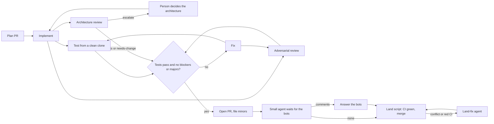

# Agent PR pipeline

One PR at a time is easy to check. Many PRs at once are not, unless each PR goes through the same fixed loop and no agent checks its own work. This skill is that loop.



Summary: a plan is reviewed first; then each PR is built, tested, reviewed for bugs and reviewed for architecture by different agents until it is clean (or a person settles an architecture question), opened, answered where the bots commented, and merged by a script in the main session.

## The loop for one PR

1. **Implement.** A worker agent builds one plan entry on its own branch, with unit tests and the acceptance test. It breaks the feature on purpose to see the test fail, then restores it. It runs the fast checks and the e2e files the PR adds or changes, pushes the branch, and does not open a PR.
2. **Test from a clean clone.** A second agent clones the branch fresh and runs the fast checks (install, lint, types, unit tests) and the PR's own e2e files. It changes no code. A clean clone catches what a dirty worktree hides: missing files, lockfile drift, a test that only passes with local state. The full e2e suite is CI's job.
3. **Adversarial review.** A third agent, on a stronger model, reads the diff against the spec and the plan entry. It ranks findings as blocker, major or minor. It runs in parallel with the tester.
4. **Architecture review.** In round 1, in parallel with the tester and the adversarial reviewer, an Opus agent reads the architecture document, the plan and the diff. It lists every new concept the PR introduces (module, record type or field, command, flag, config file, dependency, boundary, place where state lives) and gives one verdict:
   - **fits:** nothing to do.
   - **needs-change:** the PR goes against the architecture in a way the PR can fix. Its findings count as majors for the fix agent, and it checks again in the next round.
   - **escalate:** the architecture itself should change, because the PR or the plan shows the structure will not hold for what comes next, or the PR needs a decision that is not the PR's to make. The PR stops with `needs human: architecture`, a question, options and a recommendation. A person decides; the PR resumes with that decision.
   Docs-only PRs skip it. Plan PRs get it too: a plan is where new concepts usually first appear.
5. **Fix.** If a check failed or there are blockers or majors, a fix agent adds commits to the same branch. It never force-pushes. If it thinks a finding is wrong, it says why with evidence. Then steps 2 and 3 run again (and 4, if it asked for changes). Stop after `maxRounds` (default 4; plan PRs 2); then a person decides.
6. **Open the PR.** An agent opens a ready PR and files every minor finding as an issue (label `review-minor`).
7. **Bots.** A small agent (Haiku, low effort) waits for the review bots and counts their open comments. Only if there are any does an answer agent run: it fixes the point or says why not, on every thread. If its changes are substantive, the loop runs again.
8. **Land and merge.** The main session runs `scripts/land-wave.sh`. It waits for CI and squash-merges only when CI is green on the exact head commit and a review bot approved. It deletes the branch only after GitHub shows MERGED. A PR that conflicts or has a red check is reported as `LAND FIX`, and a land-fix agent handles only that PR.

## Before the first run in a repo

- Add the loop to the repo's `AGENTS.md` (or `CLAUDE.md`). `templates/AGENTS-section.md` is a starting point. Workers read it, so hard rules go there once instead of in every prompt.
- Install at least one review bot on the repo (CodeRabbit, Gitar or similar). An approval from one of them is the merge gate.
- Know the check commands (install, lint, typecheck, unit, e2e) and how long e2e takes.
- Pick a temp folder for clones that is not shared `/tmp`.

## Step 1: write the plan, then review the plan

Big work starts as a plan document, for example `docs/plan-<version>.md`. Copy `templates/plan.md`. The plan is the brief for every worker, so it must be concrete:

- **One entry per PR**, with an ID (`T01`, `U02`...), the issues it closes, a **Touches** line (every file it edits) and an **Acceptance** line (the test that proves it, and how that test fails without the change).
- **Waves.** Entries in one wave touch different files, so they can be built in parallel without conflicts. A Mermaid diagram of the waves, with a one-line summary.
- **Shared files.** If several PRs must add to one file (a CHANGELOG), the plan PR adds one marker per PR with a blank line between each pair. Each PR replaces only its own marker. Git sees no conflict because no two PRs edit adjacent lines.
- **Out of scope.** A table of what waits and why.

Triage before planning when the input is a pile of issues: give each read-only agent a group of issues, ask it to check each one against the code (not the title), and return still-valid, size, milestone and reasons. Some "bugs" turn out to be fixed already, and some "nits" turn out to be real bugs.

Run the plan itself through the pipeline with `skipImpl: true`. The reviewer checks that claims about the code are true, Touches lines are complete, acceptance tests can fail, and the scope matches the goal. Plans usually need several rounds.

## Step 2: run one wave

Load the workflow-authoring skill if the session has a Workflow tool. Run `workflow/pr-pipeline.js` with `scriptPath`, one wave per run.

### Workflow arguments

```json
{
  "repo": "owner/name",
  "tmp": "/absolute/temp/folder",
  "plan": "docs/plan-1.2.md",
  "spec": "docs/design.md",
  "architecture": "docs/architecture.md",
  "context": "Project facts and hard rules every agent needs, in a few lines.",
  "checks": ["pnpm install --frozen-lockfile", "pnpm lint", "pnpm typecheck", "pnpm test"],
  "e2ePattern": "\\.e2e\\.test\\.ts$",
  "e2eCommand": "pnpm exec vitest run {files}",
  "maxRounds": 4,
  "planRounds": 2,
  "botWaitMinutes": 20,
  "bots": "CodeRabbit (login coderabbitai) and Gitar (login contains \"gitar\")",
  "milestone": "1.2.0",
  "steps": { "review": { "model": "opus", "effort": "high" } },
  "prs": [
    { "id": "T01", "title": "Short PR title", "branch": "fix/short-name", "kind": "code", "notes": "Build plan entry T01. Settle minor #123. PR body: Closes #45 on its own line." }
  ]
}
```

- `checks` are the **fast** checks. Agents also run the e2e files the PR adds or changes (`e2ePattern`, run with `e2eCommand`). The full e2e suite runs only in CI, so CI must run it on every PR.
- `architecture`: the document the architecture reviewer checks against (defaults to `spec`). Set `"architectureReview": false` to turn the step off.
- `kind`: `code` (default), `docs` or `plan`. Docs and plan PRs get a Sonnet reviewer at high effort instead of Opus. Plan PRs stop after `planRounds` (default 2); fix what is left by hand, then rerun with `skipImpl`.

Models and effort per step (override any of them in `steps`):

| Step | Model | Effort |
| --- | --- | --- |
| `impl`, `fix` | sonnet | medium |
| `test` | sonnet | low |
| `review` | opus | high |
| `arch` | opus | high |
| `reviewDocs` (docs and plan PRs) | sonnet | high |
| `open` | sonnet | low |
| `botWait` | haiku | low |
| `botAnswer`, `landFix` | sonnet | medium |

PR options: `skipImpl: true` when the branch is already built (a plan PR, or a branch you pushed). `resume: { history, minors, findings }` to continue a PR whose rounds ran out. `landFix: true` with `prNumber` runs only the land-fix agent for that PR. `architectureDecision: "..."` carries a person's answer to an escalation into every agent's brief for that PR; the architecture reviewer then checks the PR follows it and does not escalate the same question again.

The result has one object per PR: `ready`, `prNumber`, `approvedBy`, `rounds`, `history`, `architecture` (each verdict with its new concepts), `issues`, and `reason` when not ready. With `reason: needs human: architecture` it also has `escalation`: the question, options, recommendation and why. `ready` means the PR is open and the bots are answered; merging is the land script's job.

### Notes that work

- Point at the plan entry instead of repeating it: "Build plan entry T03 in docs/plan-1.2.md."
- Name the review minors the PR should settle, and how, when the plan review left a choice open.
- Give each `Closes #N` its own line. GitHub closes only the first issue on a line like `Closes #1, #2`.
- Say what the agent must not do when it is tempting: "Test only; the final diff does not change src/x.ts."
- For a change to a hard rule, say "must not be merged by any agent" and keep it until the person approves.

## Step 3: land and merge from the main session

Workers never merge. Run `scripts/land-wave.sh <owner/repo> <pr> <pr> ...`. It waits for CI on each PR in order and calls `scripts/merge-pr.sh`, which refuses unless the PR is MERGEABLE, its head is the commit that was checked, a bot approved, and no check failed. The branch is deleted only after GitHub shows MERGED. On `LAND FIX #n`, run the workflow with `{ "id": ..., "branch": ..., "prNumber": n, "landFix": true }`, then run the land script again.

After a wave, watch CI on the default branch before starting the next wave or tagging.

## When things go wrong

| What you see | What to do |
| --- | --- |
| `rounds exhausted` with one small finding left | Fix it yourself on the branch, push, and rerun that PR with `skipImpl: true` and `maxRounds: 1` or 2. |
| `rounds exhausted` with several findings | Rerun with `resume` and the last findings, or rethink the plan entry. |
| `tester or reviewer failed` or agents failed on a usage limit | Resume the same run with `resumeFromRunId`; finished agents replay from cache. |
| A CI e2e job fails in files the PR does not touch | Rerun the job once. If it fails on the default branch too, it is not this PR's problem: file it. |
| Bot rate-limited | One bot's approval is enough. If none approved, wait or ask the person. |
| `needs human: architecture` | Show the person the escalation's question, options and recommendation, as a decision to make, not a fix to approve. If the answer changes the architecture, update the architecture document first (its own small PR). Then rerun the PR with `architectureDecision` set; if its branch exists, add `skipImpl: true` or `resume`. |
| `LAND FIX #n` from the land script | The PR conflicts or a check is red. Run the workflow with `landFix: true` for that PR; it merges the default branch in or fixes CI. Never rebase a pushed branch. |
| No bot approves | The land script stops with `not merged`. Ask the bot to review again, or let the person review and merge by hand. |
| An agent's shell refuses compound git commands | Put the commands in a script file and run the file. |

## Lessons

- Every acceptance test must fail when the feature is removed. Ask the implementer to prove it and the reviewer to check it. "Passes for the wrong reason" is the most common real finding.
- Check each issue against the code before you plan. Titles mislead.
- Keep the full e2e suite in CI. On a laptop, about five full runs at once was the limit before timeouts started; running only the PR's own e2e files locally avoids that.
- Minor findings become issues, not extra rounds. Fix them in batches between waves, grouped by file.
- A release tag is made only from a green default branch. Publishing to a package registry, and creating releases, stay with the person.
- Clean up after a release: leftover worktrees, temp clones and local branches whose tip is in a merged PR.

## Files

- `workflow/pr-pipeline.js`: the workflow script.
- `scripts/land-wave.sh`: wait for CI and merge a wave, reporting PRs that need a land fix.
- `scripts/merge-pr.sh`, `scripts/merge-wave.sh`: guarded squash-merge from the main session.
- `templates/plan.md`: plan document skeleton.
- `templates/AGENTS-section.md`: the loop as repo rules.
