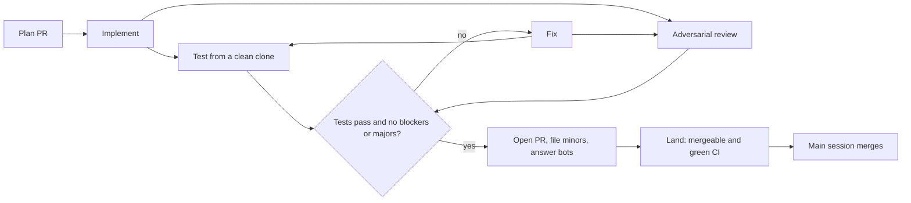

# Agent PR pipeline

One PR at a time is easy to check. Many PRs at once are not, unless each PR goes through the same fixed loop and no agent checks its own work. This skill is that loop.



Summary: a plan is reviewed first; then each PR is built, tested and reviewed by different agents until it is clean, opened with the bots answered, and merged by the main session.

## The loop for one PR

1. **Implement.** A worker agent builds one plan entry on its own branch, with unit tests and the acceptance test. It breaks the feature on purpose to see the test fail, then restores it. It pushes the branch and does not open a PR.
2. **Test from a clean clone.** A second agent clones the branch fresh and runs every check. It changes no code. A clean clone catches what a dirty worktree hides: missing files, lockfile drift, a test that only passes with local state.
3. **Adversarial review.** A third agent, on a stronger model, reads the diff against the spec and the plan entry. It ranks findings as blocker, major or minor. It runs in parallel with the tester.
4. **Fix.** If a check failed or there are blockers or majors, a fix agent adds commits to the same branch. It never force-pushes. If it thinks a finding is wrong, it says why with evidence. Then steps 2 and 3 run again. Stop after `maxRounds` (default 4); then a person decides.
5. **Open the PR and answer the bots.** An agent opens a ready PR, files every minor finding as an issue (label `review-minor`), waits for the review bots and replies on every thread: it fixes the point or says why not. If its changes are substantive, the loop runs again.
6. **Land.** An agent brings the PR to MERGEABLE with green CI, merging the default branch in if there is a conflict. It does not merge.
7. **Merge.** The main session squash-merges, only when CI is green on the exact head commit and a review bot approved. It deletes the branch only after GitHub shows MERGED.

## Before the first run in a repo

- Add the loop to the repo's `AGENTS.md` (or `CLAUDE.md`). `templates/AGENTS-section.md` is a starting point. Workers read it, so hard rules go there once instead of in every prompt.
- Install at least one review bot on the repo (CodeRabbit, Gitar or similar). An approval from one of them is the merge gate.
- Know the check commands (install, lint, typecheck, unit, e2e) and how long e2e takes.
- Pick a temp folder for clones that is not shared `/tmp`.

## Step 1: write the plan, then review the plan

Big work starts as a plan document, for example `docs/plan-<version>.md`. Copy `templates/plan.md`. The plan is the brief for every worker, so it must be concrete:

- **One entry per PR**, with an ID (`T01`, `U02`...), the issues it closes, a **Touches** line (every file it edits) and an **Acceptance** line (the test that proves it, and how that test fails without the change).
- **Waves.** Entries in one wave touch different files, so they can be built in parallel without conflicts. A Mermaid diagram of the waves, with a one-line summary.
- **Shared files.** If several PRs must add to one file (a CHANGELOG), the plan PR adds one marker per PR with a blank line between each pair. Each PR replaces only its own marker. Git sees no conflict because no two PRs edit adjacent lines.
- **Out of scope.** A table of what waits and why.

Triage before planning when the input is a pile of issues: give each read-only agent a group of issues, ask it to check each one against the code (not the title), and return still-valid, size, milestone and reasons. Some "bugs" turn out to be fixed already, and some "nits" turn out to be real bugs.

Run the plan itself through the pipeline with `skipImpl: true`. The reviewer checks that claims about the code are true, Touches lines are complete, acceptance tests can fail, and the scope matches the goal. Plans usually need several rounds.

## Step 2: run one wave

Load the workflow-authoring skill if the session has a Workflow tool. Run `workflow/pr-pipeline.js` with `scriptPath`, one wave per run.

### Workflow arguments

```json
{
  "repo": "owner/name",
  "tmp": "/absolute/temp/folder",
  "plan": "docs/plan-1.2.md",
  "spec": "docs/design.md",
  "context": "Project facts and hard rules every agent needs, in a few lines.",
  "checks": ["pnpm install --frozen-lockfile", "pnpm lint", "pnpm typecheck", "pnpm test", "pnpm e2e"],
  "maxRounds": 4,
  "models": { "impl": "sonnet", "test": "sonnet", "review": "opus", "fix": "sonnet", "bots": "sonnet", "land": "sonnet" },
  "bots": "CodeRabbit (login coderabbitai) and Gitar (login contains \"gitar\")",
  "milestone": "1.2.0",
  "prs": [
    { "id": "T01", "title": "Short PR title", "branch": "fix/short-name", "notes": "Build plan entry T01. Settle minor #123. PR body: Closes #45 on its own line." }
  ]
}
```

PR options: `skipImpl: true` when the branch is already built (a plan PR, or a branch you pushed). `resume: { history, minors, findings }` to continue a PR whose rounds ran out: a fix agent handles `findings` first, then the loop continues with the history.

The result has one object per PR: `ready`, `prNumber`, `headSha`, `approvedBy`, `rounds`, `history`, `issues` and `reason` when not ready.

### Notes that work

- Point at the plan entry instead of repeating it: "Build plan entry T03 in docs/plan-1.2.md."
- Name the review minors the PR should settle, and how, when the plan review left a choice open.
- Give each `Closes #N` its own line. GitHub closes only the first issue on a line like `Closes #1, #2`.
- Say what the agent must not do when it is tempting: "Test only; the final diff does not change src/x.ts."
- For a change to a hard rule, say "must not be merged by any agent" and keep it until the person approves.

## Step 3: merge from the main session

Workers never merge. Merging stays in the main session, where the person can see it. Use `scripts/merge-wave.sh <pr> <pr> ...`. It merges in order and stops at the first PR that is not cleanly mergeable. `scripts/merge-pr.sh` refuses unless the PR is MERGEABLE, its head is the commit that was checked, a bot approved, and no check failed.

After a wave, watch CI on the default branch before starting the next wave or tagging.

## When things go wrong

| What you see | What to do |
| --- | --- |
| `rounds exhausted` with one small finding left | Fix it yourself on the branch, push, and rerun that PR with `skipImpl: true` and `maxRounds: 1` or 2. |
| `rounds exhausted` with several findings | Rerun with `resume` and the last findings, or rethink the plan entry. |
| `tester or reviewer failed` or agents failed on a usage limit | Resume the same run with `resumeFromRunId`; finished agents replay from cache. |
| A test fails only in the tester's clone, in files the PR does not touch | Run it on the default branch a few times. Many parallel browser runs cause timeouts. Run fewer PRs per wave. |
| Bot rate-limited | One bot's approval is enough. If none approved, wait or ask the person. |
| A PR conflicts after an earlier merge | The land agent merges the default branch in. Never rebase a pushed branch. |
| An agent's shell refuses compound git commands | Put the commands in a script file and run the file. |

## Lessons

- Every acceptance test must fail when the feature is removed. Ask the implementer to prove it and the reviewer to check it. "Passes for the wrong reason" is the most common real finding.
- Check each issue against the code before you plan. Titles mislead.
- Keep e2e load down: about five full test runs at once on an 11-core laptop is the limit before timeouts start.
- Minor findings become issues, not extra rounds. Fix them in batches between waves, grouped by file.
- A release tag is made only from a green default branch. Publishing to a package registry, and creating releases, stay with the person.
- Clean up after a release: leftover worktrees, temp clones and local branches whose tip is in a merged PR.

## Files

- `workflow/pr-pipeline.js`: the workflow script.
- `scripts/merge-pr.sh`, `scripts/merge-wave.sh`: guarded squash-merge from the main session.
- `templates/plan.md`: plan document skeleton.
- `templates/AGENTS-section.md`: the loop as repo rules.
