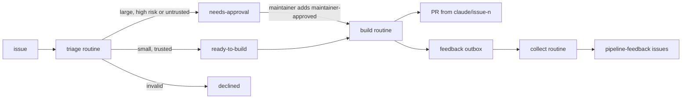
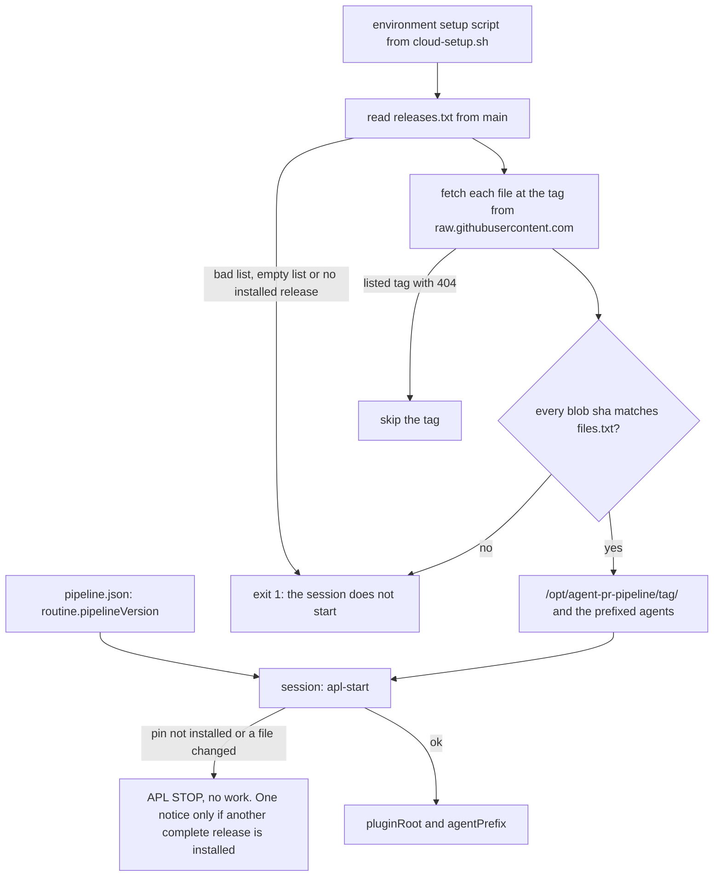
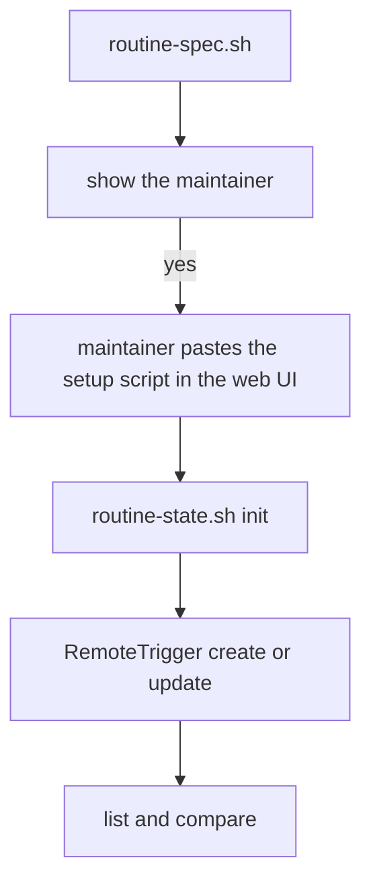

# Cloud routines

From 0.8.0 the unattended routine runs as Claude Code cloud routines, not as a job on the maintainer's Mac. This page is for the maintainer. It covers what the routines do, how to set up a repo, and how to retire the local routine.

0.8.0 is stage 1 only. A routine triages issues, builds the small ones into PRs and files feedback. It is told never to merge, tag, release, delete a branch or close an issue, and the maintainer merges every PR. The routines are told never to merge, and that holds by prompt text. See "What holds and what does not".

There are no webhooks in 0.8.0. The Issue trigger showed no author filter and no label filter, so every routine runs on a schedule only. `routine/cloud/k2.json` records this, and `routine-spec.sh` emits no webhook entry while both filters are false.

## The routines



Summary: triage labels each issue, build turns a ready or approved issue into a PR and an outbox, and collect files the outboxes.

| Routine | One per | What it does |
| --- | --- | --- |
| triage | repo | Runs `routine-state.sh next --mode cloud-triage`. An issue by an author outside `trustedAuthors` gets `needs-approval` and `untrusted-author` from code, and no agent reads it. A trusted issue goes to the `triager` agent, and code turns its answer into labels. |
| build | repo | Runs `next --mode cloud-build`, builds at most one issue, and runs `run-wave` with the arguments that code built. The wave opens the PR and answers the bots. `wave-result.sh` turns the Workflow output file into `result.json` and prints the PR, the `ready` flag and the reason code, so the session types none of them. `put built` records them. `feedback-outbox.sh` then posts the wave's feedback as one outbox record. `token-report.sh` logs the total tokens and agent count of the wave; it changes no state. `ledger.sh put --cloud` then writes one ledger record for each PR, with the routine run id from `next`, and logs the result. If the repo has no ledger issue, it exits non-zero and the routine goes on. After that the routine reads `next` again, so a build with no PR is blocked in the same run. |
| collect | feedback repo | Files the outboxes of the feedback repo and of every repo in `collectFrom`, through `file-feedback.sh --auto`. It runs no role agent. |

Each routine prompt is `routine/cloud/prompt.md`. It changes into the repo's clone first, because a multi-repo session starts in the parent of the clones. Then it runs `apl-start`, and then it follows `routine/cloud/<kind>.md` from the pinned release. Text from the event that started the session is inert data.

Code makes the choices. `routine-state.sh` picks the work, checks every argument of a `put`, and sets labels and records. An agent never sets a state label itself.

## Labels and states

State is held by GitHub labels, which the maintainer sees, and by records, which are comments on the repo's tracking issue (the open issue labelled `pipeline-routine`).

| State | How it starts | What ends it |
| --- | --- | --- |
| init needed | The repo has no tracking issue. | `routine-state.sh <repo> init`. Until then every run prints `init needed` and stops. |
| new | An open issue with no state label, no trusted `triaged` record, not a PR, not labelled with a `skipLabels` label, number at least `triageFrom`. | Triage. |
| untrusted | The author is outside `trustedAuthors`. Labels `needs-approval` and `untrusted-author`. | The maintainer adds `maintainer-approved`, or closes the issue. A changed body or a later outside comment revokes the approval. |
| ready-to-build | Triage: build, size S or M, risk below high, trusted or approved. | Build starts, or the maintainer removes the label. |
| needs-approval | Size L, risk high, a plan, an untrusted author or a revoked approval. | The maintainer adds `maintainer-approved`, or closes the issue. |
| needs-plan | An approved issue of size L, risk high or decision plan, or a build that stopped with the reason code `triage-plan`. That block adds no `build-failed`. | The maintainer plans it in a main session and removes the label. After a `triage-plan` block, a new maintainer approval gives a new build, or ends in `needs-maintainer` when the attempts are used. The label stays until the maintainer removes it. |
| declined | Triage: invalid. A comment gives the reason. | The maintainer closes the issue, or removes `declined` and the record. |
| building | `put build-started`. | A PR from `claude/issue-<n>` exists, or the block step. |
| build-failed | The last attempt has no PR and a `built` record or a record older than `buildHours`, except for the reason code `triage-plan`. | The maintainer adds `maintainer-approved` again, or closes the issue. |
| PR open | The wave opened a PR. | The maintainer merges or closes it. It counts for `openPRs` while open. |
| needs-maintainer | The attempts reached `buildAttempts`. | The maintainer only. |
| outbox open | `feedback-outbox.sh` posts `feedback-outbox <run>`. | Collect posts `feedback-filed <run>`. An outbox older than 7 days is dropped with `feedback-dropped <run>`. |
| outbox held by the cap | The issues filed in the last 24 hours reach `feedbackPerDay`. | 24 hours pass, and the oldest outbox goes first. The 7-day rule ends it. |
| env stale | `apl-start` stops: the pin is not installed, or a file does not match. The record and notice exist only when another complete release is installed. Otherwise only the run log shows the stop. | The maintainer updates the setup script or the pin. |
| paused | The label `routine-paused` is on the tracking issue. | The maintainer removes the label. |
| lost race | Two runs post `build-started` for the same issue and attempt. | The run whose record is newer stops at once. The older one builds. |

The fixed labels are `ready-to-build`, `needs-approval`, `maintainer-approved`, `declined`, `building`, `build-failed`, `needs-plan`, `needs-maintainer`, `untrusted-author`, `routine-paused`, `size:S`, `size:M` and `size:L`. `routine/config.jq` prints them.

## Stages

`routine.stage` in `.github/pipeline.json` holds the stage. It is a gated path, so the maintainer changes it in a PR.

| Stage | What the routines do | Release |
| --- | --- | --- |
| 0 | Run the code steps, write nothing to GitHub, start no agent and no wave, send no notice, and print what they would do (`would-triage`, `would-build`, `WOULD <action>`). | 0.8.0 |
| 1 | Triage, build, open PRs and file feedback. The maintainer merges every PR. | 0.8.0 |
| 2 to 4 | Later releases. | 0.9.0 and 0.10.0 |

In 0.8.0 `config.jq` refuses a stage above 1 with `stage <n> needs a later release`. At stage 0 no record is written, so the limits that count records see zero. For that reason stage 0 starts no triager and no wave.

## Settings

The settings are the `routine` block of `.github/pipeline.json` on the default branch. The pipeline reads them from there, never from a PR branch.

```json
{
  "gates": ["docs/goals.md", ".github/**", ".claude/**"],
  "routine": {
    "stage": 0,
    "pipelineVersion": "v0.8.0",
    "maintainer": "alfhen",
    "trustedAuthors": ["alfhen"],
    "triageFrom": 1,
    "skipLabels": ["review-minor"],
    "typeLabels": { "feat": "enhancement", "docs": "documentation" },
    "feedbackRepo": "alfhen/agent-pr-pipeline",
    "collectFrom": [],
    "waveArgs": { "goals": "docs/goals.md", "checks": ["bash scripts/check-syntax.sh"] },
    "limits": { "openPRs": 3, "wavesPerDay": 2 }
  }
}
```

| Key | Meaning |
| --- | --- |
| `stage` | 0 or 1. Default 0. |
| `pipelineVersion` | Required. The release tag to use, like `v0.8.0`. |
| `maintainer` | Required. The login whose `labeled` events count as approval. Never a bot. |
| `trustedAuthors` | Logins whose issues triage reads at once. The maintainer is always in it. Never a bot. |
| `triageFrom` | The first issue number triage looks at. Set it above the old backlog. |
| `skipLabels` | Issues with one of these labels are not triaged. Default `review-minor`. `pipeline-routine` and `pipeline-ledger` are always added. |
| `typeLabels` | Maps `bug`, `feat`, `docs`, `chore` and `test` to the repo's label names. Each default is the type name. A value must not be one of the pipeline's own labels, like `ready-to-build` or `building`. |
| `feedbackRepo`, `collectFrom` | Where feedback is filed, and which other repos the collect routine reads. |
| `waveArgs` | Fixed `run-wave` choices for unattended runs. `goals` and `checks` are required. `repo`, `tmp`, `pluginRoot`, `agentPrefix`, `prs`, `plan`, `feedback`, `feedbackRepo`, `resumeFromRunId` and `cleanup` are refused. |
| `limits` | Daily and per-run limits, below. |

The split is: the top level of `.github/pipeline.json` holds policy that one run must not override, and the `routine` block holds the policy of unattended runs and the wave choices that are fixed for them. Choices for a single run in a session stay as workflow arguments.

## Cost limits

All limits are per repo. They have defaults and an upper bound of 20 (`buildHours` 48, `feedbackItems` 3).

| Limit | Default | Meaning |
| --- | --- | --- |
| `openPRs` | 3 | Open routine PRs. A build does not start above this. |
| `wavesPerDay` | 2 | Builds started in 24 hours. |
| `buildAttempts` | 2 | Builds for one issue, then `needs-maintainer`. |
| `buildHours` | 6 | After this a silent build counts as failed. |
| `triagePerRun`, `triagePerDay` | 5, 20 | Triager runs. |
| `feedbackItems` | 3 | Items filed from one wave. |
| `feedbackPerDay` | 6 | New feedback issues in 24 hours, in the feedback repo. |

A run has no hard time bound in the cloud. `buildHours` only decides when a silent build counts as failed. The account limits of Claude Code apply on top.

One run handles every step up to a limit of 20 passes. The limit is fixed in `routine/cloud/triage.md` and `routine/cloud/build.md`. It is not a setting, `routine-state.sh` does not check it, and it holds by prompt text. After a `put` of a short step (`adopt`, `untrusted`, `revoke`, `pr-seen`, `block`, `exhausted`, `needs-plan`), the routine reads a new `next`. A build goes back to `next` too, and the run stops at the next `build` or `would-build` step, at `idle`, `wait`, `paused` or `init needed`, and on a `put` that exits non-zero or prints `WOULD`.

## The pin and the setup script



Summary: the setup script installs each release in the list and each named release, and checks every file against `files.txt`; `apl-start` checks the pin and the files again before any work.

- The pin is `routine.pipelineVersion`. A release tag cannot move, because the tag ruleset below forbids updates and deletions. That is why the setup script can trust the files of a tag from a release.
- `bash scripts/cloud-setup.sh --print [--latest] [<tag>...] [--repo <owner/repo>]` prints the setup script. With `--latest` the script also fetches `.claude-plugin/releases.txt` from the default branch of the plugin repo each time the environment runs the setup script (about every 7 days, or when the script or the allowed hosts change), and installs each listed release. The file holds one tag per line, newest first, at most 3. A change to it needs a merged PR. CI checks that the committed file has 1 to 3 unique `v<X.Y.Z>` lines. The version PR of each release adds the new tag on top and drops the oldest. A listed tag whose `files.txt` gives HTTP 404 is skipped, because the version PR merged and the release is not cut yet. Between the merge of a version PR and the cut of its release, anyone with push access to the repo can create a tag with that name, and the setup script then installs it. The files check proves integrity only, not origin, because `files.txt` and the files come from the same tag. It does not prove who created a tag. A cloud session cannot push tags, and a release runs only when the pin of a repo names it. Cut the release soon after the version PR merges. A named tag with a 404, a failed fetch, an empty list, a bad line, a list of more than 3 lines, or no installed release exits 1. `routine-spec.sh` always prints `--latest`. `release.sh` refuses a release of this repo when the first line of `releases.txt` is not `v<version>`. The release manifest `.claude-plugin/files.txt` lists the shipped files as `<git blob sha> <path>`. `scripts/manifest.sh --write` writes it, and `manifest.sh --check` verifies it. `release.sh` refuses a release of this repo when the manifest does not match the tree.
- The script writes each release to `/opt/agent-pr-pipeline/<tag>/`, each role agent to `~/.claude/agents/apl-<v>-<name>.md` (for `v0.8.0` the prefix is `apl-v0-8-0-`), and the launcher `/usr/local/bin/apl-start`. One environment can hold several releases, so two repos can pin different ones. Any failed fetch or check exits 1.
- `apl-start <owner/repo>` reads the pin from the default branch, checks the install and the files, and prints one JSON line with `version`, `pluginRoot`, `agentPrefix` and `defaultSha`. On a failure it prints `APL STOP <reason>`, `PIN <tag>` and `ROOT <path or none>`, and exits 1. `ROOT` is the highest release that is not the pin and passes the same file check, because the pin may have failed its file check. The prompt runs `put env-stale` from that root only when neither `PIN` nor `ROOT` is `none`. It then writes one record and one notice. When `ROOT` is `none`, no other release is installed that passes the file check. When `PIN` is `none`, the stop came before the pin was read (a failed fetch, an unreadable default branch or `pipeline.json`, or a bad `pipelineVersion`). In both cases the prompt stops with no record and no notice. Later runs with the same record stop without a notice, and the next good start writes `env-ok`.
- `pluginRoot` is outside the clone, so a PR cannot change the scripts that judge it. Workflow refuses a script outside the working folder, so the build routine copies `run-wave.js` from `pluginRoot` to `.git/apl/run-wave.js` in the clone, in the same session, just before the call. `.git` is never tracked, and a PR cannot change the copy.

### Create the environment

No API changes an environment. The maintainer does this part in the web UI:

1. Run `bash scripts/routine-spec.sh <owner/repo>` and take the `setupScript` field, or run `bash scripts/cloud-setup.sh --print --latest <pin>`. Add one tag for each release still in use that `releases.txt` does not list.
2. Paste the output in the environment's setup script. Add the repo's own tools after it (for example pnpm).
3. Save, and note the environment id.

The setup script costs no model tokens. A saved environment is reused for about 7 days. The setup script runs again when the script or the allowed hosts change. A setup script that runs longer than about 5 minutes is not cached, so every session runs it again. Each tag adds install time, so keep the tag list short.

### Upgrade the pin

1. After a release, open a one-line PR that sets `routine.pipelineVersion` to the new tag. It is a gated path, so the maintainer merges it.
2. Wait for the environment to run the setup script again. A new release that `releases.txt` holds can take up to a week to arrive.
3. To get it sooner, save the setup script again with any small change. That forces a new run.
4. Paste the script again only when the script text or the tags you need change. This is the case for a tag that the list no longer holds.

A pin raised before the environment has the release makes `apl-start` stop. If the environment holds another complete release, the routine sends one env-stale notice. If not, it stops with no notice.

A repo whose pin is not installed makes `apl-start` stop. The routine sends one notice only when another complete release is installed.

## Approval and its limit

Approval is one label, `maintainer-approved`. It counts only when the newest `labeled` event of the label has the maintainer as actor and a null `performed_via_github_app`. An `unlabeled` event never counts.

A cloud session writes through the Claude GitHub App, so its comments, issues, PRs and `labeled` events carry `performed_via_github_app.slug` `claude`, on every route that adds a label. A removal made by a session has no such mark, so only `labeled` events can be a signal.

Limits to know:

- A local tool that uses the maintainer's `gh` token, such as the local routine or a local Claude Code session, writes with no app mark and can forge an approval.
- A GitHub Actions workflow that uses a maintainer token from a repo secret can do the same. A session could push a `claude/` branch with such a workflow. So no repo secret may hold a maintainer token.
- A later change at GitHub or in the proxy could drop the app mark. The QA of each release checks a forged approval again.

A build starts only when the live author, the current approval, the body hash and the newest comments pass the Live check of `routine-state.sh`. No routine agent reads an issue by an author outside `trustedAuthors` before the maintainer approves it.

## Pause and notices

The fast pause is the label `routine-paused` on the tracking issue. Every routine stops at its first step, with no session work. Pause is advisory: a session acts as the maintainer, and the prompts only tell it not to remove the label. A session that follows injected text can remove `routine-paused`, and the removal has no app mark. A RemoteTrigger `update` with `enabled` false is the hard stop.

`put blocked` also posts one comment on the issue, after the record and the labels. The first line is fixed text for the reason code. It says what happened and that no PR was opened. When the `built` record has a `why` (the reason of the build, on one line, cut to 500 characters), a second line gives it, with each `@` made inert so the comment notifies nobody. The comment has no `<!-- pipeline:` marker. A failed comment logs a warning and the exit code stays 0, because the record is already written. Stage 0 posts no comment.

A notice is a `PushNotification` call, made only when a `put` wrote a record. Its text is fixed words, a repo, an issue number and a run id. Notices exist for `needs-plan`, `triage-failed`, `blocked`, `exhausted` and `env-stale`. The `env-stale` notice and its record exist only when another complete release is installed. If the pin is the only complete release, a stop leaves only the run log. This is rare, because the setup script with `--latest` installs the newest three releases. Stage 0 sends none. The GitHub labels `needs-approval`, `needs-plan`, `build-failed` and `needs-maintainer` are the other signal, and a saved search for them works well.

The session's auto-mode classifier judges each call, and it can refuse a routine's own write. In a test it refused a REST merge ("Merge Without Review") and an issue close ("External System Writes"). A refused `put` exits non-zero, the step ends with no write, and it comes back next run. After the first run of a routine, read the run log and check it has no `permission_denied`.

## The outbox and the collect routine

A build for another repo cannot file into this repo, because the proxy serves only attached repos. So the build session posts an outbox record on its own repo's tracking issue. The collect routine for the feedback repo has each onboarded repo attached, and files the outboxes.

- At most `feedbackItems` items per wave, each with evidence and a suggested change.
- At most `feedbackPerDay` new issues a day. An outbox over the cap waits, oldest first.
- An item that repeats an open `pipeline-feedback` issue becomes a "seen again" comment on it. The collect session decides which items repeat, and writes that list to a file.
- For another repo the redactor and the denylist check always run, and an item that holds a denylist string is refused. A filed issue says only `Source: another repo`.
- The collect routine follows the stage of the feedback repo. An outbox older than 7 days is dropped.

Records are advisory. A forged outbox can still put redacted text into a public issue, within `feedbackPerDay`.

## Self-modification

At every stage the merge script refuses a PR that touches a gated path or a floor path. The floor always holds `.github/**`, `AGENTS.md`, `CLAUDE.md`, `CLAUDE.local.md` and `docs/goals.md`, and any path named `.claude` at any depth, whether it is a folder, a file or a symlink. Every floor path matches in any letter case. The file names `AGENTS.md`, `CLAUDE.md` and `CLAUDE.local.md` match at any depth. The `gates` from `.github/pipeline.json` stay case-sensitive. If the gate cannot read the plugin's own repository from its manifest (`.claude-plugin/plugin.json`), it stops with `GATE ERROR` and the PR is not merged. It does this in every repo. In this repo it also holds `agents/**`, `workflows/**`, `scripts/**`, `skills/**`, `routine/**`, `templates/**` and `.claude-plugin/**`. No setting removes a floor path.

## What holds and what does not

The no-merge rule holds by prompt text and by the session's auto-mode classifier. The proxy does not enforce it. The ruleset asks for 0 approvals, so a session that follows injected text could merge a PR with a green `ci` or close an issue. The classifier is a second guard that can change, and it judges each call in context.

- The floor applies only to `merge-pr.sh`. It does not stop a REST merge of a green PR.
- The proxy does not limit which branches a push can update.
- Pause is advisory (see "Pause and notices"). A session can remove `routine-paused` with no mark that shows who did it.
- After approval, the wave's triager reads every comment of the issue, and the bot-answer step reads strangers' comments on the PR. Only the untrusted-input rule of the agents and the newer-comment check of the Live check limit this.
- Feedback from another repo is public at once, with no human step. The redactor and the denylist always run, and a miss is public. The details of Tagreeve are public anyway. A private repo raises the risk.
- `CLAUDE.md` and the hooks in `.claude/settings.json` load from the session's checkout, and can be stale. A fetch cannot fix this. The routine reads goals and code from the default branch, and the scripts and agents come from the pin.
- Records are advisory, because there is one account.
- The session can write to the installed files under `/opt/agent-pr-pipeline/<tag>/`. `apl-start` checks only the pin's files, only at session start. A release that is offered as ROOT is not checked.

## Rulesets for this repo

The repo is public, and the maintainer made two rulesets with an empty bypass list.

| Ruleset | Target | Rules |
| --- | --- | --- |
| main protection | default branch | restrict deletions, block force pushes, require a pull request before merging with 0 approvals, require the status check `ci` |
| release tags | `refs/tags/v*` | restrict updates, restrict deletions |

Creation of a tag is not restricted, so `release.sh` still works: it creates the tag through `POST releases`. "Automatically delete head branches" is on.

## Create the routines

Use the `cloud-routines` skill from a local session, not from a cloud session. It runs `scripts/routine-spec.sh <owner/repo> [--tags <tag>...]`, shows the result, waits for the maintainer to save the setup script, runs `routine-state.sh <repo> init`, then creates or updates each routine with RemoteTrigger and compares the result with `list`. It sets `clear_mcp_connections: true`, so a new routine gets none of the account's connectors.

RemoteTrigger cannot delete a routine or a webhook trigger. The maintainer deletes those in the web UI.



Summary: compute the spec, let the maintainer save the setup script, then create or update each routine and compare.

## Onboard a repo

Do these steps in order. Stay at stage 0 until the first compare is clean.

1. Add `.github/pipeline.json` with a `routine` block, as in the example above.
2. Add `.claude/worktrees/` to `.gitignore`. A built-in Stop hook asks a session to commit untracked files, and that folder triggers it every turn.
3. Put no maintainer token in repo secrets.
4. Make or update the environment and its setup script.
5. Create the routines with the skill, at stage 0.
6. Compare the `would-triage` and `would-build` lines with what you expect. Then set stage 1 in a PR.
7. For feedback from the repo, add it to `collectFrom` in this repo's settings.

### Checklist for Tagreeve

Nothing in `alfhen/tagreeve` changes until the maintainer does these steps there. Tagreeve is public and has a large backlog, and strangers file issues, so the untrusted path is the normal case.

- Add `.github/pipeline.json` with `routine.pipelineVersion`, `trustedAuthors`, `triageFrom` above the newest issue or PR number of the repo (read it with `gh api "repos/alfhen/tagreeve/issues?state=all&per_page=1"`), and `typeLabels` with `feat` to `enhancement` and `docs` to `documentation`.
- In `waveArgs`: `checks` `pnpm install --frozen-lockfile`, `pnpm lint`, `pnpm typecheck`, `pnpm test`; `e2eCommand` `pnpm exec vitest run --project e2e {files}`; `docsBuild` `pnpm docs:build`.
- Add `.claude/worktrees/` to `.gitignore`.
- Use an environment whose setup script is the printed part plus pnpm. Its network level must allow npm and the Playwright browser download. Trusted does not list the download; Custom does. Otherwise run no e2e in waves, because CI runs it: set `relatedTests` to false in `waveArgs`, and make `e2ePattern` match nothing.
- The existing ruleset already holds `main`, with an empty bypass list. It needs signed commits, so check that a GitHub squash merge passes it before stage 2.
- `release-tag.yml` runs on a pushed `v*` tag, and the proxy refuses tag pushes. Before stage 3, check that `POST releases` makes a tag that starts the workflow.
- Install the Claude GitHub App on the repo.
- Add the repo to `collectFrom` in this repo's settings.
- Start at stage 0.

## Retire the local routine

After 0.8.0 is released:

1. Set the pin of `alfhen/pipeline-dogfood` to `v0.8.0` and run stage 1 there.
2. Add the `routine` block to this repo and create its routines at stage 0. Keep the local routine in `triage` mode.
3. For 7 days compare the cloud lines (`would-triage`, `would-build`, `WOULD`) with the local routine's choices.
4. Run `launchctl bootout` for the local job, delete its plist, and set stage 1 in a PR.

The collect routine follows this repo's stage, so the outboxes of dogfood wait during the 7 days. When stage 1 starts, outboxes older than 7 days are dropped. Local issues that have a `triaged` record and the label `routine-build` are picked up by `adopt`. 0.9.0 deletes the local runner code.
