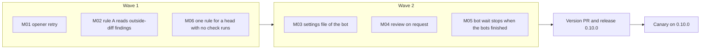

# Plan for 0.10.0: PRs land without the maintainer

## Status (2026-11-23)

- Built on release 0.9.17 (10d38fa) and the merge of #883 (9ef4f6c).
- Written from three read-only impact passes on main at 9ef4f6c: bot clearance, opener and waits, and the gate list. Each Touches line names a function, a jq `def` or a variable, because line numbers move.
- This is the merge-path part of release 2 (the maintainer's decision of 2026-11-13 on milestone 0.10.0, "M01/R01"). The routine stages 2 to 4, releases made by CI and the deletion of the local runner are not in it (choice 2).
- Plan review: round 1 and round 2 ran, then the review stopped with `needs human: scope` (repeated themes). The maintainer decided on 2026-11-23: cut M07 (#78) to 0.11.0, and the bot wait of M05 waits for every configured bot, with no "installed" state. The main session then fixed the other round 2 findings by hand.
- Each entry holds what must be true as numbered statements. The evals writer builds its list from them, with one coverage item for each statement.

## Summary in plain words

Goals 3 and 7 say agents merge PRs and the maintainer does not. In the session of 2026-11-22 every merge needed the maintainer:

- The 0.9.17 canary stopped before its land, because the PR opener returned a false `no login` block (#880, fixed in part by #883).
- CodeRabbit reviews only on request in this repo, so the session ran `scripts/request-review.sh` by hand before each merge.
- On #883, CodeRabbit put one minor finding outside the diff. `scripts/bot-approval.jq` (rule A) cannot read that block, so no reply clears it, and the maintainer merged in the GitHub UI.
- A clean rerun never gets `:auto` (#78).
- The bot wait runs to its limit when a bot leaves comments but does not approve (#109), and the land wait waits 45 minutes for a head with only commit statuses (#542).

Six PRs fix those points, except #78, which waits for 0.11.0 (choice 6). One of them also fixes #798, a merge gate gap of the same kind. It does not change which paths are gated (choice 1).

What you do: read the choices, then merge this plan.

## Goals this release serves

- **Goal 3 (my attention)** and **goal 7 (automatic improvement):** every entry removes one reason that a clean PR needs the maintainer.
- **Goal 2 (quality):** each loosened check fails closed (M02, M03), and no entry lets a finding of rank major or higher through.
- **Goal 6 (all my repos):** the gain is largest in product repos, where few paths are gated.

## Findings

- **The gate list is not the limit in this repo.** `scripts/gate-files.sh` adds a second floor for the plugin's own repo (`agents/** workflows/** scripts/** skills/** routine/** templates/** .claude-plugin/**`), found through `scripts/plugin-repo.sh`. A change to `.github/pipeline.json` alone frees nothing. Over the last 40 merged PRs (#823 to #883), 20 are release PRs, plan PRs or PRs that touch `templates/**` or `routine/**`, and stay with the maintainer under any option. Of the other 20, 2 touch only `test/**` and docs, 5 add `scripts/**`, 6 add `agents/**` and `skills/**`, and all 20 need `workflows/**`. `workflows/run-wave.js` is one file that holds `landFor`, so it cannot be ungated in part.
- **A PR cannot change its own judge.** `pipeline-io` runs scripts only from the installed `pluginRoot` (`scripts/io.sh`), and the role files are the installed ones (`scripts/role-files.sh`). The risk is one release later: an agent-merged change that weakens a judge ships in the next release.
- **Rule A only reads a known frame.** `ruleA` cuts the known HTML comments (`frameComment`) and needs `parseBody` to match `topRe` from start to end. `topRe` knows the count line, the nitpick block, `---`, the autofix box, "Prompt to fix all issues" and Review info. The #883 review (6014661001) also held a `> [!CAUTION]` block "Outside diff range comments (1)" and an "Additional comments: 1" block, so `parseBody` gave null.
- **The answered way needs a successful bot check run on the head.** On #879 the automatic run was `completed skipped` ("automatic reviews are disabled"), so the reply on the older commit did not clear until a requested review ran.
- **`--review` is never on by itself.** `land-wave.sh` asks for a review (`ask_review`) only with `--review`, which the session must pass. A hand `merge-pr.sh` call never asks.
- **The opener is never retried when it blocks.** `call()` retries only a thrown error or a null answer. The open step returns as soon as `opened.blocked` is set.

## Choices for the maintainer

Merging this plan accepts the pick of each line. Say so before the merge to change one.

| # | Choice | Pick | Why |
| --- | --- | --- | --- |
| 1 | Shrink the gates of this repo. | No change in 0.10.0. | The plugin floor in `gate-files.sh` holds the code folders whatever `.github/pipeline.json` says. Ungating `scripts/**`, `agents/**` and `skills/**` would have freed 4 more of the last 40 PRs, and each of the judge scripts and roles would still need to stay gated. Only `workflows/**` frees many PRs, and it holds `landFor`. Decide after this release, with its ledger numbers. |
| 2 | The rest of release 2: routine stages 2 to 4, releases made by CI (R01 to R05), and the deletion of the local runner. | Move it to 0.11.0. The version PR edits the four lines that promise it in 0.10.0 and the pinned test. | Stage 2 lets routines merge. It needs this release to work first. |
| 3 | Can a head with only commit statuses and no check run merge (#542)? | No. The land wait stops after 2 polls of such a head with `STOP #<pr>: no check runs`, and `merge-pr.sh` keeps its `no-checks` refusal. | The merge rule asks for at least one check run. The wait only has to stop sooner. |
| 4 | Does a plain reply of the maintainer clear a bot finding outside the diff? | No. Only the marked answer lines of the bot-answer step count (`<!-- pipeline-bot-answer head=<sha> -->`), as for nitpicks today. | Rule A trusts only marked lines. A plain comment by the same account carries no rank and no path. |
| 5 | How the land step knows that the bot reviews only on request. | A new key `reviewOnRequest` in `.github/pipeline.json`, default `false`. `land-wave.sh` then acts as if `--review` was passed. This repo sets it to `true` in a maintainer PR after M04 lands. | `land-wave.sh` already reads this file from the default branch. It is repo policy, not a choice for one run. |
| 6 | Which reruns can get `:auto` (#78). | None in 0.10.0. M07 is cut to 0.11.0 (maintainer, 2026-11-23). | The rule needs the head and the verdicts of the last check round in `landFor`, and a rule for the commits of the docs step, the minor pass and the bot answer after that round. That is a design of its own. The canary and the first-run path do not need it. |

## Decisions

- **The plan review runs with `maxRounds` 3.**
- **Each entry that changes a script, a workflow step or a role has a QA line on real input** (rule of DF, 0.9.16).
- **No new role, no new step and no new run argument.** M04 adds one settings key.

## States

No entry adds a mode or a lock. M06 adds one value of a state field:

| Field | New value | Set when | What ends it |
| --- | --- | --- | --- |
| `state` of `wait-ci.sh` and `ci.state` of the result (`endFacts`) | `noRuns` | The head has zero check runs and only successful commit statuses, from the second poll. | A check run appears on the head (then `pending`, `success` or `failure` as today), or a new head. |

Every reader of these fields handles `noRuns` as not ready: `land-wave.sh`, `agents/land-fixer.md`, and `endFacts` and the land-fix prompt of `workflows/run-wave.js`.

## Rules for every PR

- What must be true is the numbered list of the entry. A statement marked (doc) is proved by a test that reads the text. A statement marked "(holds today; kind `regression`)" passes with and without the change, and its eval has the kind `regression`.
- The round cap of every entry is the default, unless the entry says otherwise.
- A test of a statement that says that nothing happens is built from the case where it does happen, with one change. The same test file holds that positive case. The negative test also asserts the printed line or the exit code that names its cause.
- A PR edits only the parts its Touches line names.
- No eval statement holds the trigger words of the PR-text rule: "PR body", "PR title", "PR description", "pull request body", "pull request title", "pull request description", "Closes line", or a closing keyword with "#" and a number.
- Scripts under `scripts/` use `gh api` only, never `gh pr` or `gh issue`, and no command that exists on one of macOS and Linux only. CI runs on Linux. A capture of `gh api` keeps stderr out of the answer (0.9.17).
- A list in a Touches line or in build notes of the existing tests that an entry changes names the likely ones. The builder finds the rest by running the tests and lists them in its PR. A test that such a list lacks is a minor, unless it shows that a statement of the entry is wrong.
- Real input for the tests (rule of EW, 0.9.16): an entry that parses a GitHub answer saves one real answer of this repo as a fixture.
- Every entry touches a gated path (the plugin floor), so the maintainer merges each one. Each merges under the standing rule: a completed CodeRabbit review of the final head that is clean or minor-only, and green CI.
- Docs: Simplified Technical English, no em dashes.

## Order and waves

Summary: three entries in wave 1 and three in wave 2, then the version PR and the canary run.

- Wave 1. M01 and M06 edit different parts of `workflows/run-wave.js` (M01: the open step and `openPrompt`; M06: `endFacts` and step 4 of the land-fix prompt). M02 edits `ruleA` and `topRe` of `scripts/bot-approval.jq`. M06 also edits the CI rule of four scripts and `agents/land-fixer.md`.
- Wave 2. M03 edits `fourthWhy` of `bot-approval.jq`, after M02 changed `ruleA`, the changed-files read of `gate-files.sh`, and the input part of `merge-pr.sh`, after M06 changed its CI part. M04 edits `ask_review` and the settings read of `land-wave.sh`, after M06 changed `wait_ci`. M05 edits the output of `bot-status.sh`, the stop rule of `wait-bots.sh`, the stop line of `agents/bot-waiter.md` and `waitPrompt` of `workflows/run-wave.js`. M03 and M05 both edit `bot-status.sh`: M03 adds the file read and the `files` input, M05 adds `finishedOnHead` to the output.
- A conflict at landing goes through the land fix, one PR at a time.

## PRs

### Wave 1

**M01 The PR opener is retried once when it blocks with no failed command, and it clears a stale minors checklist.** Closes #884.
Touches: `workflows/run-wave.js` (the open step that reads `opened.blocked`, and step 3 of `openPrompt`), `agents/pr-opener.md` (the rule for `blocked`), the `OPEN` schema and `openPrompt` step 1 in `workflows/run-wave.js` (the new `failedCommand` field), `test/sim-pipeline.mjs` (new cases), `test/wave-prompts.test.mjs` (the test "the opener names its REST calls and edits the marked checklist comment").
QA: read-only, on real input. Save the blocked answer of #880 (`{"blocked":true,"blockedReason":"no login","commands":[]}`) as a fixture and replay it through the open step in `node test/sim-pipeline.mjs`: expected 2 `open:` calls and a ready PR. Read PR 879 and its marked checklist comment with `gh api`, and say what step 5 would find. Render `openPrompt` for the retry and check step 2 and step 3 against statements 2 and 5. Name the new sim cases that ran.

1. When the opener returns `blocked: true` with an empty `commands` list and a reason that is not the milestone stop and not `needs human: permission`, the workflow calls the opener once more, and only once.
2. The retry prompt says that an earlier attempt may have opened the PR, posted the checklist or filed issues, and that the opener reads the open PR of the branch, its marked checklist comment and its own `review-minor` issues before it creates anything.
3. The result of a retried opener holds the `issuesCreated` of both answers, with no number twice.
4. The `OPEN` schema gets a string field `failedCommand` (the command that failed, with its error text). `agents/pr-opener.md` and `openPrompt` tell the opener to return it on every blocked answer, and `commands` stays the list prepared for a person. A blocked answer of the retry stops the PR as today, and the stop names the step and the failed command in a new field `stopText` of the result: `open: <reason> [<failedCommand>]`, or `[(none returned)]` when the opener returned none. The `reason` field keeps its exact text, so `BLOCKED_REASONS` and the folder-keep rule still match it. The same `stopText` is set for a blocked answer that is not retried (a first attempt with a non-empty `commands` list, the milestone stop, the reason `needs human: permission`).
5. When "Minor findings not fixed" is empty and the login from step 1 is known, the opener looks up its marked checklist comment. When one exists, it edits that comment to the marker line and `No open minor findings.` When none exists, it posts nothing.
6. The milestone stop and a `needs human: permission` stop are not retried, also with an empty `commands` list. A blocked answer with a non-empty `commands` list is not retried, whatever its reason, because a real `no login` block returns the checklist file as a prepared command. (holds today; kind `regression`)
7. A blocked answer with the reason `no login` and an empty `commands` list (the answer of #880) is retried once.
8. Sim case: the opener returns `{blocked:true,blockedReason:'no login',commands:[],failedCommand:'gh api user --jq .login'}` twice. Expected: 2 `open:` calls, `stopText` holds `open: no login [gh api user --jq .login]`, and `reason` is `needs human: no login`.

**M02 Rule A reads the outside-diff and additional-comments blocks of a CodeRabbit review.**
Touches: `scripts/bot-approval.jq` (`topRe`, `parseBody`, `ruleA`, and new defs for the two blocks), `workflows/run-wave.js` (`answerPrompt` step 7, the sentence on the path), `agents/bot-answerer.md` (the same rule), `test/wave-prompts.test.mjs` (the prompt text), `test/clean-review.test.mjs` (new cases), `test/fixtures/` (the body of review 6014661001 of #883, saved as a fixture).
Invariants:
- A review whose body has any text that no known block matches is refused, as today.
- A finding of rank major or higher in any block refuses the review.
- A count in a block title that differs from the number of items in the block refuses the review.
- Each finding outside the diff, and each item of an Additional comments block, needs its own marked answer line that names its path and title, as a nitpick does. The Additional comments block of #883 holds a Minor item that CodeRabbit marks "Unverified finding", so these items are not informational.
- The path of an item is the bare file path, with no suffix. A block summary prints it with a suffix: `workflows/run-wave.js-1027-1027` in Additional comments, `run-wave.js:2333` in the outside-diff summary (the full path is in the body). The matcher reads the bare path, and `answerPrompt` step 7 and `agents/bot-answerer.md` tell the agent to write the bare path (the file path without the line range or `:line`) and the bold title word for word. A line that the prompt tells the agent to write must clear the matcher.
QA: read-only. Run `bot-approval.jq` on the real reviews and comments of #883 (head e099bb5), read with `gh api`, three times: with no answer comment; with a marked answer comment (written to a local file only) that has a line for the outside-diff item and none for the Additional comments item; and with a line for both. Build every line as `answerPrompt` step 7 says, from the block as printed, not by hand from the matcher. Report the output of each run.

1. A review whose body holds the count line, a `> [!CAUTION]` block "Outside diff range comments (N)" and an "Additional comments: N" block, with only Minor or Trivial items, parses. The `> ` prefix is taken off before the block is read.
2. A count line together with an outside-diff block is allowed.
3. With a marked answer line for each outside-diff item and each Additional comments item, `ruleA` clears the review. Without it, `ruleA` names the first item that has no answer, whichever block it is in.
4. A plain issue comment of the maintainer, with no marker, does not answer an item (choice 4).
5. Each invariant above has its own refusal case, built from the #883 fixture with one change. One case has an answer line for the outside-diff item and none for the Additional comments item: it refuses and names that item's path and title.
6. A review with neither an outside-diff block nor an "Additional comments" block parses and clears exactly as on the default branch. (holds today; kind `regression`) A review with only one of the two blocks is a case of statements 1 and 3, not of this one.
7. A test in `test/clean-review.test.mjs` builds the answer lines from the #883 fixture the way `answerPrompt` step 7 says (bare path, title) for the outside-diff item and the Additional comments item, and `ruleA` clears the fourth way with `coderabbitai[bot] (clean review)`. A line with the path as the summary prints it (`workflows/run-wave.js-1027-1027`) does not clear. `test/wave-prompts.test.mjs` pins the bare-path sentence in `answerPrompt` and in `agents/bot-answerer.md`.

**M06 One rule for the CI state of a head.** Closes #467, #542, #309.
Touches: a new file `scripts/ci-state.jq` (the rule: check runs and commit statuses of one head in, `{ state, failed, failedRuns, pending, noRuns }` out; `failedRuns` holds `name` and `details_url`), `scripts/wait-ci.sh` (its state computation), `scripts/land-wave.sh` (`wait_ci`), `scripts/merge-pr.sh` (the check of runs and statuses in its loop), `scripts/release.sh` (the `red` computation of the check runs and statuses), `agents/land-fixer.md` (the stop rule on `wait-ci.sh`), `workflows/run-wave.js` (`endFacts`, and step 4 of the land-fix prompt, which read `state`), `test/sim-pipeline.mjs` (a `noRuns` case), `test/release.test.mjs`, `test/land.test.mjs`, `test/wait-ci.test.mjs`, `test/bot-approval.test.mjs` (new cases; the builder finds the exact files), a new test `test/ci-state.test.mjs`. The version PR, not M06, writes `.claude-plugin/files.txt`.
Invariants:
- A failed check run or a failed commit status gives `failure` in all four scripts.
- A head with no check run never gives `success` in `merge-pr.sh`, and never gives plain `success` to the land fixer.
- A check run that is not complete is pending. A completed run whose conclusion is not `success`, `skipped` or `neutral` is failed. This is the set of `merge-pr.sh` today: it fails closed, and no check gets looser. A commit status of `failure` or `error` is failed, and one of `pending` is pending.
QA: read-only, on real input. Run `jq -f scripts/ci-state.jq` on the real check runs and statuses of three heads of this repo: a merged PR, the release commit 10d38fa, and a commit with only statuses if one exists (else say so). Run `scripts/wait-ci.sh` on one merged PR and `scripts/release.sh --dry-run alfhen/agent-pr-pipeline <next version>`. Run `scripts/land-wave.sh` on a merged PR only as a baseline line: it takes the MERGED path before `wait_ci`, so it does not run the change, and the report says so. For the land wait, put a fake `gh` first on PATH that serves the saved real answers of those three heads for an open PR, refuses every write, and logs its calls, with `merge-pr.sh` replaced by a stub that logs. Run `land-wave.sh` on it so it reaches `wait_ci`, `read_failing` and `flake_runs`: a statuses-only head must print `STOP #<pr>: no check runs` after 2 polls, and a head with one failed known-flake run and one `in_progress` run must make no `LAND FIX` line and no rerun call until the second run completes. Read the stop rule of `agents/land-fixer.md` against the `wait-ci.sh` line of a `noRuns` head. Report each output, and the same outputs from the default branch for comparison.

1. `wait-ci.sh`, `land-wave.sh`, `merge-pr.sh` and `release.sh` read the state of a head only through `scripts/ci-state.jq`. A test fails when one of them computes pass or fail on its own.
2. A head with zero check runs and only successful commit statuses ends the land wait after 2 polls with `STOP #<pr>: no check runs`, not after 45 minutes (choice 3).
3. A head with zero check runs and a failed status ends the wait at once with the failure, as today. (holds today; kind `regression`)
4. A head with zero check runs and zero statuses is waited for, then `WAITING`, as today. (holds today; kind `regression`)
5. `merge-pr.sh` still refuses a head with no check run with `no-checks`. (holds today; kind `regression`)
6. A `cancelled`, `stale` or `startup_failure` check run gives `failure`. In `merge-pr.sh` it refuses, as today. In `wait-ci.sh` and the land wait it ends the wait as a failure, so a cancelled run starts a land fix or a flake rerun. `flake_runs` and `read_failing` of `land-wave.sh` take the run objects from `failedRuns` of the filter.
7. `wait-ci.sh` prints `noRuns: true` and the state `noRuns`, not `success`, for a head with zero check runs and only successful statuses. A head with zero check runs and a failed status gives `failure` (statement 3). `agents/land-fixer.md` stops with `noRuns` as not ready and does not report ready to merge for it. (This replaces the second-poll `success` that `test/wait-ci.test.mjs` pins today. The readers are named in States.)
8. For one head with no check runs and green statuses, `wait-ci.sh` and `land-wave.sh` both report not ready.
9. In the land wait, a failed check run does not end the wait while another check run or a commit status is pending. Only a failed commit status, or nothing pending, ends it, as today. After a failed run, the land wait goes on until every run has finished, then `read_failing` and `flake_runs` run, so a known flake is rerun only from a finished workflow run. `wait-ci.sh` keeps its own rule: a failed run ends it at once. (holds today; kind `regression`) `ci-state.jq` returns the names of the pending checks too (`pending`), so `merge-pr.sh` and `release.sh` keep their messages, and `wait_ci` takes its end rule from `pending` and the failed statuses, not from `state`. The new cases, "one failed run and one `in_progress` run", go into `test/land.test.mjs` and `test/wait-ci.test.mjs`.

Build notes: `scripts/io.sh` and `files.txt` ship every file under `scripts/`, so the new jq file needs no install step; check `scripts/manifest.sh` lists it.

### Wave 2

**M03 A PR that changes the bot's settings file does not clear through the clean-review way.** Closes #798.
Touches: a new helper `scripts/pr-files.sh` (the paginated read of `pulls/<n>/files`, with `previous_filename`, and the stop at 3000 files, moved out of `gate-files.sh`), `scripts/gate-files.sh` (calls the helper), `scripts/merge-pr.sh` (the input it builds for `bot-approval.jq`), `scripts/bot-status.sh` (the same input), `scripts/pr-overlap.sh` (its two reads of `pulls/<n>/files`), `scripts/bot-approval.jq` (`fourthWhy`), `test/clean-review.test.mjs`, `test/bot-approval.test.mjs` (new cases; the builder finds the exact files).
Invariants:
- A PR whose changed files, or their `previous_filename`, include `.coderabbit.yaml`, `.coderabbit.yml` or `.coderabbit.config.ts` never clears through the fourth way.
- A failed read of the changed files gives no clearance through the fourth way.
- A list of 3000 files or more, which GitHub cuts, gives no clearance through the fourth way.
- The changed files of a PR are listed in one place only: `pr-files.sh`. The compare read of `gate-files.sh --scope`, which lists a branch and not a PR, stays as it is.
QA: read-only, on real input. Baseline: run `gate-files.sh alfhen/agent-pr-pipeline <n>` on PR 879 and on one other merged PR, and compare each output with the output of the default branch script: they are the same. Refusal: PR 781 changed only `.coderabbit.yaml`. Run `gate-files.sh` and `bot-status.sh` on PR 781, and run `bot-approval.jq` with `--arg why 1` on the input that `bot-status.sh` builds for it. Expected: the files list holds `.coderabbit.yaml`, `approvedBy` holds no `(clean review)` entry, and the why line names `.coderabbit.yaml`. The default branch script does not print that line. A rename, a failed files read and a list of 3000 files cannot be found on real input: run them on a fake `gh`, each with its own expected line. Report every output.

1. `gate-files.sh`, `merge-pr.sh`, `bot-status.sh` and `pr-overlap.sh` read the changed files of a PR only through `pr-files.sh`. A test fails when one of them calls `pulls/<n>/files` itself. `pr-overlap.sh` keeps its output and its `cannot read the files` stop. `merge-pr.sh` and `bot-status.sh` pass `files` to `bot-approval.jq`, and `bot-status.sh` reads the list once per call and only when a review could clear through the fourth way.
2. `fourthWhy` refuses with `clean review: the PR changes CodeRabbit's settings file <file>` for a PR that changes one of the three files, also by a rename.
3. A failed read of the files, or a list of 3000 files or more, gives `clean review: cannot read the changed files`.
4. A PR that changes none of the three files clears exactly as on the default branch. (holds today; kind `regression`)

**M04 The land step asks for the review when the bot reviews only on request.**
Touches: `scripts/land-wave.sh` (the settings read that sets `knownFlakes`, and the flag that turns on `ask_review`), `scripts/merge-pr.sh` (one hint line when no bot cleared), `templates/pipeline.json` (the key, `false`), `skills/pr-pipeline/SKILL.md` (Step 3, the `--review` sentence, and the settings list), `docs/cloud-routines.md` (the Settings section), `test/land-review.test.mjs`.
QA: read-only. Put a fake `gh` first on PATH that serves an open PR with a green head and the real `.github/pipeline.json` of this repo with `reviewOnRequest: true` added, refuses every write except a logged `request-review.sh` call, and logs its calls, with `merge-pr.sh` replaced by a stub that logs. Run `land-wave.sh` without `--review`: the log must show `ask_review` ran. Run it again with the key removed: the log must show no review request. Run it once against the real repo with `gh` as it is, on a merged PR, only as a baseline line: it takes the MERGED path before the settings read, so it does not run the change, and the report says so. Report the printed lines and the fake log of each run.

1. With `reviewOnRequest: true` in `.github/pipeline.json` on the default branch, `land-wave.sh` asks for the review as if `--review` was passed.
2. With the key missing or `false`, it behaves as today. (holds today; kind `regression`)
3. A settings file that the script cannot read, or a key that is not a boolean, gives the behaviour of `false` and one `WARN` line.
4. When `merge-pr.sh` refuses because no bot cleared, it prints one line that names `land-wave.sh --review` or the key.
5. SKILL.md and `docs/cloud-routines.md` name the key, its default and what it does. (doc)

Build notes: this repo's `.github/pipeline.json` gets the key in a maintainer PR after M04 lands, not in M04 (`.github/**` is a floor path).

**M05 The bot wait stops when every configured bot finished on the head.** Closes #109. #191 stays open (Not in this plan).
Touches: `scripts/bot-status.sh` (its output: a new field `finishedOnHead`), `scripts/wait-bots.sh` (the stop rule), the header comments of both, `agents/bot-waiter.md` (its stop line), `workflows/run-wave.js` (`waitPrompt`), `skills/pr-pipeline/SKILL.md` (the review-bot bullet of "Before the first run in a repo", and the stop rule of step 10; a different part from the Step 3 and settings-list edits of M04), `test/wait-bots.test.mjs`, `test/bot-approval.test.mjs`, `test/wave-prompts.test.mjs` (new cases; the builder finds the exact files).
Invariants:
- Before its time limit, the wait never stops while a bot check run on the head is still running. At the limit it stops with `timedOut`.
- The wait never stops before every configured bot has finished on the head, or the time is up.
QA: read-only, on real input. Only CodeRabbit reviews in this repo (PRs 878, 879 and 883 show nothing from Gitar). Run `bot-status.sh` with `BOT_LOGINS='coderabbitai[bot]'` on PR 883 (CodeRabbit left one thread and one body on head e099bb5) and on PR 878 (clean review), and report `finishedOnHead`. Run `WAIT_BOTS_INTERVAL=0 BOT_LOGINS='coderabbitai[bot]' scripts/wait-bots.sh` with a 1-minute limit on the same two PRs and report the last line of each: both stop at the first poll, with `timedOut: false`. Then run `wait-bots.sh` on PR 883 with `BOT_LOGINS` unset (the default list holds Gitar, which is absent): the last line must hold `timedOut: true`. Report all outputs. If the run cannot wait, run both cases on a fake `gh` that serves the saved answers of PR 883.

1. `bot-status.sh` prints `finishedOnHead`: each configured bot whose latest review is on the head, or whose check run on the head completed with a conclusion other than `skipped`, approved or not. A `skipped` run is not a review: a bot that reviews only on request has one on every PR. The bot wait does not cover a review that the land step requests later under `reviewOnRequest` (M04): the land step waits for that review itself (`ask_review`).
2. `wait-bots.sh` stops when `pending` is empty and every bot of `BOT_LOGINS` (default `coderabbitai[bot],gitar-bot[bot]`) is in `seenHead` or `finishedOnHead`. `BOT_LOGINS` is the only source of the list. The `bots` text of a run (`A.bots`) is prose for the prompts, no script reads it, and M05 adds no run argument.
3. A configured bot that never finishes on the head makes the wait run to its limit with `timedOut`. This is not as today: today the wait stops when one bot has seen the head. A repo whose list holds a bot that is not installed now waits the full `botWaitMinutes` on every PR, unless `BOT_LOGINS` lists only the installed bots.
4. A bot that finished with open threads stops the wait at once, and the open threads are in the last line.
5. `agents/bot-waiter.md` and `waitPrompt` hold no stop rule of their own: the agent stops when the script returns `timedOut: false`, or when the minutes are up. (doc)
6. SKILL.md tells the maintainer to set `BOT_LOGINS` to the installed review bots, and says that a listed bot that is absent makes every wait run to its limit. (doc) This repo sets `BOT_LOGINS=coderabbitai[bot]` in the environment of the session and of its routines (see Steps of the driving session). The same variable already feeds `merge-pr.sh`, which clears when any one listed bot clears, so the value changes no merge rule.

## Steps of the driving session

1. After the merge of this plan: run wave 1, land it, then wave 2, land it.
2. The maintainer merges the PR that sets `reviewOnRequest: true` in `.github/pipeline.json`, and sets `BOT_LOGINS=coderabbitai[bot]` in the environment of the session and of the routines of this repo, before the first wave after M05 lands.
3. The version PR and release 0.10.0. The version PR also moves the release 2 lines to 0.11.0 (Release, below).
4. The canary run on 0.10.0: one small item of this repo whose files are not gated (a docs entry). It passes when the PR lands with `:auto` through `land-wave.sh` with no hand step: no hand review request, no hand merge.

## Not in this plan

| Item | Why |
| --- | --- |
| A smaller gate list | Choice 1. |
| Routine stages 2 to 4, releases made by CI, the deletion of the local runner | Choice 2, 0.11.0. |
| #78 A clean rerun can get `:auto` (was M07) | Choice 6. Cut to 0.11.0 by the maintainer on 2026-11-23. |
| #191 What the bot status reports for each bot (seen, not seen, not installed) and the auto-approval mark | No code can tell a bot that is not installed from one that has not run yet (plan review, round 2). M05 waits for every configured bot instead. |
| #609 A failed end-of-run read drops `:auto` | Not checked against the code in the impact passes. It is in `landFor`, so it goes with #78 in 0.11.0. |
| #586, #481 Checks of commits added after sign-off | They decide what a second agent reviews. A design of its own. |
| #543 The rerun wait | Depends on M06. Check it again after M06 lands. |
| #124, #385 `release.sh` checks, #142 flaky test, #92 red default branch | Release and land work (R01), with choice 2. |
| #172 A gated PR found only at the gate | It saves rounds, not maintainer merges. |
| #881, #882 and the cost issues of milestone 0.11.0 | The cost release. |

## Pass criteria

1. The per-PR criteria hold for each entry: CI green, no blocker or major, and its QA line ran on real input.
2. The canary item of step 4 lands with `:auto` and no hand step.
3. Over the PRs of this release, the ledger counts each hand review request and each hand merge outside `merge-pr.sh`. The target is zero for the canary item.

## Release

- 0.10.0 is M01 to M06. The version PR changes the version, the release line of `agents/goals-preflight.md`, the release list and the file list.
- The version PR also moves the rest of release 2 to 0.11.0 (choice 2): the row `| 2 to 4 |` of the Stages table and the "Release 2 (0.10.0) deletes the local runner code" line in `docs/cloud-routines.md`, line 3 of `docs/routine.md`, the `routine/` item of the Files list in `skills/pr-pipeline/SKILL.md`, and the test "docs name release 2 as 0.10.0 ..." in `test/skill-notes.test.mjs`. So it does not merge without an outside review.

## Flagged concerns

- **M02 loosens a trust parser.** It reads two new blocks. Each invariant has a refusal case, and the parse fails closed on any text it does not know.
- **M05 can start the answer step before a second bot posts.** Statement 2 waits for every configured bot, so a repo with two bots waits for both.
- **M06 can end a wait on a cancelled run.** A cancelled run now counts as failed in the waits, as it does in `merge-pr.sh` today. This starts a land fix or a flake rerun where the wait ran on before. The land wait still waits for pending runs after a failed run (statement 9).
- **M05 makes the wait slower than today for a repo whose list holds a bot that is not installed.** Today the wait ends when one approving bot has seen the head. After M05, the default list holds two bots, so a repo with one installed bot waits the full `botWaitMinutes` on every PR, unless `BOT_LOGINS` lists only the installed bots. This repo has only CodeRabbit. The repos that review only on request already pass `botWaitMinutes` 0 and skip the wait. #109 is settled only for a repo whose `BOT_LOGINS` is exact.
- **CodeRabbit's body format can change.** M02 saves a real body as a fixture. A new block shape refuses, as today, and costs a maintainer merge, not a wrong merge.

## Not verified

- That `scripts/manifest.sh` and the install steps pick up a new file under `scripts/` with no change (M06 build notes).
- The format of an "Additional comments" block with more than one file. Only the one-file shape of #883 was read.
