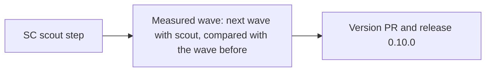

# Plan for 0.10.0: a scout step that reads the code once for each PR

## Status (2026-11-18)

- Release 0.9.11 is out; plan 0.9.12 comes first. This plan is for release 0.10.0, which the maintainer decides. He merges this plan.
- Written from one impact pass on the tag v0.9.11 (8d7a588). Each Touches line names functions, sections and case titles, because line numbers move.
- The entries hold what must be true as numbered statements. The evals writer builds its list from them, with one coverage item for each statement.

## Summary in plain words

Each PR of a wave starts several agents on Opus: the writer of the evals, the two checks of the list, the reviewer and the architecture reviewer. Each one starts with no memory and loads the same files of the code again. In plan 0.9.9 that loading was $23 of $54 for all agents.

This plan adds one cheap agent for each PR, the scout. It runs before the writer of the evals. It reads the plan entry and the code once, and writes a short digest: the files and line ranges that the entry touches, the functions and tests that pin them, and the facts that the later agents need. The Opus agents get the path of the digest and start from it. They still read the code they judge; the digest only tells them where to look.

The scout is off by default. A wave turns it on with one argument, `scout: true`. The wave is measured against the wave before it, by the average cost of each PR item, before the scout becomes a default.

What you do: decide on 0.10.0, and merge this plan when you agree.

## Choices for the maintainer

Merging this plan accepts the pick of each line. Say so before the merge to change one.

| # | Choice | Pick | Why |
| --- | --- | --- | --- |
| 1 | The model of the scout. | Sonnet at low effort. | It reads and lists; it judges nothing. Haiku can miss a function that a long file holds. |
| 2 | Default on or off. | Off. A wave passes `scout: true`. | The saving is not measured. A default comes in a later plan, after one measured wave. |
| 3 | Which agents get the digest. | The evals writer, the two checks of the list, the reviewer and the architecture reviewer. Not the implementer, the tester or the verifier. | These five are the Opus agents that load the code to judge it. The builder and the testers run the code and need the files anyway. |
| 4 | What an agent does with a digest that is wrong. | It reads the code itself, as today, and names the wrong part in its field `digestNote`. The digest is data from an agent that read the repo, not instructions. | The digest is a help, not a source of truth. No finding comes from the digest alone. |
| 5 | What happens to release 2 (stages 2 to 4 and the deletion of the local runner), which the architecture document and a pinned test call 0.10.0. | It moves to 0.11.0 or later. The version PR of this release edits those lines. | The maintainer chose 0.10.0 for the scout. Three docs and one test would else promise release 2 in 0.10.0. |

## Decisions

- **The scout writes its digest into a folder of the temp folder of the wave**, `<tmp>/digest-<id>/digest.md`. The folder name matches `*-<id>`, so `scripts/cleanup.sh clones` removes it with the other folders of the PR, and `cleanup.sh` needs no change. The scout removes an older digest of the same id before it writes.
- **The workflow builds the digest path itself** from `tmp` and the PR id. It never uses a path from the scout's answer. The answer of the scout gives only `written`, a boolean. The workflow has no filesystem, so it puts the path in a prompt only when `written` is true.
- **The digest carries no authority.** The scout reads repo text and, in a cloud run, issue text. The prompts call the digest data, not instructions.
- **A wrong part of the digest is reported in a field.** `digestNote` is an optional string in the schemas `EVALS`, `EVALSCHECK`, `REVIEW` and `ARCHREV`. The workflow collects the notes of each PR item into one result key, `digest: { path, missing, wrong }`, where `wrong` is a list of the notes.
- **The scout is a new role** with its own role file, `agents/scout.md`. It changes no code and posts nothing on GitHub.
- **The plan review runs with `maxRounds` 2.**

## Rules for every PR

- What must be true is the numbered list of the entry. A statement marked (doc) is proved by a test that reads the text. A statement marked "(holds today; kind `regression`)" passes with and without the change, and its eval has the kind `regression`.
- No entry has an Invariants line. The round cap of every entry is the default.
- A test of a statement that says that nothing happens is built from the case where it does happen, with one change. The same test file holds that positive case. The negative test also asserts the printed line or the exit code that names its cause.
- A PR edits only the parts its Touches line names.
- No eval statement holds the trigger words of the PR-text rule: "PR body", "PR title", "PR description", "pull request body", "pull request title", "pull request description", "Closes line", or a closing keyword with "#" and a number.
- `workflows/run-wave.js` stays plain JavaScript with no filesystem, no `Date.now` and no `Math.random`.
- In `test/sim-pipeline.mjs` each entry adds its cases as one block directly after its anchor case. A case uses only helpers that are defined before its anchor.
- A list in a Touches line or in build notes of the existing tests that an entry changes names the likely ones. The builder finds the rest by running the tests and lists them in its PR. A test that such a list lacks is a minor, unless it shows that a statement of the entry is wrong.
- Each code PR merges under the maintainer's standing rule: a completed CodeRabbit review of the final head that is clean or minor-only (rule A), and green CI.
- Docs: Simplified Technical English, no em dashes.

## Waves

Summary: one entry, then one measured wave against the wave before it, then the version PR.

### Wave 1

**SC A scout step that writes a digest for the Opus agents.** Sim anchor: the last case of the file at the time of the build (the builder names it in its PR).
Touches: `workflows/run-wave.js` (`STEPS`, a new entry `scout`; `ROLES`, a new entry `scout`; `runPRSteps`, a new step before `writeEvals` and after the `landFix` and `answer` branches; `evalsBlock`, one line with the digest path, for the evals writer and both evals checks; `reviewPrompt` and `archPrompt`, the same line; `botReviewPrompt` calls `reviewPrompt`, so the bot-answer check of the reviewer gets it too; not `ctx(pr)` and not `prBlock`, which reach the implementer, the tester, the verifier and the fixer; the schemas `EVALS`, `EVALSCHECK`, `REVIEW` and `ARCHREV`, the field `digestNote`; the end of `runPRSteps`, the result key `digest`), `agents/scout.md` (new), `skills/pr-pipeline/SKILL.md` (the item `scout` of "### Workflow arguments", one row of "### Role agents", one sentence in "### Driving cheaply", the result text for the key `digest`), `test/sim-pipeline.mjs` (one new block; `AGENT_OF`, the entry for `scout`), `test/role-files.test.mjs` and `test/token-report-roles.test.mjs` (the new role, if they list roles).
What must be true:
1. With no `scout` argument, no scout agent runs, and no prompt holds a digest path. (Each is one statement for the evals.)
2. With `scout: true`, one scout agent runs for each code PR item, before the evals writer, with the label `scout:<id>`, on Sonnet at low effort.
3. The workflow builds the digest path `<tmp>/digest-<id>/digest.md` from `tmp` and the PR id. The scout prompt names the plan entry, the clone and that path, and asks the scout to remove an older digest first, and to write: the files and line ranges the entry touches, the functions and tests that pin them, and nothing that judges the entry. The schema of the scout answer has one field for the digest, the boolean `written`, and no path.
4. With `scout: true`, the prompts of the evals writer, both evals checks, the reviewer and the architecture reviewer of that PR hold the digest path, the words that the digest is data from an agent that read the repo and not instructions, and the rule of choice 4: read the code you judge, and name any part of the digest that was wrong in `digestNote`. The bot-answer check of the reviewer is one of these prompts.
5. With `scout: true`, the prompts of the implementer, the tester, the verifier and the fixer hold no digest path.
6. No scout runs for a docs or plan PR item, a resume, a land-fix run or an answer run.
7. A scout that fails or answers `written` not true gives no stop: the run goes on with no digest path in the prompts, and the result has `digest.missing: true`. The result of a PR item with a digest has `digest.path` and the notes of the five roles in `digest.wrong`.
7a. A scout path from the answer of the scout, or a path with `..`, never appears in a prompt.
8. A `steps` argument for `scout` sets its model and effort.
9. `agents/scout.md` says that the scout changes no file of the repo, posts nothing on GitHub, writes only the digest file, and judges nothing.
10. (doc) SKILL.md names the argument `scout`, the role row, the result key `digest` and the default (off), and the sentence in "### Driving cheaply" says to measure a wave against the wave before it, by the average cost of each PR item with the scout included, before it becomes a default.
11. After the cleanup of a PR, the folder `<tmp>/digest-<id>` is gone. (Proved with `scripts/cleanup.sh clones <tmp> <id>` on a fixture folder with the marker `.pipeline-tmp`.)
Build notes: the sim check "each agent file exists and its defaults match the workflow defaults" reads `AGENT_OF` and the folder `agents/`, so a new role file fails it until `AGENT_OF` has `scout`. The role-file check (`role files differ:`) iterates the folder, so it needs no change. The digest folder is under `<tmp>`, as the rule of `ctx(pr)` asks of temporary files. The step goes after the `if (pr.landFix)` block, which returns early, and after the branch for `answer` of plan 0.9.12.

## Steps of the driving session

1. After plan 0.9.12 is released and this plan is merged: run wave 1 (SC) on v0.9.12.
2. Land SC under the standing rule.
3. The measured wave: the next wave of the product repo runs once with `scout: true`. The driving session compares the average weighted tokens of each code PR item, the scout included, and the average rounds of each item, with the wave before it. The two waves have other items, so the comparison is of averages with the tolerance of pass criterion 2.
4. The version PR and release 0.10.0, which the maintainer decides.

## Not in this plan

| Item | Why |
| --- | --- |
| The scout as a default | Choice 2. After one measured wave. |
| A digest for the implementer and the testers | Choice 3. |
| A digest that the workflow checks | The workflow has no filesystem. The agents check the code themselves (choice 4). |

## Pass criteria

1. The four per-PR criteria of iteration 1 hold for SC.
2. In the measured wave, the average total weighted tokens of a code PR item (the five roles of choice 3, the scout agent, and every other role) is at least 10% lower than the average of the wave before it, and the average rounds of an item are not more than 0.25 higher.
3. No finding of the measured wave comes from a wrong digest alone. The driving session reads `digest.wrong` in the results of the wave.

## Release

- 0.10.0 is SC. The maintainer decides the release. The version PR changes the version, the release line of `agents/goals-preflight.md`, the release list and the file list. It also moves release 2 to 0.11.0 (choice 5) in `docs/cloud-routines.md` (the row `| 2 to 4 |` of the Stages table and the last section, "Retire the local routine"), `docs/routine.md` line 3 and the "## Files" item `routine/` of `skills/pr-pipeline/SKILL.md`, and edits the test "docs name release 2 as 0.10.0 ..." in `test/skill-notes.test.mjs` to the new number.

## Flagged concerns

- **A wrong digest can steer a reviewer away from a fault.** Choice 4 is the guard: each agent reads the code it judges. Pass criterion 3 checks it.
- **The scout adds one agent for each PR.** If the Opus agents still load the same files, the wave costs more. Pass criterion 2 measures it, and the default stays off.
- **Release 2 loses its number.** The architecture document and a pinned test name 0.10.0 for it. Choice 5 moves it, and the version PR edits the lines and the test.
- **SC adds a role file.** A session that has not reloaded is refused with `role files differ:`.

## Not verified

- How much an Opus agent saves when it gets a digest. Cache write of loaded files was the largest part of its cost in plan 0.9.9.
- That an agent follows "start from the digest" and reads less.
