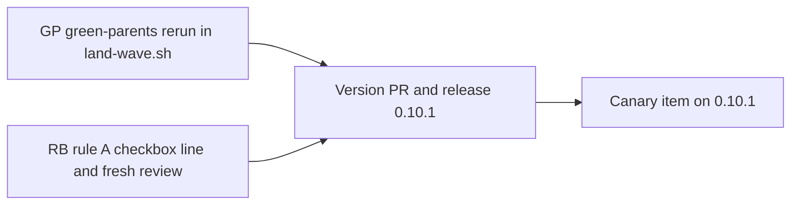

# Plan for 0.10.1: a green-parents rerun in the land step, and rule A reads the new CodeRabbit checkbox line

## Status (2026-11-26)

- Built on release 0.10.0 (d613224).
- Issue #900 came from product-repo feedback on 0.10.0. Its quick-fix triage said build, size M, risk high, so the workflow sent it to a plan. The entry below is the triager's entry, with the open question settled.
- Issue #903 came from a product-repo land on 0.10.0 and was seen again on #902 in this repo. The maintainer added it to 0.10.1.
- Issue #901 is a quick fix in the same release and has no entry here.

## Summary in plain words

When a PR conflicts, the land fix merges the default branch into it. The merge head then runs CI for the first time. If a job on that head fails for a reason that has nothing to do with the change (a network fault, a runner fault), `scripts/land-wave.sh` reruns it only when the check is in `knownFlakes`. Otherwise it stops with `LAND FIX` and exit 3, and a land-fix agent starts for a failure that is not in the code.

The fix adds one more rerun path. When the PR head is a merge of the current default branch head into the PR's previous head, and CI on both parents is green, the land step reruns the failed jobs once before it stops. A check that fails again stops with `LAND FIX` as today.

CodeRabbit review bodies now hold a new checkbox line, "Ask CodeRabbit to fix comments on this review". Rule A in `scripts/bot-approval.jq` knows only the old line, so it refuses every such review as text outside the frame, and every PR becomes a person merge. A rerun of the land step then reads the same review and stops again. The fix adds the new line to the frame, and a land after an answer that pushed nothing asks for one fresh review of the head.

What you do: merge this plan.

## Choices for the maintainer

Merging this plan accepts the pick of each line. Say so before the merge to change one.

| # | Choice | Pick | Why |
| --- | --- | --- | --- |
| 1 | Which parent must be the default branch. | The merged-in parent must equal the default branch head sha, read in the same land call. | It fails closed. A merge of an older default branch head is not proof that the current base is green. |
| 2 | How many reruns. | One per land call, shared with the known-flake path. | A real failure then still stops quickly, and the `run_attempt` guard stays. |
| 3 | Commit statuses. | A head with any failed commit status is never rerun. | A status cannot be rerun with the jobs API. |
| 4 | What "green" means for a parent. | Each failed check name of the head has a completed run with that exact name and conclusion success on each parent. | `ci-state.jq` gives success for a commit with only a bot check run, for example a PR head that conflicted so CI never ran. That is no proof. |
| 5 | Let "answered" count for a review on the head (suggestion 2 of #903). | No. A review on the head clears the gate only when rule A passes it. A land after an answer that pushed nothing asks for one fresh review instead. | It keeps the gate as strict as today. The fresh review gives the same result without a new way to clear it. |

## Decisions

- **The plan review runs with `maxRounds` 2.**
- The rerun never merges. A merge still goes only through `merge-pr.sh`, with its checks unchanged.

## Rules for every PR

- A PR edits only the parts its Touches line names.
- A test of a statement that says nothing happens is built from the case where it does happen, with one change. The same test file holds that positive case, and the negative test asserts the printed line or the exit code that names its cause.
- No eval statement holds the trigger words of the PR-text rule: "PR body", "PR title", "PR description", "pull request body", "pull request title", "pull request description", "Closes line", or a closing keyword with "#" and a number.
- Scripts under `scripts/` use `gh api` only, never `gh pr` or `gh issue`, and no command that exists on only one of macOS and Linux. CI runs on Linux.
- Docs: Simplified Technical English, no em dashes.

## Waves

Summary: two entries in one wave, then the version PR and the canary run. GP and RB both touch `scripts/land-wave.sh`, in different parts: GP the rerun block, RB the `--review` block.

### Wave 1

**GP The land step reruns the failed jobs of a merge head once when both parents are green.** Closes #900.
Touches: `scripts/land-wave.sh` (the rerun block before the `LAND FIX` stop in the main loop, a new function next to `flake_runs` that returns the failed run ids when both parents are green, and the header comment about reruns), `test/land.test.mjs` (new land cases), `test/fake-gh` (fixtures for the head commit with its parents, the default branch head, and the check-runs and status of each parent, only if the existing fixtures cannot give them), `skills/pr-pipeline/SKILL.md` (the land paragraph that says a known flake is rerun: one sentence).
Acceptance: `test/land.test.mjs` has these cases. Each fails without the change, because each asserts a printed line that the old script does not print.
Two lines are new. A rerun prints `RERUN #<pr>: green parents <sha7> <sha7>`. A refused green-parents rerun prints `NO RERUN #<pr>: <cause>`, where the cause is one of: `parent <sha7> is failure`, `parent <sha7> is pending`, `parent <sha7> has no runs`, `parent <sha7> has no run of <name>`, `commit status failed`, `run_attempt is not 1`, `no parent is the default branch head`, `head does not have two parents`, `read failed`. The `NO RERUN` line is printed only when the head has a failed check that is not in `knownFlakes`, before `LAND FIX`.
Every case below uses a check name that is not in `knownFlakes` (the default `landSetup` lists `e2e`, so the cases use another name). Case 1 is the positive case. Every no-rerun case is case 1 with exactly one input changed, is in the same file, asserts its `NO RERUN` cause line and exit 3, and asserts zero POSTs in the fake-gh log. A fixture that is missing gives `read failed`, so a case cannot pass because a fixture is missing.
1. 'land: a failing check on a merge head with green parents is rerun once and merges'. The head has two parents, one is the default branch head, and each parent has a completed run with the name of the failing check and conclusion success. Expect exactly one POST to rerun-failed-jobs, the `RERUN` line (not the known-flake line), one PUT merge and exit 0.
2. 'land: a check that fails again after the green-parents rerun stops with LAND FIX'. Expect one rerun, exit 3 and `LAND FIX` with the failing checks.
3. 'land: a merge head with a red parent is not rerun'. Case 1 with one parent's check set to failure. Expect `NO RERUN #<pr>: parent <sha7> is failure`, zero reruns and exit 3.
Extra cases, each case 1 with one change, each with its cause line:
- a failed commit status on the head: `commit status failed`.
- a failed run with `run_attempt` 2: `run_attempt is not 1`.
- the merged-in parent differs from the default branch head by one sha: `no parent is the default branch head`. Its pair is case 1, where the merged-in parent equals the default branch head.
- a pending parent: `parent <sha7> is pending`.
- a read of a parent's check-runs that fails: `read failed`.
- a parent whose check runs hold only `CodeRabbit` with success, and no run with the name of the failing check: `parent <sha7> has no run of <name>`.
All existing land tests still pass.
Invariants:
- A green-parents rerun happens only when the PR head commit has exactly two parents, one of them equals the default branch head sha read in the same call, and each failed check name of the head has a completed run with that exact name and conclusion success on each parent. A matrix name such as `e2e (1/4)` matches by its full name.
- A parent that is pending, has noRuns or failed, or a read of the commit, the branch or the checks that fails, means no rerun.
- A head with any failed commit status is never rerun. A head where any failed run has `run_attempt` other than 1 is never rerun.
- One land call reruns a head at most once, through the known-flake path or the green-parents path.
- A check that still fails after the rerun stops with `LAND FIX` and exit 3.
- The rerun never merges by itself.
- The default branch name and the settings come from the default branch, never from the PR head.
QA: read-only, no merge, no rerun on GitHub. Read the real answers of `gh api repos/alfhen/agent-pr-pipeline/commits/<head>` and of the check-runs of both parents for two real merged PRs of this repo whose head was a merge of main: the land-fix head of #890 or #891 (both parents have a `ci` run with success) and the land-fix head of #887 (its previous head has only a CodeRabbit run). Feed them to `scripts/land-wave.sh` through `test/fake-gh`, with the head's own `ci` check set to failure. The #890 or #891 head prints the green-parents rerun line. The #887 head prints `NO RERUN` with `has no run of ci` and `LAND FIX`, with no rerun. The #890 or #891 head with one parent's `ci` run edited to failure prints `NO RERUN` with `is failure`.

**RB Rule A reads the new checkbox line of a CodeRabbit review, and a land after an answer that pushed nothing asks for one fresh review.** Closes #903.
Touches: `scripts/bot-approval.jq` (`topRe`: the optional checkbox line after `---`), `scripts/land-wave.sh` (the `--review` block that decides whether to ask for a review of the head), `test/bot-approval.test.mjs` and `test/land-review.test.mjs` (new cases and fixtures), `skills/pr-pipeline/SKILL.md` (the land paragraph about `--review`: one sentence).
Acceptance:
1. `test/bot-approval.test.mjs` has a case built from the real body of CodeRabbit review 6071386294 on #902 (the autofix checkbox block, "Actionable comments posted: 1", the "Prompt to fix all issues" details and the Review info block). With its one inline Minor finding answered by the pipeline user, rule A passes it. Without the change, the same case prints "has text outside the frame of a review". A copy of the body with one more line of text after the checkbox line is still refused with that message.
2. The old checkbox line ("Fix comments: Fix CodeRabbit comments on this PR") still passes, and every existing bot-approval case still passes.
3. `test/land-review.test.mjs` has a case where the head is REVIEWED, rule A refuses only because the review is on the head and its findings were answered with no new push, and `land-wave.sh --person --review` asks for one fresh review of that head through `scripts/request-review.sh` before it stops. A second land call on the same head with the same review asks for none (the limit of two requests per head of `request-review.sh` is unchanged). A head with an unanswered finding asks for none.
Invariants:
- Rule A still refuses any text outside the frame. The frame gets exactly one more form of the checkbox line, and nothing else.
- "Answered" still counts only on an older commit. A review on the head clears the gate only when rule A passes it.
- A fresh review request goes only through `scripts/request-review.sh`, with its limits of one request per 64 minutes for the repo and two per head.
- The land step never merges because of a request. It merges only when a later review clears the gate.
QA: read-only, no merge. Run `scripts/bot-approval.jq` through `scripts/merge-pr.sh`'s check path (or the test helper that runs it) on the real answers of `gh api repos/alfhen/agent-pr-pipeline/pulls/902/reviews` and `.../comments` for head a7eb981. It passes rule A with the change and prints the "outside the frame" message without it.
