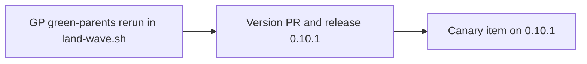

# Plan for 0.10.1: the land step reruns a failed merge head once when both parents are green

## Status (2026-11-26)

- Built on release 0.10.0 (d613224).
- Issue #900 came from product-repo feedback on 0.10.0. Its quick-fix triage said build, size M, risk high, so the workflow sent it to a plan. The entry below is the triager's entry, with the open question settled.
- Issue #901 is a quick fix in the same release and has no entry here.

## Summary in plain words

When a PR conflicts, the land fix merges the default branch into it. The merge head then runs CI for the first time. If a job on that head fails for a reason that has nothing to do with the change (a network fault, a runner fault), `scripts/land-wave.sh` reruns it only when the check is in `knownFlakes`. Otherwise it stops with `LAND FIX` and exit 3, and a land-fix agent starts for a failure that is not in the code.

The fix adds one more rerun path. When the PR head is a merge of the current default branch head into the PR's previous head, and CI on both parents is green, the land step reruns the failed jobs once before it stops. A check that fails again stops with `LAND FIX` as today.

What you do: merge this plan.

## Choices for the maintainer

Merging this plan accepts the pick of each line. Say so before the merge to change one.

| # | Choice | Pick | Why |
| --- | --- | --- | --- |
| 1 | Which parent must be the default branch. | The merged-in parent must equal the default branch head sha, read in the same land call. | It fails closed. A merge of an older default branch head is not proof that the current base is green. |
| 2 | How many reruns. | One per land call, shared with the known-flake path. | A real failure then still stops quickly, and the `run_attempt` guard stays. |
| 3 | Commit statuses. | A head with any failed commit status is never rerun. | A status cannot be rerun with the jobs API. |

## Decisions

- **The plan review runs with `maxRounds` 2.**
- The rerun never merges. A merge still goes only through `merge-pr.sh`, with its checks unchanged.

## Rules for every PR

- A PR edits only the parts its Touches line names.
- A test of a statement that says nothing happens is built from the case where it does happen, with one change. The same test file holds that positive case, and the negative test asserts the printed line or the exit code that names its cause.
- No eval statement holds the trigger words of the PR-text rule: "PR body", "PR title", "PR description", "pull request body", "pull request title", "pull request description", "Closes line", or a closing keyword with "#" and a number.
- Scripts under `scripts/` use `gh api` only, never `gh pr` or `gh issue`, and no command that exists on only one of macOS and Linux. CI runs on Linux.
- Docs: Simplified Technical English, no em dashes.

## Waves

Summary: one entry in one wave, then the version PR and the canary run.

### Wave 1

**GP The land step reruns the failed jobs of a merge head once when both parents are green.** Closes #900.
Touches: `scripts/land-wave.sh` (the rerun block before the `LAND FIX` stop in the main loop, a new function next to `flake_runs` that returns the failed run ids when both parents are green, and the header comment about reruns), `test/land.test.mjs` (new land cases), `test/fake-gh` (fixtures for the head commit with its parents, the default branch head, and the check-runs and status of each parent, only if the existing fixtures cannot give them), `skills/pr-pipeline/SKILL.md` (the land paragraph that says a known flake is rerun: one sentence).
Acceptance: `test/land.test.mjs` has three cases that fail without the change.
1. 'land: a failing check on a merge head with green parents is rerun once and merges'. The check is not in `knownFlakes`, the head has two parents, one is the default branch head and both are green. Expect exactly one POST to rerun-failed-jobs, an output line that names green parents and is not the known-flake line, one PUT merge and exit 0.
2. 'land: a check that fails again after the green-parents rerun stops with LAND FIX'. Expect one rerun, exit 3 and `LAND FIX` with the failing checks.
3. 'land: a merge head with a red parent is not rerun'. Expect zero reruns and exit 3.
There are also cases for a failed commit status (no rerun), a run with `run_attempt` 2 (no rerun) and a merged-in parent that is not the current default branch head (no rerun). All existing land tests still pass.
Invariants:
- A green-parents rerun happens only when the PR head commit has exactly two parents, one of them equals the default branch head sha read in the same call, and `scripts/ci-state.jq` gives state success for both parents.
- A parent that is pending, has noRuns or failed, or a read of the commit, the branch or the checks that fails, means no rerun.
- A head with any failed commit status is never rerun. A head where any failed run has `run_attempt` other than 1 is never rerun.
- One land call reruns a head at most once, through the known-flake path or the green-parents path.
- A check that still fails after the rerun stops with `LAND FIX` and exit 3.
- The rerun never merges by itself.
- The default branch name and the settings come from the default branch, never from the PR head.
QA: read-only, no merge, no rerun on GitHub. Pick a real merged PR of this repo whose head was a merge of main (for example the land-fix heads of #887, #890 or #891). Read the real answers of `gh api repos/alfhen/agent-pr-pipeline/commits/<head>` and of the check-runs of both parents. Feed them to `scripts/land-wave.sh` through `test/fake-gh`, with the head's own check set to failure. Check that it prints the green-parents rerun line when both parents are green, and that it prints `LAND FIX` with no rerun when one parent's answer is edited to failure.
