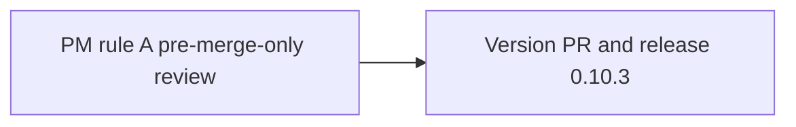

# Plan for 0.10.3: rule A clears a CodeRabbit review that holds only failed pre-merge checks

## Status (2026-11-27)

- Built on release 0.10.2 (2c9069d).
- Issue #910 was seen on #909 with release 0.10.1. Its quick-fix triage said build, size M, risk high, so the workflow sent it to a plan. The entry below is the triager's entry, with a QA line added.

## Summary in plain words

CodeRabbit can post a review on the head with no code finding. Its body then holds only a "Failed pre-merge checks" block (for example a Title check and a Linked Issues check) inside "Prompt to fix all issues", and no "Actionable comments posted: N" line. The pipeline answers it with a `pipeline-reviews` comment. `merge-pr.sh` then refuses with `rule A: review <id> has no count line (Actionable comments posted: N)`, and the PR becomes a person merge.

The fix adds one narrow branch to rule A in `scripts/bot-approval.jq`. A body with no count line passes only when it is exactly the known frame and its prompt fence holds only the failed pre-merge checks section, and a trusted answer comment for the head lists the review. Any other body with no count line, and any text outside the frame, is still refused.

What you do: merge this plan.

## Choices for the maintainer

Merging this plan accepts the pick of each line. Say so before the merge to change one.

| # | Choice | Pick | Why |
| --- | --- | --- | --- |
| 1 | Is the answer comment needed. | Yes. The review passes only when a trusted `pipeline-reviews` comment for the head lists its id. | A failed pre-merge check is a finding. The answer comment is the record that the pipeline read it. |
| 2 | Which fence sections are allowed. | Only the standard preamble, one `Failed pre-merge checks:` section and the trailer. | Any other section can hold a code finding. It fails closed. |

## Decisions

- **The plan review runs with `maxRounds` 2.**
- A body with a count line is judged exactly as before.

## Rules for every PR

- A PR edits only the parts its Touches line names.
- A test of a statement that says nothing happens is built from the case where it does happen, with one change. The same test file holds that positive case, and the negative test asserts the printed line that names its cause.
- No eval statement holds the trigger words of the PR-text rule: "PR body", "PR title", "PR description", "pull request body", "pull request title", "pull request description", "Closes line", or a closing keyword with "#" and a number.
- Scripts under `scripts/` use `gh api` only, never `gh pr` or `gh issue`, and no command that exists on only one of macOS and Linux. CI runs on Linux.
- Docs: Simplified Technical English, no em dashes.

## Waves

Summary: one entry in one wave, then the version PR and the release.

### Wave 1

**PM Rule A clears a count-free review that holds only failed pre-merge checks.** Closes #910.
Touches: `scripts/bot-approval.jq` (`ruleA`, the no-count-line branch; a new def that matches the prompt fence of a body that holds only failed pre-merge checks; a def that reads the `pipeline-reviews` ids of the trusted answer comments of the head), `test/clean-review.test.mjs` (new tests), `test/fixtures/clean-review/pr909-81139d3.json` (a new fixture that holds the real body of CodeRabbit review 6080765634 from #909 and the real answer comment, both from `gh api`), `skills/pr-pipeline/SKILL.md` (the land paragraph about rule A: one sentence). These paths are gated by the plugin floor, so the maintainer merges the PR.
Acceptance: a new test in `test/clean-review.test.mjs`, 'rule A clears a count-free review that holds only failed pre-merge checks when a trusted answer comment lists it', runs `merge-pr.sh` against the pr909 fixture and gets `approved=[coderabbitai[bot] (clean review)]`. Sibling tests in the same file give `clean review: rule A:` refusals for each of these changes, one change each: the `pipeline-reviews` line is removed, it lists another id, it is not on the second line, the comment is by another login or for another head, a line of text is added outside the frame, an `Inline comments:` or `Nitpick comments:` section is added inside the fence, or a top-level inline comment of the bot is added to the review. The first test fails on the current main, which refuses with `has no count line`. All existing clean-review and bot-approval tests still pass.
Invariants:
- A review body with no count line and no nitpick, outside-diff or Additional comments block passes rule A only when the body, with the frame comments cut, is exactly the known frame, and its prompt fence holds the standard preamble, one `Failed pre-merge checks:` section and the trailer, and no other section such as `Inline comments:`, `Nitpick comments:` or `Outside diff comments:`.
- Such a review passes only when a comment by the `GET /user` login that starts with `<!-- pipeline-bot-answer head=<head> -->` for the current head has `<!-- pipeline-reviews ... -->` with the review id on its second line. A listing by another login, for another head, on another line or with a different id does not count.
- Such a review with any top-level inline comment of the bot is refused.
- Every other body with no count line, and every body with text outside the frame, is refused as before. A body with a count line is judged exactly as before.
QA: read-only, no merge. Fetch `gh api repos/alfhen/agent-pr-pipeline/pulls/909/reviews`, `.../pulls/909/comments`, `.../issues/909/comments`, `.../pulls/909/files`, and the check runs and suites of commit 81139d3 (the head of review 6080765634). Run `scripts/bot-approval.jq` on them with `--arg why 1` and head 81139d3. Without the change it prints `review 6080765634 has no count line`. With the change it prints `coderabbitai[bot] (clean review)`. With the `pipeline-reviews` line of the answer comment removed, it refuses again.
