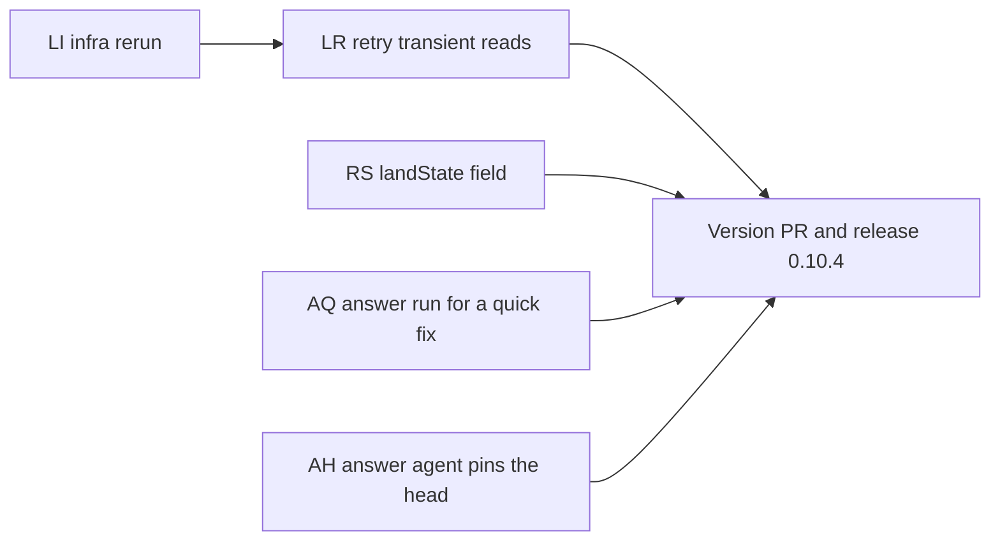

# Plan for 0.10.4: land reliability

## Status (2026-11-28)

- Built on release 0.10.3 (5320633).
- The maintainer picked the land-reliability group for 0.10.4: #922, #923, #919, #898 and #850. The first three came from product-repo feedback on 0.10.0. #898 came from the 0.10.0 canary. #850 was kept out of plan 0.9.12 by the maintainer, to get its own change.

## Summary in plain words

The land step and the answer run stop too often for causes that are not in the code. They also report states that a reader can take the wrong way.

- A GitHub API read that fails once from a network fault stops the land step, with no retry (#922).
- A CI job that fails in its install step, before any test ran, stops the land step with `LAND FIX`, unless the head is a merge with green parents or the check is in `knownFlakes` (#923).
- A wave result says `ready: true` for a PR whose CI is still pending or that no bot has cleared (#919).
- A quick-fix PR that stops with `ANSWER` has no answer run, because the workflow refuses `answer` with `quick` (#898).
- The answer agent checks out the latest remote branch. When another writer pushed after the last status read, the agent can post replies for a head that nobody checked (#850).

What you do: merge this plan.

## Choices for the maintainer

Merging this plan accepts the pick of each line. Say so before the merge to change one.

| # | Choice | Pick | Why |
| --- | --- | --- | --- |
| 1 | Which errors are transient (#922). | A failed `gh api` read whose error text holds `error connecting`, `connection reset`, `timeout`, `i/o timeout`, `unexpected EOF`, or an HTTP status 500, 502, 503 or 504. Any other failure, such as a 404 or a 422, is final at once, and an error that names a 4xx status is final even when its text also holds one of the phrases above. | A 4xx answer does not change on a retry. A retry of it only hides a real refusal for longer. |
| 2 | How many retries (#922). | 3 tries in all, with a pause of 10 then 30 seconds. | It covers a short outage and adds at most 40 seconds to each failed read. |
| 3 | Which calls retry (#922). | Only reads (`GET`). The merge, the review request, the rerun and every comment stay single calls. | A write that failed on the network may still have reached GitHub. A retry could merge twice or post twice. |
| 4 | What an infra failure is (#923). | A failed job of an Actions run whose first failed step is `Set up job`, or whose first failed step name starts with `Install`, `Set up`, `Setup`, `Checkout`, `Run actions/checkout@`, `Run actions/setup-` or `Run actions/cache@`, ignoring case, or a job with the conclusion `failure` that has no step with the conclusion `failure` or `cancelled` (the runner was lost). A job with the conclusion `timed_out` is never infra. A job with the conclusion `cancelled` is not infra either, but it does not block the rerun when the same run has at least one infra failed job and no other non-infra failed job, because GitHub cancels the sibling jobs of a matrix with `fail-fast` when one job fails. A run with a `cancelled` job and no infra failed job (a person cancelled it) is refused. The cause of a refused `cancelled` or `timed_out` job is `run <id> job <name> ended <conclusion>`. The jobs read uses `--paginate` and `per_page=100`, and a failed run with no failed job listed is not infra (the cause is `run <id> lists no failed job`). | GitHub names its own setup step `Set up job`, and the usual action steps start with these words. A failure in a test step is never infra. |
| 5 | How many infra reruns (#923). | One per land call, shared with the known-flake and green-parents paths, and only when `run_attempt` is 1. | It keeps the once-per-head rule of 0.10.1. A real install failure stops on the second try. The infra path reads `head_sha` of each run and reruns only a run of the checked head, because the run id comes from `details_url`, which an App chooses. |
| 6 | The new result field (#919). | Each result that has end facts gets `landState`, whether `ready` is true or the stop is red CI: `CI green and bot cleared` (CI success and at least one approval), `waiting for a bot` (CI success, no approval), `waiting for CI` (CI pending), `no CI runs` (state noRuns), `CI failed` (state failure) and `unknown` (no end facts, because there is no plugin root). It says nothing about conflicts or the fourth way of `reviewOnRequest`. `ready` keeps its meaning (the pipeline work is done). | A new field does not break a reader that already reads `ready`. The name does not claim that GitHub will accept the merge. |
| 7 | Where the answer agent stops (#850). | Before its first reply or push, the agent checks that the remote head of the branch is the expected head. The expected head is the pinned head until the agent pushes, and then the commit it last pushed. When it is not, it stops and returns `headMoved: true` with the new head and the expected head. It posts nothing. | A reply for a head that nobody checked is the harm in #850. The final head check of the land step stays as a second guard. |
| 8 | One retry rule for reads (#922). | `scripts/gh-read.sh` is sourced by the scripts that read GitHub on the land path, as `semver.sh` is sourced. Plan 0.9.17 choice 1 (no shared helper file) held while one script needed the rule. Now seven scripts need one rule, and a copy in each would drift. | The repo keeps one place per rule. |

## Decisions

- **The plan review runs with `maxRounds` 2.**
- No change to how `merge-pr.sh` decides a merge. It only retries its reads.
- An answer run for a quick fix gets the stored brief from `quickSetup`, which already runs `scripts/quick-brief.sh get` for every quick item, and needs no plan file. An answer item never reaches the triager.
- `scripts/wait-ci.sh` keeps its own retry loop (3 tries, 2 seconds apart, any failed read). It polls for minutes in the workflow, not in the land step, and it already retries a 4xx. Moving it to `gh_read` would change a rule that no issue of this release asks to change.

## Rules for every PR

- A PR edits only the parts its Touches line names.
- Every existing test whose expected result a decision of this plan changes is edited by the entry that makes the decision. The builder finds the set by a run of `node --test test/*.test.mjs` and `node test/sim-pipeline.mjs`, and lists each changed test in the message of the commit that applies the change. Known members: the `NO RERUN` tests of `test/land.test.mjs` (LI) and the `quick` member of the throw list of RW-14 in `test/sim-pipeline.mjs` (AQ).
- A test of a statement that says nothing happens is built from the case where it does happen, with one change. The same test file holds that positive case, and the negative test asserts the printed line or the exit code that names its cause.
- No eval statement holds the trigger words of the PR-text rule: "PR body", "PR title", "PR description", "pull request body", "pull request title", "pull request description", "Closes line", or a closing keyword with "#" and a number.
- Scripts under `scripts/` use `gh api` only, never `gh pr` or `gh issue`, and no command that exists on only one of macOS and Linux. CI runs on Linux.
- Tests that wait use `PIPELINE_TEST_FAST=1`, so a retry or a rerun adds no real sleep.
- Docs: Simplified Technical English, no em dashes.

## Waves

Summary: wave 1 has LI, RS, AQ and AH. Wave 2 has LR, which wraps the reads of `scripts/land-wave.sh` after LI changed its rerun part. Then the version PR and the release.

### Wave 1

**LI The land step reruns a job that failed in setup or install once.** Closes #923.
Touches: `scripts/land-wave.sh` (the rerun part of the main loop, from `read_failing` to the `LAND FIX` line; a new function `infra_runs` next to `green_parents`, which reads `repos/<repo>/actions/runs/<id>/jobs` for each failed run id; the header comment that lists the rerun paths), `test/land.test.mjs` or a new `test/land-infra.test.mjs` (new tests, and the existing `NO RERUN` tests whose expected line the held-back line changes, for example the `$`-anchored green-parents tests), `test/fake-gh` (only to answer the jobs read, when it does not already), `skills/pr-pipeline/SKILL.md` (the sentence in Step 3 that lists the rerun paths, and the `LAND FIX` row of "When things go wrong").
The order of the paths is: known flakes, then green parents, then infra. The first path that applies is the one rerun. Each path prints its own `RERUN #<pr>: ...` cause, and infra prints `RERUN #<pr>: infra failure in <job> step <step>, failed jobs rerun once`. The `NO RERUN` line of green parents is held back: it prints only when the infra path also refuses, and then the land step prints one line, `NO RERUN #<pr>: <green-parents cause>; <infra cause>`, then `LAND FIX` as today. A head that infra reruns prints no `NO RERUN` line. The infra causes are exactly these texts, and green parents prints none of them: `run <id> job <name> failed in step <step>` (the first job that is not infra), `cannot read the jobs of run <id>`, `run <id> lists no failed job`, `run <id> job <name> ended <conclusion>` (a job that is `timed_out`, or `cancelled` in a run with no infra failed job), `run <id> is not a run of the head` (the `head_sha` of the run is not the checked sha, tested before `run_attempt`), and `run <id> has run_attempt <n>` (a run that was already rerun). `infra_runs` reads `head_sha` and `run_attempt` of each run, as the flake path and green parents do. When green parents stopped because a commit status failed, a failed check has no Actions run id, or a failed check is not an Actions run, the infra path is not tried, and the line stays `NO RERUN #<pr>: <green-parents cause>` as today. So the existing tests `commit status failed`, `no run id for ci`, `failed check is not an Actions run` and `no run id for CodeRabbit` keep their lines, and the existing `run_attempt is not 1` test and every other existing green-parents refusal test get the `; <infra cause>` its fixture gives.
Acceptance: a new test 'an install-step failure is rerun once and a second failure stops with LAND FIX' runs `land-wave.sh` through `test/fake-gh`: the first CI read has one failed run whose job failed in step `Install dependencies`, the jobs read names that step, and after the rerun the run succeeds. The test asserts the `RERUN #<pr>: infra failure in` line and that the merge call ran. The test also asserts that no `NO RERUN` line is printed. Sibling tests, one change each, assert the full infra cause text and that the fake-gh log holds a GET of `actions/runs/<id>/jobs`: a failure in step `Run tests` prints `; run <id> job <name> failed in step Run tests`, `LAND FIX` and no rerun call; a jobs read that returns 404 prints `; cannot read the jobs of run <id>`, `LAND FIX` and no rerun call; a second failure after the rerun prints `LAND FIX`; a run with `run_attempt` 2, with the jobs fixture of the positive test in place, prints `; run <id> has run_attempt 2`, `LAND FIX` and no rerun call; a failed job with no failed step is rerun; a run whose jobs read lists no failed job prints `; run <id> lists no failed job`, `LAND FIX` and no rerun call; a job with the conclusion `timed_out` prints `; run <id> job <name> ended timed_out`, `LAND FIX` and no rerun call; a run with a job `ci (1)` that failed in step `Install dependencies` and a job `ci (2)` with the conclusion `cancelled` is rerun once (`RERUN #<pr>: infra failure in`, one POST of `rerun-failed-jobs`); a run whose only failed jobs are `cancelled` prints `; run <id> job <name> ended cancelled`, `LAND FIX` and no rerun call; a run with an infra failed job and a `timed_out` job prints `ended timed_out` and no rerun call; a failed check whose `details_url` names a run with another `head_sha`, with the install-failure jobs fixture in place, prints `; run <id> is not a run of the head`, `LAND FIX` and no rerun call (no POST of `actions/runs/<id>/rerun-failed-jobs` in the fake-gh log). The first test fails on the current main, which prints `LAND FIX` with no rerun.
Invariants:
- Only a failed job whose first failed step matches choice 4, or a failed job with no failed step (runner lost), counts as infra. Every failed run of the head must have at least one infra failed job and no other failed job except `cancelled` siblings, or nothing is rerun by this path.
- Only a run of the checked head is rerun. A run whose `head_sha` is not the checked sha is refused before the rerun call.
- A failed commit status is never rerun.
- One land call reruns a head at most once, across all three paths.
QA: read-only, no rerun call on GitHub. Fetch the real `gh api repos/alfhen/agent-pr-pipeline/actions/runs/<id>/jobs` answer of a failed run of this repo (an install-step failure if one exists, else a test-step failure) and save it as a fixture of the run. Run `scripts/land-wave.sh` through `test/fake-gh` with a head whose failed check names that run. Expected: `RERUN #<pr>: infra failure in` for an install-step job, and `NO RERUN #<pr>:` with the job name for a test-step job.

**RS A ready PR says whether it can be merged now.** Closes #919.
Touches: `workflows/run-wave.js` (every result object that holds end facts, in the normal path, the answer path and the land-fix path, ready or the red-CI stop, which get `landState`, and the result for no plugin root, which has no end facts and gets `landState: "unknown"` as a fixed value; a new small function `landStateOf(end)` next to `endFacts`), `test/sim-pipeline.mjs` (asserts on `landState` for the ready cases it already has), `skills/pr-pipeline/SKILL.md` (the sentence in Step 2 that says what `ready` means, which now also names `landState`).
Acceptance: `node test/sim-pipeline.mjs` has a new case, 'a ready PR with pending CI has landState waiting for CI', where the end facts give `ci.state` pending and an empty `approvedBy`: the result has `ready: true` and `landState: "waiting for CI"`. Sibling cases give `CI green and bot cleared` (CI success and one approval), `waiting for a bot` (CI success, no approval), `no CI runs` (state noRuns, ready true), `unknown` (no plugin root, ci null, ready true) and `CI failed` (a failed check: `ready: false` with the reason `CI failed on the head`, and `landState: "CI failed"`). The first case fails on the current main, where the result has no `landState`.
Invariants:
- `ready` keeps its current value in every case. A red-CI stop keeps `ready: false`.
- `landState` reads only the end facts the result already holds. It makes no new GitHub call.
QA: read-only. Take the real output of `bot-status.sh` and `wait-ci.sh` for two merged PRs of this repo and for one open PR. Build the end facts from them and report `landState` for each. Expected: `CI green and bot cleared` for a merged PR with a clean bot review and green CI, `waiting for CI` for an open PR whose CI is pending, and `waiting for a bot` for a PR with green CI and no approval.

**AQ An answer run works for a quick-fix PR.** Closes #898.
Touches: `workflows/run-wave.js` (the argument checks near the top: `answer` may be combined with `quick`, and an answer run of a quick fix needs no plan; `quickSetup`, whose `rerun` constant also holds `pr.answer`, so that a missing brief stops the item and never runs the triager, and which supplies the stored brief as `pr.quickState.brief` to the answer path in place of the plan entry, with no second `get`; the touches-overlap loop of the main section, which skips an item with `answer`), `test/sim-pipeline.mjs` (new cases, and existing cases under the changed-tests rule), `skills/pr-pipeline/SKILL.md` (Step 3, the sentence about the `answer: true` item, and the `ANSWER` row of "When things go wrong", which now name the quick-fix case and show the item).
Acceptance: `node test/sim-pipeline.mjs` has a new case, 'an answer run for a quick fix reads the stored brief and answers the bots', with args that have no `plan` and one item `{ quick: { issue: 896 }, answer: true, prNumber: 897, headSha, branch }`: the run starts the bot answer agent, and the answer prompt holds the text of the stored brief. A sibling case where the fake `quick-brief.sh get` answers exit 1 stops that item with `quick brief not found` and starts no `triage:`, `product:`, implementer or `botanswer:` agent. A third case gives two answer items of quick fixes with the same touched file and asserts that neither stops with `touches overlap`. The first case fails on the current main, which throws `answer cannot be combined with quick`.
Invariants:
- `answer` still cannot be combined with `landFix`, `resume` or `skipImpl`.
- An answer run of a quick fix runs no triage and no build, also when the brief is missing.
- Args with no `plan` still throw unless every item is a quick fix.
QA: read-only, nothing posted. Run `bash scripts/quick-brief.sh get alfhen/agent-pr-pipeline 896` on the real stored brief of issue 896 (the canary, PR 897). Render the answer prompt in the sim for the item `{ quick: { issue: 896 }, answer: true, prNumber: 897 }` with that output as the brief, and check that the prompt holds its text. Run `get` on an issue with no brief and report the stop reason, which is `quick brief not found`.

**AH The answer agent acts only on the pinned head.** Closes #850.
Touches: `workflows/run-wave.js` (`answerPrompt`: step 1 checks out the pinned `headSha`, not the branch tip, and checks that the remote head of the branch is the expected head before step 2, before each push and before each batch of replies. The expected head is `headSha` until the agent pushes, and then the commit it last pushed; the `ANSWER` schema, which gets `headMoved`, `newHead` and `expectedHead`; the caller of `answerPrompt`, which stops the item with the reason `bot answer: head moved (<newHead> is not the expected <expectedHead>)` when the agent returns `headMoved: true`), `skills/pr-pipeline/SKILL.md` (the sentence on the answer agent in Step 3, and one row in "When things go wrong" for the new stop), `agents/bot-answerer.md` (one sentence: stop and post nothing when the remote head is not the expected head, which is the pinned head until the agent pushes and then the commit it last pushed), `test/sim-pipeline.mjs` (new cases, and existing cases under the changed-tests rule), `test/wave-prompts.test.mjs` (a test that the answer prompt names the pinned head check).
Acceptance: `node test/sim-pipeline.mjs` has a new case, 'an answer agent that finds a moved head stops the item', where the fake answer agent returns `headMoved: true`, `newHead` and an `expectedHead` equal to `headSha`: the item stops with a reason that starts `bot answer: head moved` and names both heads, and no reviewer or tester agent starts after it. A second new case, 'an answer agent that pushed and then finds a different head stops the item', has the fake answer agent return `headMoved: true`, `newHead` and an `expectedHead` that is the commit it pushed: the reason names that pushed commit as the expected head. The sim proves only that the caller stops. A test in `test/wave-prompts.test.mjs` takes the text between `const answerPrompt` and `const botReviewPrompt` and asserts: it holds the `git checkout` of the full `headSha`; the first `git ls-remote origin <branch>` comes before the first reply instruction and before the first `git push`; it names `headMoved`, `newHead` and `expectedHead`; it says to post nothing when the heads differ; and it says the expected head becomes the pushed commit after a push. Deleting the stop sentence from the prompt makes the test fail. Both fail on the current main.
Invariants:
- The agent posts no reply and pushes no commit when the remote head is not the expected head at its check. The expected head is the pinned head until the agent pushes, and then the commit it last pushed. After its own push, the agent still posts its thread replies and the review-body comment while the remote head is that commit.
- The final head check of the land step is not changed.
QA: read-only, no push, no post. Render the answer prompt for a real open or merged PR of this repo. In a clone, run the `git checkout <headSha>` and `git ls-remote origin <branch>` commands of its step 1 for the real head and for a pinned head one commit older. Report both outputs. Expected: the second case differs from the remote head, which is the stop rule.

### Wave 2

**LR Land reads retry a transient GitHub error.** Closes #922.
Touches: a new `scripts/gh-read.sh` (one function `gh_read`, sourced by the scripts below, that runs `gh api` with the given arguments up to 3 times, per choices 1 and 2, and returns the last exit code; it refuses any `-X` or `--method` other than `GET`, and any `-f`, `-F`, `--field`, `--raw-field` or `--input`, which make `gh api` send a POST; it buffers the stdout of each try and prints it only after a try that succeeds, so a failed try, the last one too, prints no stdout, and it keeps the stderr of the last try for the caller; callers do not pass `api`, and `gh_read` adds it once), `scripts/land-wave.sh` (the `gh api` reads only: `fetch_checks`, `wait_ci`, the main loop reads, `read_default_settings`, `run_info`, `wait_rerun_started`, `green_parents`, `infra_runs` and `ask_review`; the rerun `POST` stays a single call), `scripts/request-review.sh` (its reads only), `scripts/bot-status.sh` (its reads only), `scripts/merge-pr.sh` (its reads only; the merge `PUT` and the branch `DELETE` stay single calls), `scripts/gate-files.sh` (its reads only), `scripts/pr-files.sh` (its read, the one read of the PR files), `scripts/merge-wave.sh` (its read of the PR), `scripts/check-syntax.sh` (only if the new file must be listed), `test/gh-read.test.mjs` (new, with a stub `gh` in the test that counts the calls of each path and fails a named call number, then delegates to `test/fake-gh`, which cannot fail one call of a path today), `skills/pr-pipeline/SKILL.md` (the file list line for `gh-read.sh`).
Acceptance: a new test in `test/gh-read.test.mjs`, 'a read that fails once with error connecting is retried and succeeds', runs `scripts/request-review.sh` through the counting stub and `test/fake-gh` with `PIPELINE_TEST_FAST=1`, where the first call of the check-runs read of `request-review.sh` (the read of `commits/<sha>/check-runs`, which has no outer loop) fails with `error connecting to api.github.com` and the second succeeds: the script prints no `NO REVIEW` line and posts the request. Sibling tests, one change each, on the same read: a read that fails with `HTTP 404` is not retried (the stub records one call) and prints the existing `NO REVIEW: cannot read the check runs`; a read whose error holds both `HTTP 404` and `timeout` is not retried either (one call); a read that fails 3 times with `HTTP 502` prints that line after exactly 3 calls; `gh_read -X POST <path>` exits 2 with a line that names the method. A second test makes the first read of `repos/<r>` in `gate-files.sh` fail once and asserts that `merge-pr.sh --auto` still merges (exit 0), and a third does the same for `pr-files.sh`. The `wait_ci` read of `land-wave.sh` is not used for these tests, because `wait_ci` already counts one failed read as one lost poll. A grep test asserts that no `gh api` read is left outside `gh_read` in `land-wave.sh`, `request-review.sh`, `bot-status.sh`, `merge-pr.sh`, `merge-wave.sh`, `gate-files.sh` and `pr-files.sh`, except the named single writes. A test asserts that `gh_read <path> -f a=b` exits 2 with a line that names the flag. The first test fails on the current main, which prints `NO REVIEW: cannot read the check runs`.
Invariants:
- No write is retried.
- `.claude-plugin/files.txt` is not changed. The version PR adds `scripts/gh-read.sh` to it.
- A 4xx failure is final at once, with the same printed line as today.
- With `PIPELINE_TEST_FAST=1` the retry pauses are 0.
QA: read-only. Run `gh_read repos/alfhen/agent-pr-pipeline/pulls/<n>` and a paginated read (`gh_read --paginate repos/alfhen/agent-pr-pipeline/pulls/<n>/files`) on a real PR, and compare the output byte for byte with the plain `gh api` output. Run `bot-status.sh` and `land-wave.sh` on a merged PR with the real `gh` as the baseline, then with a stub that fails the first read of each and delegates to the real `gh`. Expected: the same output as the baseline, and no partial output of a failed `--paginate` read.
