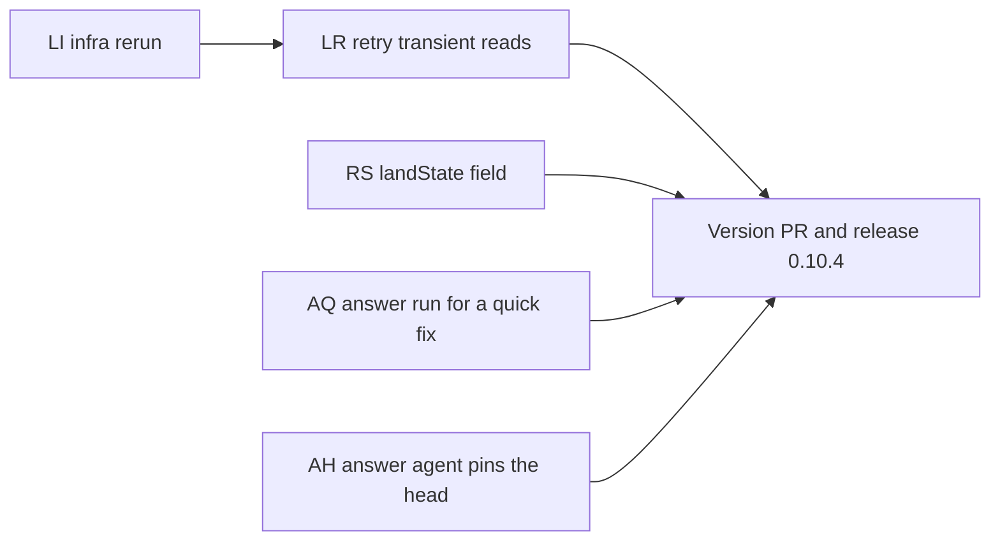

# Plan for 0.10.4: land reliability

## Status (2026-11-28)

- Built on release 0.10.3 (5320633).
- The maintainer picked the land-reliability group for 0.10.4: #922, #923, #919, #898 and #850. The first three came from product-repo feedback on 0.10.0. #898 came from the 0.10.0 canary. #850 was kept out of plan 0.9.12 by the maintainer, to get its own change.

## Summary in plain words

The land step and the answer run stop too often for causes that are not in the code. They also report states that a reader can take the wrong way.

- A GitHub API read that fails once from a network fault stops the land step, with no retry (#922).
- A CI job that fails in its install step, before any test ran, stops the land step with `LAND FIX`, unless the head is a merge with green parents or the check is in `knownFlakes` (#923).
- A wave result says `ready: true` for a PR whose CI is still pending or that no bot has cleared (#919).
- A quick-fix PR that stops with `ANSWER` has no answer run, because the workflow refuses `answer` with `quick` (#898).
- The answer agent checks out the latest remote branch. When another writer pushed after the last status read, the agent can post replies for a head that nobody checked (#850).

What you do: merge this plan.

## Choices for the maintainer

Merging this plan accepts the pick of each line. Say so before the merge to change one.

| # | Choice | Pick | Why |
| --- | --- | --- | --- |
| 1 | Which errors are transient (#922). | A failed `gh api` read whose error text holds `error connecting`, `connection reset`, `timeout`, `i/o timeout`, `unexpected EOF`, or an HTTP status 500, 502, 503 or 504. Any other failure, such as a 404 or a 422, is final at once. | A 4xx answer does not change on a retry. A retry of it only hides a real refusal for longer. |
| 2 | How many retries (#922). | 3 tries in all, with a pause of 10 then 30 seconds. | It covers a short outage and adds at most 40 seconds to a land step that already waits up to 45 minutes. |
| 3 | Which calls retry (#922). | Only reads (`GET`). The merge, the review request, the rerun and every comment stay single calls. | A write that failed on the network may still have reached GitHub. A retry could merge twice or post twice. |
| 4 | What an infra failure is (#923). | A failed job of an Actions run whose first failed step is `Set up job`, or whose first failed step name starts with `Install`, `Set up`, `Setup` or `Checkout`, ignoring case, or a failed job that has no failed step (the runner was lost). | GitHub names its own setup step `Set up job`, and the usual action steps start with these words. A failure in a test step is never infra. |
| 5 | How many infra reruns (#923). | One per land call, shared with the known-flake and green-parents paths, and only when `run_attempt` is 1. | It keeps the once-per-head rule of 0.10.1. A real install failure stops on the second try. |
| 6 | The new result field (#919). | Each ready PR gets `landState`: `mergeable` when CI passed and a bot cleared the gate, `waiting for CI` when CI is pending, `waiting for a bot` when CI passed and no bot cleared the gate, `CI failed` when a check failed. `ready` keeps its meaning (the pipeline work is done). | A new field does not break a reader that already reads `ready`. |
| 7 | Where the answer agent stops (#850). | Before its first reply or push, the agent checks that the remote head of the branch is the pinned head. When it is not, it stops and returns `headMoved: true` with the new head. It posts nothing. | A reply for a head that nobody checked is the harm in #850. The final head check of the land step stays as a second guard. |

## Decisions

- **The plan review runs with `maxRounds` 2.**
- No change to how `merge-pr.sh` decides a merge. It only retries its reads.
- An answer run for a quick fix reads the stored brief with `scripts/quick-brief.sh get`, the same way the first run of the quick fix does, and needs no plan file.

## Rules for every PR

- A PR edits only the parts its Touches line names.
- A test of a statement that says nothing happens is built from the case where it does happen, with one change. The same test file holds that positive case, and the negative test asserts the printed line or the exit code that names its cause.
- No eval statement holds the trigger words of the PR-text rule: "PR body", "PR title", "PR description", "pull request body", "pull request title", "pull request description", "Closes line", or a closing keyword with "#" and a number.
- Scripts under `scripts/` use `gh api` only, never `gh pr` or `gh issue`, and no command that exists on only one of macOS and Linux. CI runs on Linux.
- Tests that wait use `PIPELINE_TEST_FAST=1`, so a retry or a rerun adds no real sleep.
- Docs: Simplified Technical English, no em dashes.

## Waves

Summary: wave 1 has LI, RS, AQ and AH. Wave 2 has LR, which wraps the reads of `scripts/land-wave.sh` after LI changed its rerun part. Then the version PR and the release.

### Wave 1

**LI The land step reruns a job that failed in setup or install once.** Closes #923.
Touches: `scripts/land-wave.sh` (the rerun part of the main loop, from `read_failing` to the `LAND FIX` line; a new function `infra_runs` next to `green_parents`, which reads `repos/<repo>/actions/runs/<id>/jobs` for each failed run id; the header comment that lists the rerun paths), `test/land.test.mjs` or a new `test/land-infra.test.mjs` (new tests; existing tests are not changed), `test/fake-gh` (only to answer the jobs read, when it does not already), `skills/pr-pipeline/SKILL.md` (the sentence in Step 3 that lists the rerun paths, and the `LAND FIX` row of "When things go wrong").
The order of the paths is: known flakes, then green parents, then infra. The first path that applies is the one rerun. Each path prints its own `RERUN #<pr>: ...` cause, and infra prints `RERUN #<pr>: infra failure in <job> step <step>, failed jobs rerun once`. A head where any failed job is not infra prints `NO RERUN #<pr>: <cause>` with the name of the first job that is not infra, then `LAND FIX` as today.
Acceptance: a new test 'an install-step failure is rerun once and a second failure stops with LAND FIX' runs `land-wave.sh` through `test/fake-gh`: the first CI read has one failed run whose job failed in step `Install dependencies`, the jobs read names that step, and after the rerun the run succeeds. The test asserts the `RERUN #<pr>: infra failure in` line and that the merge call ran. Sibling tests, one change each, assert the printed cause: a failure in step `Run tests` prints `NO RERUN` and `LAND FIX` and no rerun call; a second failure after the rerun prints `LAND FIX`; a run with `run_attempt` 2 prints no rerun; a failed jobs read prints `NO RERUN #<pr>: read failed`; a failed job with no failed step is rerun. The first test fails on the current main, which prints `LAND FIX` with no rerun.
Invariants:
- Only a failed job whose first failed step matches choice 4 counts as infra. Every failed run of the head must have only infra failed jobs, or nothing is rerun by this path.
- A failed commit status is never rerun.
- One land call reruns a head at most once, across all three paths.

**RS A ready PR says whether it can be merged now.** Closes #919.
Touches: `workflows/run-wave.js` (the result objects of a ready PR in the normal path, the answer path and the land-fix path, which get `landState`; a new small function `landStateOf(end)` next to `endFacts`), `test/sim-pipeline.mjs` (asserts on `landState` for the ready cases it already has), `skills/pr-pipeline/SKILL.md` (the sentence in Step 2 that says what `ready` means, which now also names `landState`).
Acceptance: `node test/sim-pipeline.mjs` has a new case, 'a ready PR with pending CI has landState waiting for CI', where the end facts give `ci.state` pending and an empty `approvedBy`: the result has `ready: true` and `landState: "waiting for CI"`. Sibling cases give `mergeable` (CI success and one approval), `waiting for a bot` (CI success, no approval) and `CI failed` (a failed check). The first case fails on the current main, where the result has no `landState`.
Invariants:
- `ready` keeps its current value in every case.
- `landState` reads only the end facts the result already holds. It makes no new GitHub call.

**AQ An answer run works for a quick-fix PR.** Closes #898.
Touches: `workflows/run-wave.js` (the argument checks near the top: `answer` may be combined with `quick`, and an answer run of a quick fix needs no plan; the answer path, which reads the stored brief with `quick-brief.sh get` for an item with `quick`, in place of the plan entry), `test/sim-pipeline.mjs` (new cases), `skills/pr-pipeline/SKILL.md` (Step 3, the sentence about the `answer: true` item, and the `ANSWER` row of "When things go wrong", which now name the quick-fix case and show the item).
Acceptance: `node test/sim-pipeline.mjs` has a new case, 'an answer run for a quick fix reads the stored brief and answers the bots', with args that have no `plan` and one item `{ quick: { issue: 896 }, answer: true, prNumber: 897, headSha, branch }`: the run starts the bot answer agent, and the answer prompt holds the text of the stored brief. A sibling case where `quick-brief.sh get` finds no brief stops that item with a reason that names the missing brief, and starts no agent. The first case fails on the current main, which throws `answer cannot be combined with quick`.
Invariants:
- `answer` still cannot be combined with `landFix`, `resume` or `skipImpl`.
- An answer run of a quick fix runs no triage and no build.
- Args with no `plan` still throw unless every item is a quick fix.

**AH The answer agent acts only on the pinned head.** Closes #850.
Touches: `workflows/run-wave.js` (`answerPrompt`: step 1 checks out the pinned `headSha`, not the branch tip, and checks that the remote head of the branch is `headSha` before step 2 and again before each push; the `ANSWER` schema, which gets `headMoved` and `newHead`; the caller of `answerPrompt`, which stops the item with `HEAD MOVED` when the agent returns `headMoved: true`), `agents/bot-answerer.md` (one sentence: stop and post nothing when the remote head is not the pinned head), `test/sim-pipeline.mjs` (new cases), `test/wave-prompts.test.mjs` (a test that the answer prompt names the pinned head check).
Acceptance: `node test/sim-pipeline.mjs` has a new case, 'an answer agent that finds a moved head stops the item and posts nothing', where the fake answer agent returns `headMoved: true` and `newHead`: the item stops with a reason that starts `HEAD MOVED` and names both heads, and no reviewer or tester agent starts after it. A test in `test/wave-prompts.test.mjs` asserts the answer prompt holds the `git checkout` of the full `headSha` and the check of `git ls-remote origin <branch>` against it. Both fail on the current main.
Invariants:
- The agent posts no reply and pushes no commit when the remote head is not the pinned head at its check.
- The final head check of the land step is not changed.

### Wave 2

**LR Land reads retry a transient GitHub error.** Closes #922.
Touches: a new `scripts/gh-read.sh` (one function `gh_read`, sourced by the scripts below, that runs `gh api` with the given arguments up to 3 times, per choices 1 and 2, and returns the last exit code; it refuses any `-X` or `--method` other than `GET`), `scripts/land-wave.sh` (the `gh api` reads only: `fetch_checks`, `wait_ci`, the main loop reads, `read_default_settings`, `run_info`, `wait_rerun_started`, `green_parents`, `infra_runs` and `ask_review`; the rerun `POST` stays a single call), `scripts/request-review.sh` (its reads only), `scripts/bot-status.sh` (its reads only), `scripts/merge-pr.sh` (its reads only; the merge `PUT` and the branch `DELETE` stay single calls), `scripts/check-syntax.sh` (only if the new file must be listed), `.claude-plugin/files.txt` (by `scripts/manifest.sh --write`, only if the manifest lists scripts), `test/gh-read.test.mjs` (new), `skills/pr-pipeline/SKILL.md` (the file list line for `gh-read.sh`).
Acceptance: a new test in `test/gh-read.test.mjs`, 'a read that fails once with error connecting is retried and succeeds', runs `land-wave.sh` through `test/fake-gh` with `PIPELINE_TEST_FAST=1`, where the first check-runs read fails with `error connecting to api.github.com` and the second succeeds: the PR merges. Sibling tests, one change each: a read that fails with `HTTP 404` is not retried (the fake records one call) and prints the existing stop line; a read that fails 3 times with `HTTP 502` prints the existing stop line after 3 calls; `gh_read -X POST` exits 2 with a line that names the method. A grep test asserts that no `gh api` read is left outside `gh_read` in the four scripts, except the named single writes. The first test fails on the current main, which stops with `cannot read the check runs`.
Invariants:
- No write is retried.
- A 4xx failure is final at once, with the same printed line as today.
- With `PIPELINE_TEST_FAST=1` the retry pauses are 0.
