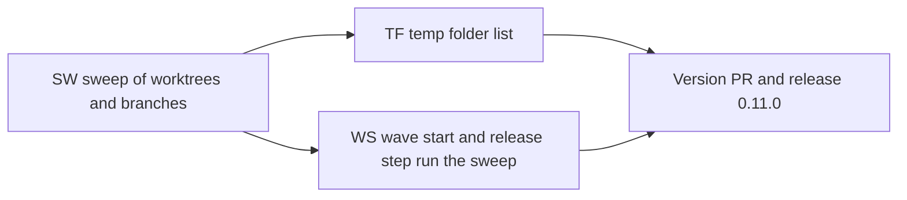

# Plan for 0.11.0: the pipeline cleans up its own leftovers

## Status (2026-11-28)

- Draft. Built on release 0.10.4, which is not out yet. This plan is reviewed and built after 0.10.4 ships.
- The maintainer set the scope: 0.11.0 is only the automatic cleanup. The cost and speed issues that were on the 0.11.0 milestone moved to 0.12.0.

## Summary in plain words

Each PR cleans up after itself today (step 12, `scripts/cleanup.sh`). It deletes its clones and the worktrees its writers pushed from. Many things stay behind:

- A worktree with uncommitted changes, or one whose head commit is not on GitHub, is kept with a `KEPT` line, and nobody comes back for it.
- The worktrees that the Agent tool makes (`agent-*`) are never cleaned.
- Local branches stay after their PR merged. PRs land by squash merge, so `git branch -d` never removes them.
- Temp folders of old waves stay until a reboot clears them.

On 2026-11-28 the main checkout held 7 such worktrees and 28 such branches, all from the 0.10.0 waves, and their PRs had all merged. SKILL.md says to clean them by hand after a release. This plan makes that a script, `cleanup.sh sweep`, that the workflow runs at the start of each wave and the main session runs after each release.

What you do: merge this plan.

## Choices for the maintainer

Merging this plan accepts the pick of each line. Say so before the merge to change one.

| # | Choice | Pick | Why |
| --- | --- | --- | --- |
| 1 | When a leftover is done. | Its head commit is on GitHub, and it is on the default branch, or every PR that GitHub lists for it (`GET repos/<repo>/commits/<sha>/pulls`) is merged or closed. A commit with no PR and not on the default branch is not done. | A squash merge leaves the branch commits off the default branch, but GitHub still lists the PR for them. Work that GitHub does not hold is never deleted. |
| 2 | Which worktrees the sweep may touch. | Only worktrees under `<repo>/.claude/worktrees/` whose name starts with `wf_` (the workflow) or `agent-` (the Agent tool), and only when nothing in them changed for 24 hours. Never the worktree that holds the current folder, and never a session worktree of another name. | A live session or a running wave may still use a newer worktree. The names are the ones the pipeline makes. |
| 3 | A worktree with uncommitted changes. | When it is done by choice 1 and nothing in it changed for 7 days, the sweep saves `git diff HEAD` and the list of untracked files as a patch in `~/.claude/agent-pr-pipeline/archive/<owner>-<repo>/`, then removes the worktree. Otherwise it is kept. | On 2026-11-28 three such worktrees held edits of minor passes that had shipped. The patch keeps the edits if a person wants them. |
| 4 | Local branches. | The sweep deletes a local branch when choice 1 holds for its tip, no worktree has it checked out, it is not the default branch, and it has no open PR. A branch whose tip is not on GitHub is kept. | It keeps every commit that exists only on this machine. |
| 5 | Remote branches. | Report only. The sweep prints one `REMOTE` line for each remote branch whose PRs are all merged or closed, and deletes none. | Deleting a remote branch is outward-facing. `merge-pr.sh` already deletes the branch of each PR it merges. |
| 6 | Temp folders. | `cleanup.sh init` adds each marked temp folder to a list, `~/.claude/agent-pr-pipeline/tmp-folders.txt`. The sweep deletes a listed folder that still has the `.pipeline-tmp` marker and that nothing changed in for 7 days, then drops it from the list. | The workflow has no filesystem access, so the folders must be listed when they are made. The marker rule is the one `cleanup.sh clones` already uses. |
| 7 | When the sweep runs. | Once at the start of each wave, through a `pipeline-io` agent, before the first build. And in Step 3 of SKILL.md, after the release. Args `sweep: false` turns it off. | The start of a wave has no worktree of that wave yet. A failed sweep never stops a wave. |

## Decisions

- **The plan review runs with `maxRounds` 2.**
- The sweep prints one line per item, `REMOVED`, `KEPT <why>`, `ARCHIVED <patch>` or `REMOTE`, and exits 0, like the other `cleanup.sh` commands. `--dry-run` prints what it would do and changes nothing.
- The sweep reads GitHub only with `GET`. It never pushes and never deletes a remote branch.

## Rules for every PR

- A PR edits only the parts its Touches line names.
- A test of a statement that says nothing happens is built from the case where it does happen, with one change. The same test file holds that positive case, and the negative test asserts the printed line that names its cause.
- Tests build real git repos and worktrees in a temp folder and use `test/fake-gh` for GitHub. No test touches the real `~/.claude`: the home folder of the list and the archive comes from `PIPELINE_HOME` in tests.
- Scripts under `scripts/` use `gh api` only, and no command that exists on only one of macOS and Linux. CI runs on Linux.
- Docs: Simplified Technical English, no em dashes.

## Waves

Summary: wave 1 builds the sweep of worktrees and branches. Wave 2 adds the temp folder list and has the workflow and the release step run the sweep. Then the version PR and the release.

### Wave 1

**SW `cleanup.sh sweep` removes finished worktrees and local branches.**
Touches: `scripts/cleanup.sh` (a new `sweep <owner/repo> <repo path> [--dry-run]` command and its usage lines; the existing commands are not changed), a new `test/cleanup-sweep.test.mjs`, `test/fake-gh` (only to answer `commits/<sha>/pulls`, when it does not already), `skills/pr-pipeline/SKILL.md` (the file list line for `cleanup.sh`, and the `KEPT` row of "When things go wrong").
Acceptance: a new test 'sweep removes a finished pipeline worktree and its branch' builds a repo with a worktree `wf_x-1` on branch `worktree-wf_x-1`, ages it past 24 hours, and has fake-gh list one merged PR for its tip. `cleanup.sh sweep` prints `REMOVED` for the worktree and the branch, and both are gone. Sibling tests, one change each, assert the printed cause: a PR that is open prints `KEPT ... open PR`; a tip that GitHub does not hold prints `KEPT ... not on GitHub`; a worktree changed less than 24 hours ago prints `KEPT ... changed in the last 24 hours`; a worktree named `session-x` is not listed; the worktree that holds the current folder prints `KEPT ... current folder`; a dirty worktree older than 7 days prints `ARCHIVED <patch>` and the patch holds the diff; a dirty worktree newer than 7 days prints `KEPT ... uncommitted changes`; `--dry-run` prints the same lines and removes nothing; a remote branch of a merged PR prints `REMOTE` and is not deleted. The first test fails on the current main, which has no `sweep` command.
Invariants:
- Nothing whose commits GitHub does not hold is deleted.
- No remote branch is deleted, and no write call is made to GitHub.
- A failed GitHub read keeps the item, with `KEPT ... cannot read`.
QA: read-only. Run `cleanup.sh sweep alfhen/agent-pr-pipeline <main checkout> --dry-run` on the real checkout and report each line. Expected: every `REMOVED` line names a worktree or branch whose PR is merged, and no line names the session worktree.

### Wave 2

**TF The sweep deletes old temp folders of the pipeline.**
Touches: `scripts/cleanup.sh` (`init`, which adds the folder to the list after it writes the marker; the `sweep` command, which reads the list), `test/cleanup-sweep.test.mjs` (new tests), `skills/pr-pipeline/SKILL.md` (the `tmp` argument line of "Workflow arguments").
Acceptance: a new test 'sweep deletes a listed temp folder that is 8 days old' runs `cleanup.sh init` on a folder, ages it 8 days, then runs `sweep`: it prints `REMOVED <folder>` and the folder and its list line are gone. Sibling tests: a folder 2 days old prints `KEPT ... changed in the last 7 days`; a listed folder with no marker prints `KEPT ... no marker` and stays listed; a folder that is gone is dropped from the list with no line. The first test fails on main, where `init` writes no list.
Invariants:
- Only a folder with the marker is deleted. The refusal rules of `init` (home folder, the top of a git repo, a shared temp folder) also hold for the sweep.

**WS The wave start and the release step run the sweep.**
Touches: `workflows/run-wave.js` (one `pipeline-io` call of `cleanup.sh sweep` before the first build, when `cleanupReady` and `A.sweep !== false`; its lines go to `result.sweep`), `test/sim-pipeline.mjs` (new cases), `skills/pr-pipeline/SKILL.md` (the `sweep` argument line, the result field, and one sentence in Step 3 after the release), `docs/routine.md` (one sentence: the routine works in its own clone and does not sweep the maintainer's checkout).
Acceptance: `node test/sim-pipeline.mjs` has a new case 'a wave runs the sweep once before the first build': the sweep io call comes before the first implementer call, and `result.sweep` holds its lines. Sibling cases: `sweep: false` makes no sweep call; a sweep call that fails adds one warning and the wave goes on. The first case fails on main, which makes no sweep call.
Invariants:
- A sweep failure never stops a wave or a PR.
- The sweep runs at most once per wave.
