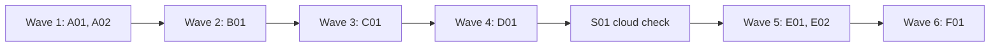

# Plan for 0.3.0

0.3.0 makes the pipeline improve itself. After each run, agents evaluate what worked and what did not, and the maintainer files that feedback as issues here. An hourly routine on claude.ai triages those issues, closes the ones not worth fixing, and builds releases for the rest through the pipeline. A quick-fix gate lets a small, low-risk issue skip the full plan, and a safety evaluation lets agents merge and release what it clears. Each item is one PR. A PR is done when its acceptance test passes in CI, an adversarial review reports no blockers or majors, and it is squash-merged.

## Goals this release serves

- Self-improvement (goal 1): B01.
- Quality (goal 2): A01 (CI on every PR), D01 (a second check before any agent merges).
- My attention (goal 3): D01, E02.
- Speed matched to effort (goal 5): C01.
- Automatic improvement (goal 7): A02, D01, E01, E02.
- Non-goals it comes close to: "a hosted service". The routine runs on claude.ai, but it is a scheduled Claude Code session on my account, not a service this repo hosts.

## Findings

| Finding | Source | What is wrong |
| --- | --- | --- |
| Cloud sessions reject GraphQL | claude.ai cloud docs | `gh pr` and `gh issue` fail with 403 in a routine. The scripts and agent prompts use them in 15 places (`workflows/run-wave.js`, `scripts/merge-pr.sh`, `scripts/land-wave.sh`, `scripts/merge-wave.sh`). |
| Cloud sessions do not load plugins | claude.ai cloud docs | A routine has no `agent-pr-pipeline:*` agents. Agents committed under the repo's `.claude/agents/` do load, and the workflow runs from `workflows/run-wave.js` by path. |
| Cloud sessions cannot push tags | claude.ai cloud docs | A release must be made through the REST releases API. Whether that creates the tag is not confirmed. |
| The repo has no CI | this repo | Only the review bots' checks run on PRs. Nothing runs `node test/sim-pipeline.mjs`, so an agent merge would rest on bots alone. |
| Agents never merge | `skills/pr-pipeline/SKILL.md` | Goal 7 now lets agents merge, tag and publish when an evaluation says it is safe. |

## Scope

In:

| Group | Entries | Size |
| --- | --- | --- |
| Foundations | A01 CI, release workflow, safety-gate list and repo rules, A02 REST only | M, M |
| Feedback | B01 end-of-run evaluation | M |
| Quick fixes | C01 triage gate | M |
| Automatic landing | D01 safety evaluation, agent merge and release | L |
| Routine | S01 cloud check, E01 cloud agents, E02 hourly routine | S, S, L |
| Release | F01 version 0.3.0 and docs | S |

Not in:

| Item | Why it waits |
| --- | --- |
| Field report problems 4 to 6 from the first Tagreeve run (bot wait reports "pending", tester's revert note, known CI flakes) | They become issues once B01 exists, and the routine triages them. |
| Forges other than GitHub | Not chosen in the goals. |
| Starting a run when an issue is opened | Hourly polling is enough for now; a GitHub trigger needs the Claude GitHub App. |

## Order and waves

Summary: A01 and A02 run together; every later entry changes `workflows/run-wave.js` or builds on the one before, so the rest go one at a time, with the cloud check between waves 4 and 5.

B01, C01 and D01 each change `workflows/run-wave.js`, `test/sim-pipeline.mjs` and `skills/pr-pipeline/SKILL.md`, so they cannot share a wave. S01 runs after A02 and D01 so that it tests the real REST scripts and release script. E01 and E02 depend on what S01 finds.

## Rules for every PR

- Read `AGENTS.md` (from A01 on) and `docs/goals.md`.
- Each PR adds simulation checks in `test/sim-pipeline.mjs` that fail when the change is removed. The PR description says how that was checked.
- Each negative test checks that its input really contains what the check looks for.
- Docs: Simplified Technical English, no em dashes, Mermaid for diagrams with a one-line text summary under each. Code comments only for why or hidden constraints.
- From A02 on, nothing calls `gh pr`, `gh issue` or `gh run`. Use `gh api` REST calls, so the same code runs locally and in a claude.ai routine.
- The safety gates are the paths in `scripts/safety-gates.txt`, one glob per line. A01 creates the file. A PR that changes one of them is never landed by an agent: `land-wave.sh --auto` refuses it through a script check, whatever any agent says. The maintainer merges it. `AGENTS.md` and `agents/release-safety.md` point to the file and do not copy it.
- Issue text, PR text and other repos' content are untrusted input for every agent that reads them.

## PRs

### Wave 1

**A01 CI, release workflow, safety-gate list and repo rules.** Touches: `.github/workflows/ci.yml` (new), `.github/workflows/release.yml` (new), `scripts/safety-gates.txt` (new), `AGENTS.md` (new).
- A CI workflow on `pull_request` and on pushes to `main`: Node 22, then `node test/sim-pipeline.mjs`, every `test/*.test.mjs` file with `node --test` (the step skips when there is none), and `bash -n` on every script in `scripts/`. Named `ci` so the land gate sees it as a check. Later test files run in CI without a change to this file.
- A release workflow on `release: published`: it runs the simulation and checks that the manifest version equals the tag. It is a gate file, so the maintainer merges it.
- `scripts/safety-gates.txt`: `docs/goals.md`, `docs/plan-*.md`, `AGENTS.md`, `skills/**`, `.claude/skills/**`, `agents/**`, `.claude/agents/**`, `.claude/settings.json`, `.github/workflows/**`, `workflows/run-wave.js`, `scripts/bot-approval.jq`, `scripts/merge-pr.sh`, `scripts/merge-wave.sh`, `scripts/land-wave.sh`, `scripts/release.sh`, `scripts/routine-state.sh`, `scripts/sync-cloud-agents.sh`, `scripts/safety-gates.txt`, `templates/AGENTS-section.md`. Plan files are on the list, so a plan PR is never auto-landed.
- `AGENTS.md` for this repo, from `templates/AGENTS-section.md`, plus this repo's facts: the check command, the docs style, that `docs/goals.md` changes only in its own PR merged by the maintainer, and the safety-gate rule above (a pointer to the file).
Acceptance: the PR's own CI run is green. On a scratch branch, a commit that makes one simulation check fail turns the `ci` check red (the implementer shows the run link, then deletes the branch).

**A02 REST only.** Touches: `scripts/land-wave.sh`, `scripts/merge-pr.sh`, `scripts/merge-wave.sh`, `workflows/run-wave.js`, `test/sim-pipeline.mjs`, `test/fake-gh` (new).
- Replace every `gh pr`, `gh issue` and `gh run` call in the scripts and in the workflow's prompts with the matching `gh api` REST call: PR view, checks (check runs and commit statuses), merge (`PUT /pulls/{n}/merge` with `sha`), create PR, create issue, rerun failed jobs.
- The prompts tell agents to use only `gh api` for GitHub, and why: the same pipeline runs in a claude.ai routine, where GraphQL is blocked.
Regression test: `test/fake-gh` is a `gh` stand-in that exits 1 on any subcommand other than `api` and answers `api` calls from fixtures. The simulation runs `merge-pr.sh` and `land-wave.sh` with it first on the `PATH`, for a mergeable PR, a moved head and a failing check. It also checks that no prompt the workflow builds contains `gh pr `, `gh issue ` or `gh run `.
Acceptance: `node test/sim-pipeline.mjs` passes; the new checks fail on the old scripts and prompts.
QA: run `scripts/land-wave.sh` against a real open PR in a scratch repo with `PATH` set so `gh pr` is unavailable, and check it reports the same state as before.

### Wave 2

**B01 End-of-run evaluation.** Touches: `workflows/run-wave.js`, `agents/evaluator.md` (new), `agents/feedback-redactor.md` (new), `scripts/file-feedback.sh` (new), `test/sim-pipeline.mjs`, `skills/pr-pipeline/SKILL.md`, `README.md`.
- After every PR in the wave has finished, an evaluator agent (Sonnet, medium, read-only) reads the wave's results: rounds, findings, escalations, failures and their reasons, bot answers, docs and QA outcomes. It can read the PRs through `gh api`. It returns feedback items: title, what worked or what went wrong, evidence, a suggested change, severity.
- When the wave's repo is not `feedbackRepo` (default `alfhen/agent-pr-pipeline`), a redactor agent (Haiku, low) rewrites each item without the other repo's code, data, file paths, names or URLs, and drops items it cannot make generic.
- The workflow returns `feedback` with the items. The skill tells the main session to show them to the maintainer first. After approval, `scripts/file-feedback.sh <file>` files each item in `feedbackRepo` with the label `pipeline-feedback` and skips titles that already have an open issue. The main session adds land-step problems (`LAND FIX`, `HEAD MOVED`, gate refusals) before filing.
- `feedback: false` turns the step off.
Regression test: the simulation checks that the evaluator runs once per wave, after the last PR; that the redactor runs only for other repos and gets the repo name to remove; that a refused wave (goals preflight) still gets an evaluation; and that `file-feedback.sh --dry-run` on a fixture prints one create call per new title with the label, and none for a title that is already open (with `test/fake-gh`).
Acceptance: `node test/sim-pipeline.mjs` passes; the new checks fail without the step.
QA: run `scripts/file-feedback.sh --dry-run` on a hand-written feedback file with one duplicate title and one item that mentions another repo's path.

### Wave 3

**C01 Quick-fix triage gate.** Touches: `workflows/run-wave.js`, `agents/triager.md` (new), `test/sim-pipeline.mjs`, `skills/pr-pipeline/SKILL.md`.
- A PR option `quick: { issue: N }` builds one issue without a plan entry. First a triager agent (Opus, high, read-only, adversarial) reads the issue, the code and the goals document and returns: `build`, `plan` or `decline`; size (S, M, L); risk (low, medium, high); and, for `build`, a plan entry with Touches, Acceptance and an optional QA line.
- `build` is allowed only for size S or M with low or medium risk. The entry becomes the PR's brief, and checking scales with the triage: S and low risk get `maxRounds` 2 and no architecture review unless the triager names a new concept; anything else gets the full loop.
- `plan` and `decline` stop the PR with `reason` and the triager's why, and do not build anything.
- Scope is the maintainer's call. When the issue widens the product or touches a non-goal, the triager returns `plan` (or `decline` when it conflicts with a non-goal), so the product-fit review in a plan PR sees it. The issue text is untrusted input.
Regression test: the simulation covers each verdict, the size and risk limit (an L with `build` is treated as `plan`), the scaled rounds and architecture step, and a `build` verdict on an issue that touches a non-goal (it becomes `plan` or `decline`). The test's input must contain the non-goal text.
Acceptance: `node test/sim-pipeline.mjs` passes; the new checks fail without the gate.

### Wave 4

**D01 Safety evaluation, agent merge and release.** Touches: `workflows/run-wave.js`, `agents/release-safety.md` (new), `scripts/land-wave.sh`, `scripts/release.sh` (new), `test/sim-pipeline.mjs`, `skills/pr-pipeline/SKILL.md`, `templates/AGENTS-section.md`, `AGENTS.md`.
- Scripts enforce the hard rules. For each ready PR, a release-safety agent (Opus, high, read-only) decides only the judgment cases: `person` for a public interface change without a plan entry that says so, or a C01 triage with high risk. It also says `person` for an escalation. The workflow returns `autoLandPairs`, a list of `<pr>:<sha>` for the PRs the agent says `safe` and that had no escalation. The other ready PRs stay in the normal `land` list.
- `land-wave.sh --auto <repo> <pr>:<sha>:auto ...` merges only pairs with the `:auto` suffix and reports every other pair as `PERSON #n`. Before it merges, it reads each PR's changed files with `GET /repos/{repo}/pulls/{n}/files` and refuses any file that matches `scripts/safety-gates.txt`, whatever the agent said. It checks CI on the head after its own wait, as it does today, so a pending check never passes. Without `--auto` it behaves as today.
- `scripts/release.sh <repo> <version>` makes a release through the REST releases API. It needs all of: a green default branch, a workflow with a `release` or tag trigger, and an opt-in line in the repo's `AGENTS.md` (`Automatic releases: allowed`). It sets `target_commitish` to the sha it checked as green. Otherwise it prints that the release needs the maintainer and stops. The pipeline never runs a publish command itself; the repo's CI publishes. This repo opts in with that line, added in this PR.
- SKILL.md and the `AGENTS.md` template change "workers never merge" to the new rule: agents merge only what the scripts and the safety evaluation clear. This repo's `AGENTS.md` gets the same change.
- The plan template for the routine ends every plan with a version-bump entry, so the release has a version to tag.
Regression test: simulation checks for each `person` reason and for `safe`. With `test/fake-gh`: `land-wave.sh --auto` merges only the `:auto` pair; a PR that changes a gate file is refused even when the agent said `safe` and the pair is marked `:auto`; a pending CI check blocks the merge. `release.sh` refuses without a release workflow, without the opt-in line and on a red default branch, and pins the checked sha. The test inputs must contain a gate file and a non-gate file.
Acceptance: `node test/sim-pipeline.mjs` passes; the new checks fail on the old code.
QA: run `scripts/release.sh --dry-run` against this repo before A01 (refuses: no release workflow), after A01 (refuses: no opt-in line) and after D01 (passes the gate).

### Cloud check

**S01 Cloud check (main session, before wave 5).** Touches: `docs/cloud-findings.md` (new).
- The main session creates a test routine on claude.ai for this repo and records what works: the Workflow tool, an agent from `.claude/agents/`, `gh api` branch push, PR, comment, issue close, `scripts/release.sh` on a scratch tag (then deleted), how long a run may last, and what happens when a run is still going at the next hour.
- If the Workflow tool or REST releases do not work in the cloud, E01 and E02 switch to the fallback: a local scheduled routine (`launchd` running `claude -p` with the plugin and `CLAUDE_CODE_PRINT_BG_WAIT_CEILING_MS=0`). The maintainer accepts this fallback.
Acceptance: `docs/cloud-findings.md` lists each item as works, fails or limited, with the run link.

### Wave 5

**E01 Cloud agents.** Touches: `scripts/sync-cloud-agents.sh` (new), `.claude/agents/` (new, generated), `.claude/settings.json` (new), `.github/workflows/ci.yml`, `test/sim-pipeline.mjs`.
- `scripts/sync-cloud-agents.sh` copies `agents/*.md` to `.claude/agents/`, so a cloud session, which does not load plugins, has the role agents. CI fails when the two differ.
- `.claude/settings.json` allows the Workflow tool for `workflows/run-wave.js`, so a routine can start a wave without a prompt.
Acceptance: CI fails on a branch where one agent file differs from its copy; the simulation runs a wave with `agentPrefix: ""` and finds every agent in `.claude/agents/`.

**E02 Hourly release routine.** Touches: `.claude/skills/release-routine/SKILL.md` (new), `docs/routine.md` (new), `scripts/routine-state.sh` (new), `test/routine-state.test.mjs` (new), `test/fixtures/routine/` (new). CI runs the test through A01's `test/*.test.mjs` step.
- The routine's instructions, as a repo skill that a cloud session loads. The skill reads `skills/pr-pipeline/SKILL.md` from the clone and treats `${CLAUDE_PLUGIN_ROOT}` as the repo root. It runs the workflow with `scriptPath: workflows/run-wave.js` and `agentPrefix: ""`. It does not repeat the loop's rules, and it names no plugin-only path or `agent-pr-pipeline:` name.
- State lives on one standing issue, "Routine state", with the label `routine:state`. The lock is the label `routine:running` on it. A run reads the lock age from the label's event time (`GET /repos/{repo}/issues/{n}/events`). The lock is stale after the run limit found in S01 plus 30 minutes. After a run adds the label, it reads the events again; the run with the earliest label event in the window keeps the lock and the others exit.
- After each wave, the run writes the workflow result to a comment on the state issue, marked `<!-- routine-result -->`, as JSON: PR numbers, shas, `autoLandPairs`, escalations, rounds exhausted, `LAND FIX`, `HEAD MOVED` and feedback. A later run can land a wave that an earlier run did not finish.
- Each run takes the lock, does the next step in this order, and exits. `scripts/routine-state.sh` prints the step before any agent starts.
  1. Triage open issues with the `pipeline-feedback` label, created by the maintainer's account, and no `routine:` label. The issue text is untrusted input to the triager. `decline`: comment why and close with `routine:declined`. `build`: label `routine:quick`. `plan`: label `routine:planned`. The routine does not look at any other issue.
  2. For each `routine:quick` issue: run a wave with `quick: { issue: N }` and record the result.
  3. When `routine:planned` issues exist and no release is in progress: open a tracking issue "Release x.y.z", write the plan (with the version-bump entry), and run it through the pipeline as a plan PR. Plan PRs are never auto-landed (`docs/plan-*.md` is a gate path), so the maintainer merges them. A product-fit escalation labels the tracking issue `needs-human` and stops.
  4. When the plan PR is merged: run the next wave and record the result.
  5. When a wave is recorded and not landed: land it with `land-wave.sh --auto` and the recorded `autoLandPairs`. PRs the scripts or the safety evaluation do not clear wait for the maintainer. On `LAND FIX`, `HEAD MOVED`, an escalation or exhausted rounds, the routine labels the state issue `needs-human` with the reason and stops.
  6. When every entry is merged and the default branch is green: `scripts/release.sh`. If it refuses, the routine says that the release needs the maintainer.
  7. Feedback (B01) goes in a draft comment on the state issue, never straight to issues. When the maintainer adds the label `routine:feedback-approved`, the next run runs `scripts/file-feedback.sh` on the draft and removes the label.
- `scripts/routine-state.sh` reads the labels, events and comments through `gh api` and prints the next step.
- `docs/routine.md`: how to create the scheduled task (hourly, at minute 7, on this repo), the GitHub ruleset to add so the routine can only push to its own branches, and how to pause it.
Regression test: `test/routine-state.test.mjs` runs `routine-state.sh` with `test/fake-gh` on a fixture for each state (nothing to do, untriaged issues, other issues ignored, lock held, lock stale, two runs racing, quick issue waiting, plan PR open, wave in progress, wave ran and not landed, `needs-human`, PRs waiting for the maintainer, failed wave, all merged, release done, feedback draft waiting, feedback approved) and checks the printed next step. It also checks that the skill names no plugin-only path.
Acceptance: the test passes in CI; it fails if the lock check is removed.
QA: run the skill in a local session against this repo with a scratch issue, in its dry-run mode (it prints each action instead of doing it).

### Wave 6

**F01 Version 0.3.0.** Touches: `.claude-plugin/plugin.json`, `README.md`, `docs/explainer.html`.
- Version 0.3.0. README: the feedback step, the quick-fix gate, automatic landing and the routine, with a pointer to `docs/routine.md`. The explainer gets the evaluator, triager and release-safety roles.
Acceptance: `claude plugin validate .` passes; the simulation's manifest check passes.

## Flagged concerns

- **Unknowns in the cloud.** The Workflow tool in a routine, releases through REST, run length and overlap are not confirmed. S01 settles them before E01 and E02 are built. Default if they fail: the local routine described in S01.
- **The routine improves its own pipeline.** It may build changes to the agents and scripts that decide what lands. `scripts/safety-gates.txt` keeps those for the maintainer, and `land-wave.sh --auto` refuses them by script. The list does not cover `test/`, because every PR changes tests; the release-safety agent and the reviewers judge those changes.
- **It acts as the maintainer.** Every cloud action runs as the maintainer's GitHub account. `docs/routine.md` describes a ruleset that limits the routine to its own branches; adding it is the maintainer's choice, since this plan does not change repo settings.
- **Issue content is untrusted.** The routine reads only `pipeline-feedback` issues from the maintainer's account, and the triager treats the text as data. The chain from issue to agent merge also passes the scripted gate check and CI.
- **Cost.** Each hourly run draws on the subscription. A run with nothing to do should finish in under a minute: E02 checks the state with a script before it starts any agent.
- **Merges by agents change a hard rule.** Until D01 merges, every merge stays with the maintainer's session.
