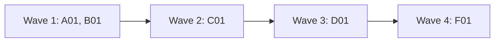

# Plan for 0.3.0

0.3.0 gives the pipeline the parts it needs to improve itself. After each run, agents evaluate what worked and what did not, and after the maintainer approves it, that feedback is filed as issues here. A quick-fix gate lets a small, low-risk issue skip the full plan. A scripted safety gate and a safety evaluation let agents merge and release what they clear. The hourly routine that uses these parts to triage feedback and build releases on its own is planned separately for 0.4.0, once these parts are in use. Each item is one PR. A PR is done when its acceptance test passes in CI, an adversarial review reports no blockers or majors, and it is squash-merged.

## Goals this release serves

- Self-improvement (goal 1): B01.
- Quality (goal 2): A01 (CI on every PR), D01 (a scripted gate and a second check before any agent merges).
- My attention (goal 3): D01.
- Speed matched to effort (goal 5): C01.
- Automatic improvement (goal 7): D01 (agents may merge and release what the gate and the evaluation clear). The routine follows in 0.4.0.
- Non-goals it comes close to: none.

## Findings

| Finding | Source | What is wrong |
| --- | --- | --- |
| The repo has no CI | this repo | Only the review bots' checks run on PRs. Nothing runs `node test/sim-pipeline.mjs`, so an agent merge would rest on bots alone. |
| Agents never merge | `skills/pr-pipeline/SKILL.md` | Goal 7 now lets agents merge, tag and publish when an evaluation says it is safe. |
| One GitHub identity | this plan | Agents act as the maintainer's account, so GitHub cannot tell their merges from the maintainer's. Script gates catch agent mistakes; they cannot stop an agent that ignores them. |
| The routine needs its own design | three plan reviews of an earlier 0.3.0 plan | Most findings were about the routine: mode enforcement beyond `gh`, a session that can edit its own guard files, the plugin folder versus the target clone, state records. It gets its own plan in 0.4.0. |

## Scope

In:

| Group | Entries | Size |
| --- | --- | --- |
| Foundations | A01 CI, release workflow, pipeline settings and repo rules | M |
| Feedback | B01 end-of-run evaluation | M |
| Quick fixes | C01 triage gate | M |
| Automatic landing | D01 safety gate, safety evaluation, agent merge and release | L |
| Release | F01 version 0.3.0 and docs | S |

Not in:

| Item | Why it waits |
| --- | --- |
| The hourly release routine (triage `pipeline-feedback` issues opened by the maintainer, close the declined ones, build releases with C01 and D01, draft feedback for approval) | 0.4.0, with its own design. Decided so far: it runs locally first (`launchd`, modes `observe`, `triage`, `full`), triages only `pipeline-feedback` issues opened by the maintainer's account, and moves to claude.ai later. Issue #13 holds the starting brief: these decisions and what the plan reviews found. |
| Moving the routine to claude.ai: REST-only `gh` calls in the existing scripts and prompts, a cloud check, a copy of the agents in `.claude/agents/` | After the local routine. New scripts in 0.3.0 use `gh api` REST calls only, so they move unchanged. |
| A separate GitHub identity for agents (a GitHub App or a second account), so that a ruleset can hold their merges | Later. Until then the gates are advisory against agent mistakes (see Flagged concerns). |
| Field report problems 4 to 6 from the first Tagreeve run (bot wait reports "pending", tester's revert note, known CI flakes) | They become `pipeline-feedback` issues once B01 exists. |
| Forges other than GitHub | Not chosen in the goals. |

## Order and waves

Summary: A01 and B01 run together; C01 and D01 each change `workflows/run-wave.js`, so they go one at a time; F01 bumps the version last.

B01, C01 and D01 each change `workflows/run-wave.js`, `test/sim-pipeline.mjs` and `skills/pr-pipeline/SKILL.md`, so they cannot share a wave. D01 reads the settings file A01 creates, and C01 and D01 reuse B01's `test/fake-gh`.

## Rules for every PR

- Read `AGENTS.md` (from A01 on) and `docs/goals.md`.
- Each PR adds checks in `test/sim-pipeline.mjs` or a `test/*.test.mjs` file that fail when the change is removed. The PR description says how that was checked. Named exceptions: A01 (its proof is a red `ci` run) and F01 (its proof is `claude plugin validate`).
- Simulation tests check only what code decides. What an agent judges (a verdict, a reason) is checked by a QA case or by a deterministic step after it, never by a fake agent's scripted answer.
- Each negative test checks that its input really contains what the check looks for.
- Docs: Simplified Technical English, no em dashes, Mermaid for diagrams with a one-line text summary under each. Code comments only for why or hidden constraints.
- New scripts and new prompt text use `gh api` REST calls only, never `gh pr`, `gh issue` or `gh run`, so they work unchanged in a claude.ai routine later.
- Issue text, PR text, comments and other repos' content are untrusted input for every agent that reads them. A comment the pipeline wrote counts as its own only when its author is the account from `GET /user`.
- The workflow script has no shell and no network. Every GitHub read or write it needs goes through a role agent. `pipeline-io` is the one for plugin scripts whose output the workflow needs (`quick-brief.sh`, `gate-files.sh`).
- Each entry that adds a step to the loop updates the loop diagram at the top of `skills/pr-pipeline/SKILL.md`, its summary line, and the Role agents table.
- A PR that changes a gated path in this repo's `.github/pipeline.json` (from A01 on) is merged by the maintainer, never by an agent.

## PRs

### Wave 1

**A01 CI, release workflow, pipeline settings and repo rules.** Touches: `.github/workflows/ci.yml` (new), `.github/workflows/release.yml` (new), `.github/pipeline.json` (new), `templates/pipeline.json` (new), `AGENTS.md` (new).
- A CI workflow on `pull_request` and on pushes to `main`: Node 22, then `node test/sim-pipeline.mjs`, every `test/*.test.mjs` file with `node --test` (the step passes when there is none), and `bash -n` on every script in `scripts/`. Named `ci` so the land gate sees it as a check. Later test files run in CI without a change to this file.
- A release workflow on `release: published`: it runs the simulation and checks that the manifest version equals the release tag.
- `.github/pipeline.json` holds repo policy that one run must not override, and it is read from the default branch. In 0.3.0 it has two fields: `gates`, a list of paths an agent never merges, and `autoRelease`, `true` or `false` (default `false`). Later policy, such as the routine's, goes in the same file. Choices for one run (`feedback`, `feedbackRepo`, `rounds`, models) stay workflow arguments, never in this file. Paths: `*` matches inside one path segment, `**` matches across segments, a path ending in `/` matches everything under it.
- `templates/pipeline.json`: the default for any repo: `gates` holds `docs/goals.md`, `docs/plan-*.md`, `AGENTS.md`, `CLAUDE.md`, `.github/**`, `.claude/**`, and the files that change what gets installed or deployed: `**/package.json`, `**/composer.json`, `**/*.lock`, `**/package-lock.json`, `**/pnpm-lock.yaml`, `**/Dockerfile*`, `**/docker-compose*.yml`, `**/migrations/**`, `**/.env*`; `autoRelease` is `false`.
- This repo's `.github/pipeline.json`: the default gates plus `scripts/**`, `agents/**`, `skills/**`, `workflows/**`, `templates/**`, `.claude-plugin/**`; `autoRelease` `false` (D01 turns it on). `test/` is not gated, because every PR changes tests; the reviewers and the merge-safety agent judge test changes.
- `AGENTS.md` for this repo, from `templates/AGENTS-section.md`, plus this repo's facts: the check commands, the docs style, that `docs/goals.md` changes only in its own PR merged by the maintainer, and a pointer to `.github/pipeline.json`.
Acceptance: the PR's own CI run is green. On a scratch branch, a commit that makes one simulation check fail turns the `ci` check red (the implementer shows the run link, then deletes the branch). `jq . .github/pipeline.json templates/pipeline.json` succeeds.

**B01 End-of-run evaluation.** Touches: `workflows/run-wave.js`, `agents/evaluator.md` (new), `agents/feedback-redactor.md` (new), `scripts/file-feedback.sh` (new), `test/fake-gh` (new), `test/feedback.test.mjs` (new), `test/sim-pipeline.mjs`, `skills/pr-pipeline/SKILL.md`, `README.md`.
- After every PR in the wave has finished, an evaluator agent (Sonnet, medium, read-only) reads the wave's results: rounds, findings, escalations, failures and their reasons, bot answers, docs and QA outcomes. It can read the PRs through `gh api`. It returns feedback items: title, what worked or what went wrong, evidence, a suggested change, severity.
- When the wave's repo is not `feedbackRepo` (default `alfhen/agent-pr-pipeline`), a redactor agent (Haiku, low) rewrites each item without the other repo's code, data, file paths, names or URLs, and drops items it cannot make generic. The redactor is the first pass only. The workflow also returns a denylist: the source repo's owner and name, and the paths of the wave's changed files. The evaluator supplies those paths in its result (it reads `GET /repos/{repo}/pulls/{n}/files` for each PR), because the workflow has no shell. When the wave's repo is `feedbackRepo`, the redactor does not run and the denylist is empty.
- The workflow returns `feedback` with the items. The skill tells the main session to show them to the maintainer first. After approval, `scripts/file-feedback.sh <file> --denylist <file>` first refuses, and reports instead of filing, any item whose text contains a denylist string, the source repo's owner or name, or a URL of that repo. It then files each item in `feedbackRepo` with the label `pipeline-feedback` and skips titles that already have an open issue. The main session adds land-step problems (`LAND FIX`, `HEAD MOVED`, gate refusals) before filing.
- `feedback: false` turns the step off.
- The workflow result changes from a list of PR objects to `{ prs: [...], feedback: [...], denylist: [...] }`. A refused wave has the same shape, with the refusals in `prs`. The SKILL.md result paragraph and every place that tells the main session where to find the `land` values are updated in this PR.
- `test/fake-gh` is a `gh` stand-in for tests: it answers `gh api` calls from fixture files (including `--paginate`, one fixture file per page, and `--method` with POST, PUT and PATCH), logs every call with its method and path, and exits 1 on any other subcommand. C01 and D01 reuse it. D01 adds fixtures for check runs, releases and the merge endpoint.
- SKILL.md: the loop diagram and its summary get the evaluation step; the Role agents table gets the two agents; the result paragraph gets the new shape.
Regression test: the simulation checks that the evaluator runs once per wave, after the last PR; that the redactor runs only for other repos and its prompt carries the repo name to remove; that a refused wave (goals preflight) still gets an evaluation; and that the result has the new shape, for a normal and a refused wave. `test/feedback.test.mjs` runs `file-feedback.sh --dry-run` with `test/fake-gh` on a fixture and checks one create call per new title with the label, and none for a title that already has an open issue (the fixture contains that title). It also checks that an item containing the repo owner, the repo name, a repo URL or a denylist path is reported and not filed (one fixture item per string).
Acceptance: `node test/sim-pipeline.mjs` and `node --test test/feedback.test.mjs` pass; the new checks fail without the step.
QA: run `scripts/file-feedback.sh --dry-run` on a hand-written feedback file with one duplicate title and one item that mentions another repo's path. Run one real wave on a scratch repo and read whether the redactor left any of its names or paths in the items.

### Wave 2

**C01 Quick-fix triage gate.** Touches: `workflows/run-wave.js`, `agents/triager.md` (new), `agents/pipeline-io.md` (new), `scripts/quick-brief.sh` (new), `scripts/trusted-comment.jq` (new), `test/sim-pipeline.mjs`, `test/quick-brief.test.mjs` (new), `skills/pr-pipeline/SKILL.md`.
- A PR option `quick: { issue: N }` builds one issue without a plan entry. First a triager agent (Opus, high, read-only, adversarial) reads the issue, the code and the goals document and returns: `build`, `plan` or `decline`; size (S, M, L); risk (low, medium, high); and, for `build`, a plan entry with Touches, Acceptance and an optional QA line.
- The workflow decides what code can decide: `build` with size L or high risk becomes `plan`. `plan` and `decline` stop the PR with `reason` and the triager's why, and build nothing.
- Scope check: for a `build`, the product-fit reviewer then reads the entry and the goals, as it does for a plan PR. An `escalate` stops the PR with `needs human: product`; `notes` become minor issues. A quick fix never skips the product-fit check.
- The brief: a new `pipeline-io` agent (Haiku, low, Bash only, no CLAUDE.md, like the bot waiter) runs the plugin's GitHub scripts when the workflow needs their output, and returns that output with no judgment. Other roles keep the GitHub work they already do. For a `build`, it runs `scripts/quick-brief.sh put <repo> <issue>`, which posts the entry once as an issue comment that starts with `<!-- pipeline:quick-brief -->`. Every later agent (implementer, tester, reviewers, architecture reviewer, fixer) gets that entry as its brief. A resume or a rerun with `skipImpl` runs `scripts/quick-brief.sh get`, and the triager does not run again.
- Where the scripts are: a new workflow argument `pluginRoot`, which the skill tells the main session to set from `${CLAUDE_PLUGIN_ROOT}`, goes into every `pipeline-io` prompt. `pipeline-io` runs scripts only from that folder, never from a clone of the target repo, so a PR cannot change the script that judges it. Without `pluginRoot`, a step that needs `pipeline-io` stops the PR with that reason.
- `scripts/trusted-comment.jq` is the one rule for "a comment the pipeline wrote". It takes a marker prefix (for example `<!-- pipeline:quick-brief`) and returns the full body of the one comment that starts with that prefix and whose author is the account from `GET /user`. Two such comments are an error, and the PR stops. Comments by any other account are ignored. D01's `merge-cleared` records use the same file unchanged. `quick-brief.sh get` uses it; the routine in 0.4.0 reuses it.
- Checking scales with the triage: S and low risk get `maxRounds` 2 and no architecture review unless the triager names a new concept; anything else gets the full loop.
- For a quick-only wave, `plan` is optional, and the prompts name the issue URL where they would name the plan.
- SKILL.md: the Workflow options (with `pluginRoot`), the frontmatter description (it says "Not for a single quick fix" and must now mention the quick option), the loop diagram and its summary, and the Role agents table (triager, pipeline-io).
Regression test: the simulation checks: an L or high-risk `build` becomes `plan`; `plan` and `decline` start no implementer; a `build` runs the product-fit reviewer on the entry, and its `escalate` stops the PR; the implementer, tester, reviewer and architecture prompts all carry the same entry; a rerun calls `pipeline-io` for `get` and not the triager; the scaled rounds and architecture step; the goals path reaches the triager's prompt; `pluginRoot` reaches every `pipeline-io` prompt, and a quick build without it stops. `test/quick-brief.test.mjs` runs `quick-brief.sh get` with `test/fake-gh` on fixtures: one trusted comment (used), a marker comment by another account only (ignored, no brief), a forged comment before the trusted one (the trusted one is used), and two trusted comments (error). Each fixture contains the marker and the author its check looks for.
Acceptance: `node test/sim-pipeline.mjs` and `node --test test/quick-brief.test.mjs` pass; the new checks fail without the gate.
QA: run one quick fix on a scratch repo for a small real issue, and one for an issue that asks for something the goals list as a non-goal; check that the second stops at the triager or the product-fit step.

### Wave 3

**D01 Safety gate, safety evaluation, agent merge and release.** Touches: `workflows/run-wave.js`, `agents/merge-safety.md` (new), `agents/pipeline-io.md`, `scripts/merge-pr.sh`, `scripts/land-wave.sh`, `scripts/merge-wave.sh`, `scripts/gate-files.sh` (new), `test/fake-gh`, `scripts/release.sh` (new), `test/sim-pipeline.mjs`, `test/gate.test.mjs` (new), `skills/pr-pipeline/SKILL.md`, `templates/AGENTS-section.md`, `AGENTS.md`, `.github/pipeline.json`.
- **One land format.** A PR's `land` value stays `<pr>:<sha>`, and becomes `<pr>:<sha>:auto` when an agent may merge it. There is no second list. `land-wave.sh` and `merge-wave.sh` split the suffix off the pair and give `merge-pr.sh` an `--auto` flag, so the sha field is always a bare sha. Both scripts also accept `--person` and pass it through.
- **REST only.** D01 converts the `gh pr` calls in `merge-pr.sh`, `land-wave.sh` and `merge-wave.sh` to `gh api` REST calls (the pull request, its check runs, and `PUT /repos/{repo}/pulls/{n}/merge` with `sha` set to the checked sha). Branch deletion becomes `gh api -X DELETE repos/{repo}/git/refs/heads/{branch}`, run only after `GET /repos/{repo}/pulls/{n}` shows `merged: true`; no script calls `git push`. `PIPELINE_TEST_FAST=1` sets every sleep and poll count to zero, for tests only. `test/fake-gh` then covers every call these scripts make, with fixtures for the merged pull request, and a logged `PUT .../merge` counts as the merge call.
- **The scripted gate.** `scripts/gate-files.sh <repo> <pr>` lists the PR's changed files through `GET /repos/{repo}/pulls/{n}/files`, every page, and matches both `filename` and `previous_filename` (so moving a file out of a gated path still counts) against `gates` from `.github/pipeline.json` on the default branch, or from `templates/pipeline.json` when the repo has none. It fails closed: on an API error, at 3000 files, or when the settings cannot be read, it reports the PR as gated.
- **Agent merges always pass the gate.** `merge-pr.sh` is the one place that merges. It runs the gate first, before any other call, when it is called with `--auto` or when `CLAUDECODE` is set (Claude Code sets it in every shell it runs). In those cases it also requires `--auto`, which only a `:auto` pair produces. So a Claude session that forgets `--auto` is still refused. `--person` skips only the gate and the `--auto` requirement. It keeps the `<pr>:<sha>` pin, the `HEAD MOVED` check, the wait for CI and the bot clearing, and a merge without a matching sha is refused. A merge the maintainer asked for in the conversation uses `--person`, and the skill tells sessions to use it only then. Most PRs in this repo are gated, so this is the normal path here. The maintainer's own terminal, without `CLAUDECODE`, is not affected.
- **The judgment check.** For each ready PR, `pipeline-io` runs `gate-files.sh` first. For a PR the gate does not hold, a merge-safety agent (Opus, high, read-only) decides `safe` or `person`: `person` for a public interface change without a plan entry that says so, a C01 triage with high risk, or anything it cannot judge. The workflow adds `:auto` only when the gate passed, the agent said `safe`, and the PR had no escalation and no exhausted rounds.
- **Final sha only.** The gate and the merge-safety agent run on the head sha that goes into the `land` value, after the docs step and the bot answers. One function in the workflow builds every `land` value, including the `landFix` and `skipImpl` paths. A land-fixer that pushes a new head gets the gate and the merge-safety agent again on that head, and a `skipImpl` rerun does the same. No `:auto` carries over from an earlier sha. `merge-pr.sh` re-runs the gate on the sha it merges.
- **Merge record.** When `merge-pr.sh` merges, it posts a comment `<!-- pipeline:merge-cleared auto|person <sha> -->` as the account from `GET /user`. `release.sh` reads these comments through `scripts/trusted-comment.jq`, with the marker prefix `<!-- pipeline:merge-cleared`; the mode and the sha follow the prefix.
- **Releases.** `scripts/release.sh <repo> <version>` makes a release through the REST releases API. The main session runs it after the last wave has landed and the default branch is green on CI; an agent never runs it on its own. It needs all of: `autoRelease: true` in `.github/pipeline.json` on the default branch, a workflow with a `release` or tag trigger, a green default branch, and a safety verdict on the release range: every commit since the last tag belongs to a merged PR with a trusted `merge-cleared` comment for the merged head sha (`auto` or `person`). A commit with no such PR or comment, such as a hand merge, means the release needs the maintainer. When the repo has no tag yet, `release.sh` always refuses with "no tag yet: the first release needs the maintainer", because commits from before the merge records would ship unchecked. So 0.3.0 itself is released by the maintainer, and every later range starts at a tag the maintainer made. `--dry-run` prints each check and the release it would create, and calls no write endpoint. It sets `target_commitish` to the sha it checked as green. Before any write call, it checks that the version in the repo's manifest at that sha (`.claude-plugin/plugin.json`, or `package.json` or `composer.json` when present) equals the release version, and refuses on a mismatch. Otherwise it prints what is missing and stops. The pipeline never runs a publish command itself; the repo's CI publishes. This PR sets `autoRelease: true` for this repo.
- SKILL.md and the `AGENTS.md` template change "workers never merge" to the new rule: agents merge only what the gate and the safety evaluation clear. Updated in this PR: the frontmatter description ("the main session merges"), the loop diagram and its summary (the gate and the merge-safety step), the land step, Step 3 (where the main session runs `release.sh`), the result fields and land pairs, a sentence on the settings split (policy in `.github/pipeline.json`, run choices in workflow arguments), the Role agents table, the Lessons line "Publishing to a package registry, and creating releases, stay with the person" (agents may create a release through `release.sh` under its conditions; publishing stays with CI), and the Files list.
Regression test: `test/gate.test.mjs` runs `gate-files.sh` with `test/fake-gh` on fixtures: a PR with a gated file, a PR with only other files, a rename out of a gated path (`previous_filename` holds it), a second page that holds the only gated file, an API error and missing settings (both gated). It runs `merge-pr.sh` with `CLAUDECODE=1` on a gated PR two ways (with `--auto`, and with no flag); each must exit with the gate's refusal text and `test/fake-gh` must log no merge call. On a non-gated PR, a bare `CLAUDECODE=1` call with no `--auto` must be refused (the merge-safety agent said `person`, so no `:auto`), and a pair without `:auto` through `land-wave.sh` and `merge-wave.sh` must be refused. With `CLAUDECODE` unset and no `--auto`, the gate must not run (the fake-gh log has no files call). Controls: a non-gated PR with `--auto` passes the gate and logs the `PUT .../merge` call with the checked sha; `--person` on a gated PR merges with a matching sha and is refused with a wrong sha. `land-wave.sh` and `merge-wave.sh` each get one case, so the suffix reaches `merge-pr.sh` as `--auto`. `release.sh` refuses with `autoRelease` false, without a release workflow, on a red default branch, on a manifest version that differs from the release version, and with one commit in the range that has no `merge-cleared` comment (or one by another account), with no tag, even when every commit has a `merge-cleared` record (the "no tag yet" text), and in `--dry-run` it logs no write call; it pins the checked sha. All script tests run with `PIPELINE_TEST_FAST=1`, and `test/fake-gh` must log a `DELETE .../git/refs/heads/...` only after a merged state. The simulation checks that `:auto` is added only when the gate passed, the agent said `safe`, and there was no escalation or exhausted rounds; that a gated PR never reaches the merge-safety agent; and that a land-fixed or `skipImpl` PR gets the gate and the agent again on its new head, with no `:auto` kept from the old sha. Each fixture contains the path or state its check looks for.
Acceptance: `node test/sim-pipeline.mjs` and `node --test test/gate.test.mjs` pass; the new checks fail on the old code.
QA: run `scripts/release.sh --dry-run` once on the D01 branch against this repo and expect the "no tag yet" refusal; run `scripts/gate-files.sh` on a real merged PR of this repo that touched `scripts/`; ask the merge-safety agent about one PR that changes a public interface and one that does not.

### Wave 4

**F01 Version 0.3.0.** Touches: `.claude-plugin/plugin.json`, `README.md`, `docs/explainer.html`. The maintainer makes the 0.3.0 release by hand after F01 merges (see D01, "no tag yet").
- Version 0.3.0. README: the feedback step, the quick-fix gate, the safety gate and automatic landing, and `.github/pipeline.json`. The explainer gets the evaluator, triager and merge-safety roles.
Acceptance: `claude plugin validate .` passes; the simulation's manifest check passes.

## Flagged concerns

- **One identity, so the gates are advisory.** Agents and the maintainer are the same GitHub account. `merge-pr.sh` refuses gated PRs for any Claude session, and that catches agent mistakes, but an agent that calls the merge API directly is not stopped by GitHub. A ruleset cannot separate the two while they share an account. The real fix is a separate identity (Not in, above).
- **The pipeline improves itself.** Later releases will build changes to the agents and scripts that decide what lands. This repo's `gates` cover `scripts/**`, `agents/**`, `skills/**` and `workflows/**`, so those always go to the maintainer.
- **Other repos have no settings until they add them.** `gate-files.sh` falls back to the plugin's default, which holds the goals, plans, agent rules, `.github/**`, and dependency, lock, container, migration and `.env` files, and `release.sh` refuses without `autoRelease: true`. Anything else a repo holds sensitive (deploy config in other places, for example) needs its own `.github/pipeline.json`; until then only the merge-safety agent judges it.
- **Merges by agents change a hard rule.** Until D01 merges, every merge stays with the maintainer's session.
