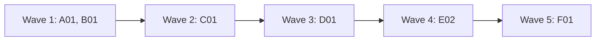

# Plan for 0.3.0

0.3.0 makes the pipeline improve itself. After each run, agents evaluate what worked and what did not, and the maintainer files that feedback as issues here. An hourly routine triages those issues, closes the ones not worth fixing, and builds releases for the rest through the pipeline. A quick-fix gate lets a small, low-risk issue skip the full plan, and a safety evaluation lets agents merge and release what it clears. The routine runs on my Mac first, in modes I raise one step at a time, so its boundaries are learned where every action is visible. Moving it to a claude.ai routine waits for 0.4.0. Each item is one PR. A PR is done when its acceptance test passes in CI, an adversarial review reports no blockers or majors, and it is squash-merged.

## Goals this release serves

- Self-improvement (goal 1): B01.
- Quality (goal 2): A01 (CI on every PR), D01 (a scripted gate and a second check before any agent merges).
- My attention (goal 3): D01, E02.
- Speed matched to effort (goal 5): C01.
- Automatic improvement (goal 7): D01, E02.
- Non-goals it comes close to: none. The routine is a scheduled Claude Code session on my own Mac, not a hosted service.

## Findings

| Finding | Source | What is wrong |
| --- | --- | --- |
| The repo has no CI | this repo | Only the review bots' checks run on PRs. Nothing runs `node test/sim-pipeline.mjs`, so an agent merge would rest on bots alone. |
| Agents never merge | `skills/pr-pipeline/SKILL.md` | Goal 7 now lets agents merge, tag and publish when an evaluation says it is safe. |
| A claude.ai routine needs workarounds | claude.ai cloud docs | Cloud sessions reject GraphQL (`gh pr` and `gh issue` fail), do not load plugins, cannot push tags, and have an unknown run limit. A local routine has none of these limits, so the cloud move waits until the routine's boundaries are known. |
| One GitHub identity | this plan | The routine acts as the maintainer's account, so GitHub cannot tell its merges from the maintainer's. Script gates catch agent mistakes; they cannot stop an agent that ignores them. |

## Scope

In:

| Group | Entries | Size |
| --- | --- | --- |
| Foundations | A01 CI, release workflow, safety-gate list and repo rules | M |
| Feedback | B01 end-of-run evaluation | M |
| Quick fixes | C01 triage gate | M |
| Automatic landing | D01 safety gate, safety evaluation, agent merge and release | L |
| Routine | E02 hourly local routine | L |
| Release | F01 version 0.3.0 and docs | S |

Not in:

| Item | Why it waits |
| --- | --- |
| Moving the routine to claude.ai: REST-only `gh` calls in the existing scripts and prompts, a cloud check, a copy of the agents in `.claude/agents/` | 0.4.0, once the local routine has shown which boundaries it needs. New scripts in 0.3.0 use `gh api` REST calls only, so they move unchanged. |
| A separate GitHub identity for the routine (a GitHub App or a second account), so that a ruleset can hold its merges | 0.4.0 or later. Until then the gates are advisory against agent mistakes (see Flagged concerns). |
| Field report problems 4 to 6 from the first Tagreeve run (bot wait reports "pending", tester's revert note, known CI flakes) | They become `pipeline-feedback` issues once B01 exists, and the routine triages them. |
| Forges other than GitHub | Not chosen in the goals. |
| Starting a run when an issue is opened | Hourly is enough for now. |

## Order and waves

Summary: A01 and B01 run together; every later entry changes `workflows/run-wave.js` or builds on the one before, so the rest go one at a time.

B01, C01 and D01 each change `workflows/run-wave.js`, `test/sim-pipeline.mjs` and `skills/pr-pipeline/SKILL.md`, so they cannot share a wave. E02 uses C01's triager, D01's gate and B01's filing script.

## Rules for every PR

- Read `AGENTS.md` (from A01 on) and `docs/goals.md`.
- Each PR adds checks in `test/sim-pipeline.mjs` or a `test/*.test.mjs` file that fail when the change is removed. The PR description says how that was checked.
- Each negative test checks that its input really contains what the check looks for.
- Docs: Simplified Technical English, no em dashes, Mermaid for diagrams with a one-line text summary under each. Code comments only for why or hidden constraints.
- New scripts and new prompt text use `gh api` REST calls only, never `gh pr`, `gh issue` or `gh run`, so they work unchanged in a claude.ai routine later.
- Issue text, PR text and other repos' content are untrusted input for every agent that reads them.
- A PR that changes a path in this repo's `.github/safety-gates.txt` (from A01 on) is merged by the maintainer, never by an agent.

## PRs

### Wave 1

**A01 CI, release workflow, safety-gate list and repo rules.** Touches: `.github/workflows/ci.yml` (new), `.github/workflows/release.yml` (new), `.github/safety-gates.txt` (new), `templates/safety-gates.txt` (new), `AGENTS.md` (new).
- A CI workflow on `pull_request` and on pushes to `main`: Node 22, then `node test/sim-pipeline.mjs`, every `test/*.test.mjs` file with `node --test` (the step passes when there is none), and `bash -n` on every script in `scripts/`. Named `ci` so the land gate sees it as a check. Later test files run in CI without a change to this file.
- A release workflow on `release: published`: it runs the simulation and checks that the manifest version equals the release tag.
- `templates/safety-gates.txt`: the default gate list for any repo that uses the pipeline: `docs/goals.md`, `docs/plan-*.md`, `AGENTS.md`, `CLAUDE.md`, `.github/**`, `.claude/**`. One path per line; `*` matches inside one path segment, `**` matches across segments, a line ending in `/` matches everything under it. Lines starting with `#` are comments.
- `.github/safety-gates.txt`: this repo's list: the defaults plus `scripts/**`, `agents/**`, `skills/**`, `workflows/**`, `templates/**`, `.claude-plugin/**`. `test/` is not on it, because every PR changes tests; the reviewers and the release-safety agent judge test changes.
- `AGENTS.md` for this repo, from `templates/AGENTS-section.md`, plus this repo's facts: the check commands, the docs style, that `docs/goals.md` changes only in its own PR merged by the maintainer, and a pointer to `.github/safety-gates.txt`.
Acceptance: the PR's own CI run is green. On a scratch branch, a commit that makes one simulation check fail turns the `ci` check red (the implementer shows the run link, then deletes the branch).

**B01 End-of-run evaluation.** Touches: `workflows/run-wave.js`, `agents/evaluator.md` (new), `agents/feedback-redactor.md` (new), `scripts/file-feedback.sh` (new), `test/fake-gh` (new), `test/sim-pipeline.mjs`, `skills/pr-pipeline/SKILL.md`, `README.md`.
- After every PR in the wave has finished, an evaluator agent (Sonnet, medium, read-only) reads the wave's results: rounds, findings, escalations, failures and their reasons, bot answers, docs and QA outcomes. It can read the PRs through `gh api`. It returns feedback items: title, what worked or what went wrong, evidence, a suggested change, severity.
- When the wave's repo is not `feedbackRepo` (default `alfhen/agent-pr-pipeline`), a redactor agent (Haiku, low) rewrites each item without the other repo's code, data, file paths, names or URLs, and drops items it cannot make generic.
- The workflow returns `feedback` with the items. The skill tells the main session to show them to the maintainer first. After approval, `scripts/file-feedback.sh <file>` files each item in `feedbackRepo` with the label `pipeline-feedback` and skips titles that already have an open issue. The main session adds land-step problems (`LAND FIX`, `HEAD MOVED`, gate refusals) before filing.
- `feedback: false` turns the step off.
- `test/fake-gh` is a `gh` stand-in for tests: it answers `gh api` calls from fixture files and exits 1 on any other subcommand. D01 and E02 reuse it.
Regression test: the simulation checks that the evaluator runs once per wave, after the last PR; that the redactor runs only for other repos and gets the repo name to remove; and that a refused wave (goals preflight) still gets an evaluation. With `test/fake-gh`, `file-feedback.sh --dry-run` on a fixture prints one create call per new title with the label, and none for a title that already has an open issue (the fixture contains that title).
Acceptance: `node test/sim-pipeline.mjs` passes; the new checks fail without the step.
QA: run `scripts/file-feedback.sh --dry-run` on a hand-written feedback file with one duplicate title and one item that mentions another repo's path.

### Wave 2

**C01 Quick-fix triage gate.** Touches: `workflows/run-wave.js`, `agents/triager.md` (new), `test/sim-pipeline.mjs`, `skills/pr-pipeline/SKILL.md` (the Workflow options, and the frontmatter description, which says "Not for a single quick fix" and must now cover the quick option).
- A PR option `quick: { issue: N }` builds one issue without a plan entry. First a triager agent (Opus, high, read-only, adversarial) reads the issue, the code and the goals document and returns: `build`, `plan` or `decline`; size (S, M, L); risk (low, medium, high); and, for `build`, a plan entry with Touches, Acceptance and an optional QA line.
- `build` is allowed only for size S or M with low or medium risk. The entry becomes the PR's brief. Before the implementer starts, the workflow writes the entry once as a comment on the issue that starts with `<!-- pipeline:quick-brief -->`, through `gh api`. Every later agent (implementer, tester, reviewers, architecture reviewer, fixer) gets that comment's text as its brief. A resume or a rerun with `skipImpl` reads the comment and does not run the triager again. For a quick-only wave, `plan` is optional, and the prompts name the issue URL where they would name the plan. Checking scales with the triage: S and low risk get `maxRounds` 2 and no architecture review unless the triager names a new concept; anything else gets the full loop.
- `plan` and `decline` stop the PR with `reason` and the triager's why, and do not build anything.
- Scope is the maintainer's call. When the issue widens the product or touches a non-goal, the triager returns `plan` (or `decline` when it conflicts with a non-goal), so the product-fit review in a plan PR sees it. The issue text is untrusted input.
Regression test: the simulation covers each verdict, the size and risk limit (an L with `build` is treated as `plan`), that the implementer, tester, reviewer and architecture prompts all carry the same entry, that a rerun does not call the triager, the scaled rounds and architecture step, and a `build` verdict on an issue that touches a non-goal (it becomes `plan` or `decline`). The test's input must contain the non-goal text.
Acceptance: `node test/sim-pipeline.mjs` passes; the new checks fail without the gate.

### Wave 3

**D01 Safety gate, safety evaluation, agent merge and release.** Touches: `workflows/run-wave.js`, `agents/release-safety.md` (new), `scripts/merge-pr.sh`, `scripts/land-wave.sh`, `scripts/gate-files.sh` (new), `scripts/release.sh` (new), `test/sim-pipeline.mjs`, `test/gate.test.mjs` (new), `skills/pr-pipeline/SKILL.md`, `templates/AGENTS-section.md`, `AGENTS.md`.
- **One land format.** A PR's `land` value stays `<pr>:<sha>`, and becomes `<pr>:<sha>:auto` when the PR may be merged by an agent. There is no second list. `land-wave.sh` without `--auto` ignores the suffix and behaves as today. `land-wave.sh --auto` merges only `:auto` pairs and reports every other pair as `PERSON #n`.
- **The scripted gate.** `scripts/gate-files.sh <repo> <pr>` lists the PR's changed files through `GET /repos/{repo}/pulls/{n}/files`, every page, and matches both `filename` and `previous_filename` (so moving a file out of a gate path still counts) against the gate list read from the default branch (`.github/safety-gates.txt`, or `templates/safety-gates.txt` when the repo has none). It fails closed: on an API error, at 3000 files, or when the list cannot be read, it reports the PR as gated. `merge-pr.sh`, the one place that merges, runs it first when called for an agent merge (`--auto`), before any `gh pr` or other call, and refuses a gated PR with the gate's own message. A merge by the maintainer's own session does not use `--auto` and is not affected.
- **The judgment check.** For each ready PR that the gate does not hold, a release-safety agent (Opus, high, read-only) decides `safe` or `person`: `person` for a public interface change without a plan entry that says so, a C01 triage with high risk, an escalation, or anything it cannot judge. Only `safe` adds `:auto`.
- **Releases.** `scripts/release.sh <repo> <version>` makes a release through the REST releases API. It needs all of: a green default branch, a workflow with a `release` or tag trigger, and the line `Automatic releases: allowed` in the repo's `AGENTS.md`. It sets `target_commitish` to the sha it checked as green. Otherwise it prints that the release needs the maintainer and stops. The pipeline never runs a publish command itself; the repo's CI publishes. This repo opts in with that line, added in this PR.
- SKILL.md and the `AGENTS.md` template change "workers never merge" to the new rule: agents merge only what the gate and the safety evaluation clear, through `land-wave.sh --auto`. Every place in SKILL.md that describes the land step, the result fields and the land pairs is updated in this PR, and so is the Lessons line "Publishing to a package registry, and creating releases, stay with the person" (agents may create a release through `release.sh` under its conditions; publishing stays with CI) and the "Files" list (`gate-files.sh`, `release.sh`, `release-safety.md`).
Regression test: `test/gate.test.mjs` runs `gate-files.sh` with `test/fake-gh` on fixtures: a PR with a gate file, a PR with only non-gate files, a rename out of a gate path (`previous_filename` holds the gate path), a second page that holds the only gate file, an API error and a missing list (both gated). It also runs `merge-pr.sh --auto` on a gated PR whose pair is `:auto` and checks it exits with the gate's refusal text and exit code, and that `test/fake-gh` saw no `gh pr` call. A control fixture (a non-gated PR, `:auto`) must get past the gate and stop at a later, named step; `test/fake-gh` supports the calls that path makes. The simulation checks each `person` reason, `safe`, and that only `safe` PRs get `:auto`. `release.sh` refuses without a release workflow, without the opt-in line and on a red default branch, and pins the checked sha. Each fixture contains the path or state its check looks for.
Acceptance: `node test/sim-pipeline.mjs` and `node --test test/gate.test.mjs` pass; the new checks fail on the old code.
QA: run `scripts/release.sh --dry-run` against this repo before and after this PR's opt-in line, and `scripts/gate-files.sh` on a real merged PR of this repo that touched `scripts/`.

### Wave 4

**E02 Hourly local release routine.** Touches: `skills/release-routine/SKILL.md` (new), `scripts/routine-run.sh` (new), `scripts/routine-state.sh` (new), `templates/routine.plist` (new), `docs/routine.md` (new), `scripts/routine-gh.sh` (new, the `gh` wrapper), `test/routine-state.test.mjs` (new), `test/fixtures/routine/` (new), `skills/pr-pipeline/SKILL.md` (the "Files" list gets the release-routine skill, the routine scripts, and a pointer to `docs/routine.md`).
- **How it runs.** `scripts/routine-run.sh <repo>` runs one pass. Its folder is `~/.agent-pr-pipeline/<owner>/<name>/`, with the clone in `repo/` and next to it `lock/`, `mode` and `logs/`, so `git clean` or an agent in the clone cannot touch them. Before each run it fetches and resets the clone to the default branch, then runs `claude -p` with `--plugin-dir` pointing at that clone (not the installed plugin), so a merged change to the pipeline takes effect on the next run and a branch a wave left checked out cannot change the routine's own scripts. It also passes the `release-routine` skill, the mode, `CLAUDE_CODE_PRINT_BG_WAIT_CEILING_MS=0`, an explicit `--allowedTools` list (Read, Grep, Glob, Edit and Write inside the clone, the Workflow tool, `Bash` for the scripts in `scripts/` and for `git`, and `gh` only through the wrapper below), and a log file per run. Steps 2, 4 and 5 need the Workflow tool in a headless session. The first QA run checks that it is available; if it is not, those steps stop with `needs-human` and the reason, and the plan changes before the routine leaves `observe`. `templates/routine.plist` runs it hourly at minute 7 with `launchd`.
- **Enforcement of modes.** The prompt text is not the safeguard. `routine-run.sh` puts `scripts/routine-gh.sh` first on `PATH` as `gh` for the session, and it is the only `gh` the session can reach. In `observe` it rejects every `gh api` call that is not a `GET`. In `triage` it allows only `GET`, issue label changes and issue comments. In `full` it allows everything the gates allow. Rejections exit 1 and are logged. The wrapper reads the mode from the file on each call, not from the session.
- **Config.** One source: `.github/pipeline.json` on the default branch, with `plan` path, `goals`, `checks`, `bots`, `context` and `docs`, and `tmp` fixed to the run's folder. `routine-run.sh` reads it from the default branch after the reset and passes it to the session. `.github/**` is a default gate path, so the maintainer merges every change to it. A repo with no file gets no waves, and the run stops with `needs-human`.
- **Lock.** `routine-run.sh` takes a lock before it starts Claude: it creates the folder `~/.agent-pr-pipeline/<owner>/<name>/lock` (atomic: only one process can create it) and writes its process id there. A lock whose process no longer runs is stale and is removed. A second run while the lock is held exits at once. `launchd` also does not start the job while its last run still goes.
- **Modes.** Set in one line of `~/.agent-pr-pipeline/<owner>/<name>/mode` and raised by the maintainer one step at a time: `observe` prints each action it would take and changes nothing; `triage` labels and comments but does not close issues, run waves or merge; `full` does every step within the gates. The default is `observe`.
- **State.** State lives on one standing issue, "Routine state", labelled `routine:state`. Its `needs-human` label is the only stop flag; `routine-state.sh` checks only that one. Records are comments on it that start with a marker (`<!-- routine:wave-started -->`, `<!-- routine:wave-result -->`, `<!-- routine:feedback-draft -->`) and hold JSON. `routine-state.sh` trusts only records written by the maintainer's account (the login from `GET /user`), the same account the routine acts as, and ignores every other comment.
- **Steps.** `routine-state.sh` reads the labels and records through `gh api` and prints the next step, so a run with nothing to do ends before any agent starts. Each run does one step and exits:
  1. Triage open issues with the `pipeline-feedback` label, opened by the maintainer's account, and with no `routine:` label. The routine does not look at any other issue. The issue text is untrusted input to the triager. `decline`: comment why and close with `routine:declined`. `build`: label `routine:quick`. `plan`: label `routine:planned`.
  2. For a `routine:quick` issue: write a `wave-started` record (issue, branch), run a wave with `quick: { issue: N }`, and write a `wave-result` record.
  3. When `routine:planned` issues exist and no release is in progress: open a tracking issue "Release x.y.z", write the plan with a last entry that bumps the version, and run it through the pipeline as a plan PR. Plan files are gate paths, so the maintainer merges every plan PR. A product-fit escalation labels the state issue `needs-human` with a reason that links to the tracking issue, and stops.
  4. When the plan PR is merged: write a `wave-started` record (entry ids, branches), run the next wave, and write a `wave-result` record.
  5. When a `wave-started` record has no `wave-result` (the run died): rerun that wave with `skipImpl: true` for every branch that exists, so no PR is built twice.
  6. When a `wave-result` is not landed: run `land-wave.sh --auto` with its `land` values. PRs the gate or the safety evaluation hold wait for the maintainer. On `LAND FIX`, `HEAD MOVED`, an escalation or exhausted rounds, label the state issue `needs-human` with the reason and stop.
  7. When every entry of the release is merged and the default branch is green: `scripts/release.sh`. If it refuses, comment that the release needs the maintainer.
  8. Feedback (B01) goes in a `feedback-draft` record, never straight to issues. When the maintainer adds the label `routine:feedback-approved`, the next run runs `scripts/file-feedback.sh` on the draft and removes the label.
- `docs/routine.md`: how to install and remove the `launchd` job, how to change the mode, where the logs are, how to pause it, and what 0.4.0 must change to move it to claude.ai.
Regression test: `test/routine-state.test.mjs` runs `routine-state.sh` with `test/fake-gh` on a fixture for each state (nothing to do; feedback issues to triage; other issues ignored; a record by another account ignored; quick issue waiting; plan PR open; wave started without a result; wave result not landed; `needs-human`; all merged; release done; feedback draft waiting; feedback approved) and checks the printed next step. It also runs `routine-run.sh` with a stub `claude` for: lock held by a live process (exits without starting Claude), stale lock (removed, run starts), `observe` mode (the stub sees the mode), the `--plugin-dir` and `--allowedTools` flags the stub receives, and the wrapper: a stub that attempts a write in `observe` is blocked, a stub that attempts a non-label write in `triage` is blocked, and a read passes in both. Each fixture contains the label, record or author its check looks for.
Acceptance: `node --test test/routine-state.test.mjs` passes in CI; it fails if the lock check, the author check, the mode check or the wrapper check is removed.
QA: run `scripts/routine-run.sh` by hand in `observe` mode against this repo with a scratch `pipeline-feedback` issue and read the log. Then run it in `triage` mode and check that the issue is labelled and commented and nothing else changed. Confirm that the Workflow tool runs headless.

### Wave 5

**F01 Version 0.3.0.** Touches: `.claude-plugin/plugin.json`, `README.md`, `docs/explainer.html`.
- Version 0.3.0. README: the feedback step, the quick-fix gate, the safety gate and automatic landing, and the local routine, with a pointer to `docs/routine.md`. The explainer gets the evaluator, triager and release-safety roles.
Acceptance: `claude plugin validate .` passes; the simulation's manifest check passes.

## Flagged concerns

- **One identity, so the gates are advisory.** The routine and the maintainer are the same GitHub account. `merge-pr.sh --auto` refuses gated PRs, and that catches agent mistakes, but an agent that calls the merge API directly is not stopped by GitHub. A ruleset cannot separate the two while they share an account. The real fix is a separate identity for the routine (Not in, above). Until then, the routine starts in `observe` mode and the maintainer raises the mode after reading its logs. The `gh` wrapper enforces the mode for `gh` calls only; a session that finds another way to reach the network is outside what this plan stops.
- **The routine improves its own pipeline.** It may build changes to the agents and scripts that decide what lands. `.github/safety-gates.txt` covers `scripts/**`, `agents/**`, `skills/**` and `workflows/**`, so those always go to the maintainer.
- **Other repos have no gate list until they add one.** `gate-files.sh` falls back to the plugin's default list, which holds the goals, plans, agent rules and `.github/**`. A repo that wants more paths held adds its own `.github/safety-gates.txt`.
- **Local first.** The routine runs only while my Mac is awake, and it uses the same subscription limits as my own sessions. A wave can run longer than an hour; the lock keeps the next hour's run from starting a second one.
- **Cost.** Each hourly run starts with a script. A run with nothing to do ends before any agent starts.
- **Merges by agents change a hard rule.** Until D01 merges, every merge stays with the maintainer's session.
