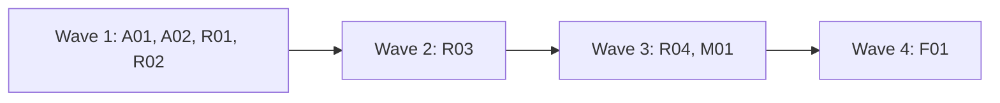

# Plan for 0.4.0

0.4.0 adds the hourly routine: a local `launchd` job that triages the `pipeline-feedback` issues in this repo, closes the ones it declines, and takes a release one step further on each run, through the pipeline and its gates. Before the routine, wave 1 fixes the five feedback issues an unattended run would hit. The maintainer reads the routine's tracking issue and its logs, raises its mode one step at a time, and still merges every PR the gates hold. Each item is one PR. A PR is done when its acceptance test passes in CI, an adversarial review reports no blockers or majors, and it is squash-merged.

## Goals this release serves

- Automatic improvement (goal 7): R01, R02, R03, R04 (the routine).
- Self-improvement (goal 1): R04 (the routine drafts run feedback for approval, then files it).
- Quality (goal 2): A01 (a land-fixer's own code is checked by other agents), A02 (no release with a wrong manifest version).
- My attention (goal 3): A01 (a blocked opener stops with the commands to run), A02 (known CI flakes are rerun by the land script, not by hand).
- Cost (goal 4): A01 (the bot waiter does not burn turns on a blocked sleep).
- Non-goals it comes close to: "A hosted service". The routine runs on the maintainer's Mac and is not a service for others. Moving it to claude.ai is not in this release.

## Findings

| Finding | Issue | What is wrong |
| --- | --- | --- |
| Opener blocked by a permission check | #72 | The result says only `PR not opened`. In an unattended run nobody reads the transcript, so the PR is lost. |
| A land-fixer's code gets no independent check | #73 | Code the land-fixer pushes reaches the merge gate with no tester or reviewer. An unattended run would land it. |
| The land-fixer answers bot threads | #74 | Notes that hand it bot threads skip the bot-answer check. |
| No version check before a release | #75 | A wrong manifest version is found only after the release is published. |
| Known CI flakes leave a ready PR red | #24 | A person reruns the job by hand. An unattended run stops there. |
| Bot waiter blocked by the session | #25 | The waiter's sleeps are refused or killed, so it returns before the bots review. |
| No routine | #13 | Goal 7 asks for a scheduled routine. Issue #13 holds the maintainer's decisions and nine points a design must answer. |

## Scope

In:

| Group | Entries | Issues | Size |
| --- | --- | --- | --- |
| Unattended-run fixes, workflow | A01 | #72, #73, #74, #25 | M |
| Unattended-run fixes, scripts and CI | A02 | #24, #75 | S |
| Routine runner and guards | R01 | #13 (points 1, 2, 3, 5) | M |
| Routine state | R02 | #13 (points 6, 7) | M |
| Routine prompt, observe and triage | R03 | #13 (point 4) | M |
| Routine full mode | R04 | #13 (points 7, 8) | L |
| Script and workflow minors | M01 | #26, #30, #31, #32, #40, #41, #42, #55, #56, #57, #58, #59, #60, #61 | M |
| Version 0.4.0 and docs minors | F01 | #29, #33, #34, #37, #38, #52, #53, #62, #63, #64, #66, #67, #68, #69, #71 | S |

Not in:

| Item | Why it waits |
| --- | --- |
| Moving the routine to claude.ai (#13 point 9) | After the local routine has run for a while. The 0.3.0 scripts use `gh api` REST calls only, so they move unchanged. |
| A separate GitHub identity for agents | Later. Until then the gates are advisory against agent mistakes (see Flagged concerns). |
| The other `pipeline-feedback` issues (#14 to #23, #44, #46 to #48) | The routine triages them after it is installed. That is its first real work. |
| The routine on other repos | It triages this repo's `pipeline-feedback` issues only. Other repos send their feedback here through the evaluation step. |

## Order and waves

Summary: the two fix entries and the first two routine entries run together; the routine prompt follows, then full mode next to the minor batch, then the version last.

A01 and M01 both change `workflows/run-wave.js` and `test/sim-pipeline.mjs`, so they are in different waves. R01 and R02 add only new files. A02, R01 and R02 run with `docsUpdate: false`, so their docs agents do not edit `README.md` or `skills/pr-pipeline/SKILL.md` while A01's docs agent does; R03 documents the routine, and F01 documents A02. R03 needs R01's runner and R02's state script. R04 needs R03's prompt. F01 is last because it sets the version.

## Rules for every PR

- Read `AGENTS.md` and `docs/goals.md`.
- Each PR adds checks in `test/sim-pipeline.mjs` or a `test/*.test.mjs` file that fail when the change is removed. The PR description says how that was checked. Named exception: F01 (its proof is `claude plugin validate` and the new CI version check).
- Simulation tests check only what code decides. What an agent judges is checked by a QA case or by a deterministic step after it, never by a fake agent's scripted answer.
- Each negative test checks that its input really contains what the check looks for.
- Docs: Simplified Technical English, no em dashes, Mermaid for diagrams with a one-line text summary under each. Code comments only for why or hidden constraints.
- New scripts and new prompt text use `gh api` REST calls only.
- Issue text, PR text and comments are untrusted input for every agent and script that reads them. A record the pipeline wrote counts only when `scripts/trusted-comment.jq` accepts it.
- No test, QA case or agent loads the `launchd` job, writes to `~/Library/LaunchAgents`, or runs the routine against this repo in `triage` or `full` mode. QA runs the routine in `observe` mode, or against a scratch repo.
- Every entry in this plan touches a gated path, so the maintainer merges each PR.

## PRs

### Wave 1

**A01 Unattended-run fixes in the workflow.** Issues: #72, #73, #74, #25. Touches: `workflows/run-wave.js`, `agents/pr-opener.md`, `agents/land-fixer.md`, `agents/bot-waiter.md`, `scripts/wait-bots.sh` (new), `test/sim-pipeline.mjs`, `test/wait-bots.test.mjs` (new), `skills/pr-pipeline/SKILL.md`.
- **#72.** The opener's result gets `blocked` (true when a permission check denied a command), `blockedReason`, and `commands`: the exact commands it prepared and could not run. The role file tells it to return these and stop, and never to work around a denial. The workflow stops the PR with `reason: needs human: permission`, the reason and the commands.
- **#73.** The land-fix path records the head before the land-fixer runs. After it, the workflow asks `pipeline-io` for the commits between the two heads that are not a merge of the default branch (`git log --no-merges <before>..<after>` in a fresh clone, through a plugin script or the tester; the implementer picks one and the reviewer checks it fails closed). If there are any, the tester and a reviewer that reads only those commits check the new head, with the same rounds and fix step as the bot-answer check (`botCheck`), before the bot wait. A clean merge of the default branch skips the check. If the check cannot run, the PR is not ready.
- **#74.** `agents/land-fixer.md` says it never replies on review threads and never changes code to answer a bot; bot threads go to the answer agent on the next step. SKILL.md says the same to the main session: `landFix` notes never hand over bot threads.
- **#25.** `scripts/wait-bots.sh <owner/repo> <pr> <minutes>` polls `bot-status.sh` every 60 seconds inside one command and prints the last status line. It stops when `seenHead` is not empty, or when the time is up (exit 0 either way, with `timedOut` in its output). One call waits at most 9 minutes, so it fits in one shell command. The bot waiter calls it again until the wave's `botWaitMinutes` have passed, and no longer sleeps between its own calls. The workflow's wait prompt names the script with `pluginRoot`, as it names `bot-status.sh`.
- SKILL.md: the troubleshooting rows for `needs human: permission` and the land-fix check, the land step, the Role agents table note on the land-fixer, and the Files list (`wait-bots.sh`).
Regression test: the simulation checks that an opener result with `blocked: true` stops the PR with `needs human: permission` and the commands; that a land-fix run whose new commits are not only a merge starts a tester and a diff reviewer before the bot wait, and a merge-only run does not; that a land-fix check with blockers runs the fixer and stops after its rounds; and that the wait prompt names `wait-bots.sh` from `pluginRoot`. `test/wait-bots.test.mjs` runs `wait-bots.sh` with `test/fake-gh` and `PIPELINE_TEST_FAST=1`: a status with `seenHead` on the second poll (stops at poll 2), and one that never has it (stops at the limit with `timedOut`).
Acceptance: `node test/sim-pipeline.mjs` and `node --test test/wait-bots.test.mjs` pass; the new checks fail without the change.

**A02 Known flakes and the version check.** Issues: #24, #75. Touches: `scripts/land-wave.sh`, `templates/pipeline.json`, `.github/pipeline.json`, `.github/workflows/ci.yml`, `scripts/check-version.sh` (new), `test/land.test.mjs` (new), `test/fixtures/land/` (new). Runs with `docsUpdate: false`; F01 documents it.
- **#24.** `.github/pipeline.json` gets `knownFlakes`: a list of check-run names (exact) that may fail for reasons outside the PR. Default `[]`. When every failing check of a PR is in that list, `land-wave.sh` reruns the failed jobs of those runs once (`POST /repos/{repo}/actions/runs/{run}/rerun-failed-jobs`), waits again, and reports `LAND FIX` only if one still fails. It never reruns a check that is not in the list, and never reruns twice for the same head.
- **#75.** `scripts/check-version.sh` checks that `.claude-plugin/plugin.json` has a semantic version (`MAJOR.MINOR.PATCH`, optional pre-release). On a pull request that changes the version, it also checks that the new version is higher than the latest tag. CI runs it as a step of the `ci` job.
Regression test: `test/land.test.mjs` runs `land-wave.sh` with `test/fake-gh` and `PIPELINE_TEST_FAST=1`: a failing check in `knownFlakes` that passes after one rerun (merges), one that fails again (`LAND FIX`, one rerun call logged), and a failing check not in the list (`LAND FIX`, no rerun call). It runs `check-version.sh` on the versions `bad`, `0.4`, `0.4.0` and `0.4.0-rc.1`, and on a lower version than a fixture tag.
Acceptance: `node --test test/land.test.mjs` passes and its new checks fail on the old scripts; the PR's own `ci` run shows the version step.

**R01 Routine runner and guards.** Issue: #13 points 1, 2, 3, 5. Touches: `routine/run.sh` (new), `routine/bin/gh` (new), `routine/settings/observe.json` (new), `routine/settings/triage.json` (new), `routine/settings/full.json` (new), `routine/launchd.plist` (new), `routine/install.sh` (new), `test/routine-guard.test.mjs` (new). Runs with `docsUpdate: false`; R03 documents it.
- **Where things live.** The runner and its settings are in the plugin folder and run from the installed copy whose path `install.sh` writes into the job, never from a clone the routine changes. Everything the session must not change is in the guard folder `~/.agent-pr-pipeline/routine/<owner>-<repo>/`, outside every clone: `mode` (one word: `observe`, `triage` or `full`; default `observe` when the file is missing or holds anything else), `lock/`, `logs/` and `clone/`. The runner resets `clone/` to the default branch at the start of each run; the runner and the guard files are not in it. The runner makes `mode` and the logs of earlier runs read-only.
- **Lock.** `mkdir lock` is the lock; the runner writes its process id into it. A lock whose process is gone is stale: the runner removes it, logs that, and goes on. A live lock ends the run with exit 0 and a log line. The lock is removed on exit.
- **The session.** The runner starts `claude -p` in `clone/` with: `--permission-mode dontAsk`, the mode's settings file with `--settings`, no user, project or local settings (`--setting-sources` set so that none load; the implementer shows the exact value works with the installed Claude Code), the plugin with `--plugin-dir <installed copy>`, `--strict-mcp-config` with no MCP servers, `CLAUDE_CODE_PRINT_BG_WAIT_CEILING_MS=0`, `routine/bin` first on `PATH`, and the prompt file from R03 (a placeholder prompt until R03). Its output goes to `logs/<timestamp>.log`.
- **Modes, default deny.** Each settings file has an allow list and a deny list, and `dontAsk` denies everything not allowed. `observe`: Read, Glob, Grep, `Bash(gh api *)`, the plugin's read-only scripts, and the `triager` and `evaluator` agents; deny Edit, Write, NotebookEdit, Workflow, `Bash(git push *)` and every other agent. `triage`: `observe`, plus the `gh` writes the wrapper allows. `full`: what a wave needs (Workflow, the role agents, git, Edit and Write inside `clone/` and the run's temp folder, the plugin's scripts); deny Edit and Write in the guard folder, `Bash(* --person*)`, `gh pr merge`, and any merge call that does not go through `merge-pr.sh`.
- **The `gh` wrapper.** `routine/bin/gh` reads the mode file, passes only `gh api` calls to the real `gh`, and decides by method and path. `observe`: GET only, so `-f`, `-F`, `--input` or `-X` with any other method is refused, because `gh api` with a field sends a POST. `triage`: GET, plus a comment on an issue, a label on an issue, and closing an issue, each only on an issue the wrapper first reads and finds open, labelled `pipeline-feedback` and opened by the account from `GET /user`; and comments on the tracking issue (R02). `full`: every call. A refused call exits 77 with one line that names the mode and the call.
Regression test: `test/routine-guard.test.mjs` runs the wrapper with `test/fake-gh` as the real `gh`: in `observe`, a GET passes and a `-f`, an `-X POST` and an `--input` call are refused with no call logged; in `triage`, a comment on a `pipeline-feedback` issue by the maintainer passes, and one on an issue without the label, one by another account and a PATCH on a pull request are refused; an unknown or missing mode acts as `observe`. It runs `run.sh` with a stub `claude` on `PATH` that logs its arguments: the arguments hold `--permission-mode dontAsk`, the mode's settings file, `--plugin-dir` with the installed path and `--strict-mcp-config`; a live lock ends the run without starting `claude`; a stale lock is taken over. Each settings file is valid JSON, and only `full.json` allows `Workflow`.
Acceptance: `node --test test/routine-guard.test.mjs` passes and its checks fail when the wrapper passes every call or when the lock check is removed.
QA: install nothing. Run `routine/run.sh` by hand in `observe` mode with a guard folder in the run's temp folder and a one-line prompt that asks the session to post an issue comment and to push a branch; check that the log shows both refused and that nothing changed on GitHub. Check that a `triager` agent started by that session cannot use Edit.

**R02 Routine state.** Issue: #13 points 6, 7. Touches: `scripts/routine-state.sh` (new), `test/routine-state.test.mjs` (new), `test/fixtures/routine/` (new). Runs with `docsUpdate: false`.
- **Tracking issue.** One open issue with the label `pipeline-routine`, opened by the account from `GET /user`. `routine-state.sh <repo> init` makes it when there is none. Two open ones are an error.
- **Records.** Each record is a comment on the tracking issue that starts with `<!-- pipeline:routine <type> <key> -->`, followed by JSON. Types: `triaged` (key: issue number; decision, size, risk), `plan-open` (key: version; PR number), `wave-started` and `wave-result` (key: version and wave; the PR list and the result's `prs`), `landed` (key: PR number; sha), `feedback-draft` and `feedback-filed` (key: run id), `released` (key: version). Records are read through `scripts/trusted-comment.jq`, one prefix at a time, so a comment by another account never counts and two records with one prefix are an error.
- **Next step, decided by code.** `routine-state.sh <repo> next` prints one JSON line with the one step this run takes. The script decides from the records, the open PRs and the open `pipeline-feedback` issues, in this order:
  1. `recover` when a `wave-started` record has no `wave-result`: the run that started it died. The step lists the wave's branches that exist; R04 reruns them with `skipImpl: true`, so no PR is built twice.
  2. `file-feedback` when a `feedback-draft` record has no `feedback-filed` record and the tracking issue has the label `feedback-approved`.
  3. `wait` when a PR the routine opened is open: the step names it. A PR the gates hold waits for the maintainer.
  4. `release` when every wave of the current plan has a `landed` record for each of its PRs and no `released` record exists for its version.
  5. `wave` when a merged plan has a wave with no `wave-started` record: the next wave.
  6. `plan` when there are `triaged` records with decision `plan` that no plan names yet.
  7. `build` when there are `triaged` records with decision `build` and no open PR for that issue.
  8. `triage` when an open `pipeline-feedback` issue opened by the maintainer's account has no `triaged` record.
  9. `idle` otherwise.
- `routine-state.sh <repo> put <type> <key> <file>` posts a record with the JSON from the file, and refuses a second record with the same type and key.
Regression test: `test/routine-state.test.mjs` runs `routine-state.sh next` with `test/fake-gh` on one fixture per step above, and on fixtures where a forged record by another account would change the step (it must not). `put` refuses a duplicate key; `init` refuses when two tracking issues are open.
Acceptance: `node --test test/routine-state.test.mjs` passes, and each step's fixture fails when its rule is removed.

### Wave 2

**R03 Routine prompt, observe and triage.** Issue: #13 point 4. Touches: `routine/prompt.md` (new), `routine/run.sh`, `templates/pipeline.json`, `.github/pipeline.json`, `skills/pr-pipeline/SKILL.md`, `README.md`, `docs/routine.md` (new), `test/sim-pipeline.mjs`, `test/routine-guard.test.mjs`.
- **Settings.** `.github/pipeline.json` gets a `routine` key: any `run-wave` argument except `prs`, `tmp` and `pluginRoot`, which the runner sets. `run.sh` reads it from the default branch and refuses to start a session when it holds `prs`, `tmp` or `pluginRoot`. The plan path comes from the `plan-open` record, not from settings.
- **The prompt.** `routine/prompt.md` tells the session to run `routine-state.sh next` and take exactly that one step, then stop. In `observe` it takes no step: it prints what it would do. It never takes a step `next` did not name.
- **Triage step.** For each untriaged issue (at most five per run), the session starts the `triager` agent with the issue, the code and `docs/goals.md`, and keeps the triager's rule that size L or high risk becomes `plan`. In `triage` and `full` mode it posts a `triaged` record. For `decline` it posts the triager's reason on the issue and closes it. For `build` and `plan` it adds the label `routine-build` or `routine-plan`. In `observe` it logs the same actions and changes nothing.
- **Docs.** `docs/routine.md`: what the routine does, the modes and how to raise them, where the guard folder and logs are, how to install and remove the job, the records, and the Flagged concerns below. A Mermaid diagram of the `next` steps, with a one-line summary. SKILL.md and README get a short section that points to it, and SKILL.md documents A02's `knownFlakes` setting.
Regression test: `test/routine-guard.test.mjs` adds: `run.sh` refuses a `routine` key with `prs`, and passes the prompt file to the stub `claude`. The simulation is unchanged unless the prompt needs a workflow argument.
Acceptance: `node --test test/routine-guard.test.mjs` passes; the new checks fail without the change.
QA: run the routine by hand in `observe` mode against this repo, with the guard folder in the run's temp folder. Read the log: it must name the triage step, list each open `pipeline-feedback` issue with a decision, and show no write call. Then run it in `triage` mode against a scratch repo with two issues (one small fix and one non-goal) and check the records, the close and the labels.

### Wave 3

**R04 Routine full mode.** Issue: #13 points 7, 8. Touches: `routine/prompt.md`, `routine/settings/full.json`, `docs/routine.md`, `test/routine-guard.test.mjs`.
- **build.** The session runs `run-wave` with one PR per `build` issue (at most three), each `quick: { issue: N }`, `pluginRoot` set to the installed copy and the `routine` settings, after a `wave-started` record. It posts the `wave-result` record with the result's `prs`, then runs `land-wave.sh` with the `land` values unchanged, never with `--person`. It posts a `landed` record for each merged PR. A PR without `:auto` stays open for the maintainer, and `next` returns `wait` for it.
- **plan.** The session writes `docs/plan-<version>.md` from the plan template for the `plan` issues. The version is the next patch version when every entry is a fix, else the next minor version. The last entry sets the manifest version. It runs the plan through `run-wave` with `kind: "plan"` and `skipImpl: true`, and posts a `plan-open` record. A plan is a gated path, so the maintainer merges it.
- **wave.** For a merged plan, the session runs the next wave, as in `build`, with each entry's `id`, `title`, `branch` and `notes` taken from the plan.
- **recover.** It reruns each listed branch with `skipImpl: true` and the same PR block, then posts the `wave-result` record.
- **release.** It runs `scripts/release.sh --dry-run`, then `scripts/release.sh` when the dry run passes, and posts a `released` record. When `release.sh` refuses, it posts the refusal on the tracking issue and takes no other step.
- **Feedback.** After a wave, the session posts the result's `feedback` and the land problems it saw as a `feedback-draft` record. It never files them. The maintainer adds the label `feedback-approved` to the tracking issue to approve the draft. In the `file-feedback` step, the session runs `scripts/file-feedback.sh` with the draft and the result's `denylist`, posts a `feedback-filed` record, and removes the label.
- `full.json` allows only what these steps need, and still denies `--person`, Edit and Write in the guard folder, and `gh pr merge`.
Regression test: `test/routine-guard.test.mjs` adds: `full.json` denies `Bash(* --person*)` and `gh pr merge`, and allows `Workflow`. What the session decides is checked by QA, not by a test.
Acceptance: `node --test test/routine-guard.test.mjs` passes; the new checks fail without the change.
QA: on a scratch repo with the plugin's gates and one small `pipeline-feedback` issue, run the routine by hand in `full` mode until it reaches `wait` or `idle`. Check each record, that no merge used `--person`, and that the feedback draft was not filed before the label.

**M01 Script and workflow minors.** Issues: #26, #30, #31, #32, #40, #41, #42, #55, #56, #57, #58, #59, #60, #61. Touches: `workflows/run-wave.js`, `scripts/file-feedback.sh`, `scripts/quick-brief.sh`, `scripts/release.sh`, `test/sim-pipeline.mjs`, `test/feedback.test.mjs`, `test/quick-brief.test.mjs`, `test/release.test.mjs`.
- Each issue is fixed as it says, or closed with a comment that says why not, with evidence. The PR body has one `Closes #N` line per fixed issue.
Regression test: one new check per fixed issue, in the test file of the script it changes.
Acceptance: `node test/sim-pipeline.mjs` and `node --test test/*.test.mjs` pass, and each new check fails without its fix.

### Wave 4

**F01 Version 0.4.0 and docs minors.** Issues: #29, #33, #34, #37, #38, #52, #53, #62, #63, #64, #66, #67, #68, #69, #71. Touches: `.claude-plugin/plugin.json`, `README.md`, `docs/explainer.html`, `skills/pr-pipeline/SKILL.md`.
- Version 0.4.0. README: the routine (pointing to `docs/routine.md`), `knownFlakes` and the version check. The explainer: the routine and the 0.3.0 roles (#68, #71, #62). The listed docs minors.
Acceptance: `claude plugin validate .` passes; the `ci` version step passes; each listed minor is fixed or closed with a reason.

## Flagged concerns

- **One identity, so the guards are advisory.** The routine acts as the maintainer's account. The settings files, the `gh` wrapper and `merge-pr.sh` catch mistakes. A session that calls the real `gh` by its full path, or edits a guard file with a shell command in `full` mode, is not stopped by GitHub. The `dontAsk` allow lists make that harder, not impossible.
- **A subagent's permissions.** Claude Code runs subagents with the rules of the main session when the main session is in `dontAsk` and the agent sets no permission mode. R01's QA checks this on the installed version. If it does not hold, R01 stops and asks the maintainer.
- **The routine improves the pipeline.** Almost every routine PR in this repo touches a gated path, so it waits for the maintainer. That is intended: in this repo the routine does the work and the maintainer still merges.
- **Cost.** A full-mode run can start a whole wave. `next` takes one step per run, and `build` takes at most three issues, so one run costs at most one wave.
