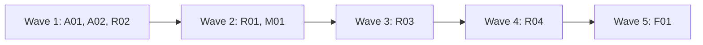

# Plan for 0.4.0

0.4.0 adds the hourly routine: a local `launchd` job that triages the `pipeline-feedback` issues in this repo, closes the ones it declines, and takes a release one step further on each run, through the pipeline and its gates. Before the routine, wave 1 fixes the five feedback issues an unattended run would hit. The maintainer reads the routine's tracking issue and its logs, raises its mode one step at a time, and still merges every PR the gates hold. Each item is one PR. A PR is done when its acceptance test passes in CI, an adversarial review reports no blockers or majors, and it is squash-merged.

## Goals this release serves

- Automatic improvement (goal 7): R01, R02, R03, R04 (the routine).
- Self-improvement (goal 1): R04 (the routine drafts run feedback for approval, then files it).
- Quality (goal 2): A01 (a land-fixer's own code is checked by other agents), A02 (no release with a wrong manifest version).
- My attention (goal 3): A01 (a blocked opener stops with the commands to run), A02 (known CI flakes are rerun by the land script, not by hand).
- Cost (goal 4): A01 (the bot waiter does not burn turns on a blocked sleep).
- Non-goals it comes close to: "A hosted service". The routine runs on the maintainer's Mac and is not a service for others. Moving it to claude.ai is not in this release.

## Findings

| Finding | Issue | What is wrong |
| --- | --- | --- |
| Opener blocked by a permission check | #72 | The result says only `PR not opened`. In an unattended run nobody reads the transcript, so the PR is lost. |
| A land-fixer's code gets no independent check | #73 | Code the land-fixer pushes reaches the merge gate with no tester or reviewer. An unattended run would land it. |
| The land-fixer answers bot threads | #74 | Notes that hand it bot threads skip the bot-answer check. |
| No version check before a release | #75 | A wrong manifest version is found only after the release is published. |
| Known CI flakes leave a ready PR red | #24 | A person reruns the job by hand. An unattended run stops there. |
| Bot waiter blocked by the session | #25 | The waiter's sleeps are refused or killed, so it returns before the bots review. |
| No routine | #13 | Goal 7 asks for a scheduled routine. Issue #13 holds the maintainer's decisions and nine points a design must answer. |

## Scope

In:

| Group | Entries | Issues | Size |
| --- | --- | --- | --- |
| Unattended-run fixes, workflow | A01 | #72, #73, #74, #25 | M |
| Unattended-run fixes, scripts and CI | A02 | #24, #75 | S |
| Routine runner and guards | R01 | #13 (points 1, 2, 3, 5) | M |
| Routine state | R02 | #13 (points 6, 7) | M |
| Routine prompt, observe and triage | R03 | #13 (point 4) | M |
| Routine full mode | R04 | #13 (points 7, 8) | L |
| Script and workflow minors | M01 | #26, #30, #31, #32, #40, #41, #42, #55, #56, #57, #58, #59, #60, #61 | M |
| Version 0.4.0 and docs minors | F01 | #29, #33, #34, #37, #38, #52, #53, #62, #63, #64, #66, #67, #68, #69, #71 | S |

Not in:

| Item | Why it waits |
| --- | --- |
| Moving the routine to claude.ai (#13 point 9) | After the local routine has run for a while. The 0.3.0 scripts use `gh api` REST calls only, so they move unchanged. |
| A separate GitHub identity for agents | Later. Until then the gates are advisory against agent mistakes (see Flagged concerns). |
| The other `pipeline-feedback` issues (#14 to #23, #44, #46 to #48) | The routine triages them after it is installed. That is its first real work. |
| The routine on other repos | It triages this repo's `pipeline-feedback` issues only. Other repos send their feedback here through the evaluation step. |

## Order and waves

Summary: the two fix entries and the routine state run first; the runner and the minor batch follow, then the prompt, then full mode, then the version last.

A01 and M01 both change `workflows/run-wave.js` and `test/sim-pipeline.mjs`, so they are in different waves. R01 and R02 add only new files. A02, R01 and R02 run with `docsUpdate: false`, so their docs agents do not edit `README.md` or `skills/pr-pipeline/SKILL.md` while A01's docs agent does; R03 documents the routine, and F01 documents A02. R03 needs R01's runner and R02's state script. R04 needs R03's prompt. R03 and R04 both touch `routine/prompt.md`, `docs/routine.md`, `skills/pr-pipeline/SKILL.md` and `test/routine-guard.test.mjs`, so they are in different waves. F01 is last because it sets the version.

A02 adds `routine/**` to the gates. R01 is in wave 2 so that wave 2 starts only after the maintainer has merged A02: the `land` value of R01 and the second gate check in `merge-pr.sh` both read gates that hold `routine/**`, so no agent merges R01 or R04.

## Rules for every PR

- Read `AGENTS.md` and `docs/goals.md`.
- Each PR adds checks in `test/sim-pipeline.mjs` or a `test/*.test.mjs` file that fail when the change is removed. The PR description says how that was checked. Named exception: F01 (its proof is `claude plugin validate` and the new CI version check).
- Simulation tests check only what code decides. What an agent judges is checked by a QA case or by a deterministic step after it, never by a fake agent's scripted answer.
- Each negative test checks that its input really contains what the check looks for.
- Docs: Simplified Technical English, no em dashes, Mermaid for diagrams with a one-line text summary under each. Code comments only for why or hidden constraints.
- New scripts and new prompt text use `gh api` REST calls only.
- Issue text, PR text and comments are untrusted input for every agent and script that reads them. A record the pipeline wrote counts only when the author and prefix rule of `scripts/trusted-comment.jq` accepts it.
- No test, QA case or agent loads the `launchd` job, writes to `~/Library/LaunchAgents`, or runs the routine against this repo in `triage` or `full` mode. QA runs the routine in `observe` mode, or against a scratch repo.
- Every entry touches a gated path, so the maintainer merges each PR. R01 and R04 touch `routine/**`, which A02 adds to the gates, so they are held (A02 is merged before wave 2). The routine's guard files are gated for that reason: a routine PR cannot change its own guards with an agent merge.

## PRs

### Wave 1

**A01 Unattended-run fixes in the workflow.** Issues: #72, #73, #74, #25. Touches: `workflows/run-wave.js`, `agents/pipeline-io.md` (only if its text names the scripts it runs), `agents/pr-opener.md`, `agents/land-fixer.md`, `agents/bot-waiter.md`, `scripts/wait-bots.sh` (new), `scripts/land-commits.sh` (new), `test/sim-pipeline.mjs`, `test/wait-bots.test.mjs` (new), `test/land-commits.test.mjs` (new), `skills/pr-pipeline/SKILL.md`.
- **#72.** The opener's result gets `blocked` (true when a permission check denied a command), `blockedReason`, and `commands`: the exact commands it prepared and could not run. The role file tells it to return these and stop, and never to work around a denial. The workflow stops the PR with `reason: needs human: permission`, the reason and the commands.
- **#73.** The land-fix path records the head before the land-fixer runs. After it, the workflow asks `pipeline-io` to run `scripts/land-commits.sh <repo> <before> <after> <tmp dir>`, one command, as for every `pipeline-io` call. The script makes its own fresh clone in `<tmp dir>` (the wave's `tmp`), so `pipeline-io` runs no git command itself. It prints the code the land-fixer added: every non-merge commit in `<before>..<after>` that is not on the default branch (`git log --no-merges <before>..<after> --not origin/HEAD`), and for each merge commit its own content, which is the combined diff (`git diff-tree --cc`). A clean merge of the default branch has an empty combined diff and prints nothing, so a conflict resolution is checked and a clean merge is not. If it prints anything, the tester and a reviewer that reads only that output check the new head, with the same rounds and fix step as the bot-answer check (`botCheck`), before the bot wait. If the script exits non-zero, the PR is not ready.
- **#74.** `agents/land-fixer.md` says it never replies on review threads and never changes code to answer a bot; bot threads go to the answer agent on the next step. SKILL.md says the same to the main session: `landFix` notes never hand over bot threads.
- **#25.** `scripts/wait-bots.sh <owner/repo> <pr> <minutes>` polls `bot-status.sh` every 60 seconds inside one command and prints the last status line. It stops when `seenHead` is not empty, or when the time is up (exit 0 either way, with `timedOut` in its output). One call waits at most 9 minutes, so it fits in one shell command. A `minutes` value above 9 waits 9. The bot waiter calls it again while the output has `timedOut` and the wave's `botWaitMinutes` have not passed, and no longer sleeps between its own calls. The wait prompt and `agents/bot-waiter.md` both say to run it with the Bash `timeout` set to 600000 ms, because the default of 120000 ms kills the call at 2 minutes, which is the failure in the issue. The wait prompt names the script with `pluginRoot`, as it names `bot-status.sh`.
- SKILL.md: the troubleshooting rows for `needs human: permission` and the land-fix check, the land step, the Role agents table note on the land-fixer, and the Files list (`wait-bots.sh`, `land-commits.sh`).
Regression test: the simulation checks that an opener result with `blocked: true` stops the PR with `needs human: permission` and the commands; that a land-fix run whose `land-commits.sh` output is not empty starts a tester and a diff reviewer before the bot wait, and an empty output does not; that a non-zero exit of the script makes the PR not ready; that a land-fix check with blockers runs the fixer and stops after its rounds; and that the wait prompt names `wait-bots.sh` from `pluginRoot` and contains `600000`. The simulation's scripted output cannot show that the git command is right, so `test/land-commits.test.mjs` builds a real temporary git repo and points the script at it with the test-only variable `LAND_COMMITS_REMOTE` (a local path used in place of the GitHub URL): a clean merge of the default branch (empty output), a merge with a hand-resolved conflict (the resolution is in the output), a merge plus one fix commit (only the fix commit, no default-branch commits), and an unreadable `<before>` (non-zero exit). `test/wait-bots.test.mjs` runs `wait-bots.sh` with `test/fake-gh` and `PIPELINE_TEST_FAST=1`: a status with `seenHead` on the second poll (stops at poll 2), one that never has it (stops at the limit with `timedOut`), and `minutes=30` (stops at the 9-minute cap, scaled by the fast flag).
Acceptance: `node test/sim-pipeline.mjs`, `node --test test/wait-bots.test.mjs` and `node --test test/land-commits.test.mjs` pass; the new checks fail without the change.

**A02 Known flakes and the version check.** Issues: #24, #75. Touches: `scripts/land-wave.sh`, `templates/pipeline.json`, `.github/pipeline.json`, `.github/workflows/ci.yml`, `scripts/check-version.sh` (new), `test/land.test.mjs` (new), `test/fixtures/land/` (new). Runs with `docsUpdate: false`; F01 documents it.
- **#24.** `.github/pipeline.json` gets `knownFlakes`: a list of check-run names (exact) that may fail for reasons outside the PR. Default `[]`. `land-wave.sh` reads it from `.github/pipeline.json` on the default branch through the REST contents API, as `gate-files.sh` reads `gates`, and uses `templates/pipeline.json` on a 404, so a PR cannot add its own failing check to the list. When every failing check of a PR is in that list, `land-wave.sh` reruns the failed jobs of those runs once (`POST /repos/{repo}/actions/runs/{run}/rerun-failed-jobs`), waits again, and reports `LAND FIX` only if one still fails. It never reruns a check that is not in the list, and never reruns twice for the same head.
- **Gate.** `.github/pipeline.json` gets `routine/**` in `gates`, and the shell-syntax step of `ci.yml` covers `routine/*.sh` and `routine/bin/gh` as well as `scripts/*.sh`. The AGENTS.md checks line changes in R03.
- **#75.** `scripts/check-version.sh` checks that `.claude-plugin/plugin.json` has a semantic version (`MAJOR.MINOR.PATCH`, optional pre-release). On a pull request that changes the version, it also checks that the new version is higher than the latest tag. CI runs it as a step of the `ci` job.
Regression test: `test/land.test.mjs` runs `land-wave.sh` with `test/fake-gh` and `PIPELINE_TEST_FAST=1`: a failing check in `knownFlakes` that passes after one rerun (merges), one that fails again (`LAND FIX`, one rerun call logged), a failing check not in the list (`LAND FIX`, no rerun call), and a check that is in a list only on the PR's head, not on the default branch (`LAND FIX`, no rerun call). It runs `check-version.sh` on the versions `bad`, `0.4`, `0.4.0` and `0.4.0-rc.1`, and on a lower version than a fixture tag. It runs `gate-files.sh` with the repo's `.github/pipeline.json` on `routine/run.sh` and `routine/bin/gh` and checks that both are held.
Acceptance: `node --test test/land.test.mjs` passes and its new checks fail on the old scripts; the PR's own `ci` run shows the version step.

**R02 Routine state.** Issue: #13 points 6, 7. Touches: `scripts/routine-state.sh` (new), `scripts/routine-records.jq` (new), `scripts/trusted.jq` (new), `scripts/trusted-comment.jq`, `test/routine-state.test.mjs` (new), `test/fixtures/routine/` (new). Runs with `docsUpdate: false`. No other wave-1 entry touches `scripts/trusted-comment.jq`.
- **Tracking issue.** One open issue with the label `pipeline-routine`, opened by the account from `GET /user`. `routine-state.sh <repo> init` makes it when there is none. Two open ones are an error. `init` is a POST, so a session in `observe` or `triage` cannot run it. The maintainer runs it outside the session (R03's `install.sh` does). When there is no tracking issue, `next` and the `observe` run treat it as no records and print the step `init needed`.
- **Records.** Each record is a comment on the tracking issue that starts with `<!-- pipeline:routine <type> <key> -->`, followed by JSON. Types: `triaged` (key: issue number; decision, size, risk), `plan-open` (key: version; PR number and the numbers of the issues the plan covers), `plan-merged` (key: version; the same issue numbers, and the plan's waves as JSON: the full `run-wave` PR block of each entry, taken from the plan at the merge sha: `id`, `title`, `branch`, `kind` and `notes`, plus `qa`, `docsUpdate` and `sensitive` when the entry sets them), `wave-started` and `wave-result` (key: `<version> <wave>` for a planned wave, `build <run id>` for a build wave of quick fixes; the PR list and the result's `prs`, with each PR's number (none for an entry that opened no PR), branch, issue number, head sha and `land` value), `landfix-result` (key: PR number; the new head sha after a land fix), `blocked` (key: `<subject> <reason slug>`; the reason as posted, so it is posted once), `blocked-cleared` (key: `<subject> <reason slug>`; written only by the maintainer, see below), `feedback-draft` and `feedback-filed` (key: run id), `released` (key: version). Every prefix is the whole marker up to ` -->`, so key 1 never matches key 12. The author and prefix rule lives in one jq function in `scripts/trusted.jq`, which `scripts/trusted-comment.jq` and `scripts/routine-records.jq` both include, so there is one rule (the account from `GET /user`). `routine-records.jq` only groups and parses the comments that function returns, by type and key. A comment by another account never counts, and it fails when two records have one type and key. A subject is a PR number, `release-<version>` or `plan-<version>`. `landed` and `released` are not decided by records: `next` reads them from GitHub. A PR of a `wave-result` or `plan-open` record has landed when it is merged and its merge commit is on the default branch. A version is released when a release with the tag `v<version>` exists, whoever made it. A `released` record is only a log line. A PR whose subject has a `blocked-cleared` record with the slug `dropped` counts as done for steps 6 and 7: that is how the maintainer drops an entry. An entry with no PR is done when a merged PR from its branch exists, or when its subject (branch or `issue-<N>`) has a `dropped` record; `clear` accepts these subjects.
- **Next step, decided by code.** `routine-state.sh <repo> next --mode <observe|triage|full>` prints one JSON line with the one step this run takes. The script decides from the records, the open PRs and the open `pipeline-feedback` issues, in this order. In `full` and `observe` it takes the first step that applies (`observe` only prints it). In `triage` it can take only the `triage` step: when an untriaged issue exists it prints `triage`, whatever the other steps are, and otherwise it prints `{"step":"idle","heldBy":"mode","wouldTake":"<step>"}`. So a triage run never stalls on a `plan` or `build` step it cannot take.
  1. `recover` when a `wave-started` record has no `wave-result`: the run that started it died. The step lists the wave's entries, each with whether its branch exists. R04 reruns an entry whose branch exists with `skipImpl: true` and builds an entry with no branch as normal, so no PR is built twice and a run that died before any push still recovers.
  2. `file-feedback` when a `feedback-draft` record has no `feedback-filed` record and the tracking issue has the label `feedback-approved`.
  3. `blocked` when an entry of a `wave-result` record is not ready (with or without a PR; an entry with no PR has the subject `<branch>` for a planned entry or `issue-<N>` for a quick fix, taken from the record), or is closed and not merged, or an open routine PR has a red check or a head that differs from the latest recorded sha (the `wave-result` sha, or the `landfix-result` sha when there is one); when a `plan-open` PR is closed and not merged; when a `blocked` record for a `release-<version>` subject exists and the release does not, or when a `blocked` record for a `plan-<version>` subject exists and no `plan-open` or `plan-merged` record exists for that version (a plan run that stopped without a PR, so it is not retried every hour). The step names the subject and the reason. A subject and reason with a `blocked-cleared` record are skipped. A `LAND FIX` the land fix did not cure, and `HEAD MOVED` from `land-wave.sh`, end in this step on the next run. A release is unblocked when the release exists, so a release the maintainer makes by hand clears it.
  3a. `land` when an open routine PR has a recorded land pair (the `wave-result` record stores each PR's `land` value) that ends in `:auto`, its head equals the latest recorded sha, and no check is red. The session runs `land-wave.sh` with only the `:auto` pairs of such PRs. This covers a session that died after the `wave-result` record, `land-wave.sh` exit 4 (CI still running), a bot approval that came later, and a mixed wave where a held pair stopped the earlier call. A PR a land fix left, and a PR the gates hold, have no `:auto` pair and fall to step 4.
  4. `wait` when a PR the routine opened is open and not blocked: the step names it. A PR the gates hold, and a PR a land fix left without `:auto`, wait for the maintainer.
  5. `adopt` when a `plan-open` PR has landed and no `plan-merged` record exists for its version.
  6. `release` when every wave of the `plan-merged` record has landed or dropped PRs, the version is not released, and no `blocked` record exists for `release-<version>`.
  7. `wave` when a `plan-merged` record has a wave with no `wave-started` record and every earlier wave has landed or dropped PRs: the next wave.
  8. `plan` when an open issue has a `triaged` record with decision `plan` and no `plan-open` or `plan-merged` record lists it.
  9. `build` when an open issue has a `triaged` record with decision `build`, no open PR and no `wave-result` record that names it. A closed issue (fixed, declined or closed by hand) never fires step 8 or 9.
  10. `triage` when an open `pipeline-feedback` issue opened by the maintainer's account has no `triaged` record.
  11. `idle` otherwise.
- `routine-state.sh <repo> put <type> <key> <file>` posts a record with the JSON from the file, and refuses a second record with the same type and key. It refuses a `plan-merged` record whose `branch` is not `<version>/<id in lower case>` for every entry, or whose ids are not the entry headings of the plan file at the recorded merge sha. It refuses the type `blocked-cleared` when `CLAUDECODE` is set, as `merge-pr.sh` refuses an agent merge without `--auto`. The maintainer clears a block from their own terminal with `routine-state.sh <repo> clear <subject> <reason slug>`, which is refused the same way. It refuses a `triaged` record with decision `build` when the size is L or the risk is high, and stores it with decision `plan` instead, so the rule that size L or high risk becomes `plan` is code and not the prompt.
Regression test: `test/routine-state.test.mjs` runs `routine-state.sh next` with `test/fake-gh` on one fixture per step above, and on fixtures where a forged record by another account would change the step (it must not). Fixtures also cover: no tracking issue (`init needed`); a PR merged by the maintainer (landed, so `release` or `wave` follows); a closed unmerged PR, a not-ready PR with and without an open PR, and a moved head (each `blocked`); a moved head that matches a `landfix-result` sha (not `blocked`); a `blocked-cleared` record (skipped); a closed unmerged PR with a `dropped` record (done, so `wave` or `release` follows); a closed unmerged `plan-open` PR (`blocked`); a release `blocked` record (`blocked`), the same with the release made by hand (not `blocked`, and not `release`); a version whose release exists with no `released` record (not `release`); a `recover` with no branch pushed (the entry is listed with no branch); a build issue whose quick fix merged and closed it, and an issue a `plan-open` record lists (each `idle`); a `build <run id>` key; `adopt`; `land` for an open `:auto` PR with a `wave-result` record and no merge (and `wait`, not `land`, for a land-fix PR and a gated PR); a `blocked` record for `plan-<version>` (`blocked`, and not `plan`) and the same after `blocked-cleared` (`plan`); a not-ready entry with no PR (`blocked`), then `clear ... dropped` on its branch subject (`wave` or `release` follows); `--mode triage` with a `build` record and an untriaged issue (`triage`), and with only a `build` record (`idle`, `heldBy: mode`); a `plan-merged` put with a wrong branch (refused); key 1 against key 12; a `triaged` build of size L (stored as `plan`). `put` refuses a duplicate key, and refuses `blocked-cleared` with `CLAUDECODE=1`; `clear` with `CLAUDECODE=1` is refused and posts nothing; `init` refuses when two tracking issues are open. A quick-brief comment and a routine record pass through the same rule in `trusted.jq`, a comment by another account fails in both, and the existing `trusted-comment.jq` tests still pass.
Acceptance: `node --test test/routine-state.test.mjs` passes, and each step's fixture fails when its rule is removed.

### Wave 2

**R01 Routine runner and guards.** Issue: #13 points 1, 2, 3, 5. Touches: `routine/run.sh` (new), `routine/bin/gh` (new), `routine/settings/observe.json` (new), `routine/settings/triage.json` (new), `routine/settings/full.json` (new), `routine/launchd.plist` (new), `routine/install.sh` (new), `test/routine-guard.test.mjs` (new). Runs with `docsUpdate: false`; R03 documents it.
- **Where things live.** Everything the session must not change is in the guard folder `~/.agent-pr-pipeline/routine/<owner>-<repo>/`, outside every clone: `plugin/` (a copy of the plugin that `install.sh` makes, holding the runner, the settings and the scripts), `mode` (one word: `observe`, `triage` or `full`; default `observe` when the file is missing or holds anything else), `lock/` and `logs/`. What the session may change is in a sibling work folder, `~/.agent-pr-pipeline/work/<owner>-<repo>/`: `clone/` and `tmp/` (the run's temp folder, passed to `run-wave` as `tmp`). The job runs `plugin/routine/run.sh`, never a clone the routine changes. A plugin update changes nothing until the maintainer runs `install.sh` again, which replaces `plugin/`; every run logs the version from `plugin/.claude-plugin/plugin.json` on its first line. The runner resets `clone/` to the default branch at the start of each run and empties `tmp/`; the runner and the guard files are in neither. The runner makes `mode`, `plugin/` and the logs of earlier runs read-only.
- **Lock.** `mkdir lock` is the lock; the runner writes its process id into it. A lock whose process is gone is stale: the runner removes it, logs that, and goes on. A live lock ends the run with exit 0 and a log line. The lock is removed on exit.
- **Nothing to do, no session.** Before it starts a session, the runner runs `routine-state.sh next` itself. It reads the `mode` file and passes it as `--mode`. On `idle` or `wait` it logs the step and starts no session, so an hour with nothing to do costs no tokens. On `init needed` it logs that and stops. In `observe` it also keeps the last `next` output in the guard folder's `logs/` and starts no session when the output equals the last one, because an observe session posts no record and would repeat the same work every hour.
- **The session.** The runner starts `claude -p` in `clone/` with: `--permission-mode dontAsk`, the mode's settings file with `--settings`, no user, project or local settings (`--setting-sources` set so that none load; the implementer shows the exact value works with the installed Claude Code), the plugin with `--plugin-dir <guard folder>/plugin`, `--strict-mcp-config` with no MCP servers, `CLAUDE_CODE_PRINT_BG_WAIT_CEILING_MS=0`, `routine/bin` first on `PATH`, and the prompt file from R03 (a placeholder prompt until R03). Its output goes to `logs/<timestamp>.log`.
- **Modes, default deny.** Each settings file has an allow list and a deny list, and `dontAsk` denies everything not allowed. `observe`: Read, Glob, Grep, `Bash(gh api *)`, the plugin's read-only scripts, and the `triager` and `evaluator` agents; deny Edit, Write, NotebookEdit, Workflow, `Bash(git push *)` and every other agent. `triage`: `observe`, plus the `gh` writes the wrapper allows and `routine-state.sh put`, and no other write script (the triage step posts `triaged` records with it). `full`: what a wave needs (Workflow, the role agents, git, Edit and Write inside the work folder, the plugin's scripts). A deny rule beats an allow rule and has no exclusions, so the work folder is never under the guard folder, and the deny patterns name the guard folder as `~/.agent-pr-pipeline/routine/**`, which does not depend on the repo. `full.json` names these deny patterns: Edit and Write in `~/.agent-pr-pipeline/routine/**`, `Bash(* --person*)`, `Bash(gh pr merge *)`, `Bash(gh api *merge*)`, `Bash(gh api *releases*)`, `Bash(git push *main*)`, `Bash(git push *--force*)`, `Bash(git push * -f *)`, `Bash(git push *--tags*)` and `Bash(git tag *)`. The scripts' own calls are not affected, because the rules match only the commands the model runs. Merges and releases go through `merge-pr.sh`, `land-wave.sh` and `release.sh`, which the settings allow.
- **The `gh` wrapper.** `routine/bin/gh` reads the mode file, passes `gh api` calls to the real `gh` in every mode, and decides by method and path. Other `gh` commands pass only in `full`, and only these: `gh pr create|view|edit|checks|list|diff`, `gh issue create|view|list|comment`, and `gh run view|rerun|list`, which the existing prompts in `workflows/run-wave.js` (opener, answer agent, land-fixer) run; `gh pr merge` and every other command is refused. In `observe` and `triage` every non-`gh api` command is refused. `observe`: GET only, so `-f`, `-F`, `--input` or `-X` with any other method is refused, because `gh api` with a field sends a POST. `triage`: GET, plus a comment on an issue, a label on an issue, and closing an issue, each only on an issue the wrapper first reads and finds open, labelled `pipeline-feedback` and opened by the account from `GET /user`; and comments on the tracking issue (R02). `full`: every `gh api` call; the deny patterns of `full.json` are the guard there, not the wrapper. In every mode the wrapper refuses the two signals only the maintainer gives: a call that adds the label `feedback-approved`, and a comment whose body (from `-f`, `-F` or a `@file`) starts with `<!-- pipeline:routine blocked-cleared`. Removing the label stays allowed. A refused call exits 77 with one line that names the mode and the call.
Regression test: `test/routine-guard.test.mjs` runs the wrapper with `test/fake-gh` as the real `gh`: in `observe`, a GET passes and a `-f`, an `-X POST` and an `--input` call are refused with no call logged; in `triage`, a comment on a `pipeline-feedback` issue by the maintainer passes, and one on an issue without the label, one by another account and a PATCH on a pull request are refused; an unknown or missing mode acts as `observe`; in `full`, `gh pr create`, `gh pr view`, `gh issue create`, `gh run rerun` and `gh pr checks` pass, and `gh pr merge` and `gh release create` are refused; in `observe` and `triage`, `gh pr create` is refused; in `full`, adding `feedback-approved` and a `blocked-cleared` comment (inline and from a `@file`) are refused, and removing the label passes. It runs `run.sh` with a stub `claude` on `PATH` that logs its arguments: the arguments hold `--permission-mode dontAsk`, the mode's settings file, `--plugin-dir` with the installed path and `--strict-mcp-config`; a live lock ends the run without starting `claude`; a stale lock is taken over; a stub `routine-state.sh` that prints `idle` or `wait` ends the run without starting `claude`, and one that prints `triage` starts it; in `observe`, a second run with the same stub output starts no `claude`, and one with a changed output starts it. Each settings file is valid JSON, only `full.json` allows `Workflow`, `observe.json` allows none of `routine-state.sh put`, `land-wave.sh`, `release.sh`, `file-feedback.sh`, `merge-pr.sh`, `routine-state.sh init` and `routine-state.sh clear`, `triage.json` allows `routine-state.sh put` and none of the others, `full.json` holds every deny pattern listed above, and no allow pattern for the work folder falls under a deny pattern (the test expands the patterns and checks the overlap). `run.sh` logs the plugin version on its first line.
Acceptance: `node --test test/routine-guard.test.mjs` passes and its checks fail when the wrapper passes every call or when the lock check is removed.
QA: install nothing. Run `routine/run.sh` by hand in `observe` mode with a guard folder and a work folder in the QA run's temp folder and a one-line prompt that asks the session to post an issue comment and to push a branch; check that the log shows both refused and that nothing changed on GitHub. Then a prompt that starts the `triager` agent and has it run `git push` and a write through a full path (commands the observe settings deny), and a `gh api` GET (allowed); check that the two are refused inside the subagent and the GET runs.

**M01 Script and workflow minors.** Issues: #26, #30, #31, #32, #40, #41, #42, #55, #56, #57, #58, #59, #60, #61. Touches: `workflows/run-wave.js`, `scripts/file-feedback.sh`, `scripts/quick-brief.sh`, `scripts/release.sh`, `test/sim-pipeline.mjs`, `test/feedback.test.mjs`, `test/quick-brief.test.mjs`, `test/release.test.mjs`.
- Each issue is fixed as it says, or closed with a comment that says why not, with evidence. The PR body has one `Closes #N` line per fixed issue.
Regression test: one new check per fixed issue, in the test file of the script it changes.
Acceptance: `node test/sim-pipeline.mjs` and `node --test test/*.test.mjs` pass, and each new check fails without its fix.

### Wave 3

**R03 Routine prompt, observe and triage.** Issue: #13 point 4. Touches: `routine/prompt.md` (new), `routine/run.sh`, `routine/install.sh`, `.github/pipeline.json`, `AGENTS.md`, `skills/pr-pipeline/SKILL.md`, `README.md`, `docs/routine.md` (new), `test/sim-pipeline.mjs`, `test/routine-guard.test.mjs`.
- **Settings.** `.github/pipeline.json` gets a `routine` key: the routine's fixed `run-wave` arguments, any except `prs`, `tmp` and `pluginRoot`, which the runner sets. `run.sh` reads it from the default branch, so a run cannot change it, and refuses to start a session when it holds `prs`, `tmp` or `pluginRoot`. SKILL.md's "Policy and choices are split" paragraph changes to say this: the `routine` key holds the routine's choices, and an attended run still takes its choices as workflow arguments. `templates/pipeline.json` does not get the key, because the routine on other repos is out of scope. The plan path comes from the `plan-open` record, not from settings.
- **Install and checks.** `install.sh` also runs `routine-state.sh <repo> init`. AGENTS.md lists the shell-syntax check for `routine/*.sh` and `routine/bin/gh`, and its layout line names `routine/`.
- **The prompt.** `routine/prompt.md` tells the session to run `routine-state.sh next` and take exactly that one step, then stop. In `observe` it takes no step: it prints what it would do. It never takes a step `next` did not name.
- **Triage step.** For each untriaged issue (at most five per run), the session starts the `triager` agent with the issue, the code and `docs/goals.md`, and posts what it returns; `routine-state.sh put` applies the rule that size L or high risk becomes `plan`. In `triage` and `full` mode it posts a `triaged` record. For `decline` it posts the triager's reason on the issue and closes it. For `build` and `plan` it adds the label `routine-build` or `routine-plan`. In `observe` it logs the same actions and changes nothing.
- **Docs.** `docs/routine.md`: what the routine does, the modes and how to raise them, where the guard folder and logs are, how to install and remove the job, the records, how to clear a block or drop an entry with `routine-state.sh clear`, that the maintainer merges a held routine PR with `merge-pr.sh --person` from a terminal so that `release.sh` finds its merge record (a merge in the GitHub web page leaves none, and the release then waits for the maintainer), and the Flagged concerns below. A Mermaid diagram of the `next` steps, with a one-line summary. The labels `routine-build` and `routine-plan` are for display; the `triaged` record decides. SKILL.md and README get a short section that points to it. SKILL.md documents A02's `knownFlakes` setting, adds `routine-state.sh`, `routine-records.jq`, `trusted.jq`, `check-version.sh` and `wait-bots.sh`/`land-commits.sh` (if A01 did not) to its Files list, and changes the `trusted-comment.jq` entry and the policy line in `.github/pipeline.json` so that the one author rule is in `trusted.jq`.
Regression test: `test/routine-guard.test.mjs` adds: `run.sh` refuses a `routine` key with `prs`, and passes the prompt file to the stub `claude`. The simulation is unchanged unless the prompt needs a workflow argument.
Acceptance: `node --test test/routine-guard.test.mjs` passes; the new checks fail without the change.
QA: run the routine by hand in `observe` mode against this repo, with the guard folder in the run's temp folder. If the tracking issue is missing, the log must say `init needed` and the run stops. Read the log: it must name the triage step, list each open `pipeline-feedback` issue with a decision, and show no write call. Then, against a scratch repo, run `routine-state.sh init` first, then run it in `triage` mode with two issues (one small fix and one non-goal) and check the records, the close and the labels.

### Wave 4

**R04 Routine full mode.** Issue: #13 points 7, 8. Touches: `routine/prompt.md`, `routine/settings/full.json`, `templates/plan.md`, `docs/routine.md`, `skills/pr-pipeline/SKILL.md`, `test/routine-guard.test.mjs`.
- **Plan template.** `templates/plan.md` gets the optional per-entry **Run:** line and says that the branch is `<version>/<id in lower case>` when the routine runs the plan.
- **SKILL.md.** The routine session in `full` mode counts as the main session for the land step, the feedback step and `release.sh`, under the same checks; the line "An agent never runs it on its own" changes to match. It ships with the code that needs it.
- **build.** The session runs `run-wave` with one PR per `build` issue (at most three), each `quick: { issue: N }`, `pluginRoot` set to the installed copy and the `routine` settings, after a `wave-started` record (key `build <run id>`). It posts the `wave-result` record with the result's `prs`, their head shas and the `land` value of each, then runs `land-wave.sh` with the `land` values unchanged, never with `--person`. It posts no `landed` record: `next` reads merges from GitHub. A PR without `:auto` stays open for the maintainer, and `next` returns `wait` for it. When `land-wave.sh` prints `LAND FIX`, the session runs `run-wave` with `landFix: true` for that PR, posts a `landfix-result` record with the new head sha, and runs `land-wave.sh` again. A land-fix result never has `:auto`, so that call stops with exit 8 from `merge-pr.sh` and leaves the PR for the maintainer; the session treats this as `wait`, not as an error. When it prints `HEAD MOVED`, the PR is `blocked` on the next run.
- **plan.** The session writes `docs/plan-<version>.md` from the plan template for the `plan` issues, with a **Run:** line on each entry that needs a run option. The version is the next patch version when every entry is a fix, else the next minor version. The last entry sets the manifest version. It runs the plan through `run-wave` with `kind: "plan"` and `skipImpl: true`, and posts a `plan-open` record. A plan run that opens no PR (it needs the maintainer for a product question, its rounds run out, or the opener fails) posts a `blocked` record with the subject `plan-<version>` and the stop reason, and takes no other step. A plan is a gated path, so the maintainer merges it.
- **adopt.** The session posts the `plan-merged` record with the waves of the merged plan, read at its merge sha. The branch of each entry is `<version>/<id in lower case>`; `routine-state.sh put` refuses any other value. The run options come from the entry's optional **Run:** line (for example `Run: kind docs, docsUpdate false, sensitive`); an entry with a **QA:** line gets `qa: true`; anything not set takes the `run-wave` default. `notes` is `Build plan entry <id> in docs/plan-<version>.md.` plus the entry's own notes.
- **blocked.** The session posts a `blocked` record with the step's subject and reason, once per subject and reason, and takes no other step. The maintainer clears it with `routine-state.sh clear` (slug `dropped` drops the entry), by merging the PR, or, for a release, by making the release. Closing a PR does not clear it.
- **land.** The session runs `land-wave.sh` with only the `:auto` pairs `next` names, never with `--person`, and treats exit 4 or a PR still waiting for a bot approval as `wait`.
- **wave.** For a merged plan, the session runs the next wave, as in `build`, with each entry's `id`, `title`, `branch` and `notes` taken from the `plan-merged` record.
- **recover.** It reruns each listed entry whose branch exists with `skipImpl: true` and the same PR block, builds each one with no branch as normal, then posts the `wave-result` record.
- **release.** It runs `scripts/release.sh --dry-run`, then `scripts/release.sh` when the dry run passes, and posts a `released` record. SKILL.md allows this (see the first bullet). When `release.sh` refuses, it posts a `blocked` record with the subject `release-<version>` and the refusal, and takes no other step. That stops `release` until the maintainer clears it or makes the release.
- **Feedback.** After a wave, the session posts the result's `feedback` and the land problems it saw as a `feedback-draft` record. It never files them. The maintainer adds the label `feedback-approved` to the tracking issue to approve the draft. In the `file-feedback` step, the session runs `scripts/file-feedback.sh` with the draft and the result's `denylist`, posts a `feedback-filed` record, and removes the label.
- `full.json` allows only what these steps need, and keeps every deny pattern of R01.
Regression test: `test/routine-guard.test.mjs` adds checks on what R04 changes: `prompt.md` has a section for every step name that `routine-state.sh next` can print (the test reads the list from the script); `prompt.md` never contains `--person`; `full.json` allows `land-wave.sh`, `release.sh`, `file-feedback.sh` and `routine-state.sh put`, and not `routine-state.sh clear`; `templates/plan.md` describes the **Run:** line; Each fails when R04 is removed. What the session decides is checked by QA, not by a test.
Acceptance: `node --test test/routine-guard.test.mjs` passes; the new checks fail without the change.
QA: on a scratch repo with the plugin's gates and one small `pipeline-feedback` issue, run the routine by hand in `full` mode until it reaches `wait` or `idle`. Check each record, that no merge used `--person`, and that the feedback draft was not filed before the label.

### Wave 5

**F01 Version 0.4.0 and docs minors.** Issues: #29, #33, #34, #37, #38, #52, #53, #62, #63, #64, #66, #67, #68, #69, #71. Touches: `.claude-plugin/plugin.json`, `README.md`, `docs/explainer.html`, `skills/pr-pipeline/SKILL.md` (issues #29, #33, #34, #38, #52, #53).
- Version 0.4.0. README: the routine (pointing to `docs/routine.md`), `knownFlakes` and the version check. The explainer: the routine and the 0.3.0 roles (#68, #71, #62). The listed docs minors.
Acceptance: `claude plugin validate .` passes; the `ci` version step passes; each listed minor is fixed or closed with a reason.

## Flagged concerns

- **One identity, so the guards are advisory.** The routine acts as the maintainer's account. The settings files, the `gh` wrapper, `merge-pr.sh` and `routine-state.sh` catch mistakes, including a session that tries to give itself the maintainer's `feedback-approved` or `blocked-cleared` signal. A session that calls the real `gh` by its full path, or edits a guard file with a shell command in `full` mode, is not stopped by GitHub. The `dontAsk` allow lists make that harder, not impossible.
- **A subagent's permissions.** Claude Code runs subagents with the rules of the main session when the main session is in `dontAsk` and the agent sets no permission mode. R01's QA checks this on the installed version. If it does not hold, R01 stops and asks the maintainer.
- **The routine improves the pipeline.** Almost every routine PR in this repo touches a gated path, so it waits for the maintainer. That is intended: in this repo the routine does the work and the maintainer still merges.
- **Cost.** A full-mode run can start a whole wave. `next` takes one step per run, and `build` takes at most three issues, so one run costs at most one wave.
