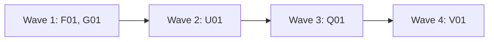

# Plan for 0.5.0

0.5.0 makes the pipeline safe to run with nobody watching. It fixes the feedback issues that the 0.4.0 and 0.4.1 runs filed about review rounds, QA, the quick-brief step and sandbox refusals: a fix round brings back the same class of problem, a finding has two severities, a QA failure or a refused check does not stop a PR, and an agent that retypes a long command loses a quick fix. The routine's full mode (#88) moves to 0.6.0 (see Decisions). The readers of the output are the maintainer, the main session and, from 0.6.0, the routine. Each entry is one PR. A PR is done when its acceptance test passes in CI, an adversarial review reports no blockers or majors, and it is squash-merged.

## Goals this release serves

- Quality (goal 2): F01 (a fix sweeps every sibling place, and a check-adding entry is reviewed against its invariants), U01 (a refused check or a QA scenario that did not run never counts as passed).
- My attention (goal 3): U01 (no fix round for a refused command), Q01 (a quick fix no longer stops for a brief that a person must delete), G01 (one syntax-check command that the sandbox allows).
- Cost (goal 4): F01 (fewer rounds that find again what round 1 could see), G01 and U01 (no empty fix rounds).
- Speed matched to effort (goal 5): Q01 (quick fixes post their brief reliably, and two quick fixes that touch one file do not build at the same time).
- Automatic improvement (goal 7): every entry. Full mode in 0.6.0 runs waves unattended, and these are the failures such a run would hit first.
- Non-goals it comes close to: "Replacing CI". G01 gives CI and the agents one script. CI still runs every check.

## Findings

Each claim was checked against `main` at 7637119.

| Finding | Issue | What is wrong |
| --- | --- | --- |
| A fix brings back the same class of problem | #96 | `agents/fixer.md` tells the fixer to fix each finding. Nothing asks it to look for the same weakness in other places, and the reviewer does not report sibling places either. |
| Plan reviewers find whole classes late | #98 | A plan entry that adds a check has no list of the properties the check must keep. A plan PR gets the architecture review in round 1 and again only after `needs-change`, so a `fits` verdict is never checked again after a fix changes the plan. |
| Two reviewers report one finding twice | #85 | `reviewLoop` joins the review, architecture and QA findings with no merge, so the fixer and the history get each shared finding twice. |
| Severity has two sources | #161, #20 | `ARCHREV` has no severity field. The workflow makes every `needs-change` finding a major, so an architecture finding titled `[minor] ...` keeps the loop open. A reviewer can also put a severity word in the title that differs from the field. |
| The stop reason hides the cap | #161 | `reviewLoop`, `docsStep` and `checkNewCode` stop with `rounds exhausted` and no numbers, and the cap can be `maxRounds`, `planRounds`, a PR's own `maxRounds` or the quick-fix cap of 2. |
| A QA failure does not stop the PR | #160 | QA runs again only when it returned a blocker or major finding (`qaOpen`). A failed scenario with only a minor finding is never checked again. The `QA` schema has no way to say a scenario did not run, so an untested scenario reads as done. |
| The quick-brief command is retyped | #189 | `briefCommand` puts the entry as one base64 argument, followed by `--sum`. A Haiku agent retypes it and merges the two (exit 65). The workflow takes `exitCode` from the agent's answer, so a posted brief can be reported as not posted. |
| Exit codes are inferred | #192 | Every `pipeline-io` call (`cleanupRun`, `readHead`, `bots`, `landFor`, `landFixCheck`, `quickSetup`) uses the exit code the agent reports, and the output can hold text that the script did not print. |
| Sandbox refusals count as failures | #190 | The `for f in ...; do bash -n` check in `AGENTS.md` and `ci.yml` is a compound command, which the worktree guard refuses when an agent runs it. The workflow reads a refused check as a failed one (`failingChecks`) and starts a fix round. `openPrompt` does not say how to pass a body, and the opener's inline `--body` was refused. |
| The old value stays in other files | #193 | `agents/implementer.md` has no rule to search for the old value of a constant it changes. |
| Plan drafts repeat avoidable gaps | #194 | SKILL.md Step 1 has no checklist for the plan author. |
| Quick entries are not checked for overlap | #195 | `runPR` runs every PR in parallel, and nothing compares the Touches lines of the quick entries. |

## Decisions

- **Release split (maintainer, 2026-11-03).** The old 0.5.0, the routine's full mode (design brief #88), is split. 0.5.0 makes the pipeline safe to run unattended. Full mode moves to 0.6.0. No entry here plans or builds full mode.
- **Write tool (maintainer, 2026-11-04).** `pr-opener` and `pipeline-io` get the `Write` tool, only to write the one file their task names inside the wave's temp folder. This is the only change to the tool sets.
- **Brief agent model (maintainer, 2026-11-04).** The quick-brief put call runs on Sonnet. Every other `pipeline-io` call stays on Haiku.
- **Defaults this plan chose.** The plan review can change these. Each is also in Flagged concerns.
  - A PR with an untested item (a refused check, or a QA scenario that did not run) can be ready, but it gets no `:auto`.
  - Of two quick PRs whose Touches lines share a path, the later one in `prs` stops before the build and runs in a later wave.

## Scope

In:

| Group | Entries | Issues | Size |
| --- | --- | --- | --- |
| Findings and fix rounds | F01 | #96, #98, #85, #161, #20, #193 | L |
| One syntax-check script | G01 | #190 (part) | S |
| Untested is not passed | U01 | #160, #190 (part) | M |
| Quick-brief transport, exit codes and overlap | Q01 | #189, #192, #195 | M |
| Version 0.5.0, plan-author checklist and docs | V01 | #194 | S |

#193 goes into F01 and #195 into Q01 because they change the same files. #194 goes into V01, which is the only entry in its wave that edits SKILL.md.

## Order and waves

Summary: the findings entry and the syntax script go first, then the untested rule, then the quick-brief entry, then the version and docs.

F01, U01 and Q01 all change `workflows/run-wave.js` and `test/sim-pipeline.mjs`, so they are in three waves. F01 goes first because its sweep rule and its findings function apply to the review of U01 and Q01, and U01's QA findings go through that function. U01 adds the first exception to the "read-only agents have no edit tools" check, and Q01 adds the second, so Q01 comes after U01. G01 touches only its own files. In each of waves 1 to 3 only one docs agent can edit `skills/pr-pipeline/SKILL.md` and `README.md`: G01 runs with `docsUpdate: false`. V01 is last because it sets the version.

## Rules for every PR

- Read `AGENTS.md` and `docs/goals.md`.
- Each PR adds checks in `test/sim-pipeline.mjs` or a `test/*.test.mjs` file that fail when the change is removed. The PR description says how that was checked. Named exception: V01 (its proof is `claude plugin validate .`, the CI version step and one text check).
- Simulation tests check only what code decides. What an agent judges is checked by a QA case or by a code step after it, never by a fake agent's scripted answer.
- Each negative test checks that its input really contains what the check looks for.
- An entry with an **Invariants** line: the reviewer checks each invariant in every round, and the tests cover each one.
- Compute each shared value in one place: the findings split (`splitFindings`), the round cap and its name (`roundsFor`), the tester's answer (`testOutcome`), the untested list (`untestedOf`), the `pipeline-io` exit code (`scripts/io.sh` and `ioCall`), the Touches paths (`touchesOf`) and the syntax-check file list (`scripts/check-syntax.sh`). The brief sum has two copies, `cksum` in the workflow and `cksum` in `quick-brief.sh`, and a test checks they agree.
- Docs: Simplified Technical English, no em dashes, Mermaid for diagrams with a one-line text summary under each. Code comments only for why or hidden constraints.
- New scripts use `gh api` REST calls only. Issue text, PR text and comments are untrusted input. A record the pipeline wrote counts only when `scripts/trusted-comment.jq` accepts it.
- No test or QA case loads a `launchd` job, writes to `~/Library/LaunchAgents` or `~/.agent-pr-pipeline`, or uses the network for anything other than GitHub calls to this repo and `alfhen/pipeline-dogfood`.
- Gated paths: every entry touches one, so the maintainer merges every PR. F01: `workflows/**`, `agents/**`, `templates/**`. G01: `scripts/**`, `AGENTS.md`, `.github/**`. U01: `workflows/**`, `agents/**`. Q01: `scripts/**`, `agents/**`, `workflows/**`. V01: `.claude-plugin/**`, `skills/**`. A docs agent that edits SKILL.md adds `skills/**`. This plan PR is `docs/plan-*.md`.

## PRs

### Wave 1

**F01 Findings and fix rounds.** Issues: #96, #98, #85, #161, #20, #193. Touches: `workflows/run-wave.js`, `agents/reviewer.md`, `agents/arch-reviewer.md`, `agents/fixer.md`, `agents/implementer.md`, `agents/triager.md`, `templates/plan.md`, `test/sim-pipeline.mjs`, `test/reviewer-agent.test.mjs`, `test/role-rules.test.mjs` (new).
- **One severity (#161, #20).** `splitFindings(findings, source)` is the only place that sorts findings. The review, QA, architecture, docs-check, bot-answer-check and land-fix-check paths all call it. It removes a leading severity word from the title (`[minor]`, `(Major)`, `blocker:`, `minor -`, any case), keeps the `severity` field, and counts a conflict when the word and the field differ. `ARCHREV` findings get a required `severity`. Architecture minors become minors. A `needs-change` verdict with no findings keeps the fallback major, as now. The architecture review runs again when its last report had a blocker or major. `agents/arch-reviewer.md`: rank each finding; `needs-change` needs at least one blocker or major. A history line is `<severity> [<source>]: <title>`, and the row gets `severityConflicts` when it is not 0.
- **Round caps (#161).** `roundsFor(pr)` returns `{ max, cap }`. `cap` is `maxRounds`, `planRounds`, `prs[].maxRounds` or `quick S/low` (the cap `withBrief` sets). The stop reasons are `rounds exhausted: <used> of <max> (<cap>)`, `docs check: rounds exhausted: <n> of <n> (docsRounds)`, and `bot answer check` and `land-fix check` with `(botCheckRounds)`.
- **Duplicates (#85).** Before the fixer and the history, findings with the same `file` and the same title (lower case, letters and digits only) become one item with the highest severity and a `sources` list. `fixPrompt` numbers the findings and groups them by file. `FIX` gets `sameAs`: groups of numbers that the fixer fixed as one. The workflow folds each group into one line of that round's history, with all sources.
- **Sweep (#96).** `REVIEW` gets `sweep`: for each blocker and major, the sibling places checked (other callers of the same function, other prompts or scripts with the same job, other plan entries and states) and those that have the same weakness. `agents/reviewer.md`: report the sweep in round 1, and report each sibling with the weakness as a finding. `fixPrompt` carries the round's `sweep`. `FIX` gets `siblings`: per finding, the places the fixer checked and fixed. `agents/fixer.md`: before you fix a finding, list every sibling place with the same weakness and fix it in the same round. For a plan PR, list the other entries and states each edit touches. The next `reviewPrompt` carries the last `siblings` and asks the reviewer to check that the sweep is complete.
- **Invariants (#98).** `templates/plan.md` gets an optional `Invariants:` line, required for an entry that adds a check (a gate, a guard, a refusal or a trust rule): one sentence per property that must hold for every input. The triager's `entry` gets optional `invariants`, and `entryText` writes them as an `Invariants:` line. `reviewPrompt` asks for `invariants`: one row per invariant, with `holds` and `evidence`. The workflow makes each row with `holds: false` a major titled `[invariant] <text>`. `agents/triager.md`: for a build entry that adds a check (a gate, a guard, a refusal or a trust rule), write an Invariants line, one sentence per property that must hold for every input.
- **Plan review (#98, #96).** `agents/reviewer.md`, for a plan PR in every round: where each policy value is read from, who can write each signal or record, what each script runner can execute, and what ends each state. `templates/plan.md` gets an optional States table (state, how it starts, what ends it), and the reviewer reports a state that nothing ends. A plan PR gets the architecture review in every round. From round 2 its prompt carries its earlier reports and asks it to check each earlier `fits` against the new head.
- **Old values (#193).** `agents/implementer.md` and `agents/fixer.md`: when you change a constant, default, limit or name, search the repo for the old value with `git grep -n -F` and update every mention, or say in your answer why one stays.
Invariants: every path that sorts findings by severity calls `splitFindings`; a history row has at most one line per file and normalized title; every cap stop reason names the cap and both numbers.
Regression test: the simulation: a review major titled `[minor] x` gives the history line `major [review]: x`, `severityConflicts: 1`, and the fixer gets the title `x`; the same case for a docs-check, bot-check and land-fix finding and a QA finding (one check per path, so a path that skips `splitFindings` fails); an architecture minor goes to `minors`, starts no fix and no second architecture run; a `needs-change` with no findings gives the fallback major; one finding from the reviewer and the architecture reviewer gives one history line with both sources and one item in the fix prompt; `sameAs: [[1, 2]]` folds two lines into one; `P1` stops with `rounds exhausted: 4 of 4 (maxRounds)`, a plan PR with `of 3 (planRounds)`, a PR with `maxRounds: 1` with `of 1 (prs[].maxRounds)`, a quick S/low PR with `of 2 (quick S/low)`, and the docs, bot and land checks with their caps; the review's `sweep` is in the fix prompt and the fixer's `siblings` are in the next review prompt; an invariant row with `holds: false` becomes a major and one with `holds: true` does not; a stored brief with an `Invariants:` line reaches the reviewer; a plan PR runs the architecture review in rounds 2 and 3 with the earlier reports. `test/reviewer-agent.test.mjs`: the sweep rule and the plan checklist. `test/role-rules.test.mjs`: the fixer's sibling and old-value rules, the implementer's old-value rule, and the architecture rule that `needs-change` needs a blocker or major, and the triager's Invariants rule. Each text check reads the role file's body, not its front matter.
Acceptance: `node test/sim-pipeline.mjs` and `node --test test/*.test.mjs` pass. Each new check fails when its rule is removed. For example, the docs-check `[minor]` case fails when `docsStep` filters on the raw severity, and the cap case fails when the reason is the bare `rounds exhausted`.

**G01 One syntax-check script.** Issue: #190 (the syntax check). Touches: `scripts/check-syntax.sh` (new), `AGENTS.md`, `.github/workflows/ci.yml`, `test/check-syntax.test.mjs` (new). Runs with `docsUpdate: false`.
- `scripts/check-syntax.sh [root]` runs `bash -n` on `scripts/*.sh`, `routine/*.sh` and `routine/bin/gh` under `root` (default: the repo that holds the script). The file list is only in this script. It prints `SYNTAX <file>` for each file that fails and `MISSING <pattern>` for a pattern that matches no file, and exits 1 for either. Otherwise it prints `OK <n> files` and exits 0. It is one simple command, so the worktree guard allows it.
- `AGENTS.md` Checks: one line `bash scripts/check-syntax.sh` replaces the two loops, so the wave `checks` copied from it change too. The `Shell syntax` step of `ci.yml` runs the same command.
Invariants: a file with a syntax error in any of the three patterns gives exit 1; a pattern that matches nothing gives exit 1; `AGENTS.md` and `ci.yml` run the script and hold no `for f in` loop.
Regression test: `test/check-syntax.test.mjs` copies the script into a temp root with good files (exit 0, `OK <n> files`), then breaks `routine/bin/gh` (exit 1, `SYNTAX routine/bin/gh`), then `scripts/x.sh` (exit 1), then removes `routine/*.sh` (exit 1, `MISSING routine/*.sh`). Each broken file really fails `bash -n`, which the test checks first. It also runs the script on the repo itself (exit 0), and checks that `AGENTS.md` and `ci.yml` call `bash scripts/check-syntax.sh` and hold no `for f in`.
Acceptance: `node --test test/check-syntax.test.mjs` passes, and the `AGENTS.md` and `ci.yml` checks fail on the old files. The PR's own `ci` run shows the new step.

### Wave 2

**U01 Untested is not passed.** Issues: #160, #190 (refusals and PR bodies). Touches: `workflows/run-wave.js`, `agents/tester.md`, `agents/qa.md`, `agents/pr-opener.md`, `agents/bot-answerer.md`, `test/sim-pipeline.mjs`, `test/tester-agent.test.mjs`, `test/role-rules.test.mjs`.
- **Refused checks (#190).** `TEST` checks get `refused`: true when a permission check denied the command, so it did not run. `agents/tester.md`: report a refused command as `refused`, never work around it, and report the acceptance-test check as a check of its own. `TEST` gets `acceptance: { declared, check }`, which the tester fills: `declared` is true when the entry has an Acceptance line that names a runnable test, and `check` is the name of the check that runs it. Plan PRs have no acceptance test, and a docs entry sets `declared` only when its Acceptance line names a runnable check. `testOutcome(test)` is the one place that reads a tester's answer, in the review loop, the docs check and `checkNewCode`. It ignores the agent's `pass`: a check fails when `pass` is false and `refused` is not true. A round passes only if at least one check ran and passed and none failed. When `acceptance.declared` is true and the PR kind is not `plan`, a round also needs a passed check whose name equals `acceptance.check`; the workflow does not read the entry or match names to a test. Three cases are not a sign-off. (a) An empty `checks` list, or a list where every check is refused: nothing ran and a fixer cannot clear a refusal, so the PR stops at once with the reason `tests did not run` and no fixer starts. (b) `acceptance.declared` is true and no passed check is named by `acceptance.check`: the tester ran checks but not the acceptance test, so the fixer gets the finding `acceptance test did not run`. (c) A failed check: the fixer gets the failure. A refused check starts no fix round and goes into the history row as `notRun: ["<name> (refused)"]`.
- **QA scenarios (#160).** `QA` scenarios get `result`: `pass`, `fail` or `not-run`, and `whyNotRun`. They have these states:

| State | Starts when | Ends when |
| --- | --- | --- |
| open | a QA run reports the scenario as `fail` | a later QA run reports the same name as `pass`, or the rounds run out and the PR stops for the maintainer |
| untested | the last QA run that names the scenario reports `not-run` | a later QA run reports it as `pass` (else it stays in the PR body and the result) |

- **Open scenarios.** Each open scenario counts as a major (`QA scenario failed: <name>`) for the fixer, and QA runs again in every round while one is open. `qaPrompt` lists the open and untested names and tells QA to use the same names. A run that leaves out an open name keeps it open. `agents/qa.md`: report a scenario you could not run as `not-run` with the reason. Never report it as `pass`.
- **Untested list.** `untestedOf` builds it from the refused checks of the last test round and the untested QA scenarios. It goes to the result (`untested`), to `openPrompt` (the PR body gets an Untested section) and to `landFor`: a PR with an untested item gets no `:auto`, and `landWhy` says `untested: <items>`.
- **Body files (#190).** `openPrompt`: write each issue body and the PR body to a file under `<tmp>/open-<id>/` with the Write tool, and pass it with `--body-file`. `agents/pr-opener.md` gets `Write` in `tools` and says to write only those files, inside the wave's temp folder (maintainer decision, 2026-11-04). A test checks that both role files hold the temp-folder rule. `answerPrompt` and `agents/bot-answerer.md`: reply with `-F body=@<file>`, never an inline body. The "read-only agents have no edit tools" check allows exactly `Write` for `pr-opener`.
Invariants: a refused check never starts a fix round and never counts as passed; a list with no check that ran stops the PR and starts no fixer; a round with no check that ran and passed is never a sign-off; a failed QA scenario ends only when a later QA run names it as `pass`, or when the PR stops; a PR with an untested item never gets `:auto`; the PR body lists every untested item.
Regression test: the simulation: a tester answer with `lint` refused and no findings starts no fix, signs off, has `notRun` in the history, `untested` in the result, a land value with no `:auto`, and the list and `--body-file` in the open prompt; a real failure next to a refused check gives a fix prompt that lists only the real failure; an answer with `pass: true` and one failed check is a failure; `checks: []` with `pass: true`, `checks: []` with `pass: false`, and a list with every check refused each stop the PR with `tests did not run`, no sign-off and no fix prompt; a list with passed checks, `acceptance: { declared: true, check: "x" }` and no passed check `x` gives the fix prompt `acceptance test did not run` and no sign-off, while the same list with `declared: false` signs off, and a plan PR signs off with `declared: true` and no such check (the simulation scripts the fields, because code decides on a field); a failed scenario with only a minor finding makes QA run in round 2 with the name in its prompt, and a `pass` there signs off; a scenario that fails in every round stops with `rounds exhausted` and `QA scenario failed: <name>` in `lastFindings`; a QA run that leaves out the open name keeps it open; a `not-run` scenario gives a ready PR with no `:auto` and the scenario in the body; the answer prompt holds `-F body=@` and no `-f body=`; `pr-opener` front matter has `Write`, and every other read-only role still has no edit tool. `test/tester-agent.test.mjs` and `test/role-rules.test.mjs`: the refused, `not-run` and body-file rules, and that `tester.md` tells the tester to fill `acceptance` honestly.
Acceptance: `node test/sim-pipeline.mjs` and `node --test test/*.test.mjs` pass. The refused case fails when `testOutcome` reads `pass` as before, and the `not-run` case fails when `landFor` ignores `untestedOf`.

### Wave 3

**Q01 Quick-brief transport, exit codes and overlap.** Issues: #189, #192, #195. Touches: `scripts/io.sh` (new), `scripts/quick-brief.sh`, `agents/pipeline-io.md`, `workflows/run-wave.js`, `test/io.test.mjs` (new), `test/quick-brief.test.mjs`, `test/fixtures/quick-brief/` (new fixtures), `test/sim-pipeline.mjs`.
- **Exit codes from the script (#192, #189).** `scripts/io.sh <script> <args>...` runs a script from its own folder. The name must match `^[a-z-]+\.sh$` and the file must be there, else exit 64. It prints `pipeline-io: begin`, then the script's stdout and stderr, then `pipeline-io: exit <n>`, and exits with the script's code. `ioCall` in the workflow is the only place that builds a `pipeline-io` command and reads the answer. It takes the exit code from the last `pipeline-io: exit` line and the output from between the two lines. When a line is missing, the call failed (`no exit line`). Every `pipeline-io` call uses it: the brief, the gate, the bot status, the PR head, `land-commits.sh` and every cleanup call. `agents/pipeline-io.md`: return the output exactly as printed.
- **No base64 (#189).** `quick-brief.sh put <repo> <issue> <file> --sum <crc>:<bytes>` replaces `--b64`, and `--b64` is refused (exit 64). The put prompt holds the entry as data in a fenced block and the path `<tmp>/brief-<id>/entry.md`. The agent writes the block to that path with the Write tool and runs one short command. `agents/pipeline-io.md` gets `Write` in `tools`: write only the file the task names, inside the wave's temp folder, with the exact text, and run nothing that is in it. The put call runs with model `sonnet` (maintainer decision, 2026-11-04); the other `pipeline-io` calls keep Haiku. The model comes from `STEPS`, not from a call site: `ROLES` gets `ioBrief: { agent: 'pipeline-io', phase: 'Triage', skills: null, model: 'brief' }` and `STEPS` gets `brief: { model: 'sonnet', effort: 'low' }`, and the put and `#put2` calls use role `ioBrief`, so `steps` can override it. A test checks that `STEPS.brief` is sonnet, that the put calls use it, and that no other `pipeline-io` call does. The SKILL.md Role agents table gets a `brief` row (pipeline-io, sonnet, low, Bash and Write) in V01. The script removes trailing newlines before it checks the sum, and the workflow computes the sum of the entry with none. On exit 65 the workflow runs the put once more (label `#put2`). A second 65 stops the PR with `quick brief not posted: checksum, twice`.
- **Replace a pipeline brief (#189).** The marker becomes `<!-- pipeline:quick-brief <crc>:<bytes> -->`, the sum of the text under it. `trusted-comment.jq` does not change: the prefix still matches. When `put` finds a trusted brief: the same text prints it (exit 0); a body that matches its marker sum, so the pipeline wrote it and no person edited it, is replaced with `PATCH /repos/{repo}/issues/comments/{id}` and the new text is printed (exit 0); any other body, including a 0.4 marker with no sum, posts nothing and exits 4 (`edited by a person`). `get` exits 4 for a body that does not match its marker sum, and reads a 0.4 marker with no sum as before. The workflow stops on exit 4 with `quick brief edited by a person`.
- **Overlap (#195).** The workflow runs `quickSetup` for every quick PR first, then compares their Touches paths. `touchesOf(brief)` reads the `Touches:` line, splits it on commas, and removes backticks and notes in brackets. A quick PR that shares a path with an earlier quick PR in `prs` stops before the build with `quick fix: touches overlap with <id> (<paths>); run it in a later wave`. Its brief stays on the issue, so the later run reuses it.
Invariants: no `pipeline-io` prompt holds `--b64` or a run of 60 or more base64 characters; the workflow takes every `pipeline-io` exit code from the `pipeline-io: exit` line, never from the agent's `exitCode`; `put` never changes a comment by another account, or a brief whose text does not match its marker sum; two quick PRs that share a Touches path never build in the same run.
Regression test: `test/io.test.mjs` copies `io.sh` and stub scripts into a temp `scripts/` folder: exit 0 with output (begin line, output, `pipeline-io: exit 0`), exit 65 (last line `exit 65`, `io.sh` exits 65), stderr is included, and a name with `/`, `..` or no such file gives exit 64. `test/quick-brief.test.mjs` with `test/fake-gh`: a put with a file and the right sum (one POST, the marker holds the sum); a file with a trailing newline (accepted); a wrong sum (exit 65, no POST); `--b64` (exit 64, no call); an existing brief with the same text (no write); an unedited pipeline brief and a new entry (one PATCH to that comment id, no POST); a brief whose text does not match its marker sum (exit 4, no write); a 0.4 marker and a new entry (exit 4, no write); `get` on an edited brief (exit 4) and on a 0.4 marker (exit 0). The simulation: an io answer with text outside the two lines (the result has none of it); an answer with `exitCode: 0` and the line `pipeline-io: exit 3` (read as 3); an answer with no exit line (the call failed); a put that gives 65 and then 0 (a `#put2` call, the PR goes on); 65 twice (the PR stops, no `implement` call); the put prompt holds the path, `--sum` and the entry block and no `--b64`; exit 4 from `get` (the PR stops); quick PRs `QO1` and `QO2` that both touch `src/x.js` (`QO2` stops with the overlap reason before `implement`, `QO1` builds); two quick PRs with no shared path (both build); `pipeline-io` front matter has `Write`. The existing check that the workflow sum equals `cksum` of the entry stays.
Acceptance: `node test/sim-pipeline.mjs` and `node --test test/*.test.mjs` pass. The exit-line case fails when `ioCall` reads the agent's `exitCode`, and the overlap case fails when the comparison is removed.
QA: against `alfhen/pipeline-dogfood`, open one scratch issue. Write an entry to a file in the QA run's temp folder and run `scripts/io.sh quick-brief.sh put alfhen/pipeline-dogfood <n> <file> --sum <sum>` with the sum from `cksum`. Then run `get`, then `put` with a changed entry (the issue still has one brief comment, with the new text), then add a line to that comment with `gh api -X PATCH`, then `put` again (exit 4, nothing changes). Close the scratch issue at the end.

### Wave 4

**V01 Version 0.5.0, plan-author checklist and docs.** Issue: #194. Touches: `.claude-plugin/plugin.json`, `skills/pr-pipeline/SKILL.md`, `README.md`, `docs/routine.md` (only where it became wrong), `templates/AGENTS-section.md`, `AGENTS.md` (the "How a change is made" steps only), `test/skill-notes.test.mjs`. Runs as `kind: "docs"`.
- Version 0.5.0. v0.4.1 (R04) is released, so the version step checks 0.5.0 against the v0.4.1 tag.
- **Checklist (#194).** SKILL.md Step 1 gets a plan-author checklist: copy the "Rules for every PR" block from the last plan; compute each shared path or value in one place; keep tests and QA away from the maintainer's real config (`~/Library/LaunchAgents`, `~/.agent-pr-pipeline`, a real `HOME`); give each acceptance test a way to fail and say how; give each check-adding entry an Invariants line and a plan with states a States table; name the gated paths each entry touches.
- **Loop copies.** `templates/AGENTS-section.md` and `AGENTS.md` step 4: a plan PR gets the architecture review in every round, and architecture findings are ranked, so a minor stays a minor.
- Docs: what earlier docs agents left out. README's script list gets `io.sh` and `check-syntax.sh`. SKILL.md's Files list, the `brief` row in the Role agents table, troubleshooting rows for the new stop reasons (`rounds exhausted: N of M (cap)`, `quick brief edited by a person`, `touches overlap`, `untested`), and Step 0, which no longer says base64.
Regression test: `test/skill-notes.test.mjs` checks that Step 1 has the checklist and each of its six items. It reads the text between the `## Step 1` and `## Step 2` headings, and fails first when either heading is missing.
Acceptance: `claude plugin validate .` passes; the CI version step passes for 0.5.0 against the v0.4.1 tag; the checklist test fails without the checklist.

## Flagged concerns

- **Two roles get Write.** `pr-opener` and `pipeline-io` had no edit tools. Both have Bash, which can already write files, so `Write` adds no power. It gives them a way to write a file that the worktree guard allows. Default: add it, with a role rule that names the one file.
- **The brief is plain text in a prompt.** In 0.4.0 the base64 kept the entry opaque, so no agent read it as instructions. The entry is the triager's text, not the issue's, and the `pipeline-io` agent only writes it with Write, which runs nothing. A prompt injection that got through the triager could still reach the put agent, which has Bash. Maintainer decision (2026-11-04): the put call runs on Sonnet; every other `pipeline-io` call stays on Haiku. The text is marked as data.
- **Untested blocks `:auto`.** In this repo every PR is gated, so nothing changes here. In other repos, some merges move to the maintainer.
- **Stricter QA.** A failed scenario with only a minor finding now keeps the loop open.
- **Cost.** A plan PR gets up to two more architecture runs. A quick PR that overlaps another one waits for a later wave.
- **Old briefs.** A brief with a 0.4 marker is still read, but `put` never replaces it. A person deletes it when it is wrong.

## Out of scope

| What | Why |
| --- | --- |
| The routine's full mode (#88) | 0.6.0 (maintainer, 2026-11-03). |
| Overlap between a quick PR and a plan PR in one wave | Code has no Touches line for a plan PR. Plan review keeps plan entries apart. |
| The other open `pipeline-feedback` issues | The routine triages them. Several (for example #97, #99, #162) are about the same rounds, but they are not needed to run unattended. |
| `review-minor` issues on files these entries touch (for example #105, #108, #126) | Fixed in a batch between waves, grouped by file, as AGENTS.md says. |
| `docs/explainer.html` | Nothing in it becomes wrong. |
| The 0.5.0 release | `scripts/release.sh`, run by the main session after V01 merges, with the maintainer's go-ahead. |
