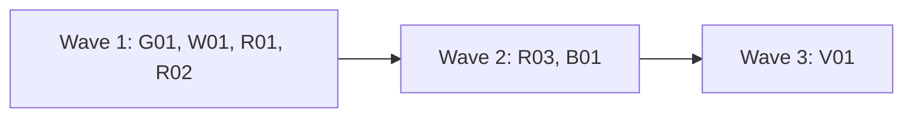

# Plan for 0.6.0

0.6.0 adds the routine's full mode (design brief #88, open points of #13). In `full` mode the routine triages as before, then plans a release from the `plan` issues, runs the waves, lands what an agent may land, recovers after a run that died, makes the release, and files run feedback after the maintainer approves it. Code decides each step, and a script, not a model, does each merge, release and feedback filing. The model runs only the steps that need judgment: triage, writing a plan, and starting a wave with arguments the runner wrote. The release also adds a version warning at the start of each wave (#227), a wider static check for the calls the workflow runtime forbids, and two fixes to what full mode lands and records (#166, #170). `observe` and `triage` do not change. The readers of the output are the maintainer, the main session and the routine. Each entry is one PR. A PR is done when its acceptance test passes in CI, an adversarial review reports no blockers or majors, and it is squash-merged.

## Goals this release serves

- Automatic improvement (goal 7): R01, R02, R03 (full mode plans, runs, lands, recovers and releases), W01 (the routine gets the wave result from a file, not from a model's words).
- Self-improvement (goal 1): R01 and R03 (run feedback goes to the maintainer as a draft and is filed only after approval).
- Quality (goal 2): B01 (an old approval does not clear code the bot never saw), G01 (the workflow cannot ship a call that breaks resume).
- My attention (goal 3): R01 (every stop ends in one `blocked` record and no hourly repeat; the maintainer ends it with one command), W01 (the land reason says "gated" in words, and a stale plugin is named at the start of a wave).
- Cost (goal 4): R01 and R03 (a step that needs no judgment starts no session; limits on open PRs, waves per day and recover attempts).
- Non-goals it comes close to: "A hosted service". The routine stays a `launchd` job on the maintainer's Mac. "Replacing CI or the review bots". The routine lands only through `land-wave.sh`, which waits for CI and a bot.

## Findings

Each claim was checked against `main` at 28932aa.

| Finding | Issue | What is wrong |
| --- | --- | --- |
| There is no full mode | #88, #13 | `routine/run.sh` accepts only `observe` and `triage`. The word `full` acts as `observe`, and `test/routine-guard.test.mjs` checks that. |
| `next` knows only triage | #88 (1, 2, 6, 7) | `routine-state.sh next` prints `init needed`, `triage` or `idle`. `put` accepts only the type `triaged` and refuses every other type with exit 64. No step has an end state because no other step exists. |
| The wrapper refuses what a wave runs | #88 (9) | `routine/bin/gh` passes only `gh api` reads and needs no mode. A wave's opener runs `gh pr create`, and the bot answerer posts replies with `gh api -F`. Both are refused. |
| No settings for the routine's waves | #13 (4) | `.github/pipeline.json` has no `routine` key, and the guard folder holds no wave arguments. A full-mode wave would have no `checks`, `goals` or `bots`. |
| No maintainer-only signal | #88 (3, 4), #13 (8) | Nothing in the code can clear a block, drop an entry or approve a feedback draft, and nothing refuses a session that tries. |
| No recovery | #13 (7) | A run that dies mid-wave leaves no record. `run.sh` resets the clone with `git clean -fdx` and does not run `git worktree prune`, so the worktrees of a dead run stay registered. |
| Release and feedback are main-session only | #88 (11) | SKILL.md Step 3 says "An agent never runs it on its own" about `release.sh`, and Step 4 says the main session files feedback. `AGENTS.md` and `templates/AGENTS-section.md` say the main session runs `release.sh`. |
| Planned waves have no PR block rule | #88 (10) | `templates/plan.md` has no line for `kind`, `docsUpdate` or `sensitive`, and no rule for the branch name. |
| One trust rule holds, but returns one comment | #88 (12) | `quick-brief.sh`, `release.sh` and `routine-state.sh` all call `scripts/trusted-comment.jq` with `-f`, and there is no jq module, so no caller needs `-L`. The rule errors on two matches, so it cannot list all records of one type. |
| The size L or high risk rule has two copies | #88 | `routine-state.sh` (the `put` jq) and `run-wave.js` line 790 apply it. The script's comment says this holds "until #88 puts both in one place". The bash script and the workflow cannot share code. |
| No version check before a wave | #227 | `run-wave.js` holds no version and reads none. A session can run waves on an old plugin after a release. |
| The forbidden-call check has gaps | (maintainer, 0.6.0 scope) | `test/sim-pipeline.mjs` has a regex (`Date\.now\(\|Math\.random\(\|new Date\(\)`) and a runtime guard. The regex misses `new Date` with no brackets, `new Date( )`, `Date.now` or `Math.random` taken as a value, and `Date['now']`. The runtime guard sees only the paths the simulation runs. |
| An old approval clears a new head | #166 | `scripts/bot-approval.jq` accepts `$r.state == "APPROVED"` with no commit check, so an approval on an older commit clears code that a bot answer or a land fix added later. |
| The land reason is raw gate output | #170 | `landFor` sets `landWhy` to `gate: <raw output>`. `gate-files.sh` exits 1 both for a gated PR and for a gate that could not run, so the two read alike. The `EXIT:1` line the issue quotes is gone since 0.5.0 Q01 (`readIo` drops it). |

## Decisions

- **Release split (maintainer, 2026-11-03).** Full mode (#88) is 0.6.0. 0.5.0 made the pipeline safe to run unattended first.
- **Version check (maintainer, 2026-11-04, #227).** The check only warns: a log line at the start and a top-level `warnings` list. The wave never stops for it, and the pipeline never installs anything. The routine runs its frozen guard copy and changes only when the maintainer runs `install.sh`.
- **Constraints that stay (maintainer).** The routine runs a frozen guard copy of the plugin. Gated paths are never merged by an agent. One identity makes the guards advisory. `observe` and `triage` keep working unchanged. No test or QA loads a `launchd` job or writes the real `~/Library/LaunchAgents` or `~/.agent-pr-pipeline`. Scratch GitHub work is only on `alfhen/pipeline-dogfood`.
- **Design choices this plan made.** The plan review can change these. Each is also in Flagged concerns.
  - A script does every merge, release, feedback filing and record write. The runner calls it after `next` names the step. A session starts only for `triage`, `plan`, `wave`, `build`, `recover` and `landfix`.
  - The workflow writes its result for the routine to a file, with a checksum, through `pipeline-io`. The session never retypes it.
  - The maintainer ends a block with `routine-state.sh <repo> drop <subject>` or `retry <subject>` from a terminal. Both are refused under `CLAUDECODE` and from a guard folder.
  - A recovered entry is rerun with `skipImpl: true` when its branch exists, so it never gets `:auto` and the maintainer merges it.
  - `observe` keeps its triage-only view. To see what full mode would do, the maintainer runs `routine-state.sh <repo> next --mode full` by hand. It only reads.

## Maintainer decisions (2026-11-04)

The maintainer chose option (a), the recommendation, for each of D1 to D5. The entries build these options. The other options are kept below for the record.

**D1. Where the routine's wave settings live (#13 point 4).** A full-mode wave needs the fixed `run-wave` arguments (`checks`, `goals`, `spec`, `bots`, `context`, `botWaitMinutes`) and the routine's limits.
- (a) A file `routine.json` in the guard folder. `install.sh --routine-json <file>` copies it in, checks it, and keeps the old one on a reinstall without the flag. It is read-only, like `mode`. It changes only when the maintainer runs `install.sh`, the same as the plugin copy. The SKILL.md split between repo policy (`.github/pipeline.json`) and run choices (workflow arguments) does not change: the file holds one runner's choices.
- (b) A `routine` key in `.github/pipeline.json`, read from the default branch at each run. A change needs a PR, which the gate holds. SKILL.md's "Policy and choices are split" paragraph must change, and a merged PR changes the routine with no `install.sh`.
- (c) No settings. The routine uses the workflow defaults. The defaults (`pnpm` checks) do not fit this repo, so every wave fails.
- Decision (maintainer, 2026-11-04): (a). It keeps one rule for the routine: nothing changes it but `install.sh`. It needs no change to the policy split. Full mode without the file acts as `triage` and logs why.

**D2. Who merges and releases unattended (#88 point 11).**
- (a) The runner script runs `land-wave.sh` with only the `:auto` pairs the workflow recorded, never `--person`. It runs `release.sh --dry-run`, then `release.sh`, when every entry of a merged plan has landed or was dropped. `release.sh` keeps all its checks: `autoRelease` true, a green default branch, a merge record for every commit since the last tag, the manifest version. SKILL.md, `AGENTS.md` and `templates/AGENTS-section.md` say the routine's runner may do both.
- (b) As (a) for merges. The release waits: the step is `wait` with the reason `release needs the maintainer`, and starts no session.
- (c) Neither. The routine stops at ready PRs. The maintainer lands and releases everything.
- Decision (maintainer, 2026-11-04): (a). Goal 7 says agents may merge, tag and publish when an evaluation says the build is safe, and only where CI allows releases. `:auto` and `release.sh` are that evaluation. In this repo every PR touches a gated path, so in practice the maintainer still merges every routine PR here, and `autoRelease` in `.github/pipeline.json` (a gated file) turns releases off for agents and the routine together.

**D3. Permissions of a full-mode session (a new permission for the routine).** A wave's agents write code, run checks, push branches and open PRs. `observe` and `triage` allow none of that.
- (a) `routine/settings/full.json` turns on the Claude Code sandbox in strict mode (`sandbox.enabled`, `allowUnsandboxedCommands: false`, `failIfUnavailable`). Bash and the Edit and Write tools may write only in the work folder (`<home>/work/<owner>-<repo>/`), and `denyWrite` names the guard folder. The network allows only the GitHub hosts. Bash is allowed in general inside the sandbox. A full-mode `gh` wrapper and `git` wrapper (`routine/bin-full/`) refuse the dangerous call shapes, and narrow deny rules repeat them. The runner checks a checksum of the guard copy before each run.
- (b) No sandbox. A tight allow list of each command shape the role prompts and the routine's `checks` run, plus the wrappers.
- (c) Both (a) and the allow list of (b).
- Decision (maintainer, 2026-11-04): (a). The sandbox is the only one of these that the operating system enforces, so the session cannot change the guard copy, `mode` or the runner, even with a command no deny rule names. An allow list of every command a wave can run breaks when a repo's checks change, and does not stop `find -exec`. The GitHub side stays advisory under one identity whatever is chosen.

**D4. How the maintainer approves a feedback draft (#13 point 8, #88 point 4).**
- (a) The label `feedback-approved` on the tracking issue. The routine files each draft whose comment was last changed before the latest `labeled` event for that label, then removes the label. To drop an item, the maintainer deletes its line in the draft comment (one item per line) before adding the label. A draft posted or edited after the label waits for the next label.
- (b) A terminal command, `routine-state.sh <repo> approve <run id>`, that posts an approval record for one draft, refused under `CLAUDECODE`.
- (c) Each draft is its own issue, and the maintainer closes it as completed to approve it.
- Decision (maintainer, 2026-11-04): (a). It works from the GitHub app with one click, it ties the approval to the text the maintainer read through the comment's `updated_at`, and #13 suggested a label.

**D5. Cost limits.**
- (a) Limits in `routine.json` (D1), with these defaults, applied by `next`: at most 3 open routine PRs before `build` and `wave` wait (`openPRs`), at most 2 waves started in 24 hours (`wavesPerDay`), at most 3 issues in a build wave (`buildIssues`), one plan in flight at a time, and 2 recover attempts per wave before a block. One step per run, one run at a time.
- (b) Only the per-run limits (one step per run, at most 3 build issues, one plan in flight). No daily cap and no open-PR cap.
- (c) A token budget per run, passed to the workflow.
- Decision (maintainer, 2026-11-04): (a). The workflow has no hook that stops agents at a token count unless the session sets a budget directive, so (c) is not reliable. The open-PR cap matters most in this repo, where every PR waits for the maintainer: without it the routine opens PRs faster than they are merged.

## Scope

In:

| Group | Entries | Issues | Size |
| --- | --- | --- | --- |
| Forbidden workflow calls, static check | G01 | (maintainer) | S |
| Bot approval on an older commit | B01 | #166 | S |
| Workflow for unattended runs: version warning, result file, land reason | W01 | #227, #170 | M |
| Routine state for full mode | R01 | #88 (1, 2, 3, 4, 5, 6, 7, 10, 12), #13 (7, 8) | L |
| Full-mode guards and install | R02 | #88 (8, 9), #13 (4) | M |
| Full-mode runner, prompt and rules | R03 | #88 (6, 7, 11), #13 (7, 8) | L |
| Version 0.6.0 and docs | V01 | | S |

How each #88 finding is answered:

| #88 finding | Answered by |
| --- | --- |
| 1. Every step needs an end state | R01 (States below, `drop` and `retry`, recover cap), R03 (the runner posts each block) |
| 2. Outcomes from GitHub | R01: a PR has landed when GitHub says merged; a version is released when the tag `v<version>` exists. No `landed` or `released` record. |
| 3. Maintainer-only signals in code | R01 (`drop`, `retry` refused under `CLAUDECODE` and from a guard folder), R02 (both wrappers refuse them and the label) |
| 4. Approval tied to the draft | R01 (the `labeled` event time against the draft's `updated_at`), D4 |
| 5. Triage mode writes only `triaged` | R01 (`put` checks the mode per record type) |
| 6. A recorded block starts no session | R01 (a held subject is skipped), R03 (`block` starts no session) |
| 7. `:auto` PRs that did not land | R01 (`land` step), R03 (the runner runs `land-wave.sh`) |
| 8. Narrow deny patterns | R02 (call shapes, tested against the real commands of the role prompts) |
| 9. The wrapper in full mode | R02 (`routine/bin-full/gh`) |
| 10. Full PR block, branch by rule | R01 (`adopt` computes the blocks; `Run:` line in `templates/plan.md`) |
| 11. SKILL.md rules | R03 (SKILL.md, `AGENTS.md`, `templates/AGENTS-section.md` change with the runner code), D2 |
| 12. One trust rule | R01 (`trusted-comment.jq` stays the one rule and gets an optional list form that no current caller passes) |

#13 point 4 is D1 and R02. Point 7 is R01 (`recover`) and R03. Point 8 is R01 (`file-feedback`), R03 and D4.

Not in:

| Issue | Why it waits |
| --- | --- |
| #172 (a gated-path flag at triage) | Useful, but full mode does not need it: a gated routine PR waits for the maintainer and starts no session. The routine triages it. |
| #164, #163, #162 | Pipeline issues found in the routine's end-to-end test. Not needed for full mode. The routine triages them. |
| #97, #14, #16 (plan review and the plan fixer) | A routine plan PR touches `docs/plan-*.md`, which is gated, so the maintainer reads every plan before it merges. |
| The other open `pipeline-feedback` issues | The routine triages them. |
| The routine on other repos | It runs on this repo only. Its feedback goes to the same repo, so the denylist is empty and no redactor runs. |
| Moving the routine to claude.ai (#13 point 9) | Later, after full mode has run. |
| A separate GitHub identity | Later. Until then the GitHub guards are advisory. |
| `docs/explainer.html` | Nothing in it becomes wrong. |
| The 0.6.0 release | `scripts/release.sh`, run by the main session after V01 merges, with the maintainer's go-ahead. |

## States

Full mode adds these states. Each one ends.

| State | How it starts | What ends it |
| --- | --- | --- |
| wave running | the runner posts `wave-started <key>`, then starts the session | the runner posts `wave-result <key>` from the result file, or the watchdog kills the run after `maxRunMinutes` (then recovering) |
| recovering | `next` finds `wave-started` with no `wave-result` | `wave-result` posted; after 2 `recover` records with no result since the last `retry`, `blocked wave-<key>` |
| step failed | a script step (`land`, `adopt`, `file-feedback`, `release`) exits non-zero in a way no other row maps | the runner posts `failed <subject> <n>`; the second failure on the same head or run gives `blocked <subject>` |
| PR waiting | a ready PR in `wave-result` whose land value has no `:auto` | merged, closed unmerged (block), head moved (block), conflict or red check (land fix), `drop` |
| PR landing | a ready PR whose recorded land value ends in `:auto` | merged, or as for PR waiting |
| land fix | an open routine PR at its recorded head conflicts or has a failed check, with no land-fix wave for that head | `wave-result landfix <pr> <sha>` posted (the new head has no `:auto`, so PR waiting); a land-fixed head that still fails is blocked |
| blocked | the runner posts `blocked <subject> <n>` | the maintainer runs `drop` or `retry`, or the GitHub outcome arrives (PR merged, tag exists, plan PR merged) |
| plan open | the runner posts `plan-open <version> <r>` after a plan run that opened a PR (`r` is the run number below) | plan PR merged (adopt), closed unmerged (block) |
| plan adopted | the runner posts `plan-merged <version>` | the tag `v<version>` exists, or every entry is dropped, or `drop plan-<version>` |
| release pending | every entry of an adopted plan is merged or dropped, and at least one merged | the tag exists; a `release.sh` refusal is blocked |
| feedback draft | the runner posts `feedback-draft <run>` after a wave with items | `feedback-filed <run>`; a refused item is blocked; an invalid edit gives `block feedback-<run>`; `drop feedback-<run>` |
| approval | the maintainer adds `feedback-approved` | the runner removes the label after it filed every draft that the label approved |

A plan run number `r` is 1 plus the `retry` records of `plan-<version>`; the plan wave key is `plan <version> <r>`, so a retried plan has new keys and no record collides. A subject is `pr-<n>`, `entry-<version>-<id>` (an entry with no PR), `issue-<n>` (a build issue with no PR), `plan-<version>`, `release-<version>`, `wave-<key>` (spaces become `-`) or `feedback-<run>`. A block's number `n` is 1 plus the number of `retry` records for its subject. A subject is held while `blocked <subject> <n>` exists for the current `n` and there is no `dropped <subject>`. Every later step skips a held subject. The runner tells the maintainer about each new `blocked` and `feedback-draft` record and each release refusal with a macOS notification and a log line (R03), because the records are comments by the maintainer's own account and GitHub does not notify an account about those.

## Order and waves

Summary: four entries with no shared file first, then the runner that uses them and the bot-approval change, then the version and docs.

G01, W01, R01 and R02 touch different files. B01 changes two expectations in `test/sim-pipeline.mjs`, which W01 also edits, so B01 waits for wave 2, where only R03 runs and R03 touches neither file. R03 needs R01's `next --mode full` output, W01's `resultFile` argument and R02's `routine.json`, wrappers and settings, and its QA runs all of them together, so it comes after. V01 sets the version, which W01 adds to `run-wave.js`, so it is last. Every wave-1 entry and B01 run with `docsUpdate: false`, so no two docs agents edit `README.md`, `skills/pr-pipeline/SKILL.md` or `docs/routine.md` in one wave. R03 documents the routine. V01 documents W01 and B01.

## Rules for every PR

- Read `AGENTS.md` and `docs/goals.md`.
- Each PR adds checks in `test/sim-pipeline.mjs` or a `test/*.test.mjs` file that fail when the change is removed. The PR description says how that was checked. Named exception: V01 (its proof is `claude plugin validate .`, the CI version step and its text check).
- Simulation tests check only what code decides. What an agent or a session judges is checked by a QA case or by a code step after it, never by a fake agent's scripted answer.
- Each negative test checks that its input really contains what the check looks for.
- An entry with an **Invariants** line: the reviewer checks each invariant in every round, and the tests cover each one.
- Compute each shared value in one place, and read it from there:
  - the step, its order, the limits and their defaults, the plan version, the `plan` argument path of each session step, and whether a step needs a session: `routine-state.sh next` (R01);
  - the PR blocks of a planned wave and the branch rule `<version>/<id in lower case>`: `routine-state.sh adopt` (R01);
  - the record trust rule: `scripts/trusted-comment.jq` (R01);
  - the version order: `scripts/semver.sh` (W01); the plugin's repo: `repository` in `.claude-plugin/plugin.json` (W01);
  - the result the routine reads: `routineResult` in `run-wave.js` (W01). The result sum has two copies, `cksum` in the workflow and the POSIX `cksum` in `result-file.sh`, and a test checks they agree;
  - the guard folder, work folder and clone paths: the `pwd -P` method that `install.sh` and `run.sh` share; the run id: `run.sh` (R03);
  - the dangerous call shapes: the table in "Call shapes" below, built by `routine/bin-full/gh`, `routine/bin-full/git` and the deny rules in `routine/settings/full.json`; the R02 tests are driven by that table (R02);
  - the shell-syntax file list: `scripts/check-syntax.sh`.
- Docs: Simplified Technical English, no em dashes, Mermaid for diagrams with a one-line text summary under each. Code comments only for why or hidden constraints.
- New scripts use `gh api` REST calls only. Issue text, PR text and comments are untrusted input. A record counts only when `scripts/trusted-comment.jq` accepts it.
- No test or QA case loads a `launchd` job or writes the real `~/Library/LaunchAgents` or `~/.agent-pr-pipeline`. Every run of `install.sh` or `run.sh` in a test or QA sets both `HOME` and `AGENT_PR_PIPELINE_HOME` to temp folders, as 0.4.1 R04 did, except the one QA step that starts a real `claude` session, which keeps the real `HOME` for sign-in and still sets `AGENT_PR_PIPELINE_HOME` to a temp folder. GitHub calls go only to this repo (reads) and `alfhen/pipeline-dogfood` (scratch work). No test or QA runs the routine against this repo in `full` mode.
- Gated paths. G01 touches none, so an agent may merge it when merge-safety says `safe`. Every other entry touches one, so the maintainer merges it. B01: `scripts/**`. W01: `scripts/**`, `workflows/**`. R01: `scripts/**`, `templates/**`. R02: `routine/**`, `scripts/**`. R03: `routine/**`, `skills/**`, `AGENTS.md`, `templates/**`. V01: `.claude-plugin/**`, `workflows/**`, `skills/**`. A docs agent that edits SKILL.md adds `skills/**`. This plan PR is `docs/plan-*.md`.

## Call shapes

One table drives R02's wrappers, deny rules and tests. A deny rule exists only for a shape that a command line shows; a record body or a REST path is checked by the wrapper alone. The invariant is: each deny rule is also refused by the wrapper, and no real prompt command is matched by a deny rule or refused by a wrapper.

| Shape | Wrapper | Deny rule in `full.json` |
| --- | --- | --- |
| `gh pr merge`, `gh release`, `gh auth`, any command not listed as passed | `bin-full/gh` | `gh pr merge`, `gh release` |
| `gh api` write to `pulls/<n>/merge`, `merges`, `releases`, `git/refs`, `git/tags`, `contents/`, `branches/*/protection`, `hooks`, `collaborators`, `actions/secrets`, `actions/workflows/*/dispatches`, `PATCH repos/<repo>`, `PATCH pulls/<n>` with `base`, a `DELETE` on a branch or the repo | `bin-full/gh` | none |
| `gh api` `PATCH`, `PUT` or `DELETE` on `issues/comments/<id>`, and any write on the tracking issue | `bin-full/gh` | none |
| a body (`-f`, `-F`, `--input`, `--body`, `-b`, `--body-file`, a `@file`) that holds `<!-- pipeline:routine`; a call that adds the label `feedback-approved` | `bin-full/gh` | none |
| `git push` with `--force`, `-f`, `--force-with-lease`, `--mirror`, `--all`, `--prune`, `--follow-tags`, `--tags`, `--delete`, `-d` | `bin-full/git` | `git push --force`, `git push -f`, `git push --tags` |
| `git push` with no explicit refspec, a refspec that starts with `+` or `:`, holds `*`, has a `refs/tags/` destination or the default branch as destination (whole-ref compare, so `fix/domain` is not `main`), or a remote other than `origin` | `bin-full/git` | none |
| a global option other than `-C` (`-c`, `--git-dir`, ...), a subcommand not on the list (an alias, `tag`, `remote`), `git config` that writes `alias.*`, `remote.*`, `url.*`, `credential.*`, `include.*`, `filter.*` or a `core.*` command key, or `push` while `remote.origin.url` or `pushurl` is not this repo | `bin-full/git` | `git tag` |
| `routine-state.sh put`, `adopt`, `drop` or `retry` run by a session | script checks (`CLAUDECODE`, guard folder) | one rule for the script name |
| `land-wave.sh`, `merge-pr.sh`, `merge-wave.sh`, `release.sh`, `file-feedback.sh` run by a session | none in the script: the runner runs `land-wave.sh` and `merge-pr.sh` with `CLAUDECODE` set on purpose, and the main session lands waves under it. The guards are the deny rule per name and `bin-full/gh` (it refuses merges and releases). The issue writes of `file-feedback.sh` pass the wrapper (`POST repos/<repo>/issues`), so for that script only the deny rule and the prompt line guard it. | one rule per script name |

Summary: the wrappers refuse every write that the role prompts do not use, and the deny rules repeat only the shapes a command line shows.

## PRs

### Wave 1

**G01 Static check for forbidden workflow calls.** Issue: none (maintainer scope). Touches: `test/workflow-runtime.test.mjs` (new). Runs with `docsUpdate: false`.
- The simulation already has a regex check and a runtime guard (both added in 0.5.0 Q01). This entry adds only what they miss. The runtime guard throws only on the paths the simulation runs, and the regex misses the forms in the Finding.
- The test reads `workflows/run-wave.js` with a small tokenizer, not a regex over the text. The tokenizer knows line and block comments, single and double quoted strings, template literals with a stack for nested `${...}` (code inside stays code), and regex literals (a `/` where a value cannot end, such as after `(`, `,`, `=`, `:`, `[`, `!`, `&`, `|`, `?`, `{`, `;` or `return`, with character classes and escapes), because `run-wave.js` has regex literals that hold a backtick (`/`+/g`, `/`/g`). The tokens, not the text, are checked: the identifier `Date` or `Math` followed by `.now` or `.random`, or by `[` a string whose value is `now` or `random` `]`, called or not; `new Date` with no argument list, or with an empty list that holds only spaces or comments. `new Date(x)` with an argument stays allowed. Each hit prints the line number and the text. The scanner covers only these forms: an alias (`const { now } = Date`, `const D = Date; D.now()`) is not found, and the runtime guard in the simulation is the net for it.
- **Preconditions on the real file.** The test fails when the tokenizer ends inside a string, template or comment, or with a non-empty template stack; when the code tokens no longer hold the anchors `async function landFor` and the last `return finish(`; or when it saw no regex literal that holds a backtick. A scanner that lost its place cannot pass.
- The regex and the runtime guard in `test/sim-pipeline.mjs` stay as they are.
Invariants: no listed form of `Date.now`, `Math.random` or argless `new Date` in code passes (the forms are in the bullet above; aliases are outside them); a mention in a comment or in prompt text does not fail; `new Date(<argument>)` does not fail; the scanner is in code state at the end of `run-wave.js`.
Regression test: the same file runs the scanner on fixture strings: `const t = Date.now`, `Date['now']()`, `new Date`, `new Date( )`, `new Date(/* x */)`, `x = Math.random` (each refused, each with its line number); `// Date.now()`, a template literal with the text `Date.now()` outside `${}`, a template literal with `${Date.now()}` (refused), `new Date(ms)` (allowed); a regex literal with a backtick followed on the next line by `Date.now()` (refused, line number of the second line); a nested template `` `${a ? `x` : Date.now()}` `` (refused); `Math['random']()` (refused); a string `'Date["now"]'` (allowed). Then it runs the scanner on `workflows/run-wave.js` (no hits, and the preconditions above hold; the comment at line 763 names `Date.now` and must not count). A fixture check also runs the preconditions on a fixture that ends inside an unclosed template (the test fails).
Acceptance: `node --test test/workflow-runtime.test.mjs` passes. The `const t = Date.now` and `new Date` fixtures pass the old regex, so they fail when the scanner is replaced by it; the comment fixture fails when comments are not removed, and the backtick-regex fixture fails when the tokenizer does not know regex literals.

**W01 Workflow for unattended runs: version warning, result file and land reason.** Issues: #227, #170. Touches: `scripts/semver.sh` (new), `scripts/check-version.sh`, `scripts/plugin-version.sh` (new), `scripts/result-file.sh` (new), `scripts/gate-files.sh`, `scripts/merge-pr.sh`, `workflows/run-wave.js`, `test/sim-pipeline.mjs`, `test/gate.test.mjs`, `test/plugin-version.test.mjs` (new), `test/result-file.test.mjs` (new). Runs with `docsUpdate: false`; V01 documents it.
- **Version order in one place.** `scripts/semver.sh` defines `semver_higher a b`, the function now in `check-version.sh` (the core first, then a release beats its own pre-release, then the pre-release text). `check-version.sh` sources it. Run by itself through `io.sh` it prints nothing and exits 0.
- **Version check (#227).** `run-wave.js` gets `const VERSION = '<version>'`, the version of the plugin that holds the running script. `scripts/plugin-version.sh <running version>` reads the version of its own plugin folder (`pluginRoot`) from `.claude-plugin/plugin.json`, reads the plugin repo from `repository` in the same file, and reads `GET repos/<plugin repo>/releases/latest`. For each of the two versions that is lower than the latest tag (by `semver_higher`), it prints `WARN plugin <version> (<running|pluginRoot>) is older than the latest release <tag>: run claude plugin update agent-pr-pipeline@agent-pr-pipeline, then /reload-plugins` and exits 0. When both are current it prints `OK` and exits 0. When it cannot read the release or the file, it prints `CHECK FAILED <why>` and exits 3. It changes nothing. The workflow runs it with `ioCall` in parallel with the preflight, before any other agent, also in a wave of only land fixes. It logs each `WARN` line at the start. Exit 3, a missing exit line, or no `pluginRoot` gives the log line `version check could not run: <why>` and no warning. The wave never stops for it. Every result shape, a refused wave included, gets the top-level `warnings` list.
- **Result file.** A new optional argument `resultFile`: an absolute path inside `tmp`, with no `..`; any other value throws before any agent starts. `routineResult(result)` builds the one shape the routine reads: `{ prs: [{ id, branch, issue, ready, reason, prNumber, headSha, land, landMode, landWhy }], feedback, warnings }` (`issue` is the quick issue number or null). After the wave-level cleanup, so the file stays, an `ioCall` with role `ioBrief` first runs `result-file.sh --clear <resultFile>`, which deletes any file at `resultFile`, `<resultFile>.try1` and `<resultFile>.try2` (an agent could have planted one, and the Write tool refuses a path that exists). The same call then uses `write: { path: <resultFile>.try1, text }` and writes `JSON.stringify(routineResult(result))` to a new path and runs `result-file.sh <path> --sum <crc>:<bytes> --to <resultFile>` with the workflow's `cksum` of that text. Write refuses a file that exists and was not read (the comment above `briefDir` in `run-wave.js`), so each attempt has its own path and no attempt reuses one. `scripts/result-file.sh` checks the file against the sum (trailing newlines removed first, as `quick-brief.sh` does) and that it parses as JSON with a `prs` list. Only when both hold does it move the file to `resultFile` and exit 0. On a wrong sum or a bad parse it deletes the try file and exits 65. It exits 64 on a bad argument. So after the clear, `resultFile` exists only after its sum matched. The `#result2` call runs the clear first too. On 65 the workflow tries once more with `<resultFile>.try2` (`#result2`). After a second failure it logs `result file not written` and the result gets `resultFile: "failed"`, and no `resultFile` exists for the runner. Without `resultFile` nothing changes and no agent runs for it.
- **Gate errors apart from hits (#170).** `gate-files.sh` prints `GATED #<n>: <files>` and exits 1 only when a changed file matches a gate. Every case where it cannot tell (the default branch, the settings, the file list, the 3000 file cutoff, a match failure) prints `GATE ERROR #<n>: <why>` and exits 3. Usage errors stay exit 2. `merge-pr.sh` still refuses on any non-zero exit and keeps exit 7, and prints `the gate could not run` instead of `the gate holds it` for exit 3. `test/gate.test.mjs` changes its error cases to expect exit 3 and `GATE ERROR`. The hit cases and `test/land.test.mjs` do not change.
- **Land reason (#170).** `landFor` reads the gate's exit code and first output line. Exit 1 with `GATED #<n>: <files>` gives `landWhy: "gated paths, the maintainer merges: <files>"`. Exit 3 with `GATE ERROR`, any other output, or any other exit code gives `landWhy: "gate check failed: <first line>"`. The raw output goes to a new field `gateOutput`. `land`, `landMode` and the fail-closed rule do not change.
Invariants: the version check never stops a wave or a PR, and runs no install; a wave whose check could not run has no warning and a log line that says so; the result file is written only inside `tmp`; the workflow clears `resultFile` and both try paths before its first write, so after the workflow `resultFile` exists only if the workflow's own write matched its sum, and two bad attempts leave no file at `resultFile` or at a try path (any agent or the session can write the work folder later, so the runner treats the file as untrusted input, R03); the gate script reports a hit and an error in different words and exit codes; a land value never gets `:auto` from a gate output that is not `not gated`.
Regression test: `test/plugin-version.test.mjs` copies the scripts and a `plugin.json` into a temp plugin folder and runs `plugin-version.sh` with `test/fake-gh`: running and pluginRoot both at the latest tag (`OK`), pluginRoot `0.5.0` with latest `v0.5.1` (one `WARN` naming pluginRoot), running `0.5.0` with pluginRoot `0.5.1` (one `WARN` naming running), a pre-release `0.6.0-rc.1` with latest `v0.6.0` (`WARN`), a 404 from the release call (`CHECK FAILED`, exit 3), and no write call in the fake-gh log. It also checks that `VERSION` in `run-wave.js` equals the version in `.claude-plugin/plugin.json`. The existing `check-version.sh` cases still pass with the sourced function. `test/result-file.test.mjs`: a file and its right sum (exit 0, the file is at `--to` and the try file is gone), a trailing newline (exit 0), a wrong sum (65, no file at `--to`, the try file deleted), text that is not JSON with a right sum (65, no file at `--to`), no `--sum` (64), and a `--to` path that already holds a bad file with a wrong-sum try (65, the old file is not replaced by the try), and `--clear` on a path with a planted `resultFile` and a planted `.try1` (both gone, exit 0). `test/gate.test.mjs`: the settings cannot be read, the file list cannot be read and the 3000 file cutoff each give exit 3 and `GATE ERROR`, a real hit gives exit 1 and `GATED`, and `merge-pr.sh` on exit 3 prints `the gate could not run` and exits 7 with no merge call. The simulation: a version answer with one `WARN` line (the result's `warnings` has it, and the log has it before the preflight answer is read); exit 3 (no warning, the log line); no `pluginRoot` (no io call for it, the log line); a refused wave has `warnings`; `resultFile` outside `tmp` throws before any agent; with `resultFile`, the write call comes after the cleanup call and its prompt runs `--clear` before the write, its prompt holds the path and `--sum` with the workflow's `cksum` of the text, and the text parses to `routineResult`; 65 then 0 (a `#result2` call whose prompt path differs from the first), 65 twice (`resultFile: "failed"`; the two write paths differ and neither is `resultFile`); a gate answer `GATED #7: a.js` with exit 1 gives `gated paths, the maintainer merges: a.js` and `gateOutput`, `GATE ERROR #7: cannot read .github/pipeline.json` with exit 3 gives `gate check failed`, and exit 2 gives `gate check failed`. A check that the workflow `cksum` of a JSON text with non-ASCII characters equals the POSIX `cksum` of the same bytes.
Acceptance: `node test/sim-pipeline.mjs` and `node --test test/*.test.mjs` pass. The `warnings` case fails when the check is removed, the version-equality check fails when `VERSION` differs from the manifest, the `GATED` case fails when `landWhy` is the raw output, and the `GATE ERROR` case fails when `gate-files.sh` prints `GATED` for an error.

**R01 Routine state for full mode.** Issues: #88 (1, 2, 3, 4, 5, 6, 7, 10, 12), #13 (7, 8). Touches: `scripts/routine-state.sh`, `scripts/trusted-comment.jq`, `templates/plan.md`, `test/routine-state.test.mjs`, `test/fixtures/routine/` (new fixtures). Runs with `docsUpdate: false`; R03 documents it.
- **One trust rule (#88 point 12).** `trusted-comment.jq` stays the only rule. It gets an optional list form: when `$ARGS.named.all` is `"1"`, it returns every matching body as a list instead of one body. It reads the argument through `$ARGS.named`, so the current callers, which do not pass it, do not change and need no `-L`. No jq module is added.
- **Records.** Each record is a comment on the tracking issue that starts with `<!-- pipeline:routine <type> <key> -->` and has one line of JSON. The prefix includes ` -->`, so key 1 never matches key 12. Every record is one line of JSON, except `feedback-draft`, which is laid out for a person (below). Types: `triaged <issue>` (as now); `plan-open <version> <r>` (`pr`, `branch`, `issues`); `plan-merged <version>` (`pr`, `sha`, `path`, `issues`, `waves`: a list of waves, each a list of PR blocks); `wave-started <key>` (`prs`: the PR blocks); `recover <key> <r> <k>` (`r` is 1 plus the `retry` records of `wave-<key>`, `k` is 1 or 2, so a retry starts a new count with new keys); `wave-result <key>` (the `routineResult` shape of W01); `blocked <subject> <n>` (`reason`); `failed <subject> <n>` (`step`, `sha` or `run`, `reason`; `n` is 1 plus the earlier `failed` records of the subject); `feedback-draft <run>` (the items, one JSON object per line after the marker line, each with an `id` and a `title`, so the maintainer drops an item by deleting its line in the GitHub app; a blank line is ignored); `feedback-filed <run>` (`filed`, `refused`); and the maintainer's `dropped <subject>` and `retry <subject> <n>`. A wave key is `<version> w<n>`, `build <run>`, `landfix <pr> <sha>`, `retry <subject> <n>` or `plan <version> <r>`. There is no `landed` or `released` record (#88 point 2). A comment by another account never counts. In `full` mode `next` never exits non-zero for a bad record: a trusted record that is not valid JSON, lacks the fields of its type, or has a draft line that does not parse, gives `block` for the record's subject (`feedback-<run>` for a draft, derived from the marker line) with the reason `invalid record <type> <key>`. Two trusted comments with one type and key (for example `drop <subject>` posted twice) are not an error: the earliest counts and the later ones are ignored.
- **Writes.** `put <type> <key word>... <file>` (the key words are separate arguments, the file is last) posts a record with the JSON from the file, after it checks the type's fields, and refuses a second record with the same type and key (exit 65). For `blocked` the caller gives only the subject, and `put` adds `n`, so the runner never counts. In a guard folder `put` reads the mode file: `triage` allows only `triaged` (#88 point 5), `full` allows every type except `dropped` and `retry`, and any other mode allows none. In `full` mode `put` of every type except `triaged`, and `adopt`, are also refused with exit 65 and no call when `CLAUDECODE` is set, as `drop` and `retry` are, so in code only the runner (run by `launchd` or a terminal, where `CLAUDECODE` is not set) writes the full-mode records. A session can bypass the check with `env -u CLAUDECODE`; the sandbox and the deny rules for the script names (R02) are the second guard, and Flagged concerns says so. `put triaged` with its six arguments stays as now. `adopt <version>` computes and posts `plan-merged` (below); no other command can post that type. `drop <subject>` and `retry <subject>` post the maintainer's records. Both are idempotent: `drop` of a subject that already has `dropped`, and `retry <subject>` when its record for the current `n` exists, print `already recorded` and exit 0 with no call. Both are refused with exit 65 and no call when `CLAUDECODE` is set or when the script runs from a guard folder, as `init` is (#88 point 3).
- **adopt (#88 point 10).** It reads the plan file at the merge sha of the `plan-open` PR (`docs/plan-<version>.md`). Waves come from the `### Wave <n>` headings. Entries come from lines that start with `**<ID> <Title>.**`, where the ID is a capital letter and two digits. Each PR block is `id`, `title`, `branch` (`<version>/<id in lower case>`), `kind` (default `code`), `qa: true` when the entry has a `QA:` line, `docsUpdate: false` or `sensitive: true` when the entry's `Run:` line says so, and `notes: "Build plan entry <id> in docs/plan-<version>.md."`. A plan with no entry, a duplicate ID, or a `Run:` word it does not know is refused with exit 65, and R03 turns that into a block.
- **next --mode full.** `next` with no `--mode`, or `--mode observe` or `--mode triage`, prints what it prints now: `init needed`, `triage` or `idle`. With `--mode full` it prints one JSON line with `step`, `session` (true when the step needs a model session), the step's data, `held` (the held subjects, for the log) and `waiting` (drafts that wait for the label, a release that waits for a retry, PRs that wait for the maintainer), which the maintainer reads by hand with `next --mode full`. Every session step's data has `plan` only when the step has a planned PR: the path of the plan document for the `plan` argument of `run-wave` (`docs/plan-<version>.md` for the `plan` step; the `path` of the `plan-merged` record for a wave, recover or land fix of a planned PR). The `build` step and every PR block of a build wave have no `plan`: those blocks carry `quick: { issue }` (the `wave-started` and `wave-result` records keep `quick`), and `run-wave.js` needs no `plan` when every PR is quick. A recover or land fix of a build-wave PR keeps `quick: { issue }` and has no `plan`, so its check and reviews use the stored quick brief, not an unrelated plan. Only `next` computes it, and the runner copies it. It reads the records, the PRs the records name, the open `pipeline-feedback` issues, the tags and the branches, and takes the first step that applies, skipping held subjects. Which steps need a session is one line of the script, `SESSION_STEPS="recover landfix wave plan build triage"`, and `session` is computed from it:
  1. `init needed` when there is no tracking issue.
  2. `recover` (session) when a `wave-started` record has no `wave-result`. Data: the key and the PR blocks, each with `skipImpl: true` when its branch exists on GitHub and without it when it does not, so no PR is built twice and a run that died before any push still recovers. When the key already has 2 `recover` records with the current `r`, the step is `block` for `wave-<key>` with `recover failed twice`. The next `recover` record is `recover <key> <r> <k>` with the next `k`, so `put` never meets a duplicate key after a `retry`.
  3. `block` (no session) when a condition below has no `blocked` record for the current `n`. Data: subject, `n`, reason. Conditions: an entry of a `wave-result` is not ready (subject `pr-<n>`, or `entry-<version>-<id>` or `issue-<n>` when it has no PR); a routine PR is closed and not merged; a routine PR's head differs from its latest recorded sha (the `wave-result` sha, or the land-fix one); a land-fixed PR still conflicts or has a failed check at its land-fix head; a plan run ended with no PR, or a `plan-open` PR is closed and not merged (`plan-<version>`). Also a `block` when a subject has 2 `failed` records since its latest `retry` (for a PR, with the same head sha), with reason `<step> failed twice: <reason>`. The runner adds the blocks it finds itself: a `release.sh` refusal with `MISSING` lines, an `adopt` refusal and a refused feedback item. Any other non-zero exit of `land-wave.sh`, `adopt`, `file-feedback.sh` or `release.sh` that no step maps (not `LAND FIX`, not `HEAD MOVED`) is a `failed` record, never a loop: the second one ends in a block, so one stuck PR cannot hold every later step.
  4. `land` (no session) when an open routine PR's latest recorded land value ends in `:auto`, its head equals that sha, no check failed (a conclusion of `failure`, `timed_out` or `action_required`, the same set as `land-wave.sh`), `mergeable` is not false and the PR has fewer than 2 `failed` records for that head. A conflicting PR therefore never takes `land`; it falls to `landfix` (step 5). Data: the pairs, unchanged.
  5. `landfix` (session) when an open routine PR at its recorded head conflicts (`mergeable` false) or has a failed check, and no `landfix <pr> <sha>` wave exists for that head. Data: one PR block with `landFix: true` and `prNumber`, and `quick: { issue }` when the PR came from a build wave.
  6. `adopt` (no session) when a `plan-open` PR is merged and no `plan-merged` record exists for its version.
  7. `file-feedback` (no session) when a `feedback-draft` has no `feedback-filed` record, the tracking issue has the label `feedback-approved`, and the comment's `updated_at` is before the latest `labeled` event of that label by the account (#88 point 4), and the run has fewer than 2 `failed` records. Data: the run ids.
  8. `release` (no session) when every entry of a `plan-merged` record has a merged PR or a `dropped` subject, at least one PR merged, the tag `v<version>` does not exist and the version has fewer than 2 `failed` records.
  9. `wave` (session) for a `retry <subject> <n>` record of a PR or entry subject with no wave for that key: one PR block, with `skipImpl: true` when its branch exists. Then, under the limits, the next wave of a `plan-merged` record with no `wave-started` record, when every earlier wave's entries are merged or dropped.
  10. `plan` (session) when open issues have a `triaged` record with decision `plan`, no `plan-open` or `plan-merged` record of the current run number lists them, and no plan is in flight (a `plan-open` PR of the current run number that is open, or a `plan-merged` version with no tag and not dropped). A `plan-open` whose PR is closed unmerged and was followed by a `retry` of `plan-<version>` is ignored, so the `plan` step fires again. Data: the issues and the version: the next minor version above the highest of the latest `v*` tag, the versions of the `docs/plan-*.md` files on the default branch, and the versions in plan records. A `retry plan-<version>` gives the same version and issues again, with run number `r` + 1, so the new `wave-started plan <version> <r>` and `plan-open <version> <r>` have new keys.
  11. `build` (session) when open issues have a `triaged` record with decision `build`, and no `wave-started` record names them, at most `buildIssues`, under the limits. Data: one quick PR block per issue (`quick: { issue }`).
  12. `triage` (session), as now.
  13. `wait` (no session) when a routine PR is open, else `idle`.
- **Limits (D5).** `next` reads `limits` from `<guard>/routine.json` when it runs in a guard folder, and uses these defaults otherwise: `openPRs` 3, `wavesPerDay` 2, `buildIssues` 3. `wave` and `build` are skipped (and the output says `heldBy: "limits"`) when the open routine PRs reach `openPRs` or the `wave-started` records of the last 24 hours reach `wavesPerDay`. `retry`, `recover` and `landfix` are not limited, because they finish work that started.
- **A held subject starts nothing (#88 point 6).** Once a block is recorded, its subject is skipped by every step, so the hour after a block starts no session for it. A PR or entry subject also holds its wave's later waves and the release, because they wait for it.
- **Maintainer verbs end every block (#88 point 1).** `drop <subject>`: the subject counts as done (an entry or PR for `wave` and `release`, a plan for `plan`, a release that the maintainer does not want, a draft). The issues of a dropped plan are not planned again. `retry <subject>`: the routine tries the step again (a one-PR rerun, the plan, the release, the recover with its count reset, the filing).
- **PATH.** The script removes both `/routine/bin` and `/routine/bin-full` from `PATH`, so it always calls the real `gh`.
- **Plan template.** `templates/plan.md` gets the optional per-entry `Run:` line (`Run: kind docs, docsUpdate false, sensitive`), says that `adopt` reads entries from lines that start with `**<ID> <Title>.**` under `### Wave <n>` headings, and that the branch is `<version>/<id in lower case>` when the routine runs the plan.
- **The size L or high risk rule.** Both copies stay: the routine's record only picks issues for a build wave, and the quick wave's own triager decides again. The script's comment says that. A test checks that `run-wave.js` still holds the same condition.
Invariants: `next` with no `--mode`, `observe` or `triage` prints exactly what it prints on main; a record by another account never changes a step; in `full` mode a bad or duplicate trusted record gives a `block` for its subject or is ignored, never a non-zero exit of `next`; `put` in a guard folder in `triage` mode writes only `triaged`; `drop` and `retry` never post under `CLAUDECODE` or from a guard folder; in `full` mode `put` of any type but `triaged`, and `adopt`, never post under `CLAUDECODE`; a retried plan, wave or recover never meets a duplicate key; no script step repeats without end: two failures end in a block; a held subject never gives a step that starts a session; every block has an end (a maintainer verb or a GitHub outcome); `landed` and `released` are read only from GitHub; `adopt` is the only writer of `plan-merged`, and every branch it writes follows the rule.
Regression test: `test/routine-state.test.mjs` with `test/fake-gh`, one fixture per step and per condition above: `recover` with one branch pushed and one not (one block with `skipImpl`, one without); a third recover (a `block` for `wave-<key>`); each `block` condition; a block already recorded (no `block`, and the subject is in `held`, and a later `wave` for the same plan does not fire); `retry` after a block (`n` is 2, and a `wave` with key `retry pr-<n> 1`); `drop` of an entry (the next wave or the release follows); `land` with an `:auto` pair, and no `land` for a pair without `:auto`, for a moved head, for a failed check (each of `failure`, `timed_out`, `action_required`) and for `mergeable: false` with the same head and no failed check (`next` gives `landfix`, and `block` when the land-fixed head still conflicts); `landfix` once per head; `adopt` on a plan fixture with three entries in two waves, a `Run:` line and a `QA:` line (exact PR blocks), and refused on a duplicate ID and an unknown `Run:` word; `file-feedback` with a draft edited before the label (filed) and after it (not filed), and a label added by another account (not filed); `release` when all are merged, not when one is open, not when the tag exists, not when every entry is dropped; `plan` with the version above a `docs/plan-0.6.0.md` file and a `v0.5.0` tag (`0.7.0`); `build` with `buildIssues`; the open-PR limit and the daily limit (`heldBy: "limits"`); a forged record by another account in each case (no change). `put`: a duplicate key (65); a `wave-result` in a guard folder in `triage` mode (65, no call); `drop` and `retry` with `CLAUDECODE=1` (65, no call) and from a guard folder (65, no call). `next` with no `--mode` on every existing fixture gives the same output as before. `trusted-comment.jq` with `--arg all 1` returns two bodies, and without it still errors on two. `put wave-result`, `put blocked` and `adopt` with `CLAUDECODE=1` in a full-mode guard folder (65, no call), and `put triaged` with `CLAUDECODE=1` (passes). Bad-record fixtures: a `feedback-draft` with one broken JSON line gives `block` for `feedback-<run>` and exit 0 (no `die 2`), and the block is held on the next call; a `wave-result` with broken JSON gives `block` for its subject; a draft with one item line deleted is valid and files the rest; `drop` twice posts one record and exits 0 both times; two `dropped` comments for one subject (posted by hand) give the same step as one. Retry fixtures, each ending with the next step's `put` accepted: a plan run, `plan-open`, PR closed unmerged, `block`, `retry plan-<version>`, then `next` gives `plan` with the same version and `r` 2, and the `put` of `wave-started plan <version> 2` and `plan-open <version> 2` pass; a `blocked wave-<key>` after 2 recovers, `retry`, then `recover <key> 2 1` is accepted. Failure fixtures: `put failed` for `land` on one head gives `land` again, a second gives `block` for `pr-<n>`, and a new head after a land fix lands again; the same for `adopt`, `file-feedback` and `release`. `next` data has the right `plan` for each session step, and none for `build`. Fixtures: a `landfix` of a build-wave PR keeps `quick: { issue }` and has no `plan`; a `recover` of a build wave keeps `quick` on every block and has no `plan`. A text check that `run-wave.js` holds `t.size === 'L' || t.risk === 'high'`.
Acceptance: `node --test test/routine-state.test.mjs` passes, and each step's fixture fails when its rule is removed. For example, the held-subject case fails when `next` returns `block` again, and the late-edit draft fails when `updated_at` is not compared with the label event.

**R02 Full-mode guards and install.** Issues: #88 (8, 9), #13 (4), D1, D3. Touches: `routine/bin-full/gh` (new), `routine/bin-full/git` (new), `routine/settings/full.json` (new), `routine/install.sh`, `scripts/check-syntax.sh`, `test/check-syntax.test.mjs`, `test/routine-full-guard.test.mjs` (new). Runs with `docsUpdate: false`; R03 documents it.
- **The full `gh` wrapper (#88 point 9).** `routine/bin-full/gh` is an allow-list parser like `routine/bin/gh`, which does not change, and it denies every write by default. It reads the repo from the guard folder's `repo` file. It passes, for that repo only, these reads: `gh pr view|checks|list|diff`, `gh issue view|list`, `gh run view|list`, and `gh api` with GET on `user` and `repos/<repo>/...`. It passes only these writes, the ones the role prompts use: `gh pr create|edit` (without `--base` set to the default branch of another repo), `gh issue create|comment`, `gh run rerun`, and `gh api` with POST on `repos/<repo>/pulls/<n>/comments/<id>/replies`, `repos/<repo>/issues/<n>/comments`, `repos/<repo>/issues`, `repos/<repo>/pulls`, and `repos/<repo>/issues/<n>/labels` (not the label `feedback-approved`). Every other write is refused (exit 77, one line), including all shapes of the "Call shapes" table: `gh pr merge`, `gh release`, `gh auth`, `POST repos/<repo>/merges`, a write to `pulls/<n>/merge`, `branches/*/protection`, `hooks`, `collaborators`, `actions/secrets`, `actions/workflows/*/dispatches`, `git/refs`, `git/tags`, `contents/`, `PATCH repos/<repo>`, `PATCH pulls/<n>` with `base`, a `DELETE` on a branch or the repo, `PATCH`, `PUT` or `DELETE` on `issues/comments/<id>`, and every write on the tracking issue (the wrapper finds it as `routine-state.sh` does; when it cannot, it refuses). Any body from `-f`, `-F`, `--input`, `--body`, `-b`, `--body-file` or a `@file`, for `gh api`, `gh issue` and `gh pr` alike, that holds `<!-- pipeline:routine` is refused, because only the runner writes records. Headers other than `Accept` are refused, as in the read-only wrapper.
- **The full `git` wrapper.** `routine/bin-full/git` is an allow-list parser like the `gh` wrapper, and it refuses by default. It reads global options first and allows only `-C <dir>`. It refuses `-c`, `--git-dir`, `--work-tree`, `--exec-path`, `--namespace` and any other global option, and any subcommand not in this list: `status`, `diff`, `log`, `show`, `add`, `commit`, `checkout`, `switch`, `branch`, `worktree`, `fetch`, `clone`, `ls-remote`, `rev-parse`, `merge`, `rebase`, `reset`, `restore`, `stash`, `grep`, `config` and `push`. An alias is not a subcommand, so `git p` and `git x` are refused. `config` passes reads (`--get`, `--get-all`, `--list`, `-l`) and writes of keys that are not `alias.*`, `remote.*`, `url.*`, `credential.*`, `include.*`, `includeIf.*`, `filter.*`, `diff.*`, `core.*Command`, `core.hooksPath`, `core.fsmonitor`, `core.attributesFile`, `core.pager`, `core.editor`, `core.sshCommand` or `http.*`; it refuses `--global`, `--system`, `--file` and `-f`. It passes `push` only as `push [-u] origin <one explicit refspec>` whose destination is `<branch>` or `refs/heads/<branch>` with `<branch>` not the default branch (read from the clone's `origin/HEAD`, compared as a whole ref, so `fix/domain` is not `main`). It refuses `push` with `--force`, `-f`, `--force-with-lease`, `--mirror`, `--all`, `--prune`, `--follow-tags`, `--tags`, `--delete`, `-d`, `--receive-pack`, `--exec`, no refspec (a bare `git push`), a refspec that starts with `+` or `:` or holds `*`, a `refs/tags/` destination, or a remote other than the literal `origin`. Before it passes a `push`, it reads `remote.origin.url` and `remote.origin.pushurl` with `git config --get` and refuses when either is not this repo (`https://github.com/<repo>(.git)` or `git@github.com:<repo>(.git)`, the repo from the guard's `repo` file). `tag`, `remote` and every other subcommand are refused. A refusal exits 77. It runs the real `git` with this folder removed from `PATH`, with `GIT_CONFIG_NOSYSTEM=1`.
- **Settings (D3, #88 point 8).** `routine/settings/full.json`: the sandbox in strict mode (`enabled`, `allowUnsandboxedCommands: false`, `failIfUnavailable: true`), `filesystem.allowWrite` the work folder `//WORK/**`, `filesystem.denyWrite` the guard folder `//GUARD/**`, network to the GitHub hosts only (`github.com`, `api.github.com`, `codeload.github.com`, `objects.githubusercontent.com`). `allow`: `Bash`, `Read`, `Edit(//WORK/**)`, `Write(//WORK/**)`, `Workflow`, and the plugin's role agents. `deny`: Edit and Write on `//GUARD/**`, the built-in agents that `triage.json` denies, the Bash rules of the "Call shapes" table that a command line shows (`gh pr merge`, `gh release`, `git push --force`, `git push -f`, `git push --tags`, `git tag`), and a Bash rule per script name that only the runner may run (`*routine-state.sh*`, `*land-wave.sh*`, `*merge-pr.sh*`, `*merge-wave.sh*`, `*release.sh*`, `*file-feedback.sh*`), written so that a test can match them. The wrapper is the guard for the other shapes; a deny rule is not widened to cover a shape that a command line does not show. The implementer checks each key on the installed Claude Code (`claude --version` in the PR body) and reports any key that does not exist instead of guessing.
- **routine.json (D1).** `install.sh --routine-json <file>` checks the file and copies it to `<guard>/routine.json`, read-only. It must be a JSON object with `waveArgs` (an object without `prs`, `tmp`, `pluginRoot`, `resultFile`, `repo` or `plan`, which the runner sets) and optional `limits` (`openPRs`, `wavesPerDay`, `buildIssues`, each an integer from 0 to 20, and `maxRunMinutes`, an integer from 10 to 1440, default 240, the wall-clock bound of one run). A bad file is refused with exit 64 and changes nothing. A reinstall without the flag keeps the old file. `--print` says whether it would copy or keep it.
- **Install.** `install.sh` fills `WORK` in the settings with the work folder's real path (the `pwd -P` method it already uses for `CLONE`), and writes `<guard>/plugin.sum`, read-only: one `shasum -a 256` line per file of the guard's `plugin/` copy, sorted by path. R03's runner checks it. The default mode stays `observe`.
- **Syntax check.** `scripts/check-syntax.sh` adds the pattern `routine/bin-full/*`.
Invariants: every deny rule of `full.json` is also refused by the wrapper, and no real command of the role prompts is matched by a deny rule or refused by a wrapper; the full `gh` wrapper passes only the writes listed above, so it never passes a write to another repo, a merge (also `merges`), a release, a tag, an edit of a comment, a write on the tracking issue, or a record body; the git wrapper is an allow-list: it never pushes to the default branch, to a tag, with force, with a glob, without an explicit refspec, or to a url other than this repo, whatever global options, alias or remote config come first; `routine/bin/gh`, `observe.json` and `triage.json` do not change; `install.sh` never writes a `routine.json` that has `prs`, `tmp`, `pluginRoot`, `resultFile`, `repo` or `plan`.
Regression test: `test/routine-full-guard.test.mjs` with `test/fake-gh` as the real `gh` and a stub `git`. It is driven by the "Call shapes" table, with one case per refused shape (refused ones exit 77 and log no call): `POST repos/o/r/merges`, `PUT branches/main/protection`, `PATCH repos/o/r`, `PATCH pulls/3` with `base`, `hooks`, `collaborators`, `actions/secrets`, `actions/workflows/x/dispatches`, `PATCH` and `DELETE` on `issues/comments/9`, a write on the tracking issue, a record body through each of `-f`, `-F`, `--input`, `--body`, `-b`, `--body-file` and a `@file`; `git push --all`, `--prune`, `--follow-tags`, `refs/heads/*:refs/heads/*`, a destination `refs/tags/v1`, a bare `git push` from a local `main`, `git remote add x url`, `git push x fix/y`, `git -C x push --force origin main`, `git -C x push origin main`, `git -c alias.x=push x`, `git --git-dir=y push origin fix/z`, an alias made by `git config alias.p 'push --force'` and then `git p`, `git config remote.origin.pushurl y`, `git config url.y.insteadOf z`, `git config filter.x.smudge y`, and a `git push origin fix/y` while the stub's `remote.origin.pushurl` is another repo. Passed: `git -C x status`, `git -C x push -u origin fix/y`, `git config --get remote.origin.url`. Passed shapes: a reply to a review thread with `-F body=@<file>` whose file says "merge this" (it is a bot reply, #88 point 8), `git push -u origin 0.7.0/r01` and `git push origin fix/domain`; refused: `git push origin main`, `git push origin HEAD:main`, `git push --force` and `git push origin :x`. It collects the real `gh` and `git` command lines from the prompts in `workflows/run-wave.js` (opener, bot answerer, land fixer, implementer), adds the synthetic allowed lines `gh api repos/o/r/pulls/3/comments/9/replies -f body="please merge this"`, `git push origin fix/domain` and `git checkout -b domain-main-fix`, and checks that none is matched by a deny rule of `full.json` and none is refused by the wrappers, and that each deny rule's own shape is refused by the wrapper (the matcher of `test/routine-guard.test.mjs`, copied or imported). Each mutation input must contain the text its rule looks for: the mutation test asserts that the synthetic line holds `merge` before it expects a hit. `full.json` is valid JSON with the sandbox keys above and no allow rule under `//GUARD/**`. `install.sh` into a temp `HOME` and `AGENT_PR_PIPELINE_HOME`: `WORK` and `GUARD` are filled with real paths; a good `--routine-json` is copied read-only; one with `prs` is refused (64, nothing written); a reinstall keeps it; `plugin.sum` lists every file of `plugin/`. `test/check-syntax.test.mjs`: a broken `routine/bin-full/git` gives `SYNTAX`.
Acceptance: `node --test test/routine-full-guard.test.mjs test/check-syntax.test.mjs` passes. The test runs the overlap checker on a mutated copy of `full.json` with the deny rule widened to `Bash(gh api *merge*)` and expects a hit on the synthetic reply line (`-f body="please merge this"`); the push case fails when the git wrapper compares `main` as a substring (`git checkout -b domain-main-fix` and `fix/domain` still pass); a wrapper that is a deny-list on an allow-all base fails the per-shape cases, and the `git -C` and alias cases fail when the wrapper skips global options.
QA: install nothing. With a temp `HOME` and `AGENT_PR_PIPELINE_HOME`, build a guard folder with `install.sh` from the branch, then start `claude -p` by hand with `--settings <guard>/plugin/routine/settings/full.json --permission-mode dontAsk` in a temp clone of `alfhen/pipeline-dogfood`, and a one-line prompt that asks it to write a file in the guard folder, run `git push --force`, and write a file in the work folder. Check in the output that the first two are refused and the third works. Then ask it to start the `agent-pr-pipeline:tester` agent with the same three tasks, and check the same inside the subagent. Also ask it to write `.git/hooks/post-checkout`, a `core.fsmonitor` value and a `filter.x.smudge` value with a `.git/info/attributes` rule in the clone's `.git`, and check that the write is refused, or that the runner's next run (a fresh clone, R03) does not run it. Report the Claude Code version.

### Wave 2

**R03 Full-mode runner, prompt and rules.** Issues: #88 (6, 7, 11), #13 (7, 8), D2. Touches: `routine/run.sh`, `routine/prompt.md`, `test/routine-guard.test.mjs`, `skills/pr-pipeline/SKILL.md` (Step 3 release paragraph, Step 4, the "Policy and choices are split" bullet only if D1 is not (a)), `AGENTS.md` (the release paragraph), `templates/AGENTS-section.md` (the release paragraph), `docs/routine.md`.
- **Mode.** `run.sh` accepts `full`. Full mode with no `<guard>/routine.json` acts as `triage` and logs `full mode needs routine.json; acting as triage`. In full mode the runner first checks `<guard>/plugin.sum` against the guard's `plugin/` copy. A difference ends the run with the log line `the guard copy changed; run install.sh` and starts nothing. The session can write the clone's `.git` (workflow agents make their worktrees from it), and git can run a program from many places there (hooks, `core.fsmonitor`, `filter.*.smudge` with `info/attributes`, `core.attributesFile`, `include.path`, `core.pager`, `credential.helper`, `url.*.insteadOf`, `diff.external`). So in full mode the runner starts each run with a fresh clone: it removes the clone folder and runs `git clone` with `GIT_CONFIG_NOSYSTEM=1`, `GIT_CONFIG_GLOBAL=/dev/null` and an empty `GIT_TEMPLATE_DIR`. It runs no git on the clone after the session ends, its `gh` calls set `GH_REPO` and run with a working folder outside the clone, and the scripts it runs (`land-wave.sh`, `release.sh`, `file-feedback.sh`, `routine-state.sh`) run from the guard folder and use `gh api` only. A watchdog bounds the whole run: the runner starts its work in its own process group and kills the group with TERM, then KILL, after `limits.maxRunMinutes` (default 240; `PIPELINE_TEST_FAST=1` counts the limit in seconds, for tests). It posts nothing at the kill, so the next run finds `recover`; a hung session cannot hold the run lock for ever. `observe` and `triage` runs do not change.
- **One step per run.** The runner runs `routine-state.sh <repo> next --mode full` and acts on the step. It starts a session only when the output has `session: true`, so the list of session steps is in one place.
  - `idle`, `wait`, `init needed`: log, exit 0.
  - `next` itself fails (a non-zero exit, or output that is not one JSON line): log it and count the failed runs in a counter file in the runner's log folder, not in the guard or work folder. A good `next` resets the count. The third failure in a row sends one notification, `next failed 3 runs in a row`. In full mode `next` turns a bad record into a `block`, so this covers only a failed GitHub call or a bug.
  - `block`: `routine-state.sh put blocked <subject> <file>` with the reason, then a notification (below). No session.
  - `land`: `CLAUDECODE=1 land-wave.sh <repo> <pairs>` with the pairs unchanged, never `--person`. The runner sets `CLAUDECODE` for this call because it runs under `launchd`: `merge-pr.sh` treats a call as a person's when it has neither `--auto` nor `CLAUDECODE`, and then skips the gate and the `--auto` check. With `CLAUDECODE` the runner is an agent merge, so a pair without `:auto` is refused with exit 8 and a gated pair with exit 7. It logs the output. `LAND FIX` and `HEAD MOVED` need no action (`next` does not name `land` again for a conflicting or moved PR, R01 step 4): the next run reads the PR from GitHub and finds `landfix` or `block`. Any other non-zero exit is `put failed pr-<n> <file>` with the head sha and the last output lines; the second one for the same head ends in a block (R01). No session.
  - `adopt`: `routine-state.sh adopt <version>`. A plan refusal (exit 65) is `put blocked plan-<version>`. Any other non-zero exit is a `failed` record. No session.
  - `file-feedback`: for each approved draft, it writes the items to a file in the run's temp folder and runs `file-feedback.sh <items> --denylist <empty list> --repo <repo> --source <repo>`, then `put feedback-filed`. Exit 2 gives `put blocked feedback-<run>` with the refused titles; any other non-zero exit is a `failed` record for `feedback-<run>`. After the last approved draft it removes the label `feedback-approved` with `gh api -X DELETE`. No session.
  - `release` (D2): `release.sh --dry-run <repo> <version>`, then `release.sh <repo> <version>` when the dry run passes. A refusal with `MISSING` lines is `put blocked release-<version>` with those lines, and a notification. Any other non-zero exit (a stop that prints no `MISSING` line) is a `failed` record for `release-<version>`. No session.
  - `recover`, `wave`, `build`, `landfix`, `plan`: the runner writes `<work>/tmp/<run>/args.json`: `waveArgs` from `routine.json`, plus `repo`, `tmp` (`<work>/tmp/<run>`), `pluginRoot` (`<guard>/plugin`), `resultFile` (`<work>/tmp/<run>/result.json`), `plan` (copied from the step's data when it has one, and left out otherwise; `routine.json` cannot hold it, because `install.sh` refuses it, and the workflow throws without it unless every PR is quick) and `prs` from the step (for `plan`, one block: `id: PLAN`, `branch: plan/<version>`, `kind: plan`, `skipImpl: true`). It posts `wave-started <key>` (or `recover <key> <r> <k>`) before the session, then starts the session. If the session posts a new `blocked` or `feedback-draft` below, the runner sends the notification. After the session it reads the result file. The workflow checked its sum when it wrote it (W01). The file is untrusted input: any workflow agent and the session can write the work folder. The runner keeps the expected PR ids in memory, from the `prs` it wrote, not from `args.json` on disk. It checks that the file parses, has a `prs` list, names exactly those ids, and that each `land` matches `^<prNumber>:<headSha, 40 hex>(:auto)?$` with the same `prNumber` and `headSha` as the other fields of that entry, with `:auto` only when `landMode` is `auto` and `ready` is true. A bad entry makes the whole file bad. When it is good, it posts `wave-result <key>`, then `feedback-draft <run>` when there are items, then for `plan`, `plan-open <version> <r>` when the plan PR opened. A plan wave with no PR is blocked by the next run's `block` step. When the file is missing or bad, it posts nothing more, and the next run finds `recover`. It logs the `warnings` of the result.
  - `triage`: exactly as in `triage` mode: `triage.json`, `routine/bin` first on `PATH`, no `bin-full`, and the `[[triage]]` prompt. The session reads untrusted issue text, so it gets no more reach than in triage mode. Only the five steps above use `full.json` and `bin-full`.
  - **Notification.** For each record the runner itself posts of type `blocked`, `feedback-draft` or a release refusal, it logs `NOTIFY <subject>: <reason>` and runs `osascript` once with the text as arguments, never inside the script: `osascript -e 'on run argv' -e 'display notification (item 2 of argv) with title (item 1 of argv)' -e 'end run' -- "$title" "$text"`. The reason can hold issue, PR or agent text, so the runner first strips control characters and cuts the text to 200 characters. The record is posted once, so the notification is not repeated by the next run. A missing `osascript` only logs. The maintainer sees held subjects and waiting drafts with `routine-state.sh <repo> next --mode full`.
- **The session.** For the five session steps other than `triage`, `claude -p` as now, with `routine/settings/full.json`, `routine/bin-full` first on `PATH`, `CLAUDE_CODE_PRINT_BG_WAIT_CEILING_MS=0` (the headless bot-wait fix in SKILL.md), and the `[[full]]` block of `prompt.md`. Before the session the runner runs `git worktree prune` in the fresh clone, with the same environment.
- **The prompt.** `prompt.md` gets a `[[full]]` block with one section per session step, and the runner fills `{{args}}`, `{{step}}` and `{{version}}`. `recover`, `wave`, `build`, `landfix`: read `{{args}}` with the Read tool, call the Workflow tool with `name: "agent-pr-pipeline:run-wave"` and exactly that object as `args`, then stop. Do nothing else: the runner records the result. `plan`: clone the repo into `<tmp>/plan`, write `docs/plan-{{version}}.md` from `templates/plan.md` for the listed issues (each entry in the `**<ID> <Title>.**` form, with a `Run:` line where an option is needed and the last entry setting the manifest version), commit it on the branch `plan/{{version}}`, push it, then run the Workflow as above. `triage`: no `[[full]]` section; the step uses the `[[triage]]` block, which needs `routine-state.sh put triaged`. In the `recover`, `wave`, `build`, `landfix` and `plan` sections: never run `land-wave.sh`, `merge-pr.sh`, `merge-wave.sh`, `release.sh`, `file-feedback.sh` or `routine-state.sh`; the runner does that. Only `routine-state.sh` refuses under `CLAUDECODE` (R01). For the other scripts the guards are the deny rule per name in `full.json` (R02) and `bin-full/gh`, which refuses merges and releases; `file-feedback.sh` issue writes pass the wrapper, so for it the deny rule and this line are the only guards.
- **Rules that change with the code (#88 point 11, D2).** SKILL.md Step 3: `release.sh` is run by the main session or by the routine's runner in `full` mode, a script, after `next` names the step; an agent or a session never runs it. Step 4: in `full` mode the routine posts the feedback as a draft and its runner files it only after the maintainer's approval label. `AGENTS.md` and `templates/AGENTS-section.md` say the same about the release in one sentence.
- **Docs.** `docs/routine.md`: full mode, `routine.json` and its limits, the records, the `next` steps (a Mermaid diagram with a one-line summary), the States table of this plan, how to approve feedback, how to end a block with `drop` and `retry`, the sandbox and the two full wrappers, how to see what full mode would do (`next --mode full` by hand), that the runner merges as an agent (it sets `CLAUDECODE` for `land-wave.sh`), that a routine PR the gate holds is merged by the maintainer with `merge-pr.sh --person` from a terminal so `release.sh` finds its merge record, the notification and the watchdog (`maxRunMinutes`), and the limits below. The "What it does in 0.4.0" heading becomes the current behaviour.
Invariants: a step with `session: false` never starts `claude`; the runner never passes `--person`, passes only the pairs `next` printed, and runs `land-wave.sh` with `CLAUDECODE` set, so a pair without `:auto` is refused with exit 8 and a gated `:auto` pair with exit 7; the `triage` step in full mode starts `claude` with the triage arguments, settings, `PATH` and prompt; `args.json` has `plan` exactly when `next` gives one (never for `build`, never for a PR with `quick`); a run ends at `maxRunMinutes`; the runner starts each run from a fresh clone and runs no git on a clone a session could write; every record the runner posts for a block, a draft or a release refusal is notified once, and agent or GitHub text reaches `osascript` only as an argument; no script step repeats without end; the session prompt names no merge, release, filing or state-write command except to forbid it; a `wave-result` is posted only from a result file that parses, names exactly the PR ids the runner kept in memory, and passes the `land` format check; a changed guard copy starts nothing; `observe` and `triage` runs start `claude` with the same arguments and prompt as on main.
Regression test: `test/routine-guard.test.mjs` with a stub `claude`, a stub `routine-state.sh` that prints a given step, stub `land-wave.sh`, `release.sh` and `file-feedback.sh` that log their arguments, and temp `HOME` and `AGENT_PR_PIPELINE_HOME`: the existing test "observe, a missing mode file and the word full all use the observe settings" changes: `full` with `routine.json` uses `full.json`, and `full` without it uses `triage.json` and logs why; each `session: false` step starts no `claude` and calls its script with the expected arguments (`land` with only the given pairs and no `--person`; `release` with `--dry-run` first, then the real call, and a refusal posts a block); each session step writes `args.json` with `waveArgs` plus the runner fields (`repo`, `tmp`, `pluginRoot`, `resultFile`, `prs`, and `plan` only when the step's data has one), posts `wave-started` before `claude` starts, and puts `bin-full` first on `PATH` with the bg-wait variable set; a stub session that writes a good result file gives `wave-result` and `feedback-draft` puts; a missing file, a file that does not parse, a file with a PR id that is not in the ids the runner kept (also when the test edits `args.json` on disk to match the file), a `land` with another sha or PR number than its fields, and a `:auto` land with `landMode` not `auto` or `ready` false each give no `wave-result`; a file planted before the run, with a stub session whose writes fail, posts nothing; a `plan` step with a result that has a PR posts `plan-open`, and one with no PR posts only `wave-result`; a changed file in `plugin/` ends the run with no `claude` and no state call; `git worktree prune` runs after the fresh clone; in full mode the clone folder is removed and cloned again each run, the runner's git calls carry `GIT_CONFIG_NOSYSTEM=1` and `GIT_CONFIG_GLOBAL=/dev/null`, and a stub `claude` that plants a hook, a `core.fsmonitor` value and a `filter.x.smudge` with an `info/attributes` rule in the clone leaves the next run with none of them and runs none (the planted program writes a marker file, and the test checks it is absent). Added cases: a `triage` step in full mode starts the stub `claude` with the same arguments as in `triage` mode and no `bin-full` on `PATH`; each session step's `args.json` has `plan` equal to the step's data when it has one (`docs/plan-0.7.0.md` for the `plan` step; the `plan-merged` path for a wave) and no `plan` for `build` or a build-wave land fix; the stub `land-wave.sh` sees `CLAUDECODE=1`, and a real `merge-pr.sh` behind it with a pair without `:auto` exits 8 and a gated `:auto` pair exits 7 (fixture with `test/fake-gh`); a stub `land-wave.sh` that exits 5 with no mapped word posts `failed`, and a second posts nothing more from the runner and `next` gives `block`; the same for `adopt`, `file-feedback` and `release` (an exit that prints no `MISSING` line); a stub `routine-state.sh` that fails three runs in a row gives one notification at the third and none at the fourth, and a good run resets the count; a stub `osascript` on `PATH` is called once for a new block and again for a draft, and not on the next run that only finds the block held; a block reason of `" & (do shell script "touch X") & "` (and one with a newline and a 500 character tail) reaches the stub only as an argument: the `-e` script texts hold no part of the reason, the argument is cut to 200 characters without control characters, and X is not made; a stub `claude` that sleeps past a `maxRunMinutes` of 1 (seconds, with `PIPELINE_TEST_FAST=1`) is killed, no `wave-result` is posted and the lock is free for the next run. `prompt.md` has a `[[full]]` section for every step that `routine-state.sh` marks `session: true` except `triage` (the test reads the list from the script), and the `[[full]]` block holds no `--person` and names the forbidden scripts only in the "never run" line. The existing observe and triage tests pass unchanged. A text check that SKILL.md Step 3 and `AGENTS.md` name the routine's runner for `release.sh`.
Acceptance: `node --test test/routine-guard.test.mjs` passes. The `session: false` case fails when the runner starts `claude` for every step, and the result-file case fails when the runner posts `wave-result` without the id check or the `land` check.
QA: on `alfhen/pipeline-dogfood` only. Include a workflow-agent sandbox check: in one scratch entry, put in `notes` an instruction for the implementer to write a file in the guard folder and a `.git/hooks/post-checkout` in the clone; check that the write in the guard folder is refused for an agent that the `Workflow` tool started (a different path than the main session and the `Task` subagent that R02 tried), and that the runner's next run (a fresh clone) does not run the hook or a planted `filter.x.smudge` with an `info/attributes` rule. If a Workflow agent can write the guard folder, R03 stops and asks the maintainer. Copy `.github/pipeline.json` and a goals file there if missing. Install from the branch with `AGENT_PR_PIPELINE_HOME` set to a temp folder, `HOME` set to a temp folder for the install, a `routine.json` with the dogfood checks, and mode `full`. Do not load the `launchd` job. Open two small scratch `pipeline-feedback` issues (one fix, one that needs a plan). Run the guard's `run.sh` by hand with the real `HOME` (for the `claude` sign-in) once per step until `next` says `wait` or `idle`. Check the records on the tracking issue at each step: `triaged`, `wave-started` and `wave-result` for the build, a `land` call with only `:auto` pairs, a `feedback-draft` that is not filed before the label, then filed after it and the label removed, a `plan-open`. Then close one routine PR unmerged and check one `blocked` record and no session on the next two runs; run `routine-state.sh drop` from a terminal and check that the next step moves on. Kill a run during a wave (stop `run.sh` while the session runs) and check that the next run is `recover` with `skipImpl` for the pushed branch. Close the scratch issues and PRs at the end.

**B01 An older bot approval needs the bot's check on the head.** Issue: #166. Touches: `scripts/bot-approval.jq`, `test/bot-approval.test.mjs` (new), `test/sim-pipeline.mjs` (the two `gate:` cases only). Runs in wave 2, because W01 edits `test/sim-pipeline.mjs` and `test/gate.test.mjs` in wave 1. Runs with `docsUpdate: false`; V01 changes the SKILL.md text.
- In `bot-approval.jq`, an `APPROVED` review whose `commit_id` is not the head clears the PR only when the bot's own check run on the head finished with `success` (the rule the file already uses for an older `COMMENTED` review, found by name in the same way). An `APPROVED` review on the head clears it as now. The output for an older approval that passes is `login (approved earlier)`. The thread-reply rule does not change for `APPROVED`.
- The head check is one jq function that both the `APPROVED` and the `COMMENTED` branches call, so the two cannot drift.
Invariants: an `APPROVED` review on an older commit never clears a PR without a successful check run of that bot on the head; an `APPROVED` review on the head clears as before; a `CHANGES_REQUESTED` with no later approval still blocks.
Regression test: `test/bot-approval.test.mjs` adds `bot-approval` cases (run through `jq -f scripts/bot-approval.jq` on fixture input, as the existing cases do): an approval on an older commit with no check run (does not clear), with the bot's check `neutral` (does not clear), with the check `success` on the head (clears, `(approved earlier)`), with a `success` check of another bot (does not clear), and an approval on the head with no check (clears). Two existing cases in `test/sim-pipeline.mjs` change their expected output, because an approval on an older commit now needs the check: `gate: a bot whose latest review is APPROVED clears it` and the second assertion of `gate: an earlier changes request still blocks...` both give `gitar-bot[bot] (approved earlier)` instead of the bare login. Every other existing case passes unchanged (the approvals in `test/gate.test.mjs` and `test/land.test.mjs` are on the head). A `merge-pr.sh` case with `test/fake-gh` and its own setup: an older approval and no head check gives `not merged`.
Acceptance: `node --test test/bot-approval.test.mjs test/gate.test.mjs` and `node test/sim-pipeline.mjs` pass. The "older commit, no check" case fails on the old `bot-approval.jq`, which accepts any `APPROVED`.

### Wave 3

**V01 Version 0.6.0 and docs.** Issues: none. Touches: `.claude-plugin/plugin.json`, `workflows/run-wave.js` (the `VERSION` line only), `skills/pr-pipeline/SKILL.md`, `README.md`, `docs/routine.md` (only where it became wrong), `test/skill-notes.test.mjs`. Runs as `kind: "docs"`.
- Version 0.6.0 in `plugin.json` and `VERSION`. v0.5.0 is released, so the version step checks 0.6.0 against the v0.5.0 tag.
- SKILL.md: the `warnings` field and the `resultFile` argument in "Workflow arguments" and the result paragraph; `gateOutput`, the new `landWhy` words and the `GATE ERROR` line and exit 3 of `gate-files.sh` (also its Files entry and the Step 3 text); the bot rule of B01 in Step 3; a troubleshooting row for a version warning and for `result file not written`; the Files list (`semver.sh`, `plugin-version.sh`, `result-file.sh`, `routine/bin-full/`, the new `routine-state.sh` commands). README: the script list and one line on full mode that points to `docs/routine.md`.
Regression test: `test/skill-notes.test.mjs` checks that SKILL.md names `warnings`, `resultFile` and `approved earlier`. The W01 test checks that `VERSION` equals the manifest.
Acceptance: `claude plugin validate .` passes; the CI version step passes for 0.6.0 against the v0.5.0 tag; the text check fails without the SKILL.md lines.

## Flagged concerns

- **One identity, so the GitHub guards are advisory.** The routine acts as the maintainer's account. The wrappers, the deny rules, `routine-state.sh` and `merge-pr.sh` catch mistakes, including a session that tries to give itself the `feedback-approved` label or a `dropped` or `retry` record. A session that calls the real `gh` by its full path, or uses the token in another way, is not stopped by GitHub. The sandbox (D3) protects the guard folder and the runner on disk; it does not protect GitHub.
- **The runner merges and releases (D2).** Code, not a model, decides and runs each merge and release, with the checks of `merge-pr.sh` and `release.sh`. In this repo every routine PR is gated, so the maintainer merges them, and the routine releases only after the maintainer merged every entry.
- **A recovered or retried PR never gets `:auto`.** A `skipImpl` rerun gets no `:auto` (0.3.0 rule), so the maintainer merges it, also in a repo with no gates. That is the safe side.
- **A dead run costs a second wave.** A recover reruns the review rounds of each pushed branch. The recover cap (2) bounds it.
- **Two triage decisions for a build.** The routine's `triaged` record picks the issue, and the quick wave's own triager decides again and can stop it as `plan` or `decline`. The two records do not read each other.
- **The routine writes plans.** A routine plan PR goes through the plan review and is gated, so the maintainer reads and merges every plan. Its quality is checked by QA, not by a test.
- **Sandbox keys.** D3 depends on the sandbox settings of the installed Claude Code. R02's QA checks them in a real session and in a subagent. If they do not hold, R02 stops and asks the maintainer.
- **Bypass of `CLAUDECODE`.** The record, drop and retry checks in `routine-state.sh` read `CLAUDECODE`. A session that runs `env -u CLAUDECODE` skips them. The sandbox, the deny rules for the script names and the wrappers are the second guard, and under one identity none of it is proof. The checks stop mistakes, not a determined session. `land-wave.sh`, `merge-pr.sh`, `merge-wave.sh` and `release.sh` have no `CLAUDECODE` refusal (the runner and the main session run them under it); `bin-full/gh` stops their merges and releases. `file-feedback.sh` has neither: its issue writes pass the wrapper, so a session that runs it is stopped only by the deny rule on its name and the prompt line, and a deny rule does not match a copy or a call through `bash -c`. That is the same reach as `gh issue create`, which the role prompts use, so it is accepted.
- **The result file is untrusted.** The runner bounds its shape (ids, `land` format, `:auto` only with `landMode: auto` and `ready`), but the session can still write a well-formed file with `:auto` after the workflow ends, so the file does not prove the merge-safety verdict. `merge-pr.sh` still applies the gate, CI and bot checks to every merge, and in this repo every PR is gated, so the maintainer merges them. A result that the session cannot write needs a second identity, and is out of scope.
- **Wall-clock bound.** `maxRunMinutes` is a limit that D5 does not list. It is a bound on a hung run, not a cost limit, and the maintainer can set it in `routine.json`.
- **Notifications.** The runner notifies with `osascript` on the Mac. A run with no GUI session only logs. The maintainer can also read `next --mode full` by hand.
- **Cost.** A full-mode run can start a whole wave. One step per run, the limits of D5, and no session for the code-only steps keep an idle hour at no tokens.
- **Observe does not preview full mode.** `observe` shows only triage. `routine-state.sh next --mode full`, run by hand, shows the next full step and changes nothing.

## Out of scope

| What | Why |
| --- | --- |
| #172, #164, #163, #162 | Not needed for full mode. The routine triages them. |
| #97, #14, #16 | Plan review issues. A routine plan is gated, so the maintainer reads it before it merges. |
| The routine on other repos, and its redactor path | It runs on this repo only. |
| Moving the routine to claude.ai (#13 point 9) | After full mode has run locally. |
| A separate GitHub identity for the routine | Later. |
| A token budget per run | D5 recommends counted limits instead. |
| `docs/explainer.html` | Nothing in it becomes wrong. |
| The 0.6.0 release | `scripts/release.sh`, run by the main session after V01 merges, with the maintainer's go-ahead. |
