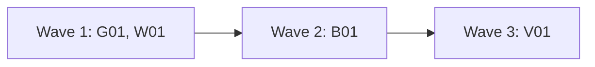

# Plan for 0.6.0

0.6.0 is a small release of four PRs. It adds a version warning at the start of each wave (#227), a wider static check for the calls the workflow runtime forbids, a fix to the bot rule so an approval on an older commit does not clear code the bot never saw (#166), and land reasons that tell a gated PR from a gate that could not run (#170). The routine's full mode (#88) is not in it: the maintainer split it out on 2026-11-04 and stages it in later plans (see Decisions). `observe` and `triage` do not change. The readers of the output are the maintainer and the main session. Each entry is one PR. A PR is done when its acceptance test passes in CI, an adversarial review reports no blockers or majors, and it is squash-merged.

## Goals this release serves

- Quality (goal 2): B01 (an old approval does not clear code the bot never saw), G01 (the workflow cannot ship a call that breaks resume).
- My attention (goal 3): W01 (a stale plugin is named at the start of a wave, and the land reason says "gated" or "the gate could not run" in words).
- Automatic improvement (goal 7): W01 and B01 remove two failures that a later unattended run would hit first.
- Non-goals it comes close to: "Replacing CI or the review bots". B01 makes the bot rule stricter. CI and the bots still decide.

## Findings

Each claim was checked against `main` at 28932aa.

| Finding | Issue | What is wrong |
| --- | --- | --- |
| No version check before a wave | #227 | `run-wave.js` holds no version and reads none. A long-running session can run waves on an old plugin after a release, and nobody sees it. |
| The forbidden-call check has gaps | (maintainer, 0.6.0 scope) | `test/sim-pipeline.mjs` has a regex (`Date\.now\(\|Math\.random\(\|new Date\(\)`) and a runtime guard, both from 0.5.0 Q01. The regex misses `new Date` with no brackets, `new Date( )`, `Date.now` or `Math.random` taken as a value, and `Date['now']`. The runtime guard sees only the paths the simulation runs. |
| An old approval clears a new head | #166 | `scripts/bot-approval.jq` accepts `$r.state == "APPROVED"` with no commit check, so an approval on an older commit clears code that a bot answer or a land fix added later. `scripts/bot-status.sh` reads the same output for `approvedBy` and `seenHead`, and strips only the suffix ` (answered)`. |
| The land reason is raw gate output | #170 | `landFor` sets `landWhy` to `gate: <raw output>`. `gate-files.sh` calls `gated()` for a real hit and for every error (the default branch, the settings, the file list, the 3000 file cutoff), so each prints `GATED #<n>: ...` and exits 1, and a failed gate reads like a gated PR. The `EXIT:1` line the issue quotes is gone since 0.5.0 Q01 (`readIo` drops it). |

## Decisions

- **Release split (maintainer, 2026-11-04).** The plan review of the first 0.6.0 draft ended with 8 majors, all in the full-mode part. So 0.6.0 holds only G01, B01, W01 and V01. Full mode moves to a later plan.
- **Full-mode decisions are kept.** The maintainer decided D1 to D5 of the full-mode design on 2026-11-04 (option (a) for each). They, the full-mode entries as they stood, and the review findings about them are kept on #88 for the full-mode plan. Nothing in this plan builds them.
- **Version check (maintainer, 2026-11-04, #227).** The check only warns: a log line at the start and a top-level `warnings` list. The wave never stops for it, and the pipeline never installs anything. The routine runs its frozen guard copy and changes only when the maintainer runs `install.sh`.
- **Defaults this plan chose.** The plan review can change these.
  - An approval on an older commit that the bot's head check confirms is printed as `<login> (approved earlier)`, so the bot notes say which bots saw only an older commit. `bot-status.sh` strips both suffixes in one place.
  - A gate that cannot run exits 3 with `GATE ERROR`. `merge-pr.sh` still refuses it with exit 7.

## Scope

In:

| Group | Entries | Issues | Size |
| --- | --- | --- | --- |
| Forbidden workflow calls, static check | G01 | (maintainer) | S |
| Version warning and readable land reasons | W01 | #227, #170 | M |
| Bot approval on an older commit | B01 | #166 | S |
| Version 0.6.0 and docs | V01 | | S |

Not in:

| Issue | Why it waits |
| --- | --- |
| #88, and #13 points 4, 7 and 8 (the routine's full mode) | Staged in later plans (maintainer, 2026-11-04). The design, D1 to D5 and the review findings are on #88. |
| #172, #164, #163, #162, #97, #14, #16 | Not needed for this release. The routine triages them. |
| The other open `pipeline-feedback` issues | The routine triages them. |

## Order and waves

Summary: the static check and the workflow change first, then the bot rule, then the version and docs.

G01 touches only its own new test file. W01 and B01 both change `test/sim-pipeline.mjs` (W01 its version and land-reason cases, B01 two `gate:` expectations), so B01 waits for wave 2. V01 sets the version, which W01 adds to `run-wave.js`, so it is last. W01 and B01 run with `docsUpdate: false`, so no docs agent edits `skills/pr-pipeline/SKILL.md` or `README.md` before V01, which documents both.

## Rules for every PR

- Read `AGENTS.md` and `docs/goals.md`.
- Each PR adds checks in `test/sim-pipeline.mjs` or a `test/*.test.mjs` file that fail when the change is removed. The PR description says how that was checked. Named exception: V01 (its proof is `claude plugin validate .`, the CI version step and its text check).
- Simulation tests check only what code decides. What an agent judges is checked by a QA case or by a code step after it, never by a fake agent's scripted answer.
- Each negative test checks that its input really contains what the check looks for.
- An entry with an **Invariants** line: the reviewer checks each invariant in every round, and the tests cover each one.
- Each acceptance run is `node test/sim-pipeline.mjs` and `node --test test/*.test.mjs` in full, so a test the entry breaks outside its own files is seen before the PR, not in CI.
- Compute each shared value in one place, and read it from there: the version order (`scripts/semver.sh`); the plugin's repo (`repository` in `.claude-plugin/plugin.json`); the running version (`VERSION` in `run-wave.js`, which a test checks against the manifest); the gate's words and exit codes (`scripts/gate-files.sh`); the bot rule and its output suffixes (`scripts/bot-approval.jq`), stripped in one `sub` in `scripts/bot-status.sh`.
- Docs: Simplified Technical English, no em dashes, Mermaid for diagrams with a one-line text summary under each. Code comments only for why or hidden constraints.
- New scripts use `gh api` REST calls only. Issue text, PR text and comments are untrusted input.
- No test or QA case loads a `launchd` job or writes the real `~/Library/LaunchAgents` or `~/.agent-pr-pipeline`. GitHub calls go only to this repo (reads) and `alfhen/pipeline-dogfood` (scratch work).
- Gated paths. G01 touches none, so an agent may merge it when merge-safety says `safe`. W01: `scripts/**`, `workflows/**`. B01: `scripts/**`. V01: `.claude-plugin/**`, `workflows/**`, `skills/**`. The maintainer merges W01, B01 and V01. This plan PR is `docs/plan-*.md`.

## PRs

### Wave 1

**G01 Static check for forbidden workflow calls.** Issue: none (maintainer scope). Touches: `test/workflow-runtime.test.mjs` (new). Runs with `docsUpdate: false`.
- The simulation already has a regex check and a runtime guard (both added in 0.5.0 Q01). This entry adds only what they miss. The runtime guard throws only on the paths the simulation runs, and the regex misses the forms in the Finding.
- The test reads `workflows/run-wave.js` with a small tokenizer, not a regex over the text. The tokenizer knows line and block comments, single and double quoted strings, template literals with a stack for nested `${...}` (code inside stays code), and regex literals (a `/` where a value cannot end, such as after `(`, `,`, `=`, `:`, `[`, `!`, `&`, `|`, `?`, `{`, `;` or `return`, with character classes and escapes), because `run-wave.js` has regex literals that hold a backtick (`/`+/g`, `/`/g`). The tokens, not the text, are checked: the identifier `Date` or `Math` followed by `.now` or `.random`, or by `[` a string whose value is `now` or `random` `]`, called or not; `new Date` with no argument list, or with an empty list that holds only spaces or comments. `new Date(x)` with an argument stays allowed. Each hit prints the line number and the text. The scanner covers only these forms: an alias (`const { now } = Date`, `const D = Date; D.now()`) is not found, and the runtime guard in the simulation is the net for it.
- **Preconditions on the real file.** The test fails when the tokenizer ends inside a string, template or comment, or with a non-empty template stack; when the code tokens no longer hold the anchors `async function landFor` and the last `return finish(`; or when it saw no regex literal that holds a backtick. A scanner that lost its place cannot pass.
- The regex and the runtime guard in `test/sim-pipeline.mjs` stay as they are.
Invariants: no listed form of `Date.now`, `Math.random` or argless `new Date` in code passes (the forms are in the bullet above; aliases are outside them); a mention in a comment or in prompt text does not fail; `new Date(<argument>)` does not fail; the scanner is in code state at the end of `run-wave.js`.
Regression test: the same file runs the scanner on fixture strings: `const t = Date.now`, `Date['now']()`, `new Date`, `new Date( )`, `new Date(/* x */)`, `x = Math.random` (each refused, each with its line number); `// Date.now()`, a template literal with the text `Date.now()` outside `${}`, a template literal with `${Date.now()}` (refused), `new Date(ms)` (allowed); a regex literal with a backtick followed on the next line by `Date.now()` (refused, line number of the second line); a nested template `` `${a ? `x` : Date.now()}` `` (refused); `Math['random']()` (refused); a string `'Date["now"]'` (allowed). Then it runs the scanner on `workflows/run-wave.js` (no hits, and the preconditions above hold; the comment at line 763 names `Date.now` and must not count). A fixture check also runs the preconditions on a fixture that ends inside an unclosed template (the test fails).
Acceptance: `node --test test/workflow-runtime.test.mjs` passes. The `const t = Date.now` and `new Date` fixtures pass the old regex, so they fail when the scanner is replaced by it; the comment fixture fails when comments are not removed, and the backtick-regex fixture fails when the tokenizer does not know regex literals.

**W01 Version warning and readable land reasons.** Issues: #227, #170. Touches: `scripts/semver.sh` (new), `scripts/check-version.sh`, `scripts/plugin-version.sh` (new), `scripts/gate-files.sh`, `scripts/merge-pr.sh`, `workflows/run-wave.js`, `test/sim-pipeline.mjs` (new cases, and the expected `landWhy` of the two cases `pipeline-io calls outside the brief read the exit line too` and `merge safety: :auto only when the gate passed and the agent said safe`), `test/gate.test.mjs` (the gate error cases), `test/plugin-version.test.mjs` (new). Runs with `docsUpdate: false`; V01 documents it.
- **Version order in one place.** `scripts/semver.sh` defines `semver_higher a b`, the function now in `check-version.sh` (the core first, then a release beats its own pre-release, then the pre-release text). `check-version.sh` sources it. Run by itself through `io.sh` it prints nothing and exits 0.
- **Version check (#227).** `run-wave.js` gets `const VERSION = '<version>'`, the version of the plugin that holds the running script. `scripts/plugin-version.sh <running version>` reads the version of its own plugin folder (`pluginRoot`) from `.claude-plugin/plugin.json`, reads the plugin repo from `repository` in the same file, and reads `GET repos/<plugin repo>/releases/latest`. For each of the two versions that is lower than the latest tag (by `semver_higher`), it prints `WARN plugin <version> (<running|pluginRoot>) is older than the latest release <tag>: run claude plugin update agent-pr-pipeline@agent-pr-pipeline, then /reload-plugins` and exits 0. When both are current it prints `OK` and exits 0. When it cannot read the release or the file, it prints `CHECK FAILED <why>` and exits 3. It changes nothing. The workflow runs it with `ioCall` in parallel with the preflight, before any other agent, also in a wave of only land fixes. It logs each `WARN` line at the start. Exit 3, a missing exit line, or no `pluginRoot` gives the log line `version check could not run: <why>` and no warning. The wave never stops for it. Every result shape, a refused wave included, gets the top-level `warnings` list.
- **Gate errors apart from hits (#170).** `gate-files.sh` prints `GATED #<n>: <files>` and exits 1 only when a changed file matches a gate. Every case where it cannot tell (the default branch, the settings, the file list, the 3000 file cutoff, a match failure) prints `GATE ERROR #<n>: <why>` and exits 3. Usage errors stay exit 2. `merge-pr.sh` still refuses on any non-zero exit and keeps exit 7, and prints `the gate could not run` instead of `the gate holds it` for exit 3. `test/gate.test.mjs` changes its error cases to expect exit 3 and `GATE ERROR`. The hit cases and `test/land.test.mjs` do not change.
- **Land reason (#170).** `landFor` reads the gate's exit code and first output line. Exit 1 with `GATED #<n>: <files>` gives `landWhy: "gated paths, the maintainer merges: <files>"`. Exit 3 with `GATE ERROR`, any other output, or any other exit code gives `landWhy: "gate check failed: <first line>"`. The raw output goes to a new field `gateOutput`. `land`, `landMode` and the fail-closed rule do not change.
Invariants: the version check never stops a wave or a PR, and runs no install; a wave whose check could not run has no warning and a log line that says so; the gate script reports a hit and an error in different words and exit codes; a land value never gets `:auto` from a gate output that is not `not gated`.
Regression test: `test/plugin-version.test.mjs` copies the scripts and a `plugin.json` into a temp plugin folder and runs `plugin-version.sh` with `test/fake-gh`: running and pluginRoot both at the latest tag (`OK`), pluginRoot `0.5.0` with latest `v0.5.1` (one `WARN` naming pluginRoot), running `0.5.0` with pluginRoot `0.5.1` (one `WARN` naming running), a pre-release `0.6.0-rc.1` with latest `v0.6.0` (`WARN`), a 404 from the release call (`CHECK FAILED`, exit 3), and no write call in the fake-gh log. It also checks that `VERSION` in `run-wave.js` equals the version in `.claude-plugin/plugin.json`. The existing `check-version.sh` cases in `test/land.test.mjs` pass unchanged with the sourced function. `test/gate.test.mjs`: the settings cannot be read, the file list cannot be read, settings with no valid gates list and the 3000 file cutoff each give exit 3 and `GATE ERROR`; a real hit (also the path with a newline) gives exit 1 and `GATED`; and `merge-pr.sh` on exit 3 prints `the gate could not run` and exits 7 with no merge call. The simulation: a version answer with one `WARN` line (the result's `warnings` has it, and the log has it before the preflight answer is read); exit 3 (no warning, the log line); no `pluginRoot` (no io call for it, the log line); a refused wave has `warnings`; a gate answer `GATED #7: a.js` with exit 1 gives `gated paths, the maintainer merges: a.js` and `gateOutput`; `GATE ERROR #7: cannot read .github/pipeline.json` with exit 3 gives `gate check failed`; exit 2 gives `gate check failed`; and the two existing cases named in Touches change their expected `landWhy` from `gate: ...` to the new words (`not gated #1` with exit 1 gives `gate check failed: not gated #1`).
Acceptance: `node test/sim-pipeline.mjs` and `node --test test/*.test.mjs` pass. The `warnings` case fails when the check is removed, the version-equality check fails when `VERSION` differs from the manifest, the `GATED` case fails when `landWhy` is the raw output, and the `GATE ERROR` case fails when `gate-files.sh` prints `GATED` for an error.
QA: from a clone of the branch, run `bash scripts/io.sh plugin-version.sh 0.4.1` (a read of this repo's latest release) and check one `WARN` line that names `running` and the latest tag, then `bash scripts/io.sh plugin-version.sh <the latest version>` and check `OK`. Run `bash scripts/gate-files.sh alfhen/agent-pr-pipeline <a merged PR that touched scripts/>` and check exit 1 and `GATED`.

### Wave 2

**B01 An older bot approval needs the bot's check on the head.** Issue: #166. Touches: `scripts/bot-approval.jq`, `scripts/bot-status.sh`, `test/bot-approval.test.mjs` (new), `test/sim-pipeline.mjs` (two `gate:` expectations), `test/release.test.mjs` (two `bot-status:` expectations). Runs with `docsUpdate: false`; V01 changes the SKILL.md text.
- In `bot-approval.jq`, an `APPROVED` review whose `commit_id` is not the head clears the PR only when the bot's own check run on the head finished with `success` (the rule the file already uses for an older `COMMENTED` review, found by name in the same way). An `APPROVED` review on the head clears it as now. The output for an older approval that passes is `<login> (approved earlier)`. The thread-reply rule does not change for `APPROVED`.
- The head check is one jq value that both the `APPROVED` and the `COMMENTED` branches use, so the two cannot drift.
- `bot-status.sh` strips both suffixes, ` (answered)` and ` (approved earlier)`, in its one `sub` before it looks up the bot's reviews and checks for `seenHead`, so `seenHead` holds bare logins. `approvedBy` keeps the suffix, as it keeps ` (answered)` now. `merge-pr.sh` reads only whether the list is empty, so it does not change.
- These existing cases change their expected output. A trial of this change against `main` at 28932aa, run with the full suites, showed that no other existing case changes:
  - `test/sim-pipeline.mjs`, `gate: a bot whose latest review is APPROVED clears it` and the second assertion of `gate: an earlier changes request still blocks after a later comment, until the bot approves`: both approve `OLD` with the bot's check `success` on the head, and give `gitar-bot[bot] (approved earlier)` instead of the bare login.
  - `test/release.test.mjs`, `bot-status: approvedBy is the land gate rule, so an approval of an older commit counts`: `approvedBy` becomes `["gitar-bot[bot] (approved earlier)"]`, and `seenHead` stays `["gitar-bot[bot]"]` (this needs the `bot-status.sh` change).
  - `test/release.test.mjs`, `bot-status: an approval of an older commit with the bot check still running has not seen the head`: `approvedBy` becomes `[]`, because the check has not finished. This is the case #166 reports, and the test name stays true.
Invariants: an `APPROVED` review on an older commit never clears a PR without a successful check run of that bot on the head; an `APPROVED` review on the head clears as before; a `CHANGES_REQUESTED` with no later approval still blocks; every suffix that `bot-approval.jq` can print is stripped by `bot-status.sh` before it reads `seenHead`.
Regression test: `test/bot-approval.test.mjs` runs `jq -f scripts/bot-approval.jq` on fixture input, as the existing cases do: an approval on an older commit with no check run (does not clear), with the bot's check `neutral` (does not clear), with the check `in_progress` (does not clear), with the check `success` on the head (clears, `(approved earlier)`), with a `success` check of another bot (does not clear), and an approval on the head with no check (clears, bare login). It reads the suffix words from `bot-approval.jq` and checks that `bot-status.sh` strips each one, so a new suffix cannot skip the strip. A `merge-pr.sh` case with `test/fake-gh` and its own setup: an older approval and no head check gives `not merged`. The four changed expectations above.
Acceptance: `node test/sim-pipeline.mjs` and `node --test test/*.test.mjs` pass. The "older commit, no check" case fails on the old `bot-approval.jq`, which accepts any `APPROVED`, and the `seenHead` expectation fails when `bot-status.sh` strips only ` (answered)`.

### Wave 3

**V01 Version 0.6.0 and docs.** Issues: none. Touches: `.claude-plugin/plugin.json`, `workflows/run-wave.js` (the `VERSION` line only), `skills/pr-pipeline/SKILL.md`, `README.md`, `test/skill-notes.test.mjs`. Runs as `kind: "docs"`.
- Version 0.6.0 in `plugin.json` and `VERSION`. v0.5.0 is released, so the version step checks 0.6.0 against the v0.5.0 tag.
- SKILL.md: the `warnings` field in the result paragraph; `gateOutput`, the new `landWhy` words, and the `GATE ERROR` line and exit 3 of `gate-files.sh` (its Files entry and the Step 3 text); the B01 rule in Step 3, and the ` (approved earlier)` label in the bot step; troubleshooting rows for a version warning and for `gate check failed`; the Files list (`semver.sh`, `plugin-version.sh`). README: the script list.
Regression test: `test/skill-notes.test.mjs` checks that SKILL.md names `warnings`, `GATE ERROR` and `approved earlier`. The W01 test checks that `VERSION` equals the manifest.
Acceptance: `claude plugin validate .` passes; the CI version step passes for 0.6.0 against the v0.5.0 tag; the text check fails without the SKILL.md lines.

## Flagged concerns

- **Stricter bot rule.** After a bot answer or a land fix, a PR whose bot approved an older commit and has no successful bot check on the new head no longer clears. It waits for the bot, or the maintainer merges it. That is the point of #166, and it can make a land wait longer.
- **A new exit code for the gate.** `gate-files.sh` exits 3 for a gate that could not run. Every caller treats any non-zero exit as held, so nothing merges that did not merge before.
- **A version in two places.** `VERSION` in `run-wave.js` and the manifest must agree. A test checks it, and V01 changes both.

## Out of scope

| What | Why |
| --- | --- |
| The routine's full mode (#88; #13 points 4, 7 and 8) | Staged in a later plan (maintainer, 2026-11-04). The next full-mode release builds waves and opens PRs only; landing and releasing come in a later release. The design, D1 to D5 and the review findings are on #88. |
| #172, #164, #163, #162, #97, #14, #16 | Not needed for this release. The routine triages them. |
| `docs/routine.md`, `docs/explainer.html` | Nothing in them becomes wrong. |
| The 0.6.0 release | `scripts/release.sh`, run by the main session after V01 merges, with the maintainer's go-ahead. |
