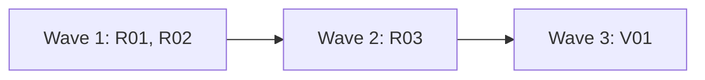

# Plan for 0.7.0

0.7.0 is stage 1 of the routine's full mode (design brief #88). A new mode word, `full`, makes the routine do what `triage` does, and also run a quick-fix wave for the open issues that the routine labelled `routine-build`, so that the wave opens their PRs. Full mode never merges, never lands, never releases and never files feedback. It does not plan `routine-plan` issues and does not run plan waves. Those come in later stages. The maintainer merges every PR that the routine opens. `observe` and `triage` do not change. The readers of the output are the maintainer and the routine. Each entry is one PR. A PR is done when its acceptance test passes in CI, an adversarial review reports no blockers or majors, and it is squash-merged.

## Goals this release serves

- Automatic improvement (goal 7): R01, R02, R03. The routine builds the fixes it triaged and opens their PRs. It does not merge, tag or publish in this stage, so it stays inside what goal 7 allows.
- My attention (goal 3): R01 and R03. A build that ends with no PR gives one `blocked` record and one notification, and starts nothing more. The maintainer reads PRs, not hourly repeats.
- Quality (goal 2): every routine PR goes through the full quick-fix loop of `run-wave`, and the maintainer merges it.
- Cost (goal 4): R01 and R03. The limits of D5, one step per run, and no session for a step that needs no judgment.
- Non-goals it comes close to: "A hosted service". The routine stays a `launchd` job on the maintainer's Mac. "Replacing CI or the review bots". The routine opens PRs only; CI and the bots still decide, and the maintainer merges.

## Findings

Each claim was checked against `main` at 8fc1141.

| Finding | Issue | What is wrong |
| --- | --- | --- |
| There is no full mode | #88 | `routine/run.sh` accepts only `observe` and `triage`. Any other word acts as `observe`, and `test/routine-guard.test.mjs` ("observe, a missing mode file and the word full all use the observe settings and say so") checks that `full` acts as `observe`. That test must change. |
| `next` knows only triage | #88 (1, 2, 6) | `routine-state.sh next` prints `init needed`, `triage` or `idle`. `put` accepts only the type `triaged`. No record says that a build started, so nothing stops a build from repeating. |
| `put triaged` needs the mode word `triage` | #88 (5) | In a guard folder `put` refuses unless the mode file says `triage` (`put needs the mode triage`). A full-mode triage step would be refused. |
| No settings for the routine's waves | #13 (4), D1 | The guard folder holds no wave arguments. A full-mode wave would have no `checks`, `goals` or `bots`, and `run-wave.js` throws without `goals`. |
| The read-only wrapper refuses what a wave runs | #88 (9) | `routine/bin/gh` passes only `gh api` reads. A quick wave runs `gh pr create`, `gh pr edit`, `gh issue create` and `gh api ... replies -F body=@<file>`. |
| The plugin's own scripts make calls a narrow wrapper would refuse | #88 round 3 | A quick wave runs these scripts through `pipeline-io`: `check-goals.sh`, `plugin-version.sh`, `quick-brief.sh`, `gate-files.sh`, `bot-status.sh`, `wait-bots.sh`, `cleanup.sh` (`land-commits.sh` runs only for a land fix). `quick-brief.sh` makes `PATCH repos/<repo>/issues/comments/<id>` to replace a brief. `plugin-version.sh` reads `repos/<plugin repo>/releases/latest`, and the plugin repo (`alfhen/agent-pr-pipeline`) is not the routine's repo on `alfhen/pipeline-dogfood`. `cleanup.sh` runs `git --git-dir=<dir> worktree remove`, `branch -D`, `show-ref`, `symbolic-ref` and `merge-base`. The design kept on #88 refused PATCH on `issues/comments`, a repo other than the routine's, and the global option `--git-dir`. |
| The repo's own checks call git in many forms | #88 round 3 | The checks of this repo (`node --test test/*.test.mjs`) run `git init`, `git -c user.name=t commit`, `git clone <local path>` and `git push <local path> main`. A git wrapper that refuses `-c` or a push to a remote other than `origin` breaks them. |
| Git runs a nested git from its own exec path | (this plan) | Git puts its exec path (for example `/opt/homebrew/opt/git/libexec/git-core`, which holds a `git`) first on `PATH` for the programs it starts: hooks, `!` aliases and `rebase --exec`. A git wrapper that is first on `PATH` does not see those nested calls. |
| Nothing on GitHub stops a push to `main` | (this plan) | The repo is private on a free plan: `GET branches/main/protection` and `GET rulesets` return 403. `release.yml` runs on `release: published`, so a pushed tag alone publishes nothing. |
| Only `merge-pr.sh` reads `CLAUDECODE` | #88 round 2 | No other script reads it. Round 2 of the 0.6.0 review said "only `routine-state.sh` reads `CLAUDECODE`". That is false on `main`: `routine-state.sh` does not read it. |
| `claude -p` has no time limit | #88 round 1 | `run.sh` waits for the session with no bound. A hung session keeps the lock, so every later run logs "another run is live". |
| The runner's git calls run in a clone that a session could write | #88 round 2 | `run.sh` runs `git fetch`, `checkout` and `clean` in the clone at the start of each run, with `cd "$clone"` before `routine-state.sh next`. In full mode a session writes in that clone, and git can run a program from its `.git` (hooks, `core.fsmonitor`, `filter.*.smudge`). |
| No signal for the maintainer | #88 round 1 | Records are comments by the maintainer's own account, and GitHub does not notify an account about its own comments. |
| Placeholder words in paths | #196 | `install.sh` fills `OWNER/REPO`, `CLONE` and `GUARD` with `sed` one after the other, so a path that holds the word `GUARD` or `CLONE` breaks the settings. Full mode adds a `WORK` placeholder. |

## Decisions

- **Staging (maintainer, 2026-11-04).** 0.7.0 is stage 1: triage, then quick waves for `routine-build` issues, and open PRs. No merge, land, release, feedback filing, planning or plan waves.
- **D1 (a), maintainer.** The wave settings live in a read-only `routine.json` in the guard folder. Only `install.sh --routine-json <file>` writes it, and a reinstall without the flag keeps it. Full mode without it acts as `triage` and logs why.
- **D3 (a), maintainer.** A full-mode session runs in Claude Code's sandbox in strict mode: Bash writes only in the full-mode folder `<work>/full` (and the per-user temp folder that the sandbox always allows), the guard folder is denied, and the network allows only the GitHub hosts. Full-mode `gh` and `git` wrappers are first on `PATH`, and the runner checks a checksum of the guard copy before each full-mode run.
- **D5 (a), maintainer.** Limits in `routine.json`: at most 3 open routine PRs before a build waits (`openPRs`), at most 2 build waves started in 24 hours (`wavesPerDay`), at most 3 issues in one build wave (`buildIssues`), one step per run, one run at a time. Stage 1 has no plan step, so the plan limits do not apply.
- **D2 and D4** (unattended merge and release, feedback approval) are for later stages. Nothing here builds them.
- **Defaults this plan chose.** The plan review can change these. Each is also in Flagged concerns.
  - The runner reads no result file. It reads every outcome from GitHub: the PR whose head branch is the branch the runner chose for the issue.
  - A routine branch is `routine/issue-<n>`. The prefix `routine/` is in one file, `routine/branch-prefix`.
  - A build runs once per issue. Its end is one `build-started` record, posted before the session, whatever the session does.
  - The runner removes `CLAUDECODE` from the environment of every session it starts, in every mode, so a by-hand run from a Claude Code shell works. Under `launchd` it is never set.
  - The runner adds no `CLAUDECODE` check. The session is kept away from the runner's records by the full `gh` wrapper (it refuses any body that holds `<!-- pipeline:`, except a quick brief), not by an environment variable. So a by-hand `run.sh` from a Claude Code shell works.
  - `maxRunMinutes` (default 240) bounds one run. It is a bound on a hung session, not a cost limit.
  - In full mode the order of steps is `block`, `build`, `triage`, then `wait` or `idle`. A build that the limits hold back lets `triage` run.
  - Waves run with `feedback: false`. Stage 1 files no feedback, so an evaluation would cost tokens and reach nobody.

## Maintainer decision N1 (2026-11-05)

**N1. How the maintainer retries or drops a build that ended with no PR.** In stage 1 a build that ends with no PR is held for good, so it never repeats. The maintainer needs a way to try it again or to drop it.
- (a) On GitHub, with no new command. To retry, delete the issue's `build-started` and `blocked` record comments on the tracking issue; the next run builds it again on the same branch. To drop, remove the label `routine-build` or close the issue. This is the rule `triage` already uses ("the routine does not triage it again until the maintainer deletes the record"). The full `gh` wrapper refuses every `DELETE` and every label change, so a session cannot do either through it.
- (b) Terminal commands, `routine-state.sh <repo> retry <issue>` and `drop <issue>`, that post maintainer records. They need a refusal for sessions, and the only signal for one in code is `CLAUDECODE`, which a by-hand `run.sh` from a Claude Code shell also has.
- (c) No way in stage 1. The maintainer builds the issue by hand with a `quick` wave.
- Decision (maintainer, 2026-11-05): (a). It adds no command and no new trust rule, it works from the GitHub app, and it keeps "a by-hand `run.sh` works" true. The entries below build (a).

## Scope

In:

| Group | Entries | Issues | Size |
| --- | --- | --- | --- |
| Routine state for full mode stage 1 | R01 | #88 (1, 2, 5, 6, 12), D5 | M |
| Full-mode wrappers and sandbox settings | R02 | #88 (8, 9), D3 | M |
| Full-mode runner, prompt and install | R03 | #88 (6), #13 (4), D1, D3, #196 | L |
| Version 0.7.0 and docs | V01 | | S |

How each review major on #88 is answered. The majors are from the 0.6.0 plan review rounds 1 to 3, kept in the #88 comment of 2026-11-04.

| Major (round) | Answered by, or why it does not apply in stage 1 |
| --- | --- |
| The runner is an unattended merge caller that `merge-pr.sh` treats as a person (1, arch) | Does not apply: stage 1 has no land step. The runner runs no merge script, and R03 tests that it calls none. |
| Full-mode `put` lets a session write runner-only records (1, arch); a session can call `put` for runner-only types (1, review) | R01: in a guard folder `build-started` and `blocked` need the mode `full`, and `triaged` needs `triage` or `full`. R02: the full `gh` wrapper refuses any body with `<!-- pipeline:` except a quick brief, and `routine-state.sh` keeps `routine/bin-full` on `PATH`, so a session's `put` goes through the wrapper and is refused. The `full.json` deny rule on the script name is the second guard. `adopt` does not exist in stage 1. |
| Nothing owns the `plan` argument for full-mode waves (1, arch); build-wave PRs get an unrelated plan (2, arch) | R01 and R03: a stage-1 wave is only quick PRs, so it needs no `plan` (`run-wave.js` line 68). The runner never sets `plan`, and `routine.json` refuses it. |
| The `gh api *merge*` mutation cannot fail (1, review) | R02: the mutation input is a command line that holds the word `merge`, and the test asserts that before it expects a hit. |
| "Every refused shape is also matched by a deny rule" contradicts the deny rules (1, review) | R02: the invariant goes one way only. Each deny rule's shape is refused by its wrapper. A wrapper refuses many shapes that no deny rule names. |
| The full wrappers are deny-lists on an allow-all base (1, review) | R02: `bin-full/gh` refuses by default. `bin-full/git` refuses by default every subcommand that writes to a remote, and every alias. It passes local subcommands, because the plugin's scripts and the repo's checks need them (round 3, arch). Flagged concerns says why. |
| The `triage` step in full mode used the wide settings (1, review) | R03: the `triage` step uses `triage.json`, `routine/bin` and the `[[triage]]` prompt, the same as in `triage` mode. |
| A plan or recover retry collides with the unique-key rule (1, review) | Does not apply in the same form: no plan or recover step. The `build-started` key is the issue number. A retry (N1) deletes the old record first, so the key is free. `put` refuses a second record with the same key. |
| The result-file retry cannot overwrite a bad file (1, review); the result-file write puts three things in one call (3, arch); the result file is writable by every agent (2, review) | Does not apply: stage 1 has no result file. The runner reads outcomes from GitHub (R01). |
| The `land` step has no end for a refused merge (1, review); `land` does not exclude a conflicting PR (2, review); `land` and `landfix` ignore statuses and flakes (3, review) | Does not apply: no land or land-fix step in stage 1. |
| The sandbox is not proven for the agents that a wave starts (1, review) | R02 QA starts agents from the `Workflow` tool and from the `Agent` tool under the `--settings` file, and stops the PR for a new maintainer decision if one escapes. R03 QA repeats it in a real wave. |
| No signal tells the maintainer about a block (1, review) | R03: a macOS notification and a `NOTIFY` log line for each `blocked` record the runner posts, a changed guard copy, a killed session, three failed runs in a row, and a triage step that repeats. |
| A hung session has no end (1, review) | R03: a watchdog kills the session's process group after `maxRunMinutes`. The `build-started` record is already posted, so the issue does not build again. |
| The Call shapes table claims `CLAUDECODE` refusals that no script has (2, arch) | R01, R02, R03 add no `CLAUDECODE` check and the plan claims none. The only reader on `main` is `merge-pr.sh` (Findings). |
| Notification text from agents goes into `osascript -e` (2, review) | R03: the runner builds every notification text itself from fixed words, an issue number and a log file name. No agent, issue or PR text goes in. The text is passed as an argument, never inside the `-e` script. |
| An edit of a draft can make `next` fail on every run (2, review) | Does not apply: no feedback drafts. R01 also makes a bad record a skipped issue in full mode, never a failed `next`. |
| The full `git` wrapper passes an open set and does not say how it finds the subcommand (2, review) | R02: the wrapper reads the global options to find the subcommand, refuses an alias (also one set with `-c alias.*`), and checks every push against fixed rules. |
| The runner's git calls run in a clone that the session can write (2, review) | R03: a build session works only in `<work>/full`, the one folder its sandbox may write. The runner clones each build's clone outside that folder, with no system or global git config and an empty template folder, moves it in, and runs no git in `<work>/full`. Every other run uses the old clone `<work>/clone`, which no session can write. The runner runs `next` and its record calls from the guard folder. |
| The git wrapper refuses the git calls of the plugin's scripts and the repo's checks (3, arch); the wrappers refuse calls that the workflow's own scripts make (3, review) | R02: the test runs each script a quick wave runs, and the repo's git-heavy test files, through both wrappers, and expects no refusal. Findings lists the calls. |
| "Every PR in this repo is gated" is false, and the runner does not tie a result's `prNumber` to the PR it built (3, review) | R01: the runner ties a PR to an issue by the branch it chose, read from GitHub (`pulls?head=<owner>:routine/issue-<n>&state=all`). The plan does not claim every PR is gated: `test/**`, `README.md` and most of `docs/` are not. The maintainer merges every routine PR because the routine never merges. |
| A crash between two records leaves a plan state that nothing ends (3, review) | Does not apply to plans. The same risk for builds: a run that dies after `build-started` leaves no PR, and the next run's `block` step ends it (States). |
| A by-hand `run.sh` from a Claude Code shell has `CLAUDECODE` set, so the runner's own `put` calls are refused (3, review) | R01 and R03: no write of the runner reads `CLAUDECODE`. R03 starts `claude -p` with `CLAUDECODE` removed from its environment, so a nested start acts as one from `launchd`. A test runs `run.sh` with `CLAUDECODE=1`. |

The #88 issue body points: 1 (end states): R01, R03 and the States table. 2 (outcomes from GitHub): R01. 3 (maintainer-only signals): N1, R02. 4 (approval tied to a draft): later stage. 5 (triage writes only `triaged`): R01. 6 (a block starts no session): R01. 7 (`:auto` PRs that did not land): later stage. 8 (narrow deny patterns): R02. 9 (the wrapper in full mode): R02. 10 (the PR block of a planned wave): later stage; R01 computes the quick PR blocks. 11 (SKILL.md rules for landing, filing and `release.sh`): no rule changes, because stage 1 does none of them; V01 checks the text. 12 (one trust rule): R01.

Not in:

| Issue | Why it waits |
| --- | --- |
| #88 points 4, 7, 10, 11, D2, D4, #13 points 7 and 8 | Later stages: land, land fix, release, feedback approval, plan, adopt and recover. |
| #273 and the other `review-minor` issues | Fixed in batches between waves. #196 is in R03 because R03 rewrites the same `sed` step. |
| The other open `pipeline-feedback` issues | The routine triages them. |
| A separate GitHub identity for the routine | Later. Until then every GitHub-side guard is advisory. |
| Raising the installed routine on this repo to `full` | The maintainer's call after the release. No test or QA does it. |
| `docs/explainer.html` | Nothing in it becomes wrong. |

## States

Full mode stage 1 adds these states. Each one ends.

| State | How it starts | What ends it |
| --- | --- | --- |
| build pending | `put triaged` stores `build` and adds the label `routine-build` | the `build` step posts `build-started <issue>`; the maintainer removes the label or closes the issue (drop) |
| build held by limits | a pending issue while the open routine PRs reach `openPRs`, or the build runs of the last 24 hours reach `wavesPerDay` | a routine PR is merged or closed, or 24 hours pass. `next` gives `triage`, `wait` or `idle` meanwhile, with `heldBy: "limits"` |
| build running | the runner posts `build-started <issue>` for each issue of the wave, then starts the session | the session ends, or the watchdog kills it after `maxRunMinutes`. The lock is freed when the runner exits |
| PR open | a PR from `routine/issue-<n>` by the account exists | the maintainer merges or closes it. The routine takes no step for it, and counts it for `openPRs` while it is open |
| build ended with no PR | `next` finds `build-started <issue>` for an open issue that still has the label, no `blocked <issue>`, and no PR (in any state) from its branch | the `block` step posts `blocked <issue>` and notifies |
| blocked | the runner posts `blocked <issue>` | the maintainer deletes both records (retry), removes the label or closes the issue (drop), all under N1 (a). `next` skips a blocked issue in every step |
| full without settings | mode `full` and no `<guard>/routine.json` | `install.sh --routine-json <file>`. Until then each run acts as `triage` and logs why |
| guard copy changed | the checksum in `<guard>/plugin.sum` does not match the guard copy | the maintainer runs `install.sh` again. Until then a full-mode run starts nothing and notifies once per changed sum |
| build folder left behind | `<work>/full/runs/<run>` still exists after its run ended (a crash or a kill of the runner) | the next `build` run removes `<work>/full/runs/*` with `rm -rf` and no git, after it holds the lock. No run in any mode runs git in `<work>/full`, so nothing else reads the folder |
| runner failing | a run ends with exit 1 (a failed `next`, a failed `put`, a failed clone) | a run that ends with exit 0 resets the count. The third failure in a row notifies once |
| triage repeating | in full mode, the `triage` step gets the same `next` output as the last two triage sessions | the output changes. Until then the runner starts no session for it and notifies once |

A crash of the whole Mac during a build leaves a stale lock and a `build-started` record with no PR. The next run takes over the stale lock (as now) and its `block` step ends the build.

## Order and waves

Summary: the state script and the wrappers first, then the runner that uses both, then the version and docs.

R01 and R02 touch different files. R02's wrappers read `routine/branch-prefix`, which R01 adds; R02's tests write that file into their own temp guard folder, and both wrappers refuse every push and PR create when it is missing, so the two PRs can merge in either order. R03 needs R01's `next --mode full`, `routine/config.jq` and records, and R02's wrappers and `full.json`, and its QA runs all of them together. V01 documents all three and sets the version. R01, R02 and R03 run with `docsUpdate: false`, so only V01 edits `docs/routine.md`, `README.md` and `skills/pr-pipeline/SKILL.md`.

## Rules for every PR

- Read `AGENTS.md` and `docs/goals.md`.
- Each PR adds checks in a `test/*.test.mjs` file that fail when the change is removed. The PR description says how that was checked. Named exception: V01 (its proof is `claude plugin validate .`, the CI version step and its text check).
- Simulation tests check only what code decides. What an agent or a session judges is checked by a QA case or by a code step after it, never by a fake agent's scripted answer.
- Each negative test checks that its input really contains what the check looks for. A test that passes because the input never had it proves nothing.
- An entry with an **Invariants** line: the reviewer checks each invariant in every round, and the tests cover each one.
- Each acceptance run is `node test/sim-pipeline.mjs`, `node --test test/*.test.mjs` and `bash scripts/check-syntax.sh` in full, so a test the entry breaks outside its own files is seen before the PR.
- New e2e tests go in new files. Named exceptions: R01 extends `test/routine-state.test.mjs`; R03 changes the one existing case in `test/routine-guard.test.mjs` that says `full` acts as `observe`, and keeps every other case unchanged.
- Compute each shared value in one place, and read it from there:
  - the step, its order, whether it needs a session (one `SESSION_STEPS` line), the limits, the issues of a build and each issue's branch: `routine-state.sh next --mode full` (R01). The runner copies them and computes none;
  - the branch prefix `routine/`: the file `routine/branch-prefix` (R01), read by `routine-state.sh` and both full wrappers (R02);
  - the `routine.json` rules and the limit defaults (`openPRs` 3, `wavesPerDay` 2, `buildIssues` 3, `maxRunMinutes` 240): `routine/config.jq` (R01), used by `next`, `install.sh` and `run.sh`;
  - the record trust rule: `scripts/trusted-comment.jq` (R01);
  - the plugin's repo: `repository` in `.claude-plugin/plugin.json`, parsed as `plugin-version.sh` does; R02's test runs `plugin-version.sh` through the wrapper, so a drift fails it;
  - the guard folder, work folder and clone paths: the `pwd -P` method that `install.sh` and `run.sh` already share; the run id: `run.sh` (the log file name, `<UTC time>-<pid>`) (R03);
  - the shell-syntax file list: `scripts/check-syntax.sh` (R02).
- Docs: Simplified Technical English, no em dashes, Mermaid for diagrams with a one-line text summary under each. Code comments only for why or hidden constraints.
- New scripts use `gh api` REST calls only. Issue text, PR text, comments and anything a session wrote are untrusted input. A record counts only when `scripts/trusted-comment.jq` accepts it.
- One identity, so every GitHub-side guard is advisory. The routine acts as the maintainer's account. The wrappers, the deny rules and the record checks catch mistakes. A session that runs the real `gh` by its full path, or uses the token in another way, is not stopped by GitHub. The sandbox protects the guard folder and the runner on disk. It does not protect GitHub.
- No test or QA case loads a `launchd` job or writes the real `~/Library/LaunchAgents` or `~/.agent-pr-pipeline`. Every run of `install.sh` or `run.sh` in a test sets both `HOME` and `AGENT_PR_PIPELINE_HOME` to temp folders. A QA step that starts a real `claude` session keeps the real `HOME` for sign-in, sets `AGENT_PR_PIPELINE_HOME` to a temp folder, and runs `install.sh` with a temp `HOME`. GitHub calls go only to this repo (reads) and `alfhen/pipeline-dogfood` (scratch work). No test or QA runs the routine against this repo in `full` mode.
- Gated paths. Every entry touches one, so the maintainer merges every PR of this plan. R01: `scripts/**`, `routine/**`. R02: `routine/**`, `scripts/**`. R03: `routine/**`. V01: `.claude-plugin/**`, `workflows/**`, `skills/**`, `AGENTS.md`. This plan PR is `docs/plan-*.md`.

## PRs

### Wave 1

**R01 Routine state for full mode stage 1.** Issues: #88 (1, 2, 5, 6, 12), D5. Touches: `scripts/routine-state.sh`, `scripts/trusted-comment.jq`, `routine/config.jq` (new), `routine/branch-prefix` (new), `test/routine-state.test.mjs`, `test/fixtures/routine/` (new fixtures). Runs with `docsUpdate: false`; V01 documents it.
- **One trust rule (#88 point 12).** `trusted-comment.jq` stays the only rule. It gets an optional list form: when `$ARGS.named.all` is `"1"`, it returns every matching body as a list, and two matches are not an error. It reads the argument through `$ARGS.named`, so the current callers (`quick-brief.sh`, `release.sh`, `routine-state.sh`), which do not pass it, do not change and need no `-L`. No jq module is added.
- **Records.** Each is a comment on the tracking issue by the account, whose first line is `<!-- pipeline:routine <type> <issue> -->` and whose second line is one line of JSON. The prefix includes ` -->`, so issue 1 never matches issue 12. New types: `build-started <issue>` with `{run, branch}`, and `blocked <issue>` with `{reason, run}`. `triaged` does not change.
- **Writes.** `put build-started <issue> <run> <branch>` and `put blocked <issue> <run>` check every argument in code: the issue is a number, `run` matches `^[0-9]{8}T[0-9]{6}Z-[0-9]+$`, and `branch` equals the branch rule for that issue. `put build-started` also checks that the issue is open, has the label `routine-build` and has a trusted `triaged` record with decision `build`. Each refuses a second trusted record with the same type and issue (exit 65, no write). In a guard folder, `put build-started` and `put blocked` need the mode word `full`, and `put triaged` needs `triage` or `full` (today only `triage`). With any other word, or none, `put` writes nothing (exit 65). No write reads `CLAUDECODE`.
- **PATH.** The script removes only `/routine/bin` from `PATH`, as now, and keeps `/routine/bin-full`. So the runner (which has no `bin-full` on `PATH`) writes through the real `gh`, and a session in full mode (which has `bin-full` first) reaches the full wrapper, which refuses any record body (R02). A comment in the script says this, because a later change that strips `bin-full` too would remove that guard.
- **Branch rule.** The branch of issue `<n>` is `$(cat routine/branch-prefix)issue-<n>`. `routine/branch-prefix` holds the one line `routine/`. The script finds it from its own real path (`<plugin>/routine/branch-prefix`), and exits 3 with a message when it is missing.
- **`routine/config.jq`.** One jq program, run with `-f` on a `routine.json`, that either prints the file with defaults filled in or fails with one line that names the problem. Rules: a JSON object with only the keys `waveArgs` and `limits`. `waveArgs` is an object that has `goals` (a string) and `checks` (a list of strings), and none of the keys that the runner sets or that stage 1 does not allow: `repo`, `tmp`, `pluginRoot`, `prs`, `plan`, `feedback`, `feedbackRepo`, `resumeFromRunId`. `limits` is optional and may hold `openPRs`, `wavesPerDay`, `buildIssues` (each an integer from 0 to 20) and `maxRunMinutes` (an integer from 10 to 1440). Defaults: `openPRs` 3, `wavesPerDay` 2, `buildIssues` 3, `maxRunMinutes` 240. Run with `-n` and no input it prints the defaults only, for `next` outside a guard folder.
- **next --mode full.** `next` with no `--mode`, or with `--mode observe` or `--mode triage`, prints exactly what it prints on `main`. With `--mode full` it prints one JSON line with `step`, `session` (true only for the steps in the one line `SESSION_STEPS="build triage"`), the step's data, `held` (blocked issues, for the log) and `heldBy` (`"limits"` when a pending build waits for a limit). In a guard folder it reads the limits from `<guard>/routine.json` through `config.jq`; a missing or bad file gives the defaults and the field `config: "defaults"`. It takes the first step that applies:
  1. `init needed` when there is no tracking issue.
  2. `block` (no session) for the oldest open issue with the label `routine-build` that has a trusted `build-started` record, no trusted `blocked` record, and no PR in any state whose head is `<owner>:<branch>` and whose author is the account (`GET repos/<repo>/pulls?state=all&head=<owner>:<branch>`). Data: `issue`, `run` (from the `build-started` record), `reason: "build ended with no PR"`.
  3. `build` (session) when there are pending issues (open, label `routine-build`, a trusted `triaged` record with decision `build`, no `build-started` record), the open PRs by the account whose head ref starts with the prefix are fewer than `openPRs`, and the distinct `run` values of the `build-started` records created in the last 24 hours (read with the list form of the trust rule) are fewer than `wavesPerDay`. Data: `issues`, the oldest first, at most `buildIssues`, each `{issue, branch}`. A limit of 0 never builds.
  4. `triage` (session), with the same data as now.
  5. `wait` (no session) when a pending issue is held by a limit (`heldBy: "limits"`) or a routine PR is open; else `idle`.
- **Outcomes from GitHub (#88 point 2).** A build has a PR when GitHub lists one from its branch. There is no `pr-opened`, `merged` or `ended` record. A PR that the maintainer closed unmerged ends the build: `next` takes no step for it.
- **Bad records.** In `--mode full`, a trusted record whose JSON does not parse or lacks its fields counts as present for its key (so its issue is skipped, never built twice) and goes into `held`. `next --mode full` exits non-zero only for a failed GitHub call or two tracking issues.
Invariants: `next` with no `--mode`, `observe` or `triage` prints exactly what it prints on `main` for the same input; a record by another account never changes a step; an issue with a trusted `build-started` record is never in a `build` step again while that record exists; an issue with a trusted `blocked` record is never in a `block` step again while that record exists; a step with `session: false` is never one that needs a session, and the list of session steps is the one `SESSION_STEPS` line; `build` never names more than `buildIssues` issues and never fires when either limit is reached; in a guard folder, `put` in `triage` mode writes only `triaged`, and `put` writes nothing in `observe` mode or with a missing mode file; every branch that `next` prints or `put` accepts follows the branch rule; `trusted-comment.jq` without `all` returns exactly what it returns on `main`.
Regression test: `test/routine-state.test.mjs` with `test/fake-gh`, one fixture per step and per condition: `next` with no mode, `observe` and `triage` on the existing fixtures (same output); `block` for a `build-started` with no PR, and none when a PR is open, merged, or closed unmerged, when the label was removed, when the issue is closed, and when a `blocked` record exists (the issue is in `held`); `build` with four pending issues and `buildIssues` 3 (three, oldest first, each with `routine/issue-<n>`); no `build` at 3 open routine PRs (an open PR from `fix/x` does not count), and none when two runs posted `build-started` in the last 24 hours (two records with the same `run` count once; a record 25 hours old does not count), each with `heldBy: "limits"` and a `triage` step when there is triage work; `buildIssues` 0 never builds; a forged `build-started`, `blocked` or `triaged` by another account in each case (no change); a `build-started` with JSON that does not parse (skipped, in `held`, exit 0); `put build-started` twice (65, one write), for an issue with no `routine-build` label (65), with a branch that breaks the rule (64), from a guard folder in `triage` mode (65) and in `full` mode (one write); `put triaged` from a guard folder in `full` mode (one write) and in `observe` mode (65); `put` with `CLAUDECODE=1` in `full` mode (one write, so a by-hand run works); a `PATH` that holds both `<x>/routine/bin` and `<x>/routine/bin-full`, with a stub `gh` in each that logs its name: the stub in `bin-full` gets the call and the one in `bin` does not. `config.jq`: a good file (defaults filled), each refused key in `waveArgs`, no `goals`, `checks` not a list, a limit of 21, `maxRunMinutes` 5, an unknown top-level key, and `-n` (the defaults). `trusted-comment.jq`: two matches without `all` (error, as now), and with `all` (a list of two).
Acceptance: `node --test test/routine-state.test.mjs` passes. The held-issue case fails when `next` gives `block` again for an issue with a `blocked` record; the once-per-issue case fails when `next` gives `build` for an issue with a `build-started` record; the daily-limit case fails when records are counted per issue instead of per `run`; the `bin-full` case fails when the script strips `/routine/bin-full` from `PATH`.

**R02 Full-mode wrappers and sandbox settings.** Issues: #88 (8, 9), D3. Touches: `routine/bin-full/gh` (new), `routine/bin-full/git` (new), `routine/settings/full.json` (new), `scripts/check-syntax.sh`, `test/check-syntax.test.mjs`, `test/routine-full-guard.test.mjs` (new), `test/fake-gh`. Runs with `docsUpdate: false`; V01 documents it.
- **Both wrappers.** Each reads the repo from the guard folder's `repo` file (three folders above its real path, as `routine/bin/gh` does) and the prefix from `<plugin>/routine/branch-prefix`, never from the environment. A missing or bad `repo` file refuses every call. A missing prefix file refuses every push to GitHub and every `gh pr create`. A refusal prints one line, `<gh|git> wrapper: refused: <the call>`, to stderr and exits 77. Each finds the real program once, as the first `gh` or `git` on `PATH` that is not in its own folder, and runs it by that absolute path. It does not remove its own folder from `PATH`, so a `gh` or `git` that a child process starts by name comes back through the wrapper.
- **The full `gh` wrapper (#88 point 9).** An allow-list parser like `routine/bin/gh`, which does not change. It refuses by default. It passes:
  - reads: `gh api <path>` with no field flags (`-f`, `-F`, `--raw-field`, `--input`) and no method other than `GET`, for `user`, `repos/<repo>/...`, and `repos/<plugin repo>/releases/latest` (the plugin repo is parsed from `repository` in `<plugin>/.claude-plugin/plugin.json` with the same `sed` as `plugin-version.sh`); `--paginate`, `--slurp`, `--jq`/`-q` (with the environment rule of `routine/bin/gh`) and `-H "Accept: ..."` as there; `gh pr view|diff|checks|list`, `gh issue view|list` and `gh run view|list`, each with `-R <repo>` or no `-R`, and with no `--web`;
  - these writes, the ones a quick wave's prompts and scripts make: `gh pr create -R <repo> --head <prefix><name> --title <t> --body-file <file>` (no `--base`, no `--repo` of another repo); `gh pr edit <n> -R <repo> --body-file <file>` (no other edit flag); `gh issue create -R <repo> --label review-minor [--milestone <m>] --title <t> --body-file <file>` (no other label); `gh api --method POST repos/<repo>/issues/<n>/comments -f body=<text>` (the quick brief); `gh api --method PATCH repos/<repo>/issues/comments/<id> -f body=<text>`, only after a `GET` of that comment shows a body that starts with `<!-- pipeline:quick-brief` (the brief replace); `gh api repos/<repo>/pulls/<n>/comments/<id>/replies -F body=@<file>` (a bot reply).
  - Body rule: the wrapper reads each body it passes (`-f body=`, `-F body=@<file>`, `--body-file`, `--input`) and refuses one that holds `<!-- pipeline:`, except a comment `POST` or `PATCH` whose body starts with `<!-- pipeline:quick-brief ` and holds no other `<!-- pipeline:`. So no session can write a `routine`, `merge-cleared` or other record through it.
  - Everything else is refused, including `gh pr merge`, `gh release`, `gh auth`, `gh repo`, `gh secret`, `gh workflow`, `gh run rerun`, `gh api graphql`, any `DELETE`, any label call, `PUT repos/<repo>/pulls/<n>/merge`, `POST repos/<repo>/merges`, `git/refs`, `git/tags`, `contents/` writes, `PATCH repos/<repo>`, `PATCH pulls/<n>`, and any path of another repo.
- **The full `git` wrapper.** It reads the global options to find the subcommand: `-C <dir>`, `-c <key>=<value>`, `--git-dir[=]<d>`, `--work-tree[=]<d>`, `--no-pager`, `--bare`, `--literal-pathspecs` and `--no-replace-objects`, in any order; any other global option is refused. It refuses the subcommand when it is an alias (`git <the same globals> --list-cmds=alias` names it, or a `-c alias.<name>` sets it) and when it is one of `send-pack`, `http-push`, `svn`, `p4`, `cvsexportcommit`, `imap-send`, `send-email` or `remote-<helper>`. Every other subcommand except `push` passes unchanged, because the plugin's scripts and the repo's checks use many of them (Findings). `push` passes only when all of these hold:
  - the only global option is `-C <dir>`, and none of `GIT_CONFIG_PARAMETERS`, `GIT_CONFIG_COUNT`, `GIT_SSH`, `GIT_SSH_COMMAND` and `GIT_DIR` is set;
  - the options are only `-u`/`--set-upstream`, `-q`/`--quiet`, `-v`, `--porcelain` and `--no-verify`;
  - there is one remote argument and at least one explicit refspec;
  - the remote's push URLs (`git -C <dir> remote get-url --push --all <remote>` for a configured name, which expands `insteadOf` and `pushInsteadOf`; the argument itself otherwise) are either all local (an absolute or `./` path, or `file://`, with no `url.*` key in `git config --get-regexp`), or all equal to this repo on GitHub (`https://github.com/<repo>` or `git@github.com:<repo>`, with or without `.git`);
  - for a GitHub push: `remote.<name>.mirror` is not true, and each refspec is `<src>:<dst>` or `<name>` with no `+`, no `*`, a non-empty source, and a destination (`<dst>`, or `<name>`; `HEAD` alone is refused) that is `<prefix><name>` or `refs/heads/<prefix><name>`, where `<name>` matches `^[A-Za-z0-9._/-]+$` and holds no `..`.
  A local push passes with any refspec and needs no prefix file, because the repo's tests push to local bare repos and the sandbox bounds what a local write can reach.
- **Settings (D3, #88 point 8).** `routine/settings/full.json`, with the placeholders `GUARD`, `WORK` and `OWNER/REPO` that R03 fills:
  - `sandbox`: `enabled: true`, `failIfUnavailable: true`, `allowUnsandboxedCommands: false`, `filesystem.allowWrite` the full-mode folder (`WORK`, which R03 fills with `<work>/full`; the old clone `<work>/clone` and the stage folder `<work>/stage` are outside it), `filesystem.denyWrite` the guard folder, `network.allowedDomains` `github.com`, `api.github.com`, `codeload.github.com`, `objects.githubusercontent.com`, `raw.githubusercontent.com` and `uploads.github.com`;
  - `permissions.allow`: `Bash`, `Read(//WORK/**)`, `Read(//GUARD/plugin/**)`, `Edit(//WORK/**)`, `Write(//WORK/**)`, `Workflow`, and `Agent(...)` for each role agent that a quick wave starts (`goals-preflight`, `pipeline-io`, `triager`, `product-reviewer`, `implementer`, `tester`, `reviewer`, `arch-reviewer`, `qa`, `fixer`, `docs-writer`, `docs-reviewer`, `pr-opener`, `bot-waiter`, `bot-answerer`, `merge-safety`, `evaluator`), in both the bare and the `agent-pr-pipeline:` form;
  - `permissions.deny`: `Edit(//GUARD/**)`, `Write(//GUARD/**)`, `NotebookEdit`, the built-in agents that `triage.json` denies, `land-fixer` and `feedback-redactor`, and only these Bash rules: `Bash(gh pr merge*)`, `Bash(gh release*)`, `Bash(git push --force*)`, `Bash(git push -f*)`, `Bash(git push --tags*)`, `Bash(git tag*)`, and one rule per script that a session never runs: `routine-state.sh`, `land-wave.sh`, `merge-pr.sh`, `merge-wave.sh`, `release.sh`, `file-feedback.sh` (each as `Bash(*<name>*)`).
  The implementer checks every key and the sandbox path-prefix form on the installed Claude Code (`claude --version` in the PR body), and reports a key that does not exist instead of guessing.
- **Syntax check.** `scripts/check-syntax.sh` adds the pattern `routine/bin-full/*`.
Invariants: each `full.json` deny rule that names `gh`, a push or a script has its shape refused by its wrapper or names a script (`Bash(git tag*)` and `Bash(git push --tags*)` are the exceptions: the wrapper passes `git tag`, which only writes a local ref, and refuses every push of a tag, so the rule is a second guard); no command line that a quick wave's prompts in `workflows/run-wave.js` or the scripts it runs (Findings) make is matched by a deny rule or refused by a wrapper; the full `gh` wrapper passes no write that is not in the list above, so never a merge, a release, a tag, a ref, a label, a delete, a write to another repo or a body with a pipeline record other than a quick brief; the git wrapper never passes a push to GitHub whose destination is outside the prefix, a force, a delete, a glob, a tag (including an unqualified destination whose source is a tag, and a tag that `push.followTags` would add), a mirror, or a URL other than this repo, whatever global options, alias, `insteadOf` or remote config come first; every push to GitHub that the git wrapper passes runs the real git with `--no-follow-tags` added; `routine/bin/gh`, `observe.json` and `triage.json` do not change.
Regression test: `test/routine-full-guard.test.mjs` builds a temp guard folder (`repo` with `o/r`, a copy of the plugin, `routine/branch-prefix`), uses `test/fake-gh` as the real `gh`, and uses the real `git` on fixture repos.
- Refused, each with exit 77, the one line, and no call in the fake-gh log: `gh pr merge 3`, `gh release create v1`, `gh auth token`, `gh api graphql -f query=x`, `gh api -X PUT repos/o/r/pulls/3/merge`, `gh api -X POST repos/o/r/merges`, `gh api -X POST repos/o/r/git/refs`, `gh api -X PATCH repos/o/r`, `gh api -X DELETE repos/o/r/issues/comments/9`, `gh api -X POST repos/o/r/issues/7/labels -f labels[]=x`, `gh api repos/x/y/issues`, a comment `POST` whose body holds `<!-- pipeline:routine build-started 7 -->` (through each of `-f`, `-F body=@<file>` and `--input`), a `gh issue create` and a `gh pr edit` whose body file holds `<!-- pipeline:merge-cleared`, a `PATCH` of a comment whose stored body starts with `<!-- pipeline:routine`, `gh pr create --head fix/x`, `gh issue create --label routine-build`.
- Refused git calls: `git push origin main`, `git push origin HEAD:main`, `git push origin HEAD`, `git push --force origin routine/issue-7`, `git push origin +HEAD:routine/issue-7`, `git push origin :routine/issue-7`, `git push origin --delete routine/issue-7`, `git push --tags origin`, `git push origin refs/heads/*:refs/heads/*`, `git push origin HEAD:refs/tags/v1`, `git push` with no refspec, `git push https://github.com/o/other.git HEAD:routine/issue-7`, `git -c remote.origin.pushurl=https://github.com/o/other.git push origin HEAD:routine/issue-7`, `git -C x -c alias.p=push p origin HEAD:main`, an alias made by `git config alias.p 'push --force'` and then `git p`, a push to a local path while `url.https://github.com/o/r.git.insteadOf` is set to that path, and a push with `GIT_CONFIG_COUNT=1` set.
- Passed: `git push -u origin routine/issue-7`, `git push origin HEAD:routine/issue-7` and `git push origin HEAD:refs/heads/routine/domain-main-fix`, each with the remote url `https://github.com/o/r.git`. For these push cases only, the "real" git behind the wrapper is a stub that answers `remote get-url`, `config --get-regexp` and `--list-cmds=alias` from fixtures and logs the push, so the network is never used. With `git config push.followTags true` and an annotated tag on `HEAD`, `git push origin HEAD:routine/issue-7` reaches the stub with `--no-follow-tags` in its arguments. With the real git: `git checkout -b domain-main-fix`, `git -c user.name=t -c user.email=t@t commit -m x`, `git --git-dir=<common> worktree list --porcelain` and `git push <absolute path to a bare repo> main`.
- Scripts through the wrappers: with `bin-full` first on `PATH`, it runs `io.sh` with `check-goals.sh`, `plugin-version.sh` (with a plugin manifest whose repository is `https://github.com/alfhen/agent-pr-pipeline` and a routine repo `o/r`, so the read of another repo's release must pass), `quick-brief.sh get`, `quick-brief.sh put` (a new brief, then a changed brief, so the `PATCH` path runs), `gate-files.sh`, `bot-status.sh`, `wait-bots.sh` with a limit that ends at once, `cleanup.sh init`, `cleanup.sh clones` and `cleanup.sh worktrees` (on a fixture repo with a pushed worktree, so `--git-dir`, `branch -D` and `merge-base` run). Both wrappers append one line to the file named by `WRAPPER_REFUSAL_LOG` (a test-only variable; unset, they write nothing) before they print a refusal, so a refusal that a script hides (`io.sh` folds stderr into stdout, `cleanup.sh` exits 0 and `check-goals.sh` drops gh stderr) still shows. Both wrappers also append one line per passed call, with its arguments, to the file named by `WRAPPER_PASS_LOG` (test-only; unset, they write nothing), so a case also proves that the call went through the wrapper. The test sets both for every case in this paragraph. It asserts the refusal file is empty, that the exit code and the stdout of `io.sh` match a run without the wrappers, and that the pass file holds the calls each script makes: the `releases/latest` read of the plugin repo for `plugin-version.sh`, the `PATCH` of `issues/comments` for the changed `quick-brief.sh put`, and at least one `gh` line and one `git --git-dir` line for `cleanup.sh worktrees`. The `cleanup.sh worktrees` case builds the fixtures it needs: `repos/o/r/commits/<sha>` in the fake-gh for the real head sha and for the `worktree-<folder>` tip (without them the script stops at `KEPT ... is not on GitHub` before any `git --git-dir` call), and it asserts `REMOVED <path> branch <b>` and no `KEPT`. Then it runs `bash scripts/check-syntax.sh` and `node --test test/routine-guard.test.mjs test/cleanup.test.mjs test/land-commits.test.mjs` from the guard's plugin copy with the guard's `bin-full/git` first on `PATH` and `WRAPPER_REFUSAL_LOG` exported (the repo's git-heavy checks), and expects them to pass, the refusal file to be empty, and the pass file to hold at least one `git -c user.name=` commit and one push to a local path.
- Deny rules: it collects the real `gh` and `git` command lines from the prompts in `workflows/run-wave.js` (opener, bot answerer, implementer, fixer, docs writer, tester, reviewers) and from the scripts above, adds the synthetic lines `gh api repos/o/r/pulls/3/comments/9/replies -F body=@/w/reply.txt # please merge this`, `git push origin HEAD:routine/domain-main-fix` and `git checkout -b domain-main-fix`, and checks that none is matched by a deny rule of `full.json` (with the matcher of `test/routine-guard.test.mjs`, copied or imported), and that each deny rule's own shape, written as a command line, is refused by its wrapper or names a script. The scrape must return at least these lines, and the test asserts that (a scrape that finds none, or misses one, fails the test): `gh pr create`, `gh pr edit`, `gh issue create --label review-minor` (with and without `--milestone`), `gh pr view --json body`, the bot reply `gh api ... replies -F body=@file`, `git push -u origin routine/issue-<n>`, `git push origin HEAD:routine/issue-<n>`, `git fetch origin && git checkout -B ...` and `git clone ... --branch`. The one exception is `Bash(git tag*)`: the test asserts that `git tag v1` passes the wrapper (the repo's checks use `git tag`) and that `git push origin v1` and `git push origin refs/tags/v1` are refused. The mutation case asserts that the synthetic reply line holds `merge`, then widens a copy of `full.json` with `Bash(gh api *merge*)` and expects a hit.
- Prompt lines through the wrappers: each scraped `gh` and `git` line, with `<file>` and `<n>` filled in (the body files hold a plain quick brief or PR body), runs through the wrappers with `bin-full` first on `PATH`. Each `gh` line must exit 0 and reach the real `gh`: for `gh api` the fake-gh logs the call; for `pr create`, `pr edit`, `issue create` and `pr view` the test extends `test/fake-gh` to log the call and print a fixture (it no longer answers `UNSUPPORTED` for them). Each `git` line must exit 0 and, for pushes, reach the stub. The `WRAPPER_REFUSAL_LOG` file must be empty, and the `WRAPPER_PASS_LOG` file must hold one line for each scraped line. Unqualified destinations: `git push origin v1:routine/v1` (with a tag `v1` and no branch `v1`) and `git push -u origin routine/issue-7` while only a tag `routine/issue-7` exists are refused, because git would push `refs/tags/routine/...`. The git wrapper passes an unqualified destination only when the source is `HEAD` on a branch (`symbolic-ref -q HEAD` gives `refs/heads/*`) or `refs/heads/<source>` exists, and passes a fully qualified `refs/heads/<prefix>...` destination as before.
- `full.json` is valid JSON with the sandbox keys above, `allowUnsandboxedCommands` false, no allow rule under `//GUARD/**`, and a deny rule for `Edit` and `Write` under it. `test/check-syntax.test.mjs`: a broken `routine/bin-full/git` gives `SYNTAX`.
Acceptance: `node --test test/routine-full-guard.test.mjs test/check-syntax.test.mjs` passes. The implementer runs one mutation for each clause below (the wrapper refuses `--git-dir`, the wrapper refuses `PATCH` on `issues/comments`, and so on) and shows that the named case fails, so no case passes for the wrong reason. The `PATCH` brief case fails when the wrapper refuses `PATCH` on `issues/comments`; the `plugin-version.sh` case fails when the wrapper passes only the routine's repo; the `cleanup.sh worktrees` case fails when the git wrapper refuses `--git-dir`; the repo-checks case fails when the git wrapper refuses `-c` or a push to a local path; the `HEAD:main` case fails when the destination is compared as a substring (`domain-main-fix` still passes); the alias case fails when the wrapper does not resolve aliases; the mutation case fails when the matcher cannot see `merge` in the line; the prompt-lines case fails when the `gh` wrapper refuses `gh pr create`, `gh pr edit`, `gh issue create` or the bot reply (one mutation each), and when the scrape is emptied; the tag-source case fails when the wrapper passes an unqualified destination without checking that the source is a branch; the `followTags` case fails when the wrapper does not add `--no-follow-tags`; each pass-file assertion fails when `bin-full` is left off `PATH` for that case.
QA: install nothing, load nothing. In a temp `AGENT_PR_PIPELINE_HOME`, make a guard folder by hand from a clone of the branch (`plugin/` copy, `repo` with `alfhen/pipeline-dogfood`, `routine/branch-prefix`), fill `GUARD`, `WORK` and `OWNER/REPO` in a copy of `full.json` with `sed` as `install.sh` does, and clone `alfhen/pipeline-dogfood` into `<work>/full/qa/clone`. From that clone, with the real `HOME`, run `env -u CLAUDECODE PATH=<guard>/plugin/routine/bin-full:$PATH CLAUDE_CODE_PRINT_BG_WAIT_CEILING_MS=0 claude -p <prompt> --settings <filled full.json> --setting-sources "" --permission-mode dontAsk --plugin-dir <guard>/plugin --strict-mcp-config`. The prompt asks it to: (1) write a file in the guard folder with Bash, (2) write one there with the Write tool, (3) write a file in `<work>/full` with Bash, (4) run `git push origin HEAD:main` in the clone, (5) run `gh api user`, (6) run `git ls-remote origin` (network and credentials inside the sandbox), (7) start the `agent-pr-pipeline:tester` agent with tasks 1, 3 and 5, and (8) call the Workflow tool with a `scriptPath` to a small script in the work folder that starts one agent with `agentType: "agent-pr-pipeline:implementer"` and `isolation: "worktree"`, with tasks 1, 3, 4 and a write of `.git/hooks/post-checkout` in the clone, (9) the writes a wave makes, from the session and from the Workflow agent: `git fetch origin && git checkout -B routine/qa-r02 origin/HEAD`, a commit, `git push -u origin routine/qa-r02` through the wrapper (it writes tracking config into `.git/config`), `git worktree add`, `gh pr create --head routine/qa-r02` and `gh pr edit` of that PR, and (10) a background process started from Bash, `(sleep 30; touch <work>/stage-qa; touch <work>/clone-qa) &`, left running when the session ends. Expected: 1, 2 and 4 are refused in every place, 3, 5, 6 and 9 work in every place, the hook write is refused or lands only in the clone (R03 makes a new clone for each build), and 60 seconds after the session ends neither file of task 10 exists. Then delete the scratch PR and the branch `routine/qa-r02`. Report the Claude Code version and the output of each task. If the sandbox does not start from the `--settings` file, if an agent that the `Agent` or `Workflow` tool started can write the guard folder, if `gh` or `git` cannot authenticate inside the sandbox, if a write of task 9 fails inside the sandbox, or if a file of task 10 exists, the PR stops and asks the maintainer: D3 needs a new decision.

### Wave 2

**R03 Full-mode runner, prompt and install.** Issues: #88 (6), #13 (4), D1, D3, #196. Touches: `routine/run.sh`, `routine/prompt.md`, `routine/install.sh`, `test/routine-guard.test.mjs` (the one case named in Rules), `test/routine-run-full.test.mjs` (new). Runs with `docsUpdate: false`; V01 documents it.
- **Mode.** `run.sh` accepts `full`. `observe` and `triage` runs do exactly what they do on `main`. Full mode with no `<guard>/routine.json`, or one that `config.jq` refuses, acts as `triage` and logs `full mode needs a good routine.json (install.sh --routine-json); acting as triage`.
- **Before anything in full mode.** The runner checks `<guard>/plugin.sum` against the guard copy (`plugin/` and `routine.json`). A difference, or a missing sum, logs `the guard copy changed; run install.sh`, notifies once per changed sum (it keeps the last notified sum in the logs folder), starts nothing and exits 0. Then it takes the lock as now. It runs `routine-state.sh <repo> next --mode full` with the guard folder as the working folder, not the clone.
- **One step per run.** It acts on `step` and starts a session only when `session` is true.
  - `idle`, `wait`, `init needed`: log, exit 0.
  - `block`: `routine-state.sh <repo> put blocked <issue> <run>`, then the notification `build of #<issue> ended with no PR; see log <run>.log`. No session.
  - `build`: in this order, all after the lock: (1) remove `<work>/full/runs/*` and `<work>/stage` with `rm -rf` (no git); (2) make the fresh clone (below) in `<work>/stage/clone` and move it with `mv` to `<work>/full/runs/<run>/clone`; (3) write `<work>/full/runs/<run>/args.json`: the `waveArgs` of `routine.json`, plus `repo`, `tmp` (`<work>/full/runs/<run>/tmp`), `pluginRoot` (`<guard>/plugin`), `feedback: false`, and `prs` with one block per issue, `{ "quick": { "issue": <n> }, "branch": <the branch from next> }`; (4) post `put build-started <issue> <run> <branch>` for each issue; (5) start the session (below). A failure in steps 1 to 3 ends the run with exit 1, posts no `build-started` and starts no session, so a network, credential or disk failure costs no build. A failed `put` starts no session and ends the run with exit 1. The runner keeps the issues and branches in memory and does not read `args.json` back.
  - `triage`: exactly as in `triage` mode: the old clone `<work>/clone`, `triage.json`, `routine/bin` first on `PATH`, no `bin-full`, and the `[[triage]]` prompt. When the `next` output is the same as that of the last two triage sessions in full mode (kept in the logs folder), it starts no session, logs `triage repeats; no session until the work changes`, and notifies once for that output.
  - Any other output, or a failed `next`: log it and exit 1.
- **After a build session.** The runner posts nothing more and reads no file the session could write. It logs the session's exit code and, for each issue of the wave, the PR that GitHub lists from its branch, or `no PR`. The next run's `block` step ends a build with no PR, so the runner has one code path for an outcome.
- **Fresh clone.** Only the build session works in a clone that a session can write, and that clone lives only in the full-mode folder `<work>/full`, the one folder that `full.json` lets a session write. Every other run, in every mode, uses the old clone `<work>/clone` and the start-of-run block of `run.sh` exactly as on `main`. No session can write `<work>/clone`: observe and triage sessions write nothing, and the build session's sandbox denies it. A process that a build session leaves running is still inside the sandbox, so it can also write only in `<work>/full` (R02's QA checks this). The runner runs no git in `<work>/full`. It clones in `<work>/stage/clone`, outside the writable folder, and moves the finished clone with `mv`. The clone runs with `GIT_CONFIG_NOSYSTEM=1`, `GIT_CONFIG_GLOBAL=/dev/null`, `GIT_TEMPLATE_DIR` set to an empty folder, and `-c core.fsmonitor=false -c core.hooksPath=/dev/null`. The clone authenticates with one fixed helper, `!<absolute path of gh> auth git-credential`, that `install.sh` writes to `<guard>/credential-helper` (the path is the first `gh` on its `PATH`; the install stops with exit 64 when there is none). The runner passes it as `-c credential.helper=<that line>`, because the system and global config that normally hold a helper are cut off. There is no detection of the maintainer's git config and no fallback to a bare `gh`: `gh auth setup-git` writes only the URL-scoped key `credential.https://github.com.helper`, so a detected `credential.helper` is a different helper (for example `osxkeychain`), and a bare `gh` in a session resolves to `bin-full/gh`, which refuses `gh auth`. The absolute path runs the real `gh`, outside the wrapper. A missing or empty `<guard>/credential-helper` is a failed clone (exit 1), not a guess. After the session ends, or the watchdog has killed it, the runner removes `<work>/full/runs/<run>` with `rm -rf`. A crash leaves the folder, and the next `build` run removes it in step 1. Every removal runs after this run holds the lock, so a run that finds a live lock removes nothing. `routine-state.sh` calls run from the guard folder.
- **The build session.** `env -u CLAUDECODE` with `PATH=<guard>/plugin/routine/bin-full:<the runner's PATH>`, `CLAUDE_CODE_PRINT_BG_WAIT_CEILING_MS=0`, the working folder the clone, and `claude -p <prompt> --settings <guard>/plugin/routine/settings/full.json --setting-sources "" --permission-mode dontAsk --plugin-dir <guard>/plugin --strict-mcp-config`. Every session the runner starts, in every mode, runs with `CLAUDECODE` removed, so a by-hand `run.sh` from a Claude Code shell starts it as `launchd` does. This is the one change to `observe` and `triage` runs. Under `launchd`, `CLAUDECODE` is never set, so nothing changes there.
- **Watchdog.** In full mode (the `build` and the `triage` step) the runner starts the session in its own process group and waits at most `maxRunMinutes` (from `config.jq`). At the limit it sends TERM to the group, then KILL after 30 seconds, logs `session killed after <m> minutes`, and notifies once. The `build-started` records stay, so the issues do not build again. `ROUTINE_TEST_SECONDS=1` makes the runner count the limit in seconds, for tests only; `launchd` never sets it.
- **Notifications.** For each event above the runner logs `NOTIFY <text>` and runs `osascript -e 'on run argv' -e 'display notification (item 2 of argv) with title (item 1 of argv)' -e 'end run' -- "agent-pr-pipeline <repo>" "<text>"`. The runner builds every text from fixed words, issue numbers, minutes and its own run id, never from agent, issue or PR text. It strips control characters and cuts the text to 200 characters anyway. A missing `osascript` only logs. A counter in the logs folder counts runs that ended with exit 1; the third in a row notifies `the routine failed 3 runs in a row; see the logs`, and a run that ends with exit 0 resets it.
- **The prompt.** `prompt.md` gets a `[[full]]` block for the `build` step. The runner fills `{{args}}` with the `args.json` path. The block says: read `{{args}}` with the Read tool, call the Workflow tool with `name: "agent-pr-pipeline:run-wave"` and exactly that object as `args`, print the result, then stop. It also says: never run `routine-state.sh`, `land-wave.sh`, `merge-pr.sh`, `merge-wave.sh`, `release.sh` or `file-feedback.sh`, and never merge, tag or release; the runner records the state, and the maintainer merges. The opening line, Step 1 (`routine-state.sh ... next`) and Step 2 (the `triager` agent) move into a new `[[triage-shared]]` block that only `observe` and `triage` runs keep. A build session gets the `[[full]]` block and the shared rules that fit it (untrusted text, take no step the args do not name), and its opening line says it is the build routine and gives the mode. The `awk` that keeps the blocks treats `[[full]]` and `[[triage-shared]]` like the other two, so a triage session never sees `[[full]]` and a build session never sees `[[triage]]`, `[[observe]]` or `[[triage-shared]]`. The `{{mode}}` fill stays; the prompt text of `observe` and `triage` runs is unchanged.
- **Install (D1, #13 point 4).** `install.sh --routine-json <file>` checks the file with `config.jq` and copies it to `<guard>/routine.json`, read-only. A refused file exits 64 and changes nothing on disk or on GitHub (the check runs before `init`). A reinstall without the flag keeps the old file. `--print` says whether it would copy, keep or have none. It writes `<guard>/credential-helper` (read-only, in `plugin.sum`) as above. The install fills `WORK` in `full.json` with the real path of `<work>/full` (the `pwd -P` method it uses for `CLONE`). It writes `<guard>/plugin.sum`, read-only: one `shasum -a 256` line per file of `plugin/` and for `routine.json`, sorted by path. The default mode stays `observe`.
- **Placeholders (#196).** The install fills all placeholders in one pass over each file (one `sed` with all `-e` expressions, where each placeholder is matched as a whole word and the replacement text is escaped), so a repo or path that holds `GUARD`, `CLONE`, `WORK` or `OWNER` is written as given.
Invariants: a step with `session: false` never starts `claude`; the runner never runs `land-wave.sh`, `merge-pr.sh`, `merge-wave.sh`, `release.sh` or `file-feedback.sh`; `args.json` never has `plan`, and its `prs` are exactly the issues and branches that `next` printed; `build-started` is posted for every issue of a wave before the session starts, and no session starts when a `put` fails; the `triage` step in full mode starts `claude` with the same arguments, settings, `PATH` and prompt as a `triage` run; a session runs at most `maxRunMinutes`; every session starts with no `CLAUDECODE` in its environment; a build session starts in a fresh clone that the runner made outside `<work>/full` and moved in; the runner runs no git in `<work>/full`; no run in any mode runs git in a folder that `full.json` lets a session write; every step of a `build` run that can fail before the session (removal, clone, `args.json`) comes before the first `build-started`; a run that finds a live lock removes nothing; a changed guard copy starts nothing; notification text holds no agent, issue or PR text and reaches `osascript` only as an argument; no event notifies twice for the same cause; `observe` and `triage` runs start `claude` with the same arguments and prompt as on `main`, in an environment that differs only in having no `CLAUDECODE`.
Regression test: `test/routine-run-full.test.mjs` with a stub `claude` (it logs its arguments, its environment and its `PATH`, and can write files, sleep or exit non-zero), a stub `routine-state.sh` that prints a given `next` and logs every call, stub `osascript`, `land-wave.sh`, `merge-pr.sh` and `release.sh` that log any call, and temp `HOME` and `AGENT_PR_PIPELINE_HOME`:
- `full` with a good `routine.json` and a `build` step: `args.json` has `waveArgs` plus `repo`, `tmp`, `pluginRoot`, `feedback: false` and the `prs` from `next`, and no `plan`; `put build-started` is logged for each issue before `claude` starts; `claude` gets `full.json`, `bin-full` first on `PATH`, the bg-wait variable and no `CLAUDECODE` (the test runs `run.sh` with `CLAUDECODE=1`); a stub session that rewrites `args.json` and plants a fake result file changes nothing the runner posts.
- A `put` that fails: no `claude`, exit 1.
- `block`: `put blocked` and one `osascript` call; no `claude`. The next run with `next` printing `idle` makes no `osascript` call.
- `triage` in full mode: the same `claude` arguments, settings, `PATH` and prompt as a `triage` run on the same input (compared with a `triage` run in the same test). The third run with the same output starts no `claude` and notifies once; the fourth notifies nothing.
- `full` with no `routine.json`, and with one that `config.jq` refuses: `triage.json` and the log line.
- A changed file in `plugin/`: no `next` call, no `claude`, one notification; a second run with the same change: no notification.
- A stub `claude` that sleeps past `maxRunMinutes` 1 with `ROUTINE_TEST_SECONDS=1`: it is killed, its child process is gone, one notification, and the next run takes the lock.
- A stub `claude` that writes a hook, a `core.fsmonitor` value and a `filter.x.smudge` with an `info/attributes` rule into its clone, each of which would write a marker file, and starts a background writer that keeps writing the same files into every folder under `<work>/full` for 5 seconds after the stub exits: the next `build` run removes the old run folder, the `git` stub logs its `clone` with `<work>/stage/clone` as the target and no `git` call with a folder under `<work>/full`, and no marker file exists. The same stub, then a run in each of `triage` mode, `observe` mode and `full` with a refused `routine.json`, and a full-mode run whose `next` prints `idle`, `block`, `wait` or `triage`: the old block runs on `<work>/clone` as on `main`, no `git` call has a folder under `<work>/full`, and no marker file exists. A clone that fails on a `build` step: exit 1, no `put build-started`, no `claude`. A live lock held by another pid while a run folder exists: the second run logs that another run is live, and the run folder and the clone in it are still there. After a normal build session and after a watchdog kill, `<work>/full/runs/<run>` is gone.
- The clone command line (logged by a `git` stub) carries exactly `-c credential.helper=<the line in <guard>/credential-helper>` and the three environment values, and no other `credential.helper`; with a missing helper file the run ends with exit 1 and no clone. Install writes the line `!<absolute path of the stub gh> auth git-credential` (a stub `gh` first on `PATH` and a git config with only a URL-scoped `credential.https://github.com.helper` and a system `credential.helper osxkeychain`: the file still holds the `gh` line); with no `gh` on `PATH` it exits 64. The unit test cannot reach a private repo, so R03's QA clones `alfhen/pipeline-dogfood` this way.
- `next` that fails three runs in a row: one notification at the third, none at the fourth; a good run resets it.
- No call to the stub `land-wave.sh`, `merge-pr.sh` or `release.sh` in any case.
- `prompt.md` has a `[[full]]` section for every step that `routine-state.sh` marks in `SESSION_STEPS` except `triage` (the test reads the line from the script); the `[[full]]` block names the forbidden scripts only in its "never run" line; a build prompt holds no `[[triage]]` text, no `triager`, no `Step 1` or `Step 2`, and `routine-state.sh` only in the "never run" line; a triage prompt holds no `[[full]]` text and is byte-equal to the prompt on `main`.
- Install: `--routine-json` with a good file (copied, read-only, in `plugin.sum`); with a file that has `plan` (exit 64, nothing written, no `init` call); a reinstall without the flag keeps the file; `--print` names copy and keep; `WORK` is filled with the real path in `full.json`; a temp home whose path holds the words `GUARD`, `CLONE` and `WORK` gives settings with that path written as given (#196).
In `test/routine-guard.test.mjs` the case "observe, a missing mode file and the word full all use the observe settings and say so" changes: `full` with no `routine.json` uses `triage.json` and logs why. Every other existing case passes unchanged.
Acceptance: `node --test test/routine-run-full.test.mjs test/routine-guard.test.mjs` passes. The `session: false` case fails when the runner starts `claude` for every step; the order case fails when `build-started` is posted after the session starts; the `CLAUDECODE` case fails when the runner passes its environment on; the watchdog case fails without the kill; the planted-hook case fails when the runner clones in `<work>/full` or runs any git there; the failed-clone case fails when `build-started` is posted before the clone; the live-lock case fails when the removal runs before the lock; the clone-line case fails without the credential setting or with a detected helper instead of the `gh` line; the #196 case fails with the old `sed` order.
QA: on `alfhen/pipeline-dogfood` only. Copy `.github/pipeline.json` and a goals file there if missing. Install from the branch with `AGENT_PR_PIPELINE_HOME` set to a temp folder, the maintainer's real `HOME` and git config (no temp `HOME`, so the real `gh auth setup-git` keys are the ones in force; check `<guard>/credential-helper` holds the `gh` line and that the clone of the private repo works, with no prompt), a `routine.json` with the dogfood checks, and mode `full`. Do not load the `launchd` job. Open one small scratch `pipeline-feedback` issue with a clear one-file fix. From a Claude Code shell (so `CLAUDECODE` is set), run the guard's `run.sh` by hand with the real `HOME` once per step until `next` says `wait` or `idle`: a `triage` run (a `triaged` record and the label `routine-build`), then a `build` run (a `build-started` record, then a PR from `routine/issue-<n>`, and nothing merged, tagged, released or filed). Check that the real wave ran in the sandbox: the log shows no sandbox start error, the guard folder holds no file that the runner did not write (compare `plugin.sum` and a file list from before the run), and the next run's checksum check passes. Issue text is untrusted, so a planted instruction proves nothing; R02's QA is the direct check. Then open a second scratch issue, run until its `build` run starts, and stop `run.sh` and its process group before the PR opens (a crash). Run again and check that the stale lock is taken over, then one `blocked` record, one `NOTIFY` line, and no session for that issue on the next two runs. Delete both records (N1 (a)) and check that the next run builds the issue again. Close the scratch issues and PRs at the end, and delete the scratch branches.

### Wave 3

**V01 Version 0.7.0 and docs.** Issues: none. Touches: `.claude-plugin/plugin.json`, `workflows/run-wave.js` (the `VERSION` line only), `docs/routine.md`, `README.md`, `skills/pr-pipeline/SKILL.md`, `AGENTS.md` (the parenthesis that calls `routine/` "the hourly triage routine"), `test/skill-notes.test.mjs`. Runs as `kind: "docs"`.
- Version 0.7.0 in `plugin.json` and `VERSION`. v0.6.0 is released, so the version step checks 0.7.0 against the v0.6.0 tag.
- `docs/routine.md`: full mode stage 1 (what it does and does not do), `routine.json` and its limits, the `build-started` and `blocked` records, the steps of `next --mode full` (a Mermaid diagram with a one-line summary), the States table of this plan, how to retry or drop a build (N1), the sandbox and the two full wrappers, the watchdog and the notifications, how to see the next step by hand (`routine-state.sh <repo> next --mode full`, which only reads), and that the maintainer merges every routine PR. The "What it does in 0.4.0" heading becomes the current behaviour. The "One identity" limit says that in full mode Bash is allowed inside the sandbox, so a session can reach the real `gh` by its full path; the wrappers and deny rules catch mistakes only.
- README: one line on full mode that points to `docs/routine.md`. SKILL.md: the Files list (`routine/bin-full/`, `routine/config.jq`, `routine/branch-prefix`, the new `routine-state.sh` commands, the `check-syntax.sh` patterns) and the `routine/` line. No SKILL.md rule about landing, filing or `release.sh` changes, because full mode stage 1 does none of them.
Regression test: `test/skill-notes.test.mjs` checks that SKILL.md names `bin-full` and that `docs/routine.md` names `routine.json`, `build-started` and `maxRunMinutes`. The existing test checks that `VERSION` equals the manifest.
Acceptance: `claude plugin validate .` passes; the CI version step passes for 0.7.0 against the v0.6.0 tag; the text check fails without the new lines.

## Flagged concerns

- **One identity, so the GitHub guards are advisory.** In full mode Bash is allowed inside the sandbox, and the sandbox allows the GitHub hosts. A session can run the real `gh` by its full path, or use the token with `curl`, and GitHub stops none of it. The wrappers, the deny rules and the record checks catch mistakes, not a determined session. Nothing on GitHub protects `main` in this repo (Findings).
- **The git wrapper passes local subcommands.** A wrapper that refuses by default broke the plugin's scripts and the repo's checks (round 3). So it refuses by default only what writes to a remote, and every alias. A nested git that git itself starts (a hook, a `!` alias, `rebase --exec`) can find the real git first through git's exec path, so it does not pass the wrapper. The sandbox bounds what a local write reaches.
- **The sandbox also allows the per-user temp folder.** Claude Code always allows writes there. The guard folder stays denied.
- **Sandbox, subagents and credentials.** D3 depends on the sandbox settings of the installed Claude Code, on Workflow agents sharing the session's sandbox, on a process that a sandboxed command leaves running staying inside the sandbox, on the writes a wave makes (a push that writes `.git/config`, `git worktree add`, `gh pr create`) working inside it, and on `gh` and `git` reaching their credentials inside it. R02's QA checks each of these, and R02 stops for a maintainer decision when one fails.
- **The quick wave's triager decides again.** The routine's `triaged` record picks the issue, and the wave's own triager can stop it as `plan` or `decline`. That build ends with no PR and is blocked, and the maintainer reads the log.
- **A build runs once.** A wave that failed for a passing reason (a usage limit, a killed session) stays blocked until the maintainer deletes its records (N1). That is the safe side for cost.
- **A killed wave can leave a PR whose bots are not answered.** The PR is open, so the routine takes no step for it. The maintainer sees it before a merge.
- **`:auto` in the session's output means nothing in stage 1.** The wave can still compute `:auto` for a PR that touches no gated path (`test/**`, `README.md`). The runner reads no land value, and the maintainer merges every routine PR.
- **Wall-clock bound.** `maxRunMinutes` (default 240) is not a D5 limit. It bounds a hung session, and the maintainer can set it in `routine.json`.
- **Notifications** need a GUI session on the Mac. Without one the runner only logs.
- **Cost.** A build run starts a whole quick wave of up to 3 issues. The D5 limits and one step per run bound it, and an idle hour starts no session.

## Out of scope

| What | Why |
| --- | --- |
| Land, land fix, release, feedback filing, plan, adopt, recover (#88 points 4, 7, 10, 11; D2, D4; #13 points 7 and 8) | Later stages of full mode. |
| `review-minor` issues other than #196 | Fixed in batches between waves. |
| The routine on other repos, and its redactor path | It runs on one repo, and stage 1 files no feedback. |
| A separate GitHub identity for the routine | Later. |
| `docs/explainer.html` | Nothing in it becomes wrong. |
| The 0.7.0 release | `scripts/release.sh`, run by the main session after V01 merges, with the maintainer's go-ahead. |
