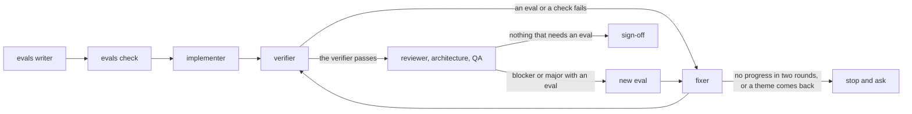
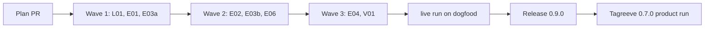

# Plan for 0.9.0

## Status (2026-11-10)

- Written from the direction plan of 2026-11-09 ("Release 1: evidence"). Checked against `main` at e8f47ac (0.8.5) and against GitHub on 2026-11-10. Nothing is built.
- Release 1 of the direction plan is this release, 0.9.0. Decision Q1 asks the maintainer to name release 2 0.10.0.
- E07 shipped in #611, except its ledger part, which is in L01. E05 is dropped (Findings, "E05 is done").
- The builder session reports to the assessment session when this plan PR opens, at the end of each wave, when a PR stops for the second time, and when the release is cut.

## Summary in plain words

After 0.9.0, each PR starts with a list of short checks, written in plain words before any code exists. The list says what must be true when the PR is done, and how to check it. The builder works against that list and cannot change it. A separate agent checks every item on a clean copy of the branch, and also checks that each test fails when the change is taken out. The open-ended reviewer still runs, but only after every item passes. A problem it finds becomes a new item, or it is only a note. A PR stops and asks when two rounds make no progress, or when the same kind of problem comes back. The maintainer reads the list and its results in the PR description.

The release also adds a ledger: one record for each PR of each run, on GitHub. It holds tokens by role (local runs), rounds, which checks passed and failed, whether the small-fix pass was kept, and what went wrong after sign-off. One command prints the numbers for a release in plain words: tokens per merged PR, rounds, maintainer touches and defects found late. Past PRs get rounds, bot threads and merge mode from GitHub history. A defect that no item caught is counted as a miss and goes into the end-of-run evaluation.

Readers: the maintainer (the eval list in each PR, the ledger report) and the agents of the pipeline. Out: merges and releases without a person (release 2), outcomes, planner, budgets and file splits (release 3). Each entry is one PR. A PR is done when its acceptance test passes in CI, an adversarial review reports no blockers or majors, and it is squash-merged.

## Goals this release serves

- Quality (goal 2): E01 to E04. Today the builder writes its own acceptance test and nobody reruns its "fails when broken" claim. After this release a separate writer sets the checks, a separate verifier runs them, and the break check proves each test can fail.
- My attention (goal 3): E01 (the list in plain words in the PR body), L01 (one report in plain words), E04 (a stop asks one clear question, and no PR runs rounds that change nothing).
- Cost (goal 4): L01 measures it. E04 runs the costly reviewers only on a branch that passes its checks, and stops a PR after two rounds with no progress.
- Self-improvement (goal 1): E06. A defect after sign-off that no check covered becomes an evaluation item for the evals writer.
- Works on all my repos (goal 6): `ciChecks` (repo policy in `.github/pipeline.json`) and the ledger work for any repo. The product run on Tagreeve is the proof (Product run).
- Automatic improvement (goal 7): the ledger is the evidence that release 2 needs before agents merge without a person.
- Small enough to understand (goal 8): this release adds two roles (evals writer, verifier), so it works against goal 8. The share of work on the pipeline's own output is in "Goal 8 share". Release 3 (S05) merges roles.
- Non-goals it comes close to: "Replacing CI or the review bots". The verifier can mark a check as covered by CI, but only by naming a check from the repo policy `ciChecks`, and the item stays on the untested list, so the maintainer merges the PR. It does not replace CI.

## Findings

Each claim was checked on 2026-11-10 against `main` at e8f47ac or against GitHub.

| Finding | Issue | What is wrong |
| --- | --- | --- |
| Sign-off reads only the tester's checks. `testOutcome` (`workflows/run-wave.js` line 193) passes when nothing failed and the check named by `acceptance.check` ran. Nothing checks what the PR must do. | #79, #47 | A weak test passes. The builder writes the acceptance test itself. |
| The tester is told not to check that the acceptance test fails when the change is removed (`agents/tester.md`). The implementer "proves" it alone. | #79 | Nobody else checks the claim. |
| The reviewer runs in the same `parallel` call as the tester in every round (`reviewLoop`, line 1013). | #44 | An Opus review runs on a branch that still fails its tests. |
| The theme stop compares only with the round before: `loopState.themes` holds the last round's themes (lines 1063 and 1064). A theme in rounds 1 and 3 does not stop. | #44 | A PR can circle between two themes. |
| A fix that pushes nothing stops at once, but its reason says `rounds exhausted: the fix changed nothing ...` (line 1072) while rounds are left. | | The reason is wrong, and the direction plan's E04 eval ("no PR ends with rounds exhausted while its evals are all verified") cannot be read from it. |
| A resume after a plan-conflict stop keeps the round's themes and can stop again with `needs human: scope`. | #600 | A second stop with a wrong reason. |
| No test reaches a round where `loopState.archOpen` alone starts the architecture review (`wantArch`, line 1010). | #612 | A dead or untested term in the loop. |
| `token-report.sh` prints `transcripts: N agents, M tokens`, and M includes cache reads. The PR flag uses the same sum. | #556 | The two totals differ 18 times with no label, and the flag follows cache reads. |
| Nothing records outcomes per PR: no tokens, rounds or late defects in one place. | | No baseline for any later choice. |
| The workflow cannot read a clock: `Date.now` throws in the Workflow runtime (line 897, and the guard in `test/sim-pipeline.mjs`). It has no filesystem. | | Wall time and token counts come from the transcripts after the run, not from the workflow. |
| `file-feedback.sh` checks for a duplicate among open `pipeline-feedback` issues only (line 207), and so does step 3 of `routine/cloud/collect.md`. | | A problem that was closed as fixed and comes back is filed with no link to the old issue. |
| **E05 is done.** #48 shipped in #605. #558: every return of `runPRSteps` after the decision rerun spreads `rerunFix()` (lines 1453 to 1500). #560: `fixChanged` is set only when `typeof fix.changed === 'boolean'` (lines 1070 and 1231). Sim cases at lines 1583 to 1610 cover both. The retry of #540 (shipped in #591) is in `call()` (line 278), and `call()` holds the only `agent(` call of the file (line 289), so every step, the `pipeline-io` calls too, gets the one retry. | #558, #560 | Both issues are still open. Close them as done with a link to those tests. Nothing is left for E05. |
| 98 PRs are merged on 2026-11-10 (the direction plan said 89). Every entry of this plan touches a gated path (`scripts/**`, `agents/**`, `workflows/**`, `skills/**`, `routine/**` in `.github/pipeline.json`). | | The maintainer merges every PR of this plan. |

## Design

### One PR after this release

Summary: the writer sets the evals, the implementer builds against them, the verifier checks them, and the reviewers run only on a branch where the verifier passes (every check and every eval).

### The eval list

- One eval is `{ id, kind, statement, check, test }`. `id` is `<PR id>-<n>` (for example `E01-3`). `kind` is one of `behaviour`, `error path`, `regression`, `quality bar`, `size limit`, `time bound`, `reference`. `statement` is one plain sentence a person can read. `check` is the command or steps, with the expected result. `test` (optional) names the test file or test that runs the check. The writer sets it only when the plan entry names a test. The verifier fills it from what it ran, and the break check (E03b) uses it.
- The list lives in the workflow's memory for the run, in every later agent's brief (`prBlock`), in the PR body under "Evals" with the last result of each id, in the result (`evals`) and in the ledger. It is never a file on the branch. So no agent after the writer can edit it. It changes only through a dispute that the writer settles (E02) or a new eval from the reviewer (E04).
- A rerun gets the list back through `resume.evals` (copied from the earlier result, as `history` is today). `prs[].evals` gives a list by hand and skips the writer. Both take `{ evals, noErrorPath, algorithm }`; a bare array means `noErrorPath` and `algorithm` are unset. The result carries the accepted rule inputs as `evalsMeta: { noErrorPath, algorithm }` next to `evals`, so a resume copies both. An `Evals:` table in a plan entry is input to the writer (E01), never the list itself.
- Plan and docs PRs get no list. A PR with no list (a resume of a PR built before 0.9.0, or `evals: false`) runs the tester path as today. The writer never runs for a resume or a `skipImpl` PR (E01).

### Verifier results and sign-off

- The verifier returns one result for each eval id: `pass`, `fail` or `ci`. A `ci` result means the sandbox refused the command; it must name a check in `ciChecks`. `ciChecks` is repo policy: the top level of `.github/pipeline.json` (default `["ci"]`). The workflow reads it from the default branch itself, with one `ioCall` to `gate-files.sh <repo> --ci-checks`, as `minorScope` reads its scope. It is not a run argument, so no run can set its own list, and a cloud build gets it the same way as a local one. When the read fails or the key is not a list of strings, the list is `[]`, so a `ci` result counts as no result. A `ci` result with no such name counts as no result. A `ci` item stays on the untested list, so the maintainer merges the PR. No land step reads the named check in this release. Items from the verifier (`ci` and `not-run`) live in their own `evals` bucket of `untestedState`: `verifyOutcome` sets it each verifier round, `noteTest` never writes it, and `untestedOf` joins it with the others. A later tester round (docs step, minor pass, bot answer, land fix) cannot clear it.
- Sign-off needs a result for every id and no `fail`. The verifier's own `pass` field is ignored, as the tester's is today. It may add up to 3 checks of its own that the builder did not see. A failed one is a major.
- Each history row gets `evals: { passed, failed, ci }` (lists of ids). The PR body, the ledger and the stop rule read this field.

### Round caps and the stop rule

- Every entry names its round cap. The main session passes it as `prs[].maxRounds`.
- **Stop after two rounds with no progress** (the rule of D8 in the direction plan, for every entry and for every PR after E04). A round has progress when at least one of these is true, compared with the round before: an eval id that failed now passes; the set of failing checks is smaller; a blocker or major theme of the round before is gone. Two rounds in a row without progress stop the PR with `no progress: <what stayed the same>`.
- Two cases stop at once, as today, and E04 keeps them: a fix that pushed nothing (`no progress: the fix changed nothing in round <n>`), and a theme that comes back (now in any earlier round of the current segment, not only the one before: `needs human: scope`).
- While waves 1 and 2 run on 0.8.5 (Q4), the code has only the two stops at once. The main session applies the two-round rule by hand from the history rows: same failing checks and no theme gone in two rounds in a row means it stops the entry and reports it.

### Ledger store

Decided: **comments on one ledger issue per repo**, never a file on `main`.

- `ledger.sh init <repo>` makes an open issue "Pipeline ledger" with the label `pipeline-ledger`. Nothing else makes it, so no repo gets one without its maintainer's go-ahead.
- One comment per PR per run: a first line `<!-- pipeline:ledger v1 <run> <pr id> -->` and one fenced JSON record. Only comments by the account that `GET user` names count (`trusted-comment.jq`, list form), as for the routine records.
- The record holds only what GitHub does not hold: tokens, wall time, rounds and eval results by round, the stop reason, the minor pass, eval misses. Merge mode (the `merge-cleared` comment), bot threads and land fixes are read from GitHub at report time by one function that back-fill uses too.
- Why: a stalled PR often has no PR number, so a record on the PR cannot hold it. A comment works through `gh api` REST in a cloud session (K6b of 0.8.0) and needs no git push. A data branch needs a push from every session, has conflicts when two sessions write, and is a second store to learn. A file on `main` would be gated and would conflict.
- Cloud runs give token totals only, marked `comparable: false`. Local runs give transcript counts by role (input, cache write, cache read, output) and one price-weighted figure: input 1, cache read 0.1, cache write 1.25, output 5. Tokens cannot be back-filled.

## States

| State | How it starts | What ends it |
| --- | --- | --- |
| evals refused | the list breaks a rule (no error-path eval and no reason, or an algorithm entry with no time bound, or with neither a size limit nor a reference) after `evalsRounds` writer attempts | the PR stops with `evals refused: <rule>`. The main session fixes the entry or passes `prs[].evals`, then reruns |
| dispute open | the implementer or the fixer returns a dispute for an eval id | the writer keeps or changes the eval in the same step; if the writer fails, the eval is kept and the dispute is recorded as `unsettled`. One dispute per id per PR; a second is ignored and logged |
| eval result `ci` | the verifier could not run the command and named a check in `ciChecks` | nothing reads the check in this release. The item is listed as covered by CI in the PR body and on the untested list (the `evals` bucket, which a tester round does not clear), so the maintainer merges the PR |
| no progress | two rounds in a row with no progress, or a fix that pushed nothing | a person reruns with `resume` and a decision, or drops the PR |
| ledger missing | `ledger.sh put` finds no ledger issue (exit 65) | the maintainer allows `ledger.sh init <repo>` |

## Scope

In:

| Group | Entries | Issues | Size |
| --- | --- | --- | --- |
| Ledger | L01 | #556 | M |
| Evals writer | E01 | | L |
| Build against the evals | E02 | #79 | M |
| Verifier | E03a | | L |
| Break-the-change check | E03b | | S |
| Reviewer after the evals | E04 | #44, #600, #612 | L |
| Eval misses feed the evaluation | E06 | | M |
| Version names in docs | V01 | Q1 | S |

Not in: see Out of scope.

### Goal 8 share

Goal 8 asks that work on the pipeline's own output (fixes and corrections of what the pipeline produced) is a limited share of each release. Count:

- Entries: **1 of 8** is a correction of the pipeline's own output (V01, stale version promises in docs). The other 7 are new capability.
- Issues the entries close: **3 of 5** are fixes of pipeline output (#556, #600, #612, each folded into an entry that rewrites the same lines). #44 and #79 are evaluator feedback answered by new capability.
- Left out on purpose: the late minors #613 and #614 (batch fix), and #558 and #560 (already fixed, close them).

## Order and waves

Summary: the ledger, the writer and the verifier first; then the rules that build on them; then the new review loop and the docs fix; then one live run, the release and the product run.

- Wave 1. L01 is outside `workflows/run-wave.js`. E01 and E03a edit different parts of it (the parts are named in each Touches line). E03a reads `pr.evals` and so does not need E01 merged: the sim gives it `prs[].evals`.
- Wave 2. E02 needs E01 (the writer settles disputes). E03b needs E03a (`verifyPrompt`, `verifyOutcome`). E06 needs L01 (`ledger.sh`). These three edit different parts.
- Wave 3. E04 rewrites `reviewLoop`, which E03a (wave 1) and E02 (wave 2, the fix call) edit, so it comes last and alone in that file. V01 is a docs PR and depends on Q1.
- Land conflicts go through the land fix, one PR at a time (AGENTS.md).
- Before the release: one quick-fix wave on `alfhen/pipeline-dogfood` from a local session with `pluginRoot` at `main` after wave 3. It is the live check that 0.8.0 lacked (finding 10 of the direction plan). Then the version PR (`manifest.sh --write`) and `scripts/release.sh`, as for 0.8.5.

### New and changed run-wave arguments

| Argument | Type | Default | Entry | What it does |
| --- | --- | --- | --- | --- |
| `evals` | boolean | `true` | E01 | `false` turns the writer off for the wave. |
| `evalsRounds` | number | `2` | E01 | Writer attempts after a refusal or an evals check that asks for changes. |
| `steps.evals` | `{ model, effort }` | `opus`, `high` | E01 | Model of the writer. |
| `prs[].evals` | eval list, or `{ evals, noErrorPath, algorithm }` | none | E01 | A given list. No writer call. |
| `prs[].algorithm` | boolean | `false` | E01 | The entry adds or changes an algorithm (the plan entry says `Algorithm: yes`). The writer can also set it. |
| `resume.evals` | eval list, or `{ evals, noErrorPath, algorithm }` | none | E01 | The list of the earlier run, copied from its result (`evals` and `evalsMeta`). |
| `steps.verify` | `{ model, effort }` | `sonnet`, `medium` | E03a | Model of the verifier. |
| `breakCheck` | boolean | `true` | E03b | `false` turns the break check off for the wave. |
| `resume.designRules` | string list | `[]` | E04 | Rules a person set after a stop. They go to the verifier, the reviewer and the fixer (#44). |
| `prs[].maxRounds` | number | unchanged | all | No code change. Each entry below names its value. |

## Rules for every PR

- Read `AGENTS.md` and `docs/goals.md`.
- Each PR adds tests that fail when the change is removed. The PR description says how that was checked.
- Each negative test checks that its input really contains what the check looks for.
- An entry with an **Invariants** line: the reviewer checks each invariant in every round, and the tests cover each one.
- Each acceptance run is `node test/sim-pipeline.mjs`, `node --test test/*.test.mjs` and `bash scripts/check-syntax.sh` in full.
- Simulation tests check only what code decides. What an agent judges is checked by its prompt text (a test file of its own) or by a code step after it.
- New tests go in new files. Named exception: `test/sim-pipeline.mjs`. Each entry adds its sim cases as one block after the anchor case its Touches line names, and adds its fake-agent lines at the named place, so two entries of one wave do not edit the same lines.
- New agent files have the same `## Rules` block as the others.
- Each shared value is computed in one place: the eval rules (`evalsVerdict`, E01), sign-off on evals (`verifyOutcome`, E03a), progress between rounds (`progressOf`, E04), the weighted figure (`token-report.sh`, L01), the eval-miss rule (`ledger.sh`, E06).
- `workflows/run-wave.js` stays plain JavaScript with no filesystem, no `Date.now`, no `Math.random`.
- Every entry runs with `docsUpdate` on, except V01 (`kind: "docs"`). This repo has no `CHANGELOG.md`, so the template's marker rule does not apply.
- Docs: Simplified Technical English, no em dashes, Mermaid with a one-line summary under each. Code comments only for why.

## PRs

### Wave 1

**L01 Ledger (#556).** Round cap 3. Touches: `scripts/token-report.sh`, `scripts/ledger.sh` (new), `test/token-report.test.mjs`, `test/ledger.test.mjs` (new), `test/fixtures/ledger/` (new), `test/fake-gh` (only if a new route needs it), `skills/pr-pipeline/SKILL.md` ("Step 4: file the feedback" only), `routine/cloud/build.md` (step 9 only), `routine/config.jq` (the line that adds `pipeline-routine` to `skipLabels`, and the `typeLabels` check that refuses it), `test/routine-state.test.mjs` (one case), `test/routine-cloud-prompts.test.mjs` (one case for step 9).
- #556 first: `token-report.sh` labels the transcript line `transcripts: N agents, M tokens (cache reads included)`, prints per role and per PR the weighted figure (input 1, cache read 0.1, cache write 1.25, output 5) and says that the top roles and the PR flags use it. The flags then use the weighted figure.
- `token-report.sh --json <file>` writes per PR: tokens by role (four counts), the weighted figure, agent count, wall minutes (first to last `timestamp` over the PR's transcripts), and the minor pass cost (agents labelled `minorfix:`, `minorreview:` and `test:<id>#minor1`). Without a transcript folder it writes the totals only with `comparable: false`.
- `scripts/ledger.sh <repo> <command>`: `init`; `put <workflow output file> --run <id> [--tokens <json>] [--cloud]` (one record per PR in the result, ready or not; a record that exists for that run and PR is not written again; `--run <id>` is made once per wave start by the main session and passed again on a resume of the same wave; after a post, `put` lists the records for that run and PR and, when two exist, deletes its own if it is not the lowest comment id; a failed delete (a cloud session can be refused) is logged and `put` still exits 0); `list` (one JSON line per trusted record, all pages, one record per run and PR id: the lowest comment id); `backfill` (one record per merged PR with none: rounds parsed from the PR body, bot threads, merge mode; tokens null; a second run writes nothing); `report [--since <tag>]` (median weighted tokens and median raw tokens per merged PR, median rounds, the share of PRs with 4 or more rounds, maintainer touches per PR, defects after sign-off, hand fixes by kind, each as one plain sentence, and how many records have no tokens); `hand <pr number> code|process` (the main session records a fix by hand after sign-off, or a process fix by hand; `report` counts them by kind). `put` and `backfill` take `--dry-run`: they print the records and write nothing.
- Record fields: `v`, `repo`, `run`, `pluginVersion`, `kind` (`wave`, `land-fix`, `backfill`), `pr` (`id`, `number` or null), `ready`, `reason`, `rounds` (history rows with an integer `round`; docs, minor1 and bots rows are not rounds; null when backfill cannot parse the PR body), `evals` (count, and passed, failed and ci ids by round, from the history rows when they have them), `minorPass` (`ran`, `kept`, `why`, weighted tokens), `codeChangedByBots`, `tokens` (`source`, `comparable`, `byRole`, `raw` (the sum with cache reads, the unit that `token-report.sh` printed before L01), `weighted`, `agents`, `wallMinutes`).
- One row per PR in `report`: the PR's records of all runs are combined. Tokens are summed, `ready` comes from the last record, and touches are counted over all records. A stalled run, its resume and a land fix are one PR.
- Maintainer touches of a PR: a merge with mode `person` plus each record whose reason starts with `needs human:`. Defects after sign-off are a set of PRs: `codeChangedByBots` true or an eval miss (E06), counted once per PR. Land-fix records are counted on a separate line, because a land fix usually resolves a conflict and not a defect. A PR whose rounds are null is left out of the median rounds, and the report says how many.
- SKILL.md Step 4: after `token-report.sh --json`, run `ledger.sh put`. `routine/cloud/build.md` step 9: after `token-report.sh`, run `ledger.sh <repo> put <output-file> --run <run> --cloud` and log its output; a non-zero exit is logged and the run goes on.
Invariants: no command writes a file in the repo; `put` and `backfill` write only comments on the ledger issue; `list` and `report` read only records by the `GET user` account; the readers never count a (run, PR id) pair twice: `list` and `report` keep the record with the lowest comment id and drop the others, and the delete in `put` is a tidy-up; a cloud record never has `comparable: true`.
Evals:

| Id | Kind | What must be true | How to check |
| --- | --- | --- | --- |
| L01-1 | behaviour | `ledger.sh report --since <tag>` prints the four numbers for the PRs merged after that tag. | `test/ledger.test.mjs` with `test/fake-gh`: four records with known values; the medians and counts match. |
| L01-2 | behaviour | A PR that stalls (ready false, no PR number) gets a record. | `put` on an output file with a stalled PR: the posted body has `"number": null` and the reason. |
| L01-3 | behaviour | A new session reads every record from GitHub alone. | `list` over two pages of comments prints each record once; a record by another login is left out. |
| L01-4 | behaviour | A local record has tokens by role and the weighted figure; a cloud record has totals with `comparable: false`. | `token-report.sh --json` on a transcript fixture, then `put`; `put --cloud` on an output file alone. |
| L01-5 | regression | #556: the transcript total is labelled, and a PR flag follows the weighted figure, not cache reads. | `test/token-report.test.mjs`: a fixture where cache reads make a different PR the largest. |
| L01-6 | behaviour | The record says whether the minor pass was kept or reverted, and its weighted cost. | Fixture with `minorPass: { ran: true, kept: false }` and `minorfix:` transcripts. |
| L01-11 | behaviour | Two `put` calls for one run and PR leave one record, also when both post before either reads. If the delete fails, `report` still counts the PR once. | `test/ledger.test.mjs` with `test/fake-gh`: the fake lists two records after the posts; the later one is deleted. A second case: the fake DELETE fails, `put` exits 0 and logs it, and `list` prints one record and `report` counts the tokens and touches once. |
| L01-7 | error path | With no ledger issue, `put` exits 65 and writes nothing; a failed GitHub call exits 3. | `test/fake-gh` with no issue: no POST in the call log. |
| L01-9 | behaviour | `report` counts each PR once over its records, counts a PR with `codeChangedByBots` and a miss once as a defect, counts land fixes apart, and leaves a null-rounds PR out of the median. | `test/ledger.test.mjs`: two runs of one PR, a land-fix record, a backfill record with null rounds. |
| L01-10 | behaviour | `hand` records a hand fix, and `report` prints the counts by kind and the share of PRs with 4 or more rounds. | `test/ledger.test.mjs` with `test/fake-gh`. |
| L01-12 | regression | The ledger issue is not triaged: `routine-state.sh next --mode cloud-triage` skips an open issue labelled `pipeline-ledger`. `routine/config.jq` adds `pipeline-ledger` next to `pipeline-routine` in `skipLabels` and refuses it as a `typeLabels` value. | `test/routine-state.test.mjs` with `test/fake-gh`: an open issue with that label and no state label is not returned. The docs step names the label in the `skipLabels` row of `docs/cloud-routines.md`. |
| L01-8 | behaviour | `backfill` writes one record per merged PR with none, and nothing on a second run. | Fixture of three merged PRs, one with a record. |

Acceptance: `node --test test/ledger.test.mjs test/token-report.test.mjs` passes; the L01-5 case fails on the old `token-report.sh` because its flag uses the sum with cache reads.
QA: on this repo, `ledger.sh alfhen/agent-pr-pipeline backfill` with `--dry-run` printing what it would post, then `report` over the printed records. No write to this repo in QA unless the maintainer allows `init` here.

**E01 Evals writer.** Round cap 4. Touches: `agents/evals-writer.md` (new), `workflows/run-wave.js` (the argument block after `FEEDBACK_REPO`: `EVALS_ON`, `EVALS_ROUNDS`; `STEPS`: the `evals` line before `impl`; `ROLES`: the `evals` line before `impl`; new schemas `EVALS` and `EVALSCHECK` after `IMPL`; new `evalsPrompt` and `evalsCheckPrompt` after `implPrompt`; `prBlock`; new `evalsVerdict` and `writeEvals` before `runPRSteps`; `runPRSteps`: one evals step before the whole implementer block (not inside its `!pr.skipImpl && !pr.resume` branch) and `evals` in each result; `openPrompt`: the "Evals" section), `templates/plan.md` (the entry block: Round cap, Algorithm, Evals), `skills/pr-pipeline/SKILL.md` ("Step 1" and the plan-author checklist only), `test/evals-writer.test.mjs` (new; one prompt-text case for the template and the skill), `test/sim-pipeline.mjs` (fake agent: one `evals:` line after the `triage` line; `base` and `quickBase` get `evals: false`; `STEP_OF` gets the `evals` and `verify` keys; cases after "no skill instruction without a skills argument").
- One rule for the list. The writer runs only for a code PR (quick fixes too) when `evals` is not false, `pr.resume` and `pr.skipImpl` are absent, and there is no `prs[].evals`. A resume or a `skipImpl` PR with no `resume.evals` or `prs[].evals` has no list and runs the tester path (Design). When a list is given or resumed, `evalsVerdict` and the evals check run once on it, before the decision fixer and the review loop, outside the implementer branch, so a resume never gets a new list from the writer.
- `writeEvals(pr)` is the writer step of that rule. The writer clones the default branch, reads the plan entry (or the quick brief), the goals document and the code. It never sees the PR branch. It returns `{ evals, algorithm, noErrorPath, notes }`; the workflow keeps `{ noErrorPath, algorithm }` as `evalsMeta` with the list.
- `evalsVerdict(list, pr, meta)` takes `meta = { noErrorPath, algorithm }` from the writer, or from the given or resumed list (`evalsMeta`). It refuses: an empty list; an id that repeats; an eval with no statement or no check (these are the structure rules); no `error path` eval and no `noErrorPath` reason; when `pr.algorithm` or the writer's `algorithm` is true, a list with no `time bound` eval, and a list with neither a `size limit` nor a `reference` eval (the reference is a slow, simple version of the same function, compared on generated inputs). So an algorithm entry always needs a time bound and one of the other two.
- Evals check: the architecture reviewer (`evalsCheckPrompt`, when `archRuns(pr)`) and, per Q3, the product reviewer check the list before the build: `ok` or `needs-change` with notes. A refusal or a `needs-change` goes back to the writer with the reason, at most `evalsRounds` attempts in all. Then the PR stops with `evals refused: <rule>` or `evals check: <notes>`. The writer failing (after the retry) stops it with `evals writer failed`.
- An `Evals:` table in the plan entry is input to the writer, not the list. The writer keeps or improves each row under the same id, may add rows, and its list goes through `evalsVerdict` and the evals check. `prs[].evals` is only for a list the maintainer gives; it and `resume.evals` skip the writer but go through `evalsVerdict` (and the evals check) before the implementer. The writer gets the entry's `Round cap` and `Algorithm:` lines as plain input.
- `prBlock` prints the list (id, kind, statement, check). `evalsPrompt` builds its own block (id, title, notes, entry text) and does not call `prBlock`, because `prBlock` prints `Branch: ${pr.branch}`. `openPrompt` puts a table "Evals" in the PR body: id, kind, what must be true, and the last result from the history row, or "not checked" before E03a.
Invariants: no implementer call happens before `evalsVerdict` accepts the list; an algorithm entry with no time bound never reaches the implementer; the writer's prompt names no PR branch; the list in every later prompt equals the accepted list plus settled changes (E02) and reviewer evals (E04), each of which passed `evalsVerdict` again.
Evals:

| Id | Kind | What must be true | How to check |
| --- | --- | --- | --- |
| E01-1 | behaviour | A code PR gets its list before the implementer starts, and every later brief and the PR body hold it. | Sim: `evals:C1` comes before `implement:C1`; the open prompt holds each statement. |
| E01-2 | error path | A list with no error-path eval and no reason is refused; after `evalsRounds` the PR stops with `evals refused: no error path`. | Sim: the writer returns behaviour evals only, twice. |
| E01-3 | behaviour | An algorithm entry with no time bound is refused. A list with a time bound and a size limit or a reference is accepted. | Sim: `algorithm: true`, a list with a size limit and a reference but no time bound gives no `implement:` call; the same list plus a time bound gives one. |
| E01-4 | behaviour | A `needs-change` from the evals check goes back to the writer once, with the notes. | Sim: the second writer prompt holds the notes. |
| E01-5 | behaviour | `prs[].evals` or `resume.evals` skips the writer but not `evalsVerdict`. | Sim: no `evals:` call; the given list is in the implementer prompt. A given list with no error-path eval and no reason stops with `evals refused: no error path`. A resumed `{ evals, noErrorPath }` with a reason and no error-path eval is accepted, and a resumed `{ algorithm: true }` list with no time bound is refused. A resume or a `skipImpl` PR with no list: no `evals:` call, a `test:` call and no `verify:` call, and the history and settled evals are not replaced. |
| E01-6 | regression | `evals: false` runs as before. The default is `evals: true`, so the existing sim cases keep their expected values only because `base` and `quickBase` set `evals: false`. | The existing sim cases pass with no change to their expected values, with `evals: false` in `base` and `quickBase`. E01's own cases pass `evals: true`. |
| E01-10 | behaviour | Plan and docs PRs get no writer. | Sim with `evals: true` and a code PR, a plan PR and a docs PR: one `evals:` call, for the code PR only. The case fails when the kind rule is removed from `writeEvals`. |
| E01-9 | behaviour | The default path (no `evals` argument) runs writer, evals check, implementer, tester or verifier, reviewers, bots, minor pass and docs in order. | Sim: one case with default args; the call list and `STEP_OF` order match. |
| E01-7 | error path | A writer that dies twice stops the PR with `evals writer failed`, and no implementer runs. | Sim. |
| E01-8 | behaviour | The writer reads the default branch only: its prompt names no PR branch, and the agent file says it never reads one. | `test/evals-writer.test.mjs`: with a fixture PR whose branch is a unique string, the test first checks the string is in `implPrompt`, then that `evalsPrompt` does not contain it; the agent file says it never reads a PR branch. |

Acceptance: `node test/sim-pipeline.mjs` and `node --test test/evals-writer.test.mjs` pass; the E01-3 case fails when `evalsVerdict` skips the algorithm rule.

**E03a Verifier.** Round cap 4. Touches: `agents/verifier.md` (new), `workflows/run-wave.js` (`STEPS`: the `verify` line after `test`; `ROLES`: the `verify` line after `test`, with `skills: 'test'`; new schema `VERIFY` after `TEST`; new `verifyPrompt` after `testPrompt`; new `verifyOutcome` after `testOutcome`; `untestedState`, `untestedOf` and `noteTest`: the new `evals` bucket; `runPRSteps`: one `ioCall` for `ciChecks` before the loop, only when `pr.evals` is set, so a PR without a list makes no extra call; `historyRow`; `reviewLoop`: the `test` call in the first `parallel` and the `testOutcome` line after it), `scripts/gate-files.sh` (the new `--ci-checks` mode: prints `CICHECKS <json array>` from the top level of `.github/pipeline.json` on the default branch, `["ci"]` when the file or key is missing, exit 3 when it cannot be read), `test/gate.test.mjs` (cases for `--ci-checks`), `templates/pipeline.json` and `skills/pr-pipeline/SKILL.md` (the `.github/pipeline.json` line of "Files" only: the `ciChecks` key), `test/verifier-agent.test.mjs` (new; one case that the template has `ciChecks`), `test/sim-pipeline.mjs` (fake agent: one `verify:` line before the `test` line, and the fake `pipeline-io` answer for `--ci-checks`; cases after "a decision rerun that stops at open still reports rerunFixChanged").
- When `pr.evals` is set, the loop calls the verifier (label `verify:<id>#<round>`) instead of the tester. The verifier clones the branch, runs the fast checks and the branch's own e2e (as the tester does), then each eval's check. It returns the `TEST` fields plus `evals: [{ id, result, evidence, ciCheck }]` and `extra: [{ name, pass, evidence }]` (at most 3).
- `verifyOutcome(pr, verify)` builds on `testOutcome` and adds: a major `eval <id> has no result` for each missing id or `ci` result whose `ciCheck` is not in `ciChecks`; a major `eval <id> failed: <evidence>` for each fail; a major for each failed extra check. `pass` is false when any of these exist. `ci` results go to the `evals` bucket of the untested list as `<id> (covered by CI check <name>)`. The bucket is replaced each verifier round and read by `untestedOf`, `syncUntested` and `landFor`; `noteTest` does not touch it.
- `historyRow` adds `evals: { passed, failed, ci }`.
- A PR without `pr.evals` runs the tester exactly as today. In the sim, `evals` is false in `base` and `quickBase` once E01 has landed, so these calls stay the ones the existing cases assert. The minor pass, the docs check, the bot check and the land-fix check keep the tester in this release.
Invariants: sign-off never happens when an eval id has no result or a result is `fail`; the verifier's own `pass` field never decides; a `ci` result counts only with a name from `ciChecks`; an item of the `evals` bucket stays on the untested list until a later verifier round replaces it; a PR without `pr.evals` gets the same calls as on `main`.
Evals:

| Id | Kind | What must be true | How to check |
| --- | --- | --- | --- |
| E03a-1 | behaviour | Sign-off is refused when an eval id has no result. | Sim: the verifier leaves out one id; the PR is not signed off and a fix round gets `eval <id> has no result`. |
| E03a-2 | behaviour | Sign-off is refused when a result is `fail`. | Sim. |
| E03a-3 | error path | A `ci` result with no name from `ciChecks` counts as no result; with `ci` named it counts and is listed as untested. | Sim, both cases. |
| E03a-4 | behaviour | A failed extra check is a major. | Sim. |
| E03a-5 | behaviour | The verifier's `pass: true` with one failed eval does not sign off. | Sim. |
| E03a-6 | behaviour | The history row has the eval ids by result. | Sim: `history[0].evals`. |
| E03a-7 | regression | A PR without `pr.evals` calls the tester as before. | Sim: the cases that run with `evals: false` (see E01) keep their expected values. |
| E03a-8 | behaviour | A `ci` item is still in `untested` and in the open prompt after a docs step whose tester round is clean. | Sim: a `ci` result, then a docs step with an empty `notRun`; `untested` holds the item and the PR gets no `:auto` merge. |
| E03a-9 | error path | `ciChecks` comes from `gate-files.sh --ci-checks`; a failed read gives `[]` and a `ci` result counts as no result. | Sim: the fake `pipeline-io` fails. `test/gate.test.mjs`: the mode on a settings fixture, a missing key and a bad value. |

Acceptance: `node test/sim-pipeline.mjs` and `node --test test/verifier-agent.test.mjs` pass; the E03a-1 case fails when `verifyOutcome` checks only the results it got; the E03a-8 case fails when `noteTest` replaces the `evals` bucket.

### Wave 2

**E02 Build against the evals (#79).** Round cap 3. Touches: `workflows/run-wave.js` (`implPrompt`; `IMPL` (`disputes`, `deviations`); `fixPrompt` and `FIX` (`disputes`); new `disputePrompt`, `DISPUTE` and `settleDisputes` after `writeEvals`; `runPRSteps`: the lines after the `impl` call, and `evalDisputes` in each result; `reviewLoop`: the lines after the `fix` call only; `reviewPrompt`: the deviation rule), `agents/implementer.md`, `agents/fixer.md`, `agents/evals-writer.md` (the dispute section), `agents/reviewer.md` (the deviation rule only), `test/build-against-evals.test.mjs` (new), `test/sim-pipeline.mjs` (cases after "severity: a fits architecture report keeps its minors and starts no fix for the minor").
- The implementer and the fixer build until they believe every eval passes. They cannot change an eval. They may return `disputes: [{ id, reason }]`. Any other field that holds evals is ignored.
- `settleDisputes` sends each dispute to the writer, which answers `keep` or `change` (with the new eval) and a reason. After a `change`, `evalsVerdict` runs on the new list with the same `evalsMeta` and the evals check runs on it again (when it ran before). A change that fails either is rejected: the old eval stays and the dispute is recorded as `rejected`. One dispute per id per PR; a second is logged and ignored. If the writer fails, the eval is kept and the dispute is `unsettled`. Every dispute goes into `evalDisputes` on the result and into the PR body.
- #79: the implementer returns `deviations: [{ what, where, why }]` for any change against the entry's Touches line, Acceptance line or a named plan rule. The reviewer gets them and rules on each as accepted or a finding. One rule for both reviewers: a Touches deviation is a finding unless the entry or a rule allows it.
Invariants: the list changes only through `settleDisputes` (and, after E04, a reviewer eval), and every changed list passes `evalsVerdict`; no dispute changes an eval without a writer answer; each dispute is in the result.
Evals:

| Id | Kind | What must be true | How to check |
| --- | --- | --- | --- |
| E02-1 | behaviour | The implementer and the fixer get the list as fixed text and the rule that they cannot change it. | `test/build-against-evals.test.mjs` on `implPrompt`, `fixPrompt` and the agent files. |
| E02-2 | behaviour | An edited list in an implementer answer changes nothing. | Sim: the implementer returns an `evals` field; the verifier prompt holds the writer's list. |
| E02-3 | behaviour | A dispute goes to the writer, and its ruling and reason are in `evalDisputes`. | Sim: one `keep`, one `change`. |
| E02-4 | error path | A writer that fails on a dispute keeps the eval and records `unsettled`. | Sim. |
| E02-5 | error path | A second dispute for the same id is ignored and logged. | Sim. |
| E02-6 | behaviour | Deviations reach the reviewer prompt. | Sim: the review prompt of round 1 holds the deviation. |
| E02-8 | error path | A `change` that removes the only error-path eval or the time bound is rejected, and the old eval stays. | Sim: the writer answers `change` with a list that breaks the rule. A second case: a list accepted through a `noErrorPath` reason, and a `change` to another eval, is not rejected for the error-path rule. |
| E02-7 | regression | A PR with no disputes and no deviations makes the same calls as before. | Sim. |

Acceptance: `node test/sim-pipeline.mjs` and `node --test test/build-against-evals.test.mjs` pass; the E02-2 case fails when the loop takes a list from the implementer's answer.

**E03b Break-the-change check.** Round cap 3. Touches: `workflows/run-wave.js` (`verifyPrompt`; `VERIFY` (`breakCheck` per result); `verifyOutcome`; `BREAK_CHECK` after `CI_CHECKS`), `agents/verifier.md` (the break-check section), `test/verifier-agent.test.mjs`, `test/sim-pipeline.mjs` (cases after the last E03a case).
- In a round where every eval passed, for each eval of kind `behaviour` or `error path`, the verifier maps the eval to the test that ran its check (and fills `test`), removes the change from the files that are not tests in its clone, runs the test, and restores the clone. A file the PR changes is reset with `git checkout origin/HEAD -- <file>`; a file the PR adds is deleted, because it is not on `origin/HEAD`. `fails-without-change` counts only when the test fails on its own assertion (a result comparison). A load, import, missing-file, syntax or exit-127 error is not that: the result is `not-run` with the reason, and the item goes to untested. It returns `breakCheck`: `fails-without-change`, `passes-without-change`, `not-applicable` (kinds `regression`, `quality bar`, `size limit`, `time bound`, `reference`: they pass with and without the change by design) or `not-run` (with why). An eval that it cannot map to a test is `not-run`.
- `verifyOutcome` turns `passes-without-change` into a major `eval <id>: the test passes without the change`. `not-run` goes to the `evals` bucket of the untested list, so no eval of kind `behaviour` or `error path` is skipped without a trace. `not-applicable` is neither a pass nor a major. `breakCheck: false` skips the step.
- The verifier pushes nothing; the check happens only in its clone.
Invariants: a test that passes with the change removed never counts as a pass; a test that fails without the change for a load or import reason is `not-run`, never a proof; the break check never changes the branch; `not-run` items stay on the untested list (the `evals` bucket).
Evals:

| Id | Kind | What must be true | How to check |
| --- | --- | --- | --- |
| E03b-1 | behaviour | A test that still passes with the change removed is a failed eval. | Sim: `passes-without-change` stops sign-off. |
| E03b-2 | behaviour | The break check runs for each `behaviour` and `error path` eval in a round where every eval passed. | Prompt test and sim. |
| E03b-3 | error path | A break check that could not run is an untested item, not a pass. | Sim: `not-run` is in `untested`. |
| E03b-4 | behaviour | The verifier pushes nothing. | `test/verifier-agent.test.mjs`: the agent file has no push and says to restore the clone. |
| E03b-5 | regression | `breakCheck: false` gives the E03a calls and results. | Sim. |
| E03b-7 | behaviour | A file the PR adds is deleted in the clone and restored, not checked out from `origin/HEAD`. | Prompt test: the agent file names both steps. Sim: a result for an added file. |
| E03b-10 | error path | A test that fails only because the added file is missing (load, import, exit 127) is `not-run`, not `fails-without-change`. | Prompt test: the agent file and `verifyPrompt` name the rule and the error kinds. Sim: a `not-run` result with that reason is in `untested`. |
| E03b-8 | behaviour | A `regression` eval gets `not-applicable`, which is not a major. | Sim. |
| E03b-9 | error path | An eval of kind `behaviour` or `error path` that the verifier cannot map to a test is `not-run` and untested. | Sim: `not-run` is in `untested`. |
| E03b-6 | break check | The E03b-1 test fails when `verifyOutcome` ignores `breakCheck`. | The verifier removes the rule and runs the test. |

Acceptance: `node test/sim-pipeline.mjs` passes; the E03b-1 case fails on E03a's `verifyOutcome`.

**E06 Eval misses feed the evaluation.** Round cap 3. Touches: `scripts/ledger.sh` (the eval-miss rule in `put`, a new `miss` command, the `report` defect count), `workflows/run-wave.js` (`evaluatePrompt` only), `agents/evaluator.md`, `scripts/file-feedback.sh` (the duplicate check at the open-issue read only), `routine/cloud/collect.md` (step 3 only), `test/ledger.test.mjs`, `test/feedback.test.mjs`, `test/evaluator-ledger.test.mjs` (new), `test/routine-cloud-prompts.test.mjs` (one case for collect step 3).
- Eval miss: a PR that signed off and then had code changed to answer a bot (`codeChangedByBots` true), or a defect that the main session traces to a merged PR later (`ledger.sh <repo> miss <pr number> <issue>`). `put` writes `evalMisses` in the record from the first rule, in the same run. The rule is in `ledger.sh` only, and `report` counts a PR with both once.
- `evaluatePrompt` tells the evaluator: a ready PR with `codeChangedByBots` true is an eval miss; file it as an item for the evals writer, with what the bot found. It also gives the command `bash <pluginRoot>/scripts/ledger.sh <repo> report` for the numbers of earlier runs; if it fails, the evaluator says so and goes on.
- `file-feedback.sh` and collect step 3 read open and closed `pipeline-feedback` issues. An open match is skipped as today. A closed match is filed with a line `Seen before in #<n> (closed)`.
Invariants: an eval miss is counted in one place (`ledger.sh`); no item is skipped because of a closed issue.
Evals:

| Id | Kind | What must be true | How to check |
| --- | --- | --- | --- |
| E06-1 | behaviour | An accepted bot finding on a signed-off PR shows in the ledger as an eval miss in the same run. | `test/ledger.test.mjs`: `put` on a result with `codeChangedByBots` true. |
| E06-2 | behaviour | `miss` records a later defect, and `report` counts it. | `test/ledger.test.mjs`. |
| E06-3 | behaviour | The evaluator prompt names eval misses as items for the evals writer, and gives the ledger command. | `test/evaluator-ledger.test.mjs` on `evaluatePrompt` and `agents/evaluator.md`. |
| E06-4 | behaviour | An item that matches a closed issue is filed with the link; an open match is skipped. | `test/feedback.test.mjs` with `test/fake-gh`. |
| E06-5 | error path | A failed ledger read does not stop the evaluation and adds no made-up number. | Prompt text test. |
| E06-6 | regression | A wave with no eval miss gives the same feedback calls as before. | The existing feedback and sim cases pass unchanged. |

Acceptance: `node --test test/ledger.test.mjs test/feedback.test.mjs test/evaluator-ledger.test.mjs` passes; the E06-1 case fails on L01's `ledger.sh`.
QA: `file-feedback.sh --dry-run` against this repo with one item whose title equals a closed `pipeline-feedback` issue. It prints the `Seen before` line.

### Wave 3

**E04 Reviewer after the evals (#44, #600, #612).** Round cap 4. Touches: `workflows/run-wave.js` (`reviewLoop`; `wantArch`, `wantProduct` and `wantQa` (the `round === startRound` terms); new `progressOf` before `reviewLoop`; `resumeThemes`; `scopeEscalation`; `REVIEW` (an `eval` field on a finding); `reviewPrompt` and `fixPrompt`: the eval rule and `designRules`; `historyRow`: the `stop` field, and no themes on a plan-conflict stop), `agents/reviewer.md`, `test/review-after-evals.test.mjs` (new), `test/sim-pipeline.mjs` (cases at the end of the file).
- Order in a round for a PR with evals: the verifier first. If an eval fails, the fixer runs without the reviewer, the architecture review or QA. When the verifier's outcome is a pass (`verifyOutcome(...).pass`: no failing fast check, no failing eval, extra check or break check, and no missing result), those three run, on the same head. If any fast check fails, the fixer runs without them, as for a failed eval. `wantArch`, `wantProduct` and `wantQa` use "the first round where the reviewers run" in place of `round === startRound`, so a round 1 that fails an eval does not skip product review or QA for good.
- A reviewer blocker or major must carry an `eval` (statement and check). The workflow adds it to the list with id `<PR id>-R<round>-<n>`, and the verifier checks it next round. A blocker or major with no `eval` keeps its severity and stops sign-off. It goes back to the reviewer once, to write an eval. If it still has none, the PR stops with `needs human: review after evals`, and the finding is in the PR body. A reviewer eval goes through the `evalsVerdict` structure rules (a unique id, a statement and a check) before it joins the list. This follows Q2 (a).
- The loop ends when the verifier's outcome is a pass and no review finding needs a new eval. At the round cap with the verifier's outcome a pass and a new eval open, the reason is `needs human: review after evals` with the open findings, never `rounds exhausted`. Other blocking sources keep the fixer path and rerun the next round, as today: architecture findings, QA findings, the reviewer's failed invariants (each a `major` titled `[invariant] ...`, which `reviewLoop` puts in a group of their own, `splitFindings([[review.findings, 'review'], [invariantFindings, 'invariant'], ...])`, so their `sources` include `invariant`; the minor-pass and bot-check uses of `failedInvariants` do not change), the verifier's extra checks and `passes-without-change` majors carry no `eval` field (the ARCHREV and QA schemas do not change). "The verifier passed" means every fast check, every eval of the list, the verifier's extra checks and the break check. At the cap with one of those open, the reason names its source: `needs human: <source> findings open at the round cap` (source: architecture, QA, invariant, extra check or break check). A finding needs an `eval` only when its `sources` is exactly `['review']`, also after `mergeDuplicates`. The cap reason takes the source name from `sources`. So `rounds exhausted` is left only for a cap where the verifier's outcome is a fail (an eval, a fast check or a test failed).
- Scope of these rules: the verifier-first order, the eval requirement and the cap reasons `review after evals` and `<source> findings open` apply only when `pr.evals` is set. A PR with no list (a plan or docs PR, `evals: false`, a resume or `skipImpl` PR with no list) keeps today's loop: the tester and the reviewers in one `parallel`, blockers to the fixer, `rounds exhausted` at the cap. The stop rule, the segment rule and the stop markers apply to every PR. The existing sim cases (with `evals: false`) keep their expected values.
- Stop marker: `reviewLoop` sets `row.stop = '<reason>'` on the history row of every stop that pushed a row and that a person can resume (scope, no progress, plan conflict, `tests did not run`, `rounds exhausted`, `needs human: review after evals`, `needs human: <source> findings open at the round cap`) before it returns. The `tests did not run` row has no themes and is not a round for `progressOf`; it only closes the segment, and `historyRow` keeps it. `resume.history` is copied from the result, so the marker survives a resume. `resumeThemes` and the segment rule read it.
- Segment rule (one rule for all three checks): the current segment is the rows after the last row with any `stop` marker. The repeat-theme check, `resumeThemes` and the no-progress counter read only that segment, and only rows with an integer `round`. Rows of the docs step, the minor pass, the bot check and the land fix carry no marker and are not rounds, so these checks skip them. A stop in those steps never carries its themes into a resume. So `resumeThemes` is empty at a resume after any of these stops, and a resume with `designRules` runs a fix round.
- Stop rule (Design): `progressOf(previous row, row)`. Two rows in a row of the current segment with no progress stop with `no progress: ...`. Round 1 of a segment is not a no-progress round (it has no row before it in the segment to compare with), so the rule needs rounds 2 and 3 of a segment and can fire within the cap of 4. A fix that pushed nothing gives `no progress: the fix changed nothing in round <n>` (its row gets the marker too). A theme that is in any earlier row of the current segment (the rows after the last row with a `stop` marker) stops with `needs human: scope` (#44, on top of #588).
- `resume.designRules` go into the verifier, reviewer and fixer prompts (#44 (c)).
- #600: a plan-conflict stop leaves `themes` out of its history row, so `resumeThemes` does not carry them. #612: remove the `archOpen` term from `wantArch` if the new order leaves no path where it alone decides, or add a sim case where it does.
Invariants: for a PR with evals, the reviewer never runs on a head where the verifier's outcome failed in that round (an eval or a fast check); no PR with evals ends with `rounds exhausted` while the verifier passed in its last round; for a PR with evals, every blocker or major from the reviewer is an eval the verifier checks or a stop (no finding is demoted); architecture, QA, invariant, extra-check and break-check blockers keep the fixer path and, open at the cap, give a reason that names their source; a PR with no list gets today's reviewer calls, and its blockers go to the fixer with no `eval`; a theme that returns inside one segment stops the PR, and a resume starts a new segment, because every stop that pushes a row and that a person can resume leaves a `stop` marker on its row (an escalation and an agent-failed stop push no row and have no marker).
Evals:

| Id | Kind | What must be true | How to check |
| --- | --- | --- | --- |
| E04-1 | behaviour | Reviewer, architecture, product review and QA run only in a round where the verifier's outcome is a pass, and then they run. | Sim with product and QA on: round 1 has a failed eval and no `review:`, `product:` or `qa:` call; round 2 has all three. A second case: all evals pass, one fast check fails: no `review:` call in that round. |
| E04-2 | behaviour | A blocker with an `eval` becomes a new eval that the verifier checks next round; one without goes back to the reviewer once, then stops with `needs human: review after evals`. | Sim, both. |
| E04-3 | behaviour | No PR ends with `rounds exhausted` while the verifier's outcome passed in its last round. | Sim at the cap: the reason is `needs human: review after evals`. |
| E04-11 | behaviour | At the cap with every eval passing and an architecture blocker open, a failed invariant open, or a verifier extra-check major open, the reason names that source and is not `rounds exhausted`. | Sim, each source. The history line of the invariant case shows the source `invariant`. |
| E04-4 | behaviour | A theme in rounds 1 and 3 stops the PR. | Sim. |
| E04-5 | behaviour | Two rounds with no progress stop with `no progress`; a fix that pushed nothing says `no progress`. | Sim, both. |
| E04-6 | regression | #600: a resume after a plan-conflict stop runs a fix round. | Sim: a first run that really stops on a plan conflict; its `history` (with the `stop` marker) is the resume input. |
| E04-7 | regression | #612: a case fails when the `archOpen` term is removed, or the term is gone. | Sim, or the term's absence. |
| E04-9 | behaviour | A resume after a scope stop with `designRules` runs a fix round, and a theme from before the stop does not stop it again. | Sim: a first run that really stops with `needs human: scope`; its result's `history` is fed to the resume with `designRules`. |
| E04-12 | regression | A resume after a `no progress` stop runs a fix round, and the old themes and the old no-progress rows do not stop it at once. | Sim: a first run that really stops with `no progress`; its `history` is the resume input; the resume has a fix round, and a stop for no progress needs rounds 2 and 3 of the new segment. |
| E04-14 | regression | A PR with no list (a plan PR, `evals: false`) gets today's reviewer calls, and a reviewer blocker with no `eval` goes to the fixer. | Sim: the existing cases with `evals: false` pass unchanged, and a plan-PR case with a blocker shows a fixer call. |
| E04-13 | regression | A resume after a cap stop runs a fix round and does not stop with `needs human: scope` in its first round. | Sim: a first run that stops at the cap with `needs human: review after evals`, and one that stops with `rounds exhausted`; each `history` is fed to a resume with `designRules`. |
| E04-14 | regression | A stop in the docs step, the minor pass or the bot check leaves rows with themes and no marker; a resume does not carry those themes. | Sim: a history with such a row after a review row; `resumeThemes` is empty. |
| E04-15 | regression | A `tests did not run` stop after a round with themes leaves a marked row with no themes; a resume has a fix round, and a theme the earlier fix handled does not stop it with `needs human: scope`. | Sim: a round with themes, then nothingRan, then a resume with that `history`. |
| E04-10 | error path | A reviewer eval with a repeated id or no check is not added to the list. | Sim. |
| E04-8 | behaviour | `resume.designRules` reach the verifier, reviewer and fixer. | `test/review-after-evals.test.mjs` and sim. |

Acceptance: `node test/sim-pipeline.mjs` and `node --test test/review-after-evals.test.mjs` pass; the E04-3 case fails on the old loop because its last-round reason is `rounds exhausted`.

**V01 Version names in docs (Q1).** Round cap 2, `kind: "docs"`. Only if the maintainer chooses Q1 (a). Touches: `docs/cloud-routines.md` (the stage table row "2 to 4", and "0.9.0 deletes the local runner code" at line 292), `docs/routine.md` (line 3), `skills/pr-pipeline/SKILL.md` (the `routine/` line of "Files"), `test/skill-notes.test.mjs` (one case).
- Stage 2 work and the deletion of the local runner move from "0.9.0" to "release 2 (0.10.0)"; stages 3 and 4 to 0.10.0 too, or later, as release 2's plan decides. `docs/plan-0.8.0.md` stays as it is: it is a record.
Evals:

| Id | Kind | What must be true | How to check |
| --- | --- | --- | --- |
| V01-1 | behaviour | No current doc promises stage 2 or the local runner deletion in 0.9.0. | `test/skill-notes.test.mjs`: it reads each of the four files, asserts that the file is not empty and that a line has `0.10.0` or `release 2`, and that no line pairs `0.9.0` with `stage 2`, `2 to 4`, `local runner` or `deletes`. |
| V01-2 | regression | `docs/plan-0.8.0.md` is not changed. | The diff against the default branch is not empty and does not list the file. |
| V01-3 | behaviour | The stage table names release 2 by its version. | `test/skill-notes.test.mjs`. |

Acceptance: `node --test test/skill-notes.test.mjs` passes; the new case fails on `main` because line 70 ("2 to 4" with 0.9.0) and line 292 of `docs/cloud-routines.md`, line 3 of `docs/routine.md` and the `routine/` line of SKILL.md pair 0.9.0 with those words.

## Product run

Not a release. It proves 0.9.0 on another repo. No new pipeline features during the run, only fixes that block it.

- Tagreeve 0.7.0 build waves start on the `v0.9.0` tag. Local waves only, because tokens by role exist only there. `pluginRoot` switches between waves, never inside one.
- Before the first wave, in the Tagreeve repo and with its maintainer's go-ahead (this plan changes nothing in `alfhen/tagreeve`): a PR that adds `.github/pipeline.json` with its gates, `knownFlakes` and `ciChecks` (exact check-run names), merged by the maintainer; one `ledger.sh alfhen/tagreeve init`; `ciChecks` in the same file, set to Tagreeve's check-run names.
- The pairNames entry (Tagreeve #1457, #1465) has the two-rounds-no-progress stop (D8) and is reported apart from the other entries.
- The baseline is Tagreeve 0.6.2 on plugin 0.8.4 (direction plan, "Baseline").

Success measures of this release (set before the trial; one release against one release points a direction and proves nothing):

- Fewer code fixes by hand after sign-off than 4 (counted with `ledger.sh hand`). This is the main quality measure.
- A smaller share of entries with 4 or more review rounds than 4 of 21 (the share line of `report`).
- Mean raw tokens per entry (cache reads included, the unit of the 0.88M baseline from the direction plan) not above 0.88M, though every entry gains an evals step. The weighted figure is reported too, but it has no baseline, so the token measure is a direction only.
- The pairNames rewrite converges, or stops within two rounds at low cost.
- Fewer process fixes by hand than 6 (counted with `ledger.sh hand`).
- Eval misses are counted. There is no baseline for them.

The comparison (review rounds, tokens per merged PR, bot findings after sign-off, eval misses, maintainer touches) is reported in plain words from `ledger.sh report`.

## Date estimate

- Size: 8 PRs (7 entries and V01) plus this plan PR and the version PR. About 15 to 25 million subagent tokens without cache reads (a planning figure, not a ledger unit), and 1 to 2 days of waves.
- Basis: a 3-PR wave took 62 minutes and 2.7M subagent tokens. These entries are larger (Opus reviews of a 1566-line file, caps of 3 and 4 rounds), so about 1.5M to 3M per PR, 2 to 6 land-conflict repairs at 5 to 20 minutes and 0.1M to 0.3M each, and about 1M for the plan PR.
- Dates: plan PR reviewed and merged on 2026-11-10 or 2026-11-11; wave 1 on 2026-11-11; wave 2 on 2026-11-11 or 2026-11-12; wave 3, the dogfood run and the tag on 2026-11-12 or 2026-11-13. **Range: 2026-11-12 to 2026-11-14.**
- It assumes: the maintainer merges each gated PR within about 4 hours in his day (every PR here is gated, so 10 merges); at most one entry stops for a decision; no wave waits for a cloud check; the dogfood run finds no blocker. Each stop for a decision adds about half a day. If E04 runs to its cap and stops, the tag moves to about 2026-11-17.

## Maintainer decisions

**Q1. Version names.** `docs/cloud-routines.md` (stage table), `docs/cloud-routines.md` line 292, `docs/routine.md` line 3, the `routine/` line of the SKILL.md "Files" list, and `docs/plan-0.8.0.md` (D8, D9, D10, "Later releases" and "Out of scope") promise stage 2 work, the plan step, minor batches and the deletion of the local runner "in 0.9.0". This release is 0.9.0 and has none of that.
- (a) Release 2 is 0.10.0, release 3 is 0.11.0. V01 changes the four places in the current docs. `docs/plan-0.8.0.md` stays as a record.
- (b) Release 2 keeps the old name: call this release 0.8.6. A patch number for two new roles misleads.
- (c) Change the docs in this plan PR. The brief for this plan keeps the plan PR to `docs/plan-0.9.0.md`.
- Recommendation: (a).

**Q2. Where a new eval comes from in E04.**
- (a) The reviewer writes the eval (statement and check) in its finding, and the verifier checks it. No extra agent call.
- (b) The writer runs again in each round that has a blocker or major, and turns the findings into evals. One more Opus call per such round. Evals stay in one hand and one style.
- Either way, a blocker or major with no eval is not demoted: it goes back once, then stops (E04).
- Recommendation: (a). The reviewer does not check its own eval (the verifier does), so no agent checks its own work. (b) adds cost in exactly the rounds that are already the most costly. The ledger shows whether the reviewer's evals are weaker; then (b) is one switch away.

**Q3. Who checks the eval list before the build.** The direction plan says the architecture reviewer and the product reviewer. Today the product reviewer runs on plan PRs only (`productRuns`).
- (a) Both check every list: two Opus calls per PR.
- (b) The architecture reviewer checks every list (when the repo has an architecture document and the PR is not quick S/low). The product reviewer checks it only when `productReview` is `"all"`.
- (c) Neither. The verifier and the reviewer catch a bad list later.
- Recommendation: (b). The token target of the product run (mean not above 0.88M per entry) already pays for a writer and a verifier. The plan PR already gets the product check for every entry.

**Q4. Which pipeline builds this release.**
- (a) All three waves on the released 0.8.5 (`pluginRoot` at the installed plugin), then one live run on `alfhen/pipeline-dogfood` with `main` before the tag.
- (b) Switch `pluginRoot` to `main` after each wave, so waves 2 and 3 run on the new code.
- Recommendation: (a). With (b) a fault in the new verifier or loop judges the PRs that come after it, and a gated PR can only be fixed by another PR through the same faulty loop. The dogfood run and the product run test the new code.

The ledger store is decided in Design (one ledger issue per repo), not asked: the other choices lose stalled PRs or need a push from every session.

## Flagged concerns

- **The eval list is a single point of failure.** A behaviour the writer missed passes the builder and the verifier. The verifier's own checks (E03a), the reviewer (E04) and the eval-miss record (E06) are the answer. The product run shows whether they are enough.
- **Cost.** Every code PR gains a writer (Opus), an evals check and a verifier. The saving is fewer review rounds and no Opus review on a failing branch. Not measured yet; the product run and the ledger decide.
- **Goal 8.** Two new roles make the pipeline larger. Release 3 (S05) merges roles. The SKILL.md role table and README change through the docs step of E01 and E03a.
- **The pipeline changes its own judge.** Every entry is gated, so the maintainer merges each one. Q4 (a) keeps 0.8.5 as the judge until the tag.
- **Ledger records are advisory.** One account writes everything, so any session can post a record that looks right. The trust rule only shuts out other accounts. The numbers are for direction, not for a gate.
- **Reviewer-written evals (Q2 (a)) can be vague.** The verifier then cannot check them and returns no result, which stops sign-off. A vague eval costs a round, not a wrong merge.
- **The break check needs a clean split of test files and other files.** A repo where tests live beside code with no naming rule gives `not-run`, which is listed as untested and keeps the PR from an agent merge. An eval of kind `regression` gets `not-applicable`, so it is not a break-check gap.
- **Wall time** comes from transcript timestamps, so it exists for local runs only.
- **Bot answers, the minor pass, the docs check and the land fix still use the tester**, not the verifier. A bot-answer change is checked by the tester and a diff review, as today.

## Out of scope

| What | Why |
| --- | --- |
| M01 to M03, R01 to R05 | Release 2 (0.10.0 if Q1 (a)). |
| D01 to D05, S01 to S05 | Release 3, re-ranked from the ledger first. |
| E05 | Done: #48 in #605, #558 and #560 fixed on `main` with sim cases, retry in `call()` for every step (Findings). Close #558 and #560. |
| E07 | Shipped in #611. Its ledger part is in L01. |
| #426 Several builds per routine run | Touches the ledger and S01; after release 2. |
| #524 Split the largest files | S02, release 3. The ledger shows what land conflicts cost first. |
| #124, #385 `release.sh` checks | R01, release 2. |
| #142 A known flaky test | R01, release 2. `knownFlakes` exists; Tagreeve fills it before the product run. |
| #78 A clean rerun cannot be merged by an agent | M01, release 2. |
| #47 Acceptance lines the builder cannot prove | E03a's `ci` result answers part. Check it again after the product run. |
| #613 `minorScope` comment and `--scope` test | Batch fix. No entry rewrites `minorScope` or `gate-files.sh`. |
| #614 Large script output breaks `pipeline-io` | Batch fix. No entry rewrites `ioCall` or `io.sh`. |
| Open `review-minor` issues | Fixed in batches between waves, grouped by file. |
| Any change in `alfhen/tagreeve` | Its maintainer's PRs (Product run). |
| The 0.9.0 release | The version PR and `scripts/release.sh`, run by the main session after the dogfood run. |
