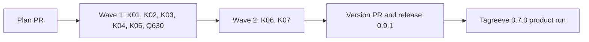

# Plan for 0.9.1

## Status (2026-11-10)

- Written after the 0.9.0 release. Checked against `main` at b778840 (Release 0.9.0, #669) and against GitHub on 2026-11-10. Nothing is built.
- This release is the shakedown that the maintainer's decision D9 asks for: before the Tagreeve product run uses 0.9.0, one real wave on this repo must pass with `pluginRoot` at `v0.9.0`.
- Plan amendment: see "Amendment to plan-0.9.0".

## Summary in plain words

0.9.0 added an evals writer, a verifier, a break check, a ledger and a review loop that runs after the evals. Each part ran in tests and in one live run on the dogfood repo. None of them has built a full wave of real PRs on a real repo. This release does that, on this repo, with the released 0.9.0 as the judge.

The wave rehearses the path that Tagreeve will use: a plan PR, entries with Evals tables, the evals check, one wave, and the ledger. It also runs one quick fix, so the quick path gets the same test. The entries are small corrections that 0.9.0 itself showed are needed. Most of them make the evals, the break check and the ledger report the truth in more cases.

Readers: the maintainer (the shakedown result and the ledger report) and the Claude sessions that run the Tagreeve product run next. Out: new roles, new arguments that change what a wave does, and the work of release 2 (0.10.0). Each entry is one PR. A PR is done when its acceptance test passes in CI, an adversarial review reports no blockers or majors, and it is squash-merged.

## Goals this release serves

- Quality (goal 2): K01 closes the one path where code lands that no eval checked (a bot answer or a land fix after sign-off). K02 and K07 make the ledger count what the evals proved and what they missed.
- My attention (goal 3): K03, K05 and K06 make a stop give the true cause, so the main session looks at the right thing first. K05 also removes a false "not ready" that needed a check by hand.
- Self-improvement (goal 1): every entry comes from a finding of a 0.9.0 run or review. The shakedown itself produces the evaluation items for the Tagreeve run.
- Cost (goal 4): the shakedown gives the first ledger numbers for a full wave on 0.9.0 (Comparison).
- Works on all my repos (goal 6): the shakedown is the gate for the Tagreeve run.
- Small enough to understand (goal 8): this release adds no role and no concept. All 8 entries correct the pipeline's own output (Goal 8 share).
- Non-goals it comes close to: none. No entry changes CI, the review bots or the tools the pipeline runs on.

## Findings

Each claim was checked on 2026-11-10 against `main` at b778840.

| Finding | Issue | What is wrong |
| --- | --- | --- |
| The bot-answer check and the land-fix check (`checkNewCode`) always call the tester, also for a PR with an eval list. | #670 | The head that merges is not the head the evals passed on. Tagreeve had 6 bot rounds in 0.6.2, so this path is common there. |
| `verifyOutcome` keeps only passed, failed and ci ids in the history row. Break-check results go only to the untested list (for `not-run`). `ledger.sh put` copies no break-check data. | #660 | The ledger cannot count evals that were proven to fail without the change. That is a shakedown pass criterion. |
| The stop for a fix that changed nothing reads `no progress: the fix changed nothing in round <n>, ...` and names no eval. | #653 | In the 0.9.0 live run the cause was an eval that no code could satisfy. The main session looked at the code first. |
| In `reviewLoop`, a passing rerun on another head (or with a missing `headSha`) stops with the "fix changed nothing" reason, and a failing rerun on another head stops with `checks failed twice`. | #624 | The maintainer gets a wrong cause. The issue quotes the old text `rounds exhausted: the fix changed nothing`; on `main` the text is now `no progress: the fix changed nothing in round <n>, ...`. The fault is the same. |
| `ledger.sh put` writes a bot eval miss only when `ready` is true. A PR can end not ready after a bot changed its code (red CI at the end, land refusal, end facts fail). The bot-check failure exit of `runPRSteps` drops `codeChangedByBots` from the result. The evaluator prompt and `agents/evaluator.md` also say "a ready PR". | #631 | The "Eval misses" line counts fewer PRs than the "Defects" line, and a resume loses the miss for good. The issue says `ledger.sh` is the only place of the rule, but the evaluator text states the same "ready" rule. |
| `wait-ci.sh` counts every completed conclusion except success, neutral and skipped as failed. `land-wave.sh` counts only failure, timed_out and action_required. | #607 | A cancelled or stale check gives "CI failed on the head" while the land script sees the same head as not red. |
| `wait-ci.sh` exits 3 on the first unreadable GitHub reply, and `endFacts` reports `final facts: cannot read the CI state` with no retry. | #668 | One server error page made a passing PR not ready (#667). The retry of #540 is for agents that die, not for script replies. |
| A pipeline-io call whose script prints more than the tool's inline limit returns the tool's "output too large" notice, not the io.sh lines. `readIo` then reports `pipeline-io: no exit line`. | #614 | The land-fix check of #611 stopped with no tester or reviewer. Any large io output (a merge diff, a long list) fails the same way. |
| Two sim cases of E01 and E03a pass even when the rule they name is removed. | #630 | A regression in the open prompt's eval results, or in which writer list reaches the verifier, would pass CI. |

## Scope

In:

| Group | Entries | Issues | Size |
| --- | --- | --- | --- |
| Evals after a late code change | K01 | #670 | M |
| Break-check results in the record | K02 | #660 | S |
| A no-progress stop that names the eval | K03 | #653 | S |
| Large io output | K04 | #614 | M |
| End-of-run CI read | K05 | #607, #668 | S |
| Sim cases that can fail (quick fix) | Q630 | #630 | S |
| The rerun stop when the head moved | K06 | #624 | S |
| Bot eval misses on PRs that end not ready | K07 | #631 | S |

Not in: see Out of scope.

### Goal 8 share

Goal 8 asks that work on the pipeline's own output is a limited share of each release. Count:

- Entries: **8 of 8** correct the pipeline's own output. There is no new capability.
- Issues the entries close: **9 of 9** are fixes of pipeline output.

This is right for a shakedown. Its job is to show that 0.9.0 can judge a wave of real PRs, and a fault it finds must be easy to see. A small correction has a clear right answer, so the evals, the verifier and the break check are tested on work where a wrong verdict is plain. New capability would mix two questions: is the new code right, and is the judge right. The corrections also come from 0.9.0's own runs, so each one makes the next run's numbers more true. The share goes back down in 0.10.0, which is new capability (release 2).

## Order and waves

Summary: six entries in wave 1, the shakedown wave of D9; two entries in wave 2 that edit the same part as a wave 1 entry; then the release and the Tagreeve run.

8 entries do not fit one wave under the AGENTS.md rule (#427). Two pairs edit the same part:

- K03 (#653) and K06 (#624) both change the stop in `reviewLoop` for a fix that changed nothing. It is one block of about 20 lines: K03 changes the reason that block builds, and K06 changes the rerun branches that use that reason. K06 goes to wave 2 and builds on K03's reason.
- K02 (#660) and K07 (#631) both change the record that `ledger.sh put` builds (one jq expression: K02 the `evals` field, K07 the `evalMisses` field). K07 also depends on K01, because a failing eval on a bot head (new in K01) leaves through the bot-check exit of `runPRSteps`, which K07 changes. K07 goes to wave 2.

The other wave 1 entries edit different parts of `workflows/run-wave.js`: K01 `checkNewCode`, K02 `verifyOutcome`, `historyRow` and `evalsOut` in `runPRSteps`, K03 the "fix changed nothing" stop in `reviewLoop`, K04 `readIo`, `ioCall` and `landFixCheck`, K05 `endFacts`. Q630 changes no file outside `test/sim-pipeline.mjs`.

`skills/pr-pipeline/SKILL.md` has one line per step of "The loop for one PR", so two edits of one step paragraph always conflict. Each Touches line names the paragraph or row its docs step may edit, and no two entries of a wave share one. K01 owns step 10 and step 11. K04 and K05 keep their docs out of step 11: what step 11 says about them stays true.

Land conflicts go through the land fix, one PR at a time (AGENTS.md).

## Shakedown

### Pass criteria (D9)

Written before the build. For every PR of the wave, the shakedown passes only when all of these hold:

1. **A list before the build.** The evals writer wrote the eval list on the default branch before the implementer ran (the `evals:` call comes before the `impl:` call in the journal). For Q630 the triager's brief comes first, then the writer.
2. **A result for every eval id.** The PR body has a row for each eval id of the accepted list, each with `pass`, `fail` or `ci`, and no row says `not checked`.
3. **A break check that ran.** At least one eval of kind `behaviour` or `error path` has `fails-without-change`, or the PR body has the tests-only line. Q630 is expected to have the tests-only line.
4. **A ledger record.** `ledger.sh alfhen/agent-pr-pipeline put` wrote one record for the PR on the ledger issue #651, with tokens by role (`tokens.comparable: true`, so a local run).
5. **No fault fixed by hand.** No pipeline fault needed a fix by hand to finish the PR. A process fix by hand is recorded with `ledger.sh hand <pr> process`, and it fails this criterion.

A stop for a person is not by itself a fault: a `needs human:` stop with a true reason is the pipeline working. A wrong reason, a missing record, a step that did not run, or a result the main session had to correct is a fault.

A fault found is filed as an issue, fixed through the pipeline and released before Tagreeve starts. When the fix is small and wave 2 has not started, it goes into wave 2. Otherwise it is a 0.9.2 quick fix.

Wave 1 is the D9 wave. Wave 2 runs on the same `pluginRoot` and is judged by the same criteria; a fault there also blocks the Tagreeve start.

### How the shakedown runs

- Both waves run from a local session (tokens by role exist only there), with `pluginRoot` at the installed v0.9.0, never at `main`. A fix merged in wave 1 must not judge wave 2.
- `evals` is on, `breakCheck` is on, `docsUpdate` is on. The plan PR gets the product review and the architecture review.
- Q630 runs as `quick: { issue: 630 }` in wave 1. The writer of a quick fix reads the issue, not this plan, so before the wave the main session posts Q630's Evals table as a comment on #630 from the maintainer's account. Comments by that account count as part of the issue.
- Every path these entries touch is gated (`.github/pipeline.json`), so the maintainer merges every PR. No agent merge is expected, and `merge-safety` does not run.
- After each wave: `token-report.sh --json`, then `ledger.sh put` for the run (SKILL.md Step 4). After wave 2: `ledger.sh report --since v0.9.0`.
- The builder session reports to the assessment session when this plan PR opens, at the end of each wave, when a PR stops for the second time, and when the release is cut.

### Comparison

Reported in plain words from `ledger.sh report` and `token-report.sh`, beside two earlier waves. One wave against one wave points a direction and proves nothing.

| Wave | PRs | Subagent tokens without cache reads | Wall time | Rounds | Stops |
| --- | --- | --- | --- | --- | --- |
| 0.8.4, 2026-11-09 | 3 | 2.71M in all (about 0.9M per PR) | 62 minutes | 3, 6, 3 | not counted |
| 0.9.0 wave 1 | 3 | 1.84M per PR | not compared | not compared | every entry stopped once |
| 0.9.1 wave 1 | 6 | from the ledger | from transcripts | from the ledger | from the ledger |

What we hope to see, not a pass criterion:

- Tokens without cache reads per PR below the 0.9.0 wave 1 figure of 1.84M, because these entries are smaller.
- Fewer than half of the PRs stop for a person (0.9.0 wave 1: all of them).
- No PR with 4 or more rounds.

## Amendment to plan-0.9.0

`docs/plan-0.9.0.md`, section "Product run", says that Tagreeve 0.7.0 build waves start on the `v0.9.0` tag. The maintainer's decision D9 moved that start: the Tagreeve waves start only after this shakedown passes. This plan does not edit `docs/plan-0.9.0.md`; it stays as a record. The rest of the product run (local waves, the baseline, the success measures) is unchanged. The tag the Tagreeve run starts on is in Flagged concerns.

## Rules for every PR

- Read `AGENTS.md` and `docs/goals.md`.
- Each PR adds tests that fail when the change is removed. The PR description says how that was checked.
- Each negative test checks that its input really contains what the check looks for.
- An entry with an **Invariants** line: the reviewer checks each invariant in every round, and the tests cover each one.
- Each acceptance run is `node test/sim-pipeline.mjs`, `node --test test/*.test.mjs` and `bash scripts/check-syntax.sh` in full.
- Every eval can be checked from a clean clone of the branch: no PR body, labels, bot comments, CI results or merges (#652).
- Simulation tests check only what code decides. What an agent judges is checked by its prompt text or by a code step after it.
- New tests go in new files. Named exceptions: `test/sim-pipeline.mjs`, where each entry adds its cases as one block after the anchor case its Touches line names; Q630 changes two existing cases in place; K06 changes the reason in the existing case "#602: a rerun on a different head does not sign off"; K07 changes the existing E06-1 case in `test/ledger.test.mjs` and one assertion in `test/evaluator-ledger.test.mjs`.
- `workflows/run-wave.js` stays plain JavaScript with no filesystem, no `Date.now`, no `Math.random`.
- No entry adds a role, a step or a run-wave argument.
- Every entry runs with `docsUpdate` on. This repo has no `CHANGELOG.md`, so the template's marker rule does not apply.
- Docs: Simplified Technical English, no em dashes, Mermaid with a one-line summary under each. Code comments only for why.

## PRs

### Wave 1

**K01 The evals run again after a bot answer or a land fix changes code (#670).** Round cap 3. Touches: `workflows/run-wave.js` (`checkNewCode` only), `test/sim-pipeline.mjs` (cases after "a bot answer in words only needs no check"), `skills/pr-pipeline/SKILL.md` ("The loop for one PR", step 10 and step 11).
- When a bot answer changes code on a PR that has an eval list, every eval is checked again on the new head before the PR can be ready.
- The same holds for the code a land fix adds (the land-fix check runs when `land-commits.sh` prints something).
- An eval that fails on the new head makes the PR not ready, with a reason that names the eval id. It goes through the same fix rounds as a bot-check finding, with the same cap (`botCheckRounds`).
- The diff reviewer of the bot-answer check and of the land-fix check still runs.
- A PR with no eval list keeps today's tester check.
- Out of this entry: the docs check and the minor pass keep the tester.

Invariants: a PR with an eval list is never ready on a head that the bot answer or the land fixer changed unless every eval id has a result on that head with no `fail`.
Evals:

| Id | Kind | What must be true | How to check |
| --- | --- | --- | --- |
| K01-1 | behaviour | On a PR with an eval list, a bot answer that changed code gets a verifier call on the new head, and no tester call for that check round. | Sim: a PR with `evals` and a bot answer with `codeChanged: true`; the calls hold a verifier call for the bot-check round and no `test:` call for it. |
| K01-2 | behaviour | On a land fix with output, a PR with an eval list gets a verifier call on the new head. | Sim: `landFix: true` with an eval list and non-empty `land-commits.sh` output; a verifier call runs for the land-check round. |
| K01-3 | error path | An eval that fails on the bot head makes the PR not ready, with a reason that names the eval id, after the fix rounds of the bot check. | Sim: the verifier fails eval `C1-1` in every bot-check round; the result has `ready: false`, a `fix:` call between the rounds, and a reason that holds `C1-1`. |
| K01-4 | behaviour | When every eval passes on the bot head and the reviewer finds nothing, the PR is ready, and the bot-check history row has the eval results. | Sim: verifier passes all ids in the bot round; `ready: true`, and the bot row has `evals.passed` with every id. |
| K01-5 | regression | A PR with no eval list keeps the tester in the bot-answer check and the land-fix check. | The existing cases "a bot answer that changed code is tested and reviewed on its diff before it can land" and "land fix: output from land-commits.sh starts a tester and a diff reviewer before the bot wait" pass unchanged. |

Acceptance: `node test/sim-pipeline.mjs` passes; K01-1 and K01-3 fail on `main` because `checkNewCode` always calls the tester.

**K02 Break-check results in the result and the ledger record (#660).** Round cap 3. Touches: `workflows/run-wave.js` (`verifyOutcome`, `historyRow`, and `evalsOut` in `runPRSteps`), `scripts/ledger.sh` (`put`: the `evals` field of the record only), `test/sim-pipeline.mjs` (cases after "F659: an unreadable or empty changed-file list keeps the break check"), `test/ledger-break-check.test.mjs` (new), `skills/pr-pipeline/SKILL.md` ("The loop for one PR", step 2; the result paragraph of "Workflow arguments"; the `ledger.sh` line of "Files").
- A verifier round that gave break-check results puts them in its history row, by eval id, grouped by the four results. The issue fixes the shape: `breakCheck: { fails, passes, notRun, notApplicable }`.
- The PR result carries the break-check results of the last verifier round that gave them, in every exit after the review loop (ready or not).
- `ledger.sh put` copies them into the record's `evals`.
- A round with no break check (the tester path, `breakCheck: false`, a round with a failed eval) adds no break-check data, and an older output file with none still gives a record.

Evals:

| Id | Kind | What must be true | How to check |
| --- | --- | --- | --- |
| K02-1 | behaviour | A verifier answer with break-check results gives a history row that holds each id under its result. | Sim: answers with one `fails-without-change`, one `not-run` and one `not-applicable`; the row lists each id once, under its own result. |
| K02-2 | behaviour | The PR result holds the same break-check results, also when the PR ends not ready after sign-off. | Sim: the same answers and a bot status that fails; the result has `ready: false` and the break-check results. |
| K02-3 | behaviour | `ledger.sh put` copies the break-check results into the record's `evals`. | `test/ledger-break-check.test.mjs`: `put --dry-run` on an output file with break-check results; the record holds each id under its result. |
| K02-4 | error path | An output file with no break-check data gives a record with none, and `put` exits 0. | The same test file: an output file from the tester path; exit 0 and no break-check ids in the record. |
| K02-5 | regression | With `breakCheck: false`, history rows and results have no break-check data. | Sim: the E03b-5 setup; no row and no result has break-check data. |

Acceptance: `node --test test/ledger-break-check.test.mjs` and `node test/sim-pipeline.mjs` pass; K02-1 and K02-3 fail on `main` because the row has only passed, failed and ci, and `put` copies only those.

**K03 The no-progress stop names the failing eval (#653).** Round cap 3. Touches: `workflows/run-wave.js` (`reviewLoop`: the reason of the stop for a fix that changed nothing, before the rerun), `test/sim-pipeline.mjs` (cases after "E04-5b: a fixed eval is progress, and the same failed evals in rounds 1 to 3 stop the PR"), `test/ledger-no-progress.test.mjs` (new), `skills/pr-pipeline/SKILL.md` ("When things go wrong": the `no progress` row only).
- When evals failed in the round and the fix changed nothing (and raised no dispute that changed the list), the stop reason names each failed eval id and says it may not be checkable from a clean clone.
- The reason names only evals that failed in that round.
- The reason still starts with `no progress:`, so `ledger.sh report` still counts the stop as a maintainer touch.
- A round where only fast checks failed keeps today's reason and the rerun of #602.

Evals:

| Id | Kind | What must be true | How to check |
| --- | --- | --- | --- |
| K03-1 | behaviour | A failed eval with a fix that changed nothing and no dispute stops the PR with a reason that names the eval id and holds the word `checkable`. | Sim: the verifier fails `C1-2`, the fix returns `changed: false`; the reason starts with `no progress:` and holds `C1-2` and `checkable`. |
| K03-2 | behaviour | Only the evals that failed in that round are named. | Sim: `C1-1` passes and `C1-2` fails; the reason holds `C1-2` and not `C1-1`. |
| K03-3 | regression | A failing fast check with no failed eval in the same state keeps today's reason and the rerun. | The existing #602 cases pass unchanged. |
| K03-4 | behaviour | `ledger.sh report` counts the new reason as a maintainer touch. | `test/ledger-no-progress.test.mjs` (new) with `test/fake-gh`: one record whose reason is the K03-1 reason; touches is 1. |

Acceptance: `node test/sim-pipeline.mjs` passes; K03-1 fails on `main` because the reason names no eval.

**K04 Large script output does not break pipeline-io (#614).** Round cap 3. Touches: `scripts/io.sh`, `agents/pipeline-io.md`, `workflows/run-wave.js` (`readIo`, `ioCall`, and `landFixCheck` with `landReviewPrompt` only if the land-fix output arrives by a file), `test/io-large.test.mjs` (new), `test/sim-pipeline.mjs` (cases after "pipeline-io calls outside the brief read the exit line too"), `skills/pr-pipeline/SKILL.md` ("Role agents": the `io.sh` paragraph; "When things go wrong": one row for the new reason).
- An io call whose script prints more than a set limit still gives the workflow the exit code from io.sh's exit line.
- The step that needs the full output gets it: the land-fix check runs with the whole `land-commits.sh` output.
- Output at or under the limit comes back inline, as today.
- When an io answer has no exit line and holds the tool's "output too large" notice, the reason names that cause, not `no exit line`.

Invariants: the exit code comes only from the last exit line that io.sh printed, never from the agent's words; any file written for a large output is inside the wave's temp folder; scripts still run only from `pluginRoot`.
Evals:

| Id | Kind | What must be true | How to check |
| --- | --- | --- | --- |
| K04-1 | size limit | Output one byte over the limit takes the large-output path, and output at the limit comes back inline. | `test/io-large.test.mjs`: stub scripts that print exactly the limit and one byte more; check both forms. |
| K04-2 | behaviour | For output over the limit, io.sh prints the begin line and the exit line with the script's exit code, and the full output can be read back byte for byte. | The same test file: a stub that prints 100 KB and exits 3; the exit line says 3, and the full text read back equals the stub's output. |
| K04-3 | behaviour | A land-fix check whose `land-commits.sh` output is over the limit still runs the tester (or verifier) and the land reviewer, and the reviewer gets the full output. | Sim: the io answer for `landcommits1` in the large form; a `landreview:` call runs and its prompt gives the full output or the path to it. |
| K04-4 | error path | An io answer with no exit line that holds the "too large to return inline" notice gives a reason that says the output was too large. | Sim: that answer for an io call; the reason holds `too large` and not `no exit line`. |
| K04-5 | regression | Small outputs and the existing io cases do not change. | `node --test test/io.test.mjs` and the existing pipeline-io sim cases pass unchanged. |

Acceptance: `node --test test/io-large.test.mjs` and `node test/sim-pipeline.mjs` pass; K04-2 and K04-3 fail on `main` because io.sh prints the whole output inline.
QA: run `bash scripts/io.sh` with a stub script in a temp copy of `scripts/` that prints 100 KB, from a Claude Code Bash call, and check that the answer has the exit line. Then a stub that prints 10 bytes.

**K05 The end-of-run CI read: the same failed set as the land script, and a retry (#607, #668).** Round cap 3. Touches: `scripts/wait-ci.sh`, `workflows/run-wave.js` (`endFacts` only), `test/wait-ci-end.test.mjs` (new), `test/sim-pipeline.mjs` (cases after "end facts: the bots, the CI state and the call come from the script"), `skills/pr-pipeline/SKILL.md` ("When things go wrong": the `final facts` row only).
- A check run counts as failed in the end CI state only for the conclusions that `land-wave.sh` counts: failure, timed_out and action_required. A cancelled or stale check does not make the state `failure`. Statuses with failure or error still do.
- The end read of the CI state tries again a few times, with a short wait, when a GitHub reply is not JSON or a request fails. Only after the last try does the PR get `final facts: cannot read the CI state`, and the reason then says how many tries ran.
- `wait-ci.sh` is also the land fixer's wait. Its use there must not get worse: a retry adds only a short, fixed wait.
- `land-wave.sh` does not change.

Invariants: a check run with conclusion failure, timed_out or action_required, or a status with failure or error, always gives the state `failure`.
Evals:

| Id | Kind | What must be true | How to check |
| --- | --- | --- | --- |
| K05-1 | behaviour | A head whose only bad check run is cancelled, and one whose only bad check run is stale, give the state `success` when all else passed. | `test/wait-ci-end.test.mjs` with `test/fake-gh`: two fixtures; `state` is `success` and `failed` is empty. |
| K05-2 | regression | failure, timed_out and action_required still give `failure` and name the check. | The same file: one fixture for each. |
| K05-3 | behaviour | One reply that is not JSON, then a good reply, gives the CI state of the good reply. | The same file: a fake gh that returns an HTML page on the first call and good JSON after; the script prints the good state and exits 0. Sim: the end read gives `ready: true`. |
| K05-4 | error path | When every reply is bad, the PR is not ready with `final facts: cannot read the CI state`, and the reason names the number of tries. | Sim or script test: every reply bad; the reason holds the try count. |
| K05-5 | time bound | The retries end after a fixed number of tries and do not wait for CI to finish. | The K05-4 test ends with the wait between polls set to 0 by its environment, and the fake gh call log shows the fixed number of tries. |

Acceptance: `node --test test/wait-ci-end.test.mjs` and `node test/sim-pipeline.mjs` pass; K05-1 fails on `main` because `wait-ci.sh` counts cancelled as failed, and K05-3 fails because it exits 3 on the first bad reply.

**Q630 Two sim cases that can fail for their rule (#630).** Quick fix: `quick: { issue: 630 }`, expected `quick: S/low`, so the cap is 2 rounds (`quick S/low`) and there is no architecture review. It runs as a quick fix on purpose, so the shakedown tests the quick path (triage, product check of the entry, quick brief, writer from the brief) beside the plan path. Touches: `test/sim-pipeline.mjs` (the cases "E01-1 the open prompt gives the last result of each eval from the history rows and the verifier" and "E01-1 + E03a: the writer list that E01 accepted reaches the verifier, and a PR with no list goes to the tester", in place).
- The open-prompt case has a history where the last row with evals leaves out one eval id. The open prompt then shows that id's result from an earlier row.
- The case also shows `not checked` for an id with no result in any row, or the PR says in its body why `not checked` can no longer be reached.
- The writer-list case has a first evals check that returns needs-change and a writer that returns a different list on attempt 2. The verifier prompt holds the attempt-2 ids and no id that only the first draft had.
- The PR changes only test files, so the verifier gives the tests-only result and the PR body has the tests-only line.

The main session posts this table on #630 before the wave (How the shakedown runs).
Evals:

| Id | Kind | What must be true | How to check |
| --- | --- | --- | --- |
| Q630-1 | regression | An eval id missing from the last history row keeps its result from an earlier row in the open prompt. | `node test/sim-pipeline.mjs` passes. Then, in the clone only, change the open prompt's lookup to read only the newest row: the case fails. Restore the clone. |
| Q630-2 | regression | The list that reaches the verifier is the accepted attempt-2 list, not the first draft. | `node test/sim-pipeline.mjs` passes. Then, in the clone only, make the writer step keep the first list: the case fails. Restore the clone. |
| Q630-3 | regression | A fresh run with no result for an id shows `not checked` for it, or the case says why that text can no longer appear. | Read the changed case: it asserts `not checked`, or a comment names the reason it cannot be reached. |

Acceptance: `node test/sim-pipeline.mjs` passes, and each changed case fails on `main` code with its rule removed, as in Q630-1 and Q630-2.

### Wave 2

**K06 The rerun stop gives the true cause when the head moved (#624).** Round cap 3. Touches: `workflows/run-wave.js` (`reviewLoop`: the rerun branches after the stop for a fix that changed nothing), `scripts/ledger.sh` (`report`: the maintainer-touch rule, only if the new reason needs it), `test/sim-pipeline.mjs` (the existing case "#602: a rerun on a different head does not sign off", and new cases after "#602: the rule holds on the verifier path, with the label verify:<id>#<n>r"), `test/ledger-rerun-stop.test.mjs` (new), `skills/pr-pipeline/SKILL.md` ("The loop for one PR", step 2: its last sentence; "When things go wrong": one row).
- When the rerun's head is not the head of the round before, the PR stops with a reason that says the head moved and names both heads. This holds whether the rerun passed or failed.
- When either call reported no `headSha`, the reason says the head is unknown.
- `checks failed twice: <names>` is used only when both runs failed on the same head.
- A passing rerun on the same head keeps today's path.
- `ledger.sh report` counts the new stop as a maintainer touch.

Evals:

| Id | Kind | What must be true | How to check |
| --- | --- | --- | --- |
| K06-1 | behaviour | A passing rerun on another head stops with a reason that says the head moved and names both shas, and not "the fix changed nothing". | Sim: the "#602: a rerun on a different head" setup; the reason holds `sha-C1` and `sha-new`. |
| K06-2 | behaviour | A failing rerun on another head stops with the head-moved reason, not `checks failed twice`. | Sim: the rerun fails on `sha-new`. |
| K06-3 | error path | A rerun where either call has no `headSha` stops with a reason that says the head is unknown. | Sim: two cases, one for each call without `headSha`. |
| K06-4 | regression | Two failures on the same head still stop with `checks failed twice: <names>`, and a pass on the same head still signs off. | The other existing #602 cases pass unchanged. |
| K06-5 | behaviour | `ledger.sh report` counts a record with the new reason as one maintainer touch. | `test/ledger-rerun-stop.test.mjs` with `test/fake-gh`: one record with that reason; touches is 1. |

Acceptance: `node test/sim-pipeline.mjs` passes; K06-1 and K06-2 fail on `main` because `reviewLoop` does not check the head before it picks the reason.

**K07 A bot code change is an eval miss also when the PR ends not ready (#631).** Round cap 3. Touches: `scripts/ledger.sh` (`put`: the `evalMisses` field and the header comment on the rule), `workflows/run-wave.js` (`runPRSteps`: the not-ready exits after the bot answer, so they keep `codeChangedByBots`; `evaluatePrompt`: the eval-miss sentence), `agents/evaluator.md` (the eval-miss sentence), `test/ledger.test.mjs` (the E06-1 case), `test/evaluator-ledger.test.mjs` (the eval-miss assertion), `test/ledger-bot-miss.test.mjs` (new), `test/sim-pipeline.mjs` (cases after "a finding in the bot answer check gets a fix round and a second check"), `skills/pr-pipeline/SKILL.md` (the `ledger.sh` line of "Files" only).
- A PR whose bot answer changed code after sign-off gets one bot eval miss in its record, whether it ends ready or not: red CI at the end, a land refusal, end facts that fail, or a bot check that fails.
- So every result exit after a bot answer that changed code says so, including the exit when the bot check fails.
- A PR whose bot answer changed no code gets no bot miss. A second `put` for the same run and PR writes nothing, as today.
- The evaluator prompt, `agents/evaluator.md` and `ledger.sh` state the same rule.
- After this, the "Eval misses" line of `report` counts every PR that the "Defects" line counts for a bot code change.

Evals:

| Id | Kind | What must be true | How to check |
| --- | --- | --- | --- |
| K07-1 | behaviour | `put` writes a bot eval miss for a PR with `codeChangedByBots: true` and `ready: false`. | `test/ledger-bot-miss.test.mjs`: `put --dry-run` on such an output file; `evalMisses` is `[{ source: "bot" }]`. |
| K07-2 | behaviour | A PR whose bot check fails after a bot answer that changed code has `codeChangedByBots: true` in its result. | Sim: bot answer `codeChanged: true` and a bot-check review with a blocker in every round; the result has `ready: false` and `codeChangedByBots: true`. |
| K07-3 | regression | `codeChangedByBots: false` gives no bot miss, and an existing bot miss is not added twice. | The changed E06-1 case in `test/ledger.test.mjs`. |
| K07-4 | behaviour | `report` gives the same count for eval misses and for defects when every defect is a bot code change. | `test/ledger-bot-miss.test.mjs` with `test/fake-gh`: one ready and one not-ready record, both with a bot code change; both lines count 2. |
| K07-5 | behaviour | The evaluator prompt and `agents/evaluator.md` no longer limit the eval miss to a ready PR. | `test/evaluator-ledger.test.mjs`: the eval-miss text is the same in both, and neither says "A ready PR". |

Acceptance: `node --test test/ledger-bot-miss.test.mjs test/ledger.test.mjs test/evaluator-ledger.test.mjs` and `node test/sim-pipeline.mjs` pass; K07-1 fails on `main` because `put` needs `ready == true`, and K07-2 fails because the bot-check exit drops `codeChangedByBots`.

## Date estimate

- Size: 8 PRs plus this plan PR and the version PR. About 9 to 15 million subagent tokens without cache reads (a planning figure).
- Basis: the 0.8.4 wave (3 PRs, 2.71M, 62 minutes) and 0.9.0 wave 1 (1.84M per PR). These entries are smaller than the 0.9.0 entries, so about 1M to 1.8M per PR, plus about 1M for the plan PR and 1 to 3 land-conflict repairs.
- Dates: plan PR reviewed and merged on 2026-11-10 or 2026-11-11; wave 1 on 2026-11-11; wave 2 and the version PR on 2026-11-11 or 2026-11-12. **Range: 2026-11-11 to 2026-11-13.** The Tagreeve run can start the next working day.
- It assumes: the maintainer merges each PR within about 4 hours of the working day (every PR here is gated, so 10 merges); at most one stop for a decision; the shakedown finds no fault. A fault adds a fix and a 0.9.2, about half a day to one day.

## Flagged concerns

- **Which tag the Tagreeve run starts on.** Default: `v0.9.1`. It holds K01, which Tagreeve needs most (bot rounds are common there), and any fault fix. The other choice is `v0.9.0` right after wave 1 passes, which starts Tagreeve about half a day earlier but without K01. The maintainer can change the default without a new plan.
- **The judge and the judged.** The shakedown judges 0.9.0 with PRs that change 0.9.0. Both waves keep `pluginRoot` at the installed v0.9.0, and every PR is gated, so the maintainer merges each one. A fix cannot judge itself.
- **Small entries flatter the numbers.** Tokens per PR will likely be lower than in 0.9.0 because the entries are small. The comparison says so; it is not evidence that 0.9.0 got cheaper.
- **Q630 depends on the triager.** If the triager does not return `build` with S and low risk, Q630 gets the full loop or stops with `plan`. Either one is a true result of the quick path and not a fault. If it stops, the main session runs it as a plan entry in wave 2.
- **K04 is the largest entry.** It changes how every io call returns its output. If it reaches its cap, it moves to 0.9.2, and the shakedown stays valid with the other PRs.
- **No entry dropped.** #607 alone changes only the report (the land value is kept), but it is the same end-of-run read as #668, so they are one entry.

## Out of scope

| What | Why |
| --- | --- |
| R05 Delete the local routine | Waits on its precondition (release 2, 0.10.0). |
| The remaining open `review-minor` issues | Fixed in batches between waves, grouped by file. No entry here takes a batch. |
| #613 `minorScope` comment and `--scope` test | Batch fix. No entry here edits `minorScope` or `gate-files.sh`. |
| The docs check and the minor pass with the verifier | K01 covers only code from a bot answer or a land fix. |
| M01 to M03, R01 to R04 | Release 2 (0.10.0). |
| D01 to D05, S01 to S05 | Release 3. |
| Any change in `alfhen/tagreeve` | Its maintainer's PRs (plan-0.9.0, "Product run"). |
| The 0.9.1 release | The version PR and `scripts/release.sh`, run by the main session after wave 2. |
