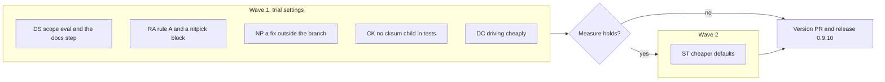

# Plan for 0.9.10: fewer tokens, and four faults of plan 0.9.9

## Status (2026-11-17)

- Release 0.9.9 is out. Plan 0.9.9 cost $5.40 at list prices for each PR item (271 agents, 10 items), with 1.2 review rounds and one outside review for each PR. This is the baseline of this plan.
- The maintainer approved a trial of cheaper step settings on 2026-11-16 (decision D24 of the driving log). Wave 1 of this plan runs with them as wave arguments and measures them. Entry ST makes them the defaults only when the measure holds (choice 1).
- Written from one impact pass on the tag v0.9.9 (82af67d). Each Touches line names functions, sections and case titles, because line numbers move.
- The entries hold what must be true as numbered statements. The evals writer builds its list from them, with one coverage item for each statement.
- The waves run with `pluginRoot` at the installed v0.9.9.

## Summary in plain words

Most of the cost of a wave is Opus agents that each read the same big files again, and the main session that drives the wave. This plan cuts both, in small steps that can be measured.

Wave 1 runs with cheaper models for four steps: the review on Opus at medium effort, the writer of the checks on Sonnet, the test run and the opening of the PR on Haiku. The architecture review stays on Opus at high effort. The wave also skips the docs step for an entry whose Touches line already names its docs. The ledger then shows the cost of each role, the rounds and the findings of the outside review, next to plan 0.9.9.

Wave 1 also fixes four faults that cost rounds or stopped PRs in plan 0.9.9: a scope check that fails after a correct docs change (#831), a review with only a small note in its body that the script cannot clear (#829), a fix that is an action outside the code and counts as no progress (#832), and a test run that can hang on macOS (#833). One entry adds a short section to the skill on how to drive a wave cheaply.

Wave 2 makes the cheaper settings the defaults, but only if wave 1 shows that they save at least 15% and cost no extra rounds. It also puts the check of the minor pass on Sonnet and lets a wave skip the bot wait.

What you do: merge this plan. After wave 1 the driving session tells you the numbers and whether wave 2 runs.

## Choices for the maintainer

Merging this plan accepts the pick of each line. Say so before the merge to change one.

| # | Choice | Pick | Why |
| --- | --- | --- | --- |
| 1 | When the cheaper step settings become the defaults (entry ST). | Only when wave 1 costs at least 15% less for each PR item than $5.40, has at most 1.5 review rounds for each item, and no PR needs more than two outside reviews. If one of the three fails, ST is not built, and the driving session tells you the numbers. | A default that costs extra rounds saves nothing. The three numbers come from the ledger, so no person has to judge them. |
| 2 | The scout step (your "discovery" idea): one cheap agent reads the code once for each PR and writes a digest for the Opus agents. | Not in this plan. It gets its own plan after 0.9.10, measured against the new defaults. | It edits the same parts as ST and NP (the step table, the role table, the review prompt), so it needs a third wave. It is also a new role, and its saving (maybe 10 to 20%) is unknown. One change at a time keeps the numbers readable. |
| 3 | How a wave skips the bot wait when the bot reviews only on request. | `botWaitMinutes: 0` skips it (entry ST). Today 0 means 20 minutes. | No new argument. Nobody sets 0 to mean 20. |
| 4 | A fixer settles a finding with an action outside the branch, for example a new issue or a comment (entry NP). | The fixer gives the proof (issue number or comment link). The round does not stop for no progress, and the reviewer of the next round checks the proof. If the reviewer raises the same finding again, the rules of today apply. | It ends a stop for a PR that was ready, and a person or the next reviewer can check each proof. |
| 5 | Issue #833 (a test run that hangs in `cksum` on macOS). | The tests compute the sum in JavaScript and start no `cksum` child with input. The entry closes #833 without a proof of the cause. | The suspect is the child process. With no child, the hang cannot happen in the tests. Scripts still use `cksum` and are not changed. |

## Decisions

- **The trial settings are wave arguments in wave 1:** `"steps": {"review": {"model": "opus", "effort": "medium"}, "evals": {"model": "sonnet", "effort": "high"}, "test": {"model": "haiku", "effort": "low"}, "open": {"model": "haiku", "effort": "low"}}`. The architecture review stays at the default, Opus high.
- **`docsUpdate: false` for an entry whose Touches line names its docs.** In this plan that is every entry. The docs reviewer still runs for no entry of this plan.
- **The plan review runs with the trial settings and `maxRounds` 2.**

## Rules for every PR

- What must be true is the numbered list of the entry. A statement marked (doc) is proved by a test that reads the text. A statement marked "(holds today; kind `regression`)" passes with and without the change, and its eval has the kind `regression`.
- No entry has an Invariants line. The round cap of every entry is the default.
- A test of a statement that says that nothing happens is built from the case where it does happen, with one change. The same test file holds that positive case. The negative test also asserts the printed line or the exit code that names its cause.
- A PR edits only the parts its Touches line names.
- No eval statement holds the trigger words of the PR-text rule: "PR body", "PR title", "PR description", "pull request body", "pull request title", "pull request description", "Closes line", or a closing keyword with "#" and a number.
- Each closing line is on its own line in the description of the PR.
- `workflows/run-wave.js` stays plain JavaScript with no filesystem, no `Date.now` and no `Math.random`.
- Scripts under `scripts/` use `gh api` only, never `gh pr` or `gh issue`, and no command that exists on one of macOS and Linux only. CI runs on Linux.
- In `test/sim-pipeline.mjs` each entry adds its cases as one block directly after its anchor case. A case uses only helpers that are defined before its anchor.
- A list in a Touches line or in build notes of the existing tests that an entry changes names the likely ones. The builder finds the rest by running the tests and lists them in its PR. A test that such a list lacks is a minor, unless it shows that a statement of the entry is wrong.
- Each code PR merges under the maintainer's standing rule: a completed CodeRabbit review of the final head that is clean or minor-only (rule A), and green CI.
- Docs: Simplified Technical English, no em dashes.

## Waves

Summary: five entries in wave 1 with the trial settings, then the measure of choice 1, then ST in wave 2 only if the measure holds, then the version PR.

Why two waves: ST changes the defaults that wave 1 measures, and it edits the section "### Driving cheaply" that DC adds. The five entries of wave 1 edit different functions and files: DS edits `evalsRules`, NP edits `FIX`, `reviewLoop` and `reviewPrompt`, RA edits `scripts/bot-approval.jq`, CK edits test helpers, DC adds one SKILL.md section.

### Wave 1

**DS A scope eval allows the changes of the docs step.** Sim anchor: after "TK-8 evalsVerdict accepts every kind, quality bar included, and refuses an unknown one".
Touches: `workflows/run-wave.js` (`evalsRules`, one new rule), `agents/evals-writer.md` (one new bullet after the bullet on the kind `quality bar`), `test/sim-pipeline.mjs` (one new block).
What must be true:
1. The rule list that the writer prompt and both evals-check prompts hold says that an eval which limits a change to the parts that the Touches line names also allows the files that the docs step can change, as `docsPrompt` names them, when the docs step runs for the PR.
2. The same rule says that such an eval does not fail for a change of the docs step, and names the stop that it prevents: `docs check: rounds exhausted`.
3. `agents/evals-writer.md` says the same in one bullet.
4. An eval that limits the change to the Touches line still fails for a change to a code file that the Touches line does not name. (holds today; kind `regression`)
Build notes: `evalsRules` holds today the rule "The Touches line is a limit: no eval needs a file outside it". Keep it. `docsRuns(pr)` decides whether the docs step runs.
Closes #831

**RA Rule A clears a review whose only findings are in a nitpick block of the body.**
Touches: `scripts/bot-approval.jq` (`parseBody` and the regex `topRe` with its blocks, and the rule A check that prints "has no count line"), `test/clean-review.test.mjs` (new cases), `test/fixtures/clean-review/` (new fixtures).
What must be true:
1. A review of the head with no inline comment, whose body is the known frame plus one block "Nitpick comments: N" with N items, each ranked Minor or Trivial, and no line "Actionable comments posted: N", clears rule A when the head has a `pipeline-bot-answer` comment of the user, on the same terms as a review with answered inline Minors.
2. The same body with no `pipeline-bot-answer` comment for the head is refused, with a line that names the missing answer.
3. A nitpick block whose number of items differs from N is refused.
4. A nitpick block with an item ranked above Minor is refused.
5. A body with any text outside the known frame and the nitpick block is refused. (holds today; kind `regression`)
6. A body with no count line and no nitpick block is refused with the line "has no count line (Actionable comments posted: N)". (holds today; kind `regression`)
Build notes: the case "rule A" near the no-count-line test of `test/clean-review.test.mjs` pins statement 6. The body format of a nitpick block comes from the reviews on #823 and #811; copy it into a fixture.
Closes #829

**NP A fixer can settle a finding with an action outside the branch.** Sim anchor: after "PN-6 a no-line or differing model answer alone refuses no PR".
Touches: `workflows/run-wave.js` (the schema `FIX`, one new field; `reviewLoop`, the branch for `fix.changed === false`; `reviewPrompt`, one sentence), `agents/fixer.md` (one new bullet), `skills/pr-pipeline/SKILL.md` (the row of "When things go wrong" for the stop "no progress: the fix changed nothing"), `test/sim-pipeline.mjs` (one new block).
What must be true:
1. The schema `FIX` has a field `outside`: a list of items, each with the number of a finding, the action, and a proof (an issue number or a link to a comment).
2. When the fix changed nothing and every blocker and major of the round has an `outside` item with a proof that is not empty, the round does not stop with `no progress: the fix changed nothing`, and the next round runs.
3. When one blocker or major of the round has no such item, the stop of today happens.
4. The review prompt of the next round lists each `outside` item and asks the reviewer to check its proof and to report the finding again if the proof does not settle it.
5. A finding settled outside the branch that the reviewer of the next round reports again gives no second skip: the rules of today apply to that round.
6. `agents/fixer.md` says when to use `outside`: only when the finding asks for an action that is not a change of the branch, and only with a proof.
7. (doc) The SKILL.md row for the stop "no progress: the fix changed nothing" names `outside`.
Build notes: the same stop for the resume fix and the minor pass (`drop('the fixer changed nothing')`) is not changed. `test/ledger-no-progress.test.mjs` and `test/review-loop-stops.test.mjs` pin today's stop.
Closes #832

**CK The tests start no `cksum` child process with input.**
Touches: `test/cksum.mjs` (new: one function that gives the POSIX `cksum` line of a text), `test/cksum.test.mjs` (new), `test/land-last-line.test.mjs`, `test/quick-brief.test.mjs`, `test/sim-pipeline.mjs` (the helper `withLandSum` and the two cases that call `execFileSync('cksum', ...)`).
What must be true:
1. The function in `test/cksum.mjs` gives the same line as POSIX `cksum` for fixed texts: the empty text, one line, many lines and a text with bytes above 127. `test/cksum.test.mjs` holds the expected lines as literal values and starts no child process.
2. No file under `test/` calls `spawnSync`, `execFileSync` or `execSync` with the command `cksum` and an input. The call of `cksum` on files in `test/role-files.test.mjs` stays.
3. The tests that compared a sum with `cksum` before still compare the same sum, now from `test/cksum.mjs`, and fail when the sum in the output is wrong.
4. `workflows/run-wave.js` and the scripts are not changed.
Build notes: the workflow has its own copy of the function (`const cksum` in `run-wave.js`), which a workflow script cannot import. Do not share it.
Closes #833

**DC A section in SKILL.md on driving a wave cheaply.**
Touches: `skills/pr-pipeline/SKILL.md` (new section "### Driving cheaply" directly after "### Cost and the prompt cache"), `test/skill-docs.test.mjs` (one new case).
What must be true:
1. (doc) The section says that the main session costs more than the agents, and that its cost is the number of calls times the size of its conversation times the price of its model.
2. (doc) It says to start a fresh main session for each plan, with the state in the plan and a log file.
3. (doc) It says that a wake-up more than one hour after the last call writes the whole conversation to the cache again, and to land the PRs of a wave with as few commands and wake-ups as possible.
4. (doc) It says to give a lookup in a big file to a subagent, and to read big files by line ranges.
5. (doc) It names the `steps` argument with the trial settings of this plan as the example, and `docsUpdate: false` for an entry whose Touches line names its docs.

### Wave 2 (only when the measure of choice 1 holds)

**ST Cheaper defaults, the minor-pass check on Sonnet, and a bot wait that a wave can skip.** Sim anchor: after "AN-11 step 2 of SKILL.md says a name that matches no check is an untested item and no finding".
Touches: `workflows/run-wave.js` (`STEPS`, the entries `review`, `evals`, `test`, `open` and a new entry `minorReview`; `ROLES`, the entry `minorReview`; `BOT_WAIT_MIN`; `bots`, a guard before the bot-wait call), `agents/reviewer.md`, `agents/evals-writer.md`, `agents/tester.md`, `agents/pr-opener.md` (the `model:` and `effort:` lines), `skills/pr-pipeline/SKILL.md` (the `steps` and `botWaitMinutes` items of "### Workflow arguments", the rows of "### Role agents" for these roles, the example of the `steps` argument in "### Driving cheaply"), `test/sim-pipeline.mjs` (one new block; the check "each agent file exists and its defaults match the workflow defaults"; the asserts that pin the old defaults).
What must be true:
1. With no `steps` argument, the review step is Opus at medium effort, the evals step is Sonnet at high effort, the test step and the open step are Haiku at low effort. The arch step stays Opus at high effort. (Each is one statement for the evals.)
2. The check of the minor pass (`minorreview:<id>`) uses the new step `minorReview`, Sonnet at high effort, also for a code PR. A `steps` argument for `minorReview` overrides it.
3. The review of a code PR in the review loop still uses the step `review`, and the review of a docs or plan PR still uses `reviewDocs`. (holds today; kind `regression`)
4. The `model:` and `effort:` lines of the four role files equal the new defaults, and the sim check of the defaults passes with the `minorreview:` calls left out of it.
5. With `botWaitMinutes: 0`, no bot-wait agent runs, and the result of the bot step is the same as today's result of a wait that saw no bot review in its time.
6. With no `botWaitMinutes`, the wait is 20 minutes. (holds today; kind `regression`)
7. (doc) SKILL.md states the new defaults, the step `minorReview`, and that `botWaitMinutes: 0` skips the wait when the bot reviews only on request.
Build notes: `STEPS` merges the `steps` argument for each step key. `ROLES.minorReview` has `reviewModel: true` today; change it to use its own step. `BOT_WAIT_MIN` is `A.botWaitMinutes || 20` today, so 0 gives 20.

## Steps of the driving session

1. Run wave 1 with the trial settings and `docsUpdate: false`. Land each PR under the standing rule.
2. Read the ledger records of wave 1 (`after-run.sh`): cost for each PR item, review rounds, outside reviews. Compare them with plan 0.9.9 and tell the maintainer, with the result of choice 1.
3. If the measure holds, run wave 2. If not, skip ST and go to the version PR.
4. The version PR and release 0.9.10.

## Not in this plan

| Item | Why |
| --- | --- |
| The scout step | Choice 2. |
| A script that decides that a PR needs no docs change | `docsUpdate: false` per entry does the same for this repo. Its own entry when a product repo needs it. |
| The bot wait of 1 minute that gives no signal when the bot reviews only on request | ST lets a wave set 0. |
| The HEAD MOVED line with short shas; rule A reading `* a * b` on one line of "Files with no reviewable changes" as two items | Notes, not a wrong merge. |

## Pass criteria

1. The four per-PR criteria of iteration 1 hold for each entry of wave 1 (a list before the build, a result for each eval id, the break check ran where an eval of kind `behaviour` or `error path` exists, and a ledger record with tokens by role).
2. The driving session reports the cost of wave 1 for each PR item and by role, the rounds and the outside reviews, next to plan 0.9.9.
3. No entry needs more than two outside reviews.
4. In the next product wave on 0.9.10, no PR stops with `docs check: rounds exhausted` because of a scope eval.
5. The entries file at most 2 issues.

## Release

- 0.9.10 is the entries that were built. The version PR merges without an outside review when it changes only the version, the release line of `agents/goals-preflight.md` and the file list.

## Flagged concerns

- **The trial can lower review quality.** Opus at medium effort can miss a fault that high effort finds. The outside review is the guard, and criterion 3 measures it. Choice 1 stops ST when rounds go up.
- **NP lets a PR go on with no change of the branch.** The proof is checked only by the next reviewer. A reviewer of NP must check that a fixer cannot use `outside` for a finding that asks for a code change: statement 6 and the check of the next round are the guard.
- **RA widens what clears by script.** Only a nitpick block with Minor or Trivial items and an answer for the head clears. A reviewer of RA must check that the parse still refuses any other text.
- **ST changes four role files.** A session that has not reloaded is refused at its first wave with `role files differ:`. That is the intended guard.

## Not verified

- The cause of the hang in #833. Only the child process is removed from the tests.
- How much the trial settings save. Wave 1 measures it.
- The exact text of a CodeRabbit nitpick block in every case. The fixtures come from two reviews.
