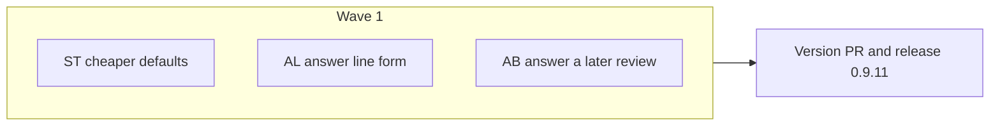

# Plan for 0.9.11: cheaper defaults, and the two gaps of rule A

## Status (2026-11-17)

- Release 0.9.10 is out. Its waves ran with these step settings as wave arguments: review on Opus at medium effort, test and open on Haiku at low effort. No fault came from them. The evals step on Sonnet failed (its lists were refused 9 times), so the evals step stays on Opus at high effort.
- Written from one impact pass on the tag v0.9.10 (0ed656d). Each Touches line names functions, sections and case titles, because line numbers move.
- The entries hold what must be true as numbered statements. The evals writer builds its list from them, with one coverage item for each statement.
- The wave runs with `pluginRoot` at the installed v0.9.10, with the step settings of entry ST as wave arguments.

## Summary in plain words

Three small changes.

The first makes the cheaper step settings the defaults, so that each wave saves them with no extra argument: the review on Opus at medium effort, and the test run and the opening of the PR on Haiku. The check of the minor pass moves to Sonnet. A wave can also skip the wait for the review bot, which helps when the bot reviews only on request.

The other two close the two gaps that the review of release 0.9.10 left in rule A, the rule that clears a review with only small findings. The agent that answers the review is told the exact form of an answer line that rule A reads (#839). Rule A already clears a reason that follows the title after a separator such as a full stop, so the example in #839 clears today. It still refuses a reason that follows the title after a space or a dash, and the new prompt closes that gap. And a later review of the same commit with a new small finding now gets its answer from that agent, not from a person (#840). That needs the answer prompt and the role file to allow a second answer comment for a head.

What you do: merge this plan. The wave runs after the merge.

## Choices for the maintainer

Merging this plan accepts the pick of each line. Say so before the merge to change one.

| # | Choice | Pick | Why |
| --- | --- | --- | --- |
| 1 | Which step settings become the defaults (entry ST). | Review: Opus, medium. Test and open: Haiku, low. Minor-pass check: Sonnet, high. Evals and arch stay Opus, high. | The waves of 0.9.10 ran with the first three and showed no fault. The evals step on Sonnet cost more than it saved. The minor-pass check reads only the commits of one small pass. |
| 2 | How a wave skips the bot wait. | `botWaitMinutes: 0` skips it. Today 0 means 20 minutes. A repo whose bot reviews only on request passes 0, not 1. | No new argument. Nobody sets 0 to mean 20. With 0 the wait agent does not run, and the land step asks for the review. |
| 3 | When the bots step calls the answer agent again for a head that already has an answer comment (entry AB). | When a bot review of the head with a finding body is later than the newest answer comment of the head. The answer prompt and the role file then allow a new answer comment for the head. | Then each new review gets one answer. A review that is older than the answer was answered already. |
| 4 | The form of an answer line for a nitpick item (entry AL). | The line holds only its start (`#N` or `Note, not filed:`), the path and the title. The reason goes on the next line. | Rule A accepts a reason that follows the title after `.`, `,`, `;`, `:` or `)`. It refuses a reason that follows the title after a space or a dash, and a line that names two items. A prompt that keeps the line to its start, path and title never meets either case. The prompt is easier to change than the gate, and the gate stays strict. |

## Decisions

- **The scout step and #832 are not in this plan.** The scout step is measured after these defaults. #832 needs a simpler rule than the one that failed in 0.9.10.
- **The plan review runs with `maxRounds` 2.**

## Rules for every PR

- What must be true is the numbered list of the entry. A statement marked (doc) is proved by a test that reads the text. A statement marked "(holds today; kind `regression`)" passes with and without the change, and its eval has the kind `regression`.
- No entry has an Invariants line. The round cap of every entry is the default.
- A test of a statement that says that nothing happens is built from the case where it does happen, with one change. The same test file holds that positive case. The negative test also asserts the printed line or the exit code that names its cause.
- A PR edits only the parts its Touches line names.
- No eval statement holds the trigger words of the PR-text rule: "PR body", "PR title", "PR description", "pull request body", "pull request title", "pull request description", "Closes line", or a closing keyword with "#" and a number.
- Each closing line is on its own line in the description of the PR.
- `workflows/run-wave.js` stays plain JavaScript with no filesystem, no `Date.now` and no `Math.random`.
- Scripts under `scripts/` use `gh api` only, never `gh pr` or `gh issue`, and no command that exists on one of macOS and Linux only. CI runs on Linux.
- In `test/sim-pipeline.mjs` each entry adds its cases as one block directly after its anchor case. A case uses only helpers that are defined before its anchor.
- A list in a Touches line or in build notes of the existing tests that an entry changes names the likely ones. The builder finds the rest by running the tests and lists them in its PR. A test that such a list lacks is a minor, unless it shows that a statement of the entry is wrong.
- Each code PR merges under the maintainer's standing rule: a completed CodeRabbit review of the final head that is clean or minor-only (rule A), and green CI.
- Docs: Simplified Technical English, no em dashes.

## Waves

Summary: one wave of three entries, then the version PR.

Why one wave: the three entries edit different parts. ST edits `STEPS`, `ROLES`, `BOT_WAIT_MIN`, the start of `bots`, three role files and SKILL.md items and rows on steps and arguments (not step 10). AL edits step 7 of `answerPrompt`. AB edits `scripts/bot-status.sh`, `agents/bot-answerer.md`, step 10 of SKILL.md and their tests. ST and AL both edit `workflows/run-wave.js` and `test/sim-pipeline.mjs`, in different functions and at different anchors.

### Wave 1

**ST Cheaper defaults, the minor-pass check on Sonnet, and a bot wait that a wave can skip.** Sim anchor: after "AN-11 step 2 of SKILL.md says a name that matches no check is an untested item and no finding".
Touches: `workflows/run-wave.js` (`STEPS`, the entries `review`, `test`, `open` and a new entry `minorReview`; `ROLES`, the entry `minorReview`; `BOT_WAIT_MIN`; `bots`, a guard before the bot-wait call), `agents/reviewer.md`, `agents/tester.md`, `agents/pr-opener.md` (the `model:` and `effort:` lines), `skills/pr-pipeline/SKILL.md` (the `steps` and `botWaitMinutes` items of "### Workflow arguments", the rows of "### Role agents" for these roles, the example of the `steps` argument in "### Driving cheaply", the example of the arguments with `botWaitMinutes`; not step 10), `test/skill-docs.test.mjs` (the case "the section Driving cheaply holds the cost rules": its pin of the example JSON), `test/land-review.test.mjs` (the assert on the arguments section, `botWaitMinutes ... 1`, becomes 0; the assert on step 10 is AB's), `test/sim-pipeline.mjs` (one new block; the check "each agent file exists and its defaults match the workflow defaults"; the asserts that pin the old defaults).
What must be true:
1. With no `steps` argument, the review step is Opus at medium effort.
2. With no `steps` argument, the test step and the open step are Haiku at low effort.
3. With no `steps` argument, the evals step and the arch step stay Opus at high effort. (holds today; kind `regression`)
4. The check of the minor pass (`minorreview:<id>`) uses the new step `minorReview`, Sonnet at high effort, also for a code PR. A `steps` argument for `minorReview` overrides it.
5. The review of a code PR in the review loop still uses the step `review`, and the review of a docs or plan PR still uses `reviewDocs`. (holds today; kind `regression`)
6. The `model:` and `effort:` lines of the three role files equal the new defaults, and the sim check of the defaults passes with the `minorreview:` calls left out of it.
7. With `botWaitMinutes: 0`, no bot-wait agent runs, and the result of the bot step is the same as today's result of a wait that saw no bot review in its time, with a `wait` object.
8. With no `botWaitMinutes`, the wait is 20 minutes. (holds today; kind `regression`)
9. (doc) The item `botWaitMinutes` and the arguments example of SKILL.md say to pass 0 for a repo whose bot reviews only on request, and that 0 skips the wait. SKILL.md states the new defaults and the step `minorReview` in the item `steps` and the role rows. The example in "### Driving cheaply" no longer passes `review`, `test` or `open`, which are defaults now, and holds no `evals` on Sonnet. It shows one override that is not a default: `"minorReview": {"model": "opus", "effort": "high"}`. The pins of the example in `test/skill-docs.test.mjs` follow it.
Build notes: `STEPS` merges the `steps` argument for each step key. `ROLES.minorReview` has `reviewModel: true` today; change it to use its own step. `BOT_WAIT_MIN` is `A.botWaitMinutes || 20` today, so 0 gives 20. Other asserts that pin the old defaults are near the sim cases on botreview, preflight, qa and evals; the builder finds them by running the sim. Step 10 says 1 today in SKILL.md and in `test/land-review.test.mjs`; AB changes both to 0, so ST leaves step 10 alone.

**AL The answer prompt gives the exact form of a nitpick answer line.** Sim anchor: after "RA-1 step 7 of the answer prompt asks one line for each finding of a body, with its file path, its title and an issue number or a Note".
Touches: `workflows/run-wave.js` (`answerPrompt`, step 7, two sentences), `test/sim-pipeline.mjs` (one new block).
What must be true:
1. Step 7 of `answerPrompt` says that the answer line of a finding of a review body holds only its start (`#N` or `Note, not filed:`), the file path and the title, as the review prints them, and nothing else.
2. The same step says that the reason for a "Note, not filed:" goes on the next line, never on the answer line.
3. The sim block reads the prompt of a `botanswer:` call and fails when the words of statements 1, 2 and 5 are gone.
4. Rule A in `scripts/bot-approval.jq` is not changed. (holds today; kind `regression`)
5. Step 7 says to post a new answer comment for the head when a bot review on it is newer than the newest answer comment of the head, with one answer line for each item of that review. It no longer says to post one comment for each head.
Build notes: the case "RA-1 step 7 of the answer prompt ..." pins today's text: add to it only by the new block. Step 7 says "Post it once for the head" today; statement 5 replaces that sentence, and the builder changes any pin of it. The form that rule A refuses today is a reason after the title with only a space or a dash (`<title> because ...`, `<title> - ...`); the sentence of statement 2 must name it.
Closes #839

**AB The bots step answers a later review of a head that has an answer comment.**
Touches: `scripts/bot-status.sh` (the count `reviewBodies` and its header comment), `agents/bot-answerer.md` (the line on the review-body comment), `skills/pr-pipeline/SKILL.md` (step 10: the sentence on `botWaitMinutes` for a request-only bot, "at most once per head" and "reviewBodies is 0 for that head"), `test/wait-bots.test.mjs` (new cases; the answer comments of its fixtures get a `created_at`; the builder adds a test file for `bot-status.sh` if the cases fit there better, and names it in its PR), `test/clean-review.test.mjs` (the case "rule A refuses a later review with a nitpick item whose path the answer comment does not name, and bot-status.sh counts the old comment": its answer comment is at 01:00 and the review at 01:12 on the same head, so `reviewBodies` becomes 1; a variant with the answer comment newer than the review keeps 0), `test/land-review.test.mjs` (the assert on step 10, `botWaitMinutes ... 1`, becomes 0).
What must be true:
1. `reviewBodies` counts the bot reviews of the head with a body that can hold a finding and a `submitted_at` later than the `created_at` of the newest trusted answer comment of the head.
2. With no answer comment for the head, `reviewBodies` counts every such review. (holds today; kind `regression`)
3. With an answer comment that is later than every such review, `reviewBodies` is 0. (holds today; kind `regression`)
4. With an answer comment, and then a later bot review of the same head with a finding body, `reviewBodies` is 1, so the bots step calls the answer agent again.
5. An answer comment that is not trusted (by another account, or with another head in its marker) counts as no answer comment. (holds today; kind `regression`)
6. A later bot review of the head with a known no-finding body gives 0. (holds today; kind `regression`)
7. An answer comment with no `created_at` counts as older than every review.
8. (doc) `agents/bot-answerer.md` says to post a new answer comment for the head when a bot review of it is newer than the newest answer comment. Step 10 of SKILL.md says the answer agent runs again for a later review of the same head, that `reviewBodies` is 0 once an answer comment newer than every such review is on the PR, and that a request-only repo passes `botWaitMinutes` 0.
Build notes: the bots step calls the answer agent when `openThreads` or `reviewBodies` is more than 0 (`bots` in `run-wave.js`), so the `bots` function needs no change; the prompt text is AL's. `trusted-comment.jq` gives the trusted answer comments; take the newest by `created_at`. The case in `test/clean-review.test.mjs` is the RA-7 behaviour of 0.9.10 that this entry reverses. The case "rule A does not compare the time of the answer comment" beside it stays valid: rule A is not changed.
Closes #840

## Steps of the driving session

1. Run wave 1 with the settings of ST as wave arguments (`review` Opus medium, `test` and `open` Haiku low) and `docsUpdate: false` on each entry.
2. Pre-check each PR with the CodeRabbit command line, then land it under the standing rule.
3. The version PR and release 0.9.11.

## Not in this plan

| Item | Why |
| --- | --- |
| The scout step | Measured after these defaults. |
| #832, a fix that is an action outside the branch | The rule of 0.9.10 failed six evals attempts. It needs a simpler rule first. |
| Two items in a nitpick block with the same path and title; a fence of four backticks around a fence of three | Rule A refuses them; it never clears wrongly. Notes on #838. |

## Pass criteria

1. The four per-PR criteria of iteration 1 hold for each entry (a list before the build, a result for each eval id, the break check ran where an eval of kind `behaviour` or `error path` exists, and a ledger record with tokens by role).
2. No entry needs more than two outside reviews.
3. The driving session reports the cost of the wave for each PR item at list prices, next to plan 0.9.9 ($5.40).
4. The entries file at most 2 issues.

## Release

- 0.9.11 is the three entries. The version PR merges without an outside review when it changes only the version, the release line of `agents/goals-preflight.md`, the release list and the file list.

## Flagged concerns

- **ST can lower review quality.** Opus at medium effort can miss a fault that high effort finds. The outside review is the guard. A wave can still pass `"review": {"model": "opus", "effort": "high"}`.
- **ST changes three role files.** A session that has not reloaded is refused at its first wave with `role files differ:`. That is the intended guard.
- **AB can call the answer agent once more for each later review.** That costs one agent on Sonnet for each such review, which is less than a person or a new fix round.

## Not verified

- How much the new defaults save in a wave with no stops. The waves of 0.9.10 had stops in the evals step.
- That CodeRabbit gives `submitted_at` on every review of the reviews list.
