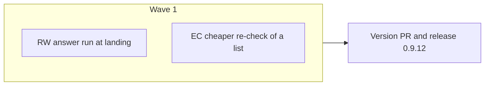

# Plan for 0.9.12: an answer run at landing, and cheaper re-checks of a list

## Status (2026-11-18)

- Release 0.9.11 is out. Its defaults are review on Opus at medium effort, test and open on Haiku at low effort, the minor-pass check on Sonnet at high effort, and evals and arch on Opus at high effort.
- Written from one impact pass on the tag v0.9.11 (8d7a588). Each Touches line names functions, sections and case titles, because line numbers move.
- The entries hold what must be true as numbered statements. The evals writer builds its list from them, with one coverage item for each statement.
- The wave runs with `pluginRoot` at the installed v0.9.11 and no `steps` argument.

## Summary in plain words

Two changes that cut the cost of a wave.

The first is for a repo whose review bot reviews only when the land step asks. When that review has comments, the land stops today, and the main session reads each comment and writes each answer by hand. That is the most costly kind of work, because the main session has the longest conversation. After this plan the land command says which run to start, and one short workflow run answers the comments with the answer agent that the wave already has. The main session then runs the land again.

The second is for the check of the list of evals. When the check sends a list back, the writer makes a new list and the check reads all of it again, up to three times. In one wave of 0.9.10 the check ran 18 times and was the largest cost of the wave. After this plan the check of a later attempt gets the reasons it gave before and the ids of the items that did not change. It rules on the changed items and on the reasons, and it does not judge again an item that it accepted before.

What you do: merge this plan. The wave runs after the merge.

## Choices for the maintainer

Merging this plan accepts the pick of each line. Say so before the merge to change one.

| # | Choice | Pick | Why |
| --- | --- | --- | --- |
| 1 | How the land step gets the answers to the comments of a review it asked for (entry RW). | The land command stops with a new line `ANSWER #<pr>` and its own exit code. The main session runs one workflow run with `answer: true` for that PR, which runs only the bots step (the answer agent, and the check of a code change that the answer made). Then it runs the land again. | A script cannot start an agent. The bots step and its checks exist already, so the run adds no new role and no new rule for the answers. |
| 2 | What the check of a later attempt of the list reads (entry EC). | The full new list, as today, plus the reasons of the last check and the ids of the items that are the same as in the last list. It does not judge again an unchanged item that the last check did not name. | The check still sees the whole list, so it can see an item that a change made wrong. It does less work on the items it already accepted. |

## Decisions

- **The scout step is in its own plan for 0.10.0.** It is a new role and a minor version.
- **#832 is not in this plan.**
- **The plan review runs with `maxRounds` 2.**

## Rules for every PR

- What must be true is the numbered list of the entry. A statement marked (doc) is proved by a test that reads the text. A statement marked "(holds today; kind `regression`)" passes with and without the change, and its eval has the kind `regression`.
- No entry has an Invariants line. The round cap of every entry is the default.
- A test of a statement that says that nothing happens is built from the case where it does happen, with one change. The same test file holds that positive case. The negative test also asserts the printed line or the exit code that names its cause.
- A PR edits only the parts its Touches line names.
- No eval statement holds the trigger words of the PR-text rule: "PR body", "PR title", "PR description", "pull request body", "pull request title", "pull request description", "Closes line", or a closing keyword with "#" and a number.
- `workflows/run-wave.js` stays plain JavaScript with no filesystem, no `Date.now` and no `Math.random`.
- Scripts under `scripts/` use `gh api` only, never `gh pr` or `gh issue`, and no command that exists on one of macOS and Linux only. CI runs on Linux.
- In `test/sim-pipeline.mjs` each entry adds its cases as one block directly after its anchor case. A case uses only helpers that are defined before its anchor.
- A list in a Touches line or in build notes of the existing tests that an entry changes names the likely ones. The builder finds the rest by running the tests and lists them in its PR. A test that such a list lacks is a minor, unless it shows that a statement of the entry is wrong.
- Each code PR merges under the maintainer's standing rule: a completed CodeRabbit review of the final head that is clean or minor-only (rule A), and green CI.
- Docs: Simplified Technical English, no em dashes.

## Waves

Summary: one wave of two entries, then the version PR.

Why one wave: RW edits `scripts/land-wave.sh`, the start of `runPRSteps` (a new branch for `answer`), SKILL.md Step 3 and the row of "When things go wrong" for the new stop. EC edits `evalsCheckPrompt` and `writerLoop`. The two entries edit different functions of `workflows/run-wave.js` and use different sim anchors.

### Wave 1

**RW The land step names an answer run, and the workflow can run only the bots step for an open PR.** Sim anchor: after "ST-14 SKILL.md states the new defaults and the step minorReview".
Touches: `scripts/land-wave.sh` (the stop after `ask_review` for open comments, and the stop after a refusal of `merge-pr.sh` whose cause is a missing answer of the user), `workflows/run-wave.js` (`runPRSteps`, a new branch for a PR item with `answer: true`, next to the `landFix` branch), `skills/pr-pipeline/SKILL.md` (Step 3, one paragraph; the row of "When things go wrong" for `ANSWER #<pr>`), `test/land-review.test.mjs` (new cases; the cases that pin `REVIEW #<pr>` with exit 9 for open comments change to the new line), `test/sim-pipeline.mjs` (one new block).
What must be true:
1. When `ask_review` finds open bot comments or an unanswered review body on the head, `land-wave.sh` prints `ANSWER #<pr>: <openThreads> threads, <reviewBodies> review bodies; run the bots step with answer: true, then land again` and exits 10. It posts no review request.
2. When `merge-pr.sh` refuses the PR and its cause line names a missing reply or a missing answer of the user (the lines that start with `clean review: not every top-level inline comment of the bot has a reply of the user` or `clean review: rule A:` and name an answer), `land-wave.sh` prints the same `ANSWER #<pr>` line and exits 10.
3. Every other refusal of `merge-pr.sh` keeps today's line `STOP #<pr> not merged` and exit 5. (holds today; kind `regression`)
4. A review that did not come keeps `REVIEW #<pr>: <cause>` and exit 9. (holds today; kind `regression`)
5. A PR item with `answer: true` and `prNumber` runs no evals writer, no implementer, no review loop, no minor pass, no docs step and no open step. It reads the head, runs `bots()` for the PR, and ends with the result fields that a land-fix run gives (`land`, `untested`, `ready`).
6. In such a run, when the answer agent changed code, the bot check of today runs on the new commits. When it changed no code, no check runs. (holds today; kind `regression` for the bots step itself)
7. A PR item with `answer: true` and no `prNumber` is refused at the start with a line that names the missing `prNumber`, and runs no agent.
8. The result of an `answer: true` run never gets `:auto`.
9. (doc) Step 3 of SKILL.md says what to do on `ANSWER #<pr>`: run the workflow with one PR item `{id, title, branch, prNumber, answer: true}`, then run the land command again. The row of "When things go wrong" names the line and exit 10.
Build notes: the `landFix` branch of `runPRSteps` shows the sequence (head read, `bots`, `syncUntested`, end facts, `landFor`); the new branch is that sequence with no land-fix agent and no `landFixCheck`. `land-wave.sh` reads the cause line that `merge-pr.sh` prints after `approved=[]`.

**EC The check of a later attempt of the list rules on what changed.** Sim anchor: after "C10-3 an evalsRounds value of 1 or 2 gives one or two writer calls".
Touches: `workflows/run-wave.js` (`writerLoop`, the data it gives to the check of attempts 2 and 3; `evalsCheckPrompt`, one new part for a later attempt), `test/sim-pipeline.mjs` (one new block).
What must be true:
1. On attempt 2 and 3 of the writer, the arch and product check prompts hold the reasons that the last check gave (its notes), as quoted data.
2. The same prompts hold the ids of the evals of the new list whose statement, kind and check are the same as in the last list.
3. The same prompts tell the reviewer to rule on the changed and new evals and on each reason of the last check, and not to judge again an unchanged eval that the last check did not name. The reviewer can still send the list back for an unchanged eval when a change of another eval made it wrong, and it says so.
4. On attempt 1 the check prompts hold none of these parts. (holds today; kind `regression`)
5. The check prompts of every attempt still hold the full list, the coverage map and the writer notes. (holds today; kind `regression`)
6. A list in which every eval changed gives an empty list of unchanged ids, and the prompt says so.
Build notes: the last list and the last reasons are in `writerLoop` already (the `last` value that `evalsPrompt` gets). Compare evals by id, statement, kind and check. The sim cases "E01-2 the writer notes reach the evals check on a later attempt" and "C10-1" to "C10-3" pin today's prompts and calls.

## Steps of the driving session

1. Run wave 1 with no `steps` argument and `docsUpdate: false` on each entry.
2. Pre-check each PR with the CodeRabbit command line, then land it under the standing rule.
3. The version PR and release 0.9.12.

## Not in this plan

| Item | Why |
| --- | --- |
| The scout step | Its own plan for 0.10.0. |
| A land step that answers by itself | A script cannot start an agent. RW makes it one short run. |
| A check of a later attempt that runs only the reviewer that refused | The product check is small. Both checks still run. |

## Pass criteria

1. The four per-PR criteria of iteration 1 hold for each entry (a list before the build, a result for each eval id, the break check ran where an eval of kind `behaviour` or `error path` exists, and a ledger record with tokens by role).
2. No entry needs more than two outside reviews.
3. The driving session reports the cost of the wave for each PR item at list prices, next to plan 0.9.9 ($5.40) and plan 0.9.11 ($6.55).
4. The entries file at most 2 issues.

## Release

- 0.9.12 is the two entries. The version PR merges without an outside review when it changes only the version, the release line of `agents/goals-preflight.md`, the release list and the file list.

## Flagged concerns

- **EC can let a wrong eval pass.** An unchanged eval that the last check missed is not judged again. The check of attempt 1 judged every eval, and the reviewer can still name one that a change made wrong.
- **RW lets an agent write the answers to an outside review.** The answers follow the same rules as the bots step of today, and the gate (rule A) reads them as it does now.

## Not verified

- How much EC saves. The cost of a check is mostly the files it loads, not the list it reads.
- That every cause line of `merge-pr.sh` for a missing answer starts with one of the two texts of RW statement 2.
