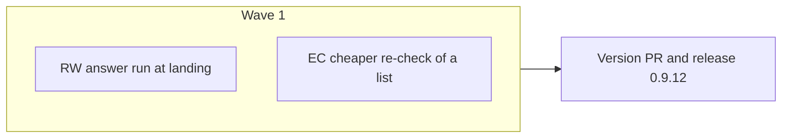

# Plan for 0.9.12: an answer run at landing, and cheaper re-checks of a list

## Status (2026-11-18)

- Release 0.9.11 is out. Its defaults are review on Opus at medium effort, test and open on Haiku at low effort, the minor-pass check on Sonnet at high effort, and evals and arch on Opus at high effort.
- Written from one impact pass on the tag v0.9.11 (8d7a588). Each Touches line names functions, sections and case titles, because line numbers move.
- The entries hold what must be true as numbered statements. The evals writer builds its list from them, with one coverage item for each statement.
- The wave runs with `pluginRoot` at the installed v0.9.11 and no `steps` argument.

## Summary in plain words

Two changes that cut the cost of a wave.

The first is for a repo whose review bot reviews only when the land step asks. When that review has comments, the land stops today, and the main session reads each comment and writes each answer by hand. That is the most costly kind of work, because the main session has the longest conversation. After this plan the land command says which run to start, and one short workflow run answers the comments with the answer agent that the wave already has. The main session then runs the land again.

The second is for the check of the list of evals. When the check sends a list back, the writer makes a new list and the check reads all of it again, up to three times. In one wave of 0.9.10 the check ran 18 times and was the largest cost of the wave. After this plan the check of a later attempt gets the reasons of the last list that a check ruled on, and the ids of the items that did not change since that list. It rules on the changed items and on the reasons, and it does not judge again an item that a check read before and did not name.

What you do: merge this plan. The wave runs after the merge.

## Choices for the maintainer

Merging this plan accepts the pick of each line. Say so before the merge to change one.

| # | Choice | Pick | Why |
| --- | --- | --- | --- |
| 1 | How the land step gets the answers to the comments of a review it asked for (entry RW). | The land command stops with a new line `ANSWER #<pr>` and its own exit code. The main session runs one workflow run with `answer: true` for that PR, which runs only the bots step (the answer agent, and the check of a code change that the answer made, with the verifier when the PR has an eval list). Then it runs the land again. A refusal of `merge-pr.sh` keeps today's stop and is not sent to this run. The PR then lands with the `land` value of the answer run, mode `person`: the main session merges it under your standing rule, and no agent merges it. | A script cannot start an agent. The bots step and its checks exist already, so the run adds no new role and no new rule for the answers. |
| 2 | What the check of a later attempt of the list reads (entry EC). | The full new list, as today, plus the reasons of the last list that a check ruled on and the ids of the items that are the same as in that list. It does not judge again an unchanged item that the check did not name. A list that a rule refused was never checked: after it, and on attempt 1, the check judges the full list. | The check still sees the whole list, so it can see an item that a change made wrong. It does less work on the items it already accepted. |

## Decisions

- **The scout step is in its own plan for 0.10.0.** It is a new role and a minor version.
- **#832 is not in this plan.**
- **The plan review runs with `maxRounds` 2.**

## Rules for every PR

- What must be true is the numbered list of the entry. A statement marked (doc) is proved by a test that reads the text. A statement marked "(holds today; kind `regression`)" passes with and without the change, and its eval has the kind `regression`.
- No entry has an Invariants line. The round cap of every entry is the default.
- A test of a statement that says that nothing happens is built from the case where it does happen, with one change. The same test file holds that positive case. The negative test also asserts the printed line or the exit code that names its cause.
- A PR edits only the parts its Touches line names.
- No eval statement holds the trigger words of the PR-text rule: "PR body", "PR title", "PR description", "pull request body", "pull request title", "pull request description", "Closes line", or a closing keyword with "#" and a number.
- `workflows/run-wave.js` stays plain JavaScript with no filesystem, no `Date.now` and no `Math.random`.
- Scripts under `scripts/` use `gh api` only, never `gh pr` or `gh issue`, and no command that exists on one of macOS and Linux only. CI runs on Linux.
- In `test/sim-pipeline.mjs` each entry adds its cases as one block directly after its anchor case. A case uses only helpers that are defined before its anchor.
- A list in a Touches line or in build notes of the existing tests that an entry changes names the likely ones. The builder finds the rest by running the tests and lists them in its PR. A test that such a list lacks is a minor, unless it shows that a statement of the entry is wrong.
- Each code PR merges under the maintainer's standing rule: a completed CodeRabbit review of the final head that is clean or minor-only (rule A), and green CI.
- Docs: Simplified Technical English, no em dashes.

## Waves

Summary: one wave of two entries, then the version PR.

Why one wave: RW edits `scripts/land-wave.sh`, the argument loop, `needsGoals`, `evaluateWave`, `landFor`, the catch of `runPR` and the start of `runPRSteps` (a new branch for `answer`) in `workflows/run-wave.js`, SKILL.md Step 3 and the row of "When things go wrong" for the new stop. EC edits `writerLoop`, `checkEvals` and `evalsCheckPrompt`. No function or part is in both entries. The two entries edit different functions of `workflows/run-wave.js` and use different sim anchors.

### Wave 1

**RW The land step names an answer run, and the workflow can run only the bots step for an open PR.** Sim anchor: after "ST-14 SKILL.md states the new defaults and the step minorReview".
Touches: `scripts/land-wave.sh` (`ask_review`: the stop for open comments before the request, and the new test after `request-review.sh` printed REVIEWED), `workflows/run-wave.js` (the argument loop at the top, next to the `quick` check; the `needsGoals` line; the skip test of `evaluateWave`; `landFor`, one new `rerunReason`; the catch of `runPR`, which keeps `prNumber` for an answer item; `runPRSteps`, a new branch for a PR item with `answer: true`, next to the `landFix` branch), `skills/pr-pipeline/SKILL.md` (Step 3, one paragraph; the row of "When things go wrong" for `ANSWER #<pr>`), `test/land-review.test.mjs` (new cases; the cases that pin `REVIEW #<pr>` with exit 9 for open comments change to the new line), `test/sim-pipeline.mjs` (one new block).
What must be true:
1. When `ask_review` finds open bot comments or an unanswered review body on the head, `land-wave.sh` prints `ANSWER #<pr> <sha>: <openThreads> threads, <reviewBodies> review bodies; run the bots step with answer: true, then land again` with the 40-character head it checked, and exits 10. It posts no review request. It applies the same test a second time, after `request-review.sh` printed REVIEWED: `ask_review` reads `bot-status.sh` once more, and when `approvedBy` is not empty `merge-pr.sh` runs; otherwise, when `openThreads` or `reviewBodies` is above 0, it prints the same `ANSWER` line and exits 10 with no `merge-pr.sh` call; otherwise `merge-pr.sh` runs. A failed read of the status ends with `STOP #<pr>: cannot read the bot status` and exit 5. A new case of `test/land-review.test.mjs` shows it: the review comes after the request with an inline comment, and the land exits 10 with `ANSWER` and no merge call. The same holds for the new head after an answer run that pushed a commit.
2. Every refusal of `merge-pr.sh` keeps today's line `STOP #<pr> not merged` and exit 5, whatever its cause. (holds today; kind `regression`)
3. A review that did not come keeps `REVIEW #<pr>: <cause>` and exit 9. (holds today; kind `regression`)
4. A PR item with `answer: true` and `prNumber` runs no evals writer, no implementer, no review loop, no minor pass, no docs step and no step that opens the PR. The one `open` agent that it may start is the body update of `syncUntested`, which runs only when `untestedOf(pr)` is not empty or `dropTestsOnly` holds; a sim case counts the agents with role `open` in an answer run that leaves an untested item (exactly 1) and in one that leaves none (0). It reads the head, runs `bots()` for the PR, and ends with the result fields that a land-fix run gives (`land`, `untested`, `ready`).
5. The item takes the earlier `evals` and `evalsMeta` as the `landFix` item does. The branch reads them with `givenEvals` and `evalsVerdict`, and sets `ciChecksState` with `ciChecksOf`, before `bots()`.
6. In such a run, when the answer agent changed code, the bot check of today runs on the new commits: the verifier when the item has an eval list, the tester when it has none. When the answer agent changed no code, no check runs. (holds today; kind `regression` for the bots step itself)
7. An `answer: true` run ends with `ready: false` and a reason that says nothing was answered, when `bots()` ran no answer agent, or when the bot-status counts of open threads or open review bodies are still above 0 after the answer agent ran.
8. A PR item with `answer: true` and no `prNumber`, or with `answer: true` and any of `landFix`, `resume`, `skipImpl` or `quick`, makes the run throw at the argument loop, before any agent, with a message that names the item and the missing or wrong field.
9. A run in which every item has `answer: true` starts no goals preflight agent, no evaluation agent and no safety agent. The version check and the role probe run as for any run.
10. The result of an `answer: true` run never gets `:auto`: its `land` value has the form `<pr>:<sha>` with the mode `person`. The sha is the head after the answer agent, so a land with it does not stop with `HEAD MOVED` when the answer agent pushed a commit, and a sim case shows both cases (a pushed commit and no commit).
12. A PR item with `answer: true` carries `headSha`, the sha of its `ANSWER` line. When the head of the PR at the start of the run is not `headSha`, the run ends with `ready: false` and a reason that names both shas, and runs no answer agent. A sim case shows the stop and the positive case with the same head.
11. (doc) Step 3 of SKILL.md says what to do on `ANSWER #<pr>`: run the workflow with one PR item `{id, title, branch, prNumber, headSha, answer: true, evals}` (`headSha` from the `ANSWER` line) (`evals` as for a land fix, when the PR has a list), then run the land command again with the `land` value of the answer run (its head and the mode `person`), never with the value of the first run; when the answer run ends not ready, do not land again, a person decides. The main session lands that value with `--person --review` under the standing merge rule of the maintainer; no agent merges it with `--auto`. The row of "When things go wrong" names the line and exit 10.
Build notes: the `landFix` branch of `runPRSteps` shows the sequence (given list, head read, `bots`, `syncUntested`, end facts, `landFor`); the new branch is that sequence with no land-fix agent and no `landFixCheck`. The loop stops because `bot-status.sh` counts a thread as answered once the bot or the user replied, so one reply of the answer agent clears the counts that `ask_review` reads. A gate refusal of `merge-pr.sh` (a missing reply of the user, a nitpick with no answer line) is not sent to the answer run, because `bots()` starts the answer agent only on those counts and they can both be 0 in that case. A sim case in which both counts are 0 for an `answer: true` item pins statement 7.

**EC The check of a later attempt of the list rules on what changed.** Sim anchor: after "C10-3 an evalsRounds value of 1 or 2 gives one or two writer calls".
Touches: `workflows/run-wave.js` (`writerLoop`, which keeps the last list that a check ruled on and its notes; `writeEvals`, only the `from` object that it passes to `writerLoop` for attempt 2, which gets one new field with the notes `c.notes` of the round 1 check; `checkEvals`, one new optional parameter for them, which the call of `settleDisputes` does not pass; `evalsCheckPrompt`, one new part for a later attempt), `test/sim-pipeline.mjs` (one new block).
What must be true:
1. The checked list is the last list on which `checkEvals` ruled. A list that `evalsVerdict` or `coverageVerdict` refused is not a checked list. A list given to `writeEvals` that the check of round 1 sent back is a checked list for attempt 2, with the notes of that check. (A given list that passes round 1 returns at once and has no attempt 2.)
2. On attempt 2 and 3, when a checked list exists, the arch and product check prompts hold the notes of that check, as quoted data.
3. In the same case the prompts hold the ids of the evals of the new list whose statement, kind, check and test are the same as in the checked list.
4. In the same case the prompts tell the reviewer to rule on the changed and new evals and on each reason of the checked list, and not to judge again an unchanged eval that the notes did not name. The reviewer can still send the list back for an unchanged eval when a change of another eval made it wrong, and it says so.
5. When no checked list exists, the check prompts hold none of these parts and the check judges the full list. This is the case on attempt 1, and on attempt 2 after a rule refused attempt 1. When attempt 1 was checked and a rule refused attempt 2, attempt 3 compares with the list of attempt 1 and gives its notes. For a given list that the round 1 check sent back, the checked list and its notes start from `from` (when `from.given` is true and `from.rule` is false). (holds today for attempt 1; kind `regression` for that part)
6. The check prompts of every attempt still hold the full list, the coverage map and the writer notes. (holds today; kind `regression`)
7. A new list in which every eval changed gives an empty list of unchanged ids, and the prompt says so.
Build notes: `last` in `writerLoop` also holds a rule refusal, so it cannot serve as the checked list; keep a second value that is set only when `checkEvals` returned a result. Compare evals by id, statement, kind and check. The sim cases "E01-2 the writer notes reach the evals check on a later attempt" and "C10-1" to "C10-3" pin today's prompts and calls. A sim case where a rule refuses attempt 1 and attempt 2 is checked pins statement 5.

## Steps of the driving session

1. Run wave 1 with no `steps` argument and `docsUpdate: false` on each entry.
2. Pre-check each PR with the CodeRabbit command line, then land it under the standing rule.
3. The version PR and release 0.9.12.

## Not in this plan

| Item | Why |
| --- | --- |
| The scout step | Its own plan for 0.10.0. |
| A land step that answers by itself | A script cannot start an agent. RW makes it one short run. |
| A check of a later attempt that runs only the reviewer that refused | The product check is small. Both checks still run. |

## Pass criteria

1. The four per-PR criteria of iteration 1 hold for each entry (a list before the build, a result for each eval id, the break check ran where an eval of kind `behaviour` or `error path` exists, and a ledger record with tokens by role).
2. No entry needs more than two outside reviews.
3. The driving session reports the cost of the wave for each PR item at list prices, next to plan 0.9.9 ($5.40) and plan 0.9.11 ($6.55).
4. The entries file at most 2 issues.

## Release

- 0.9.12 is the two entries. The version PR merges without an outside review when it changes only the version, the release line of `agents/goals-preflight.md`, the release list and the file list.

## Flagged concerns

- **EC can let a wrong eval pass.** An unchanged eval that the checked list's check missed is not judged again. The first check of an eval judged it in full, a rule refusal never counts as a check, and the reviewer can still name an eval that a change made wrong.
- **RW lets an agent write the answers to an outside review.** The answers follow the same rules as the bots step of today, and the gate (rule A) reads them as it does now.

## Not verified

- How much EC saves. The cost of a check is mostly the files it loads, not the list it reads.
- That one reply of the answer agent clears the counts of `bot-status.sh` for every open thread and review body that `ask_review` finds.
