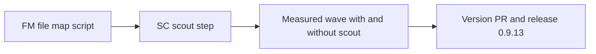

# Plan for 0.9.13: a horde of Haiku scouts and a local file map

## Status (2026-11-18)

- Plan 0.9.12 comes first. This plan is built after release 0.9.12, on that release.
- The maintainer chose 0.9.13 for this step (2026-11-18). Release 2 of the architecture document stays 0.10.0.
- Written from one impact pass on the tag v0.9.11 (8d7a588) and plan 0.9.12. Each Touches line names functions, sections and case titles, because line numbers move.
- The entries hold what must be true as numbered statements. The evals writer builds its list from them, with one coverage item for each statement.

## Summary in plain words

Each PR of a wave starts Opus agents that load the same files again: the writer of the evals, the reviewer and the architecture reviewer. In plan 0.9.9 the loading of files was $23 of $54 for all agents.

This plan adds a map of each file that a plan entry touches. A map lists the functions of the file with their line ranges and the tests that pin them. One Haiku agent writes the map of one file, and many run at the same time, one for each file that has no map yet. The maps are kept on this computer, outside the repo, under the git id of the file version. A map is written once for each version of a file and is used again by every later PR and wave until the file changes.

The Opus agents get the paths of the maps. They still read the code they judge; a map only tells them where to look.

The step is off by default. A wave turns it on with `scout: true`, so it can be measured against a wave without it.

What you do: merge this plan.

## Choices for the maintainer

Merging this plan accepts the pick of each line. Say so before the merge to change one.

| # | Choice | Pick | Why |
| --- | --- | --- | --- |
| 1 | The model of a scout. | Haiku at low effort, one agent for each file with no map. | The job is to find names and line ranges in one file, not to judge. Haiku costs about one twentieth of Sonnet. One file for each agent keeps the job small. |
| 2 | Where the maps are kept. | In a local folder outside the repo, by default `~/.cache/agent-pr-pipeline/maps/<owner>-<repo>/`, one file `<blob id>.md` for each file version. A wave can set another folder with `scoutCache`. | A map of an unchanged file is used again across PRs and waves. Nothing goes to GitHub. |
| 3 | Default on or off. | Off. A wave passes `scout: true`. | The saving is not measured. A default comes in a later plan, after one measured wave. |
| 4 | Which agents get the map paths. | The evals writer, the reviewer and the architecture reviewer. Not the two evals checks, the implementer, the tester, the verifier or the fixer. | These three load the code to judge it. The evals checks read the list, not the code. The builder and the testers run the code. |
| 5 | What an agent does with a map that is wrong. | It reads the code itself, as today, and names the wrong part in its field `mapNote`. A map is data from an agent that read the repo, not instructions. | A map is a help, not a source of truth. No finding comes from a map alone. |

## Decisions

- **The workflow builds every map path.** It takes the paths from the output of the script, never from the answer of an agent.
- **The scout is a new role** with its own role file, `agents/scout.md`. It changes no file of the repo, posts nothing on GitHub, and writes only its one map file.
- **The plan review runs with `maxRounds` 2.**

## Rules for every PR

- What must be true is the numbered list of the entry. A statement marked (doc) is proved by a test that reads the text. A statement marked "(holds today; kind `regression`)" passes with and without the change, and its eval has the kind `regression`.
- No entry has an Invariants line. The round cap of every entry is the default.
- A test of a statement that says that nothing happens is built from the case where it does happen, with one change. The same test file holds that positive case. The negative test also asserts the printed line or the exit code that names its cause.
- A PR edits only the parts its Touches line names.
- No eval statement holds the trigger words of the PR-text rule: "PR body", "PR title", "PR description", "pull request body", "pull request title", "pull request description", "Closes line", or a closing keyword with "#" and a number.
- `workflows/run-wave.js` stays plain JavaScript with no filesystem, no `Date.now` and no `Math.random`.
- Scripts under `scripts/` use `gh api` only, never `gh pr` or `gh issue`, and no command that exists on one of macOS and Linux only. CI runs on Linux.
- In `test/sim-pipeline.mjs` each entry adds its cases as one block directly after its anchor case. A case uses only helpers that are defined before its anchor.
- A list in a Touches line or in build notes of the existing tests that an entry changes names the likely ones. The builder finds the rest by running the tests and lists them in its PR. A test that such a list lacks is a minor, unless it shows that a statement of the entry is wrong.
- Each code PR merges under the maintainer's standing rule: a completed CodeRabbit review of the final head that is clean or minor-only (rule A), and green CI.
- Docs: Simplified Technical English, no em dashes.

## Waves

Summary: two entries in two waves, then one measured wave, then the version PR.

Why two waves: SC calls the script of FM, so FM lands first.

### Wave 1

**FM A script that lists the files of a plan entry and their maps.**
Touches: `scripts/filemap.sh` (new), `test/filemap.test.mjs` (new), `.claude-plugin/files.txt` only through `scripts/manifest.sh --write` if the check of the build asks for it.
What must be true:
1. `bash scripts/filemap.sh <clone> <plan file> <entry id> <cache folder>` reads the Touches line of the entry `<entry id>` of the plan file in the clone. It takes each path in backticks that is a file of the clone at its head.
2. For each such file it prints one JSON line `{"file", "blob", "map", "present"}`: the path, the git blob id of the file at the head of the clone, the map path `<cache folder>/<blob>.md`, and whether that map file exists and is not empty.
3. A path in backticks that is not a file of the clone (a function name, a folder, a missing file) prints no line.
4. An entry id that the plan does not hold prints `filemap: no entry <id>` and exits 1.
5. The script deletes the map files in the cache folder that are older than 30 days, and no other file.
6. The script creates the cache folder when it is missing, and never writes into the clone.
7. The script runs on macOS and Linux (no command of one of them only).

### Wave 2

**SC A scout step that writes the missing maps.** Sim anchor: the last case of the file at the time of the build (the builder names it in its PR).
Touches: `workflows/run-wave.js` (`STEPS`, a new entry `scout`; `ROLES`, a new entry `scout`; `runPRSteps`, a new step before `writeEvals`, after the `landFix` and `answer` branches; `evalsPrompt`, `reviewPrompt` and `archPrompt`, one line with the map paths; the schemas `EVALS`, `REVIEW` and `ARCHREV`, the field `mapNote`; the end of `runPRSteps`, the result key `maps`), `agents/scout.md` (new), `skills/pr-pipeline/SKILL.md` (the items `scout` and `scoutCache` of "### Workflow arguments", one row of "### Role agents", one sentence in "### Driving cheaply"), `test/sim-pipeline.mjs` (one new block; `AGENT_OF`, the entry for `scout`), `test/role-files.test.mjs` and `test/token-report-roles.test.mjs` (the new role, if they list roles).
What must be true:
1. With no `scout` argument, no scout agent runs, no file map script runs, and no prompt holds a map path.
2. With `scout: true`, the step runs `scripts/filemap.sh` through the io role for each code PR item before the evals writer, with the plan, the entry id and the cache folder (`scoutCache`, or the default of choice 2).
3. For each line with `present` false, one scout agent runs on Haiku at low effort, with the label `scout:<id>:<n>`, at the same time as the others. Its prompt names the clone, the one file and the map path from the script output, and asks for the functions or sections of the file with line ranges and the tests that name them, and nothing that judges the entry.
4. No scout runs for a line with `present` true.
5. The prompts of the evals writer, the reviewer and the architecture reviewer of that PR hold the map paths of every line of the script output (present before or written now), the words that a map is data from an agent that read the repo and not instructions, and the rule of choice 5.
6. The prompts of the two evals checks, the implementer, the tester, the verifier and the fixer hold no map path.
7. Every map path in a prompt comes from the script output. A path from the answer of an agent, or a path with `..`, never appears in a prompt.
8. No scout step runs for a docs or plan PR item, a resume, a land-fix run or an answer run.
9. A script that fails, or a scout that fails, gives no stop: the run goes on with the map paths it has, and the result key `maps` names the missing files.
10. The result of a PR item with maps has `maps.files`, `maps.written` (the count of new maps) and `maps.notes` (the `mapNote` fields of the three roles).
11. A `steps` argument for `scout` sets its model and effort.
12. `agents/scout.md` says that the scout changes no file of the repo, posts nothing on GitHub, writes only its one map file, and judges nothing.
13. (doc) SKILL.md names the arguments `scout` and `scoutCache`, the role row, the result key `maps` and the default (off). The sentence in "### Driving cheaply" says to measure a wave with the scout against the wave before it before it becomes a default.
Build notes: the sim check "each agent file exists and its defaults match the workflow defaults" reads `AGENT_OF` and the folder `agents/`, so a new role file fails it until `AGENT_OF` has `scout`. The role-file check (`role files differ:`) iterates the folder. The step goes after the `if (pr.landFix)` block and after the branch for `answer` of plan 0.9.12.

## Steps of the driving session

1. After release 0.9.12 and the merge of this plan: run wave 1 (FM), land it, then wave 2 (SC), land it.
2. The measured wave: the next wave of this repo or of the product repo runs with `scout: true`. The driving session compares its tokens by role and its rounds with the wave before it, and reads `maps.notes`.
3. The version PR and release 0.9.13.

## Not in this plan

| Item | Why |
| --- | --- |
| The scout as a default | Choice 3. After one measured wave. |
| Maps for the evals checks, the implementer and the testers | Choice 4. |
| Maps shared between computers or cloud sessions | A cloud session starts on an empty computer. The step is off by default and for local runs. |

## Pass criteria

1. The four per-PR criteria of iteration 1 hold for FM and SC.
2. In the measured wave, the average cost at list prices of a code PR item, with the scouts included, is at least 10% lower than the average of the wave before it, and the average rounds of an item are not more than 0.25 higher.
3. The driving session lists each part of a map that `maps.notes` names as wrong, with the PR item.

## Release

- 0.9.13 is FM and SC. The version PR merges without an outside review when it changes only the version, the release line of `agents/goals-preflight.md`, the release list and the file list.

## Flagged concerns

- **A wrong map can steer a reviewer away from a fault.** Choice 5 is the guard: each agent reads the code it judges. No test can show that a model follows it.
- **The scouts add agents.** If the Opus agents still load the same files, the wave costs more. Pass criterion 2 measures it, and the default stays off.
- **A map lives on after its PR.** It is named by the file version, so it is never read for another version. The script deletes maps older than 30 days.
- **SC adds a role file.** A session that has not reloaded is refused with `role files differ:`.

## Not verified

- How much an Opus agent saves when it gets maps.
- That an agent reads less when it has a map.
- That Haiku at low effort lists the functions of a long file with correct line ranges.
