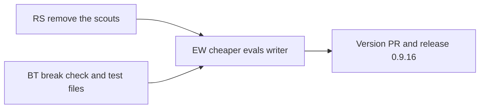

# Plan for 0.9.16: remove the scouts, and a cheaper evals writer

## Status (2026-11-19)

- Built on release 0.9.15 (40da278).
- Written from the log analysis of the product repo's 0.8.0 wave 1 (8 build items with `scout: true`) and eight earlier waves without it. Each Touches line names functions, sections and case titles, because line numbers move.
- The entries hold what must be true as numbered statements. The evals writer builds its list from them, with one coverage item for each statement.

## Summary in plain words

Plan 0.9.13 added Haiku scouts that write a map of each file an entry touches, so that the evals writer reads less. The measurement says that it does not. With maps, an evals writer read about 61k characters through its shell calls. Without maps, the median of eight earlier waves was about 47k. The writers read the maps and then the code as before.

The same logs show what does drive the cost of the evals writer: the number of its shell calls. Each call makes the model read its whole context again, about 50k tokens. Writers made from 8 to 52 calls. In the product wave, the writer with 48 calls read 1.79M cached tokens; the one with 16 calls read 0.30M.

The logs also show that 6 of 8 first lists were sent back by the evals check, each for a real defect of a known kind: a gap in coverage, a check command that cannot match, or a break of a plan rule. Each refusal costs a second writer run and a second check on Opus.

This plan does three things:

1. It removes the scout step, the scout role and the file map script (entry RS).
2. It tells the evals writer to read in few, batched shell calls, and to check its own list against the refusal reasons before it returns it (entry EW).
3. It fixes issue #864: the break check can never fail an eval whose checked function lives in a test file that the PR changes, so the run stopped for a person (entry BT).

What you do: merge this plan.

## Choices for the maintainer

Merging this plan accepts the pick of each line. Say so before the merge to change one.

| # | Choice | Pick | Why |
| --- | --- | --- | --- |
| 1 | Remove the scouts or keep them off by default. | Remove them: the step, the role file, the script, its test and the docs. | The maintainer's decision (2026-11-19, "cut the scouts from the next version"). An option that is off and saves nothing still costs review and test time in every change of `runPRSteps`. |
| 2 | A wave that still passes `scout`. | The workflow ignores it and writes one log line: `scout: removed in 0.9.16, ignored`. The run goes on. | A product repo can keep an old argument for one wave without a stop. Refusing the run would cost more than the line. |
| 3 | The maps already on disk, in the plugin data folder. | Left as they are. The docs say that the folder `maps/` of the plugin data folder can be removed by hand. | The workflow has no filesystem, and a delete of a shared folder by a script is a risk with no gain. The files are small. |
| 4 | How the writer checks its own list. | One numbered step in the writer prompt, before it returns: check the list against the same rules the evals check applies (`evalsRules`) and against the refusal reasons named in this plan. No new agent. | A second agent would add a call, which is the cost this plan cuts. The rules text is shared, so the two cannot drift. |
| 5 | The fix of #864. | The stop of #864 comes from the verifier answering `passes-without-change` for a test whose subject is in a changed test file. The run already accepts `not-applicable` for a behaviour or error path eval without a stop: it is no finding, and the eval goes on the untested list, so the maintainer merges the PR. BT changes the verifier prompt so that the verifier gives that answer in this case, with a `breakWhy` that starts `subject in test file `, and changes the untested text to quote the `breakWhy`. No gate and no path check is added. | The verifier is not an attacker; the rule guards against an honest mistake. The untested list keeps a person on every use, so no agent merges on the verifier's word. Running the default branch's test file against the reverted tree cannot work when the PR adds the case. |

## Decisions

- **The writer prompt names a target, not a cap.** It says to read in few calls, for example one call that prints several files or ranges, and it gives about 15 calls as the aim. A hard cap could stop a writer that needs one more read.
- **The plan review runs with `maxRounds` 2.**

## Rules for every PR

- What must be true is the numbered list of the entry. A statement marked (doc) is proved by a test that reads the text. A statement marked "(holds today; kind `regression`)" passes with and without the change, and its eval has the kind `regression`.
- No entry has an Invariants line. The round cap of every entry is the default.
- A test of a statement that says that nothing happens is built from the case where it does happen, with one change. The same test file holds that positive case. The negative test also asserts the printed line or the exit code that names its cause.
- A PR edits only the parts its Touches line names.
- No eval statement holds the trigger words of the PR-text rule: "PR body", "PR title", "PR description", "pull request body", "pull request title", "pull request description", "Closes line", or a closing keyword with "#" and a number.
- `workflows/run-wave.js` stays plain JavaScript with no filesystem, no `Date.now` and no `Math.random`.
- In `test/sim-pipeline.mjs` each entry adds its cases as one block directly after its anchor case. A case uses only helpers that are defined before its anchor.
- A list in a Touches line or in build notes of the existing tests that an entry changes names the likely ones. The builder finds the rest by running the tests and lists them in its PR. A test that such a list lacks is a minor, unless it shows that a statement of the entry is wrong.
- Each code PR merges under the maintainer's standing rule: a completed CodeRabbit review of the final head that is clean or minor-only (rule A), and green CI.
- Docs: Simplified Technical English, no em dashes.

## Waves

Summary: RS and BT in wave 1, in parallel; EW in wave 2; then the version PR.

Why two waves: RS removes a line of `evalsPrompt` and EW edits the steps of the same prompt, so they go one after the other. BT edits `verifyPrompt` and `verifyOutcome`, which RS and EW do not touch. RS and BT use different sim anchors in different parts of `test/sim-pipeline.mjs`.

### Wave 1

**RS Remove the scout step, the scout role and the file map script.** Sim anchor: the case `RW-18 an answer run that throws keeps prNumber`, the last case before the cases of entry SC. RS removes the SC and Q854 cases, so its block goes where they were, and it uses no helper that they define.
Touches: `workflows/run-wave.js` (`SCOUT_ON`; `STEPS`, the entry `scout`; `ROLES`, the entry `scout`; the state maps `mapsState`, `mapPathsState` and `scoutState`; the schema `EVALS`, the field `mapNote`; `evalsPrompt`, the line `${mapBlock(pr)}`; the map helpers from `MAP_BLOB` to `scoutStep`; the call `await scoutStep(pr, rawEvals)`; the use of `w.mapNote`; the result key `maps` in the `finally` block of the item run; one log line for an argument `scout`), `agents/scout.md` (removed), `scripts/filemap.sh` (removed), `test/filemap.test.mjs` (removed), `test/sim-pipeline.mjs` (the cases of plan 0.9.13 entry SC and of quick fix Q854 that test the scout step, removed; `AGENT_OF`, the entry `scout`; one new block), `routine/settings/observe.json` and `routine/settings/triage.json` (the two `Agent(scout)` lines each), `test/routine-settings.test.mjs` (`scout` in `leftOut`), `skills/pr-pipeline/SKILL.md` (the item `scout` of "### Workflow arguments", its row of "### Role agents", its sentence in "### Driving cheaply"; one sentence on the old maps folder), `.claude-plugin/files.txt` only through `scripts/manifest.sh --write`.

1. With `scout: true`, a code item whose evals writer runs starts no `scout` agent and no `filemap.sh` call, and its result has no key `maps`.
2. With `scout: true`, the run writes the log line `scout: removed in 0.9.16, ignored` once, and the item goes on to its evals writer as with no `scout` argument.
3. No prompt of any agent holds the text `File maps:` or `mapNote`, and the schema of the evals writer has no field `mapNote`.
4. The files `agents/scout.md`, `scripts/filemap.sh` and `test/filemap.test.mjs` do not exist, and no file of the repo outside `docs/plan-*.md` and `CHANGELOG.md` names `filemap.sh` or the role `scout`.
5. The settings files `routine/settings/observe.json` and `routine/settings/triage.json` hold no `Agent(scout)` and no `Agent(agent-pr-pipeline:scout)`.
6. (doc) "### Workflow arguments" of `skills/pr-pipeline/SKILL.md` has no item `scout`, "### Role agents" has no row `scout`, and the skill says in one sentence that the folder `maps/` of the plugin data folder is no longer used and can be removed by hand.
7. A code item with no `scout` argument starts the same agents in the same order as on the default branch. (holds today; kind `regression`)

Build notes: the role-file check (`role files differ:`) iterates the folder `agents/`, so the removal of `agents/scout.md` changes the file list; `scripts/manifest.sh --write` updates `.claude-plugin/files.txt`. `test/token-report-roles.test.mjs` and `test/role-files.test.mjs` may list the roles; the builder runs them and lists every test it changes in its PR.

**BT The verifier gives an eval whose subject is in a changed test file a `not-applicable`, not a `passes-without-change`.** Closes #864. Sim anchor: the case `F659: the last verifier round decides tests only`, after the helper `withChanged`, which BT's cases use.
Touches: `workflows/run-wave.js` (`verifyPrompt`, the break check step; `verifyOutcome`, the text of the untested item for `not-applicable`), `test/sim-pipeline.mjs` (one new block).

What the code does today: for an eval of kind behaviour or error path that passed, `breakCheck` `not-applicable` is already no finding and no stop. The eval stays in `passed`, it is in the group `notApplicable` of the result's `breakCheck`, and it is on the untested list as `<id> (break check not run: not-applicable is not valid for kind <kind>)`, so a person merges the PR. The stop of #864 comes only from `passes-without-change`, which is a major finding. BT adds no gate, no state map and no path check: the answer is already safe, because every use lands on the untested list.

Threat model: the verifier is not an attacker. The rule guards against an honest mistake of the verifier. A person merges every PR with an untested item, so no agent merges on the verifier's word. A tests-only round (every changed file is a test or a docs file) is out of this rule: it has its own `testsOnly` path, which sets `not-applicable` for every eval and adds its own line to the PR, as today.

1. The break check step of `verifyPrompt` tells the verifier when to give `not-applicable` for a behaviour or error path eval: the code that the test of the eval checks is itself defined in a test file that the PR changes, so taking the change out of the files that are not tests cannot change the result. The `breakWhy` then starts `subject in test file ` and names that file. The step says that a test that only calls a helper of its own file, and through it runs a changed source file, still gets the break check.
2. For such an answer, the untested item is `<id> (break check not applicable: <breakWhy>)`, so a person sees the verifier's reason. A `not-applicable` for these kinds with no `breakWhy` keeps the text of today. This text is the only change in the code outcome.
3. A `not-applicable` for these kinds is still no finding and no stop, and the eval still counts as passed and is in the group `notApplicable`. (holds today; kind `regression`)
4. An eval with `passes-without-change` is a major finding as today. (holds today; kind `regression`)

Build notes: the change in `verifyOutcome` is the line that builds `why` for `not-applicable`. Only a run of the verifier can show that the prompt makes it give the answer, so pass criterion 5 is the measure of statement 1.

### Wave 2

**EW The evals writer reads in batched calls and checks its own list first.** Sim anchor: the last case of the file at the time of the build.
Touches: `workflows/run-wave.js` (`evalsPrompt`, its numbered steps), `agents/evals-writer.md` (one paragraph on batched reads, one on the self-check), `test/sim-pipeline.mjs` (one new block), `skills/pr-pipeline/SKILL.md` (one sentence in "### Driving cheaply").

1. The writer prompt tells the writer to read in few shell calls, with about 15 calls as the aim, and gives one example command that prints several files or line ranges in one call.
2. The writer prompt has a step before the return: check the list against the rules for the list (the text of `evalsRules`, which the evals check also gets) and against each refusal reason below, and change the list before returning it. The reasons, by name:
   - a bullet, invariant, Acceptance line or QA line of the entry with no eval (a line that names only a step after the build, such as the text of the pull request, labels, CI, a merge or a release, needs no eval, as today);
   - a check command that cannot print what the eval says, for example a `grep -F` pattern with a backslash inside single quotes, or a test filter whose run always reports skipped tests;
   - a negative case that differs from its positive case in more than one thing;
   - a negative test that does not first assert that its input holds the value it is about;
   - two evals whose checks contradict each other on the same test.
3. The self-check step adds no agent call: the writer does the check in the same agent run, and the workflow starts no agent for it. (A first list that now passes can save the second writer and check calls, so the total count of an item can be lower.)
4. (doc) `agents/evals-writer.md` says to read in batched calls and to check the list against the refusal reasons before returning it.
5. (doc) "### Driving cheaply" of `skills/pr-pipeline/SKILL.md` says in one sentence that the cost of the evals writer grows with its number of shell calls.

## Steps of the driving session

1. After release 0.9.15 and the merge of this plan: run wave 1 (RS and BT), land them one at a time, then wave 2 (EW), land it.
2. The version PR and release 0.9.16.
3. The measure: the next build wave of the product repo runs on 0.9.16 with no `scout` argument. The driving session counts, from the transcripts, the shell calls of each evals writer and the share of first lists that the evals check sends back, and compares them with the product repo's 0.8.0 wave 1.

## Not in this plan

| Item | Why |
| --- | --- |
| A hard cap on the writer's calls | Decisions: a cap can stop a writer that needs one more read. |
| A Sonnet evals check | The checks found real defects in 6 of 8 lists. A weaker check would let them reach the build, where a defect costs a round. |
| Deleting the old maps | Choice 3. |

## Pass criteria

1. The four per-PR criteria of iteration 1 hold for RS, BT and EW.
2. In the measured wave, the median number of shell calls of an evals writer agent is at most 20 (0.8.0 wave 1: about 30).
3. In the measured wave, at most half of the first lists are sent back (0.8.0 wave 1: 6 of 8).
4. In the measured wave, the mean weighted tokens of the evals writer per item is at least 25% lower than in 0.8.0 wave 1 (351k).
5. No item of the measured wave stops on the break check of an eval whose subject is in a changed test file. When the measured wave has no such eval, this criterion is not measured, and the driving session says so; BT's sim block proves the outcome text, and only a real run can prove the verifier's answer (statement 1 of BT).

## Release

- 0.9.16 is RS, BT and EW. The version PR merges without an outside review when it changes only the version, the release line of `agents/goals-preflight.md`, the release list and the file list.

## Flagged concerns

- **Fewer calls can mean less reading.** A writer that batches its reads may still read the same text, which is fine, but a writer that reads less to meet the aim can miss a fact. Pass criterion 3 watches the refusals; a rise shows it.
- **The self-check can grow the writer's output.** The step asks for a check, not a written report: the writer changes the list and says in `notes` only what it changed.
- **BT trusts the verifier's word that the subject is in a test file.** Each use goes on the untested list with the verifier's `breakWhy`, so a person merges the PR and reads the reason. The workflow checks nothing more; a mistaken answer costs one person merge, not a wrong agent merge. The prompt change is the only thing that stops #864, so pass criterion 5 is its only measure.
- **RS removes a role file.** A session that has not reloaded is refused with `role files differ:`.

## Not verified

- That a model keeps to about 15 calls when told to.
- That the self-check catches the refusal reasons before the evals check does.
- The share of the evals writer's cost that the fewer calls save; pass criterion 4 measures it.
