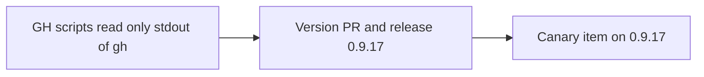

# Plan for 0.9.17: scripts read only the answer of gh, not its hints

## Status (2026-11-20)

- Built on release 0.9.16 (7bc0260), after its canary item.
- Written from one impact pass on main after 0.9.16. Each Touches line names the line it changes by the variable it sets, because line numbers move.
- The entry holds what must be true as numbered statements. The evals writer builds its list from them, with one coverage item for each statement.

## Summary in plain words

gh 2.105.0 (2026-11-17) prints a hint of several lines on stderr after a read of a pull request, also through `gh api`. Four scripts capture `$(gh api ... 2>&1)`, so stderr goes into the same text as the answer, and the script then reads that text as JSON. Since then `scripts/gate-files.sh` prints `GATE ERROR #<pr>: unexpected answer for the changed files` for every PR (issue #869). It fails safe: every PR lands as a person merge, and no agent merge happens in any repo.

The fix keeps the answer and the error text apart, as `scripts/wait-ci.sh` already does: stdout goes into the variable, stderr goes into a temp file. The error message and the checks that read the error text (`HTTP 404`, `is not enabled for this session`) read the temp file. The text of every message stays as it is.

What you do: merge this plan.

## Choices for the maintainer

Merging this plan accepts the pick of each line. Say so before the merge to change one.

| # | Choice | Pick | Why |
| --- | --- | --- | --- |
| 1 | Where the fix lives. | In each of the four scripts, with the pattern of `scripts/wait-ci.sh`: one temp file for stderr per script, removed on exit. No shared helper file. | The scripts are standalone today and are installed one by one from `files.txt`. A shared helper is a new concept for 27 lines. The pattern is already in the repo and tested. |
| 2 | Hide the hint with a setting instead. | No. | `gh help environment` and `gh config` have no switch for it, and a later hint would break the scripts again. |
| 3 | A guard against new captures. | One test that fails when a script under `scripts/` captures `gh api` with `2>&1` inside `$( )`. | The same fault would come back with the next script that copies an old line. |

## Decisions

- **The plan review runs with `maxRounds` 2.**
- **This is the first plan under the rules of DF (0.9.16):** the entry changes scripts, so it has a QA line on real input.

## Rules for every PR

- What must be true is the numbered list of the entry. A statement marked (doc) is proved by a test that reads the text. A statement marked "(holds today; kind `regression`)" passes with and without the change, and its eval has the kind `regression`.
- No entry has an Invariants line. The round cap of every entry is the default.
- A test of a statement that says that nothing happens is built from the case where it does happen, with one change. The same test file holds that positive case. The negative test also asserts the printed line or the exit code that names its cause.
- A PR edits only the parts its Touches line names.
- No eval statement holds the trigger words of the PR-text rule: "PR body", "PR title", "PR description", "pull request body", "pull request title", "pull request description", "Closes line", or a closing keyword with "#" and a number.
- Scripts under `scripts/` use `gh api` only, never `gh pr` or `gh issue`, and no command that exists on one of macOS and Linux only. CI runs on Linux.
- A list in a Touches line or in build notes of the existing tests that an entry changes names the likely ones. The builder finds the rest by running the tests and lists them in its PR. A test that such a list lacks is a minor, unless it shows that a statement of the entry is wrong.
- Each code PR merges under the maintainer's standing rule: a completed CodeRabbit review of the final head that is clean or minor-only (rule A), and green CI.
- Docs: Simplified Technical English, no em dashes.

## Waves

Summary: one entry in one wave, then the version PR and the canary run.

### Wave 1

**GH The scripts parse only the stdout of `gh api` and keep stderr for their messages.** Closes #869.
Touches: `scripts/gate-files.sh` (every capture of `gh api` with `2>&1`: the reads that set `sha`, `branch`, `settings`, `cmp`, `pages`), `scripts/release.sh` (every capture of `gh api` with `2>&1`, and the `is404` checks that read them), `scripts/land-wave.sh` (the read that sets `settings`), `scripts/plugin-version.sh` (the read that sets `tag` and the `is not enabled for this session` check), `test/gate.test.mjs`, `test/release.test.mjs`, `test/land.test.mjs`, `test/plugin-version.test.mjs` (new cases), one new test file `test/gh-stderr.test.mjs`.
QA: on this machine (gh 2.105 or newer), read-only, no merge, no release. Run these on real input:
- `scripts/gate-files.sh alfhen/agent-pr-pipeline <n>` for a real open or merged PR of this repo. It prints the file list and the gate result, with no `GATE ERROR` and no `cannot read`. This is the one run that fails on the old code, so it proves the fix.
- `scripts/plugin-version.sh <running version>` prints `OK` or the expected `WARN` line, with no `CHECK FAILED`.
- `scripts/release.sh --dry-run alfhen/agent-pr-pipeline <version not yet released>`, run after at least one commit exists since the last tag, so the compare and `pulls` reads run. It prints the `ok:` lines and the `MISSING` lines for that version, exits 1, and prints no `cannot go on` and no `cannot read`. This run shows only that nothing broke; it also passes on the old code.
- `scripts/land-wave.sh` cannot run read-only, so the fake-`gh` case of statement 2 and the land of the canary item cover it.

1. With a fake `gh` first on `PATH` that prints a valid JSON answer on stdout and a hint of several lines on stderr and exits 0, `scripts/gate-files.sh <repo> <pr>` prints the same result as with no hint, and not `GATE ERROR`.
2. The same holds for `scripts/release.sh --dry-run`, `scripts/land-wave.sh` (its read of `.github/pipeline.json`) and `scripts/plugin-version.sh`: a hint on stderr with exit 0 does not change what the script prints or its exit code.
3. When `gh` exits non-zero, each script prints the same message as today, and that message holds the text that `gh` wrote on stderr. (holds today; kind `regression`)
4. A `gh` that exits non-zero with `HTTP 404` on stderr for the read of `.github/pipeline.json` still counts as no settings file in `gate-files.sh` and `release.sh`, and `plugin-version.sh` still takes `is not enabled for this session` on stderr as the cloud case. (holds today; kind `regression`)
5. No script under `scripts/` captures `gh api` with `2>&1` inside `$( )`: a test reads the files and fails on such a line.
6. Each script removes its temp file for stderr on exit, also on an error exit.

Build notes: the pattern is in `scripts/wait-ci.sh` (`errf=$(mktemp)`, `trap 'rm -f "$errf"' EXIT`, `2>"$errf"`, and the message reads `$(cat "$errf")`). A script that already has an EXIT trap adds the remove to it. Real input for the tests (rule of EW 0.9.16): save one real answer of `pulls/<n>/files` of this repo as a fixture and use it in the cases of statement 1, next to the hint text of gh 2.105 as quoted in issue #869.

## Steps of the driving session

1. After the merge of this plan: run wave 1 (GH), land it.
2. The version PR and release 0.9.17.
3. The canary run on 0.9.17 (Step 3 of the skill): one small real item of this repo. It shows `:auto` lands again when the gate allows it, so the land of the canary item is the check of statement 1 on real input.
4. Then the product repo moves to 0.9.17.

## Not in this plan

| Item | Why |
| --- | --- |
| Other open issues | Each is minor or needs its own plan. #869 breaks agent merges in every repo, so it goes alone and fast. |
| A shared script helper | Choice 1. |

## Pass criteria

1. The four per-PR criteria of iteration 1 hold for GH.
2. The QA line of GH ran on this machine with gh 2.105 or newer, and its report shows the expected output of the three scripts that run read-only, and names how `land-wave.sh` is covered.
3. After the release, the gate of the canary item prints no `GATE ERROR`.

## Release

- 0.9.17 is GH. The version PR merges without an outside review when it changes only the version, the release line of `agents/goals-preflight.md`, the release list and the file list.

## Flagged concerns

- **A message that quoted the hint is now shorter.** No test or reader depends on the hint text.
- **gh can change where it prints hints.** Statement 5 and the stdout-only reads cover any later text on stderr; a hint on stdout would need another fix, and no gh version does that today.

## Not verified

- That no other script in the repo reads `gh` output with stderr merged in a form that `2>&1)` does not match, such as a pipe. The builder runs `git grep -n '2>&1' -- scripts` and lists each `gh` line it leaves as it is, with the reason.
