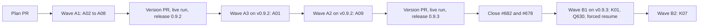

# Plan for 0.9.2

## Status (2026-11-11)

- Written after the 0.9.1 release. Checked against `main` at ccdbaff (Release 0.9.1, #694) and against GitHub on 2026-11-11. Nothing is built.
- This release is iteration 1 of the maintainer's decision D10: work this repo's open issues down with the new pipeline before Tagreeve uses it.
- The open PRs #682 (K01) and #678 (Q630) are closed with a pointer to this plan before wave B (Wave B).
- Amended after wave A1 (Amendment 1). A01 stopped twice at the evals check, and the iteration stopped for the maintainer. The fix is in the entry text, so 0.9.2 ships A02 to A08, A01 and A09 are built on v0.9.2 and released as 0.9.3, and wave B runs on v0.9.3.

## Summary in plain words

The 0.9.1 shakedown (D9) passed 3 of 6 PRs with no help, and two live runs passed. But every resume after a stop went wrong. A run that died lost its eval list. A resume checked an accepted list again and stopped on a new gap. A verifier answer with no eval results cost a round and a stop. A fix that could not be committed looked like a fix that changed nothing. The main session also typed large resume arguments and the token and ledger steps by hand.

This release fixes those faults, so the later D10 batches and the Tagreeve run can go with no help. Wave A has the fixes. Then 0.9.2 is released, A01 and A09 are built on it, and 0.9.3 is released. Wave B then rebuilds the three PRs that the shakedown did not finish (K01, Q630, K07) on `pluginRoot` v0.9.3, as the proof. One of them is stopped on purpose and resumed, to show that a resume now works.

Readers: the maintainer (the iteration report and the ledger report) and the Claude sessions that run the later batches and Tagreeve. Out: new roles, new run-wave arguments that change what a wave does, the batch fixes, and the work of release 2 (0.10.0). Each entry is one PR. A PR is done when its acceptance test passes in CI, an adversarial review reports no blockers or majors, and it is squash-merged.

## Goals this release serves

- Automatic improvement (goal 7) and my attention (goal 3): A01, A02, A03 and A09 remove the hand steps that every resume needed in 0.9.1. A03 also makes a stop give the true cause.
- Quality (goal 2): A04 lets the break check prove more cases, so fewer items stay untested. A07 ranks an untrusted-path finding as at least major.
- Cost (goal 4): A06 aims for smaller eval lists that the evals check accepts on the first attempt. Wave B has a token target (Pass criteria).
- Self-improvement (goal 1): every entry comes from a finding of the 0.9.1 shakedown.
- Small enough to understand (goal 8): no entry adds a role or a step. All entries correct the pipeline's own output (Goal 8 share).
- Non-goals it comes close to: none. No entry changes CI, the review bots or the tools the pipeline runs on.

## Findings

Each claim was checked on 2026-11-11 against `main` at ccdbaff.

| Finding | Issue | What is wrong |
| --- | --- | --- |
| `writeEvals` gives no list (the tester path) to a `resume` or `skipImpl` PR without `resume.evals`. A run that dies returns no result to copy the list from. A PR whose steps throw gives `null` in `prs`, because `parallel` turns the throw into `null`. | #679 | Q630 was resumed with no list, ran the tester path, and #678 opened with no Evals table. The issue names the dead run; the `null` result of a PR that throws loses the list in the same way. |
| `writeEvals` runs `checkEvals` on every given list, also a list that the evals check accepted in an earlier run. The result has no record of what was accepted. | #690 | Three of the four stops on 2026-11-10 came from a second check of an accepted list. |
| `verifyOutcome` turns a verifier answer with no `evals` rows into one major `eval <id> has no result` per id, and `testOutcome` adds `acceptance test did not run`. `call` retries only a null answer or a throw. | #687 | One incomplete answer cost a fix round and a `no progress` stop on a good branch (K05). |
| The `FIX` schema has no field for a change that could not be committed or pushed. `reviewLoop` reads `changed: false` as no progress. | #677 | K01's fix existed on disk but was reported as `no progress`. The main session committed it by hand. |
| The break-check rule says `fails-without-change` only when the test fails on its own assertion. The rule is in three places: `agents/verifier.md`, `verifyPrompt` in `workflows/run-wave.js`, and step 2 of SKILL.md. `test/sim-pipeline.mjs` stops at its first failing case (the `check` helper has no filter). | #695 | A TypeError in the test body counted as `not run` on #676. On #686, three of four `not run` items came from the fail-fast sim file. The issue names only the verifier; the same rule text is in the prompt and the skill. |
| `io.sh` writes `io-large.XXXXXX` files at the top of the wave's temp folder. `cleanup.sh clones <tmp> --all` deletes only folders at depth 1. SKILL.md says the rest of the temp folder is deleted. | #684 | Copies of land-fix diffs stay on disk. A run that dies before `finish` also leaves its files, so the next run's cleanup must remove old ones too. |
| The evals writer prompt does not hold the rules that the evals check applies. The shakedown lists were long and had boilerplate quality-bar rows. | none | Lists went back to the writer, and each attempt and each eval cost tokens in every later round. |
| `agents/reviewer.md` has no rank rule for a path, command or URL that untrusted text chooses. The minor check may report only faults in its own commits. | none (background #685, now closed) | #685 (a `..` path that reached the land reviewer's read) was ranked minor twice before it was fixed. |
| The token report and the ledger records (`token-report.sh --json`, then `ledger.sh put`) and the resume arguments are typed by the main session. Nothing warns when a resume's `maxRounds` plus the rounds in its history pass the entry's Round cap. | none | Large lists were retyped by hand on each resume, which is a hand edit of an eval list. |
| `ledger.sh report` counts `needs human:`, `no progress:`, `checks failed twice:`, `head moved:` and `head unknown:` stops as maintainer touches, but not `evals check:` or `evals refused:` stops. | none | The 0.9.1 report counted fewer touches than the maintainer gave. |

## Scope

In:

| Group | Entries | Issues | Size |
| --- | --- | --- | --- |
| An accepted list survives a stop and a resume | A01 | #679, #690 | M |
| A verifier answer with no eval results | A02 | #687 | S |
| A fix that could not be saved | A03 | #677 | S |
| Break check: in-test failures and fail-fast files | A04 | #695 | M |
| Large-output files removed by cleanup | A05 | #684 | S |
| Evals writer rubric and list size | A06 | none | S |
| Reviewer rank line for untrusted paths | A07 | none | S |
| Evals-check stops as maintainer touches | A08 | none | S |
| Main-session steps as scripts | A09 | none | M |
| Rebuild of the unfinished shakedown PRs | K01, Q630, K07 | #670, #630, #631 | M, S, S |

Not in: see Out of scope.

### Goal 8 share

Goal 8 asks that work on the pipeline's own output is a limited share of each release. Count:

- Entries: **12 of 12** correct the pipeline's own output. There is no new capability.
- Issues the entries close: **9 of 9** are fixes of pipeline output (#679, #690, #687, #677, #695, #684, #670, #630, #631).

D10 asks for this: the maintainer decided that this repo's open issues are worked down with the new pipeline before Tagreeve uses it. The product-fit review reads the share as decided. Iteration 1 fixes the faults that make a resume need a person, because the later iterations and Tagreeve must run with no help. The share goes back down in 0.10.0, which is new capability (release 2).

## Order and waves

Summary: seven fixes in wave A1 and release 0.9.2; then A01 and A09 on v0.9.2 and release 0.9.3; then the rebuild of the three shakedown PRs on v0.9.3 in two waves.

Why this order:

- A09 goes to wave A2. Its resume script copies the accepted-list record that A01 adds to the result, so it builds on A01. They also both edit the resume text of SKILL.md.
- K07 goes to wave B2, as in 0.9.1. K01 and K07 both change the `landFix` branch of `runPRSteps`, and K07 changes the bot-check exit that a failing eval on a bot head (new in K01) leaves through.
- Wave B runs on v0.9.3, so the fixes of wave A judge it. A fix must not judge itself, so wave A1 runs on the installed v0.9.1, and A01 and A09 run on the installed v0.9.2. `pluginRoot` is never `main`.
- A01 runs after 0.9.2 so that the A06 writer rules write its list. A01 has the hardest list of the iteration, so it is also the first test of A06.

The wave A1 entries edit different parts of `workflows/run-wave.js`:

| Entry | Parts of `workflows/run-wave.js` |
| --- | --- |
| A01 | `writeEvals`, `givenEvals`, `settleDisputes` (the accepted change only), `runPR` (a throw after the list is accepted), `runPRSteps` (the `written` block after `writeEvals` and `evalsOut`) |
| A02 | `checkCall`, `reviewLoop` (only the stops right after the first check call of a round, before the reviewers run) |
| A03 | `FIX`, `fixPrompt` (its Return line only), `reviewLoop` (only the block after the fixer answers, from the `fixChanged` line to the start of the rerun), `checkNewCode` (only after its fix call), `runPRSteps` (only the return after a review loop that did not sign off, and the `preFindings` fix call of a resume) |
| A04 | `verifyPrompt` (only the break-check step) |
| A06 | `evalsPrompt`, `evalsCheckPrompt` |
| A07 | `minorReviewPrompt`, `minorPass` (only how the check's findings are read), `runPRSteps` (only the block after `minorPass` returns, up to the docs step) |

A05 and A08 do not edit `workflows/run-wave.js`. A08 owns the maintainer-touch rule of `ledger.sh report`, also for the `fix not saved:` reason that A03 adds, so A03 does not edit `ledger.sh`.

`skills/pr-pipeline/SKILL.md` has one line for each step of "The loop for one PR", so two edits of one step always conflict. Each Touches line names the step, paragraph or row its docs step may edit, and no two entries of a wave share one:

| Entry | Parts of SKILL.md |
| --- | --- |
| A01 (wave A3) | "The loop for one PR" step 1; "Workflow arguments" the result paragraph (it names the record field and says that a resume and a `skipImpl` rerun pass it back in the object form of the given list); "When things go wrong" one new row after the `resumeFromRunId` row; "Files" one new line after the `io.sh` line. A01 edits no other part. The PR options paragraph is A09's. |
| A02 | "When things go wrong" one new row after the `tester or reviewer failed` row |
| A03 | "When things go wrong" the `no progress: the fix changed nothing in round N` row and one new row after it |
| A04 | "The loop for one PR" step 2 |
| A05 | "The loop for one PR" the "Once per wave: evaluate." paragraph (its last sentence) and step 12 |
| A06 | "Step 1: write the plan" the "Evals." bullet |
| A07 | "The loop for one PR" step 3 and step 7 |
| A08 | "Files" the `ledger.sh` line |
| A09 (wave A2) | "Step 4" the first two paragraphs; "Workflow arguments" the PR options paragraph (the `resume` and `maxRounds` sentences); "Files" two new lines after the `token-report.sh` line |

In `test/sim-pipeline.mjs` each entry adds its cases as one block after the anchor case its Touches line names, and no two entries share an anchor. Land conflicts go through the land fix, one PR at a time (AGENTS.md).

## How the iteration runs

- Wave A runs from a local session (tokens by role exist only there), with `pluginRoot` at the installed v0.9.1, never at `main`.
- A01 (wave A3) and A09 (wave A2) run from a local session with `pluginRoot` at the installed v0.9.2.
- Wave B runs from a local session with `pluginRoot` at the installed v0.9.3.
- `evals`, `breakCheck` and `docsUpdate` are on. The plan PR gets the product review and the architecture review.
- Every wave A entry touches a gated path (`scripts/**`, `agents/**`, `workflows/**` or `skills/**`), so the maintainer merges each of them and `merge-safety` does not run for them.
- After each run of wave A: `token-report.sh --json`, then `ledger.sh put` (SKILL.md Step 4), by hand as today. After each run of wave B: the A09 run script from v0.9.3, and a resume only with arguments from the A09 resume script.
- After wave B: `ledger.sh report --since v0.9.1`.
- The builder session reports to the assessment session when this plan PR opens, at the end of each wave, when a PR stops for the second time, and when the release is cut.

## Pass criteria (D10, iteration 1)

Written before the build. The iteration passes only when all of these hold.

For every PR of waves A and B:

1. **A list before the build.** The evals writer wrote the eval list on the default branch before the implementer ran (the `evals:` call comes before the `implement:` call in the journal). For Q630 the quick brief comes first, then the writer.
2. **A result for every eval id.** The PR body has a row for each eval id of the accepted list, each with `pass`, `fail` or `ci`, and no row says `not checked`.
3. **A break check that ran.** At least one eval of kind `behaviour` or `error path` has `fails-without-change`, or the PR body has the tests-only line.
4. **A ledger record.** `ledger.sh alfhen/agent-pr-pipeline put` wrote one record for each run of the PR, with tokens by role (`tokens.comparable: true`).

For the iteration:

5. **No hand-steering.** No eval list was edited or typed by hand, and no commit was made by hand on a PR branch. In wave B, every resume argument came from the A09 resume script. A hand step is recorded with `ledger.sh hand <pr> process` and fails this criterion.
6. **No evals-check stop for a person.** In wave B, and for A01 and A09, no PR stopped with `evals check:` or `evals refused:`. Wave A runs on v0.9.1, which still has the faults this plan fixes, so wave A's count is reported, not judged.
7. **Tokens.** In wave B, the mean of subagent tokens without cache reads per PR is at or under 0.88M, from the ledger records.
8. **First-attempt lists.** In wave B, the evals check accepted every list on the writer's first attempt (no `evals:<id>#w2` call).
9. **More closed than filed.** The issues the iteration closes are more than the issues it files (`review-minor` issues and `pipeline-feedback` issues filed from its runs). A miss is expected: the iteration closes about 9 issues with 12 PRs, and the six 0.9.1 PRs filed ten minors (about 1.7 per PR), so about 20 filed. The report gives the count by source. The cause is the minor pass, not the gate: since 0.8.5 the pass may fix a gated file the PR already changes. In 0.9.1 the pass ran on 4 of 6 PRs, and was dropped twice (K02: its check found a major; K03: its fix broke a test) and kept twice (K04, K06: 2 fixed each). K01 and K05 had no pass, because they ended in resume runs, which skip it. Iteration 2 takes two levers from these numbers: a resume that signs off runs the pass, and a dropped pass keeps the fixes that its check did not fault.

**Wave A stops on a known 0.9.1 fault.** Wave A runs on v0.9.1. An entry that stops at the evals check, on a re-check of an accepted list (#690), on a verifier answer with no results (#687) or on a fix that was not saved (#677) gets no resume on v0.9.1. It gets one fresh rebuild with the reviewer's refusal in the entry notes. If it stops again, it moves behind the tag and is built on v0.9.3 in wave B. The 0.9.2 tag cannot do without A02 and A06, and the 0.9.3 tag cannot do without A01 and A09. If one of them stops a second time, the iteration stops and the maintainer decides. Any other entry can move to wave B.

**A01 and A09 on v0.9.2.** The same rule applies to them: an evals-check stop gets no resume, one fresh rebuild with the refusal in the entry notes, and a second stop stops the iteration for the maintainer.

A stop for a person with a true reason is the pipeline working, except a stop that criterion 6 names. A wrong reason, a missing record, a step that did not run, or a result the main session had to correct is a fault. A fault found in wave A is filed and fixed in wave A2 when it is small, or before the 0.9.2 tag. A fault found in wave B is filed for iteration 2, and the Tagreeve start waits for its fix.

### Forced resume

In wave B1, K01 runs with `maxRounds: 1`. In the 0.9.1 build of K01, round 1 had blockers or majors (#682 signed off after round 2), so the known finding of round 1 is expected to stop it after its list was accepted. Then the main session resumes K01 with only the arguments that the A09 resume script prints from that result, and `maxRounds: 2` (the rest of the Round cap of 3). It passes when:

- the resume run has no `test:` call in its review loop, and no `evalsarch:` and no `evalsproduct:` call for K01, except one evals check on the list when the stopped result's list holds reviewer evals that its record lacks (round 1 adds them before the round cap stops the run); that check must accept the list, and a refusal is an `evals check:` stop that fails criterion 6;
- a second resume from the result of the first, if one is needed, has no evals check (A01-10);
- the verifier prompt of the resume holds every id of the accepted list;
- the PR body has a result for every eval id;
- each run has its own ledger record.

If K01 signs off in round 1, K07 runs with `maxRounds: 1` in wave B2 in the same way. If K07 also signs off, the main session stops one wave B run on purpose after the `implement:` call returns `pushed: true`, recovers the list with the A01 script and resumes with the A09 script. The iteration report says which form ran.

### Live run before the 0.9.2 and 0.9.3 tags

Each of the two tags gets the live run below.

After wave A1 and its version PR are merged (tag 0.9.2), and again after A01, A09 and their version PR are merged (tag 0.9.3), one run on `alfhen/pipeline-dogfood` from a clone of `main`, judged by criteria 1 to 4.

How it starts: the auto-mode classifier refused a headless `claude -p --dangerously-skip-permissions` launch once, so this plan does not depend on that launch. The builder session prepares one folder: a clone of `main` as `pluginRoot`, the plugin's agents copied into the folder's `.claude/agents`, and a prompt file for the run. Then the maintainer does one of these, at the maintainer's choice:

- start the run in a terminal from the prepared folder (`claude` with the prompt file), or
- add a permission rule for the launch script, so the builder session can start it, or
- waive the live run for 0.9.2: A01 and A09 are built on v0.9.2 as the next test of it, and nothing else uses it before that. The report then says the tag had no live run.
- waive the live run for 0.9.3: wave B tests v0.9.3 on three real PRs right after the tag, and nothing else uses 0.9.3 before that. The report then says the tag had no live run.

A headless start needs `CLAUDE_CODE_PRINT_BG_WAIT_CEILING_MS=0` (SKILL.md, "When things go wrong"). The tag waits for this run, unless the maintainer waives it. A fault it finds is fixed before the tag.

### Iteration report

At the end of wave B the builder session sends one report: one row per PR with criteria 1 to 4, the forced-resume result, each hand step, the iteration counts (criteria 5 to 9), and the comparison below from `ledger.sh report`.

### Comparison

Reported in plain words from `ledger.sh report` and `token-report.sh`. One wave against one wave points a direction and proves nothing.

| Wave | PRs | Subagent tokens without cache reads | Stops |
| --- | --- | --- | --- |
| 0.8.4, 2026-11-09 | 3 | about 0.9M per PR | not counted; 3 land repairs |
| 0.9.0 wave 1 | 3 | 1.84M per PR | every entry stopped once |
| 0.9.1 wave 1 | 6 | from the ledger | from the ledger |
| 0.9.3 wave B | 3 | target: 0.88M per PR or less | from the ledger |

## Rules for every PR

- Read `AGENTS.md` and `docs/goals.md`.
- Each PR adds tests that fail when the change is removed. The PR description says how that was checked.
- Each negative test checks that its input really contains what the check looks for.
- An entry with an **Invariants** line: the reviewer checks each invariant in every round, and the tests cover each one.
- Each acceptance run is `node test/sim-pipeline.mjs`, `node --test test/*.test.mjs` and `bash scripts/check-syntax.sh` in full.
- Every eval can be checked from a clean clone of the branch: no PR body, labels, bot comments, CI results or merges (#652).
- An eval that says it fails on `main` must fail on `main`. A behaviour that already holds on `main` is kind `regression`.
- Simulation tests check only what code decides. What an agent judges is checked by its prompt text or by a code step after it.
- New tests go in new files. Named exceptions: `test/sim-pipeline.mjs`, where each entry adds its cases as one block after the anchor case its Touches line names, and A01 also changes the `evalsMeta` `deepEqual` case in place; A04 also changes the `check` helper of that file, and the E03b-10 test of `test/verifier-agent.test.mjs`, which pins the rule A04 replaces.
- Test fixtures hold no data from another repo and no real paths of the maintainer's machine.
- `workflows/run-wave.js` stays plain JavaScript with no filesystem, no `Date.now`, no `Math.random`.
- No entry adds a role, a step or a run-wave argument. A new field in an agent answer or in the result is allowed when the entry names it.
- Every entry runs with `docsUpdate` on. This repo has no `CHANGELOG.md`, so the template's marker rule does not apply.
- Docs: Simplified Technical English, no em dashes, Mermaid with a one-line summary under each. Code comments only for why.

## PRs

### Wave A1

**A01 An accepted eval list survives a stop and a resume (#679, #690).** Round cap 3. Touches: `workflows/run-wave.js` (`writeEvals`, `givenEvals`, `metaOf` (stays three fields; the record is read beside it), `settleDisputes`: the accepted change only, `runPR`, and in `runPRSteps` the `written` block after `writeEvals` and `evalsOut`), `scripts/recover-evals.sh` (new), `test/recover-evals.test.mjs` (new), `test/fixtures/recover-evals/` (new), `test/sim-pipeline.mjs` (cases after "E01-5 a resumed PR whose evals check stops keeps its history, findings and list"; and the case at the `deepEqual` of `x.C1.evalsMeta`, line 456 on `main`, changed in place to expect the record), `skills/pr-pipeline/SKILL.md` (see the table in Order and waves).
- The list that the evals check accepted is the contract for the PR. Every result of a PR with an accepted list carries a record of it (see the next bullets), ready or not.
- A resume or rerun whose list is the same as the record, and whose record `pr` is the PR's id, runs no evals check (`evalsVerdict`, which is code, still runs). A record of another PR, or a different check or kind, is not the same. A list that differs from the record (a dispute ruling, a reviewer eval, a given list that differs) goes through `evalsVerdict` and the evals check, as today.
- A dispute `change` that the evals check accepts updates the record. So does any other list that the evals check accepts and that differs from the record (a writer list, a given list, a list with reviewer evals): it is the record in every later result, so the next resume runs no evals check on it.
- The record is the field `evalsMeta.accepted` of the result, next to `noErrorPath`, `noReference` and `algorithm`. Its shape is `{ pr, evals: [{ id, kind, statement, check }], noErrorPath, noReference, algorithm }`: the PR id, the accepted list and the meta it was accepted with. Two lists are the same when their ids, kinds, statements and checks are equal, in order; the meta is not compared. `metaOf` keeps its three fields, so the record never enters an evals-check prompt. A resume passes it back in `resume.evals`, and a `skipImpl` rerun in `prs[].evals`, both in the object form `{ evals, noErrorPath, noReference, algorithm, accepted }` (the result's `evals` and `evalsMeta` spread) that `givenEvals` already reads for both. This is the existing option with the result's meta spread into it, not a new run-wave argument: no new key at the level of `prs[]` or `resume`, and no new top-level argument.
- Every stop return after the list is accepted carries the record, also the stop that `writeEvals` itself returns (an `evals check:` or `evals refused:` stop of a resume whose changed list the check refuses, and the `evals missing:` stop). That stop keeps the earlier record unchanged. When a record exists, that stop also sets `evals` to the record's list and the three fields of `evalsMeta` (`noErrorPath`, `noReference`, `algorithm`) to the record's meta, not to the meta of the refused or partial input, so the object that A09 copies is the accepted contract. The result of a throw in `runPR` does the same. `evalsVerdict` still runs on a list that equals the record. The refused list stays in the reason and in `lastFindings`, not in `evals`. With no record (the E01-5 case), `evals` stays the given list, as today.
- A resume or a `skipImpl` rerun says the PR had a list when its object form holds `accepted` and no `evals`, or an empty `evals`. It stops before any check with a reason that starts `evals missing:`, returns the `accepted` it was given, and never runs the tester path. An input with no object form, or an object with only `history`, has no list to miss and keeps the tester path.
- A PR whose steps throw after its list was accepted returns a result with `ready: false`, a reason that names the failure, and the record's list, meta and record. It is not `null`.
- A run that returned no result at all: `scripts/recover-evals.sh` reads what the run already wrote to disk (its journal or its transcript folder) and prints, for each PR, the accepted list, its meta, the record and the last verifier result of each eval id. The record it prints is the last list the evals check accepted, also a dispute `change`. It only reads; it runs nothing from the files. It prints a list only when the evals check accepted it: a writer attempt or a dispute `change` that the check refused, or a `keep` ruling, is not the record. Its evals run once for each of the two input forms.
- SKILL.md step 1 says to recover the list before a resume when the earlier result is missing.

Invariants: at the start of a resume or a `skipImpl` rerun, a list reaches the verifier with no new evals check only when its content equals the record of an earlier result of the same PR (same `pr`); a reviewer eval added inside a run passes `evalsVerdict` only, as today; a PR whose input holds `accepted` never runs the tester in its review loop.
Evals:

| Id | Kind | What must be true | How to check |
| --- | --- | --- | --- |
| A01-1 | behaviour | A resume whose list equals the accepted record runs no evals check, and the verifier gets every id. | Sim: resume with the `evals` and the record of an earlier result; no `evalsarch:` or `evalsproduct:` call, and the `verify:` prompt holds each id. On `main` the resume calls `evalsarch:`. |
| A01-2 | behaviour | A resume whose list differs from the record in one statement runs the evals check once. | Sim: the A01-1 setup with one statement changed; exactly one `evalsarch:` call. |
| A01-3 | error path | A resume or `skipImpl` rerun whose object form holds `accepted` and no list stops with a reason that starts `evals missing:`, returns the record, and makes no `test:` or `verify:` call; a resume with only `history` still takes the tester path. | Sim: `resume.evals = { accepted }` and `prs[].evals = { accepted }` with `skipImpl`: `ready: false`, the reason starts `evals missing:`, the result holds the record, no `test:` or `verify:` call. A third case, `resume: { history }`, calls `test:C1#1`. |
| A01-4 | behaviour | Every result of a PR with an accepted list carries the record, also when it ends not ready. | Sim: a PR that stops at the round cap and one that stops at the bot check; both results hold `evalsMeta.accepted`, equal to the accepted list. |
| A01-5 | behaviour | A dispute `change` that the evals check accepts updates the record, so a resume with the changed list runs no evals check. | Sim: a fixer dispute with `change`; the result's record has the new eval; a resume from that result has no `evalsarch:` call. |
| A01-6 | behaviour | A PR whose verifier throws twice after its list was accepted returns a not-ready result with the list, not `null`. | Sim: `verify:C1#1` throws on both tries; `prs` holds an object for C1 with `ready: false` and its `evals`. On `main` it is `null`. |
| A01-7 | behaviour | `recover-evals.sh` prints the accepted list, its meta, the record and the last verifier result of each id from a run fixture, for each input form. | `test/recover-evals.test.mjs`: a journal fixture and a transcript-folder fixture, each with a writer answer, an evals-check answer with verdict `ok` and two verifier answers; each JSON output equals the expected file. Further fixtures for each form: `evalsarch:C1#1` answers `needs-change` and `evals:C1#w2` is accepted (the record is the second list); a `dispute:` answer with a `change` whose `evalsarch:C1#d1` answers `needs-change` (the record keeps the earlier eval); a `keep` ruling (no change). Each negative fixture is checked to hold the answer it tests. |
| A01-8 | error path | `recover-evals.sh` on a run with no accepted list for the PR, or on a missing path, exits non-zero, names the PR or the path, and prints no list, for each input form. | The same test file: the cases for each form, one fixture holding a list for another PR, one with a writer answer and no evals-check answer (the run died before the check), and one where `evalsarch:C1#1` says `ok` and `evalsproduct:C1#1` says `needs-change`; exit code not 0, empty stdout, and stderr holds the PR id or the path. Each fixture is checked to hold the answer it tests. |
| A01-10 | behaviour | A resume whose changed list passes the evals check updates the record, so a second resume with that list runs no evals check. | Sim: resume C1 with the record plus one extra eval; the evals check accepts. Exactly one `evalsarch:` call, the result's record equals the new list, and a second resume from that result has no `evalsarch:` call. |
| A01-11 | behaviour | A resume whose changed list the evals check refuses stops with `evals check:`, and its result holds the earlier record unchanged; a second resume from that result with the record's own list makes no evals-check call. | Sim: resume C1 with the record and a changed list that `evalsarch:C1#1` refuses; `ready: false`, the reason starts with `evals check:`, and the record equals the earlier one. Then build the second resume as `{ evals: R1.evals, ...R1.evalsMeta }` from that result R1, with no other edit; no `evalsarch:C1` call, the result is not an `evals check:` stop, and the `verify:` prompt holds each id of the record. Repeat with `resume.evals = { accepted }`: the `evals missing:` result copied back the same way does not stop. In both cases the accepted list has no `error path` eval and a `noErrorPath` reason, and the second result's reason does not start with `evals`. On `main` there is no record. |
| A01-15 | error path | A list that equals the record but breaks `evalsVerdict` is still refused, with no evals-check call. | Sim: resume C1 with the record's list, no `error path` eval, and meta with no `noErrorPath`; the reason starts with `evals refused:`, and there is no `evalsarch:` call. |
| A01-12 | behaviour | `recover-evals.sh` prints a dispute `change` that the evals check accepted as the record, for each input form. | `test/recover-evals.test.mjs`: one fixture for each form with a writer list, a `dispute:` answer with a `change`, and an `evalsarch:<id>#d1` answer `ok`; the printed record holds the changed eval, which is in the `dispute:` answer and not in the writer list. |
| A01-13 | behaviour | A `skipImpl` rerun whose `prs[].evals` object holds the record and the same list runs no evals check. | Sim: `skipImpl` with `prs[].evals` set to the list and meta of an earlier result; no `evalsarch:` call, and the `verify:` prompt holds each id. On `main` it calls `evalsarch:`. |
| A01-14 | behaviour | The record is kept, and shown to no evals check. A different check or kind, or a record of another PR, runs the evals check. | Sim: resume C1 with `{ evals, ...evalsMeta }`; the result's `evalsMeta.accepted` equals the list, and the `evalsarch:` prompt of a changed-list resume does not contain the record. Three more cases, each with one change (a check, a kind, the record `pr`): one `evalsarch:` call each. |
| A01-9 | regression | A resume or `skipImpl` PR that never had a list keeps the tester path, and a resume whose evals check stops keeps its history. | The existing cases "E01-5 a resume or a skipImpl PR with no list has no writer, a tester and no verifier, and keeps its history" and "E01-5 a resumed PR whose evals check stops keeps its history, findings and list" pass unchanged. The case at the `deepEqual` of `x.C1.evalsMeta` is changed in place to expect `accepted`; E04-13, which spreads `evalsMeta` into `resume.evals`, passes the record and stays green. |

Acceptance: `node --test test/recover-evals.test.mjs` and `node test/sim-pipeline.mjs` pass; A01-1 fails on `main` because `writeEvals` checks every given list, and A01-3 fails because a resume with no list takes the tester path.

**A02 A verifier answer with no eval results is tried again (#687).** Round cap 3. Touches: `workflows/run-wave.js` (`checkCall`, and in `reviewLoop` only the stops right after the first check call of a round), `test/sim-pipeline.mjs` (cases after "E03a-1: an eval id with no result refuses sign-off and the fixer gets "eval <id> has no result""), `skills/pr-pipeline/SKILL.md` (see the table in Order and waves).
- A verifier answer with no result for any eval id (an empty or missing `evals` list) counts as a failed agent answer. The verifier runs once more on the same head, as after an agent error (#540).
- The second answer decides the round as today. Only when it also has no eval results does the PR stop, with a reason that says the verifier gave no eval results twice. No fixer runs for that.
- An answer with some results and some missing ids keeps today's rule: each missing id is a major.
- The retry is in the one function that calls the verifier, so the round's first check and the rerun of #602 both get it.

Evals:

| Id | Kind | What must be true | How to check |
| --- | --- | --- | --- |
| A02-1 | behaviour | A first answer with `evals: []` and a second with every result give one extra verifier call and a normal round with no fixer. | Sim: two verifier calls for round 1, then the reviewers, and no `fix:` call. On `main` a `fix:` call follows. |
| A02-2 | behaviour | An answer with no `evals` field counts the same as an empty list. | Sim: the A02-1 setup with the field left out; the same calls. |
| A02-3 | error path | Two answers with no eval results stop the PR with a reason that says the verifier gave no eval results twice, and no fixer runs. | Sim: the reason holds `no eval results` and `twice`; no `fix:` call. |
| A02-4 | regression | An answer that misses one id gives one major for that id and goes to the fixer, with no extra verifier call. | The existing case "E03a-1: an eval id with no result refuses sign-off ..." passes unchanged, and a new case counts one `verify:` call for its round. |

Acceptance: `node test/sim-pipeline.mjs` passes; A02-1 fails on `main` because an empty answer turns into one major per id.

**A03 A fix that could not be saved says so (#677).** Round cap 3. Touches: `workflows/run-wave.js` (`FIX`, the Return line of `fixPrompt`, in `reviewLoop` only the block after the fixer answers up to the rerun, in `checkNewCode` only the part after its fix call, in `runPRSteps` only the return after a loop that did not sign off and the `preFindings` fix call of a resume), `agents/fixer.md` (one rule), `test/fixer-unsaved.test.mjs` (new), `test/sim-pipeline.mjs` (cases after "#602: open blocking findings and a fix that changed nothing stop at once, with no rerun"), `skills/pr-pipeline/SKILL.md` (see the table in Order and waves).
- A fixer that made changes but could not commit or push them says so in a field of its answer, with the error.
- The PR then stops with a reason that starts with `fix not saved:` and holds the error, never `no progress`. The result names the worktree that holds the work.
- The same holds for the fix rounds of the bot-answer check and the land-fix check, and for the fix call that a resume with `findings` or a decision makes in `runPRSteps` before the review loop (K01's forced resume goes through it).
- A fixer that changed nothing keeps today's `no progress` stop and the rerun of #602.
- `ledger.sh report` counts the new stop as a maintainer touch through A08, so this entry does not edit `ledger.sh`.
- Out of this entry: the docs writer, the bot answerer and the minor fixer, which have their own answers.

Evals:

| Id | Kind | What must be true | How to check |
| --- | --- | --- | --- |
| A03-1 | behaviour | A review-loop fixer that reports unsaved work with an error stops the PR with a reason that starts with `fix not saved:` and holds the error. | Sim: the fixer answer has the field and `ENOSPC`; the reason starts with `fix not saved:`, holds `ENOSPC` and not `no progress`. |
| A03-2 | behaviour | That result names the fixer's worktree. | Sim: the same run; the result holds the worktree path from the answer. |
| A03-3 | behaviour | In the bot-answer check, a fixer that reports unsaved work stops the check with the same reason. | Sim: a bot-check fix round with the field; the reason starts with `fix not saved:`. |
| A03-4 | error path | A fixer that reports unsaved work with no error text still stops with `fix not saved:` and says the error is unknown. | Sim: the field with an empty error; the reason holds `unknown`. |
| A03-5 | regression | A fixer that changed nothing and reports no unsaved work keeps the `no progress` stop and the rerun. | The existing #602 cases pass unchanged. |
| A03-7 | error path | A resume whose first fixer call reports unsaved work stops with a reason that starts with `fix not saved:`. | Sim: `resume: { history, findings, evals }` with a fixer answer that has the field and `ENOSPC`; `ready: false`, a reason that starts with `fix not saved:` and holds `ENOSPC`, and no verifier call. |
| A03-6 | behaviour | `agents/fixer.md` tells the fixer to report a failed commit or push in that field, with the error and the worktree. | `test/fixer-unsaved.test.mjs`: the agent file names the field, a failed commit and a failed push. |

Acceptance: `node --test test/fixer-unsaved.test.mjs` and `node test/sim-pipeline.mjs` pass; A03-1 fails on `main` because `changed: false` always gives `no progress`.

**A04 The break check counts in-test failures and proves each case (#695).** Round cap 3. Touches: `agents/verifier.md` (the break-check rules), `workflows/run-wave.js` (`verifyPrompt`: the break-check step only), `test/sim-pipeline.mjs` (the `check` helper only), `test/verifier-agent.test.mjs` (the E03b-10 test, changed in place to the new rule), `test/break-check-rule.test.mjs` (new), `test/sim-filter.test.mjs` (new), `skills/pr-pipeline/SKILL.md` (see the table in Order and waves).
- A test that fails without the change for any reason other than a load, import, syntax, missing-file or exit 127 error counts as `fails-without-change`. A TypeError in the test body is such a failure.
- When a test file stops at its first failing case, the verifier runs each case alone with the runner's filter by case name, so each case can be proven.
- A `not-run` reason names which cause applied: load, import, syntax, missing file, exit 127, or no test for the eval.
- `agents/verifier.md`, the verify prompt and SKILL.md step 2 state the same rule.
- `node test/sim-pipeline.mjs` gets a filter by case name. With no filter it runs every case, as today.

Invariants: a filter that matches no case never exits 0; with no filter, every case of the file runs.
Evals:

| Id | Kind | What must be true | How to check |
| --- | --- | --- | --- |
| A04-1 | behaviour | The verifier file and the verify prompt say that a failure other than a load, import, syntax, missing-file or exit 127 error is `fails-without-change`, and neither limits it to the test's own assertion. | `test/break-check-rule.test.mjs`: reads `agents/verifier.md` and the verify prompt from a sim run; both hold the rule, and neither holds `own assertion`. The E03b-10 test of `test/verifier-agent.test.mjs` is rewritten to the new wording and passes. |
| A04-2 | behaviour | Both texts tell the verifier to run each case alone by name when a test file stops at its first failure. | The same test file: both hold the rule. |
| A04-3 | behaviour | Both texts say that a `not-run` reason names its cause from the fixed list. | The same test file. |
| A04-4 | behaviour | The sim filter runs only the cases whose name holds the text and prints one `ok` line for each. | `test/sim-filter.test.mjs`: run the sim with the filter set to a unique case name; exit 0 and exactly one `ok` line. |
| A04-5 | error path | A filter that matches no case exits non-zero with a message. | The same test file: a filter of random text; exit code not 0. |
| A04-6 | regression | With no filter the sim runs every case. | The same test file: a run with a filter that matches every case name prints the same `ok` lines as a run with no filter, and their number is at least the number of `await check(` calls in the file (some calls run in loops, so the two numbers can differ). |

Acceptance: `node --test test/break-check-rule.test.mjs test/sim-filter.test.mjs` and `node test/sim-pipeline.mjs` pass; A04-1 fails on `main` because the rule says "own assertion", and A04-4 fails because the sim has no filter.

**A05 Cleanup removes the large-output files (#684).** Round cap 2. Touches: `scripts/cleanup.sh` (the `clones --all` branch only), `test/cleanup-io-large.test.mjs` (new), `skills/pr-pipeline/SKILL.md` (see the table in Order and waves).
- `cleanup.sh clones <tmp> --all` also removes each `io-large.*` file at the top of a marked temp folder, files of earlier runs too, and prints one `REMOVED` line for each.
- The per-PR `clones <tmp> <id>` does not remove them, because another PR of the wave may still read one.
- `io.sh` and `run-wave.js` do not change.

Invariants: cleanup removes only regular files whose name is `io-large.` and letters or digits, at the top of a marked folder that `refused` accepts; it never follows a symbolic link.
Evals:

| Id | Kind | What must be true | How to check |
| --- | --- | --- | --- |
| A05-1 | behaviour | In a marked folder, `--all` removes each `io-large.*` file at the top and prints `REMOVED` for it. | `test/cleanup-io-large.test.mjs`: two such files and one folder; all three gone, three `REMOVED` lines. On `main` the files stay. |
| A05-2 | error path | In a folder with no marker, no `io-large.*` file is removed, and the script prints `KEPT` and exits 0. | The same test file. |
| A05-3 | behaviour | A symbolic link named `io-large.x` is not followed; its target stays. | The same test file: a link to a file outside the folder; the target still exists. |
| A05-4 | regression | Other files at the top (the marker, `notes.txt`, `io-large-x`) stay, and the per-PR form removes no `io-large.*` file. | The same test file. |
| A05-5 | regression | The existing cleanup tests pass unchanged. | `node --test test/cleanup.test.mjs`. |

Acceptance: `node --test test/cleanup-io-large.test.mjs` passes; A05-1 fails on `main` because `--all` deletes only folders.

**A06 The evals writer gets the check's rules and a size.** Round cap 2. Touches: `workflows/run-wave.js` (`evalsPrompt`, `evalsCheckPrompt`), `agents/evals-writer.md` (the list rules), `test/evals-writer-rubric.test.mjs` (new), `test/sim-pipeline.mjs` (cases after "E01-2 the writer notes reach the evals check on a later attempt"), `skills/pr-pipeline/SKILL.md` (see the table in Order and waves).
- The writer gets the rules that the evals check applies: the plan's Rules for every PR apply to the list; the Touches line is a limit, so no eval needs a file outside it; a claim that an eval fails on the default branch must be true there.
- The writer prompt and the evals-check prompt take these rules from one text, so they cannot drift.
- The writer aims for 3 to 6 evals for each issue the entry closes, and at most 20 for a batch PR.
- The writer writes no quality-bar row that states a general rule with no check that can fail (for example, "the code follows the house style").
- No error path: the entry changes prompt text only. The list gives that reason in `noErrorPath`.

Number to hit, measured in wave B (Pass criteria 7 and 8): the evals check accepts every list on the writer's first attempt, and the mean of tokens without cache reads per PR is at or under 0.88M.
Evals:

| Id | Kind | What must be true | How to check |
| --- | --- | --- | --- |
| A06-1 | behaviour | The writer prompt holds the three rules: the plan's Rules for every PR, the Touches line as a limit, and a true fails-on-main claim. | Sim: the `evals:C1` prompt holds each rule. On `main` it holds none. |
| A06-2 | behaviour | The evals-check prompt holds the same rule text as the writer prompt. | Sim: the same block is in the `evals:C1` and `evalsarch:C1#1` prompts. |
| A06-3 | size limit | The writer rules say 3 to 6 evals for each issue and at most 20 for a batch PR. | `test/evals-writer-rubric.test.mjs`: `agents/evals-writer.md` holds both numbers in one rule. |
| A06-4 | quality bar | The writer rules say a quality-bar eval needs its own check that can fail, and give a general rule as the example of what not to write. | The same test file. |
| A06-5 | regression | The writer cases of E01 pass unchanged. | The existing E01 cases pass. |

Acceptance: `node --test test/evals-writer-rubric.test.mjs` and `node test/sim-pipeline.mjs` pass; A06-1 fails on `main` because the writer prompt has no such rules.

**A07 An untrusted path that reaches a read or a command is at least major.** Round cap 3. Touches: `agents/reviewer.md` (the rank list and the minor-pass sentence), `workflows/run-wave.js` (`minorReviewPrompt`, in `minorPass` only how the check's findings are read, and in `runPRSteps` only the block after `minorPass` returns, up to the docs step: it adds a field to the pass result and returns not ready on it), `test/reviewer-rank.test.mjs` (new), `test/sim-pipeline.mjs` (cases after "minor pass: a major from the check does the same"), `skills/pr-pipeline/SKILL.md` (see the table in Order and waves).
- A finding where a path, command or URL that untrusted text chooses reaches a file read, a command or a reviewer prompt is at least major. Untrusted text is an agent answer, script output, a PR comment or a bot thread.
- The minor check may report such a security finding also outside the commits of the pass, and marks it as outside.
- Such a finding is not lost when the pass is dropped: the PR ends not ready with a reason that names it (Flagged concerns).
- Every other finding of the minor check keeps today's rule.

Evals:

| Id | Kind | What must be true | How to check |
| --- | --- | --- | --- |
| A07-1 | behaviour | `agents/reviewer.md` ranks a finding where untrusted text chooses a path, command or URL that reaches a read, a command or a reviewer prompt as at least major, and names the four untrusted sources. | `test/reviewer-rank.test.mjs`. |
| A07-2 | behaviour | The minor-check prompt and `agents/reviewer.md` allow that finding outside the pass commits. | The same test file, and a sim case that reads the `minorreview:` prompt. |
| A07-3 | behaviour | A minor-check major marked as such a finding outside the pass makes the PR not ready with a reason that names the finding, after the pass is reverted. | Sim: the `minorreview:` answer has that finding; `ready: false`, the reason holds its title, and a `minorrevert:` call ran. |
| A07-4 | error path | A minor-check finding marked outside the pass but ranked minor goes to the minors list and stops nothing. | Sim: `ready: true`, and the minor is in the checklist minors. |
| A07-5 | regression | A major about the pass commits still drops the pass, and the PR stays ready. | The existing case "minor pass: a major from the check does the same" passes unchanged. |

Acceptance: `node --test test/reviewer-rank.test.mjs` and `node test/sim-pipeline.mjs` pass; A07-3 fails on `main` because the pass drops every check finding.

**A08 Evals-check stops count as maintainer touches.** Round cap 2. Touches: `scripts/ledger.sh` (`report`: the maintainer-touch rule only), `test/ledger-evals-stop.test.mjs` (new), `skills/pr-pipeline/SKILL.md` (see the table in Order and waves).
- `ledger.sh report` counts a record whose reason starts with `evals check:`, `evals refused:` or `fix not saved:` (A03) as one maintainer touch.
- An agent failure that a `resumeFromRunId` fixes (`evals writer failed`, `tester or reviewer failed`) is not a touch.

Evals:

| Id | Kind | What must be true | How to check |
| --- | --- | --- | --- |
| A08-1 | behaviour | A record with an `evals check:` reason counts as one touch. | `test/ledger-evals-stop.test.mjs` with `test/fake-gh`: one record; touches is 1. On `main` it is 0. |
| A08-2 | behaviour | Records with `evals refused:` and `fix not saved:` reasons count as one touch each. | The same test file: two records; touches is 2. |
| A08-3 | error path | A record with no reason, or with `evals writer failed`, counts no touch, and `report` exits 0. | The same test file. |
| A08-4 | regression | The touches of the existing reasons do not change. | `node --test test/ledger-no-progress.test.mjs test/ledger-rerun-stop.test.mjs test/ledger.test.mjs`. |

Acceptance: `node --test test/ledger-evals-stop.test.mjs` passes; A08-1 fails on `main` because the touch rule does not name `evals check:`.

### Wave A2

**A09 Main-session steps as scripts.** Round cap 3. Touches: `scripts/after-run.sh` (new), `scripts/resume-args.sh` (new), `test/after-run.test.mjs` (new), `test/resume-args.test.mjs` (new), `skills/pr-pipeline/SKILL.md` (see the table in Order and waves).
- `scripts/after-run.sh` writes the run's token report and ledger records in one command, from the workflow output file and the run's transcript folder: `token-report.sh --json` to a file in the temp folder it is given, then `ledger.sh put` with that file. It passes `--land-fix` on.
- `scripts/resume-args.sh` prints the `prs[]` item of a resume for one PR id from an earlier result (a workflow output file, or the output of `recover-evals.sh`): the lists, the meta, the history, the minors, the findings, the disputes and the deviations, copied as they are, and the list in the object form that A01 reads: `resume.evals` is `{ evals, ...evalsMeta }` of the result, so the record is `resume.evals.accepted` (the `prs[].evals` of a `skipImpl` rerun has the same form). The output of `recover-evals.sh` maps to the same form. A large list is never typed.
- With `--max-rounds <n>` and `--cap <c>`, it prints a `WARN` line on stderr when the rounds in the history plus `n` are more than `c`, and still prints the item.
- SKILL.md Step 4 and the resume text use the two scripts.

Invariants: `resume-args.sh` prints only fields copied or spread from its input, and no new key at the level of `resume` or `prs[]`; it never adds, drops or edits an eval.
Evals:

| Id | Kind | What must be true | How to check |
| --- | --- | --- | --- |
| A09-1 | behaviour | `after-run.sh` writes the tokens file and one ledger record for each PR of the output file. | `test/after-run.test.mjs` with `test/fake-gh` and a fixture output file and transcript folder; one comment for each PR, with `tokens.comparable` true. |
| A09-2 | error path | With no transcript folder it writes records with `comparable` false and says so; with a missing output file it exits non-zero and writes nothing. | The same test file: two cases. |
| A09-3 | behaviour | `resume-args.sh` prints an item whose `resume.evals` is the object form of the result's list and meta, and whose other `resume` fields equal the result's fields. | `test/resume-args.test.mjs`: with `jq`, `resume.evals.evals` equals the result's `evals`, `resume.evals.accepted` equals `evalsMeta.accepted`, `resume.evals.noErrorPath` equals `evalsMeta.noErrorPath`, the history, minors and findings are equal, and the keys of `resume` are a subset of the existing resume keys. |
| A09-4 | behaviour | It takes the output of `recover-evals.sh` as input too, and prints the same object form. | The same test file: the A01 fixture output; `resume.evals.evals` is its list and `resume.evals.accepted` is its record. |
| A09-5 | error path | An id that is not in the input exits non-zero and prints nothing on stdout. | The same test file. |
| A09-6 | behaviour | `--max-rounds 2 --cap 3` with 2 rounds of history prints a `WARN` line that names 2, 2 and 3; with 1 round it prints none. | The same test file: two cases, stderr read. |
| A09-7 | size limit | A list of 40 evals and 12 history rows comes through whole. | The same test file: the printed item equals the input fields. |

Acceptance: `node --test test/after-run.test.mjs test/resume-args.test.mjs` passes; each test fails on `main` because the scripts do not exist.

### Wave A3 (on `pluginRoot` v0.9.2)

A01, as written above, built fresh on a new branch from `main` after the 0.9.2 tag. Wave A2 (A09) follows it, also on v0.9.2.

### Wave B (on `pluginRoot` v0.9.3)

Before wave B, the main session closes #682 and #678, each with one comment that points to this plan and to the new PR once it exists. Their branches stay until the new PRs merge; the maintainer decides about deleting them.

Each wave B PR is a fresh build on a new branch from `main` as it is then. Its entry is in `docs/plan-0.9.1.md`, and it is not copied here. The run passes `plan: docs/plan-0.9.1.md`, and each PR's notes say: "Build entry <id> of docs/plan-0.9.1.md on main as it is now. docs/plan-0.9.2.md, section Wave B, says what changed."

What changed since the 0.9.1 entries:

- `pluginRoot` is v0.9.3, not v0.9.0. The 0.9.1 rule about the judge does not apply.
- A03 changed the part of `checkNewCode` after its fix call. K01 builds on it.
- A01 added the accepted-list record to every result. The `evals` that K01's land-fix run reads stays as it is.

| Wave | Entry | Issue | Branch | Notes |
| --- | --- | --- | --- | --- |
| B1 | K01 | #670 | `feat/092-reverify` | Round cap 3. Runs with `maxRounds: 1` for the forced resume (Pass criteria). |
| B1 | Q630 | #630 | `fix/issue-630-b` | `quick: { issue: 630 }`. The trusted quick brief and the Evals comment on #630 stay, so the triager does not run again. Test-only, so `merge-safety` runs for it. |
| B2 | K07 | #631 | `fix/092-bot-miss` | Round cap 3. After K01 lands. |

## Date estimate

- Size: 9 PRs in wave A, 3 in wave B, this plan PR, its amendment and two version PRs. About 12 to 16 million subagent tokens without cache reads (a planning figure).
- Basis: 0.9.0 wave 1 (1.84M per PR) and the 0.9.1 waves. The wave A entries are small, so about 0.9M to 1.3M per PR; wave B has the 0.88M target; plus about 1M for the plan PR, the resume run, and 1 to 3 land repairs.
- Dates: the maintainer gave a standing word to merge on green, and the six-PR 0.9.1 wave ran in one evening. So: plan PR merged on 2026-11-11; wave A1 (8 PRs) on 2026-11-11 to 2026-11-12; the live run and the 0.9.2 release on 2026-11-12; wave B on 2026-11-12 to 2026-11-13 (the plan as first written). **Range: 2026-11-13 to 2026-11-14.**
- Amendment 1: wave A1 ran on 2026-11-11 (6.6M subagent tokens, 7 of 8 merged). The 0.9.2 release, wave A3 (A01), wave A2 (A09) and the 0.9.3 release add about one day: wave B on 2026-11-13 to 2026-11-14. **Range: 2026-11-14 to 2026-11-15.** The Tagreeve start moves by about one day, to about 2026-11-18 to 2026-11-20.
- The whole of D10 to the Tagreeve start: iteration 1 to 2026-11-14; iteration 2 (6 batch PRs) and iteration 3 (6 batch PRs), about one to two days each, so the Tagreeve start is about **2026-11-17 to 2026-11-19**, and about 2026-11-21 if iteration 2's numbers call for a fourth iteration.
- It assumes: PRs merge on green under the maintainer's standing word; the maintainer starts the live run within half a day of the prompt; at most one stop for a decision. A fault in the live run adds about half a day.

## Flagged concerns

- **A security finding outside the minor pass (A07).** Default: the PR ends not ready with a reason that names the finding, so a person sees it before a merge. The other choice is an untested item on the PR, which also blocks an agent merge but lets the PR be ready. The maintainer can change the default without a new plan.
- **The writer size is a prompt rule (A06).** `evalsVerdict` does not refuse a list of more than 20 evals, because a refusal adds a writer attempt and can stop a PR. If wave B shows lists above the cap, iteration 2 can add the refusal.
- **A reviewer eval changes the list (A01).** A list with a reviewer eval differs from the accepted record, so a resume runs the evals check again, as #690 asks. The round cap stops K01 after the reviewers ran, so the stopped result can hold reviewer evals that the record lacks. The forced resume then runs one evals check on that list, and the report says so; it is not a fault of A01.
- **The sim filter can show order-dependent cases (A04).** A case that needs an earlier case's state fails when it runs alone. The implementer fixes such a case in place only when it is in a block the entry touches; others are filed.
- **Wave B ships after 0.9.3.** K01, Q630 and K07 merge after the 0.9.3 tag, so they go out in the next release with iteration 2. Tagreeve starts on that release.
- **One more release (Amendment 1).** Splitting the tag costs one more version PR and live run, about half a day. It keeps a released version as the judge of every entry.
- **0.88M is a tight target.** K01 is the largest of the three. A miss of criterion 7 is reported with the per-role figures, and the cause is filed for iteration 2.
- **The live run needs the maintainer.** The plan does not depend on a headless launch (How it starts). The tag waits for that run, unless the maintainer waives it. The 0.10.0 plan needs a home for the live run that needs neither the maintainer nor the skip-permissions flag, for example a cloud run on the scratch repo.
- **No backstop for a second writer attempt that fails (A06).** If wave B shows a list that needs a second attempt and fails it, iteration 2 adds a third attempt or an automatic fresh rebuild with the check's notes.
- **Wave A1 tests the by-part method.** Eight PRs in wave A1 edit `workflows/run-wave.js` and SKILL.md by part. Iterations 2 and 3 need the same method for 78 issues in that file, so the report gives wave A1's land repairs as the test of the method.

## Out of scope

| What | Why |
| --- | --- |
| The batch fixes (about 130 open issues, most of them `review-minor`) | Iterations 2 and 3 of D10, grouped by the files they touch. |
| #680 and #681 (minors from #682) | Batch fixes. The K01 rebuild may settle them; otherwise they go to iteration 2. |
| Unsaved work of the docs writer, the bot answerer and the minor fixer | A03 covers the fixer only. Filed for iteration 2 if seen. |
| A refusal of a list with more than 20 evals | Flagged concerns. |
| The docs check and the minor pass with the verifier | As in 0.9.1. |
| R05, M01 to M03, R01 to R04 | Release 2 (0.10.0). |
| D01 to D05, S01 to S05 | Release 3. |
| Any change in `alfhen/tagreeve` | Its maintainer's PRs. Tagreeve starts after this iteration. |
| The 0.9.2 release | The version PR and `scripts/release.sh`, run by the main session after wave A1 and the live run. |
| The 0.9.3 release | The same, after A01 and A09 and the live run. |
