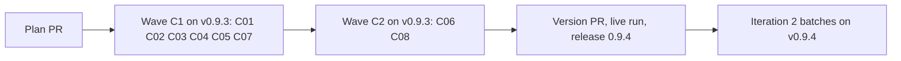

# Plan for 0.9.4

## Status (2026-11-12)

- Draft. Written after the 0.9.3 release, checked against `main` at e6ef2d9 (Release 0.9.3, #730). Nothing is built.
- This release is the first part of iteration 2 of the maintainer's decision D10. The batches of iteration 2 run on v0.9.4 after this release (Out of scope).
- K07 (#631, wave B2 of `docs/plan-0.9.2.md`) is still in its run. This plan does not touch its parts of `workflows/run-wave.js` (`runPRSteps`, the not-ready exits after the bot answer; `evaluatePrompt`) or `scripts/ledger.sh`.

## Summary in plain words

Iteration 1 showed two things that stop the pipeline from running with no person.

The first is the evals check. Of 16 eval lists, 5 were accepted on the first attempt, 6 on the second, and 5 stopped for a person. The check was right most of the time: of 40 points in its 14 refusals, 25 said the list could not be the contract, and only 3 or 4 refusals held corrections alone. The main cause is that the writer leaves behaviours of the entry with no eval, and builds fixtures on input shapes that the code never makes. So this release makes the writer map every bullet of the entry to its evals, and code refuses a bullet with no eval before the check runs. The check then ranks its points: a contract point refuses the list, a correction comes back as an edit that the writer applies once.

The second is the merge gate. Gitar's free plan ran out, and CodeRabbit reviews but does not approve. So no bot can clear a PR, and the maintainer merged wave B by hand. This release lets the gate accept a clean, completed CodeRabbit review of the head, read from the check run that only CodeRabbit's App can write. It also spends the scarce reviews only on final heads.

Three smaller fixes come with it: the minor pass runs after a resume that signs off and keeps the fixes its check did not fault, a list of more than 20 evals is refused in code, and a tests-only PR records its mutation proof.

Readers: the maintainer (the iteration report and the gate decision) and the sessions that run the batches and Tagreeve. Out: new roles, new run-wave arguments, the batch fixes, and the Wavewright rename. Each entry is one PR. A PR is done when its acceptance test passes in CI, an adversarial review reports no blockers or majors, and it is squash-merged.

## Goals this release serves

- Automatic improvement (goal 7) and my attention (goal 3): C01, C06 and C07 remove the evals-check stops that needed a person five times in iteration 1. C02 and C03 remove the hand merges that the bot gate forced in wave B.
- Trust in what merges (goal 1): C02 keeps a bot review as the gate and closes the ways a stranger or a skipped review could clear it. C05 makes the proof of a tests-only PR part of the record.
- Goal 8 share: every entry is work on the pipeline's own output (lists, gate, minor pass, break check), so the share is 8 of 8.

## Findings

| Finding | Issue | What is wrong |
| --- | --- | --- |
| The writer leaves a behaviour or an invariant of the entry with no eval, and the check finds it only on a full re-check of a new draft. | none (iteration 1 report) | 25 of 40 refusal points were contract-level, most of them a missing behaviour. Two attempts later a person is needed. |
| Fixtures are built on input shapes the code never makes (a `minors` field on a stopped result, a hand-built journal). | none (iteration 1 report) | The break check accepts such a test as proof, and the reviewer sees code and tests that agree. Only a pre-build check of the claim catches it. |
| The check answers a kind label, a fixture detail or a test file name with the same refusal as a missing behaviour. | none (iteration 1 report) | Each refusal costs a writer attempt and a full re-check. 3 or 4 of 14 refusals held corrections alone. |
| A list of 20 evals for an entry that closes two issues. | none (A01, #718) | The 3 to 6 per issue rule is prompt text only, and it did not bind. |
| No bot can clear the merge gate. | #736 | Gitar's free plan ran out. CodeRabbit posts no review object when a full review finds nothing, and its approval setting is unsafe on a public repo (any non-author can approve by command). |
| A CodeRabbit check run can end `success` without a full review. | #736 (comment) | "Review failed" ends `success` unless `fail_commit_status` is on; an incremental review covers only commits since the last review; a PR can change `.coderabbit.yaml` (path filters) for its own review. |
| The default bot regex `[bot]` matches any App, and the match is a substring test. | #736 (triage) | With no review object, a check run named like the bot from another App could clear the gate. |
| 52 of 60 heads spent CodeRabbit's review budget or hit its limit, on heads that were not final. | none | About one review an hour, also on a paid plan at this volume. |
| A resume that signs off skips the minor pass. | none (0.9.1 report) | K01 and K05 had no pass, so their minors were filed, not fixed. |
| A dropped minor pass reverts every fix, also the ones its check did not fault. | #702 | K02 and K03 lost fixes that were fine. An outside-marked minor is also lost when the pass drops for another reason. |
| The PR body of a tests-only PR says its mutation checks "were refused and not run", but three agents ran them. | none (Q630, #731) | The tester of the minor-pass check declined by its own scope and reported `refused`. The verifier's record says not-applicable for every eval, so the proof is only in prose. |

## Scope

In:

| Group | Entries | Issues | Size |
| --- | --- | --- | --- |
| The writer maps every bullet to its evals | C01 | #698 | M |
| The gate reads a clean bot review of the head | C02 | #736 | M |
| One review for each final head | C03 | none | S |
| A resume that signs off runs the minor pass | C04 | none | S |
| Tests-only proof and "not run" | C05 | #705, #721, #729 | S |
| A list size limit in code | C07 | none | S |
| The check ranks its points | C06 | none | M |
| A dropped pass keeps the fixes it did not fault | C08 | #701, #702 | M |

Not in:

| Issue | Why it waits |
| --- | --- |
| #706 | A sim case that fails alone. A batch fix with the other sim minors. |
| #708 | A ledger touch reason. `scripts/ledger.sh` is K07's, and the batches take the ledger minors together. |
| #723, #724, #726, #727 | Wording and numbering in the A09 and A10 scripts. A batch fix. |
| #732, #733, #734 | The land-fix list. They touch the `landFix` branch that K07 changes now. A batch fix after K07. |
| Plan review that does not converge | The coverage map may carry over to plan review (Flagged concerns). Not widened into this release. |

## Order and waves

Summary: six independent fixes in wave C1, the two that build on C01 and C04's parts in wave C2, then the release, then the batches.

Why this order:

- C06 goes to wave C2. It changes the same prompts as C01 (`evalsPrompt` and `evalsCheckPrompt`) and the writer loop of `writeEvals` that C01 calls into.
- C08 goes to wave C2. It changes `minorPass` and `minorReviewPrompt`, and C04 changes `minorPassRuns`; they are different parts, but C08's evals need C04's resume path to reach the pass.
- C02 and C03 are in one wave on purpose. C03 posts the full-review request that C02's rule reads. C02's evals use fixtures, so neither needs the other on `main` to be built.
- Both waves run on the installed v0.9.3. A fix must not judge itself, and `pluginRoot` is never `main`.

The wave C1 entries edit different parts of `workflows/run-wave.js`:

| Entry | Parts of `workflows/run-wave.js` |
| --- | --- |
| C01 | `EVALS` (the schema: the `coverage` field and the eval's `inputFrom`), `evalsRules`, `evalsPrompt` (step 3 and the Return line), `evalsCheckPrompt` (step 2), a new `coverageVerdict` after `evalsVerdict`, and in `writeEvals` only the one line after `evalsVerdict` in the writer loop that calls it |
| C03 | `openPrompt` (the create call only: open as a draft), `waitPrompt`, `bots` (only before the `botWait` call: mark ready and ask for one full review) |
| C04 | `minorPassRuns` |
| C05 | `refusedText`, `verifyPrompt` (only the tests-only break-check sentence), `breakCheckOf` (the new value) |
| C07 | `evalsVerdict` (one new rule at its end) |

C02 does not edit `workflows/run-wave.js`.

The wave C2 entries:

| Entry | Parts of `workflows/run-wave.js` |
| --- | --- |
| C06 | `EVALSCHECK` (the schema: ranked points), `checkEvals`, `writeEvals` (the writer loop after `checkEvals`, and its last attempt), `evalsPrompt` (the `last` text), `evalsCheckPrompt` (step 3 and the Return line) |
| C08 | `minorPass` (the `drop` branch and the result), `minorReviewPrompt` (the Return line), `minorRestore`, and in `runPRSteps` only the `pass.outside` return |

`skills/pr-pipeline/SKILL.md` has one line for each step of "The loop for one PR", so two edits of one step always conflict. No two entries of a wave share a part:

| Entry | Parts of SKILL.md |
| --- | --- |
| C01 | "Step 1: write the plan" the "Evals." bullet |
| C02 | "Step 3: land and merge" the gate paragraph; "When things go wrong" the `PR n NOT merged: the gate holds it` row |
| C03 | "The loop for one PR" step 9 and step 10 |
| C04 | "The loop for one PR" step 7 (one sentence on a resume) |
| C05 | "The loop for one PR" step 2 |
| C07 | "When things go wrong" one new row after the `evals refused:` row |
| C06 (wave C2) | "When things go wrong" the `evals refused: <rule>`, `evals check: <notes>` row |
| C08 (wave C2) | "The loop for one PR" step 7 (the drop sentences) |

C04 and C08 both edit step 7, in different waves. In `test/sim-pipeline.mjs` each entry adds its cases as one block after the anchor case its Touches line names, and no two entries share an anchor.

## How the iteration runs

- Both waves run from a local session with `pluginRoot` at the installed v0.9.3, never at `main`.
- `evals`, `breakCheck` and `docsUpdate` are on. The plan PR gets the product review and the architecture review.
- Every entry touches a gated path, so the maintainer merges each of them (by hand after a completed CodeRabbit review of the head, until C02 is released), and `merge-safety` does not run for them.
- After each run: `scripts/after-run.sh` from v0.9.3. A resume uses only the arguments that `scripts/resume-args.sh` prints.
- An evals-check stop gets one fresh rebuild with the refusal in the notes, as in iteration 1. A second stop moves the entry to the next iteration, except C01 and C02, whose second stop stops the release for the maintainer.
- The builder session reports to the assessment session when the plan PR opens, at the end of each wave, when a PR stops for the second time, and when the release is cut.

## Pass criteria (D10, iteration 2, written before the build)

Measured in the batches of iteration 2 on v0.9.4, against iteration 1's base of 16 lists: 5 accepted on attempt 1, 6 on attempt 2, 5 stopped.

1. **Lists accepted on the first attempt.** At least 3 in 4 of the batch lists are accepted on attempt 1.
2. **No evals-check stop for a person.** No batch PR stops with `evals check:` or `evals refused:` for a person. The automatic fresh attempt of C06 may be used, and each use is counted.
3. **A gate with no hand merge.** Every batch PR that is ready merges through `merge-pr.sh` with a bot cleared on the head, with no hand merge. The report gives the wait at the gate for each PR (from ready to cleared).
4. **One review for each final head.** Each batch PR has at most one completed CodeRabbit review before its final head, plus one for each bot-answer code change.
5. **The four per-PR criteria of iteration 1** (a list before the build, a result for each eval id in the PR body, the break check ran, a ledger record with tokens by role) hold for every PR of waves C1 and C2 and the batches.

## Rules for every PR

- Read `AGENTS.md` and `docs/goals.md`.
- Each PR adds tests that fail when the change is removed. The PR description says how that was checked.
- Each negative test checks that its input really contains what the check looks for.
- An entry with an **Invariants** line: the reviewer checks each invariant in every round, and the tests cover each one.
- Each acceptance run is `node test/sim-pipeline.mjs`, `node --test test/*.test.mjs` and `bash scripts/check-syntax.sh` in full.
- Every eval can be checked from a clean clone of the branch: no PR body, labels, bot comments, CI results or merges.
- An eval that says it fails on `main` must fail on `main`. A behaviour that already holds on `main` is kind `regression`.
- Simulation tests check only what code decides. What an agent judges is checked by its prompt text or by a code step after it.
- A fixture of a GitHub answer is built from a real answer of the same endpoint (a check run of PR 731 or 735, a review list, a comment list), with no data from another repo and no real paths of the maintainer's machine. The test says which endpoint it stands for.
- New tests go in new files. Named exception: `test/sim-pipeline.mjs`, where each entry adds its cases as one block after the anchor case its Touches line names.
- `workflows/run-wave.js` stays plain JavaScript with no filesystem, no `Date.now`, no `Math.random`.
- No entry adds a role, a step or a run-wave argument. A new field in an agent answer or in the result is allowed when the entry names it.
- Every entry runs with `docsUpdate` on. This repo has no `CHANGELOG.md`.
- Docs: Simplified Technical English, no em dashes, Mermaid with a one-line summary under each. Code comments only for why.
- Each behaviour and each invariant of an entry is its own bullet. The writer maps each bullet to its evals (C01), so a bullet that holds two behaviours gets split in review.

## PRs

### Wave C1

**C01 The writer maps every bullet of the entry to its evals (#698).** Round cap 3. Touches: `workflows/run-wave.js` (see the table in Order and waves), `agents/evals-writer.md` (the coverage and input-shape rules), `templates/plan.md` (the bullet rule), `test/evals-coverage.test.mjs` (new), `test/sim-pipeline.mjs` (cases after "E01-1 + E03a: the writer list that E01 accepted reaches the verifier, and a PR with no list goes to the tester"), `skills/pr-pipeline/SKILL.md` (see the table).
- The writer answer has a `coverage` field: one item for each bullet and each invariant of the entry, with the bullet text as the entry states it and the ids of the evals that cover it.
- Code refuses a writer list whose `coverage` is empty, has an item with no id, or names an id that is not in the list, with the reason `evals refused: coverage: <what>`. This runs before the evals check, so a refused list costs no check call.
- An eval whose check reads a fixture names the producer of the fixture's input shape in `inputFrom` (for example "a run-wave.js stopped result" or "the journal line of a finished agent").
- The evals check judges per coverage item: a bullet of the entry that is not in `coverage`, or an item whose ids do not cover it, is a gap. It judges each `inputFrom` claim against the code.
- `evalsRules` says that a quick-fix PR keeps the rules of its brief and of `AGENTS.md`, not "the rules in its brief" (#698).
- `templates/plan.md` says each behaviour and each invariant of an entry is its own bullet.
- A list with no fixture eval needs no `inputFrom`.
Invariants: a writer list reaches the evals check only when every coverage item has at least one id and every id names an eval of the list.
Evals:

| Id | Kind | What must be true | How to check |
| --- | --- | --- | --- |
| C01-1 | behaviour | A writer list with a coverage item that has no id is refused before the evals check. | Sim: the `evals:C1` answer has `coverage: [{ bullet: 'b1', ids: [] }]`; the reason starts with `evals refused: coverage:` and there is no `evalsarch:C1` call. On `main` the check runs. |
| C01-2 | error path | A coverage item that names an id not in the list is refused, and so is an empty `coverage`. | Sim: two cases; each reason starts with `evals refused: coverage:` and names the id or says the coverage is empty. |
| C01-3 | behaviour | A list with full coverage goes to the evals check, and the check prompt holds each coverage item. | Sim: the `evalsarch:C1#1` prompt holds each bullet text and its ids. |
| C01-4 | behaviour | The writer prompt and `agents/evals-writer.md` ask for `coverage` and for `inputFrom` on a fixture eval, and the check prompt asks it to judge per item and each `inputFrom` claim. | `test/evals-coverage.test.mjs`: reads the agent file and the two prompts from a sim run; each holds the rule. |
| C01-5 | behaviour | `templates/plan.md` holds the bullet rule, and `evalsRules` no longer limits a quick PR to its brief. | The same test file. |
| C01-6 | regression | A given list (resume or `skipImpl`) and a list equal to the record keep their paths, with no coverage refusal. | The existing A01 cases pass unchanged. |

Acceptance: `node --test test/evals-coverage.test.mjs` and `node test/sim-pipeline.mjs` pass; C01-1 fails on `main` because no code reads `coverage`.

**C02 The merge gate reads a clean bot review of the head (#736).** Round cap 3. `sensitive: true`. Touches: `scripts/bot-approval.jq`, `scripts/bot-status.sh` (the `nofinding` rule and the answer override move to a shared jq file), `scripts/merge-pr.sh` (passes each check run's `app.slug`, `head_sha`, `started_at`, title and summary), `scripts/review-clean.jq` (new, shared), `.github/pipeline.json` (`.coderabbit.yaml` joins the gates), `test/bot-clean-review.test.mjs` (new), `test/fixtures/bot-gate/` (new, from real answers), `skills/pr-pipeline/SKILL.md` (see the table).
- A bot clears the gate as `login (clean review)` when its check run on the head commit is `completed` with conclusion `success`, title "Finished" and a summary that starts "Result: Success - Review completed".
- That check run was made by the bot's own App: `app.slug` equals the bot login without `[bot]`, compared in full, not as a substring.
- That check run started after a full-review request on the PR (`@coderabbitai full review`) posted by the maintainer's account after the head commit was pushed.
- Every top-level inline comment the bot opened has a reply.
- No review of the bot on the head has a body with a finding (the `nofinding` rule, now in one jq file that `bot-status.sh` and `bot-approval.jq` both read).
- No CHANGES_REQUESTED review of the bot is open without a later APPROVED review from it.
- A PR that adds or changes `.coderabbit.yaml` never clears through this rule.
- Every other conclusion or title clears nothing: `neutral` ("Review rate limited"), `skipped` ("Review skipped", "Review paused", "No files to review", "Too many files to review", "Incremental review skipped"), `cancelled`, `failure`, and a `success` titled "Review failed".
- A commit status, or a check run with the bot's name from another App, clears nothing.
- The default bot pattern lists the bot logins in full (`coderabbitai[bot]`, `gitar-bot[bot]`), with no `[bot]` catch-all.
- The existing rules (APPROVED on the head, APPROVED earlier with a passing check run, COMMENTED and answered on an older commit) do not change.
- `.coderabbit.yaml` is a gated path, so the maintainer merges any change to it.
- No bot setting changes, and no `.coderabbit.yaml` is added.
Invariants: no comment, review or check run of an account other than the bot's App clears the gate; a check run that did not complete a full review of the head clears nothing.
Evals:

| Id | Kind | What must be true | How to check |
| --- | --- | --- | --- |
| C02-1 | behaviour | A success "Finished" "Review completed" run of `coderabbitai` on the head, started after a full-review request by the maintainer's account, with no open thread, clears the gate. | `test/bot-clean-review.test.mjs`: the PR 731 check run fixture with a request comment before its `started_at`; the output is `["coderabbitai[bot] (clean review)"]`. On `main` it is `[]`. |
| C02-2 | error path | A `neutral`, `skipped`, `cancelled` or `failure` run, and a `success` run titled "Review failed", clear nothing. | The same test file: one case each; the PR 735 neutral fixture is one of them. |
| C02-3 | error path | A clean run with no full-review request, or with the request after the run started, clears nothing. | The same test file: two cases. |
| C02-4 | error path | A run on an older commit, a run from another App with the same name, and a commit status named CodeRabbit clear nothing. | The same test file: three cases. |
| C02-5 | error path | An unanswered inline thread, a head review body with "Actionable comments posted: 1", or an open CHANGES_REQUESTED keep the gate closed. | The same test file: three cases. |
| C02-6 | error path | A PR whose files include `.coderabbit.yaml` does not clear through the clean-review rule, and `gate-files.sh` holds it. | The same test file with a files fixture; and `bash scripts/gate-files.sh` on a fixture list holds the path. |
| C02-7 | regression | The existing gate cases pass unchanged, and the default bot pattern no longer matches `github-actions[bot]`. | `node --test test/bot-approval.test.mjs`, and a new case for the pattern. |

Acceptance: `node --test test/bot-clean-review.test.mjs test/bot-approval.test.mjs` passes; C02-1 fails on `main` because the gate has no clean-review rule.

**C03 One review for each final head.** Round cap 2. Touches: `workflows/run-wave.js` (see the table), `agents/pr-opener.md` (the draft rule), `agents/bot-waiter.md` (the ready and request steps), `test/review-budget.test.mjs` (new), `test/sim-pipeline.mjs` (cases after "a bot answer in words only needs no check"), `skills/pr-pipeline/SKILL.md` (see the table).
- The opener creates a new PR as a draft. An existing open PR keeps its state.
- Before the bot wait, the bot waiter marks the PR ready for review, then posts one `@coderabbitai full review` comment on the head, and waits.
- After a bot answer that changed code, the bot waiter posts one more full-review request for the new head.
- The bot waiter posts no request when the bot already has a completed run on the head.
- Rate limits: the bot waiter does not post again within the wait. A rate-limited run is reported in `notes`, and the PR stays not cleared.
Invariants: the workflow posts at most one full-review request for each head commit.
Evals:

| Id | Kind | What must be true | How to check |
| --- | --- | --- | --- |
| C03-1 | behaviour | The open prompt creates a new PR as a draft and keeps the state of an existing one. | Sim: the `open:C1` prompt holds the draft create call and the keep rule. On `main` it holds no draft. |
| C03-2 | behaviour | The bot-wait prompt marks the PR ready, then asks for one full review on the head, and asks for none when a completed run exists. | Sim: the `botwait:C1` prompt holds the three rules. |
| C03-3 | behaviour | After a bot answer with `codeChanged: true`, the bot-wait prompt of the next wait asks for one full review of the new head. | Sim: the second wait prompt holds the new head sha and the request. |
| C03-4 | behaviour | `agents/pr-opener.md` and `agents/bot-waiter.md` hold the draft and request rules, with the one-request-per-head limit. | `test/review-budget.test.mjs`. |

Acceptance: `node --test test/review-budget.test.mjs` and `node test/sim-pipeline.mjs` pass; C03-1 fails on `main`.

**C04 A resume that signs off runs the minor pass.** Round cap 2. Touches: `workflows/run-wave.js` (`minorPassRuns`), `test/sim-pipeline.mjs` (cases after "minor pass: a major from the check does the same"), `skills/pr-pipeline/SKILL.md` (see the table).
- A resume that signs off runs the minor pass, like a first run.
- A `skipImpl` rerun, a docs PR and a plan PR still skip it.
Evals:

| Id | Kind | What must be true | How to check |
| --- | --- | --- | --- |
| C04-1 | behaviour | A resume that signs off with a minor in a file in scope makes a `minorfix:` call. | Sim: `resume: { history, findings, evals }` with one minor; a `minorfix:C1` call. On `main` there is none. |
| C04-2 | regression | A `skipImpl` rerun, a docs PR and a plan PR make no `minorfix:` call. | Sim: three cases. |
| C04-3 | behaviour | SKILL.md step 7 says a resume that signs off runs the pass. | `grep -c` on the step line prints 1. |

Acceptance: `node test/sim-pipeline.mjs` passes; C04-1 fails on `main` because `minorPassRuns` is false for a resume.

**C05 A tests-only PR records its proof, and "not run" means no role ran it (#705, #721, #729).** Round cap 2. Touches: `workflows/run-wave.js` (see the table), `agents/verifier.md` (the tests-only rule), `agents/tester.md` (the scope rule), `test/break-check-mutation.test.mjs` (new), `test/sim-pipeline.mjs` (cases after the tests-only cases of #659), `skills/pr-pipeline/SKILL.md` (see the table).
- On a tests-only PR the verifier runs, for each eval whose statement says it fails when a rule is removed, a named mutation of the code under test in its clone, and reports `breakCheck: fails-on-mutation` with the mutation in `breakWhy` when the case fails. It restores the file after each mutation.
- `breakCheckOf` counts `fails-on-mutation` as proof, like `fails-without-change`.
- A tests-only eval with no such statement stays not-applicable.
- A tester that does not run a step because the step is outside its task reports it as `skipped: outside scope`, not as `refused`. `refused` is only for a permission check or a file that could not run.
- SKILL.md step 2 says that a missing file the change adds is proof (#721), and a test pins the wording (#729).
- The full-file fallback of a case that fails alone with the change does not give `fails-without-change` (#705).
Evals:

| Id | Kind | What must be true | How to check |
| --- | --- | --- | --- |
| C05-1 | behaviour | A tests-only verify answer with `fails-on-mutation` counts as a break-check fail in the history row. | Sim: a tests-only PR whose verifier answers `fails-on-mutation` for C1-1; the row's `breakCheck.fails` holds C1-1. On `main` the value is not read. |
| C05-2 | behaviour | The verify prompt of a tests-only PR asks for a named mutation for each "fails when removed" eval and the restore step. | Sim: the `verify:C1#1` prompt of a tests-only PR holds the rule. |
| C05-3 | behaviour | `agents/tester.md` and `refusedText` say a step outside the task is `skipped: outside scope`, not `refused`. | `test/break-check-mutation.test.mjs`. |
| C05-4 | behaviour | SKILL.md step 2 holds the added-file proof sentence, and the test fails when it is removed. | The same test file. |
| C05-5 | error path | A case that fails alone with the change and passes in the full file gives no `fails-without-change`. | The same test file, with the prompt text of `verifyPrompt`. |

Acceptance: `node --test test/break-check-mutation.test.mjs` and `node test/sim-pipeline.mjs` pass; C05-1 fails on `main`.

**C07 A list of more than 20 evals is refused in code.** Round cap 2. Touches: `workflows/run-wave.js` (`evalsVerdict`), `test/evals-size.test.mjs` (new), `skills/pr-pipeline/SKILL.md` (see the table).
- `evalsVerdict` refuses a list of more than 20 evals with `evals refused: more than 20 evals (<n>)`.
- The 3 to 6 per issue rule stays a writer rule, and the coverage map of C01 is the check of what each eval covers.
- A given list or a list equal to the record goes through the same rule.
Evals:

| Id | Kind | What must be true | How to check |
| --- | --- | --- | --- |
| C07-1 | behaviour | A writer list of 21 evals is refused before the evals check, and the reason names 21. | Sim: no `evalsarch:` call; the reason holds `more than 20 evals (21)`. On `main` the check runs. |
| C07-2 | size limit | A list of exactly 20 evals passes the rule. | Sim: the `evalsarch:C1#1` call runs. |
| C07-3 | error path | A resume with a given list of 21 evals stops with the same reason. | Sim. |

Acceptance: `node test/sim-pipeline.mjs` passes; C07-1 fails on `main`.

### Wave C2

**C06 The evals check ranks its points.** Round cap 3. Touches: `workflows/run-wave.js` (see the table), `agents/arch-reviewer.md` and `agents/product-reviewer.md` (the evals-check rank rule), `agents/evals-writer.md` (applying corrections), `test/evals-rank.test.mjs` (new), `test/sim-pipeline.mjs` (cases after the C01 block), `skills/pr-pipeline/SKILL.md` (see the table).
- The evals check returns `points`: each with a `rank` (`contract` or `correction`), the eval id or coverage item it is about, and for a correction the exact edit (`edit`: the field and its new value, or a new case for an existing eval).
- A contract point is one of: a coverage item with no eval that covers it, an eval that cannot be checked from a clean clone, a false claim about `main` that changes what is proven, an eval that needs an edit outside Touches or breaks a plan rule, a check that can pass for the wrong reason, and a fixture whose `inputFrom` claim is false.
- Only a contract point refuses the list.
- When every point is a correction, the writer gets the edits once and applies them. Code then checks that each edit is in the new list (the field holds the new value, or the eval has one more case in its check), and accepts the list with no second evals check.
- A writer answer that does not apply every edit is refused with `evals refused: correction not applied: <id>`.
- A kind label is never a contract point.
- After the last writer attempt is refused, the workflow makes one fresh attempt, with the refusal in the writer's prompt and no earlier draft. Its list goes through the normal check. Its stop is the stop for a person.
- The result counts the attempts in `evalsMeta.attempts` and the fresh attempt in `evalsMeta.fresh`.
Invariants: a list that a contract point refused never reaches the verifier without a later evals check that has no contract point.
Evals:

| Id | Kind | What must be true | How to check |
| --- | --- | --- | --- |
| C06-1 | behaviour | A check answer with only correction points leads to one writer call with the edits, and a list that applies them is accepted with no second `evalsarch:` call. | Sim: `evalsarch:C1#1` returns two corrections; the next writer list applies both; calls hold `evals:C1#w2` and no `evalsarch:C1#2`; the PR reaches `verify:`. On `main` a second check runs. |
| C06-2 | error path | A writer list that leaves out one correction is refused with `evals refused: correction not applied:` and the eval id. | Sim. |
| C06-3 | behaviour | A check answer with one contract point refuses the list, and the next attempt gets a full check. | Sim: `evalsarch:C1#2` runs. |
| C06-4 | behaviour | After the last attempt is refused, one fresh attempt runs with the refusal and no earlier draft, and its stop is the reason. | Sim: the `evals:C1#fresh` prompt holds the refusal text and no earlier list; `evalsMeta.fresh` is true. |
| C06-5 | behaviour | The check prompt and the agent files give the two ranks and the contract list, and say a kind label is never a contract point. | `test/evals-rank.test.mjs`. |
| C06-6 | regression | A check answer with verdict `ok` and no points accepts the list as today. | The existing E01 cases pass unchanged. |

Acceptance: `node --test test/evals-rank.test.mjs` and `node test/sim-pipeline.mjs` pass; C06-1 fails on `main`.

**C08 A dropped minor pass keeps the fixes its check did not fault (#701, #702).** Round cap 3. Touches: `workflows/run-wave.js` (see the table), `agents/reviewer.md` (the per-fix fault rule of the minor check), `test/minor-partial.test.mjs` (new), `test/sim-pipeline.mjs` (cases after the C04 block), `skills/pr-pipeline/SKILL.md` (see the table).
- The minor-check answer names, for each blocker or major, the numbers of the pass fixes it faults.
- When the tests pass and every blocker or major names its fixes, the pass reverts only the faulted fixes, and the tester and the check run once more on the new head. When they find nothing, the other fixes stay, and the result lists them as fixed.
- When the tests fail, or a blocker or major names no fix, the whole pass drops as today.
- There is no third run: a finding on the second run drops the whole pass.
- An outside-marked minor stays in the minors list when the pass drops for any reason (#702).
- The `needs human: untrusted path outside the minor pass:` stop keeps its prefix in every path (#701).
Invariants: a kept pass fix was checked by a tester run and a check run on a head that holds it and no faulted fix.
Evals:

| Id | Kind | What must be true | How to check |
| --- | --- | --- | --- |
| C08-1 | behaviour | A check major that faults fix 2 of 3 reverts fix 2 only, a second check runs, and fixes 1 and 3 are in the result's fixed list. | Sim: calls hold `minorrevert:C1`, `test:C1#minor2` and `minorreview:C1#2`; `minorPass.fixed` has two titles. On `main` the pass drops all three. |
| C08-2 | error path | A failing test, or a major that names no fix, drops the whole pass. | Sim: two cases; `minorPass.kept` is false. |
| C08-3 | error path | A finding on the second check drops the whole pass, with no third run. | Sim: no `minorreview:C1#3`. |
| C08-4 | behaviour | An outside-marked minor stays in the minors when the pass drops because the tests failed. | Sim (#702). |
| C08-5 | behaviour | `agents/reviewer.md` asks the minor check to name the faulted fixes. | `test/minor-partial.test.mjs`. |

Acceptance: `node --test test/minor-partial.test.mjs` and `node test/sim-pipeline.mjs` pass; C08-1 fails on `main`.

## Date estimate

- Size: 8 PRs, this plan PR and the version PR. About 10 to 14 million subagent tokens without cache reads (a planning figure, from iteration 1: 0.9M to 2.1M per PR, plus land fixes and one fresh rebuild).
- The gate is the slow part. Until C02 is released, each PR waits for one completed CodeRabbit review (about one an hour) and a hand merge. A wave of six PRs that become ready over one to two hours waits about 3 hours on average and about 6 hours for the last one.
- Dates: plan PR on 2026-11-13; wave C1 on 2026-11-13 to 2026-11-14; wave C2, the live run and the 0.9.4 release on 2026-11-14 to 2026-11-15. **Range: 2026-11-15 to 2026-11-16.** The batches of iteration 2 follow on v0.9.4.
- It assumes: the maintainer merges each PR within a few hours of a clean review until C02 is released, and starts the live run.

## Flagged concerns

- **The review budget.** CodeRabbit's open-source tier gives about one review an hour here, and its paid plans drop to about the same rate at this volume (the fair-usage refill after 70 reviews in 7 days). C03 spends one review on each final head. The wait per PR goes in the report, so the maintainer can weigh a second reviewer bot (Gemini Code Assist, Qodo Merge, Sourcery or Copilot code review, none checked yet) against the wait. A second bot joins the gate only when it gives a signal that the gate can read with an exact App slug.
- **The full-review request is a comment.** C02 trusts a request only from the maintainer's account, and it is the check run, not the comment, that clears the gate. A stranger's request can start a review but cannot change what the review finds.
- **A failed review ends `success`.** C02 reads the title and the summary, not only the conclusion. If CodeRabbit changes those texts, the gate clears nothing, which is the safe side. Setting `reviews.fail_commit_status` would make it plainer, but it changes a bot setting, so it is the maintainer's choice.
- **C06 trusts the check's rank.** A check that ranks a contract gap as a correction lets the list through after one edit. The reviewer after the evals and the break check still see a missing behaviour once the tests exist, so the cost is a later round, not a merged gap.
- **C08 adds a second check run to the minor pass.** It costs a tester and a reviewer more on a partly faulted pass, and saves the fixes that iteration 1 lost.
- **The coverage map and plan review.** Plan review did not converge in three rounds in iteration 1 (1 blocker and 4 majors, then 2 majors, then 4 majors). The same idea may carry over: each goal and each finding of a plan mapped to an entry, and code refusing a finding with no entry. This is a candidate for release 3's planner, not part of this release.
- **The size limit is 20 for any PR.** A single entry like A01 can still reach 20. If the batches show single entries near the limit, iteration 3 can make the limit depend on the coverage items.

## Out of scope

| Item | Why it waits |
| --- | --- |
| The iteration 2 batches (about 7 issues each, one deliberate batch of 10 to 12) | They run on v0.9.4 after this release, so the new check and gate judge them. |
| The Wavewright rename | Its own release after D10 and before Tagreeve. |
| A second reviewer bot | A decision for the maintainer after the gate wait is measured. |
| `reviews.fail_commit_status` and any other CodeRabbit setting | Bot settings are the maintainer's. C02 needs none. |
| Any change in `alfhen/tagreeve` | Its maintainer's PRs. |
