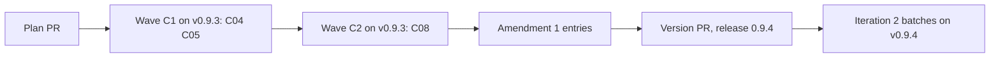

# Plan for 0.9.4

## Status (2026-11-13)

- Draft, narrowed after plan review. Written after the 0.9.3 release, checked against `main` at ff1cfc7 (K01, #735). Nothing is built.
- This release is the first part of iteration 2 of the maintainer's decision D10. The batches of iteration 2 run on the release that holds the evals-check entries (Release).
- Plan review of the first draft (eight entries) did not converge: round 1 had 3 blockers and 9 majors, round 2 had 6 blockers and 13 majors, most of them on mechanism detail of C01, C02, C03, C06 and C07. The assessment session decided under the maintainer's overnight rule: this plan keeps the entries that settled (C04, C05, C08), and the others are held (Held for amendment).
- K07 (#631, wave B2 of `docs/plan-0.9.2.md`) is still in its run. This plan does not touch its parts of `workflows/run-wave.js` (`runPRSteps`, the not-ready exits after the bot answer; `evaluatePrompt`) or `scripts/ledger.sh`.

## Summary in plain words

Iteration 1 showed two large problems and three small ones. The large ones are the evals check (of 16 eval lists, 5 were accepted on the first attempt and 5 stopped for a person) and the merge gate (no bot can clear a PR since Gitar's free plan ran out). Their entries need more design work, so they are held for an amendment and for the maintainer.

This plan builds the three small ones now:

- C04: a resume that signs off runs the minor pass, like a first run.
- C05: a tests-only PR records its mutation proof, and a check is "not run" only when no role ran it.
- C08: a dropped minor pass keeps the fixes its check did not fault.

Readers: the maintainer and the sessions that run the batches and Tagreeve. Out: new roles, new run-wave arguments, the batch fixes, the Wavewright rename. Each entry is one PR. A PR is done when its acceptance test passes in CI, an adversarial review reports no blockers or majors, and it is squash-merged.

## Goals this release serves

- Automatic improvement (goal 7): C04 and C08 keep minor fixes that iteration 1 filed or lost. C05 makes a tests-only proof part of the record, so a tests-only PR needs no person for it.
- Goal 8 share: every entry is work on the pipeline's own output, so the share is 3 of 3.

## Findings

| Finding | Issue | What is wrong |
| --- | --- | --- |
| A resume that signs off skips the minor pass. | none (0.9.1 report) | K01 and K05 had no pass, so their minors were filed, not fixed. |
| A dropped minor pass reverts every fix, also the ones its check did not fault. | #702 | K02 and K03 lost fixes that were fine. An outside-marked minor is also lost when the pass drops for another reason. |
| The PR body of a tests-only PR says its mutation checks "were refused and not run", but three agents ran them. | none (Q630, #731) | The tester of the minor-pass check declined by its own scope and reported `refused`. The verifier's record says not-applicable for every eval, so the proof is only in prose. |

## Scope

In:

| Group | Entries | Issues | Size |
| --- | --- | --- | --- |
| A resume that signs off runs the minor pass | C04 | none | S |
| Tests-only proof and "not run" | C05 | #705, #721, #729 | S |
| A dropped pass keeps the fixes it did not fault | C08 | #701, #702 | M |

Not in:

| Issue | Why it waits |
| --- | --- |
| #698, and the evals-check entries C01, C06, C07 | Held for amendment 1 (Held for amendment). |
| #736, and the gate entries C02, C03 | Held for the maintainer (Held for amendment). |
| #706 | A sim case that fails alone. A batch fix with the other sim minors. |
| #708 | A ledger touch reason. `scripts/ledger.sh` is K07's, and the batches take the ledger minors together. |
| #723, #724, #726, #727 | Wording and numbering in the A09 and A10 scripts. A batch fix. |
| #732, #733, #734 | The land-fix list. They touch the `landFix` branch that K07 changes now. A batch fix after K07. |

## Held for amendment

| Entry | What it is for | Why it is held |
| --- | --- | --- |
| C01 The writer maps every bullet of the entry to its evals (#698) | The coverage map. | Amendment 1 rewrites it in what-must-be-true form. Code can check only that every coverage item has an eval id and that every id is in the list; whether the items are all the bullets of the entry is the check's judgment. |
| C06 The evals check ranks its points | Corrections applied once, and an automatic fresh attempt. | Amendment 1 rewrites it in what-must-be-true form. |
| C07 A size limit in code | The list size. | Amendment 1 rewrites it: the limit counts per coverage item and does not count evals a reviewer adds in a run. It must not reverse sim case A06-7, and it must not share a part of `workflows/run-wave.js` with C01 in one wave. |
| C02 The merge gate reads a clean bot review of the head (#736) | The gate while no bot approves. | It sets what clears the merge gate (whose reply counts, a check run with no App, the request rule). The maintainer decides first. |
| C03 One review for each final head | The review budget. | It sets when a review is asked, and its draft step needs a call that the REST-only rule forbids. The maintainer decides first, with C02. |

## Order and waves

Summary: two small fixes in wave C1, C08 after C04 is on main, then the entries of amendment 1, then the version PR and the release.

Why this order:

- C08 goes to wave C2, after C04 is on `main`. C04 changes `minorPassRuns`, and C08's evals use the resume path that C04 opens to reach the pass.
- Both waves run on the installed v0.9.3. A fix must not judge itself, and `pluginRoot` is never `main`.

The entries edit different parts of `workflows/run-wave.js`:

| Entry | Parts of `workflows/run-wave.js` |
| --- | --- |
| C04 | `minorPassRuns` |
| C05 | `refusedText`, `verifyPrompt` (only the tests-only break-check sentence), `VERIFY` (the `breakCheck` enum), `verifyOutcome` (the `testsOnly` branch), `breakCheckOf` (the new value), `TESTS_ONLY_LINE` and its rule in `openPrompt` (only the tests-only sentence) |
| C08 (wave C2) | `MINORFIX` (the commit map), `MINORREVIEW` (a `fixes` field on each finding), `normalizeFindings` and `absorb` (only the copy of the `fixes` field), `minorFixPrompt` (one commit for each fix), `minorPass` (the `drop` branch and the result), `minorReviewPrompt` (the Return line), `minorRevertPrompt`, `minorRestore` (the partial-revert check through `scripts/minor-partial.sh`), and in `runPRSteps` only the `pass.outside` return |

`skills/pr-pipeline/SKILL.md` has one line for each step of "The loop for one PR", so two edits of one step always conflict:

| Entry | Parts of SKILL.md |
| --- | --- |
| C04 | "The loop for one PR" step 7 (one sentence on a resume) |
| C05 | "The loop for one PR" step 2 |
| C08 (wave C2) | "The loop for one PR" step 7 (the drop sentences) |

C04 and C08 both edit step 7, in different waves. In `test/sim-pipeline.mjs` each entry adds its cases as one block after the anchor case its Touches line names, and no two entries share an anchor.

## How the iteration runs

- Both waves run from a local session with `pluginRoot` at the installed v0.9.3, never at `main`.
- `evals`, `breakCheck` and `docsUpdate` are on. The plan PR gets the product review and the architecture review.
- Every entry touches a gated path. Until a gate change is released, each PR merges under the maintainer's standing rule of 2026-11-12: after a completed CodeRabbit review of the final head and green CI, with a merge record and a basis note. `merge-safety` does not run for them.
- After each run: `scripts/after-run.sh` from v0.9.3. A resume uses only the arguments that `scripts/resume-args.sh` prints.
- An evals-check stop gets one fresh rebuild with the refusal in the notes, as in iteration 1. A second stop moves the entry to the next iteration.
- The builder session reports to the assessment session when the plan PR opens, at the end of each wave, when a PR stops for the second time, and when the release is cut.

## Pass criteria (written before the build)

For the entries of this plan:

1. **The four per-PR criteria of iteration 1** (a list before the build, a result for each eval id in the PR body, the break check ran, a ledger record with tokens by role) hold for C04, C05 and C08.
2. **C04 on a real resume.** The first resume in the batches that signs off makes a minor pass, and its result has a `minorPass` field.
3. **C05 on a real tests-only PR.** The first tests-only PR in the batches has a `fails-on-mutation` result for each eval whose statement says it fails when a rule is removed, and its PR body has no "refused" line for a check that a role ran.
4. **C08 on a real partial drop.** When a minor-pass check in the batches faults some fixes and not others, the result lists the kept fixes, or the report says that no such case came up.

The list-acceptance criteria (at least 3 in 4 lists accepted on attempt 1, and no evals-check stop for a person, against iteration 1's base of 16 lists: 5 accepted on attempt 1, 6 on attempt 2, 5 stopped) apply to the batches. They are measured on the release that holds the entries of amendment 1, not on this plan's entries alone.

## Rules for every PR

- Read `AGENTS.md` and `docs/goals.md`.
- Each PR adds tests that fail when the change is removed. The PR description says how that was checked.
- Each negative test checks that its input really contains what the check looks for.
- An entry with an **Invariants** line: the reviewer checks each invariant in every round, and the tests cover each one.
- Each acceptance run is `node test/sim-pipeline.mjs`, `node --test test/*.test.mjs` and `bash scripts/check-syntax.sh` in full.
- Every eval can be checked from a clean clone of the branch: no PR body, labels, bot comments, CI results or merges.
- An eval that says it fails on `main` must fail on `main`. A behaviour that already holds on `main` is kind `regression`.
- Simulation tests check only what code decides. What an agent judges is checked by its prompt text or by a code step after it.
- A fixture of a GitHub answer is built from a real answer of the same endpoint (a check run of PR 731 or 735, a review list, a comment list), with no data from another repo and no real paths of the maintainer's machine. The test says which endpoint it stands for.
- New tests go in new files. Named exception: `test/sim-pipeline.mjs`, where each entry adds its cases as one block after the anchor case its Touches line names, and edits the existing helpers and cases its Touches line names.
- `workflows/run-wave.js` stays plain JavaScript with no filesystem, no `Date.now`, no `Math.random`.
- No entry adds a role, a step or a run-wave argument. A new field in an agent answer or in the result is allowed when the entry names it.
- Every entry runs with `docsUpdate` on. This repo has no `CHANGELOG.md`.
- Docs: Simplified Technical English, no em dashes, Mermaid with a one-line summary under each. Code comments only for why.
- Each behaviour and each invariant of an entry is its own bullet, and the entry says what must be true, not how the code does it. The mechanism is the build's.

## PRs

### Wave C1

**C04 A resume that signs off runs the minor pass.** Round cap 2. Touches: `workflows/run-wave.js` (`minorPassRuns`), `test/sim-pipeline.mjs` (the existing case "minor pass: a skipImpl rerun or a resume runs no pass", which keeps its `skipImpl` half and drops its resume half; and cases after "minor pass: a major from the check does the same"), `skills/pr-pipeline/SKILL.md` (see the table).
- A resume that signs off runs the minor pass, like a first run.
- A `skipImpl` rerun, a docs PR and a plan PR still skip it.
Evals:

| Id | Kind | What must be true | How to check |
| --- | --- | --- | --- |
| C04-1 | behaviour | A resume that signs off with a minor in a file in scope makes a `minorfix:` call. | Sim: `resume: { history, findings, evals }` with one minor; a `minorfix:C1` call. On `main` there is none. |
| C04-2 | regression | A `skipImpl` rerun, a docs PR and a plan PR make no `minorfix:` call. | Sim: three cases. Each case holds a minor in a file in scope, so on a run that does the pass a `minorfix:` call happens and the case fails. |
| C04-3 | behaviour | SKILL.md step 7 says a resume that signs off runs the pass. | `grep -c` on the step line prints 1. |

Acceptance: `node test/sim-pipeline.mjs` passes; C04-1 fails on `main` because `minorPassRuns` is false for a resume.

**C05 A tests-only PR records its proof, and "not run" means no role ran it (#705, #721, #729).** Round cap 2. Touches: `workflows/run-wave.js` (see the table), `agents/verifier.md` (the tests-only rule), `agents/tester.md` (the scope rule), `test/break-check-mutation.test.mjs` (new), `test/verifier-agent.test.mjs` (the tests-only sentence at line 58 changes with the rule), `test/sim-pipeline.mjs` (the F659 tests-only cases that pin the "could not prove" sentence change; and cases after the tests-only cases of #659), `skills/pr-pipeline/SKILL.md` (see the table).
- On a tests-only PR the verifier runs, for each eval whose statement says it fails when a rule is removed, a named mutation of the code under test in its clone, and reports `breakCheck: fails-on-mutation` with the mutation in `breakWhy` when the case fails. It restores the file after each mutation.
- The `VERIFY` schema allows `fails-on-mutation` in `breakCheck`. `verifyOutcome` keeps the value on a tests-only PR, where it sets it to null today.
- `breakCheckOf` counts `fails-on-mutation` as proof, like `fails-without-change`.
- `TESTS_ONLY_LINE` says the break check could not prove the tests can fail only when no eval has a mutation proof. With a proof it says which evals the mutation proved. The F659 cases and `test/verifier-agent.test.mjs` are updated to match, and keep the old sentence for the no-proof case.
- A tests-only eval with no such statement stays not-applicable.
- A tester that does not run a step because the step is outside its task reports it as `skipped: outside scope`, not as `refused`. `refused` is only for a permission check or a file that could not run.
- SKILL.md step 2 says that a missing file the change adds is proof (#721), and a test pins the wording (#729).
- The full-file fallback of a case that fails alone with the change does not give `fails-without-change` (#705).
Evals:

| Id | Kind | What must be true | How to check |
| --- | --- | --- | --- |
| C05-1 | behaviour | A tests-only verify answer with `fails-on-mutation` counts as a break-check fail in the history row, and the PR body line does not say "could not prove" for it. | Sim: a tests-only PR whose verifier answers `fails-on-mutation` for C1-1; the row's `breakCheck.fails` holds C1-1 and the open prompt holds the proof sentence. On `main` `breakCheck` is null for a tests-only PR. |
| C05-2 | behaviour | The verify prompt of a tests-only PR asks for a named mutation for each "fails when removed" eval and the restore step. | Sim: the `verify:C1#1` prompt of a tests-only PR holds the rule. |
| C05-3 | behaviour | `agents/tester.md` and `refusedText` say a step outside the task is `skipped: outside scope`, not `refused`. | `test/break-check-mutation.test.mjs`. |
| C05-4 | behaviour | SKILL.md step 2 holds the added-file proof sentence, and the test fails when it is removed. | The same test file. |
| C05-5 | error path | A case that fails alone with the change and passes in the full file gives no `fails-without-change`. | The same test file, with the prompt text of `verifyPrompt`. |

Acceptance: `node --test test/break-check-mutation.test.mjs` and `node test/sim-pipeline.mjs` pass; C05-1 fails on `main`.

### Wave C2

**C08 A dropped minor pass keeps the fixes its check did not fault (#701, #702).** Round cap 3. Touches: `workflows/run-wave.js` (see the table), `agents/reviewer.md` (the per-fix fault rule of the minor check), `scripts/minor-partial.sh` (new), `AGENTS.md` (step 6, the drop sentences), `test/minor-partial.test.mjs` (new, runs the script on a scratch repo), `test/sim-pipeline.mjs` (cases after the C04 block), `skills/pr-pipeline/SKILL.md` (see the table).
- The fix agent makes one commit for each fix, and `MINORFIX` returns a commit map: the fix number and its sha.
- The minor-check answer names, for each blocker or major, the numbers of the pass fixes it faults.
- The `MINORREVIEW` schema gives each finding a `fixes` field (the numbers of the pass fixes it faults). `normalizeFindings` and `absorb` copy that field, so it is not lost when findings are merged, and two findings with one title keep the union of their fix numbers.
- When the tests pass and every blocker or major names its fixes, the pass reverts only the faulted fix commits, and the tester and the check run once more on the new head. When they find nothing, the other fixes stay, and the result lists them as fixed.
- Code does not trust the reverting agent's head. `scripts/minor-partial.sh` builds a scratch branch from the signed-off sha with a cherry-pick of the kept commits from the commit map, and the new head is accepted only when its tree equals the tree of that branch. A cherry-pick conflict, a missing sha, or a tree that differs drops the whole pass. The agent of `minorRevertPrompt` is told to revert the named commits only.
- When the tests fail, or a blocker or major names no fix, the whole pass drops as today.
- There is no third run: a finding on the second run drops the whole pass.
- An outside-marked minor stays in the minors list when the pass drops for any reason (#702).
- The `needs human: untrusted path outside the minor pass:` stop keeps its prefix in every path (#701).
- `AGENTS.md` step 6 says a pass reverts only the faulted fixes when the tests pass, and drops whole otherwise.
Invariants: a kept pass fix was checked by a tester run and a check run on a head that holds it and no faulted fix, and the script checked that head.
Evals:

| Id | Kind | What must be true | How to check |
| --- | --- | --- | --- |
| C08-1 | behaviour | A check major that faults fix 2 of 3 reverts fix 2 only, a second check runs, and fixes 1 and 3 are in the result's fixed list. | Sim: calls hold `minorrevert:C1`, `test:C1#minor2` and `minorreview:C1#2`; `minorPass.fixed` has two titles. On `main` the pass drops all three. |
| C08-2 | error path | A failing test, or a major that names no fix, drops the whole pass. | Sim: two cases; `minorPass.kept` is false. |
| C08-3 | error path | A finding on the second check drops the whole pass, with no third run. | Sim: no `minorreview:C1#3`. |
| C08-4 | behaviour | An outside-marked minor stays in the minors when the pass drops because the tests failed. | Sim (#702). |
| C08-5 | behaviour | `agents/reviewer.md` asks the minor check to name the faulted fixes, `minorFixPrompt` asks for one commit for each fix, and `minorRevertPrompt` names the commits to revert. | `test/minor-partial.test.mjs`. |
| C08-6 | error path | A partial revert that the agent reports as done but whose head still holds the faulted fix drops the whole pass. | Sim: the reverter returns `reverted: true` with a head whose tree differs from the script's; `minorPass.kept` is false and no kept fix is listed. |
| C08-7 | behaviour | `scripts/minor-partial.sh` accepts a head whose tree equals the kept-commits tree, and refuses a tree that holds the faulted fix and a cherry-pick conflict. | `test/minor-partial.test.mjs`: three cases on a scratch repo. |
| C08-8 | behaviour | `AGENTS.md` step 6 holds the partial-revert sentence. | The same test file greps it. |
| C08-9 | behaviour | Two minor-check findings with one title, one faulting fix 1 and one faulting fix 3, merge into one finding that faults fixes 1 and 3. | Sim: the `minorreview:C1` answer has the two findings; the pass reverts fixes 1 and 3 and keeps fix 2. On `main` the answer has no `fixes` field to keep. |

Acceptance: `node --test test/minor-partial.test.mjs` and `node test/sim-pipeline.mjs` pass; C08-1 fails on `main`.

## Release

- No tag for C04, C05 and C08 alone. Each tag costs the maintainer a plugin reload, and these three do little for the batches.
- The version PR waits until the entries of amendment 1 (C01, C06, C07) are on `main` too. Then 0.9.4 is tagged without C02 and C03, and with no live run (the maintainer waived it for 0.9.4). The gate entries become 0.9.5 after the maintainer's decision.
- If amendment 1 does not converge in its plan review, there is no 0.9.4 tag until it does.

## Date estimate

- Size: 3 PRs, this plan PR, amendment 1 with 3 more PRs, and the version PR. About 5 to 8 million subagent tokens without cache reads (a planning figure, from iteration 1: 0.9M to 2.1M per PR).
- The gate is the slow part: about one completed CodeRabbit review an hour, so about one merge an hour.
- Dates: this plan PR on 2026-11-13; waves C1 and C2 on 2026-11-13; amendment 1 and its entries on 2026-11-13 to 2026-11-14; the 0.9.4 release on 2026-11-14. **Range: 2026-11-14 to 2026-11-15.**
- The whole of D10 to the Tagreeve start: 0.9.4 by about 2026-11-15; the gate entries as 0.9.5 after the maintainer's decision; then the batches of iterations 2 and 3 (7 batches each) at about one merge an hour, about 1.5 to 2 days each; then the Wavewright rename release. **Tagreeve start: about 2026-11-19 to 2026-11-21.**

## Flagged concerns

- **Two plans in a row whose review grew worse on mechanism detail.** Plan 0.9.2 amendment 1 (1 blocker and 4 majors, then 2 majors, then 4 majors) and this plan's first draft (3 blockers and 9 majors, then 6 blockers and 13 majors). From now on every entry is in what-must-be-true form: each bullet says what holds after the change, and the mechanism is the build's. An open design choice is written as a choice with a pick.
- **C08 adds a second check run to the minor pass.** It costs a tester and a reviewer more on a partly faulted pass, and saves the fixes that iteration 1 lost. Whether the cost is worth it is the maintainer's to judge from the batches.
- **C05 trusts the verifier's mutation.** A mutation that does not touch the rule under test could still make the case fail. The verifier names the mutation in `breakWhy`, so the reviewer and the report can read it.
- **The coverage map and plan review.** The idea of C01 may carry over to plan review: each goal and each finding of a plan mapped to an entry. A candidate for release 3's planner, not part of this release.

## Out of scope

| Item | Why it waits |
| --- | --- |
| The iteration 2 batches (about 7 issues each, one deliberate batch of 10 to 12) | They run on v0.9.4, after the entries of amendment 1. |
| The gate entries C02 and C03 | The maintainer decides first. |
| The Wavewright rename | Its own release after D10 and before Tagreeve. |
| A second reviewer bot, and any CodeRabbit setting | The maintainer's. |
| Any change in `alfhen/tagreeve` | Its maintainer's PRs. |
