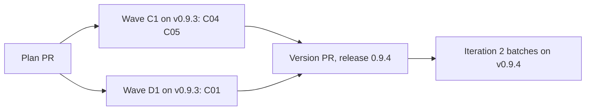

# Plan for 0.9.4

## Status (2026-11-13)

- Draft, narrowed after plan review. Written after the 0.9.3 release, checked against `main` at ff1cfc7 (K01, #735). Nothing is built.
- This release is the first part of iteration 2 of the maintainer's decision D10. The batches of iteration 2 run on the release that holds the evals-check entries (Release).
- Plan review of the first draft (eight entries) did not converge: round 1 had 3 blockers and 9 majors, round 2 had 6 blockers and 13 majors, most of them on mechanism detail of C01, C02, C03, C06 and C07. The assessment session decided under the maintainer's overnight rule: this plan keeps the entries that settled (C04, C05, C08), and the others are held (Held).
- The plan review of the narrowed plan reached its cap of 2 rounds with 5 majors in each round, on C04, C05 and C08. The assessment session decided under the overnight rule: C08 is held too, C04 and C05 keep their two open points as build notes, and the findings that `main` already fixes are corrected. These edits were made by hand after the cap.
- Amendment 1b: C01 alone, written from an impact pass (a read-only list of every existing test, fixture, script and doc sentence that C01 changes, in `.claude/assessment/drafts/impact-c01.md`). Amendment 1 (C01, C06 and C07) did not settle in its plan review (round 1: 2 blockers and 4 majors; round 2: 1 blocker and 9 majors), most of it on contradictions with existing tests. The assessment session decided under the overnight rule: C01 alone, with its open choices settled, and C06 and C07 held.
- K07 (#631, wave B2 of `docs/plan-0.9.2.md`) is still in its run. This plan does not touch its parts of `workflows/run-wave.js` (`runPRSteps`, the not-ready exits after the bot answer; `evaluatePrompt`) or `scripts/ledger.sh`.

## Summary in plain words

Iteration 1 showed two large problems and some small ones. The large ones are the evals check (of 16 eval lists, 5 were accepted on the first attempt and 5 stopped for a person) and the merge gate (no bot can clear a PR since Gitar's free plan ran out). Their entries need more design work, so they are held for an amendment and for the maintainer.

This plan builds two small ones and the main lever of the evals check:

- C04: a resume that signs off runs the minor pass, like a first run.
- C05: a tests-only PR records its mutation proof, and a check is "not run" only when no role ran it.
- C01: the evals writer returns a coverage map, one item for each bullet of the entry, and code refuses a writer list with an item that has no eval. In iteration 1, 25 of the 40 points the evals check refused were a behaviour of the entry with no eval.

Readers: the maintainer and the sessions that run the batches and Tagreeve. Out: new roles, new run-wave arguments, the batch fixes, the Wavewright rename. Each entry is one PR. A PR is done when its acceptance test passes in CI, an adversarial review reports no blockers or majors, and it is squash-merged.

## Goals this release serves

- Automatic improvement (goal 7): C04 keeps minor fixes that a resume filed in iteration 1. C05 makes a tests-only proof part of the record, so a tests-only PR needs no person for it.
- Goal 8 share: every entry is work on the pipeline's own output, so the share is 3 of 3.
- My attention (goal 3): C01 makes a writer list that misses a bullet fail in code before the evals check, so fewer lists stop for a person.

## Findings

| Finding | Issue | What is wrong |
| --- | --- | --- |
| A resume that signs off skips the minor pass. | none (0.9.1 report) | K01 and K05 had no pass, so their minors were filed, not fixed. |
| A dropped minor pass reverts every fix, also the ones its check did not fault. | none (0.9.1 report) | K02 and K03 lost fixes that were fine. The entry for it (C08) is held. |
| Already fixed on `main`, issues still open. | #701, #702, #721 | `main` already keeps an outside-marked minor when the pass drops (#702, sim case "minor pass: an outside-marked minor reaches the checklist when the pass is dropped"), already gives the `pass.outside` stop the `needs human: untrusted path outside the minor pass:` prefix (#701), and SKILL.md step 2 already says that a missing file the change adds is proof (#721). Only a test that pins the step 2 wording is missing (#729). These issues are closed with a pointer to `main`, not by an entry of this plan. |
| The PR body of a tests-only PR says its mutation checks "were refused and not run", but three agents ran them. | none (Q630, #731) | The tester of the minor-pass check declined by its own scope and reported `refused`. The verifier's record says not-applicable for every eval, so the proof is only in prose. |

## Scope

In:

| Group | Entries | Issues | Size |
| --- | --- | --- | --- |
| A resume that signs off runs the minor pass | C04 | none | S |
| Tests-only proof and "not run" | C05 | #705, #729 | S |
| The coverage map | C01 | none | M |

Not in:

| Issue | Why it waits |
| --- | --- |
| The evals-check entries C06, C07 | Held (Held). |
| #698 | The quick-fix wording of `evalsRules`. It has no bullet in C01, so it goes to a batch. |
| C08 | Held (Held). |
| An `inputFrom` eval field | No reader: `evalsText` and `verifyPrompt` do not show it. A candidate for a later entry that names its reader. |
| #701, #702, #721 | Already fixed on `main` (Findings). |
| #736, and the gate entries C02, C03 | Held for the maintainer (Held). |
| #706 | A sim case that fails alone. A batch fix with the other sim minors. |
| #708 | A ledger touch reason. `scripts/ledger.sh` is K07's, and the batches take the ledger minors together. |
| #723, #724, #726, #727 | Wording and numbering in the A09 and A10 scripts. A batch fix. |
| #732, #733, #734 | The land-fix list. They touch the `landFix` branch that K07 changes now. A batch fix after K07. |

## Held

| Entry | What it is for | Why it is held |
| --- | --- | --- |
| C06 The evals check ranks its points | Corrections applied once, and an automatic fresh attempt. | Held after amendment 1's review: a correction that an `ok` carries breaks `recover-evals.sh`, the other callers of `checkEvals` were not named, and reviewer text would reach a verifier command with no second reader. That last point is a threat-model question for the maintainer. Findings: `.claude/assessment/drafts/amend094-1-review.md`. |
| C07 A size limit in code | The list size. | Held after amendment 1's review: its limit of 3 evals per item disagrees with the writer's aim of 3 to 6 per issue, and its exemption of `-R` ids can be chosen by a writer. It waits for C01 and its own impact pass. Findings: `.claude/assessment/drafts/amend094-1-review.md`. |
| C08 A dropped minor pass keeps the fixes its check did not fault | Partial keep of a minor pass. | Two open points after the plan-review cap: its invariant ties a kept fix to a scripted check of the head only on the partial path, not on the clean keep; and its premise named #701 and #702 as open, which `main` already fixes. It caught none of the filed minors of iteration 1. |
| C02 The merge gate reads a clean bot review of the head (#736) | The gate while no bot approves. | It sets what clears the merge gate (whose reply counts, a check run with no App, the request rule). The maintainer decides first. |
| C03 One review for each final head | The review budget. | It sets when a review is asked, and its draft step needs a call that the REST-only rule forbids. The maintainer decides first, with C02. |
| Eval producer field (0.9.6) | Each eval names the producer of its fixture's input shape (`inputFrom`), and the evals-check prompt shows it and judges it, so a fixture built on an input shape no producer makes is caught before the build. | The plan-review fixer took `inputFrom` out of C01 because nothing read it. It returns as its own entry with this named reader, written after an impact pass. |

## Order and waves

Summary: two small fixes in wave C1 and the coverage map in wave D1, which can run at the same time; then the version PR and the release.

Why this order:

- The waves run on the installed v0.9.3. A fix must not judge itself, and `pluginRoot` is never `main`.
- C01 shares no part of a file with C04 or C05 (the tables below), so waves C1 and D1 can run at the same time.

The entries edit different parts of `workflows/run-wave.js`:

| Entry | Parts of `workflows/run-wave.js` |
| --- | --- |
| C04 | `minorPassRuns`, and in `minorPass` only the history push of the `minor1` row |
| C05 | `refusedText`, `verifyPrompt` (only the tests-only break-check sentence), `VERIFY` (the `breakCheck` enum), `verifyOutcome` (the `testsOnly` branch), `breakCheckOf` (the new value), `TESTS_ONLY_LINE` and its rule in `openPrompt` (only the tests-only sentence) |
| C01 (wave D1) | `EVALS` (the schema), `evalsPrompt` (step 3 or 4 and the Return line, outside `evalsRules`), `evalsCheckPrompt`, `checkEvals` (a coverage parameter), a new writer-only coverage check, `writeEvals` (the writer loop, and the given branch that builds a new record), `makeRecord`, `setRecord` and the record comment above them, `settleDisputes` (only its `checkEvals` and `setRecord` calls) |

`skills/pr-pipeline/SKILL.md` has one line for each step of "The loop for one PR", so two edits of one step always conflict:

| Entry | Parts of SKILL.md |
| --- | --- |
| C04 | "The loop for one PR" step 7 (one sentence on a resume) |
| C05 | "The loop for one PR" step 2 |
| C01 (wave D1) | "The loop for one PR" step 1 (the refusal rules and the evals check sentence); "Step 1: write the plan" the Evals bullet and the Invariants text (keeping the phrase "Invariants line") |

In `test/sim-pipeline.mjs` each entry adds its cases as one block after the anchor case its Touches line names, and no two entries share an anchor. C01 also changes two existing places in place, named in its Touches line.

Other shared files: C01 alone touches `scripts/recover-evals.sh`, `agents/evals-writer.md`, `templates/plan.md`, `test/evals-coverage.test.mjs` (new), `test/evals-writer.test.mjs` and `test/build-against-evals.test.mjs`. C05 alone touches `agents/verifier.md` and `agents/tester.md`.

## How the iteration runs

- The wave runs from a local session with `pluginRoot` at the installed v0.9.3, never at `main`.
- `evals`, `breakCheck` and `docsUpdate` are on. The plan PR gets the product review and the architecture review.
- Every entry touches a gated path. Until a gate change is released, each PR merges under the maintainer's standing rule of 2026-11-12: after a completed CodeRabbit review of the final head and green CI, with a merge record and a basis note. `merge-safety` does not run for them.
- After each run: `scripts/after-run.sh` from v0.9.3. A resume uses only the arguments that `scripts/resume-args.sh` prints.
- An evals-check stop gets one fresh rebuild with the refusal in the notes, as in iteration 1. The 0.9.4 tag needs C01: a second evals-check stop of C01 stops the iteration for the maintainer (overnight: for the assessment session). C04 and C05 ship in 0.9.4 when they are on `main`; the tag waits for them while they are still in their runs. A second evals-check stop of C04 or of C05 moves that entry to 0.9.6 with the held entries, and the tag goes without it. So no entry can block the tag by stopping twice, and the tag is never cut without the coverage map.
- The builder session reports to the assessment session when the plan PR opens, at the end of each wave, when a PR stops for the second time, and when the release is cut.

## Pass criteria (written before the build)

For the entries of this plan:

1. **The four per-PR criteria of iteration 1** (a list before the build, a result for each eval id in the PR body, the break check ran, a ledger record with tokens by role) hold for C04 and C05.
2. **C04 on a real resume.** The first resume in the batches that signs off makes a minor pass, and its result has a `minorPass` field.
3. **C05 on a real tests-only PR.** The first tests-only PR in the batches has a `fails-on-mutation` result for each eval whose statement says it fails when a rule is removed, and its PR body has no "refused" line for a check that a role ran.

The list-acceptance criteria (at least 3 in 4 lists accepted on attempt 1, and no evals-check stop for a person, against iteration 1's base of 16 lists: 5 accepted on attempt 1, 6 on attempt 2, 5 stopped) apply to the batches. They are measured on the release that holds C01 (0.9.4), not on this plan's entries alone.

## Rules for every PR

- Read `AGENTS.md` and `docs/goals.md`.
- Each PR adds tests that fail when the change is removed. The PR description says how that was checked.
- Each negative test checks that its input really contains what the check looks for.
- An entry with an **Invariants** line: the reviewer checks each invariant in every round, and the tests cover each one.
- Each acceptance run is `node test/sim-pipeline.mjs`, `node --test test/*.test.mjs` and `bash scripts/check-syntax.sh` in full.
- Every eval can be checked from a clean clone of the branch: no PR body, labels, bot comments, CI results or merges.
- An eval that says it fails on `main` must fail on `main`. A behaviour that already holds on `main` is kind `regression`.
- Simulation tests check only what code decides. What an agent judges is checked by its prompt text or by a code step after it.
- A fixture of a GitHub answer is built from a real answer of the same endpoint (a check run of PR 731 or 735, a review list, a comment list), with no data from another repo and no real paths of the maintainer's machine. The test says which endpoint it stands for.
- New tests go in new files. Named exception: `test/sim-pipeline.mjs`, where each entry adds its cases as one block after the anchor case its Touches line names, and edits the existing helpers and cases its Touches line names.
- `workflows/run-wave.js` stays plain JavaScript with no filesystem, no `Date.now`, no `Math.random`.
- No entry adds a role, a step or a run-wave argument. A new field in an agent answer or in the result is allowed when the entry names it.
- Every entry runs with `docsUpdate` on. This repo has no `CHANGELOG.md`.
- Docs: Simplified Technical English, no em dashes, Mermaid with a one-line summary under each. Code comments only for why.
- Each behaviour and each invariant of an entry is its own bullet, and the entry says what must be true, not how the code does it. The mechanism is the build's.

## PRs

### Wave C1

**C04 A resume that signs off runs the minor pass.** Round cap 2. Touches: `workflows/run-wave.js` (`minorPassRuns`, and in `minorPass` only the history push of the `minor1` row), `test/sim-pipeline.mjs` (the existing case "minor pass: a skipImpl rerun or a resume runs no pass", which keeps its `skipImpl` half and drops its resume half; and cases after "minor pass: a major from the check does the same"), `skills/pr-pipeline/SKILL.md` (see the table).
- A resume that signs off runs the minor pass, like a first run.
- A `skipImpl` rerun, a docs PR and a plan PR still skip it.
- A resume whose history already holds a minor-pass row (round `minor1`) runs no pass. A PR gets one pass, whether it runs once or is resumed, and SKILL.md and `AGENTS.md` keep saying so.
- Build note (open after the plan-review cap): every pass that starts leaves a `minor1` row, whatever its end; `minorPass`'s history push joins C04's Touches. Today `minorPass` writes the row only when the tester and the check both answered, so a pass that drops before its check (the fixer changed nothing, or the check failed to run) leaves no row, and a later resume would run a second pass.
Evals:

| Id | Kind | What must be true | How to check |
| --- | --- | --- | --- |
| C04-1 | behaviour | A resume that signs off with a minor in a file in scope makes a `minorfix:` call. | Sim: `resume: { history, findings, evals }` with one minor; a `minorfix:C1` call. On `main` there is none. |
| C04-2 | regression | A `skipImpl` rerun, a docs PR and a plan PR make no `minorfix:` call. | Sim: three cases. Each case holds a minor in a file in scope, so on a run that does the pass a `minorfix:` call happens and the case fails. |
| C04-4 | behaviour | A resume runs the pass only when its history holds no `minor1` row: with no such row a minor in a file in scope makes a `minorfix:` call, and with a `minor1` row it makes none. | Sim, two halves in one case. (a) The C04-1 setup, a resume with no `minor1` row and one minor in scope on a PR that signs off: a `minorfix:C1` call. (b) The same resume with `history: [{ round: 'minor1', testPass: true, failingChecks: [], blockersAndMajors: [] }]`: no call matches `/^minorfix/`. Half (a) fails on `main`, where a resume runs no pass, so the break check can prove the case. Half (b) fails on a build that only drops `!pr.resume` from `minorPassRuns`. |
| C04-3 | behaviour | SKILL.md step 7 says a resume that signs off runs the pass. | `grep -c` on the step line prints 1. |
| C04-5 | error path | A resume after a run whose minor pass dropped before its check makes no `minorfix:` call, and a resume after a run that had no pass makes one. | Sim, three halves in one case. (a) The C04-1 setup, a resume whose history holds no `minor1` row and one minor in scope on a PR that signs off: a `minorfix:C1` call. (b) Run 1 has a minor in scope and `minorfix:C1` answers `changed: false`, then stops at a later step; a resume with the `history` and `minors` of that result on a PR that signs off: no call matches `/^minorfix/`. (c) The same with `test:C1#minor1` answering null in run 1. Half (a) fails on `main`, where a resume runs no pass, so the break check can prove the case. Halves (b) and (c) fail on a build that writes the row only after a completed check. |

Acceptance: `node test/sim-pipeline.mjs` passes; C04-1 fails on `main` because `minorPassRuns` is false for a resume.

**C05 A tests-only PR records its proof, and "not run" means no role ran it (#705, #729).** Round cap 2. Touches: `workflows/run-wave.js` (see the table), `agents/verifier.md` (the tests-only rule), `agents/tester.md` (the scope rule), `test/break-check-mutation.test.mjs` (new), `test/verifier-agent.test.mjs` (the tests-only sentence at line 58 changes with the rule), `test/sim-pipeline.mjs` (the F659 tests-only cases that pin the "could not prove" sentence change; and cases after the tests-only cases of #659), `skills/pr-pipeline/SKILL.md` (see the table).
- On a tests-only PR the verifier runs, for each eval whose statement says it fails when a rule is removed, a named mutation of the code under test in its clone, and reports `breakCheck: fails-on-mutation` with the mutation in `breakWhy` when the case fails. It restores the file after each mutation.
- The `VERIFY` schema allows `fails-on-mutation` in `breakCheck`. `verifyOutcome` keeps the value on a tests-only PR, where it sets it to null today.
- `breakCheckOf` counts `fails-on-mutation` as proof, like `fails-without-change`.
- `TESTS_ONLY_LINE` says the break check could not prove the tests can fail only when no eval has a mutation proof. With a proof it says which evals the mutation proved. The F659 cases and `test/verifier-agent.test.mjs` are updated to match, and keep the old sentence for the no-proof case.
- A tests-only eval with no such statement stays not-applicable.
- A tester that does not run a step because the step is outside its task leaves that step out of `checks`. It adds no check entry and no new answer field, so `testOutcome` is unchanged and the step counts as neither passed, failed nor refused. `refused` is only for a permission check or a file that could not run.
- A test pins the SKILL.md step 2 sentence that a missing file the change adds is proof (#729). The sentence is already on `main` (#721).
- The full-file fallback of a case that fails alone with the change does not give `fails-without-change` (#705).
- Build note (open after the plan-review cap): a step the tester leaves out is recorded, and an omitted acceptance step fails the check.
- Whether an acceptance step is required comes from the workflow, which knows from the entry whether it has an Acceptance line, and not from the tester's answer. A tester answer that leaves out the acceptance result when the entry has an Acceptance line fails the check. The mechanism is the build's.
Evals:

| Id | Kind | What must be true | How to check |
| --- | --- | --- | --- |
| C05-1 | behaviour | A tests-only verify answer with `fails-on-mutation` counts as a break-check fail in the history row, and the PR body line does not say "could not prove" for it. | Sim: a tests-only PR whose verifier answers `fails-on-mutation` for C1-1; the row's `breakCheck.fails` holds C1-1 and the open prompt holds the proof sentence. On `main` `breakCheck` is null for a tests-only PR. |
| C05-2 | behaviour | The verify prompt of a tests-only PR asks for a named mutation for each "fails when removed" eval and the restore step. | Sim: the `verify:C1#1` prompt of a tests-only PR holds the rule. |
| C05-3 | behaviour | `agents/tester.md` and `refusedText` say a step outside the task is left out of `checks` and is not `refused`. | `test/break-check-mutation.test.mjs`. |
| C05-4 | regression | SKILL.md step 2 holds the added-file proof sentence, and the test fails when it is removed. | The same test file. The sentence already holds on `main`; the test is new. |
| C05-5 | error path | A case that fails alone with the change and passes in the full file gives no `fails-without-change`. | The same test file, with the prompt text of `verifyPrompt`. |
| C05-6 | error path | A PR whose entry has an Acceptance line and whose tester answer has no acceptance result fails the check. | Sim: a PR whose notes hold an Acceptance line, and a `test:C1#1` answer with `pass: true`, every check passed and no `acceptance` field: the round is not a pass and the reason names the missing acceptance result. On `main` the round passes, because `testOutcome` reads the acceptance only from the tester's own answer. |

Acceptance: `node --test test/break-check-mutation.test.mjs` and `node test/sim-pipeline.mjs` pass; C05-1 fails on `main`.

### Wave D1

**C01 The writer maps every bullet of the entry to its evals.** Round cap 3. Touches:
- `workflows/run-wave.js` (see the table in Order and waves).
- `scripts/recover-evals.sh` (the record and meta build, and the header comment, which states that a given list read from a check prompt has no coverage).
- `agents/evals-writer.md` (the fields of an eval, the cover rule, the refusal rule and the Return list).
- `templates/plan.md` (the entry bullet placeholders and the Invariants line).
- `skills/pr-pipeline/SKILL.md` (see the table).
- `test/sim-pipeline.mjs`: changed in place, the helper `withMeta` (it builds every writer answer; it gives a default coverage made from the list ids, with item text that holds no eval statement), and in case "E01-1 a code PR gets its list before the implementer, and every later brief and the PR body hold it" only the `deepEqual` of `x.C1.evalsMeta` (the record gains its coverage). New cases go after "A01-17 a reviewer eval added inside a run is not in the record, so a resume with that list runs the check once".
- `test/evals-writer.test.mjs` and `test/build-against-evals.test.mjs` (only `OK_LIST`, which gains a coverage).
- `test/evals-coverage.test.mjs` (new): the cases of C01-8, C01-9, C01-10 and C01-12. It builds its recover-evals and resume-args inputs inline, as `test/recover-evals.test.mjs` does, so no fixture file is added. The existing `test/recover-evals.test.mjs` and `test/resume-args.test.mjs` are not edited.

This entry supersedes these sentences of A01 in `docs/plan-0.9.2.md`, and that file is not edited: the record shape `{ pr, evals, noErrorPath, noReference, algorithm }` (the record gains `coverage`); and "`metaOf` keeps its three fields, so the record never enters an evals-check prompt" (`metaOf` keeps its three fields, but the record's coverage now enters the evals-check prompt).

- The evals writer returns a coverage map with its list: items, each naming the eval ids that cover it. An item is one bullet or one invariant of the entry; for a batch, one issue; for a quick fix, one line of the trusted brief.
- Code refuses a list that the writer returned when its coverage is missing or empty, when an item names no eval id, or when an item names an id that is not in the list.
- This refusal applies to a writer's list only. A given list (`prs[].evals`), a resumed list (`resume.evals`), a reviewer eval added inside a run, a dispute change and a land-fix list are never refused for coverage, and keep the paths they have on `main`.
- No eval is exempt by its id. An eval may belong to no item, whoever added it.
- The coverage refusal is checked after the existing rule checks of a writer list pass and before the evals check runs. It never starts an evals-check call.
- A coverage refusal gives the reason prefix `evals refused: ` like the other rule refusals, so the ledger counts it as one maintainer touch with no change to `scripts/ledger.sh`.
- The coverage is stored in the accepted record (`evalsMeta.accepted`) and nowhere else in the result. The top level of `evalsMeta` keeps its three fields.
- The record's coverage is carried unchanged: in every later result, through a resume whose list equals the record, through a given list that builds a new record from an earlier record, and through an accepted dispute change.
- `scripts/resume-args.sh` prints the coverage inside `resume.evals.accepted` with no change to the script, because it copies `evalsMeta` whole.
- `scripts/recover-evals.sh` prints the coverage inside `evalsMeta.accepted` when the accepted writer answer holds one, and prints no coverage key when it holds none. A given list read from a check prompt has no coverage. It never refuses a writer answer for a missing coverage.
- When a list goes to the evals check and has a coverage (the writer's, or its record's), the check prompt shows the items and asks for a judgment per item. When it has none, the check prompt is the same as on `main`.
- The evals-check prompt keeps the step 2 sentence word for word, keeps the "Evals to check:" block in the shape `recover-evals.sh` reads, and the code adds no eval statement of the record to the item text it shows.
- Rule text that both the writer and the evals check must get is in `evalsRules`. Text only for the writer stays outside the span from "Rules for the list" to the Return line, so the two prompts still share one rule text (A06-2).
- Two lists are still the same when their ids, kinds, statements and checks are equal. The coverage is not compared.
- `templates/plan.md` says each behaviour and each invariant of an entry is its own bullet. Its Invariants line keeps the prefix "Invariants: ", and SKILL.md keeps the phrase "Invariants line".

Invariants: a writer list that reaches the evals check has a coverage in which every item names at least one eval id and every id is in the list. No list other than a writer's list is refused for coverage. The coverage of an accepted record is never changed after it is accepted, except by a later writer list that the evals check accepts.

Evals:

| Id | Kind | What must be true | How to check |
| --- | --- | --- | --- |
| C01-1 | behaviour | A writer list with no coverage is refused with a reason that starts `evals refused: `, and no `evalsarch:` call is made for it. | Sim: a writer answer with no coverage on both attempts; the reason starts with `evals refused: ` and no call starts with `evalsarch:`. On `main` the list goes to the evals check. |
| C01-2 | error path | A writer list with an item that names no eval id, or an id that is not in the list, is refused. | Sim: two cases, one for each fault; each is refused with `evals refused: `. The case checks that the coverage it gives really has the fault. |
| C01-3 | behaviour | A writer list with a valid coverage goes to the evals check, and the check prompt shows each item. | Sim: the `evalsarch:C1#1` prompt holds the item text of each item. On `main` it holds no item. |
| C01-4 | behaviour | The accepted record holds the writer's coverage, and the top level of `evalsMeta` keeps three fields. | Sim: `x.C1.evalsMeta.accepted.coverage` equals the writer's coverage; the keys of `evalsMeta` other than `accepted` are `noErrorPath`, `noReference` and `algorithm`. |
| C01-5 | behaviour | The coverage carries unchanged through a resume, a given list that builds a new record, and an accepted dispute change. | Sim: three cases; in each the new result's `evalsMeta.accepted.coverage` equals the first record's coverage. |
| C01-6 | regression | A given list, a resumed list, a reviewer eval and a land-fix list with no coverage are not refused for coverage. | The existing E01-5, A01-4, E02-3 resume, K01 land-fix and A01-17 cases pass with their assertions unchanged; A01-17 still counts one evals-check call on the resume. |
| C01-7 | regression | The existing evals-check call counts and stop reasons do not change for lists that already pass. | The existing cases E01-2, E01-3, E01-4, A01-1, A01-2, A01-10, A01-11, A01-14, A01-15 and F652-2 pass with their assertions unchanged, with `withMeta` giving a valid coverage. |
| C01-8 | behaviour | `recover-evals.sh` prints the writer's coverage in `evalsMeta.accepted` when the answer holds one, also after a replayed dispute change, and prints no coverage key when it holds none. A given list read from a check prompt has no coverage. | `test/evals-coverage.test.mjs` (new): an inline answer with a coverage, in each input form, run through `recover-evals.sh`; a given list read from a check prompt gives no coverage key; and the existing `expected-ok.json` case in `test/recover-evals.test.mjs` passes unchanged. |
| C01-9 | regression | `resume-args.sh` prints the coverage inside `resume.evals.accepted`. | `test/evals-coverage.test.mjs` (new): a result whose record holds a coverage; the printed item holds it, and no key is added at the level of `resume`. This passes on `main` by design, because the script copies `evalsMeta` whole and C01 does not change it; it guards that the coverage still comes through. |
| C01-10 | behaviour | The writer prompt and `agents/evals-writer.md` ask for the coverage map, and its item rule. | Sim: the `evals:C1` prompt holds the coverage rule and the Return line names `coverage`; `test/evals-coverage.test.mjs` (new) reads the agent file. |
| C01-11 | regression | The writer and evals-check prompts still share one rule text, and the check prompt keeps its step 2 sentence and its "Evals to check:" block. | The existing A06-2 and E01-11 cases and the recover-evals A10 cases pass unchanged. |
| C01-12 | behaviour | The plan template says each behaviour and each invariant is its own bullet and keeps the "Invariants: " prefix. | `test/evals-coverage.test.mjs` (new) reads `templates/plan.md`; the existing role-rules and skill-notes tests pass unchanged. |
| C01-13 | regression | The code adds no eval statement of the record to the check prompt when it shows the coverage. | Sim: the A01-14 setup with a coverage; the `evalsarch:` prompt does not match the statement of C1-1. This passes on `main` by design, where the prompt shows no items; it guards that the code that shows the items adds no record statement. It does not cover the writer's own item text, which is free text. |

Acceptance: `node test/sim-pipeline.mjs` and `node --test test/*.test.mjs` pass; C01-1 and C01-3 fail on `main`.

## Release

<<<<<<< ours
- 0.9.4 is C01, C04 and C05. The tag waits for C01 from amendment 1b, and for C04 and C05 while they are still in their runs. It is tagged without C02 and C03, and with no live run (the maintainer waived it for 0.9.4).
- The 0.9.4 tag needs C01: a second evals-check stop of C01 stops the iteration for the maintainer (overnight: for the assessment session). A second evals-check stop of C04 or of C05 moves that entry to 0.9.6 with the held entries, and the tag goes without it. So no entry can block the tag by stopping twice, and the tag is never cut without the coverage map.
- No tag for C04 and C05 alone: each tag costs the maintainer a plugin reload.
- The batches of iteration 2 (plan 0.9.5) ship as 0.9.5. The held entries C06, C07, C08, the gate entries C02 and C03, and the eval-producer field go to 0.9.6.
=======
- No tag for C04 and C05 alone. Each tag costs the maintainer a plugin reload, and these two do little for the batches.
- 0.9.4 is C01, C04 and C05. The tag waits for C01 from amendment 1b, and for C04 and C05 while they are still in their runs. It is tagged without C02 and C03, and with no live run (the maintainer waived it for 0.9.4).
- The 0.9.4 tag needs C01: a second evals-check stop of C01 stops the iteration for the maintainer (overnight: for the assessment session). A second evals-check stop of C04 or of C05 moves that entry to 0.9.6 with the held entries, and the tag goes without it. So no entry can block the tag by stopping twice, and the tag is never cut without the coverage map.
>>>>>>> theirs

## Date estimate

- Size: 3 PRs, this plan PR, and the version PR. About 5 to 8 million subagent tokens without cache reads (a planning figure, from iteration 1: 0.9M to 2.1M per PR).
- The gate is the slow part: about one completed CodeRabbit review an hour, so about one merge an hour.
- Dates: this plan PR on 2026-11-13; wave C1 on 2026-11-13; wave D1 (C01) on 2026-11-13 to 2026-11-14; the 0.9.4 release on 2026-11-14. **Range: 2026-11-14 to 2026-11-15.**
- The whole of D10 to the Tagreeve start: 0.9.4 by about 2026-11-15; the batches of iteration 2 as 0.9.5; the held entries and the gate entries as 0.9.6 after the maintainer's decision; the batches of iteration 3 as 0.9.7 (7 batches in each iteration) at about one merge an hour, about 1.5 to 2 days each; then the Wavewright rename release. **Tagreeve start: about 2026-11-19 to 2026-11-21.**

## Flagged concerns

- **Three plan reviews in a row did not settle inside the cap.** The narrowed plan stayed flat (5 majors, then 5) on C04, C05 and C08. The next plan, the batch plan of iteration 2, carries no mechanism and no eval tables: a batch entry is the issues it closes, its file group, its Touches by part and its wave.
- **Two plans in a row whose review grew worse on mechanism detail.** Plan 0.9.2 amendment 1 (1 blocker and 4 majors, then 2 majors, then 4 majors) and this plan's first draft (3 blockers and 9 majors, then 6 blockers and 13 majors). From now on every entry is in what-must-be-true form: each bullet says what holds after the change, and the mechanism is the build's. An open design choice is written as a choice with a pick.
- **Four plan reviews did not settle inside the cap, and the reviews named unlisted contradictions with existing tests and code as the cause.** C01 is written from an impact pass done before the text: each existing test it changes is named in its Touches as changed in place, and each bullet is narrowed so it changes nothing else. This is the first test of that method.
- **C05 trusts the verifier's mutation.** A mutation that does not touch the rule under test could still make the case fail. The verifier names the mutation in `breakWhy`, so the reviewer and the report can read it.
- **The coverage map and plan review.** The idea of C01 may carry over to plan review: each goal and each finding of a plan mapped to an entry. A candidate for release 3's planner, not part of this release.

## Out of scope

| Item | Why it waits |
| --- | --- |
| The iteration 2 batches (about 7 issues each, one deliberate batch of 10 to 12) | They run on v0.9.4, after C01. |
| The gate entries C02 and C03 | The maintainer decides first. |
| The Wavewright rename | Its own release after D10 and before Tagreeve. |
| A second reviewer bot, and any CodeRabbit setting | The maintainer's. |
| Any change in `alfhen/tagreeve` | Its maintainer's PRs. |
