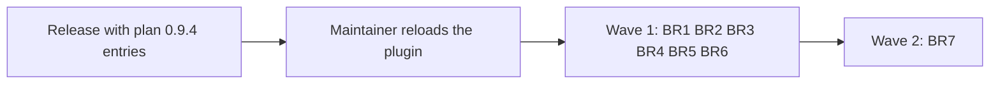

# Plan for 0.9.5

## Status (2026-11-12, night)

- Written at night on 2026-11-12, from the D10 triage list and the open issues with no milestone on that date. Nothing is built.
- This is D10 iteration 2: the batch fixes of the open `review-minor` and `pipeline-feedback` issues.
- The batches run with `pluginRoot` at the release that holds the entries of plan 0.9.4. They start after the maintainer reloads the plugin for that release.
- The entries have no eval tables and no mechanism, by the assessment session's rule after four plan reviews in a row did not settle inside the cap. Plan review judges the grouping, the Touches split and the order only.

## Summary in plain words

Iteration 1 fixed the faults the 0.9.1 shakedown found. This iteration works down the open issues in batch PRs of about 7 issues each, grouped by file and by part, so the batches of one wave do not edit the same code. One batch has 12 issues on purpose, to test a large batch. Iteration 3 takes the rest. The 16 issues that need a design choice are not batch work: they wait for the maintainer.

## Rules for every PR

- What must be true is in each issue the batch closes. The evals writer builds the list from the issues, with one coverage item for each issue.
- A batch PR edits only the parts its Touches line names. A minor found in another part is filed for the batch of that part.
- Each "Closes #N" is on its own line in the PR body.
- Every batch PR is merged under the maintainer's standing rule (a clean CodeRabbit review of the final head and green CI) only if he extends that rule to the batches. Otherwise he merges each one.
- `workflows/run-wave.js` stays plain JavaScript with no filesystem, no `Date.now` and no `Math.random`. No batch adds a role, a step or a run-wave argument.
- Docs: Simplified Technical English, no em dashes, Mermaid with a one-line summary under each.

## Waves of iteration 2

Summary: six batches in parallel in wave 1, then the 12-issue docs batch alone in wave 2.

### Wave 1

**BR1 Review loop stops and themes.** File group: `workflows/run-wave.js`.
Touches: `workflows/run-wave.js` (`reviewLoop`: the stops, the themes and the cap stop; `SECURITY_THEME`), `test/sim-pipeline.mjs` (one new block), one new test file.
Build note:
Closes #672
Closes #658
Closes #648
Closes #646
Closes #594
Closes #581
Closes #582

**BR2 Land-fix results and stop returns.** File group: `workflows/run-wave.js`. After K07 (#737) is on `main`, because it edits the land-fix results K07 changes.
Touches: `workflows/run-wave.js` (`runPRSteps`: the land-fix branch and its results, the stop returns, `roundsIn`, the milestone reason), `test/sim-pipeline.mjs` (one new block), one new test file.
Build note:
Closes #734
Closes #732
Closes #733
Closes #650
Closes #610
Closes #604
Closes #549
Closes #545

**BR3 Routine state and settings.** File group: routine scripts.
Touches: `scripts/routine-state.sh`, `routine/config.jq`, `test/routine-settings.test.mjs`, one new test file.
Build note:
Closes #522
Closes #521
Closes #398
Closes #351
Closes #349
Closes #526
Closes #328

**BR4 Ledger and token report.** File group: ledger scripts.
Touches: `scripts/ledger.sh` (`report`, `backfill`, `hand`), `scripts/token-report.sh`, `scripts/wave-result.sh`, one new test file.
Build note:
Closes #708
Closes #620
Closes #618
Closes #617
Closes #636
Closes #555
Closes #554
Closes #643

**BR5 Land and wait scripts.** File group: land scripts. It does not edit `scripts/bot-approval.jq`: that file belongs to C02, which waits for the maintainer. An issue of this batch that needs a change in that file is moved to iteration 3 by the build, with a note in the PR body.
Touches: `scripts/gate-files.sh`, `scripts/land-wave.sh`, `scripts/wait-ci.sh`, `scripts/wait-bots.sh`, one new test file.
Build note:
Closes #613
Closes #517
Closes #518
Closes #487
Closes #592
Closes #542
Closes #688
Closes #109
Closes #244

**BR6 Tests-only state and the open step.** File group: `workflows/run-wave.js`.
Touches: `workflows/run-wave.js` (the tests-only state, the tester schema `TEST`, `openPrompt` and the blocked-open result), `test/sim-pipeline.mjs` (one new block), one new test file.
Build note:
Closes #665
Closes #666
Closes #575
Closes #574
Closes #216
Closes #534
Closes #533
Closes #532

| Batch | Parts of `workflows/run-wave.js` | Other files |
| --- | --- | --- |
| BR1 | `reviewLoop` (stops, themes, cap stop), `SECURITY_THEME` | none |
| BR2 | `runPRSteps` (land-fix branch and results, stop returns, `roundsIn`, milestone reason) | none |
| BR3 | none | `scripts/routine-state.sh`, `routine/config.jq`, `test/routine-settings.test.mjs` |
| BR4 | none | `scripts/ledger.sh`, `scripts/token-report.sh`, `scripts/wave-result.sh` |
| BR5 | none | `scripts/gate-files.sh`, `scripts/land-wave.sh`, `scripts/wait-ci.sh`, `scripts/wait-bots.sh` |
| BR6 | tests-only state, `TEST`, `openPrompt` and the blocked-open result | none |

No two batches of wave 1 share a part. In `test/sim-pipeline.mjs`, each batch adds one block after its own anchor case, and no two share an anchor. The docs step of a wave 1 batch edits no SKILL.md step that another wave 1 batch edits. A SKILL.md change that a batch needs is noted for BR7.

### Wave 2

**BR7 Skill and docs (the deliberate large batch, 12 issues).** File group: SKILL.md and the docs. It runs alone, because it edits many SKILL.md parts that the docs step of any other batch could also touch.
Touches: `skills/pr-pipeline/SKILL.md` ("Workflow arguments", "Files", "When things go wrong", steps 2, 9 and 11), `docs/cloud-routines.md`, `docs/routine.md` (the test-step text).
Build note:
Closes #727
Closes #724
Closes #680
Closes #640
Closes #623
Closes #608
Closes #566
Closes #515
Closes #514
Closes #513
Closes #570
Closes #507

| Batch | Parts |
| --- | --- |
| BR7 | SKILL.md "Workflow arguments", "Files", "When things go wrong", steps 2, 9 and 11; `docs/cloud-routines.md`; `docs/routine.md` (the test-step text) |

## Dependencies

- BR2 waits for K07 (#737) on `main`.
- BR5 leaves `scripts/bot-approval.jq` to C02. C02 waits for the maintainer.
- All batches wait for the release that holds the entries of plan 0.9.4, and for the maintainer's plugin reload.

## Needs the maintainer (16 issues)

These are not batch fixes. Each needs a design choice. They go to milestone 0.10.0 or to a plan entry, by the maintainer's word.

| Issue | Choice needed | Recommendation |
| --- | --- | --- |
| #16 | What a plan reviewer judges from round 2 on | Per-bullet judging after C01 shows the unit works; the fix commits first as a stopgap (release 3, D02) |
| #76 | Whether a plan PR that runs out of rounds opens for a person | Open it, marked as needing a person check, with no `:auto` (release 3, D05) |
| #80 | How far the tester isolates the host tools | Accept it now, because CI catches it at land; a repo list of host tools later |
| #86 | How empty result fields say skipped against failed | A status field for each step, together with #609 (release 3, S01) |
| #94 | Whether `architecture` becomes a per-PR option | No: keep one run per document and the no-new-argument rule |
| #95 | When a plan rerun may skip product fit | Carry an aligned verdict when code shows the scope did not change (release 3, S03) |
| #99 | When product fit runs again after round 1 | When a fix adds entries or behaviour, by the same rule as #95 (release 3, D02) |
| #141 | Where the Touches limit is enforced | A code check before the commit (release 3, S02) |
| #191 | What the bot status reports | Every configured bot as seen, not seen or not installed, with or right after C02 (release 2, M01) |
| #264 | Whether commit statuses count in the gate | No: close it as answered by C02 (release 2, M01) |
| #428 | How script steps run with fewer agent starts | Join adjacent script calls and run independent ones at the same time (release 3, S05) |
| #467 | One rule for a head with no check runs | One shared filter for three scripts, after C02 (release 2, M01) |
| #481 | Whether a bot finding declined in words gets a second agent | A reviewer for a major or higher; the rest listed for the maintainer (release 2, M01) |
| #586 | Whether commits after sign-off get a decision check | The decision check in the check prompts (release 2, M01) |
| #609 | What a failed end-of-run read may change in the result | Keep the land value on the checked head, with #86 (release 2, M01 and R01) |
| #664 | Which test layouts count as tests-only | Common suffixes in the fixed pattern and a repo setting; check Tagreeve's layout first |

## Count

- Open with no milestone, without the 2 bookkeeping issues: 138. Plan 0.9.4 and K07 close 8, so 130 remain: 16 that need the maintainer, and 114 in 14 batches.
- About 20 open with no margin if the 16 move to a milestone and every batch lands.
- About 36 without the deferrals.
- The target is 25 or fewer. The batches are not tuned to meet it.

## Iteration 3 (short list)

- Wave 1: BR8 (prompts: `evalsCheckPrompt`, `verifyPrompt`, `botAnswerPrompt`, `waitPrompt`, `quickPrompts`, the checklist step of `openPrompt`; 10 issues), BR9 (routine docs and cloud setup; 7), BR10 (`minorPass`, `evalsVerdict`, `landListOk`, `resumedList`, `breakCheckOf`; 9), BR11 (argument checks, `call`, `absorb`, `readIo`; 7), BR12 (feedback, cleanup, recover and resume scripts, test order; 9).
- Wave 2: BR13 (`fixPrompt`, `docsPrompt`, `testPrompt`; 6), BR14 (`landFor`, `docsCheck`, `finish`, `evaluatePrompt`, `landFixCheck`, `runPR`; 7).
- Its batch issues are listed in the iteration 3 plan. It also takes the minors that iteration 2 files.

## Date estimate

- The release with plan 0.9.4's entries and the plugin reload come first.
- Wave 1 (six batches) builds in about 2 to 3 hours. Its merges come at about one an hour, at the rate of CodeRabbit's reviews, so about 6 hours.
- Wave 2 (BR7) adds about 2 hours.
- Range: one day after the release.

## Flagged concerns

- **The review budget.** At about one CodeRabbit review an hour, merges and not builds set the pace.
- **The count has no margin.** One stopped batch, or filings at the 0.9.1 rate, ends the count at about 35 to 40, and that calls for a fourth iteration.
- **BR7 is the large-batch test.** If its list or its review does not settle, the next plans keep batches near 7 issues.
