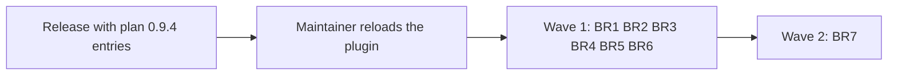

# Plan for 0.9.5

## Status (2026-11-12, night)

- Written at night on 2026-11-12, from the D10 triage list and the open issues with no milestone on that date. Nothing is built.
- This is D10 iteration 2: the batch fixes of the open `review-minor` and `pipeline-feedback` issues.
- The batches run with `pluginRoot` at the release that holds the entries of plan 0.9.4. They start after the maintainer reloads the plugin for that release.
- The entries have no eval tables and no mechanism, by the assessment session's rule after four plan reviews in a row did not settle inside the cap. Plan review judges the grouping, the Touches split and the order only.
- Before review, an impact pass checked each batch against `main` at ff1cfc7: the tests and docs its issues change, the parts it needs, part clashes inside a wave, and issues that are already fixed or need a design choice. This version applies it.

## Summary in plain words

Iteration 1 fixed the faults the 0.9.1 shakedown found. This iteration works down the open issues in batch PRs of 5 to 9 issues each, grouped by file and by part, so the batches of one wave do not edit the same code. One batch has 11 issues on purpose, to test a large batch. Iteration 3 takes the rest. The 22 issues that need a design choice are not batch work: they wait for the maintainer.

## Rules for every PR

- What must be true is in each issue the batch closes. The evals writer builds the list from the issues, with one coverage item for each issue.
- A batch PR edits only the parts its Touches line names. A minor found in another part is filed for the batch of that part.
- Each "Closes #N" is on its own line in the PR body.
- Every batch PR is merged under the maintainer's standing rule (a clean CodeRabbit review of the final head and green CI) only if he extends that rule to the batches. Otherwise he merges each one. BR7 is always merged by the maintainer, because it edits `AGENTS.md`, a floor path.
- `workflows/run-wave.js` stays plain JavaScript with no filesystem, no `Date.now` and no `Math.random`. No batch adds a role, a step or a run-wave argument.
- A new stop reason starts with `needs human:`, so `wave-result.sh` and the ledger touch rule need no change.
- Docs: Simplified Technical English, no em dashes, Mermaid with a one-line summary under each.

## Waves of iteration 2

Summary: six batches in parallel in wave 1, then the 11-issue docs batch alone in wave 2.

### Wave 1

**BR1 Review loop stops and themes.** File group: `workflows/run-wave.js`. Sim anchor: after "scope: majors on one theme in two rounds running stop the PR with needs human: scope and the threat-model question".
Touches: `workflows/run-wave.js` (`reviewLoop`: the stops, the themes, the cap stop and a before-and-after compare of `pr.evals` for #658; `SECURITY_THEME`; `scopeEscalation`; `archPrompt`; `verifyOutcome`), `agents/arch-reviewer.md` (the "From round 2 on" rule), `test/wave-prompts.test.mjs` (the case at line 183 only, changed in place), `test/sim-pipeline.mjs` (one new block after the anchor), one new test file.
Build note: for #582, "a fixer may already have run" is read inside `reviewLoop` from `pr.skipImpl`, `pr.resume` and the decision fields. `runPRSteps` is not edited.
Closes #672
Closes #658
Closes #648
Closes #646
Closes #594
Closes #582

**BR2 Land-fix results and stop returns.** File group: `workflows/run-wave.js`. After K07 (#737) is on `main`, because it edits the land-fix results K07 changes. Sim anchor: after "E04-17: a stop that pushes no row gets a marker row with no themes, and a resume runs a fix round".
Touches: `workflows/run-wave.js` (`runPRSteps`: the land-fix branch and its results, the `!b.ok` and `!sync.ok` returns, and the pre-fix block of a resume; `roundsIn`), `scripts/resume-args.sh` (the round count), `test/resume-args.test.mjs`, `test/sim-pipeline.mjs` (the cases "E04-16" and "E04-17" changed in place, and one new block after the anchor), one new test file.
Build notes: #732 and #734 are one fix. For #733 the pick is: a land fix accepts only a list equal to the record, as today, and SKILL.md says so (BR7 writes that sentence).
Closes #734
Closes #732
Closes #733
Closes #650
Closes #610
Closes #604

**BR3 Routine state and settings.** File group: routine scripts. No sim block.
Touches: `scripts/routine-state.sh`, `routine/config.jq`, `test/routine-settings.test.mjs`, `test/routine-state.test.mjs`, one new test file.
Build note: #349 and #521 are one fix.
Closes #522
Closes #521
Closes #398
Closes #351
Closes #349
Closes #526

**BR4 Ledger and token report.** File group: ledger scripts. After K07 (#737) is on `main`, because K07 edits `scripts/ledger.sh` and `test/ledger.test.mjs`. No sim block.
Touches: `scripts/ledger.sh` (`report`, `backfill`, `hand`, the touches pattern), `scripts/token-report.sh`, `scripts/wave-result.sh`, `workflows/run-wave.js` (`prBlock` only, for #555), `test/ledger.test.mjs`, one new test file. The #555 case goes in BR4's new test file, not in `test/wave-prompts.test.mjs`, which BR1 and BR6 edit.
Closes #708
Closes #620
Closes #618
Closes #617
Closes #636
Closes #555
Closes #554
Closes #643

**BR5 Land and wait scripts.** File group: land scripts. It does not edit `scripts/bot-approval.jq` or `scripts/bot-status.sh`: those belong to C02, which waits for the maintainer. No sim block.
Touches: `scripts/gate-files.sh`, `scripts/land-wave.sh`, `scripts/wait-ci.sh`, `scripts/release.sh`, `templates/pipeline.json`, `workflows/run-wave.js` (`minorScope`, the comment only, for #613), `test/fake-gh` (the query-to-file mapping for a query that holds a `/`; existing mappings stay as they are), `test/land.test.mjs`, `test/gate.test.mjs`, `test/release.test.mjs`, one new test file.
Closes #613
Closes #517
Closes #518
Closes #592
Closes #688

**BR6 The open step and the tester result.** File group: `workflows/run-wave.js`. It builds on C05 of plan 0.9.4. Sim anchor: after "a blocked opener keeps the PR number and the issues it already filed".
Touches: `workflows/run-wave.js` (`runPRSteps`: the blocked-open return only; `OPEN`; `MILESTONE_STEP`; `openPrompt` step 3 and its blocked sentence; `TEST`; `relatedText`; `testPrompt` (the Return line); `bots()`, only to clear the tests-only state after a bot code change), `agents/pr-opener.md`, `test/wave-prompts.test.mjs` (the cases at lines 132 and 152 only, changed in place), `test/sim-pipeline.mjs` (the cases "tester: a report with no related field leaves the history without relatedTests" and "a blocked opener keeps the PR number and the issues it already filed" changed in place, and one new block after the anchor), one new test file.
Build note: the #549 reason starts with `needs human:`.
Closes #666
Closes #575
Closes #574
Closes #216
Closes #534
Closes #533
Closes #532
Closes #549
Closes #545

| Batch | Parts of `workflows/run-wave.js` | Other files |
| --- | --- | --- |
| BR1 | `reviewLoop` (stops, themes, cap stop, the `pr.evals` compare), `SECURITY_THEME`, `scopeEscalation`, `archPrompt`, `verifyOutcome` | `agents/arch-reviewer.md`, `test/wave-prompts.test.mjs` (line 183) |
| BR2 | `runPRSteps` (land-fix branch and results, the `!b.ok` and `!sync.ok` returns, the pre-fix block), `roundsIn` | `scripts/resume-args.sh`, `test/resume-args.test.mjs` |
| BR3 | none | `scripts/routine-state.sh`, `routine/config.jq`, `test/routine-settings.test.mjs`, `test/routine-state.test.mjs` |
| BR4 | `prBlock` | `scripts/ledger.sh`, `scripts/token-report.sh`, `scripts/wave-result.sh`, `test/ledger.test.mjs` |
| BR5 | `minorScope` (comment) | `scripts/gate-files.sh`, `scripts/land-wave.sh`, `scripts/wait-ci.sh`, `scripts/release.sh`, `templates/pipeline.json`, `test/fake-gh`, `test/land.test.mjs`, `test/gate.test.mjs`, `test/release.test.mjs` |
| BR6 | `runPRSteps` (blocked-open return only), `OPEN`, `MILESTONE_STEP`, `openPrompt` (step 3, blocked sentence), `TEST`, `relatedText`, `testPrompt` (Return line), `bots()` (tests-only clear) | `agents/pr-opener.md`, `test/wave-prompts.test.mjs` (lines 132 and 152) |

No two batches of wave 1 share a part. `runPRSteps` is split by return: BR2 owns the land-fix branch, the `!b.ok` and `!sync.ok` returns and the pre-fix block, and BR6 owns only the blocked-open return. `test/wave-prompts.test.mjs` is split by case: BR1 owns the case at line 183, and BR6 owns the cases at lines 132 and 152. In `test/sim-pipeline.mjs`, BR1, BR2 and BR6 each add one block after their own named anchor, and no two share an anchor. The docs step of a wave 1 batch edits no SKILL.md step: a SKILL.md change that a batch needs is carried to BR7 (below).

### Wave 2

**BR7 Skill and docs (the deliberate large batch, 11 issues).** File group: SKILL.md and the docs. It runs alone, because it edits many SKILL.md parts that the docs step of any other batch could also touch. The maintainer merges it, because it edits `AGENTS.md`, a floor path. No sim block.
Touches: `skills/pr-pipeline/SKILL.md` ("Step 1" the Waves bullet; "Step 2" the intro above "Workflow arguments"; "Workflow arguments" the PR options and the result paragraph; "Files"; "When things go wrong" the rows for `no progress`, `needs human: scope`, `needs human: permission`, `milestone not found` and `quick fix: touches overlap`, and the rows its issues name; "The loop for one PR" steps 2, 5, 9 and 11), `docs/cloud-routines.md`, and for #570: `agents/tester.md`, `agents/verifier.md`, `workflows/run-wave.js` (the Test phase detail in `meta` only), `AGENTS.md`, `templates/AGENTS-section.md`, `README.md`, `docs/explainer.html`.
SKILL.md notes carried from wave 1, written by BR7 after wave 1 lands:
- the `no progress` row for break-check ids (#672);
- step 5 for #582;
- step 9, the result paragraph and the `needs human: permission` row for #549 and #534;
- the `rounds` field of the result paragraph for #650;
- the `ledger.sh` line of "Files" for #708;
- the land-fix list rule of step 11 and the PR options for #733's pick (with #680).
Closes #727
Closes #724
Closes #680
Closes #623
Closes #608
Closes #566
Closes #515
Closes #514
Closes #513
Closes #570
Closes #507

| Batch | Parts |
| --- | --- |
| BR7 | SKILL.md: Step 1 Waves bullet, Step 2 intro, "Workflow arguments" (PR options, result paragraph), "Files", "When things go wrong" (the named rows), steps 2, 5, 9 and 11; `docs/cloud-routines.md`; `agents/tester.md`; `agents/verifier.md`; `workflows/run-wave.js` (`meta` Test phase detail); `AGENTS.md`; `templates/AGENTS-section.md`; `README.md`; `docs/explainer.html` |

## Dependencies

- BR2 and BR4 wait for K07 (#737) on `main`.
- BR6 builds on C05 of plan 0.9.4.
- BR5 leaves `scripts/bot-approval.jq` and `scripts/bot-status.sh` to C02. C02 waits for the maintainer.
- BR7 waits for wave 1, because it writes the SKILL.md notes that wave 1 carries.
- All batches wait for the release that holds the entries of plan 0.9.4, and for the maintainer's plugin reload.

## Close with a pointer

- #640 is already fixed on `main` (SKILL.md "Workflow arguments" lists `evalDisputes` and `deviations` in `resume` and in the result). It is closed with a link, not by a batch.

## Needs the maintainer (22 issues)

These are not batch fixes. Each needs a design choice. They go to milestone 0.10.0 or to a plan entry, by the maintainer's word.

| Issue | Choice needed | Recommendation |
| --- | --- | --- |
| #16 | What a plan reviewer judges from round 2 on | Per-bullet judging after C01 shows the unit works; the fix commits first as a stopgap (release 3, D02) |
| #76 | Whether a plan PR that runs out of rounds opens for a person | Open it, marked as needing a person check, with no `:auto` (release 3, D05) |
| #80 | How far the tester isolates the host tools | Accept it now, because CI catches it at land; a repo list of host tools later |
| #86 | How empty result fields say skipped against failed | A status field for each step, together with #609 (release 3, S01) |
| #94 | Whether `architecture` becomes a per-PR option | No: keep one run per document and the no-new-argument rule |
| #95 | When a plan rerun may skip product fit | Carry an aligned verdict when code shows the scope did not change (release 3, S03) |
| #99 | When product fit runs again after round 1 | When a fix adds entries or behaviour, by the same rule as #95 (release 3, D02) |
| #109 | When the bot wait stops, given what the bot status reports | Decide with #191, because the fix needs `bot-status.sh` (release 2, M01) |
| #141 | Where the Touches limit is enforced | A code check before the commit (release 3, S02) |
| #191 | What the bot status reports | Every configured bot as seen, not seen or not installed, with or right after C02 (release 2, M01) |
| #264 | Whether commit statuses count in the gate | No: close it as answered by C02 (release 2, M01) |
| #328 | Which files may name the fixed routine labels | Exempt the routine prompts, and let the scripts read the names from `routine/config.jq` |
| #428 | How script steps run with fewer agent starts | Join adjacent script calls and run independent ones at the same time (release 3, S05) |
| #467 | One rule for a head with no check runs | One shared filter for three scripts, after C02 (release 2, M01) |
| #481 | Whether a bot finding declined in words gets a second agent | A reviewer for a major or higher; the rest listed for the maintainer (release 2, M01) |
| #487 | Whether the branch head gets its own script | Only a "Files" line in SKILL.md for `gate-files.sh --head`, written in iteration 3 |
| #542 | How the land wait treats a failed status with no check runs | Decide with #467, after C02 (release 2, M01) |
| #581 | Whether QA findings count toward a theme stop | Document that QA majors never count toward a theme stop, and add no QA theme |
| #586 | Whether commits after sign-off get a decision check | The decision check in the check prompts (release 2, M01) |
| #609 | What a failed end-of-run read may change in the result | Keep the land value on the checked head, with #86 (release 2, M01 and R01) |
| #664 | Which test layouts count as tests-only | Common suffixes in the fixed pattern and a repo setting; check Tagreeve's layout first |
| #665 | Which non-test files a tests-only branch may hold | Decide with #664 |

## Count

- Open with no milestone, without the 2 bookkeeping issues: 138.
- Plan 0.9.4 as narrowed and K07 close 3 (#705 and #729 by C05, #631 by K07). #701, #702 and #721 are already fixed on `main` and #640 too, so 4 close with a pointer. That leaves 131.
- Of those: 22 need the maintainer; #736 waits for the C02 gate entry; 51 are in the 7 batches of iteration 2; 57 are in iteration 3.
- If every batch of iterations 2 and 3 lands (108 issues) and the 22 move to a milestone: about 21 open (#736 and about 20 new filings at the iteration 1 rate). No margin.
- Without the deferrals: about 43.
- The target is 25 or fewer. The batches are not tuned to meet it.

## Iteration 3 (short list)

- Wave 1: BR8 (prompts: `evalsCheckPrompt`, `verifyPrompt`, `botAnswerPrompt`, `waitPrompt`, `quickPrompts`, the checklist step of `openPrompt`; 10 issues, and #698 joins it: the quick-fix part of `evalsRules`), BR9 (routine docs and cloud setup; 7), BR10 (`minorPass`, `evalsVerdict`, `landListOk`, `resumedList`, `breakCheckOf`; 9), BR11 (argument checks, `call`, `absorb`, `readIo`; 7), BR12 (feedback, cleanup, recover and resume scripts, test order; 9).
- Wave 2: BR13 (`fixPrompt`, `docsPrompt`, `testPrompt`; 6), BR14 (`landFor`, `docsCheck`, `finish`, `evaluatePrompt`, `landFixCheck`, `runPR`; 7).
- #244 moves to iteration 3, after C02 lands, because it needs `scripts/bot-approval.jq`.
- Its batch issues are listed in the iteration 3 plan. It also takes the minors that iteration 2 files.

## Date estimate

- The release with plan 0.9.4's entries and the plugin reload come first.
- Wave 1 (six batches) builds in about 2 to 3 hours. BR2 and BR4 start after K07 lands. Merges come at about one an hour, at the rate of CodeRabbit's reviews, so about 6 hours.
- Wave 2 (BR7) adds about 2 hours, and the maintainer merges it.
- Range: one day after the release.

## Flagged concerns

- **The review budget.** At about one CodeRabbit review an hour, merges and not builds set the pace.
- **The count has no margin.** One stopped batch, or filings at the 0.9.1 rate, ends the count at about 35 to 40, and that calls for a fourth iteration. The impact pass moved 6 issues to "Needs the maintainer", so the count without deferrals rose from about 36 to about 43.
- **BR7 is the large-batch test.** If its list or its review does not settle, the next plans keep batches near 7 issues.
- **`test/fake-gh` is shared.** BR5 changes how it maps a query with a `/`. Every existing mapping must stay as it is, or tests of other wave 1 batches fail for the wrong reason.
