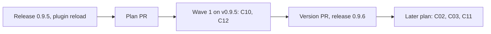

# Plan for 0.9.6: a third evals attempt, and a bar for filed minors

## Status (2026-11-14)

- For plan review. Nothing is built.
- Checked against `main` at 71c1264 ("Ledger and token report (batch BR4)", #762). Every line number in this plan is from that commit. On it `workflows/run-wave.js` has 2,254 lines and `test/sim-pipeline.mjs` has 4,959 lines.
- Not on `main` yet: BR6 (#770) and BR3 (#774) of plan 0.9.5 wave 1, and BR7 (wave 2). Release 0.9.5 is not tagged. They move line numbers, so each Touches line names functions, sections and case titles. BR6 edits `openPrompt`, and BR7 edits steps 5 and 9 of SKILL.md. C12 edits other sentences of the same places, and it is built after both are on `main`.
- This plan is the small part of the proposal `.claude/assessment/drafts/plan-0.9.6-proposal.md` of 2026-11-13, which had four entries (C10, C11, C02, C03). This plan takes C10 from it, word for word, and adds C12. The other three entries go to a later plan (Held).
- Each entry is written from an impact pass: a read-only list of each existing test, fixture, script and doc sentence that the entry changes. The passes are `.claude/assessment/drafts/impact-c10.md` (at c213316) and `impact-c12.md` (at 71c1264). Between the two commits `workflows/run-wave.js`, `test/sim-pipeline.mjs` and `agents/` did not change, and `skills/pr-pipeline/SKILL.md` changed only in two lines of "Files". So the line numbers of C10 hold at 71c1264.
- The maintainer's decisions behind this plan are D15 (rule A), D16 (plans are judged by the quality of local runs) and D17 (a higher bar for issues), all of 2026-11-13. No entry waits for a new decision of his.
- This plan adds no state, so it has no States table.

## Summary in plain words

The runs of 2026-11-13 showed two things.

- **The eval list stops too soon.** With two tries, 4 of 8 lists stopped before anything was built. With three tries all four were accepted. One stop was a false alarm of a code rule.
- **The pipeline files notes as issues, and it filed one real fault as a note.** Wave 1 of plan 0.9.5 closes 40 issues and filed 17 new ones. A sort of 87 open issues found that 58 of them describe no wrong action today. On batch BR6 the reviewer saw that the batch's fix did not hold for PRs with an eval list. It ranked the point minor, because the code was outside the entry's Touches line, and the point became an issue. The outside review bot ranked the same point Major, after the PR was open.

This plan has one entry for each:

- C10: the eval writer gets three tries, and the rule that refuses "an eval about the PR itself" reads only what the eval says it tests.
- C12: a minor finding becomes an issue only when the reviewer names an input that a real run can produce and the wrong outcome that follows today. Code checks that both are there. Every other minor stays as a note on the PR. A finding which shows that the PR's own change does not do what its entry asks is at least major, also when the code that must change is outside the entry's Touches line.

Readers: the maintainer and the sessions that run the batches and Tagreeve. Out: the merge gate (C02), the review request in the land step (C03), the reload check (C11), the held entries C05 to C09, the rename. Each entry is one PR. A PR is done when its acceptance test passes in CI, an adversarial review reports no blockers or majors, and it is squash-merged.

## Goals this release serves

- **My attention (goal 3).** C10 removes stops that needed a fresh run by a person (4 on 2026-11-13). C12 keeps notes out of the issue list, so the list holds what needs a decision or a fix. On 2026-11-13 three agents sorted 87 open issues, and 65 of them are proposed for closing.
- **Quality (goal 2).** With C12 a fix that does not hold on a real path is fixed in its own PR, or the PR stops for a person. It does not land with an issue for later.
- **Cost (goal 4).** A stopped list costs a new run with at least two more writer attempts. A third attempt costs one. Each filed note costs a part of a later batch: wave 1 of plan 0.9.5 cost about 1.25 million tokens a batch.
- **Works on all my repos (goal 6).** The bar is in the role files in words that hold for any repo: the product does the wrong thing today for an input that real use can produce.
- **Goal 8 share.** Both entries are work on the pipeline itself, so the share is 2 of 2. That is accepted for this release: the product of this repo is the pipeline, D10 is the iteration that works on it before the product run, and no entry adds a role, a step or an argument. C12 puts its rule in one place in each file.
- **The backlog measure of D17.** "Nothing open that is ranked above minor, and no issue older than two iterations." C12 stops the list from growing with notes while the batches work it down.
- **D16.** No entry is for cloud runs.

## Findings

All facts are from the driver's log of 2026-11-13 (`.claude/assessment/morning-summary-notes.md`, with the time of the log entry in brackets), from the decision lines D15 to D17 (`.claude/assessment/factory-plan.md`) and from read-only calls to GitHub.

| Finding | Entry | What is wrong |
| --- | --- | --- |
| With 2 writer attempts, 4 of 8 eval lists stopped at the evals stage: C01 of plan 0.9.4, and BR3, BR4 and BR6 of plan 0.9.5 wave 1 (10:25, 18:00). | C10 | Each stop needed a fresh run. With `evalsRounds` 3 all four were accepted: C01 and BR6 on attempt 2, BR3 and BR4 on attempt 3 (11:25, 19:10). The default is 2 (`workflows/run-wave.js:48`). |
| BR4 was refused twice by the code rule `eval BR4-4 checks the PR, not the code` (18:00). | C10 | A false alarm. The eval tested `scripts/ledger.sh backfill`, which reads the description text of merged pull requests. Its fixture on `main` holds a closing keyword (`test/ledger.test.mjs:329`). The rule reads the statement and the check together (`run-wave.js:1888`). |
| Wave 1 of plan 0.9.5 closes 40 issues and filed 17: #752, #753, #755, #756, #758, #759, #761, #763 to #769 and #771 to #773 (19:10). | C12 | One new issue for each 2.4 that the wave closes. The target "25 or fewer open" could not be reached by batches, and the maintainer replaced it (D17). |
| The 20 issues that the runs of the day filed sort as: 8 weaknesses in the PR's own new code, 7 sibling places outside the batch's parts, 3 doc texts held for BR7, 2 minors of the outside reviewer (21:10). | C12 | The reviewer sets `fileIssue: true` on a minor "that has a real effect on behaviour or on a reader" (`agents/reviewer.md:30`), and the opener files each marked minor (`run-wave.js:976`). Nothing asks what goes wrong, or for which input. |
| BR6 (#770) filed 7 issues by itself, #763 to #769 (19:10). | C12 | The same cause. |
| 87 open issues were sorted against the bar of D17: 16 wrong today, 58 notes, 10 fixed, 2 design choices, 1 stale; 4 of the notes are unsure and stay open (21:25, `drafts/triage-bar.md`). | C12 | About two in three describe no wrong action today for an input that a real run can produce. Each cost a review, an issue and a sort. |
| The pipeline's reviewer found that BR6's fix for #575 and #216 does not hold for a PR with an eval list (the `required` list of `VERIFY`, `run-wave.js:473`). It ranked the point minor and filed it as #767, whose text says "VERIFY is outside the BR6 Touches line". CodeRabbit ranked the same point Major in review 5899316982 of commit 3fabe8f (23:15). | C12 | The rank followed the Touches line, not the effect. The fix came after the PR was open. It cost one more run (`wf_6f539da8-66f`) and one more review of about an hour. |
| The one finding of CodeRabbit on #762, ranked Minor, was wording. It got the answer "Note, not filed:" and no issue (22:06). The fix run of #770 was the first run with the bar in its `context` (23:15). | C12 | The bar is in use by hand. It is not in the role files, the workflow or SKILL.md. |

## Scope

In:

| Group | Entries | Issues | Size |
| --- | --- | --- | --- |
| A third writer attempt, and the PR-text rule | C10 | none | S |
| The bar for filing a minor, and the rank of a fix that does not hold | C12 | none | M |

Not in:

| Issue or item | Why it waits |
| --- | --- |
| C02, C03, C11 | Held (Held). |
| C05, C06, C07, C08, C09 | Held (Held). |
| #654 (the rule misses common forms, and it refuses a code eval whose statement names the description text of a pull request) | C10 fixes another fault of the same rule: a trigger phrase that is only in a check. #654 is about the statement, which the rule still reads, so C10 does not close it. It goes with the batches of the issues that pass the bar. |
| Closing the 65 open issues that are below the bar, fixed or stale | It waits for the maintainer's word, with the numbers (D17). |
| Batches for the issues that pass the bar | Their own plan (D17, item 3). |
| A bar for the evaluator's feedback items | They are filed another way: label `pipeline-feedback`, the maintainer's approval or the limits of `scripts/file-feedback.sh`. |
| An agent that files late minors | Today the main session files them by hand (`skills/pr-pipeline/SKILL.md:274`). C12 only makes the mark in the result right. |
| A code check that the opener filed no more than its list | It needs a new stop or a new warning, and its own impact pass. |
| A rule that makes the bot answerer file an issue, or write a note, for a minor of the outside reviewer | That is rule A, which the driving session does by hand today. It goes with C02. |
| The `plan conflict:` rule in the bot-answer check and the land-fix check | The sim case "a plan conflict finding from the reviewer or the fixer stops the PR before another round" asserts that those tasks do not hold it. |
| A change to `agents/evaluator.md` so that it reports refused marks | After the first wave on 0.9.6 shows how often a mark is refused. |
| A reason for the rule of C10 that quotes the matched words | It changes a pinned reason text (`PR_REFUSAL`, `test/sim-pipeline.mjs:4908`). Only if lists still stop on that rule. |

## Held

| Entry | What it is for | Why it is held |
| --- | --- | --- |
| C02 The merge gate reads a clean bot review of the head (#736, #264) | A PR can clear the gate with a completed, clean CodeRabbit review of its final commit, with rule A. | Its own plan after this one, because it is large or needs a live check. |
| C03 One review request for each final head, made by the land step | The land step asks for the review, waits for it, and merges what the gate clears. | Its own plan after this one, because it is large or needs a live check. |
| C11 A wave stops when the session runs older role files than `pluginRoot` | A wave says "reload" when the session runs older role agents than the plugin folder holds. | Its own plan after this one, because it is large or needs a live check. |
| C05, C06, C07, C08, C09 | The proof of a tests-only PR, ranked points of the evals check, a size limit for an eval list, a partial keep of a minor pass, and the producer of a fixture's input. | Not needed for the first product run; after the Tagreeve start. Their open points are in the proposal. |

## Order and waves

Summary: after release 0.9.5 and the plan PR, one wave builds C10 and C12 at the same time, and then the version PR makes release 0.9.6.

Why this order:

- The wave runs on the installed v0.9.5. A fix must not judge itself, and `pluginRoot` is never `main`.
- C10 and C12 share no part of a file (the tables below), so both build in one wave.
- Merges come one at a time, at the rate of CodeRabbit's reviews.

The entries edit different parts of `workflows/run-wave.js`:

| Entry | Parts of `workflows/run-wave.js` |
| --- | --- |
| C10 | `EVALS_ROUNDS` (line 48); the one line of `evalsVerdict` that tests `PR_TEXT` (1888); `evalsPrompt`, step 4 only (740) |
| C12 | `absorb` (148-161) and `mergeDuplicates` (166-178); two new descriptions after `THEME` (476); the finding items of `REVIEW` (487), `ARCHREV` (519) and `QA` (542); `reviewPrompt`, only the sentence on `plan conflict:` (801); `minorReviewPrompt`, one new sentence after the exception for untrusted text (883); `openPrompt`, only the last line, the list "Minor findings to file" (976) |

The nearest pair is line 740 (C10) and line 801 (C12), so git reports no conflict.

`skills/pr-pipeline/SKILL.md` has one line for each step of "The loop for one PR", so two edits of one step always conflict:

| Entry | Parts of SKILL.md |
| --- | --- |
| C10 | "The loop for one PR" step 1 (the one sentence on the rule `eval <id> checks the PR, not the code`); "Workflow arguments" the bullet for `evals` and `evalsRounds` |
| C12 | "The loop for one PR" step 3 (the sentence on `plan conflict:`, and one new sentence for the rank rule), step 5 (in the needs-change item, the words on where the minors go) and step 9 (the sentences on `fileIssue`); "Step 3" the paragraph that starts "After a wave, count the `lateMinors`"; "When things go wrong" the `lateMinors` row |

Step 1 is line 61 and step 3 is line 63. Line 62 (step 2) is between them and no entry edits it. A test merge of two edits with one unchanged line between them gave no conflict (run for this plan on a scratch repo).

In `test/sim-pipeline.mjs` each entry adds its cases as one block after the anchor case that its Touches line names, and the two anchors are different cases. Each entry also changes the existing helpers and cases that its Touches line names, and no helper or case is named by both.

Other shared files: none. `agents/evals-writer.md` and `test/evals-attempts.test.mjs` are C10 only. `agents/reviewer.md`, `agents/arch-reviewer.md`, `agents/docs-reviewer.md`, `agents/qa.md` and `test/filing-bar.test.mjs` are C12 only. No entry edits `README.md`, `AGENTS.md`, `templates/` or a script.

## How the iteration runs

- The wave runs from a local session with `pluginRoot` at the installed v0.9.5, never at `main`.
- `evals`, `breakCheck` and `docsUpdate` are on. The wave arguments set `evalsRounds` to 3, because C10 is not in v0.9.5, and `botWaitMinutes` to 5.
- The wave's `context` holds the bar of D17 in words, because C12 is not in v0.9.5. The maintainer decided this for every run until the bar ships (D17).
- The plan PR gets the product review and the architecture review, and a fresh read-only agent reads its diff before the outside review (D14). The maintainer merges it, or the driving session on his word, as for plan 0.9.5 (#741).
- Gated paths: C10 and C12 each touch `workflows/**`, `agents/**` and `skills/**`. No entry touches a floor path (`AGENTS.md`, `.github/**`, a `.claude` folder, `docs/goals.md`).
- So each PR merges under the maintainer's standing rule: a completed CodeRabbit review of the final head that is clean, or minor-only by his rule A of 2026-11-13, and green CI. For a minor-only review, each finding gets an answer that names an issue, or that starts with "Note, not filed:" when the finding is below the bar. The merge goes through the driving session's interim script (`driver/direct-merge.sh`), with a merge record and a basis note. `merge-safety` does not run for them.
- After each run: `scripts/after-run.sh` from v0.9.5. A resume uses only the arguments that `scripts/resume-args.sh` prints.
- An evals-check stop gets one fresh rebuild with the refusal in the notes. A second stop of an entry is decided in Release.
- The notes of each PR hold the entry's row of the SKILL.md parts table, for the docs step.
- The driving session reports to the maintainer when the plan PR opens, at the end of the wave, when a PR stops for the second time, and when the release is cut.

## Pass criteria (written before the build)

For the entries of this plan:

1. **The four per-PR criteria of iteration 1** hold for C10 and C12: a list before the build, a result for each eval id in the pull request, the break check ran, and a ledger record with tokens by role.

For the first wave that runs on 0.9.6:

2. **No eval list stops at the evals stage when the entry is sound.** A stop for a real gap in an entry does not count against this. Base of 2026-11-13: 4 of 8 lists stopped, and all four were accepted with a third attempt.
3. **At least 3 in 4 lists are accepted by attempt 2.** Base: 4 of 8.
4. **The number of issues a PR files is at most 1 for each 5 issues it closes.** It is counted over the wave: the `issues` of every result and the late minors that the main session filed, against the issues that the wave's PRs close. Base: 17 filed for 40 closed, which is 1 for each 2.4.

## Rules for every PR

- Read `AGENTS.md` and `docs/goals.md`.
- Each PR adds tests that fail when the change is removed. The PR says how that was checked.
- Each negative test checks that its input really contains what the check looks for.
- An entry with an **Invariants** line: the reviewer checks each invariant in every round, and the tests cover each one.
- Each acceptance run is `node test/sim-pipeline.mjs`, `node --test test/*.test.mjs` and `bash scripts/check-syntax.sh` in full.
- Every eval can be checked from a clean clone of the branch: no label, bot comment, CI result or merge, and nothing that exists only after the PR is open.
- No eval statement and no check names the text of the PR under build (its description, its title or a closing line), also not inside a fixture text. The wave runs on v0.9.5, where a code rule reads both the statement and the check.
- An eval that says it fails on `main` must fail on `main`. A behaviour that already holds on `main` is kind `regression`.
- An eval that checks only doc text names a test file that reads the doc, so the break check can run.
- Simulation tests check only what code decides. What an agent judges is checked by its prompt text or by a code step after it.
- New tests go in new files. Named exception: `test/sim-pipeline.mjs`, where each entry adds its cases as one block after the anchor case its Touches line names, and edits the existing helpers and cases its Touches line names. An existing test file changes only where a Touches line names it.
- `workflows/run-wave.js` stays plain JavaScript with no filesystem, no `Date.now`, no `Math.random`.
- Scripts and prompts call GitHub through `gh api` (REST) only. `test/rest-only.test.mjs` passes unchanged.
- No entry adds a role, a step, a run-wave argument or an agent file. A new field in an agent answer or in a result item is allowed when the entry names it.
- Every entry runs with `docsUpdate` on. The docs step of an entry edits only the SKILL.md parts of its row in the parts table. This repo has no `CHANGELOG.md`.
- Docs: Simplified Technical English, no em dashes, Mermaid with a one-line summary under each. Code comments only for why.
- Each behaviour and each invariant of an entry is its own bullet, and the entry says what must be true, not how the code does it. The mechanism is the build's.

## PRs

### Wave 1

**C10 The eval list gets a third attempt, and the PR-text rule reads the statement.** Round cap 2. Touches:
- `workflows/run-wave.js` (see the table in Order and waves).
- `agents/evals-writer.md` (the rule line that starts "Every eval must be checkable from a clean clone of the branch": one sentence added, and it stays one rule line).
- `skills/pr-pipeline/SKILL.md` (see the table).
- `test/sim-pipeline.mjs`, changed in place: case "E01-2 a list with no error path eval and no reason is refused; after evalsRounds the PR stops" (only its first label list); case "E01-4 a second needs-change stops the PR with the notes" (its attempt count or its title, so the title is true again); helper `refusedAtOnce` (its label list); case "F652-2 an eval that names the PR title, a Closes line or the pull request body is refused; so is a given list" (only the first item of `bads`, whose words are in the check alone). New cases go after "F652-2 an eval about code that names a pull request in passing is not refused".
- `test/evals-attempts.test.mjs` (new): the cases of C10-8, C10-9 and C10-10.

On `main` today: the default is 2 (`run-wave.js:48`). The rule is one pattern, `PR_TEXT` (1871), tested against the statement and the check together (1888), for every list that `evalsVerdict` judges (callers at 1311, 1959, 1972, 2015 and 2065).

Choice: how the rule tells the PR under build from a fixture. Code cannot tell them apart safely: the check is free text, a fixture of a pull request uses the same words as the live PR, and a marker word can stand next to any text (`impact-c10.md`). Options: (A) the rule reads the statement only; (B) the statement, and in the check only commands that read the live PR; (C) only exact phrases about "this PR"; (D) the rule of `main` with an exemption for the word "fixture". Pick: **A**. Reason: the statement says what is under test, so the rule reads what it guards, and it needs no word list. What A lets through is an eval with a clean statement whose check reads the live PR. The first guard is the writer's own rule. After it, only one guard catches such an eval for certain: the fixer's dispute for an eval that no code change can make pass (`agents/fixer.md:18`), which comes after one implement and verify round. The evals check asks only whether a check can fail (`run-wave.js:759`), and a check that reads a PR that does not exist yet can fail. The first item of `bads` in case F652-2 is such an eval, and with A it is no longer refused by code.

- With no `evalsRounds` argument, the writer is asked at most 3 times for one list.
- The `evalsRounds` argument still sets the number of attempts.
- On the last attempt a refusal stops the PR with the reasons of `main`: `evals refused: <rule>` or `evals check: <notes>`.
- The rule refuses an eval whose statement matches `PR_TEXT`, with the reason `eval <id> checks the PR, not the code`. The pattern does not change.
- The rule does not read the check. An eval whose statement names code is not refused by this rule, whatever its check holds.
- The rule is the same for every list that `evalsVerdict` judges: a writer's list, a given list, a resumed list, a reviewer eval, a dispute change and a land-fix list.
- The writer's task prompt and `agents/evals-writer.md` say that an eval for code that reads pull request text names the code in its statement, and that the fixture text goes in the check. Both keep the words that the case "F652-1 the writer prompt and agent file name what is not an eval" pins. The new sentence of the task prompt is outside the rule text that the writer and the evals check share.
- SKILL.md says that the default is 3 and that the rule reads the statement.

Invariants: for every list, an eval whose statement matches `PR_TEXT` is refused, whatever its check holds. For every list, the text of a check never makes this rule refuse. For every wave, the writer is asked at most `evalsRounds` times for one list, and at most 3 times when the wave has no `evalsRounds` argument.

Evals:

| Id | Kind | What must be true | How to check |
| --- | --- | --- | --- |
| C10-1 | behaviour | With no `evalsRounds` argument, a writer whose list is refused each time is asked three times, and the PR then stops. | Sim: a writer that always returns a list with no error path eval and no reason. `evalLabels('C1')` equals `['evals:C1', 'evals:C1#w2', 'evals:C1#w3']`, and the reason is `evals refused: no error path`. On `main` the list has two labels. |
| C10-2 | behaviour | With no `evalsRounds` argument, a list that the evals check sends back twice and accepts on attempt 3 is built. | Sim: a check that answers `needs-change` twice and then `ok`. The labels start with `evals:C1`, `evalsarch:C1#1`, `evals:C1#w2`, `evalsarch:C1#2`, `evals:C1#w3`, `evalsarch:C1#3`, `implement:C1`. On `main` the PR stops after `evalsarch:C1#2`. |
| C10-3 | regression | An `evalsRounds` value of 1 or 2 gives one or two writer calls. | Sim: the writer of C10-1 with each value; the label lists have 1 and 2 entries. This passes on `main` by design; it guards that the argument still sets the number. |
| C10-4 | behaviour | An eval about code is accepted when only its check holds a trigger phrase of the rule. | Sim: an eval whose statement names `scripts/ledger.sh backfill` and whose check holds the text of the second fixture record of the backfill case in `test/ledger.test.mjs` (a closing keyword and an issue number). The case first puts that same text in the statement and asserts the reason `PR_REFUSAL`, so the text really is a trigger. Then, with the text in the check alone, an `implement:C1` call is made. On `main` the second half is refused. |
| C10-5 | regression | An eval whose statement holds a trigger phrase is refused, in a writer's list and in a given list. | Sim: `prEval` in a writer's list with `evalsRounds: 1`, and in `prs[].evals`; both reasons equal `PR_REFUSAL`. This passes on `main` by design; it guards that the statement is still read. |
| C10-6 | error path | A writer whose statement holds a trigger phrase on every attempt stops the PR after the third attempt, and no evals check and no implementer runs. | Sim: a writer that always returns `listOf('C1')` with `prEval`. The reason equals `PR_REFUSAL`, three labels start with `evals:`, and no label starts with `evalsarch:` or `implement:`. On `main` it stops after two. |
| C10-7 | behaviour | A given list and a dispute change are accepted when a trigger phrase is only in a check. | Sim, two halves. (a) `prs[].evals` with the eval of C10-4: no reason that starts `evals refused`. (b) A fixer dispute whose `change` ruling gives that eval under the disputed id: the ruling in `evalDisputes` is `change`. Each half first asserts that the same text in the statement gives the refusal. On `main` both are refused. |
| C10-8 | behaviour | The writer's task prompt and its role file say that an eval for code that reads pull request text names the code in its statement and puts the fixture text in its check. | `test/evals-attempts.test.mjs` (new) captures the `evals:<id>` prompt as `test/evals-writer.test.mjs` does, and reads `agents/evals-writer.md`; each holds the sentence. The existing F652-1 case and the two A06 cases of the sim pass unchanged. On `main` neither holds it. |
| C10-9 | behaviour | SKILL.md says that the default of `evalsRounds` is 3 and that the rule reads the statement of an eval. | `test/evals-attempts.test.mjs` (new) reads SKILL.md: the `evalsRounds` bullet holds "default 3" and not "default 2", and the step 1 line holds the new sentence. On `main` the bullet says "default 2". |
| C10-10 | regression | `recover-evals.sh` prints the list of attempt 3 as the record when the evals check accepted only that attempt. | `test/evals-attempts.test.mjs` (new): an inline journal with three writer answers and the check answers refuse, refuse, ok; the printed `evals` equal the third list. This passes on `main` by design, because the script reads any `#w<n>` label (`scripts/recover-evals.sh:72`). |

Acceptance: `node test/sim-pipeline.mjs` and `node --test test/*.test.mjs` pass; C10-1 and C10-2 fail on `main` because the default is 2, and C10-4 fails on `main` because the rule reads the check.

**C12 A minor is filed only with an input and an outcome, and a fix that does not hold is at least major.** Round cap 3. Touches:
- `workflows/run-wave.js` (see the table in Order and waves). Not `normalizeFindings`, `partition`, `OPEN`, `runPRSteps`, `bots`, `checkNewCode`, the code of `minorPass`, `botReviewPrompt`, `landReviewPrompt` or `meta`.
- `agents/reviewer.md` (the rank list: one new line; the paragraph that starts "Set `fileIssue: true`"; the minor-pass sentence: one more exception), `agents/arch-reviewer.md` (the last sentence of the needs-change item), `agents/docs-reviewer.md` (the sentence that starts "Set `fileIssue: true`"), `agents/qa.md` (the `minor` line of the rank list).
- `skills/pr-pipeline/SKILL.md` (see the table).
- `test/sim-pipeline.mjs`, changed in place, fixtures only: helper `passHook` (its finding `design nit`); cases "minor pass: a finding the reviewer cannot confirm stays in the not-fixed list and is filed when marked", "minors: a minor repeated in several rounds reaches the opener once", "minors: the opener list drops a repeat on a plan PR, where no pass runs", "minors: the opener list drops a minor the docs check repeats" and "minors: a minor marked in a later round keeps its mark when round 1 left it unmarked". In each, every finding that has `fileIssue: true` gets an `input` and an `outcome`, and no assertion changes. The case "minors: only marked minors are listed to file, and the checklist lists the rest" then passes unchanged, through `passHook`. New cases go after "minors: a minor marked in a later round keeps its mark when round 1 left it unmarked".
- `test/filing-bar.test.mjs` (new): the cases of C12-1, C12-8, C12-9, C12-12 and the role-file half of C12-13.

On `main` today: a minor is filed when its `fileIssue` is true, and nothing else is checked. The opener's list is `minors.filter(m => m.fileIssue)` (`run-wave.js:976`). The mark is a boolean in three finding schemas (`REVIEW` 487, `ARCHREV` 519, `QA` 542), and `absorb` keeps it when duplicates merge (149). Four role files say when to set it, each with the words "a real effect on behaviour or on a reader" (`agents/reviewer.md:30`, `agents/arch-reviewer.md:16`, `agents/docs-reviewer.md:18`, `agents/qa.md:19`). A minor of the bot-answer check or the land-fix check is in `lateMinors` of the result with the reviewer's mark as it came (1749-1753, 2051, 2186), and the main session files it by hand (`SKILL.md:274` and the `lateMinors` row, 321). The severity field decides the rank in every path, and code never reads what a finding says (`normalizeFindings` 130-140). The rank list has one "at least major" rule, for untrusted text (`agents/reviewer.md:27`), and no rule says that the Touches line does not lower a rank. The title rule for `plan conflict:` names only a blocker (`run-wave.js:801`), the code stops for a blocker or a major with that title (1430-1434), and the fixer returns `planConflict` for a fix outside the Touches line (850, 1457-1460). The rule is only in the review loop of a code or docs PR.

Choice 1: how a finding carries the input and the outcome. Options: (A) two short fields of the finding, `input` and `outcome`; (B) marker words inside the `detail` text. Pick: **A**. Reason: code can check that a field is there without reading free text, and the one code rule that reads free text gave a false alarm on 2026-11-13 (`PR_TEXT`, BR4-4). `absorb` joins the `detail` of duplicates with "Also:", so a marker inside it would move, and a field merges whole. The six sim fixtures change in both designs (`impact-c12.md`).

Choice 2: what code does with a mark that has no input or no outcome. Options: (A) take the mark away and say nothing; (B) take the mark away and write the reason on the minor; (C) send the finding back to the reviewer, or stop the PR. Pick: **B**. Reason: a note must not cost a round or stop a PR, so not C. With A, a session that runs older role files files nothing and no result shows it. C11, which finds such a session, is not in this plan.

Choice 3: the `plan conflict:` sentence of the reviewer's task. Options: (A) it stays "a blocker", and a major reaches the stop one step later, through the fixer's `planConflict`; (B) it names a blocker or a major. Pick: **B**. Reason: the code already stops for a major with that title, and the reviewer knows at once that the fix is outside the Touches line. With A the PR pays for one fix call that must change nothing.

Filing:

- A finding of the reviewer (in each of its tasks), of the architecture reviewer, of the docs check and of QA can carry two short text fields, `input` and `outcome`. The schema says what each holds: `input` is an input that real use can produce, and `outcome` is the wrong result or the wrong action that follows today.
- A minor is fileable when it has `fileIssue: true`, an `input` that is not empty and an `outcome` that is not empty. A text of spaces only is empty.
- The opener's list "Minor findings to file" holds the fileable minors and no other minor.
- A minor that has the mark and is not fileable stays in the list "Minor findings not fixed", so it is on the checklist. It does not change `ready` or the reason of the PR.
- Such a minor has no file mark, and it carries `notFiled` with a short text that says what is missing. This holds wherever the workflow shows the minor: in the opener's lists, in `minors` of a result and in `lateMinors`. A fileable minor and a minor that never had the mark have no `notFiled`.
- In a result, a minor in `lateMinors` has `fileIssue: true` only when it is fileable. This holds for the bot-answer check and for the land-fix check.
- The check is the same for a minor that a resume carries in `resume.minors`.
- When duplicates merge, the merged minor is fileable when one of them is fileable. It then carries the `input` and the `outcome` of that one, and no `notFiled`.
- The check changes no severity and no blocker or major. It removes no minor from a list, and the minor pass takes the same minors as on `main`.
- The sentences of the opener's task and `agents/pr-opener.md` do not change. Only the content of the list can change. The opener files one issue for each finding under "Minor findings to file", and for no other finding.

Role files:

- `agents/reviewer.md`, `agents/arch-reviewer.md`, `agents/docs-reviewer.md` and `agents/qa.md` each say this, in one place: set `fileIssue: true` on a minor only when it has a real effect. A real effect means that the product does the wrong thing today for an input that real use can produce. Give that input in `input` and the wrong outcome in `outcome`. A marked minor without both is not filed. The words hold for any repo. In this repo the product is the pipeline, and real use is a real run.
- Each of the four files says, in the same place, what is below the bar: wording, naming, consistency that causes no wrong action, test strength, a missing test for code that works, "could drift later", and a nicer error text. Such a finding is still reported as a minor, with no mark, and it goes to the checklist.
- `agents/docs-reviewer.md` says what the two fields hold for a doc: the input is a reader that follows the sentence, and the outcome is the wrong command or the wrong step that the reader then takes.
- The four files keep the words "real effect".

Rank:

- The rank list of `agents/reviewer.md` has one new rule. A finding which shows that the change of the PR does not do what its entry, its brief or one of its issues asks, on a path that real runs take, is at least major. This holds also when the code that must change is outside the entry's Touches line. Such a finding is never a minor. The line says that it holds in a review of the whole change of the PR.
- In a minor-pass check, a finding of the new rule is a second exception, next to the one for an untrusted-path finding. The minor-pass sentence of `agents/reviewer.md` and the task of the check (`minorReviewPrompt`) each say: report such a finding as at least major also when it is about code outside the commits of the pass, and mark it with `outsidePass: true`.
- The code for that mark does not change. A blocker or a major with `outsidePass: true` drops the pass with a revert commit and ends the PR not ready, with the title of the finding in the reason, as the case "minor pass: a major marked outside the pass reverts the pass and ends the PR not ready, with its title" asserts on `main`. So a fault in the PR's own change does not land with an issue for later.
- The minor-pass sentence keeps the words that `test/reviewer-rank.test.mjs` pins ("untrusted-path finding", "outside those commits", `outsidePass`, "Report a blocker or major only for a real fault in those commits"). The task keeps the words that the case "minor pass: the check prompt allows an untrusted-path finding outside the pass diff and names the mark" pins.
- The new rule is one line. It does not hold the words "untrusted text" or "minor-pass check", so `test/reviewer-rank.test.mjs` passes unchanged.
- In the review loop of a code or docs PR, the reviewer's task says: start its title with `plan conflict:` when a blocker or a major cannot be fixed without breaking the Touches line or an Acceptance line of the entry. The words "start its title with `plan conflict:`" stay as they are on `main`, so the case "the plan review checks each Acceptance line against the plan decisions and can stop for a plan conflict" of `test/wave-prompts.test.mjs` passes unchanged.
- A blocker or a major with that title stops the PR with `needs human: plan conflict` before a fixer runs, as on `main`.
- The tasks of the bot-answer check, of the land-fix check and of a plan PR review hold no `plan conflict:` rule, as on `main`. There a finding of the new rank rule is at least major, and it goes to the fix round of that check.
- Code does not check the rank rule. The severity field decides, as on `main`.

Docs:

- SKILL.md gives the bar in one place, step 9: when a minor is fileable, the two fields, the list of what is below the bar, and `notFiled`. Step 9 keeps the words "real effect".
- Step 3 of SKILL.md gives the new rank rule in one sentence, and its `plan conflict:` sentence names a blocker or a major.
- Step 5 of SKILL.md says that the minors of a `fits` verdict go to the checklist. It no longer says "the issue list".
- The paragraph of SKILL.md that starts "After a wave, count the `lateMinors`" and the `lateMinors` row of "When things go wrong" say: file an issue only for a late minor that has `fileIssue: true` in the result, and put the others on the checklist of the PR.
- `AGENTS.md` and `templates/AGENTS-section.md` are not edited. Their sentence "It files a GitHub issue with the label `review-minor` only for a minor the reviewer marked as having a real effect, once per PR" stays true: every filed minor is one that a reviewing role marked as having a real effect.
- The short labels "file the marked minors" are not edited: `meta` of `workflows/run-wave.js` (line 16), the diagram of SKILL.md (line 34) and the PR agent card of `docs/explainer.html` (line 202). They name the step, and step 9 holds the rule. The Lessons bullet "an issue exists only for a minor that matters" and the result paragraph of SKILL.md are not edited.

Invariants: for every minor, from every reviewing role and from `resume.minors`, the opener's list to file holds it only when it has the mark, an input and an outcome. For every result, a minor in `lateMinors` or `minors` has `fileIssue: true` only under the same condition. For every finding, the check never changes its severity, never removes it from the minors, and never changes `ready` or the reason of the PR.

Evals:

| Id | Kind | What must be true | How to check |
| --- | --- | --- | --- |
| C12-1 | behaviour | The finding items of the review, architecture and QA schemas each have the fields `input` and `outcome`, with a description. | `test/filing-bar.test.mjs` (new) reads `workflows/run-wave.js` as `test/wave-prompts.test.mjs` does: the text of `REVIEW`, of `ARCHREV` and of `QA` each holds a property `input` and a property `outcome`, and still holds `fileIssue`. Each of the two properties has a description text that is not empty, written in the schema or in the constant that the schema names. The existing case "the QA schema takes file and fileIssue" passes unchanged. On `main` no schema holds the two fields. |
| C12-2 | regression | A minor that has the mark, an input and an outcome is in the opener's list of minors to file. | Sim: the reviewer of `C1` returns one minor with no `file` (so no minor pass runs), `fileIssue: true`, an `input` and an `outcome`. The text after `Minor findings to file:` in the `open:C1` task holds its title and both texts, and the item has no `notFiled`. This passes on `main` by design; it guards that the new check does not refuse a minor that has both. |
| C12-3 | error path | A minor that has the mark and lacks an input or an outcome is not in the list to file, stays in the list of minors not fixed, and does not stop the PR. | Sim, two runs. (a) The reviewer of `C1` returns four minors with no `file`, each with `fileIssue: true`: one with neither field, one with `input` only, one with `outcome` only, and one whose two fields hold only spaces. (b) A run of `C1` that reaches the open step with a `resume` whose `minors` hold one such minor. The test writes that list by hand, as the case "BR2-13: a docs-check stop and a stop of a resumed run keep the accumulated minors" does. The case first asserts that each minor it gives holds `fileIssue: true`. Then, in the `open:C1` task of each run: the text after `Minor findings to file:` holds none of the titles; the text between `Minor findings not fixed:` and `Minor findings to file:` holds each title, with `notFiled`; and `ready` is true and the result has no reason. On `main` the list to file holds every one of them. |
| C12-4 | behaviour | The check is the same for a marked minor of the architecture reviewer, of the docs check and of QA. | Sim, three runs: an `arch:C1#1` answer with the verdict `fits`, a `docsreview:G1#1` answer and a `qa:Q1#1` answer. Each gives two minors with `fileIssue: true`, one with both fields and one with neither, and the case first asserts that. In each run the list to file holds the first title and not the second. On `main` it holds both. |
| C12-5 | behaviour | When one minor is reported more than once, the merged minor is in the list to file when one report has the mark, an input and an outcome, and it carries the input and the outcome of that report. | Sim, three runs with two review rounds, as in the case "minors: a minor marked in a later round keeps its mark when round 1 left it unmarked". (a) Round 1 gives the minor with no mark, and round 2 with the mark and both fields. (b) Round 1 gives it with the mark and both fields, and round 2 with the mark and no field. (c) Round 1 gives it with the mark and no field, and round 2 with the mark and both fields. In each run the list to file holds the title once, with the two texts, and the item has no `notFiled`. On `main` runs (a) and (c) fail: the merged item has the mark and not the two texts. |
| C12-6 | behaviour | In a result, a late minor of the bot-answer check or of the land-fix check has the mark only when it has an input and an outcome. | Sim, two runs: a `botreview:C2#1` answer, and a `landreview:LA#1` answer of the land-fix PR `LA` (with `land.landOutput.add('LA')`, as in the case "severity: a land-fix-check finding titled [minor] x is one major line and a conflict"). Each answer gives two minors with `fileIssue: true`, one with both fields and one with neither, and the case first asserts that. In `lateMinors` of each result both titles are there; the first item has `fileIssue` true and no `notFiled`; the second has `notFiled` and no `fileIssue` that is true. On `main` both items have the mark. |
| C12-7 | behaviour | A minor whose mark was refused carries `notFiled` in the `minors` of a stop result, and a fileable minor does not. | Sim: a run that stops before the open step, as in the first half of the case "BR2-12: a stop before the open step carries the minor, and a resume gives it to the open step" (a major in round 1 and a fixer that changes nothing). Round 1 also gives two minors with `fileIssue: true`, one with both fields and one with neither. In `minors` of the result, the second has `notFiled` and no `fileIssue` that is true, and the first has `fileIssue` true and no `notFiled`. On `main` no minor has `notFiled`. |
| C12-8 | behaviour | Each of the four role files that set the mark says that a real effect needs an input and a wrong outcome today, names the fields `input` and `outcome`, and lists what is below the bar. | `test/filing-bar.test.mjs` (new) reads `agents/reviewer.md`, `agents/arch-reviewer.md`, `agents/docs-reviewer.md` and `agents/qa.md`. Each holds "real effect", `input`, `outcome` and the seven items of the list (wording, naming, consistency, test strength, a missing test, drift, error text), and the words `fileIssue: true` are in one paragraph or list item of the file only. `agents/docs-reviewer.md` also says what the two fields hold for a doc. On `main` no file holds `outcome`. |
| C12-9 | behaviour | The rank list of `agents/reviewer.md` says that a finding which shows that the change does not do what its entry or issue asks, on a path that real runs take, is at least major, also when the code that must change is outside the Touches line. | `test/filing-bar.test.mjs` (new) reads the lines between "Rank each finding:" and the paragraph on `fileIssue`: one line holds "at least major", "Touches" and "never a minor". `test/reviewer-rank.test.mjs` passes unchanged. On `main` no line of the file holds both "at least major" and "Touches". |
| C12-10 | behaviour | In the review loop of a code PR, the reviewer's task names a blocker or a major in the sentence on `plan conflict:`. | Sim: the `review:C1#1` task holds "blocker or major" in the sentence that names `plan conflict:`. The existing case "a plan conflict finding from the reviewer or the fixer stops the PR before another round" passes unchanged, so the task of the bot-answer check and the review task of a plan PR still hold no `plan conflict:`. The case "the plan review checks each Acceptance line against the plan decisions and can stop for a plan conflict" of `test/wave-prompts.test.mjs` also passes unchanged. On `main` the sentence names a blocker only. |
| C12-11 | regression | A major whose title starts with `plan conflict:` stops the PR with `needs human: plan conflict` before a fixer runs. | Sim: a `review:C1#1` answer with one major titled `plan conflict: the entry asks for X, and the Touches line leaves out the code for X`. The reason equals `needs human: plan conflict`, `conflict` holds the title, and no `fix:C1#` call is made. This passes on `main` by design; it guards that the sentence of C12-10 has code behind it. |
| C12-12 | behaviour | SKILL.md gives the bar in step 9 and in no other step, the new rank rule in step 3, and the rule for late minors in the `lateMinors` row. | `test/filing-bar.test.mjs` (new) reads SKILL.md. The step 9 line holds "real effect", `input`, `outcome`, `notFiled` and the seven items of the list, and after that is asserted, no other line of "The loop for one PR" holds `notFiled`. The step 3 line has one sentence that holds "at least major" and "outside the entry's Touches line", and its `plan conflict:` sentence holds "blocker or major". The needs-change item of step 5 does not hold "issue list". The row that starts with `lateMinors` and the paragraph that starts "After a wave" each hold `fileIssue`. On `main` step 9 holds no `outcome`, and the row holds no `fileIssue`. |
| C12-13 | behaviour | The task of the minor-pass check and the minor-pass sentence of `agents/reviewer.md` each say that a finding which shows that the change of the PR does not do what its entry asks is reported as at least major also outside the commits of the pass, with `outsidePass: true`. | Sim: the `minorreview:C1` task holds one sentence with "at least major", "does not do what its entry" and `outsidePass: true`. `test/filing-bar.test.mjs` (new) reads the line of `agents/reviewer.md` that holds "minor-pass check": it holds the same three texts. The cases "minor pass: the check prompt allows an untrusted-path finding outside the pass diff and names the mark" and "minor pass: a major marked outside the pass reverts the pass and ends the PR not ready, with its title" and `test/reviewer-rank.test.mjs` pass unchanged. On `main` neither text holds "does not do what its entry". |

Acceptance: `node test/sim-pipeline.mjs` and `node --test test/*.test.mjs` pass; C12-3 and C12-6 fail on `main` because nothing checks a mark, and C12-10 fails on `main` because the sentence names a blocker only.

## Release

- 0.9.6 is C10 and C12.
- No live run is planned. The maintainer waived it for 0.9.4. A live run on the scratch repo before the tag is run only when he asks. The release that Tagreeve gets must have one.
- The version PR and the tag are made as for 0.9.4: the version PR sets the version, puts the new tag on top of `.claude-plugin/releases.txt` and writes the manifest (`.claude-plugin/files.txt`), as #751 did. Then the driving session runs `scripts/release.sh`, which makes the release only when its checks pass, and the repo's CI publishes.
- A second evals-check stop of an entry stops that entry for the maintainer. He decides: tag with the other entry, or wait. The driving session recommends the tag with one entry, because the two entries do not need each other and the next plan is built on this release.
- After the tag the maintainer runs `claude plugin update agent-pr-pipeline@agent-pr-pipeline` and `/reload-plugins`. The first wave on 0.9.6 then measures pass criteria 2 to 4.
- With 0.9.6 installed, the wave arguments need no `evalsRounds` 3 when C10 is in the release, and no bar in `context` when C12 is in the release. When the release leaves an entry out, the override of that entry stays in the wave arguments.

## Date estimate

- Size: 2 PRs, this plan PR and the version PR. About 3 to 5 million subagent tokens without cache reads (a planning figure: the two runs of plan 0.9.4 cost 1.13 and 1.21 million, and plan 0.9.5 wave 1 cost about 1.25 million a batch).
- The gate is the slow part: about one completed CodeRabbit review an hour, so about one merge an hour, and a finding costs one more hour. Two PRs and the plan PR need at least three reviews.
- First: the rest of plan 0.9.5 (the merges of #770 and #774, BR7, the version PR) and the reload for 0.9.5. About 2026-11-14.
- This plan PR and its review: 2026-11-14 to 2026-11-15. Wave 1: 2026-11-15. The version PR and the release: 2026-11-15 to 2026-11-16. **Range: 2026-11-15 to 2026-11-17.**
- The dates assume that BR7 and release 0.9.5 are done on 2026-11-14, and that no entry stops twice.

## Flagged concerns

- **The bar is a judgment, and code can only check that the reviewer named an input and an outcome.** Code cannot check that the input is real or that the outcome is wrong. A reviewer can fill the two fields for a note, and the note is then filed. The sort of 2026-11-13 was unsure about 4 of 87 issues, so the bar is not sharp at its edge.
- **Fewer filed issues means that small faults are only on the PR, and they can be forgotten.** A checklist comment on a merged PR is read by nobody, and no batch picks it up. The maintainer chose this (D17). The checklist stays on the PR, so a later sort can still read it.
- **The rank rule can turn more PRs into `plan conflict` stops.** A finding that was a filed minor on 2026-11-13 (one case in six batches, #767) is now at least major. When its fix is outside the Touches line, the PR stops for a person, who changes the plan entry. That is slower for that PR, and it is the right place for the decision.
- **The rank rule has no code check.** It is a sentence in one role file and in the reviewer's task. A reviewer that ranks such a finding minor again is caught only by the outside reviewer, as on 2026-11-13.
- **A finding of the new rule in a minor-pass check drops a sound pass.** The code of `main` reverts the pass for each blocker or major of that check, also one that is marked as outside the pass. The PR then ends not ready with the title of the finding. That is the same cost as for an untrusted-path finding, and the task of that check still says not to review the rest of the PR again, so it is rare.
- **The tests of C10 reach the rule through three of its five callers.** The writer's list, a given list and a dispute change are tested. A reviewer eval and a land-fix list are not. The rule is one line of `evalsVerdict`, which every caller uses.
- **A session with older role files files nothing.** The roles of 0.9.5 do not know the two fields, so code refuses every mark. The reload check (C11) is held. The `notFiled` field on each such minor is the only sign, and the evaluator is not told to read it (Scope, Not in).
- **Pass criterion 4 can be met for the wrong reason.** A reviewer that marks nothing, or a session with older role files, also files few issues. Read the criterion with the number of `notFiled` minors and with what the outside reviewer still finds.
- **A PR that was built on 0.9.5 and is resumed on 0.9.6 files none of its marked minors.** Its `resume.minors` hold marks with no input and no outcome. They go to the checklist.
- **Other ways to file stay as they are.** The evaluator's feedback items, and the issues that the driving session files by hand for a minor of the outside reviewer, do not pass through C12. Two of the 20 issues of 2026-11-13 came the second way.
- **C12 has 13 evals, above the range for an entry of this size.** If its list does not settle, the split is: the filing part (C12-1 to C12-8) first, and the rank part (C12-9 to C12-11 and C12-13, with step 3 of C12-12) second.
- **BR6, BR3 and BR7 are not on `main`.** BR6 edits `openPrompt` and the returns after the opener. BR7 edits steps 5 and 9 of SKILL.md. C12's Touches name the sentences, but the text that BR6 and BR7 leave was not read.
- **This plan's review is a test of the method.** Plans written from an impact pass settled in two rounds (plan 0.9.4 amendment 1b, plan 0.9.5). If this plan needs more than two rounds, read the findings for one cause first: a contradiction with a test, script or doc sentence that no Touches line names. That is a miss of the impact pass, not of the entry.
- **The cloud routines get the new default of C10.** A cloud routine cannot set `evalsRounds` (`test/routine-settings.test.mjs:135`), so a cloud build can make one more writer attempt. That cost is accepted: a third attempt costs less than a stopped list and a new run.

## Out of scope

| Item | Why it waits |
| --- | --- |
| C02, C03 and C11 | Their own plan after this one (Held). |
| Batches of the issues that pass the bar | Their own plan, on the release that is installed then (D17, item 3). |
| The Wavewright rename | Its own release after D10 and before Tagreeve (D11). |
| A second reviewer bot, a paid plan, and any bot setting | The maintainer's. |
| Candidate: the docs writer knows the parts of SKILL.md that another entry owns | No entry yet. Until then the notes of each PR hold the entry's row of the parts table. |
| Candidate: an eval that checks only doc text gets a test | No entry yet. Until then each doc eval of this plan names a test file that reads the doc. |
| Any change in `alfhen/tagreeve` | Its maintainer's PRs. |

## Not verified

- The text of `openPrompt` after BR6 (#770), and of steps 5 and 9 of SKILL.md after BR7. The line numbers after BR6, BR3 and BR7 land.
- That the workflow runtime passes a field that the schema lists (`input`, `outcome`) through to the workflow as the agent wrote it. The sim's fake agent returns objects as they are.
- That a reviewer agent fills the two fields well from the role text and the schema description alone. No task prompt names them in this plan.
- The count behind the sort by cause. D17 puts the numbers 8, 7, 3 and 2 next to "17 filed", and the log of 21:10 says that they are the 20 issues that the runs of the day filed. The 20 were not counted again.
- The outcome of the fix run of #770 (`wf_6f539da8-66f`). #770 was open with a new head (79cd4c9) when this plan was written.
- The words of BR4-4 as the writer first wrote it. Only the refusal reason and the fixture on `main` were read.
- That the six sim cases named for C12 are the only tests that give the mark to a minor with no input and outcome. The search was for `fileIssue` in `test/`; it found those cases and `test/wave-prompts.test.mjs:145-149`.
- That each C12 eval fails or passes on `main` as its row says. The claims were read from the code at 71c1264 (for C12-2 and C12-11: `run-wave.js:976` and 1430-1434). No new sim case was run.
