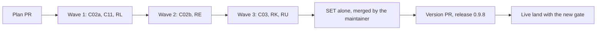

# Plan for 0.9.8: the merge gate, the review request and the faults of the 0.9.7 run

## Status (2026-11-15)

- The plan is merged (#797) and wave 1 is built: C02a is on `main`, C11 and RL are in review. This revision adds one entry, RU, and choice 8. Nothing else changes.
- Written from one impact pass on `main` at 15ee469 (`.claude/assessment/drafts/impact-gate.md`, a local note of the driving session), checked again at 2fbab55 (v0.9.7). Each Touches line names functions, sections and case titles, because line numbers move.
- The six choices on the merge gate are decided (maintainer, 2026-11-13). Rule A (a review with only minor findings is clean once each finding is answered) is decided (2026-11-13). The filing bar is decided (2026-11-13). CodeRabbit's automatic reviews are off and a review is asked for by comment (2026-11-14).
- The entries hold what must be true as numbered statements. The evals writer builds its list from them, with one coverage item for each statement. A statement with more than one sentence gets one item for each sentence.
- The waves run with `pluginRoot` at the installed v0.9.7, after the update to v0.9.7 and a reload.

## Summary in plain words

Today the session that drives the build asks CodeRabbit for each review by hand, one PR an hour, reads the answer with its own scripts and merges under your standing rule. This plan moves that into the plugin. The step that lands a PR can now ask CodeRabbit for a review of the last commit. It asks only when the session that drives the build turns that on; a plain land asks for nothing. The merge script does not ask. It merges when that review finds nothing or only small points that each have an answer. A run now also looks at its start for a session that still uses the agent rules of an older release. For this release the run goes on with a warning. From the next release it stops. In both cases you type `/reload-plugins` and the run is started again. Three small entries fix the faults that cost the most time in the 0.9.7 run: a list of checks that was given again after a stop got only one try, a decision of yours did not reach the agent that repairs a PR before the merge, and a check for behaviour that already worked could not be shown to fail, and stopped the PR.

Added on 2026-11-15, while wave 1 was built: a ninth entry (RU, choice 8). A run that repairs an open PR on release 0.9.7 can end as "not ready" with a reason that is not true, when the text of the PR needed no change. RU fixes that before the full product waves, where such repair runs happen.

What you do: remove the Gitar app from the repo (choice 1), merge one small settings PR after wave 3 (choice 5), and reload after the release.

## Choices for the maintainer

Merging this plan accepts the pick of each line. Say so before the merge to change one.

| # | Choice | Pick | Why |
| --- | --- | --- | --- |
| 1 | Gitar no longer reviews, but it still marks some PRs as passed. Two of the merge rules count that mark as proof that the bot looked at the last commit. | Remove the Gitar app from the repo (a repo setting, yours to do). | No plan of Gitar reviews this repo. An app that passes with no review must not count. |
| 2 | Who answers a review that has only small findings (rule A). | The session that drives the build writes the answers, as today. You do nothing. | 4 of about 15 merges used it. An agent that files issues at the merge step is a larger change. |
| 3 | A PR that still has no clean review after the script asked two times. | No new rule. The session that drives the build asks once more itself on the same commit, and a clean review of that request still lets the PR merge. | It did not happen in 15 merges. |
| 4 | A PR that changes CodeRabbit's settings file can weaken the review that judges it. The merge script does not refuse such a PR (issue #736, item 3). | Not built. In this repo and in a repo with no settings file, the file becomes one that only you merge. A repo with its own settings file adds the three names to its `gates` (SET names this in the onboarding steps). A new issue holds item 3. | No agent merges such a PR in a repo whose `gates` name the file. A merge of it is one that you asked for (`--person`). |
| 5 | Two rule files change. The repo rules (`AGENTS.md`) get the new merge condition and the new review request. The list of files that only you merge gets CodeRabbit's settings file. | One small settings PR (entry SET), built alone after wave 3, that you merge. All other PRs merge under your standing rule. | Your rule does not cover those two files. |
| 6 | The three entries for the faults of the 0.9.7 run (RL, RE, RK). | In this plan. | Batch B needed four restarts and five fix runs for these causes. A product run meets the same paths. |
| 7 | On a product repo, a review finding above minor at the land step means a fix run, and a fix run is always merged by you (#78). | No change in this plan. Know it before the full Tagreeve waves. | #78 is its own design question. |
| 8 | A fault of release 0.9.7 that the build of wave 1 found (#802): a land-fix run stops with `PR body not updated with the untested items` when the body needs no change. The quick-fix route refused it, because the triager ranked the risk high (it loosens a check that stops a PR). | A ninth entry, RU, in wave 3. It merges under your standing rule, like the other code PRs. | Every land-fix run on a product repo meets the fault, and the result then has no pair for the land step. |

## Decisions

- **The gate has four ways to clear.** The three of today stay. The fourth is new: a completed, clean CodeRabbit review of the final commit that was asked for after the push. It clears `coderabbitai[bot]` only.
- **A bot is its exact login and its own App.** `BOT_LOGINS` becomes a list of exact logins. A check run counts for a bot only when its App is the bot's. A reply answers a thread only when the bot or the user wrote it; for the fourth way only the user.
- **Every read stops the merge when it fails.** No read of `merge-pr.sh` sits inside a pipe without a stop.
- **Rule A is in the gate, the answers are not.** The gate checks that each minor or trivial finding has an answer by the user with an issue number or a text that starts with `Note, not filed:`. Who writes the answer is choice 2.
- **The request is the land step's.** A new script posts `@coderabbitai full review` through REST, at most twice for a commit, and never sooner than 64 minutes after the newest request by the user in the repo. The workflow's bot wait does not change. The proposal's rule for a bot check that still runs is not built: with automatic reviews off it has no input.
- **Three rules have one home.** The request rule, the push-time rule and the completed-review rule are in one new file, `scripts/review-request.jq` (C02b). The gate and the request script (C03) both read that file.
- **The reload check reads a version line, not a folder variable.** `agents/goals-preflight.md` holds one plain line with the release version. The version PR writes it. A probe returns the line of the role file the session loaded. A wave is refused only on a fact that a script read (`ROLES DIFFER` or `ROLES MISSING` of `scripts/role-files.sh`). A model answer alone never refuses a wave: it gives a `WARN`, and the wave runs. This replaces the marker with `${CLAUDE_PLUGIN_ROOT}` of the earlier proposal. The Claude Code docs say that the variable is replaced in agent content, and no check has shown when (live check G never ran, and no released role file holds the variable).
- **No entry adds a role agent (a file in `agents/`), a step (a key of `STEPS`), a wave argument or a result key.** C11 adds one entry to `ROLES` that uses the `goals-preflight` agent and the `preflight` step.
- **A closing line is on the entry whose merge makes the last change that the issue names.** When two entries settle an issue, the later one carries the line. Its build notes name the statements of the earlier entry that settle the rest. So C03 carries #736 (after C02b), RE carries #792 (after RL) and SET carries #780 (after C03).
- **The settings PR comes last.** SET is built alone after wave 3 and before the version PR, because its sentences on the land step are true only when C03 is on `main`. The maintainer merges it.

## Rules for every PR

- What must be true is the numbered list of the entry. A statement marked (doc) is proved by a test that reads the text. A statement marked "(holds today; kind `regression`)" passes with and without the change, and its eval has the kind `regression`.
- No entry has an Invariants line: the numbered statements hold the properties, and each becomes an eval. The round cap of every entry is the default.
- A test of a statement that says that nothing happens (no request, no clearing, no call, no merge) is built from the case where it does happen, with one change. The same test file holds that positive case. The negative test also asserts the printed line or the exit code that names its cause.
- A PR edits only the parts its Touches line names. When a decision after a stop allows one more place, the driving session changes the scope eval in the list of the rerun in the same step.
- No eval statement holds the trigger words of the PR-text rule: "PR body", "PR title", "PR description", "pull request body", "pull request title", "pull request description", "Closes line", or a closing keyword with "#" and a number.
- Each closing line is on its own line in the description of the PR.
- `workflows/run-wave.js` stays plain JavaScript with no filesystem, no `Date.now` and no `Math.random`.
- Scripts under `scripts/` use `gh api` only, never `gh pr` or `gh issue`, and no command that exists on one of macOS and Linux only. CI runs on Linux.
- In `test/sim-pipeline.mjs` each entry adds its cases as one block after its anchor case. Every anchor of this plan is after the last helper definition (`refusedForText`), so a case can use every helper. An eval check names only helpers that are defined before the entry's block.
- Each code PR but SET merges under the maintainer's standing rule: a completed CodeRabbit review of the final head that is clean or minor-only (rule A), and green CI. The driving session asks for the review with its own scripts, as in plan 0.9.7, because the waves run on v0.9.7. The maintainer merges SET.
- A finding of the CodeRabbit command-line pre-check that is ranked major and names a mechanism is fixed before the review is asked for.
- Docs: Simplified Technical English, no em dashes.

## Waves

Summary: three waves of two or three PRs, then the settings PR alone, then the release, then one live land that uses the new gate.

Why three waves: C02a and C02b both rewrite `scripts/bot-approval.jq`. C03 needs the rules for the request, the push time and a completed review, which C02b puts in `scripts/review-request.jq`. `skills/pr-pipeline/SKILL.md` has one line for each step, so two entries that edit one step are in different waves: step 10 (C02a, C02b, C03), step 6 (RL, RK), the result paragraph (C11, RE). Edits of lines that touch also conflict at landing, so RL edits step 6 and not step 11, which is the line after step 10 (C02a). RE comes after RL: it edits the result paragraph for the key that RL gives a land-fix run that throws, and so it carries the closing line for #792. RU is in wave 3 because it was added after wave 1 started; it edits `BODY`, `bodyPrompt` and `syncUntested`, which no other entry edits, and no line of SKILL.md. SET comes alone after wave 3: its sentences name the request of the land step, which C03 builds, and the maintainer merges it.

### Wave 1

**C02a Who is the bot, who answers, and every read stops the merge.** Tests in `test/bot-approval.test.mjs`, `test/gate.test.mjs`, `test/land.test.mjs`, `test/release.test.mjs`, `test/wait-bots.test.mjs`; sim cases "gate: ..." (the helpers `GITAR_RAN`, `gate`, `reply` get new data). The case that keeps the three default lists equal (statement 3) is in `test/bot-approval.test.mjs`. The text case for statement 8 is in `test/wave-prompts.test.mjs`, and the text case for statement 9 is in `test/skill-notes.test.mjs`.
Touches: `scripts/bot-approval.jq`, `scripts/bot-status.sh` (the default list, the identity rule and one new read: the check suites), `scripts/merge-pr.sh` (the reads and the default list), `workflows/run-wave.js` (the default text of `BOTS`), `skills/pr-pipeline/SKILL.md` (step 10; the lines on `BOT_LOGINS` and on how the bot's check is found; the `bots` example in "Workflow arguments"; the review-bot bullet of "Before the first run in a repo"), the fixtures `test/fixtures/gate/bot/*.json`, the five test files above (with `statusSetup` of `test/release.test.mjs` and `setup` of `test/wait-bots.test.mjs`, which get a fixture for the check suites), `test/wave-prompts.test.mjs` (one new case), `test/skill-notes.test.mjs` (one new case), `test/sim-pipeline.mjs` (the three gate helpers and the cases that use them).
What must be true:
1. A check run counts for a bot only when its `app.slug` with `[bot]` added equals the bot's login. A run with no `app` counts for nothing: not for clearing, not for `seenHead`, not for `pending`.
2. A commit status clears nothing for a bot. (holds today; kind `regression`)
3. `BOT_LOGINS` is a list of exact logins, separated by commas, with the default `coderabbitai[bot],gitar-bot[bot]`. A review or a comment counts for a bot only when its author login is in the list. One test keeps the default list of `merge-pr.sh`, the default list of `bot-status.sh` and the logins in the default text of `BOTS` equal.
4. A `BOT_LOGINS` value with an item that is not a login (letters, digits and hyphens, with or without the ending `[bot]`) stops `merge-pr.sh` and `bot-status.sh` with a message that names the format, before any merge call.
5. A thread counts as answered only by a reply of the thread's bot or of the user. This holds for the answered-comment way and for `openThreads`. With no user in the input, only a reply of the thread's bot answers a thread.
6. `merge-pr.sh` reads the user, the reviews, the review comments, the PR comments and the check suites, each as its own call. A read that fails stops with `PR <n> NOT merged: cannot read ...` and no merge call. The new reads come after the gate block. The check runs are read once, and the pull is read no more often than today (these two sentences hold today; kind `regression`).
7. The three ways of today clear as before, with the identity rule of statements 1, 3 and 5. (holds today; kind `regression`)
8. The default text of the wave argument `bots` names the two exact logins, and no prompt sentence says "login contains".
9. (doc) SKILL.md says that `BOT_LOGINS` is a list of exact logins, that a bot's check is found by its App, and that another bot needs `BOT_LOGINS`. The `bots` example in "Workflow arguments" names the two exact logins.
10. `bot-status.sh` reads the check suites of the head on all pages, as its own call. When that read fails the script exits 1, as for its other reads. Its output line keeps its six keys (this sentence holds today; kind `regression`).
Build notes: no rule of C02a uses the PR comments and the check suites. C02a makes these reads, in `merge-pr.sh` and in `bot-status.sh`, for statement 2 of C02b, because it already edits the setups of the old test files. Statement 6 alone breaks 26 cases without new data: 16 in `test/gate.test.mjs`, 9 in `test/land.test.mjs` and 1 in `test/bot-approval.test.mjs`. All run through three setups: `setup` of `test/gate.test.mjs`, `landSetup` of `test/land.test.mjs` and the setup inside the `bot-approval` case "merge-pr.sh does not merge an older approval with no check on the head". Statement 10 breaks 6 cases of `test/release.test.mjs` (through `statusSetup`) and 15 of `test/wait-bots.test.mjs` (through `setup`), because `test/fake-gh` exits 1 for a path with no fixture. Three more cases need new data for the identity rule: `bot-approval` "an approval on an older commit with a successful check on the head clears as approved earlier", `release` "bot-status: an unanswered bot thread is counted and nothing clears" (the reply login must be the user of the fixture) and `wait-bots` "wait-bots keeps polling while a bot check run is still running, and the body then counts". `test/skill-notes.test.mjs` needs the label "approved earlier" in SKILL.md.
Closes #548

**C11 A wave says "reload" when the session runs the role files of another release.** Sim anchor: after "C10-3 an evalsRounds value of 1 or 2 gives one or two writer calls".
Touches: `workflows/run-wave.js` (`ROLES`, one new entry; one new schema, one new prompt and one copy of the version pattern; the start of the wave: the third call beside the preflight and the version check, and the refusal before the goals refusal; `evaluateWave`, the empty result), `agents/goals-preflight.md` (one line above `## Rules`), `scripts/role-files.sh` (new), `test/plugin-version.test.mjs` (one new case), `skills/pr-pipeline/SKILL.md` (the result paragraph; the paragraph "Once per wave: evaluate"; the `agentPrefix` option; "Resume, do not restart"; two new rows in "When things go wrong" after the row for the version warning, one for the refusal and one for the two `WARN` lines; one new line in "Files"), `README.md` (the scripts list), `docs/cloud-routines.md` ("The pin and the setup script", two sentences: the version PR also writes the line, and the check does not run in the cloud), `test/sim-pipeline.mjs` (the fake agent; one new list for the new labels, with its reset in `simulate` and `runWith`; the case "the result has the agent count per role"; one new block), `test/role-files.test.mjs` (new).
What must be true:
1. `agents/goals-preflight.md` holds one line `Role files of release <version>.`, and a test fails when the version differs from `.claude-plugin/plugin.json`.
2. At the start of a wave with `pluginRoot` and the default `agentPrefix`, one `goals-preflight` agent with the label `roles:wave` returns the version of that line in its own instructions, or says that its instructions hold no such line. Its prompt holds no version and no folder. The prompt tells the agent to run no command and to read no file. A wave of only land fixes runs it too.
3. The version equals the version of the workflow: the wave runs, with no log line and no warning.
4. Another version: the probe runs once more (`roles:wave#2`). Only when both answers give the same other version, one `pipeline-io` call `io:wave#roles` runs `scripts/role-files.sh <first folder> <second folder>`. The first folder is the folder of the loaded version: the folder beside `pluginRoot` with that version as its name. The second folder is the folder beside `pluginRoot` with the version of the workflow as its name. When `pluginRoot` is that folder, it is `pluginRoot`. Every other pair of answers (two different versions, one "no line", free text, a null answer) is the case of statement 7 with the line `WARN role check could not run: <why>`, and no io call runs.
5. `ROLES SAME` lets the wave run with one log line.
6. `ROLES DIFFER <names>` or `ROLES MISSING <folder>`: every PR is refused as `{ id, ready: false, refused: true, reason }`. No other input refuses a wave for its role files. The reason starts with `role files differ:` and names the two versions, the role files that differ when known, `/reload-plugins` and a new run. No PR step, evaluator or redactor runs. The result has the same keys as a goals refusal, and the final cleanup runs. The role reason wins over the goals reason.
7. "No line" in the first answer: the probe runs once more (`roles:wave#2`). "No line" twice: no io call runs, `warnings` gets one line that starts `WARN role files hold no release line:`, and the wave runs. That line says that the session holds the role files of a release before 0.9.8 or that the probe failed, and it names `/reload-plugins` and a new run. No usable answer (a null probe, free text, a pair of answers that statement 4 does not take, a failed io call, `CHECK FAILED` with exit 3, other output): one line `WARN role check could not run: <why>` in `warnings`, and the wave runs.
8. No `pluginRoot`, or a changed `agentPrefix`: one log line, no warning, no probe, the wave runs. This is the way out of a refusal that a reload does not cure: the test of this statement shows that a wave with `agentPrefix` "" runs.
9. A version from the probe reaches a command only when it matches the version pattern of `scripts/semver.sh`, and then only as part of one shell-quoted argument. A test keeps the copy of the pattern in `run-wave.js` equal to it.
10. `role-files.sh` compares the `agents/*.md` files of two folders byte for byte, and only reads. The one line left out of the compare is the line of `goals-preflight.md` that matches `Role files of release <version>.` A file in one folder only counts as a difference. The script prints `ROLES SAME` or `ROLES DIFFER <names>` (exit 0). It prints `ROLES MISSING <folder>` (exit 0) when the first folder does not exist. It prints `CHECK FAILED <why>` (exit 3) when the second folder cannot be read or when the two folders are the same folder.
11. `agentCounts` counts the probe.
12. (doc) SKILL.md says what the check does, that a role refusal needs a reload and a new run and not a resume, that a role refusal gets no evaluation, and, in the new line of "Files", that the version PR writes the line. The row for the refusal also says that a refusal which a reload in a new session does not change is a fault of the pipeline: the wave can run with copied role files and `agentPrefix` "" (statement 8), and the session reports the fault. The row for the two `WARN` lines says what each line means, and for the line `WARN role files hold no release line:` it names `/reload-plugins` and a new run. `docs/cloud-routines.md` says two things only: the version PR writes the line, and the check does not run in the cloud because `agentPrefix` is set there. SKILL.md says that with a `pluginRoot` outside the plugin cache the check can compare no files, and that such a wave runs with `agentPrefix` "" and copied role files, as the live runs do.
Build notes: nine test files besides the sim run the start of a wave with a fake agent that answers an unknown label with `null`; statement 7 keeps them valid. In the sim the fake files the new labels in a list of its own, outside `calls` and `versionCalls`. Then the cases "incomplete goals refuse the wave after one agent" and "every call names its role agent from the plugin", which compare label lists, stay with no change. The version cases ("version: ...") stay with the default answer "same version". The new sim block holds one case for "no line" twice (the wave runs with the `WARN`), one for the same other version twice (the io call runs) and one for each other pair of statement 4 (the wave runs with the `WARN`, and no io call runs).
No closing line.

**RL A land-fix run reads the decisions, and a run that throws keeps what it found.** Sim anchor: after "F652-3 a kept dispute with no push still stops with no progress".
Touches: `workflows/run-wave.js` (`landFixPrompt`, `landReviewPrompt`, `answerPrompt`, `minorFixPrompt`: one line each for the design rules; the state maps; the catch of `runPR`; the land-fix branch of `runPRSteps`, the two local arrays; `bots`, the minors of the bot check), `skills/pr-pipeline/SKILL.md` (step 6: the sentence on `resume.designRules` and one sentence on the land-fix run, which says that a land-fix run that throws carries its minors under `lateMinors`; the row `needs human: scope` in "When things go wrong"), `test/sim-pipeline.mjs` (one new block, with the doc case).
What must be true:
1. In a run with `resume.designRules`, the land fixer prompt, the land review prompt, the bot answer prompt and the minor fix prompt hold the rules. The architecture prompt still does not, and the docs, minor review and dispute prompts stay without the rules (this sentence holds today; kind `regression`).
2. A land-fix run that throws returns its rows under `history` and its minors under `lateMinors`, the key that every land-fix stop returns and that Step 3 of SKILL.md counts. A run of another kind that throws keeps `minors`, as the result paragraph says (this sentence holds today; kind `regression`).
3. A bot check whose fixer or reviewer throws returns the minors that the check had found (the reviewer case uses a `parallel` that throws again): under `lateMinors` in a land-fix run and under `minors` in another run.
4. `resume-args.sh`, given the thrown result of statements 2 and 3, prints those minors in `resume.minors` (the check runs the workflow first; the script already maps `lateMinors`). The count of Step 3 includes them.
5. (doc) SKILL.md says in step 6 that a land-fix run gets the design rules and that a land-fix run that throws carries its minors under `lateMinors`, which Step 3 counts. It says in the row `needs human: scope` that when a decision after a stop allows a change outside the Touches line, the session changes the scope eval in the list it gives to the rerun.
Build notes: the rules go on a line of their own in each prompt and not into `prBlock` ("E04-8: resume.designRules reach the verifier, the reviewer and the fixer" pins that the architecture prompt has none; `test/token-report-roles.test.mjs` reads `prBlock`). "E02-3 minor fix, minor revert and land-fix prompts say disputes are not taken" pins source text in `minorFixPrompt` and `landFixPrompt` and stays. In `bots`, the tracked minors are also the known list of the review prompt. The result paragraph of SKILL.md says that a PR that throws carries its history and its minors under `minors`. It stays true for every run but a land fix. RL does not edit the paragraph, because C11 edits it in this wave: step 6 names the land-fix key, and RE adds the key to the paragraph in wave 2 (statement 6 of RE). #792 names that paragraph, so RE carries the closing line for #792. RL does not edit step 11.
No closing line.

### Wave 2

**C02b The fourth way: a clean review that was asked for, and rule A.** After C02a is on `main`. Tests in one new test file with a fixture folder built from real answers (#794 at 33b6f35: a clean run after a request; #794 at 900bd64: one inline Major and one Nitpick ranked Trivial; #793: two inline minors with answers) and one made fixture with two runs of the bot's App on one head. Each case of statements 3 to 8 is a fixture that clears, with one change (statement 12).
Touches: `scripts/review-request.jq` (new: the request rule, the push-time rule, the completed-review rule and the no-finding rule), `scripts/bot-approval.jq`, `scripts/bot-status.sh` (the suffix list; the no-finding rule moves to `scripts/review-request.jq`, which the gate also reads; the input of the jq), `scripts/merge-pr.sh` (the input of the jq; the line `clean review:`), `scripts/land-wave.sh` (header line 6 only), `skills/pr-pipeline/SKILL.md` (step 10; the paragraph on the gate in Step 3; the row for `approved=[]`; one new line in "Files"), `README.md` (the two sentences on when a PR merges), `docs/explainer.html` (the same sentence), `test/bot-approval.test.mjs` (the case "bot-status.sh strips every suffix that bot-approval.jq can print"), one new test file, the fixtures.
What must be true:
1. A fourth way clears `coderabbitai[bot]` only and prints `coderabbitai[bot] (clean review)`. It needs the bot's run on the head, which is the newest run of the bot's App by `started_at`: `completed`, conclusion `success`, title `Finished`, and a summary that starts with `Result: Success - Review completed`. It also needs green CI: at least one check run on the head whose App is not the App of a login in `BOT_LOGINS`, `completed` with the conclusion `success`. A head whose only passing runs are runs of a review bot does not clear this way. A bot with no review object can clear this way.
2. It needs the request: a PR comment by the user whose whole text is `@coderabbitai full review`, with a `created_at` after the push time of the head and before the `started_at` of that run. The push time is the earliest `created_at` of the check suites of the head, read on all pages. A head with no check suite does not clear. The commit's own date is never read (this sentence holds today; kind `regression`).
3. It needs a reply by the user on every top-level inline comment of the bot on the PR.
4. It needs that the bot has no `CHANGES_REQUESTED` review without a later approval.
5. Every finding of the bot on the head passes rule A. Inline: the review body says "Actionable comments posted: N", exactly N top-level inline comments of the bot carry the id of that review, each is ranked Minor or Trivial, and each has a reply by the user that holds `#` and a number or starts with `Note, not filed:`.
6. Rule A, findings in the body: the outside-diff section (count M) and the nitpick section (count K). The form of a section heading comes from a real fixture: "Nitpick comments: K" from #794 at 900bd64. A section whose form is in no real fixture is refused. So a body with an outside-diff section is refused until a real review with that section is a fixture, and M is 0 until then. The body ranks exactly M plus K findings, each Minor or Trivial. One PR comment by the user answers them: the newest comment that starts with `<!-- pipeline-bot-answer head=<head sha> -->`. Its `created_at` is after the `submitted_at` of the newest review of the bot on the head. It has at least as many lines that each hold `#` and a number or `Note, not filed:` as all reviews of the bot on the head rank findings in their bodies, counted together. So one line answers one finding of one review, and an older answer comment answers nothing.
7. Rule A refuses all that it cannot rank: a "Duplicate comments" section, a count that is missing or differs, a rank word other than Minor or Trivial, a finding with no such answer, and a body text that the no-finding rule does not know.
8. Each of these runs clears nothing, with one test for each: a skipped run (each skipped title that #736 names), a rate-limited run, a `cancelled` run, a `failure` run, a `success` run with the title "Review failed", a `success` run on an older commit, a run that started before the request, and a clean run on a head with no passing check run of another App.
9. When no bot clears, `merge-pr.sh` prints one more line that starts `clean review:` and names the first condition of the fourth way that did not hold, in the order of statements 1 to 7 (the green CI of statement 1 comes after the bot's run). The line `approved=[...]` keeps its form, `approvedBy` stays a list of strings, and the output line of `bot-status.sh` keeps its six keys (this sentence holds today; kind `regression`).
10. (doc) SKILL.md, the README and the explainer describe four ways.
11. The request rule (the text and the author of a request), the push-time rule and the completed-review rule are in `scripts/review-request.jq`, and no other file of `scripts/` holds a copy. The gate reads them from that file.
12. The new test file holds the positive cases: the clean run of #794 at 33b6f35, with its request and its push time, and the answered review of #793 each print `coderabbitai[bot] (clean review)` with no change. No real review with a nitpick section clears, so the positive case of statement 6 is a made fixture, marked as made: the review of #794 at 900bd64 without its inline Major and with the answer comment. Each case of statements 3 to 8 is one of these fixtures with one change, and it also asserts that the `clean review:` line of statement 9 names the condition that the case changes. These cases fail on `main`, which prints no such line, so statements 3 to 8 are not of kind `regression`.
Build notes: a commit is the head of a PR a second time only after a force-push, which no agent and no script of the pipeline makes, so the push-time rule of statement 2 does not cover a head that comes back. The answer comment that sets `reviewBodies` to 0 stays a rule of the wait; the gate never uses it alone. The sim case "gate: a bot comment on the current head blocks, even when answered" stays only because the fourth way reads the run text of CodeRabbit. `land` "land: check runs with large payloads are read and merged" holds only when a run's summary does not go through one jq argument. The real fixture of #794 at 33b6f35 is built from the default read of the check runs, which returns one run of the bot; the made fixture holds a clean run and an older skipped run. Two rules of the driving session's interim merge script are not built. A green run named `ci`: `ciChecks` names the checks that may stand in for an eval, not checks a merge needs. A key for a needed check belongs with #467. `merge-pr.sh` keeps its rule that every check run of the head passed and that at least one exists. For the three ways of today the bot's own run can be that one, as today; the fourth way asks for a passing run of another App (statement 1), because with it a head always has the bot's run. The draft refusal: the opener opens ready PRs. Item 3 of #736 is not built (choice 4). Before wave 2 the driving session files one new issue for item 3 and writes one comment on #736. The comment names what this plan replaces: item 3 of the maintainer's comment (choice 4, the new issue), item 2 (who posts the request: C03), bullet 3 of body item 1 (rule A) and body item 6 (void since #781). The session gives the number of the new issue to wave 2 in the `notes` of C02b, and the description of the PR names it. C03 carries the closing line for #736.
No closing line.

**RE A list that the evals check refuses goes back to the writer, also on a rerun, and a stop holds the list.** After RL is on `main`. Sim anchor: after "C10-12 a list that the evals check sends back three times stops the PR with the notes".
Touches: `workflows/run-wave.js` (`writeEvals`: the given path and the writer loop; `evalsPrompt`: the sentence "Nothing is built yet" and the text for a later attempt; the evals stop in `runPRSteps`), `skills/pr-pipeline/SKILL.md` (step 1, the sentences on attempts and on a resume; the `evals` bullet of the workflow arguments, which keeps "default 3"; the PR options, `evals` and `resume.evals`; the result paragraph: the sentence on a list that differs, and the two sentences on the minors of a `run failed` result; the row `evals check:`), `test/sim-pipeline.mjs` (the case "A01-11 a resume whose changed list the check refuses keeps the record, and its result resumes with no check"; one new block, with the doc case).
What must be true:
1. When the evals check sends back a list that was given in `prs[].evals` or `resume.evals`, the writer gets the list and the notes, up to `evalsRounds` attempts in all, and the PR stops only after the last one. On the given path the writer call of attempt N has the label `evals:<id>#wN`, and its check has round N. A check that does not answer still stops at once, and with `evals: false` a given list that the check sends back stops at once (this sentence holds today; kind `regression`).
2. A given list that a code rule refuses still stops at once. (holds today; kind `regression`)
3. The record of the earlier run is kept through every attempt, and a list of the writer on a later attempt leaves a record as a writer list does. With a record, a stop keeps `evals` and `evalsMeta.accepted` of the record and puts the last list of the writer in `lastFindings`.
4. On a rerun the writer prompt does not say that nothing is built. A rerun is a PR with `resume` or `skipImpl`. The prompt still keeps the writer on the default branch (this sentence holds today; kind `regression`).
5. For a PR with no record: a stop with `evals check:` on the writer path returns the last list of the writer under `evals` and its `noErrorPath`, `noReference` and `algorithm` under `evalsMeta`, and a resume of that result runs the evals check. A stop with `evals refused:` returns the same, and its resume stops at the rule again. `resume-args.sh` carries both keys with no change.
6. (doc) SKILL.md says that a given or resumed list that the check sends back goes to the writer, up to `evalsRounds` attempts in all, and that an evals stop returns the last list of the writer. The result paragraph says that a land-fix run that throws carries its minors under `lateMinors`, and a run of another kind under `minors`.
Build notes: the helper `noWriter` fails a run when the writer starts; "A01-11" is the one case that must change. "C01-14 a given or resumed list that differs from the record leaves a record with no coverage" holds for attempt 1 and is not edited; say in a case of the new block what a writer answer on attempt 2 leaves. The cases that pin the number of writer calls for a rule refusal (E01-2, C10-1, C10-3, C10-6) stay: this entry adds no second counter. `test/skill-docs.test.mjs` pins `evals check:`, "not answer" and `run failed:` in the result paragraph, and `test/evals-attempts.test.mjs` pins "default 3" in the `evals` bullet; both stay. `scripts/recover-evals.sh` pairs the label `evals:<pr>#w<N>` with `evalsarch:<pr>#<N>`, and another label on the given path makes it print nothing. `evalsCheckPrompt` holds the same sentence as `evalsPrompt`; the Touches line does not name it. #792 is settled by statements 2, 3 and 4 of RL on `main` plus the `lateMinors` sentence of statement 6 of this entry: #792 names the sentence of the result paragraph on a PR that throws, and this entry makes it true for a land fix.
Closes #792

### Wave 3

**C03 The land step asks for the review.** After C02b is on `main`. Tests in two new test files (the script; `land-wave.sh --review`) with fixtures for `test/fake-gh`.
Touches: `scripts/request-review.sh` (new), `scripts/land-wave.sh` (the header; the flag parse and the usage line; one step between the `WAITING` test and the call of `merge-pr.sh`), `skills/pr-pipeline/SKILL.md` (step 10, one sentence; Step 3: the first paragraph and one new paragraph; the row "Bot rate-limited" in "When things go wrong" and one new row after it; the `botWaitMinutes` line of the arguments example; "Files": the `land-wave.sh` line and one new line), `README.md` (the scripts list), two new test files, fixtures.
What must be true:
1. The script posts nothing when the head of the PR is not the given sha. It prints a line that starts `NO REVIEW #<pr>: ` with that cause and exits 1.
2. The script counts the requests from GitHub: the comments by the user whose whole text is the request and whose `created_at` is after the push time of the head. With none it posts one. With one, it posts none and goes on at statement 5 or 6 for the run of that request. With two it posts none and goes on at statement 5 for the run of the newest request. A rerun, a dead session or a request by hand never gives a third request.
3. The request is posted through the REST comments endpoint.
4. The script posts no request sooner than 64 minutes after the newest request by the user on any PR of the repo. It waits for that time. Before it waits, the script prints one line `WAIT <seconds> #<pr>` with the real number of seconds. The test mode shortens the sleep and not the number.
5. After a request the script waits for the bot's run on the head that started after it. When that run is a completed review (statement 1 of C02b), it prints a line that starts `REVIEWED #<pr> run <id>` and exits 0.
6. When the run after request 1 is rate limited, cancelled or has the title "Review failed", the script posts request 2, by the rule of statement 4. It also posts request 2 when no run of the bot's App on the head started in the 45 minutes after request 1; this holds in the same call and in a later call. A skipped run that is older than the request is never read as the answer.
7. Every other end prints a line that starts `NO REVIEW #<pr>: ` with the cause and exits 1: a head that is not the given sha, two requests with no completed review, a run that started after a request and did not complete inside 45 minutes of that request, no run that started inside 45 minutes of request 2, or a failed read.
8. The time rules give the same result on Linux and on macOS, and a test mode makes the waits short.
9. Without `--review`, `land-wave.sh` makes the same calls as today. (holds today; kind `regression`)
10. With `--review`, for each pair in order, after CI is green and the head is the checked sha: when the PR is not `MERGEABLE`, `land-wave.sh` posts no request and goes on to `merge-pr.sh`, which refuses. In every other case it reads `bot-status.sh` once. When `approvedBy` is not empty it posts no request and calls `merge-pr.sh`. When `openThreads` or `reviewBodies` is above 0 it posts no request and stops with a line that starts `REVIEW #<pr>: `. In every other case it runs the script, and calls `merge-pr.sh` after `REVIEWED`. After `NO REVIEW` it stops with `REVIEW #<pr>: ` and the cause. When the read of `bot-status.sh` fails, it posts no request, calls no merge and stops with a line that starts `STOP #<pr>: cannot read the bot status` and exit 5, the code of the other `STOP` lines and failed reads of `land-wave.sh`.
11. `land-wave.sh --review` stops at the first PR that is not merged and posts no request for a later pair. A `REVIEW` stop exits 9.
12. `--review` and `--person` work together, in any order.
13. (doc) SKILL.md describes the flag, the two requests, the 64 minutes and the `REVIEW #n` stop, and says that the session runs the command in the background. Step 10 says that a bot that reviews only on request is asked by the land step, while the workflow's bot wait still runs to `botWaitMinutes`. The row "Bot rate-limited" names the two requests and the 64 minutes. The new paragraph of Step 3 says that one land command with `--review` runs at a time for a repo, because the script has no lock.
14. `request-review.sh` takes the request rule, the push-time rule and the completed-review rule from `scripts/review-request.jq` and holds no copy of them.
15. (doc) SKILL.md says, in the arguments example and in step 10, that for a repo whose review bot reviews only on request the session passes `botWaitMinutes` of 1, because the land step asks for the review and a long wait of the bot step ends with `approvedBy` empty.
16. Each case that posts no request (statements 1, 2, 10 and 11) also asserts the printed line and the exit code of its end. For `request-review.sh` it asserts that the log of `test/fake-gh` holds the GET read of the head (statement 1), and also the GET read of the comments (statement 2). For `land-wave.sh` it asserts the exact end: the `REVIEW #<pr>: ` line with exit 9, the `STOP` line with exit 5, or the call of `merge-pr.sh` in the log. The same test file holds the positive case: the same fixture with the one condition changed back, where the request is posted.
Build notes: `test/rest-only.test.mjs` forbids `gh pr` in `scripts/`. The request is posted with `-f body=`, never `-F`: the text starts with `@`, and `-F` reads a file with that name. A land with `--review` waits 64 minutes for each PR and runs for hours. The Bash tool stops a command after 10 minutes at most, so the new paragraph says that the session runs the command in the background. SKILL.md already says that a headless session stops background tasks after 10 minutes, and the new paragraph names it. The exit codes 2 to 6 are in use by `land-wave.sh`, and `merge-pr.sh` uses 7 and 8. The basis note and the check of the default branch of the driver scripts are not built: the merge record is what `release.sh` reads. The wait of 75 seconds between the completed run and the merge, which the interim script of the driving session has, is not built: on #793 and #794 the review object was posted 5 and 6 seconds before the run completed. Step 8 of `AGENTS.md` is edited by SET, not by this entry, so SET carries the closing line for #780: statements 13 and 15 of this entry settle the SKILL.md part of #780, and statement 3 of SET settles the rest. The closing line for #736 holds only with C02b on `main`, which the wave order gives: C02b builds the gate, and this entry builds the request (item 2 of the maintainer's comment on #736).
Closes #736

**RK An eval that already holds cannot stop a PR, and a check names only helpers that exist.** Sim anchor: after "C10-7 a given list and a dispute change are accepted when a trigger phrase is only in a check".
Touches: `workflows/run-wave.js` (`evalsRules`, one or two rules; `UNMEETABLE_EVAL_TEXT`; the stop in `reviewLoop` for a break-check finding that comes back), `agents/evals-writer.md` (the rule lines), `agents/fixer.md` (one sentence), `skills/pr-pipeline/SKILL.md` (the Evals bullet of the plan rules, one sentence; step 6, the sentence on break check findings; the plan-author checklist, one item; one new row in "When things go wrong" after the row for the round cap), `test/sim-pipeline.mjs` (one new block, with the doc case).
What must be true:
1. The rules that the writer and the evals check share say that an eval of kind `behaviour` or `error path` whose statement or check says that it holds on the default branch is refused, and that its kind is `regression`. When the eval is the only `error path` eval, the writer gives `noErrorPath` with the reason that the error path already holds.
2. The fixer is told, in the review loop, where the task takes disputes, that the answer to "the test passes without the change" for an eval that already holds on the default branch is a dispute of that eval. A dispute change that the rule `no error path` rejects ends in the stop of statement 3.
3. When the same eval id has the finding "the test passes without the change" in two rounds in a row, the PR stops in the second of them with a reason that starts `needs human:` and names the id. The two rounds are rounds of one run in the review loop. The stop comes before the cap check.
4. The rules that the writer and the evals check share say that a check which names a helper of a test file must be able to run at the place where the entry puts the new test.
5. (doc) The plan-author checklist of SKILL.md says that the place of a new test block must come after the helpers its cases need. SKILL.md names the new reason of statement 3 in step 6 and in the new row.
Build notes: "A06-1" and "A06-2" match three rule sentences and stay with more rules. "E04-11: at the cap with the evals passing, the reason names the open source and not rounds exhausted" pins the reason of a one-round cap; statement 3 stops in round 2 and leaves it. `test/skill-notes.test.mjs` matches six checklist sentences and counts nothing.
Closes #786

**RU A PR body that needs no change does not stop a PR.** Added to this plan on 2026-11-15 (choice 8). Sim anchor: after "D-9 the plan review checks that each issue an entry closes is fully settled, and the code review does not".
Touches: `workflows/run-wave.js` (`BODY`, one new key of the answer; `bodyPrompt`, the sentence on what to return; `syncUntested`, the line that reads the answer), `test/sim-pipeline.mjs` (one new block).
What must be true:
1. The body agent can answer that the body already holds what its task asks: `updated` false with `unchanged` true. Its prompt says when to give that answer: the body has no `Tests only:` line to take out and its Untested section needs no change.
2. The answer `unchanged` true counts only when the run can show that the Untested section of the body needs no change. On the path that knows what the body lists (`listed` set, the bot-answer path), it counts when the untested list of the run equals that list. On the path that does not know it (`listed` null, the land fix), it counts when the untested list of the run is empty. The fact that the body has no `Tests only:` line rests on the answer of the body agent, because the workflow reads no body; this stays as strict as the `updated` true answer, which also rests on the agent. A land-fix run of a branch that is not tests only, with no untested item, then goes on and ends `ready` with its `land` pair. The same holds for a bot-answer run whose list equals the list of the open.
3. In every other case `unchanged` true does not count, and the PR stops with the reason of the A2 case, as for `updated` false. That is: the list of the run differs from `listed` (for example the open listed items and a bot test round cleared them, so the body must lose its Untested section), or `listed` is null and the list is not empty. The maintainer merges from the body, so a list that the run cannot show as saved stops the PR.
4. `updated` false with no `unchanged` true stops the PR with `PR body not updated with the untested items`. (holds today; kind `regression`)
5. `updated` true goes on, with or without `unchanged`. (holds today; kind `regression`)
Build notes: the sim cases "A2 a refused removal of the Tests only line stops the PR with the body reason" and the cases near "BR6" that answer `{ updated: false }` pin statement 4 and stay with no change. The fake agent answers a label that ends in `#body` with `{ updated: true }`; the new block gives its own answers. The helpers `a2Run`, `a2Bots`, `a2NonTest` and `kLandPr` are defined before the anchor. The key `unchanged` is a key of the answer of the body agent, not a key of the result of a PR. The row `PR body not updated with the untested items` of SKILL.md stays true and is not edited: after this entry the reason is given when a change was not saved, and when the run cannot show that the Untested section needs no change. The exact reason text is `PR body not updated with the untested items`. The new block has these cases: a bot-answer run with a matching list and `unchanged` true ends ready; a cleared list with `listed` non-empty and `unchanged` true stops; a land-fix run with a non-empty list and `unchanged` true stops. Seen in run `wf_a0ee60f6-a63` on #799.
Closes #802

### After wave 3

**SET The settings: the bot's config file is gated, and the repo rules name the fourth way and the request.** After C03 is on `main`. It is built alone, before the version PR. The maintainer merges this PR.
Touches: `.github/pipeline.json` (`gates`), `templates/pipeline.json` (`gates`), `AGENTS.md` (step 8, one clause; step 9, the sentence on when a PR is merged), `templates/AGENTS-section.md` (the same clause and the same sentence), `test/land.test.mjs` (one new case beside "gate: routine/run.sh and routine/bin/gh are held by the repo gates", for `.github/pipeline.json`), `skills/pr-pipeline/SKILL.md` (the review-bot bullet of "Before the first run in a repo": one sentence that a repo with its own settings file adds the three names to its `gates`), `docs/cloud-routines.md` (the onboarding checklist: the same sentence), `test/gate.test.mjs` (one new case beside "gate: with no settings file the plugin template gates apply", for the template; one text case for statements 2 and 3).
What must be true:
1. `gates` in `.github/pipeline.json` and in `templates/pipeline.json` holds `.coderabbit.yaml`, `.coderabbit.yml` and `.coderabbit.config.ts`, and a PR that changes one of them is gated.
2. (doc) `AGENTS.md` and the template say in step 9 that a PR is merged when CI passes on the head commit and a review bot has approved it, had its comments answered and raised nothing new on the head, or has completed a clean review of the head that was asked for after the push.
3. (doc) `AGENTS.md` and the template say in step 8 that a bot that reviews only on request is asked by the land step.
4. (doc) SKILL.md and `docs/cloud-routines.md` say that `gates` of a repo with its own settings file hold the three names only when the repo adds them, and that the fixed floor does not hold them.
Build notes: the repo holds no config file of another review bot, and choice 1 removes the Gitar App. A config file of another bot gets its gate with the PR that adds the file. #780 is settled by statements 13 and 15 of C03 on `main` plus statement 3 of this entry.
Closes #779
Closes #780

## Steps of the driving session

No wave agent can do these steps. The driving session does them, in this order.

1. Before wave 2: file one new issue for item 3 of #736, and write one comment on #736 that names the items that rule A, choice 4 and C03 replace.
2. For each PR: ask for the outside review by hand, as in plan 0.9.7.
3. Before the version PR: a live check of the probe of C11. A scratch project holds a copy of the built `agents/goals-preflight.md`, with the line, as a project agent. A new headless session in that project starts the agent with the probe prompt five times. All five answers must give the version. A miss stops the release and goes back to C11.
4. After the release: the live land of pass criterion 5.
5. After the release and before the reload: the reload check of pass criterion 6.

## Not in this plan

| Item | Why |
| --- | --- |
| Rule A answers written by an agent | Choice 2. |
| A scripted merge for a PR that no review clears | Choice 3. |
| #736 item 3 | Choice 4; a new issue, filed before wave 2. |
| #78 (a rerun never gets `:auto`) | Its own design question, milestone 0.10.0. See choice 7. |
| A second counter for the evals check (a rule refusal would not use an attempt) | Entry RE gives a rerun the writer loop, so a stop like that of batch A2 costs one start. A second counter changes four pinned cases for one seen stop. |
| #109, #191, #467, #542, #543 | Milestone 0.10.0; no place of these entries. |
| #596, #705 | Design choices, held with C05 to C09. |
| The bot list in the settings file | `BOT_LOGINS` stays an environment variable. The variable is older than this plan, which changes only its format. A move into the settings file is a later item. |
| The CodeRabbit command-line pre-check | It finds another set than the PR review. It stays a tool of the driving session. |

## Pass criteria

1. The four per-PR criteria of iteration 1 hold for each entry (a list before the build, a result for each eval id in the pull request, the break check ran, and a ledger record with tokens by role).
2. No eval list stops at the evals stage.
3. No entry needs more than two outside reviews.
4. The entries file at most 2 issues, besides the one that choice 4 names. #802 (choice 8) is the first of the two.
5. After the release, one PR of this repo lands with `land-wave.sh --person --review`. For a review with no finding: one request, a `REVIEWED` line, `approved=[coderabbitai[bot] (clean review)]`, the merge. For a minor-only review: a stop, the answers, then a second call that posts no request and merges. A rerun of the same call posts no new request.
6. After the release and before the reload, a wave that runs the 0.9.8 workflow with `pluginRoot` at the 0.9.8 folder runs, and `warnings` holds the `WARN` line that names `/reload-plugins`. After `/reload-plugins` the same wave has no such line. The refusal (the compare of two releases) is first shown live at the next release.

## Release

- 0.9.8 is the nine entries (RU was added on 2026-11-15). The maintainer merges SET after wave 3, and the version PR comes after it. The version PR also writes the version line of `agents/goals-preflight.md`. The live check of the probe (step 3 of the driving session) passes before the version PR.
- The plan's own PRs cannot use the new gate, because the waves run on v0.9.7. Criterion 5 is the first use.
- After it: the full Tagreeve 0.7.0 waves.

## Flagged concerns

- **The gate reads text of the bot.** The title, the summary, the counts and the rank words are CodeRabbit's. A change of their form refuses a merge; it never clears one. A refusal names its cause in the `clean review:` line.
- **The 64 minutes are read from this repo's comments.** The allowance is very likely shared with other repos of the account, and the script does not see their reviews. Then a request is rate limited, which uses one of the two requests of the commit. Two land commands with `--review` that run at the same time for one repo can also both post inside the 64 minutes. The script has no lock; SKILL.md says to run one at a time.
- **C11 warns at 0.9.8 and stops from the next release.** After the release of 0.9.8, a session that has not reloaded holds role files with no release line, so its first wave runs with a `WARN`. From the next release, the first wave after a release is refused until the maintainer reloads, when a role file changed. Each of the last six releases changed one. That is the aim of the entry.
- **C11 needs the folder of the loaded version.** The folder stays for 14 days after the update (Claude Code docs; the cache of the maintainer's machine holds 0.1.0 to 0.9.6). After that the wave is refused by statement 6 (`ROLES MISSING`), and a reload cures it. The folder name comes from the version that the probe gave two times, so a probe that gives the same wrong version two times can still lead to a refusal. A refusal that a reload in a new session does not change has a way out: copied role files and `agentPrefix` "" (statement 8).
- **C11's mechanism was changed after the impact pass.** The pass listed the places for a folder marker. The version line changes statements 1, 2, 4 and 10 and adds one place (the version PR and its test). The plan review must check those against the code.
- **C02a changes the fixtures of five old test files.** A reviewer must see that each old case still fails for its own reason.
- **RE lets the writer run on a rerun.** The writer must stay away from the PR branch.
- **For the three older ways, the merge script still accepts a bot's own check run as the one check run it needs.** `merge-pr.sh` asks that every check run of the head passed and that at least one exists. The fourth way does not rely on that: it needs a passing run of an App that is not a review bot's (C02b statement 1), so a head whose CI never started does not clear. The same rule for the three older ways changes the fixtures of most gate tests, so it is not in this plan; it belongs with #467 (one rule for a head with no check runs). A repo with no CI at all never clears by the fourth way, and the maintainer merges there.

## Not verified

- What run CodeRabbit makes for a request that is rate limited while automatic reviews are off.
- Whether the review allowance is shared between this repo and Tagreeve.
- Which file wins when a branch holds two of the three config files.
- That GitHub sets `app` on a check run so that no other App or account can forge it.
- The form of a "Duplicate comments" section and of an "Outside diff range comments" section in a current review; only the Nitpick section was read.
- That a Haiku agent at low effort returns a line of its own instructions. The live check before the version PR tests it five times (step 3 of the driving session). A false "no line" twice gives a `WARN`, and the wave runs (statement 7).
- Which workflow file runs in a session that has not reloaded.
- The sim cases "A10-1", "A10-13", "E02-3" and "BR2-14" under entry RE were read by title and helpers, not by each assertion.
- Whether the proxy of the cloud routines serves the check-suites path. `bot-status.sh` reads it after C02a, and a cloud wave runs that script. The cloud path is not in use (maintainer, 2026-11-13).
