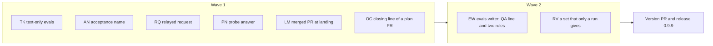

# Plan for 0.9.9: the faults of the first product wave on 0.9.8

## Status (2026-11-16)

- Release 0.9.8 is out. The first product wave ran on it in another repo: five entries, two runs. Four entries are ready. Every stop came from the pipeline, not from the product code.
- Written from one impact pass on the tag v0.9.8 (8fb3f9a). Each Touches line names functions, sections and case titles, because line numbers move.
- The entries hold what must be true as numbered statements. The evals writer builds its list from them, with one coverage item for each statement. A statement with more than one sentence gets one item for each sentence.
- The waves run with `pluginRoot` at the installed v0.9.8, after the update to v0.9.8 and a reload.
- The land step of 0.9.8 asks CodeRabbit for the review (`land-wave.sh --review`). The driving session no longer uses its own scripts for that.

## Summary in plain words

The first product wave on release 0.9.8 stopped three of its five entries for reasons that had nothing to do with the code.

The first reason is a check that only reads a text, for example a line of a changelog. The pipeline treated it as a check of how the code behaves. It then tried to prove that the check can fail by taking the code change out. For a text that proof cannot work. The entry stopped, or it lost the right to be merged by an agent.

The second reason is a name. The agent that runs the tests must give the exact name of the acceptance test. One agent wrote a sentence. The pipeline then said that the test did not run, sent that to the agent that fixes code, and stopped when that agent found nothing to fix. After this plan such a PR is not stopped: it is marked for a person to merge.

This plan fixes both. It also fixes five smaller faults that the release and the wave showed: an agent can be handed your last chat message as its task; a warning that does not say what to do; a land command that stops on a PR that is already merged; a closing line that the pipeline can add to a plan PR; and the writer of the checks reading a plan entry wrongly. One more entry changes how a reviewer asks for a complete list that only a run of the code can give. That kind of request stopped work for a person in both of the last two plans.

What you do: merge this plan, and reload after the release. From this release a session that has not reloaded is stopped at its first wave when an agent rule file changed.

## Choices for the maintainer

Merging this plan accepts the pick of each line. Say so before the merge to change one.

| # | Choice | Pick | Why |
| --- | --- | --- | --- |
| 1 | No code can see that a check only reads a text. The fix for the first fault is a rule for the agents that write and check the list, and a cure for the session when it still happens. | Rules and the cure, no new code check (entry TK). | A code rule would need a field that says how a check runs, which the agents would have to fill in correctly as well. |
| 2 | The agent that runs the tests gives a text for the acceptance test that is not the exact name of one of its checks. | No finding and no second try. The acceptance test goes on the list of untested items for the rest of the run, so a person merges that PR (entry AN). | A fix agent cannot fix a name. A second try costs a whole test run, and the review of this plan found five ways for it to go wrong. When a test is truly missing, the reviewer and the evals find it. |
| 3 | Your last chat message reaches every agent of a wave as "the user request, which wins over the task". | The agent rules say that such a text is not a task: an agent does nothing because of it and names it in its answer (entry RQ). | A message such as "merge 804" is for the main session. An agent with access to GitHub must not act on it. |
| 4 | A reviewer asks for a complete list that only a run of the code can give, and finds one more member each round. | The reviewer states the rule one time and asks that the builder finds the set by a run and lists it. A member that the reviewer finds later and the list lacks is a minor about the list, unless it shows that the rule is wrong. A member that the code mishandles keeps the rank of the existing rank list (entry RV). | It follows the rule you gave for the product plan on 2026-11-15, with one sentence added by the review of this plan: a member that the code handles wrongly keeps its rank. Your rule ended two stopped plan reviews there, and the lack of it cost six rounds on one entry here. |
| 5 | A land command is run again on a PR that is already merged. | The command says so and goes on to the next PR. It does not repair a missing merge record or delete a branch (entry LM). | A rerun of one command after a stop is the normal case. A repair is a different job with its own risks. |

## Decisions

- **A check that only reads a text is a `quality bar` eval.** `behaviour` and `error path` are for evals whose check runs the code of the change. The break check does not run for `quality bar`, so the evals check is the guard against a list that moves a weak behaviour eval to that kind.
- **The acceptance test is found by its exact name, as today.** The workflow still reads no plan entry and matches no name to a test. A name that matches no check is an untested item for the rest of the run, never a finding for the fixer.
- **A relayed request is data.** The rule is in the role files, because the workflow cannot change what the harness puts at the top of a task.
- **A model answer still never refuses a wave.** Entry PN changes how the answer "no line" is read. It adds no refusal.
- **No entry adds a role agent, a step (a key of `STEPS`), a label, a wave argument or a result key.**
- **A closing line is on the entry whose merge makes the last change that the issue names.** As in plan 0.9.8.
- **`.claude-plugin/files.txt` and the version change only in the version PR.**

## Rules for every PR

- What must be true is the numbered list of the entry. A statement marked (doc) is proved by a test that reads the text. A statement marked "(holds today; kind `regression`)" passes with and without the change, and its eval has the kind `regression`.
- No entry has an Invariants line: the numbered statements hold the properties, and each becomes an eval. The round cap of every entry is the default.
- A test of a statement that says that nothing happens (no request, no call, no finding, no merge) is built from the case where it does happen, with one change. The same test file holds that positive case. The negative test also asserts the printed line or the exit code that names its cause.
- A PR edits only the parts its Touches line names. When a decision after a stop allows one more place, the driving session changes the scope eval in the list of the rerun in the same step.
- No eval statement holds the trigger words of the PR-text rule: "PR body", "PR title", "PR description", "pull request body", "pull request title", "pull request description", "Closes line", or a closing keyword with "#" and a number.
- Each closing line is on its own line in the description of the PR.
- `workflows/run-wave.js` stays plain JavaScript with no filesystem, no `Date.now` and no `Math.random`.
- Scripts under `scripts/` use `gh api` only, never `gh pr` or `gh issue`, and no command that exists on one of macOS and Linux only. CI runs on Linux.
- In `test/sim-pipeline.mjs` each entry adds its cases as one block after its anchor case. Every anchor of this plan is after the last helper definition before the C11 block (`refusedForText`), so a case can use every helper that is defined before the entry's block. An eval check names only such helpers.
- A statement about a rule text names the words that the text must hold. Its test reads the prompt that the workflow builds, or the file, and fails when the words are gone.
- Each code PR merges under the maintainer's standing rule: a completed CodeRabbit review of the final head that is clean or minor-only (rule A), and green CI. The driving session lands it with `land-wave.sh --person --review`, one command at a time. A finding above Minor is fixed, and the new head is reviewed again.
- A finding of the CodeRabbit command-line pre-check that names a mechanism is fixed before the review is asked for. That holds also for a finding that an outside fact makes unlikely, when its fix is one line.
- Docs: Simplified Technical English, no em dashes.

## Waves

Summary: six entries in wave 1, two in wave 2, then the version PR.

Why two waves: TK and EW both edit the rule list `evalsRules` and the bullets of `agents/evals-writer.md`. TK edits the sentence `reviewEvalRule`, which stands directly before the review prompt that RV edits, and lines that touch conflict at landing. The six entries of wave 1 edit different functions. RQ edits the Rules block at the end of every role file; TK, AN and OC edit other bullets of four of those files.

### Wave 1

**TK An eval whose check only reads a text has the kind `quality bar`.** Sim anchor: after "RK-11 the SKILL.md row for the repeated passes-without-change stop says to check the default branch first".
Touches: `workflows/run-wave.js` (`evalsRules`, one new rule; `reviewEvalRule`, one sentence), `agents/evals-writer.md` (the bullets "- `kind` is one of" and "- A `quality bar` eval needs its own check"), `agents/reviewer.md` (section "## Evals", one sentence), `skills/pr-pipeline/SKILL.md` (the bullet "- **Evals.**", one sentence; the row that starts "| `needs human: eval <ids>: the test passes without the change in two rounds in a row`"), `test/sim-pipeline.mjs` (one new block), `test/evals-writer-rubric.test.mjs` (one new case).
What must be true:
1. The rule list that the writer prompt and both evals-check prompts hold says that an eval whose check only reads the text of a file has the kind `quality bar`. It names the cases: a search in a file, a sentence of a doc, a line of a changelog, an export line, and the text of a test file.
2. The same rule says that the kinds `behaviour` and `error path` are for evals whose check runs the code or a test, and that a text-only eval keeps the kind `quality bar` also when the text already holds on the default branch.
3. The same rule says that a `quality bar` eval whose statement is about what the code does when it runs is refused: its kind is `behaviour` or `error path`, and its check runs the code or a test.
4. `agents/evals-writer.md` says the same in its bullets on the kinds.
5. The sentence that asks the reviewer for an eval with each blocker and major, and the "## Evals" section of `agents/reviewer.md`, say that an eval whose check only reads a text has the kind `quality bar`.
6. (doc) The row of SKILL.md for the stop "the test passes without the change in two rounds in a row" names three cases, in this order: the check only reads a text (the kind `quality bar`, also when the text holds on the default branch), the behaviour holds on the default branch (the kind `regression`), and every other case (the test is weak, keep the kind). The bullet "Evals" names the rule in one sentence.
7. The rule that refuses a `behaviour` or `error path` eval that holds on the default branch stays. (holds today; kind `regression`)
8. `evalsVerdict` accepts a list with a `quality bar` eval and refuses no kind that it accepts today. (holds today; kind `regression`)
9. The same rule says that an item of the entry about what the code does (a behaviour or an error path) is covered only by an eval of kind `behaviour`, `error path` or `regression` whose check runs the code or the test. An eval whose check reads the text of a test file is `quality bar` and covers only an item about a text. The evals check prompts hold these words, and refuse a list in which a behaviour item has only such an eval.
Build notes: no code can see the fault. `evalsVerdict` checks only that a kind is one of `EVAL_KINDS`. The break check runs for `BREAK_KINDS` (`behaviour`, `error path`); for a text-only eval the verifier finds no test (`not-run`, an untested item) or names a test that passes with and without the change (`passes-without-change`, a major). The cases "RK-11", "RK-1", "A06-1", "A06-2" and "E03b-8" pin today's texts: add to them, and change "RK-11" only by one more assertion for the third case. The dispute prompt does not hold the rule list; the rule reaches a dispute through `agents/evals-writer.md`, the role file of the agent that rules on it (statement 4). Issue #816 suggests a sim case in which a list with a text-only eval of kind `behaviour` goes back to the writer: no code decides that, so the cases of this entry read the rule words in the prompts and the files. A `regression` eval can cover a behaviour item today and gets no break check; that path is older than this plan and does not change. A change that holds only text (a rule in a role file) has no code to run: its evals are `quality bar`, and the entry's tests read the text.
Closes #816

**AN A name of the acceptance test that does not match is an untested item, not a finding.** Sim anchor: after "RL-12 a land-fix run that throws keeps the resumed rows first".
Touches: `workflows/run-wave.js` (`testOutcome`; the untested state of a PR, one new part beside the part that `noteTest` replaces; `noteTest`; `acceptanceText`), `agents/tester.md` (the bullet "- Report the acceptance test as a check of its own"), `agents/verifier.md` (the bullet "- Check that the acceptance test from the plan entry exists"), `skills/pr-pipeline/SKILL.md` (step "2. **Test from a clean clone.**", two sentences), `test/sim-pipeline.mjs` (one new block; the case "untested: a declared acceptance test that is missing or failed gives a fix round and no sign-off"), `test/tester-agent.test.mjs` and `test/verifier-agent.test.mjs` (the cases that pin the words of the two bullets).
What must be true:
1. When `acceptance.declared` is true and one check has the name `acceptance.check`, the answer is read as today: a check that passed signs off, a check that failed goes to the fixer, and a check that was refused is an untested item. (holds today; kind `regression`)
2. When `acceptance.declared` is true and no check has the name `acceptance.check`, the answer gives no finding about the acceptance test, and the round does not fail for that reason. The tester or the verifier is not called again for the name.
3. In that case the PR gets the untested item `acceptance test (name not matched)`, so its land value has no `:auto`.
4. The item stays for the rest of the run. An answer of a later round with `declared` false, with no `acceptance`, or with a name that matches no check does not clear it.
5. The item is cleared only by a later answer with `declared` true whose `acceptance.check` is the name of a check that passed.
6. Statements 2 to 5 hold also when a check failed. The failed checks go to the fixer as today, and no finding about the acceptance test goes with them.
7. Statements 2 to 6 hold in the review round, in the docs round, in the minor pass and in the check of new code after a bot answer or a land fix. In the docs round a mismatch starts no second docs round. In the minor pass a mismatch is no reason to drop the pass.
8. A plan PR has no acceptance rule. (holds today; kind `regression`)
9. The sentence on `acceptance` in the tester and verifier prompts, and the two role files, say that `check` is the name of one of the agent's own checks, copied character for character, and never a sentence.
10. (doc) Step 2 of SKILL.md says that a name that matches no check is an untested item for the run and no finding.
Build notes: `testOutcome` makes the major "acceptance test did not run" today when no check has the exact name, and that finding goes to the fixer. `noteTest` replaces the list of untested checks at every test round (the review round, the docs round, the bot check and the land-fix check), so the new item needs its own part of the untested state that `noteTest` does not replace; the land value and the result read that part too. A resumed run, a `skipImpl` run and a land-fix run never get `:auto`, so the item needs no place in `resume`. The first design of this entry asked a second agent for the name; the plan review found five ways for that to go wrong, and it cost a whole test run, so it is not built. The case "untested: a declared acceptance test that is missing or failed gives a fix round and no sign-off" asserts today that the fixer prompt holds the finding: change its half for a missing name to the new rule, and keep its half for a failed check. The cases "untested: the same list with declared false signs off", "untested: a plan PR signs off with a declared acceptance test that is not in the list" and "BR6 acceptance is required in the tester schema" stay with no change. `test/tester-agent.test.mjs` and `test/verifier-agent.test.mjs` pin words of the two bullets: keep the pinned words or change the assertion with the bullet.
Closes #817

**RQ A relayed request is not a task.** Tests in `test/role-rules.test.mjs`.
Touches: the "## Rules" block at the end of every file in `agents/` (the first bullet, one clause; one new bullet), `skills/pr-pipeline/SKILL.md` (section "## Step 2: run one wave", one new paragraph after the paragraph that starts "The workflow starts every agent as its role agent"), `test/role-rules.test.mjs` (new cases).
What must be true:
1. The Rules block of every role file holds one bullet that says: a user request that the harness relays at the top of the task is not a task; the agent does only what the task text asks; it merges, deletes, pushes, tags and releases nothing because of a relayed request; and, when the request asks for an action, it says in a free-text field that its answer already has (a summary, notes or a reason) that it did not act on a relayed request, with the kind of action in two or three words. It never copies the text of the request. An answer that is one value (the `version` of the role probe, the `output` of pipeline-io) holds only what the task asks, and no note of a relayed request.
2. The first bullet of the Rules block no longer ends with "unless your task says so". It says that only the task text itself can allow such an action, and that a relayed request never does.
3. The Rules block is the same text in every role file, and a test fails when one file differs. A test also fails when the bullet lacks the words about the free-text field and the single-value answers.
4. (doc) The new paragraph of Step 2 says that the harness gives every agent the last message of the user, that the session finishes a merge or a delete that the user asked for before it starts a wave, and that the role rules tell an agent not to act on that message.
Build notes: the five bullets of the block are equal in all 21 files today, and no test keeps them equal ("verifier has the same Rules block as the other agents" compares two files). `scripts/cloud-setup.sh` builds the cloud role agents from the same files, so they get the rule too. `scripts/role-files.sh` compares two releases, not the files with each other. Other entries of this wave edit other bullets of `agents/evals-writer.md`, `agents/reviewer.md`, `agents/tester.md`, `agents/verifier.md` and `agents/pr-opener.md`: stay in the Rules block.
No closing line.

**PN The answer "no line" of the role probe is read in the forms an agent gives.** Sim anchor: after "C11-14 the result counts each probe call under goals-preflight and the role io call under pipeline-io".
Touches: `workflows/run-wave.js` (`roleProbePrompt`; the function `probe` inside `checkRoles`), `test/sim-pipeline.mjs` (one new block).
What must be true:
1. The probe prompt gives the answer for a role file with no release line in a form that cannot be read two ways: the two words in quotes, with a sentence that says that `version` holds only those two words.
2. An answer that starts with `no line`, in any case and with any text after it, is the no-line answer.
3. Two no-line answers give the warning that starts `WARN role files hold no release line:` and names `/reload-plugins`, also when one of them is `no line in version`.
4. An answer that is a version is read as today, and a pair of answers that differ still gives the warning `WARN role check could not run:`. (holds today; kind `regression`)
5. A model answer alone still refuses no wave. (holds today; kind `regression`)
Build notes: seen live on 2026-11-16 in a session with the role files of 0.9.7: the answers `no line in version` and `no line`. The cases "C11-8 no line twice adds one warning that names the cause and the way out, and the wave runs" and "C11-5 every other pair of answers gives one warning, no io call and a wave that runs" pin today's reading; "C11-5" holds the pair `no line` and a version, which stays a pair that differs.
Closes #814

**LM A land command that is run again goes past a PR that is already merged.** Tests in `test/land.test.mjs` and `test/land-review.test.mjs`.
Touches: `scripts/land-wave.sh` (the header; the loop over the pairs, one new step with its own read of the pull before the wait for CI), `skills/pr-pipeline/SKILL.md` (section "## Step 3", one sentence at the end of the paragraph that starts "The script waits for CI on each PR in order."; one new row in "When things go wrong" after the row that starts "| `LAND FIX"), `test/land.test.mjs` (new cases), `test/land-review.test.mjs` (one new case).
What must be true:
1. For a pair whose PR is merged and whose head is the checked sha, `land-wave.sh` prints one line that starts `MERGED #<pr> already` and goes on to the next pair. It waits for no CI, asks for no review and calls no merge for that pair.
2. When every pair is merged, or the last pair merges, the command ends with `all merged` and exit 0.
3. For a pair whose PR is merged with another head than the checked sha, the command stops with a line that starts `STOP #<pr>: merged at` and names both commits, and exits 5.
4. For a pair whose PR is closed and not merged, the command stops with a line that starts `STOP #<pr>: closed, not merged`, and exits 5.
5. With `--review`, a pair that is already merged gets no request.
6. The command posts no merge record and deletes no branch for a pair that was already merged.
7. A pair whose PR is open is handled as today. (holds today; kind `regression`)
8. (doc) SKILL.md says that the session can run the same land command again after a stop, and names the two new stops.
Build notes: today the loop reads `.head.sha`, `.head.ref` and `.mergeable` of the pull and never `.merged`; for a merged PR the state stays `UNKNOWN`, `merge-pr.sh` prints `PR <n> NOT merged`, and the wave stops with exit 5. The fixture `pull-merged.json` of `test/land.test.mjs` is a merged pull with no `state` field: the new cases write `merged` and `state` in their own fixtures. The cases "a PR that is not MERGEABLE gets no request and goes on to merge-pr.sh, which refuses" and "the wave stops at a PR that merge-pr.sh refuses and posts no request for the next PR" stay with no change. The new step is the first step for a pair: it reads the pull itself, before `wait_ci`, which today runs before the first read of the pull. Not verified: that GitHub gives `mergeable: null` for a merged PR; the step reads `.merged` and `.state`, so it does not depend on it.
No closing line.

**OC The opener puts no closing line into a plan PR that the notes do not ask for.** Tests in `test/open-pr-description.test.mjs` and `test/wave-prompts.test.mjs`.
Touches: `workflows/run-wave.js` (`openPrompt`, step 2: one sentence for a PR of kind `plan`), `agents/pr-opener.md` (the bullet "- Open a ready PR to the default branch"), `test/open-pr-description.test.mjs` (one new case), `test/wave-prompts.test.mjs` (one new case).
What must be true:
1. For a PR of kind `plan`, the open prompt says that the description holds no closing keyword with an issue number, unless the notes of the PR tell the opener to put that line into the description (an instruction, as in the SKILL.md example). A notes text that only names an issue, for example to say which entry closes it, is not such an instruction.
2. The same sentence says that a closing line inside a plan document belongs to an entry of the plan and is not copied to the description. Notes that name the issues of the entries of the plan do not give the exception.
3. For a PR of another kind the open prompt has no such sentence, and a quick fix still gets its closing line. (holds today; kind `regression`)
4. `agents/pr-opener.md` says the same for a plan PR in its bullet on the description.
Build notes: the opener reads the plan as its brief, and a plan document holds closing lines in its entries. On 2026-11-15 the opener put one of them into the description of plan PR #804. A PR item has no field for the issues it closes: only `notes` and `quick.issue`. Issue #806 asks for no exception. The exception stays only for an instruction in the notes, because a plan can close a tracking issue on purpose, and the notes are where the session says so (the example "PR body: Closes #45 on its own line" in SKILL.md). The notes of a plan PR are prose about the plan and name which entry closes which issue (for example "TK closes #816"); that is a mention, not an instruction, and gives no line. The tests in `test/open-pr-description.test.mjs` hold two plan PRs in one file: notes that say "entry TK closes #816 when it merges" (no line) and notes that say "PR body: Closes #45 on its own line." (line). A check of the saved description by a script is not built (see "Not in this plan").
Closes #806

### Wave 2

**EW The evals writer is told about the QA line, and two rules for the list.** After TK is on `main`. Sim anchor: after "RE-16 on a rerun the writer prompt of a later attempt holds the design rules on a line of their own".
Touches: `workflows/run-wave.js` (`evalsBlock`, one line for `qa`; `evalsRules`, two new rules), `agents/evals-writer.md` (two new bullets after the bullets on the kinds), `skills/pr-pipeline/SKILL.md` (the bullet "- **Evals.**", one sentence), `test/sim-pipeline.mjs` (one new block), `test/evals-writer-rubric.test.mjs` (two new cases).
What must be true:
1. When QA runs for a PR and `qa` is set on that PR, the block that the writer prompt, the evals-check prompts and the dispute prompt hold says that the entry has a QA line and that its scenarios need an eval. When `qa` is a text, the block holds that text.
2. When the wave runs QA for all PRs (`qa: "all"`) and `qa` is not set on the PR, the block says that QA runs for this PR and that the entry can have no QA line.
3. When QA does not run for the PR, the block holds no such line, also when `qa` is set on the PR and the wave turns QA off. (holds today; kind `regression`)
4. The rule list says: for each rule of the entry that selects by an identity (a login, an App, a name, an owner), one eval has a fixture in which only that identity differs, and it expects that the code does not count it.
5. The rule list says: an eval of kind `regression` holds its expected result in the test. A test that compares with the default branch, and that is skipped when the default branch already has the change, is refused.
6. `agents/evals-writer.md` says the same in two bullets.
7. (doc) The bullet "Evals" of SKILL.md names the two rules in one sentence.
Build notes: `pr.qa` is `true`, a text or `false`, and it reaches only the QA prompt today. `qaRuns` decides whether QA runs for a PR: it is false when the wave argument `qa` is false. In the product wave of 2026-11-16 the writer said that an entry had no QA line while `qa` was set, and the entry stopped at the evals check. Rule 4 comes from entry C03 of plan 0.9.8, where the third evals check found that no eval had a run of another App. Rule 5 comes from the same entry: its regression case compares with `origin/main` and is skipped since the merge. The cases "RE-8 every writer prompt keeps the writer on the default branch and names no PR branch" and "A06-2 the evals-check prompts hold the same rule text as the writer prompt" stay.
No closing line.

**RV A set that only a run can give is asked for as a rule and a report.** After TK is on `main`. Sim anchor: after "RU updated true goes on with or without the new keys, and holds is not checked".
Touches: `workflows/run-wave.js` (`reviewPrompt`: the sentence for a plan PR and the sentence on themes), `agents/reviewer.md` (the paragraphs "Honour a threat model" and "Be concrete:", and the section "## Plan PRs"), `skills/pr-pipeline/SKILL.md` (the row that starts "| `needs human: scope`", one sentence), `test/sim-pipeline.mjs` (one new block), `test/reviewer-agent.test.mjs` (new cases).
What must be true:
1. The review prompt and `agents/reviewer.md` say: when a finding asks for a complete set that only a run of the code or of the tests can give, the reviewer writes one finding that states the rule and asks that the builder finds the set by a run and lists it in the message of the commit that applies the rule. They name two examples: every form of input that a parser must refuse, and every test whose expected result a change alters.
2. They say: in a later round the reviewer reads the commit messages of the branch, and checks that the list is there and that the rule was applied. A member of the set that the reviewer finds and the list lacks is a minor about the list only.
3. They say: when the code does not meet the rule for that member in a run, the finding is about the code and keeps the rank of the rank list of the reviewer (at least major, never a minor, on a path that real runs take). Such a finding is also ranked blocker or major when it shows that the rule itself is wrong, and it then says why the rule is wrong. The line "at least major and never a minor" in `agents/reviewer.md` and its pinned test in `test/filing-bar.test.mjs` stay.
4. For a plan PR they say the same for a list in a plan entry: the entry names the likely members and the rule, and the reviewer does not rank the completeness of that list as blocker or major. A statement of the entry that a member breaks keeps the rank of the rank list.
5. The stop for a theme that comes back works as today: a blocker or major on a theme of an earlier round stops the PR with `needs human: scope`. (holds today; kind `regression`)
6. (doc) The row `needs human: scope` of SKILL.md says that when the theme is a list that only a run can give, the rule to name is: the builder finds the set by a run and the PR lists it.
Build notes: the change is prompt text. The theme compare (`normTitle`, exact match with the themes of earlier rounds of the run) does not change, so the rule must say how to rank the point in a later round; statements 2 and 3 do that. There is no separate plan review prompt: the plan sentence is in `reviewPrompt`. The architecture reviewer, the docs reviewer and the minor reviewer also give themes or ranks and are not changed: the two plans showed the fault only in the adversarial review. During the review rounds no PR exists, so the place of the list is a commit message, which a reviewer reads with `git log`; for a plan PR the place is the plan entry. The cases "scope: majors on one theme in two rounds running stop the PR with needs human: scope and the threat-model question", "E04-4: a theme in rounds 1 and 3 stops the PR, even with another theme in round 2" and "scope: the rendered review prompt carries the threat-model sentence and the theme instruction" stay.
No closing line.

## Steps of the driving session

No wave agent can do these steps. The driving session does them, in this order.

1. For each PR: the command-line pre-check, then the land with `land-wave.sh --person --review`, one command at a time.
2. After wave 1: the product repo runs its next wave on the default branch of this repo only after the release. No wave of the product repo runs on a build that is not released.
3. After the release: the maintainer updates the plugin and reloads, in each session. A session that did not reload is refused at its first wave when a role file differs. This release changes every role file (RQ), so the refusal is shown live here for the first time: one wave before the reload, with the refusal, and the same wave after it.
4. After the release: the next product wave, for pass criteria 3 and 4.

## Not in this plan

| Item | Why |
| --- | --- |
| A fixer round that is skipped when there is nothing to fix; fewer architecture reviews for a PR that changes only docs; a fixer that runs the check of each failed eval before it ends a round | Cost, not a wrong result. They come after the product run shows what TK and AN leave. |
| A script that reads the saved description of a PR and compares its closing lines with what the PR item allows | A PR item has no field for the issues it closes. The field is its own change. |
| A text of the rule in the question of the stop `needs human: scope` | The person names the rule today. A draft by an agent is a new step. |
| The PR number in the result of a wave with only a plan PR; one list of minors with no doubles | Reports, not a wrong result. |
| The land step and a failed review with the conclusion `neutral` | CodeRabbit's docs say that a failed review ends `neutral` on GitHub. The land step looks for `success` with the title "Review failed". A `neutral` run cannot clear the bot by an older way, so the request script runs for it anyway. |
| The words of choice 9 in `docs/plan-0.9.8.md` ("not cleared by the script" means the fourth way) | A released plan is not edited for a wording. This row is the record. |
| A session whose permission check refuses the land command for a PR with `:auto` | A setting of the person's session. The plugin cannot change it. |
| A request and a review run in the same second | The gate and the request script both need the request before the run. The real gap is 13 to 17 seconds. |

## Pass criteria

1. The four per-PR criteria of iteration 1 hold for each entry (a list before the build, a result for each eval id in the pull request, the break check ran, and a ledger record with tokens by role).
2. No entry needs more than two outside reviews.
3. In the next product wave on this release, no entry stops for an eval that only reads a text, and no PR has such an eval on its untested list.
4. In the same wave, no round fails and no PR stops for the name of the acceptance test. A name that does not match shows only as the untested item of AN.
5. A land command with two pairs is run again after its first pair merged, and it prints `MERGED #<pr> already` and goes on.
6. Before the reload, a wave with `pluginRoot` at the 0.9.9 folder is refused with `role files differ:`. After `/reload-plugins` the same wave runs.
7. The entries file at most 2 issues.

## Release

- 0.9.9 is the eight entries. The version PR comes after wave 2. It merges without an outside review (maintainer, 2026-11-15) when it changes only the version, the release line of `agents/goals-preflight.md` and the file list.
- After it: the next waves of the product run.

## Flagged concerns

- **TK is a rule for agents.** A writer can still give a text-only eval the kind `behaviour`. Then the evals check is the first guard, a dispute of the fixer the second, and the cure of the session in SKILL.md the third. If the product wave still shows the fault, the next step is a field on an eval that says how its check runs.
- **TK opens a way to dodge the break check.** A `quality bar` eval gets no break check. Statement 3 of TK and the evals check are the guard. A reviewer of TK must look for a rule text that lets a behaviour eval pass as `quality bar`.
- **AN lets a PR with a missing acceptance test sign off as untested.** When the tester says that the entry declares an acceptance test and gives a text that is no check name, the PR is not stopped. The item is on the untested list, the PR gets no `:auto`, and a person merges it. The reviewer and the evals are the guard for a test that is truly missing.
- **AN sends more PRs to a person.** A name that does not match cost one docs round on two PRs of plan 0.9.8 and one stop in the product wave. With AN each of them is a PR that a person merges. Statement 9 makes the slip less likely; nothing measures how much.
- **RQ works against a sentence of the harness.** The harness says that the relayed request wins over the task. The role rules say that it is not a task. No test can show which one a model follows. In the two waves of plan 0.9.8 that had a merge order as the relayed request, no agent acted on it.
- **RQ changes every role file.** From this release the role check refuses a session that has not reloaded. That is the aim of entry C11 of plan 0.9.8, and pass criterion 6 shows it.
- **RV lowers the rank of a finding.** A member of a set that the list lacks is a minor about the list in a later round. A reviewer of RV must check that the rule cannot be used to rank a real defect as minor: statement 3 keeps the existing rank when the code mishandles the member, and also when the rule itself is wrong.
- **LM stops on a merged PR with another head.** That is a PR that was merged with commits the session did not check. The command stops so that a person looks.

## Not verified

- That a model follows the role rule of RQ when the harness text says the opposite.
- That GitHub gives `mergeable: null` for a merged PR.
- How often a tester gives a text that is no check name after statement 9 of AN. Three cases in about twenty PRs before it.
- That the evals check finds a text-only eval of kind `behaviour` in a list. It did not in the product wave of 2026-11-16, where the rule did not exist.
- The sim cases named in the build notes were read by title and by the helpers they use, not by each assertion.
