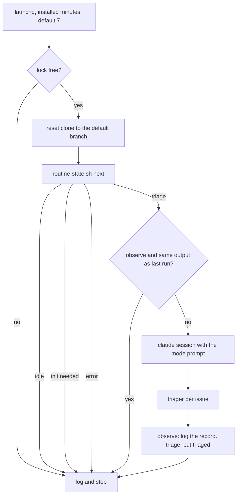

# The triage routine

The routine is an hourly job on the maintainer's Mac. It reads the open `pipeline-feedback` issues of one repo and decides for each one: `build`, `plan` or `decline`. It runs unattended, so it is limited by guards that are listed below.

## What it does in 0.4.0

- It triages open `pipeline-feedback` issues that the maintainer's account opened. It takes at most five in one run.
- In `observe` mode it writes the decision for each issue to its log and changes nothing on GitHub.
- In `triage` mode it stores a `triaged` record for each issue. For a `decline` it also posts the reason and closes the issue. For a `build` or `plan` it adds the label `routine-build` or `routine-plan`.

## What it does not do

- It does not write code, push a branch, open a PR, merge or release. Edit, Write, `git` and the Workflow tool are denied.
- It does not act on a `build` or `plan` record. The maintainer, or a session the maintainer starts, does that. For a `build`, run a `quick` wave.
- The `triager` reads each issue and its comments through the guard `gh` wrapper. Comments by the maintainer's account count as part of the issue. Pipeline records are data, and all other comments are untrusted.
- It does not start a session when there is nothing to triage.

## What the session can read

The settings allow `Read`, `Glob` and `Grep` only for paths inside the work clone. `install.sh` writes the real clone path into the rules, for example `Read(//Users/me/.agent-pr-pipeline/work/o-r/clone/**)`. The path is the same string that `run.sh` puts in the prompt. The rules sit in `allow` only: Edit, Write and the `Bash` rule for `git` stay denied.

The routine allows no Bash command that lists or reads files, such as `ls`, `find`, `cat` or `grep`. A rule for them would reach outside the clone. The prompt tells the triager to use the Read, Glob and Grep tools.

## The `why` in the record

In `triage` mode the session passes the `why` to `routine-state.sh put` inside double quotes. It keeps the triager's words and changes only four characters: `"` becomes `'`, `$` becomes `S`, a backtick becomes `'` and `\` becomes `/`. It replaces line breaks with spaces. `put` and its checks do not change.

## One run



One run starts at each installed minute (default 7). It takes the lock, resets the clone, asks `next` for work, and starts a session only when `next` names issues to triage.

## Modes

The file `mode` in the guard folder holds one word.

| Mode | Writes |
| --- | --- |
| `observe` (default) | Nothing. The session logs the record it would post. |
| `triage` | Only `routine-state.sh <repo> put triaged ...`. |

A missing file, or any other word, acts as `observe`, and the log says so. To raise `observe` to `triage`, make the file writable, write the word, and make it read-only again:

```sh
chmod u+w ~/.agent-pr-pipeline/routine/<owner>-<repo>/mode
echo triage > ~/.agent-pr-pipeline/routine/<owner>-<repo>/mode
chmod a-w ~/.agent-pr-pipeline/routine/<owner>-<repo>/mode
```

Start in `observe`. Read some logs. Raise to `triage` when its decisions look right.

## Where things are

`<home>` is `$AGENT_PR_PIPELINE_HOME`, or `~/.agent-pr-pipeline`.

- Guard folder: `<home>/routine/<owner>-<repo>/`. It holds `plugin/` (a copy of this plugin), `mode`, `repo`, `lock/` and `logs/`. The session cannot change it, and the runner makes it read-only.
- Logs: `<home>/routine/<owner>-<repo>/logs/<timestamp>.log`. The first line holds the plugin version.
- Clone: `<home>/work/<owner>-<repo>/clone/`. The session may read it. The runner resets it to the default branch at the start of each run.

The job runs `plugin/routine/run.sh` in the guard folder, never a file in the clone. A plugin update changes nothing until the maintainer runs `install.sh` again.

## Install, load, unload, remove

Run `gh` signed in as the maintainer's account, then:

```sh
routine/install.sh --print <owner>/<repo>   # shows what would happen, writes nothing
routine/install.sh <owner>/<repo>
routine/install.sh --minutes 7,37 <owner>/<repo>   # start at minutes 7 and 37 of each hour
```

`--minutes` takes a comma-separated list of minutes, each 0 to 59. Without it, the install keeps the minutes of the installed plist, so a reinstall does not reset the schedule. When there is no plist, the minute is 7. `--print` shows the minutes the install would write.

The install copies the plugin to the guard folder, writes `repo`, writes `mode` with `observe` when there is none, opens the tracking issue (`routine-state.sh <repo> init`) and writes `~/Library/LaunchAgents/com.agent-pr-pipeline.routine.<owner>-<repo>.plist`. It does not load the job. It prints the commands:

```sh
launchctl bootstrap gui/$(id -u) ~/Library/LaunchAgents/com.agent-pr-pipeline.routine.<owner>-<repo>.plist   # load
launchctl bootout gui/$(id -u)/com.agent-pr-pipeline.routine.<owner>-<repo>                                    # unload
```

To remove the routine, unload the job, delete the plist, and delete `<home>/routine/<owner>-<repo>` and `<home>/work/<owner>-<repo>` (run `chmod -R u+w` on the guard folder first).

## The `triaged` record

A record is a comment on the tracking issue (the open issue with the label `pipeline-routine`). Its body starts with `<!-- pipeline:routine triaged <issue number> -->` and has one line of JSON: `decision`, `size`, `risk` and `why`. A `build` of size `L`, or with risk `high`, is stored as `plan`, and the original decision is kept in `triagerDecision`. A comment by another account never counts.

## Limits to know

- **One identity, so the guards are advisory.** The routine acts as the maintainer's account. The settings files and the read-only `gh` wrapper catch mistakes. A session that calls the real `gh` by its full path is denied by the `dontAsk` allow list, not by GitHub. The one write path, `routine-state.sh put`, checks every record in code and does only the actions its decision names.
- **A subagent's permissions.** The routine expects the `triager` agent to run under the session's `dontAsk` rules. Check this on the Claude Code version you use. A live run has not yet confirmed that the Read, Glob and Grep calls of the triager in the clone are accepted: check the log for refusals.
- **Triage closes issues.** In `triage` mode a `decline` closes an issue with a comment. The maintainer can reopen it. The record stays, so the routine does not triage it again until the maintainer deletes the record.
- **Two triage records for a build.** A `quick` wave runs its own triager. In 0.4.0 the two records do not read each other.
- **Cost.** A run with nothing new to triage starts no session, and a run triages at most five issues.
