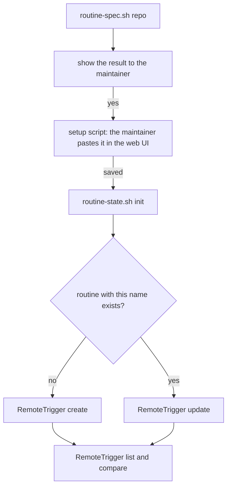

# Cloud routines

A repo that has a `routine` block in `.github/pipeline.json` gets up to three cloud routines (triage, build, and collect for the feedback repo) and one cloud environment. `scripts/routine-spec.sh` computes what to create. This skill creates it, with the maintainer's yes at each write.



Summary: compute the spec, show it, let the maintainer save the setup script in the web UI, then create or update each routine with RemoteTrigger and compare with `list`.

## 1. Compute the spec

```bash
ROOT="${CLAUDE_PLUGIN_ROOT}"
bash "$ROOT/scripts/routine-spec.sh" <owner/repo> [--tags <tag>...] > "${TMPDIR:-/tmp}/spec.json"
```

The settings come from `.github/pipeline.json` on the default branch of the repo. The printed setup script installs the pin, each `--tags` release, and each release listed in `.claude-plugin/releases.txt` on the default branch of the plugin repo (at most 3). `--tags` is for a release that the list does not hold, because one environment can serve several repos with different pins. A repo with no `routine` key prints an empty list and a note: make nothing, and tell the maintainer to add the block first. Never pass the JSON as a command-line argument; read it from the file.

Show the maintainer, for each routine: the name, the schedule, the sources, the webhooks and the prompt. Do not print the whole setup script unless asked. The spec holds no secret and you add none.

## 2. The environment

No RemoteTrigger action reads or changes an environment or its setup script (K8). So the maintainer pastes the `setupScript` field in the web UI: write it to a file, show the path, and wait for a yes that it is saved. The script reads the list when a session starts, so a new release that the list holds needs no new paste. The environment's own part (for example the package manager of the repo) follows the printed part and is the maintainer's. Do not go on until the maintainer says it is saved.

## 3. The tracking issue

With the maintainer's yes, run `bash "$ROOT/scripts/routine-state.sh" <owner/repo> init` from the main session. It prints the tracking issue number and is safe to run again. Without it every routine run prints `init needed` and stops, and a stale environment sends no notice.

## 4. The routines

Use RemoteTrigger from the main session. For each entry of `routines`:

- `list` first. When a routine with the entry's `name` exists, call `update` with its id. Otherwise call `create`. The name drops the difference between `a-b/c` and `a/b-c`, so before `update` compare the existing routine's sources with the entry's. When they differ in a repo, stop and ask the maintainer.
- `create` takes `name`, `cron_expression` (the `schedule` field), `enabled`, `clear_mcp_connections: true` and `job_config.ccr` with `environment_id`, `session_context` (`model`, `sources`, `allowed_tools`) and `events` holding the `prompt`. Set `clear_mcp_connections: true`: without it a new routine gets the account's connectors. Keep the repos of `sources` as the spec lists them (the repo and, for collect, each repo of `collectFrom`), add none and drop none, and turn each into a `git_repository` object (shape below). A session reaches only the repos attached as sources.
- Body shapes (K8 records the field names only; the shapes below are what the API took on the first call): `sources` is a list of `{"git_repository": {"url": "https://github.com/<owner>/<repo>"}}`, one per repo of the spec. `events` is a list of one `{"data": {"type": "user", "uuid": "<new uuid>", "session_id": "", "parent_tool_use_id": null, "message": {"role": "user", "content": "<the prompt>"}}}`. `allowed_tools` is the entry's `allowedTools` from the spec, unchanged: the prompts and the wave agents (implementer, fixer, docs-writer, reviewers) use Bash, Read, Write, Edit, Glob, Grep, PushNotification, Agent, Workflow and ToolSearch, and a shorter list could block them. `model` is the model the maintainer names. `environment_id` is shown in the web UI after the maintainer saves the setup script: ask for it. A plain `["owner/repo"]` list in `sources` gets HTTP 400.
- `update` can change `name`, `enabled`, `cron_expression` and the prompt. K8 did not show that it changes `sources` or `allowed_tools`. When the compare below finds a difference in them, the maintainer deletes the routine in the web UI and you `create` it again.
- Webhooks: `webhooks` is empty while K2 found no filter (`routine/cloud/k2.json` is `{"authorFilter": false, "labelFilter": false}` in 0.8.0), so the routines run on their schedules only. When an entry is present, call `create_webhook_trigger` with `routine_trigger_id`, `hook_type`, `source: github`, `scope_id` (`<owner>/<repo>`) and `events`, and add the entry's `filter` (K2 found that the API takes it without storing it), and then check with `get` that the filter was stored. A webhook whose filter shows nothing in `get` is not made.
- Then `list` again and compare each routine with the spec: name, schedule, enabled, environment, sources, allowed tools. After the first `run` of a routine, read `get_run_log` and check it has no `permission_denied`.

Turn a routine off or on with `update` and `enabled`. Run one by hand with `run`, and read it with `list_runs` and `get_run_log`.

## 5. Delete

RemoteTrigger cannot delete a routine or a webhook trigger. The maintainer deletes them in the web UI. Tell them which ones by name. Do not delete the environment either.

## Pause

The fast pause is the label `routine-paused` on the tracking issue of the repo. It needs no session: every routine stops at its first step. A routine can also be turned off with `update`. `/schedule` does not work inside a cloud session, so make and change routines only from a local session.

## After a release

For each repo that should move, open the one-line PR that sets `routine.pipelineVersion` to the new tag in `.github/pipeline.json` (a gated path, so the maintainer merges it). A release that `releases.txt` holds is installed by the environment already pasted. Regenerate the setup script, with one `--tags` value per tag still in use that the list no longer holds, and ask the maintainer to paste it again only when the tags changed. A repo whose pin is not installed makes `apl-start` stop, and its routine sends one notice.
