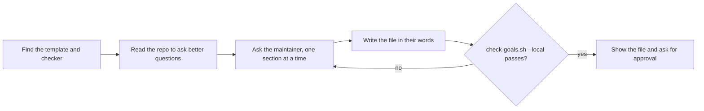

# Write the goals document

The agent-pr-pipeline skill does not start without a goals document. Its product-fit reviewer checks every plan against it. Only the maintainer decides what the product is for, so this skill asks and writes down the answers. It never invents a goal, a non-goal or a user.



Summary: read the repo, ask the maintainer section by section, write their answers into the template, check the file with the script, and ask them to approve it.

## 1. Find the shared files

The template and the checker are in the agent-pr-pipeline folder, two levels above this skill. This skill folder is often a symlink, so resolve the real path first:

```bash
ROOT=$(cd "$(dirname "$(realpath "<this skill's folder>/SKILL.md")")/../.." && pwd)
ls "$ROOT/templates/goals.md" "$ROOT/scripts/check-goals.sh"
```

If either file is missing, stop and tell the user to install the whole agent-pr-pipeline repo (see its README).

## 2. Read before you ask

Read the README, `AGENTS.md` or `CLAUDE.md`, and any existing goals, vision or roadmap file. Use them only to ask sharper questions, for example: "The README says it runs without a server. Is 'no hosted service' a non-goal?" A sentence in the README is not a goal until the maintainer says so.

If a goals document already exists, show it and ask what should change. Do not overwrite it without a yes.

## 3. Ask, one section at a time

Ask in plain words and wait for each answer. Ask a follow-up when an answer is vague.

1. **What the product is.** "In one or two sentences: what is it, and who is it for?"
2. **Goals.** "What should the product do better a year from now? Name one or more goals." Test each one: could you tell whether a plan entry moves it forward? If not, ask what would show progress. "Make it better" is not a goal; "a first-time user runs it in under five minutes" is.
3. **Non-goals.** "What will the product not do, even if users ask? Why not, in a few words?" Offer the kinds of scope creep the product-fit reviewer watches for, as questions: a second interface next to the main one, a hosted service, a new audience, polish no goal asks for.
4. **Users.** "Who uses it, and what are they trying to get done?"
5. **How to change this file.** Show the template's text (only the maintainer changes the goals, in a PR of their own) and ask whether to keep it.

After each section, ask "Anything else for this section?" Stop when the maintainer says no.

If the maintainer does not know an answer, leave that item out. Do not fill the gap with a guess or a placeholder. Tell them the pipeline refuses to run until Goals and Non-goals each have at least one real item.

## 4. Write the file

Copy `$ROOT/templates/goals.md` to the path the maintainer chooses (default `docs/goals.md`). Replace every `<...>` placeholder with their answers. Keep their words; fix only grammar and length, and keep one item per bullet. Remove every placeholder that has no answer.

## 5. Check it

```bash
"$ROOT/scripts/check-goals.sh" --local docs/goals.md
```

On `INCOMPLETE`, go back to step 3 for the missing section. Never add an item to make the check pass.

## 6. Show it and hand over

Show the whole file and ask the maintainer to approve it or change it. Do not commit or push unless they ask. Suggest a PR of its own for the goals document. The pipeline reads the file from the default branch, so merge it before the first run. After the merge, `check-goals.sh <owner/repo> docs/goals.md` checks the merged file.
