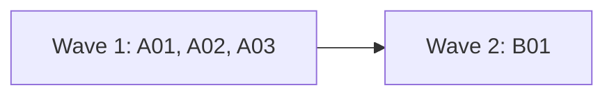

# Plan for <version>

<One paragraph: the goal of this release, who reads its output, and what is in and out. Each item is one small PR. A PR is done when its acceptance test passes in CI, an adversarial review reports no blockers or majors, and it is squash-merged.>

## Goals this release serves

<Name the product goals (from the goals document) this release moves forward, and any non-goal it comes close to. The product-fit review checks every entry against this.>

## Findings

| Finding | Issue | What is wrong |
| --- | --- | --- |
| <what a user saw> | #<n> | <why it matters> |

## Scope

In:

| Group | Issues | Size |
| --- | --- | --- |
| <name> | #<n>, #<n> | S / M / L |

Not in:

| Issue | Why it waits |
| --- | --- |
| #<n> | <reason> |

## States

<Optional. Use it when the plan adds states (a status, a mode, a lock). The reviewer reports a state that nothing ends.>

| State | How it starts | What ends it |
| --- | --- | --- |
| <name> | <trigger> | <exit> |

## Order and waves



<One-line summary of the diagram. Then why this order: which entries share files, which build on others.>

## Rules for every PR

- <Hard rules from AGENTS.md that matter for this plan, in short.>
- Each PR adds a regression test that fails when the change is removed. The PR description says how that was checked.
- Each negative test checks that its input really contains what the check looks for. A test that passes because the input never had it proves nothing (for example, a compressed body that no longer holds the literal text).
- Entries in one wave can touch the same file when they edit different parts of it. Each Touches line names the function or section of a shared file. Entries that edit the same part go in different waves.
- New e2e tests go in new files. Named exceptions: <entry and file>.
- CHANGELOG: this plan PR adds the `## <version>` heading with one marker per PR, a blank line between each pair. Each PR replaces only its own marker.

```markdown
## <version>

<!-- A01 -->

<!-- A02 -->
```

## PRs

### Wave 1

**A01 <Title> (#<n>).** Touches: `<file>`, `<file>`, `<test file>`, `<doc page the change affects>`, `CHANGELOG.md` (the A01 marker).
- <What changes, in concrete terms: functions, messages, field names.>
- <Edge cases and what the output says in each.>
Invariants: <optional; required for an entry that adds a check (a gate, a guard, a refusal or a trust rule). One sentence per property that must hold for every input.>
Regression test: <the unit and e2e tests, with fixture inputs>.
Acceptance: <the command that passes>, and <the test> fails on the old code because <reason>.
QA: <optional. What a person would try by hand: commands, inputs, combinations with existing options. Leave it out for refactors and internal changes.>

### Wave 2

**B01 <Title>.** Touches: ...

## Flagged concerns

- <Anything the reviewer or the person must decide, with the default you chose.>
